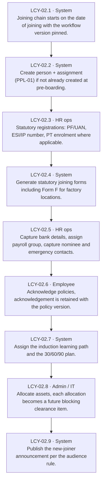
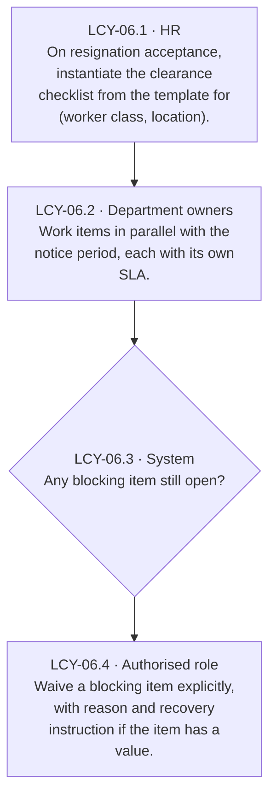
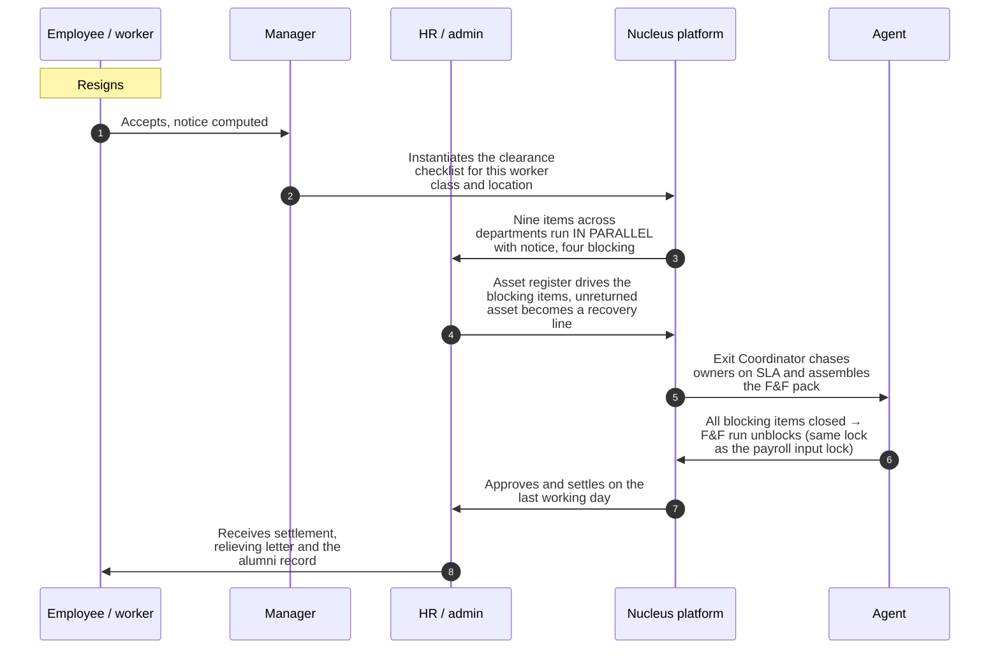
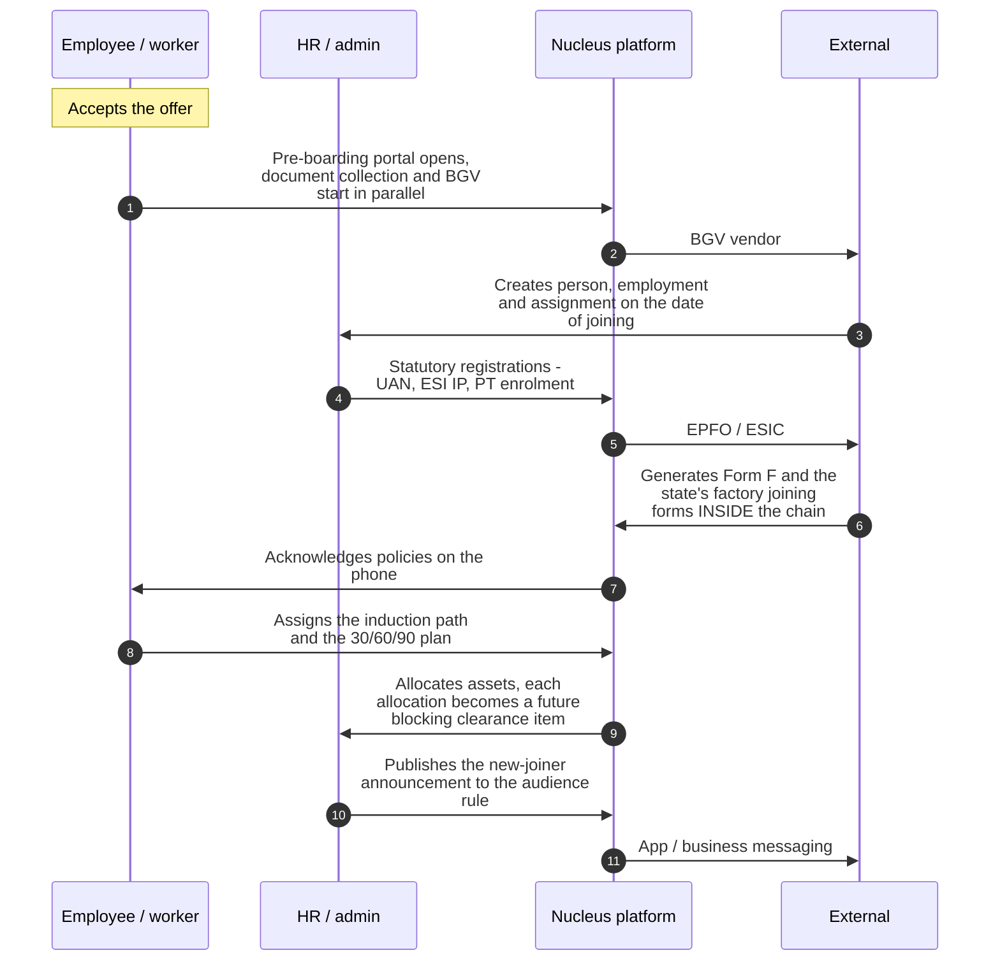

<picture>
  <source media="(prefers-color-scheme: dark)" srcset="../../assets/MultipliersKraftLogoDark.png">
  
</picture>

# FRS-LCY-01 — Lifecycle — Process Specifications

| Attribute | Value |
| :--- | :--- |
| Document ID | FRS-LCY-01 |
| Title | Lifecycle — Process Specifications |
| Product | Nucleus Suite (Nucleus HRMS Suite) |
| Version | 1.0.0 |
| Status | Issued for approval |
| Owner (role) | Domain Product Owner — Lifecycle |
| Author | Dhanraj Dadhich |
| Reviewed by | *pending* |
| Approved by | Product Council — *pending* |
| Date | 2026-11-05 |
| Classification | Internal |
| CMMI practice areas | RDM, TS |
| Related documents | FRS-LCY-00, FRS-LCY-01, FRS-LCY-02, FRS-LCY-03, FRS-LCY-04, FRS-LCY-05, FRS-LCY-06, FRS-LCY-07, FRS-LCY-08, FRS-LCY-09, FRS-LCY-10, FRS-LCY-11, FRS-LCY-12, FRS-LCY-13, BRS-01, SRS-01, REQ-01, REQ-02 |
| Quality & process-performance objectives | QPPO-05 (effective requirements reviews), QPPO-01 (escaped defects) — MPM-01 |
| Process performance baseline used | PPB-01 (review defect density), PPB-02 (review rate) — MPM-01 |
| Peer review record | *pending* (PR-xxxx, QA-02) |
| Tailoring record | none |
| Traceability anchor | BG-01 · R-17, R-24 · processes LCY-01–LCY-08 |
| Source of record | Nucleus — Process Flows & Process Maps v1.0 — sheet(s) 03_Process_Inventory, 04_Process_Steps, 05_Swimlane_Maps Nucleus HR Demo Points Build Sheet v1.0 — sheet(s) 07_Approval_Workflows Nucleus HRMS Demo Dataset v1.1 — sheet(s) 64_Approval_Workflows |

> **Source of record.** Requirements in this document are taken from the source workbook(s) named above and keep their workbook IDs, which are never renumbered. Changes are made through a change request (CM-02) against the source workbook. Sections marked **Authored** are original additions that are not present in the source workbooks.

Step types: TASK (human) · SYS (system, unattended) · DEC (decision) · APPR (approval gate) · INT (integration call) · WAIT (timer or external event) · AGENT (agent-executed, governed). CRUD: C create · R read · U update · D delete-by-end-dating (temporal facts are never hard-deleted). In the flow diagrams decisions are diamonds, approvals are double-bordered boxes and integration, wait and agent steps are rounded.

## 1. Process inventory

| Process ID | Process | Trigger | Primary actor | Frequency | Criticality | Blueprint module | Phase | Reuses | Demo pts | Note |
| :--- | :--- | :--- | :--- | :--- | :--- | :--- | :--- | :--- | :--- | :--- |
| LCY-01 | Pre-boarding | Offer accepted | Candidate, HR | Per hire | High | Module 5 | P1 | CMP-01 | 23 | Document collection, BGV, asset and IT requests run in parallel. |
| LCY-02 | Joining chain | Date of joining | HR ops | Per hire | Critical | Module 5 | P1 | CMP-01, CMP-03r | 23,26 | Statutory joining forms including Form F are produced INSIDE the chain. |
| LCY-03 | Probation and confirmation | Probation end approaching | Manager, HR | Per hire | Medium | Module 5 | P2 | CMP-01, CMP-03r | 21 | Confirmation letter and any referral balance both trigger here. |
| LCY-04 | Promotion and transfer | Approved change | HR ops | Monthly | High | Module 5 | P2 | CMP-01, CMP-10 |  | Transfer re-resolves PT, LWF, holiday calendar, rest-day pattern and location scope. |
| LCY-05 | Resignation and notice | Employee resigns | Employee, HR | Per exit | High | Module 5 | P1 | CMP-01 | 16 | Notice computation feeds F&F recovery. |
| LCY-06 | Clearance / no-dues | Resignation accepted | Department owners | Per exit | Critical | Module 5 | P1 | CMP-01, CMP-05 | 16 | Parallel with notice, not after it. Blocking items gate F&F. |
| LCY-07 | F&F settlement on the last working day | All blocking items cleared | Payroll | Per exit | Critical | Modules 3, 5 | P1 | CMP-03, CMP-05 | 16 | Gratuity, encashment, notice recovery, negative net handling. |
| LCY-08 | Asset allocation and return | Joining / exit | Admin, IT | Per hire and exit | Medium | Module 5 | P1 | CMP-01 | 23 | A register, not a checkbox. Same assets appear as blocking clearance items. |

## 2. Step-level specifications

### LCY-01 — Pre-boarding

**Trigger:** Offer accepted · **Primary actor:** Candidate, HR · **Frequency:** Per hire · **Criticality:** High · **Phase:** P1 · **Reuses:** CMP-01

The source workbook specifies this process at inventory level only. Its complete flow is specified in use case LCY-UC-001 (FRS-LCY-12).

### LCY-02 — Joining chain

**Trigger:** Date of joining · **Primary actor:** HR ops · **Frequency:** Per hire · **Criticality:** Critical · **Phase:** P1 · **Reuses:** CMP-01, CMP-03r

| Step | Step ID | Lane / actor | Type | Action or decision | Rule ID(s) | Objects touched (CRUD) | Key fields | Screen | Event emitted | Exception / note | Reuses | Demo pts | Phase |
| :--- | :--- | :--- | :--- | :--- | :--- | :--- | :--- | :--- | :--- | :--- | :--- | :--- | :--- |
| 1 | LCY-02.1 | System | SYS | Joining chain starts on the date of joining with the workflow version pinned. | RL-390 | workflow_instance C | chain_id, workflow_version, person_id | SCR-060 | lifecycle.joining.started | In-flight instances finish on the version they started under. | CMP-01 | 23,26 | P1 |
| 2 | LCY-02.2 | System | SYS | Create person + assignment (PPL-01) if not already created at pre-boarding. | RL-391 | person C; assignment C | — | SCR-010 | people.worker.hired |  |  | 23,26 | P1 |
| 3 | LCY-02.3 | HR ops | TASK | Statutory registrations: PF/UAN, ESI/IP number, PT enrolment where applicable. | RL-392 | statutory_registration C | uan, esi_ip, pt_enrolment, registered_on | SCR-060 | compliance.registration.done |  |  | 23,26 | P1 |
| 4 | LCY-02.4 | System | SYS | Generate statutory joining forms including Form F for factory locations. | RL-382 | statutory_form_instance C | form_code, state, location_id | SCR-073 | compliance.form.generated | Owner for this item is still to be assigned (blueprint Annexure A, point 26). | CMP-03r | 23,26 | P1 |
| 5 | LCY-02.5 | HR ops | TASK | Capture bank details, assign payroll group, capture nominee and emergency contacts. | RL-393 | bank_detail C; assignment U | account_token, ifsc, payroll_group | SCR-010 |  | Bank detail changes inside a payroll window raise an alert (RL-322). | CMP-06 | 23,26 | P1 |
| 6 | LCY-02.6 | Employee | TASK | Acknowledge policies; acknowledgement is retained with the policy version. | RL-394 | policy_acknowledgement C | policy_id, version, acknowledged_at | SCR-062 |  |  |  | 23,26 | P1 |
| 7 | LCY-02.7 | System | SYS | Assign the induction learning path and the 30/60/90 plan. | RL-395 | learning_assignment C | path_id, due_on, trigger(joining_chain) | SCR-063 | learning.path.assigned | Same mechanism as any other assignment trigger (Module 10 contract). |  | 23,26 | P1 |
| 8 | LCY-02.8 | Admin / IT | TASK | Allocate assets; each allocation becomes a future blocking clearance item. | RL-396 | asset_allocation C | asset_code, issued_on, condition | SCR-064 | asset.allocated |  |  | 23,26 | P1 |
| 9 | LCY-02.9 | System | SYS | Publish the new-joiner announcement per the audience rule. | RL-397 | announcement C | type(new_joiner), audience_rule, channels | SCR-066 | experience.announcement.published |  |  | 23,26 | P1 |

### LCY-03 — Probation and confirmation

**Trigger:** Probation end approaching · **Primary actor:** Manager, HR · **Frequency:** Per hire · **Criticality:** Medium · **Phase:** P2 · **Reuses:** CMP-01, CMP-03r

The source workbook specifies this process at inventory level only. Its complete flow is specified in use case LCY-UC-003 (FRS-LCY-12).

### LCY-04 — Promotion and transfer

**Trigger:** Approved change · **Primary actor:** HR ops · **Frequency:** Monthly · **Criticality:** High · **Phase:** P2 · **Reuses:** CMP-01, CMP-10

The source workbook specifies this process at inventory level only. Its complete flow is specified in use case LCY-UC-004 (FRS-LCY-12).

### LCY-05 — Resignation and notice

**Trigger:** Employee resigns · **Primary actor:** Employee, HR · **Frequency:** Per exit · **Criticality:** High · **Phase:** P1 · **Reuses:** CMP-01

The source workbook specifies this process at inventory level only. Its complete flow is specified in use case LCY-UC-005 (FRS-LCY-12).

### LCY-06 — Clearance / no-dues

**Trigger:** Resignation accepted · **Primary actor:** Department owners · **Frequency:** Per exit · **Criticality:** Critical · **Phase:** P1 · **Reuses:** CMP-01, CMP-05

| Step | Step ID | Lane / actor | Type | Action or decision | Rule ID(s) | Objects touched (CRUD) | Key fields | Screen | Event emitted | Exception / note | Reuses | Demo pts | Phase |
| :--- | :--- | :--- | :--- | :--- | :--- | :--- | :--- | :--- | :--- | :--- | :--- | :--- | :--- |
| 1 | LCY-06.1 | HR | TASK | On resignation acceptance, instantiate the clearance checklist from the template for (worker class, location). | RL-400 | clearance_checklist_template R; clearance_item C | item, owner_role, blocking, sla_days | SCR-061 | lifecycle.clearance.started | Plant leaver returns tools and a locker key; head-office leaver returns a laptop and a card. | CMP-10 | 16 | P1 |
| 2 | LCY-06.2 | Department owners | TASK | Work items in parallel with the notice period, each with its own SLA. | RL-401 | clearance_item U | status, cleared_on, cleared_by, note | SCR-061 | lifecycle.clearance.item_cleared | Parallel, not sequential — this is the only way F&F settles on the LWD. | CMP-01 | 16 | P1 |
| 3 | LCY-06.3 | System | DEC | Any blocking item still open? | RL-402 | clearance_item R | blocking, status | SCR-061 |  | Yes → F&F held. Demo: E1042 has two open blocking items; E1068 is fully cleared. | CMP-05 | 16 | P1 |
| 4 | LCY-06.4 | Authorised role | TASK | Waive a blocking item explicitly, with reason and recovery instruction if the item has a value. | RL-403 | clearance_item U; payroll_input C | waived_by, waive_reason, recovery_amount | SCR-061 | lifecycle.clearance.waived | An unreturned asset becomes a recovery line, not a silently ticked box. |  | 16 | P1 |

### LCY-07 — F&F settlement on the last working day

**Trigger:** All blocking items cleared · **Primary actor:** Payroll · **Frequency:** Per exit · **Criticality:** Critical · **Phase:** P1 · **Reuses:** CMP-03, CMP-05

The source workbook specifies this process at inventory level only. Its complete flow is specified in use case LCY-UC-007 (FRS-LCY-12).

### LCY-08 — Asset allocation and return

**Trigger:** Joining / exit · **Primary actor:** Admin, IT · **Frequency:** Per hire and exit · **Criticality:** Medium · **Phase:** P1 · **Reuses:** CMP-01

The source workbook specifies this process at inventory level only. Its complete flow is specified in use case LCY-UC-008 (FRS-LCY-12).

## 3. Swimlane maps

### SM-7 — EXIT — clearance in parallel with notice, F&F on the last working day (demo point 16)

| Step | Employee / worker | Manager | HR / admin | System (Nucleus) | Agent | External | Note |
| :--- | :--- | :--- | :--- | :--- | :--- | :--- | :--- |
| 1 | Resigns |  |  |  |  |  |  |
| 2 |  | Accepts; notice computed |  |  |  |  |  |
| 3 |  |  |  | Instantiates the clearance checklist for this worker class and location |  |  | Plant and head office templates differ |
| 4 |  |  | Nine items across departments run IN PARALLEL with notice, four blocking |  |  |  |  |
| 5 |  |  |  | Asset register drives the blocking items; unreturned asset becomes a recovery line |  |  |  |
| 6 |  |  |  |  | Exit Coordinator chases owners on SLA and assembles the F&F pack |  | Prepare; a human releases |
| 7 |  |  |  | All blocking items closed → F&F run unblocks (same lock as the payroll input lock) |  |  |  |
| 8 |  |  | Approves and settles on the last working day |  |  |  |  |
| 9 | Receives settlement, relieving letter and the alumni record |  |  |  |  |  |  |

### SM-9 — JOINING CHAIN (demo points 23, 26)

| Step | Employee / worker | Manager | HR / admin | System (Nucleus) | Agent | External | Note |
| :--- | :--- | :--- | :--- | :--- | :--- | :--- | :--- |
| 1 | Accepts the offer |  |  |  |  |  |  |
| 2 |  |  |  | Pre-boarding portal opens; document collection and BGV start in parallel |  | BGV vendor |  |
| 3 |  |  | Creates person, employment and assignment on the date of joining |  |  |  |  |
| 4 |  |  |  | Statutory registrations: UAN, ESI IP, PT enrolment |  | EPFO / ESIC |  |
| 5 |  |  |  | Generates Form F and the state's factory joining forms INSIDE the chain |  |  | Not chased in an audit week |
| 6 | Acknowledges policies on the phone |  |  |  |  |  |  |
| 7 |  |  |  | Assigns the induction path and the 30/60/90 plan |  |  |  |
| 8 |  |  | Allocates assets; each allocation becomes a future blocking clearance item |  |  |  |  |
| 9 |  |  |  | Publishes the new-joiner announcement to the audience rule |  | App / business messaging |  |

## 4. Approval workflows

| Workflow ID | Workflow | Form ID | Requirement | Approval chain | How it behaves | What must hold |
| :--- | :--- | :--- | :--- | :--- | :--- | :--- |
| W-07 | No dues clearance | F-FNF-02 | R-17 | One sign-off per department | Parallel, not sequential — departments clear independently. | F&F release is blocked until every line is Cleared or Waived with a reason. |
| W-08 | Full and final settlement | F-FNF-01 | R-17 | HR Head → Finance | Runs after no dues is complete. | The source asks for same-day settlement, so the workflow must be short enough to close on the last working day. |

### Workflow behaviour

| Workflow | Name | Form | Chain | Sequential or parallel | Recorded per level | Escalation | Delegation allowed | Return to applicant | Live demo record | Demo point |
| :--- | :--- | :--- | :--- | :--- | :--- | :--- | :--- | :--- | :--- | :--- |
| W-07 | No dues clearance | F-FNF-02 | One sign-off per department | Parallel | Actor, decision, timestamp, recovery amount, waiver reason | After 5 days to HR | Y | N | E1042 — four cleared, two open, both blocking | Point 16 |
| W-08 | Full and final settlement | F-FNF-01 | HR Head → Finance | Sequential | Actor, decision, timestamp | None | N | Y | FF-2026-0021 released on the last working day; FF-2026-0018 held | Point 16 |

## Approval & Sign-off

| Role | Name | Date | Decision | Conditions / comments |
| :--- | :--- | :--- | :--- | :--- |
| Author | Dhanraj Dadhich | 2026-11-05 | Submitted | |
| Peer review moderator | *pending* | | | PR-xxxx |
| PQA (process compliance) | *pending* | | | |
| Approval authority (DOC-01 §7) | *pending* | | | |

## Measurement Data Captured

| Measure | Value | Unit | Notes |
| :--- | :--- | :--- | :--- |
| Size | 43 | specified items (table rows) | Counted automatically at generation |
| Authoring effort | *to be recorded* | person-hours | |
| Review effort (preparation + meeting) | *pending review* | person-hours | From PR-xxxx |
| Rework effort | *pending review* | person-hours | |
| Review rate | *pending review* | items / hour | Compare with PPB control limits |
| Requirement volatility (changes since baseline) | 0 | CRs touching this artefact | Not yet baselined (CM-03) |

**Defects found, by detection phase and severity**

| Detection phase | Major | Minor | Editorial | Injected in phase (major) |
| :--- | :--- | :--- | :--- | :--- |
| Author self-check | 0 | 0 | 0 | — |
| Peer review | *pending* | | | |
| Design / build | | | | |
| System / integration test | | | | |
| UAT | | | | |
| Production (escaped) | | | | each escaped major opens a CAR record (CAR-01) |

Within control limits of the review-rate PPB? *To be assessed at peer review.*

## Revision History

| Version | Date | Author | Change summary | CR ref | Approved by |
| :--- | :--- | :--- | :--- | :--- | :--- |
| 1.0.0 | 2026-11-05 | Dhanraj Dadhich | Consolidated release | CR-0001 | *pending* |
