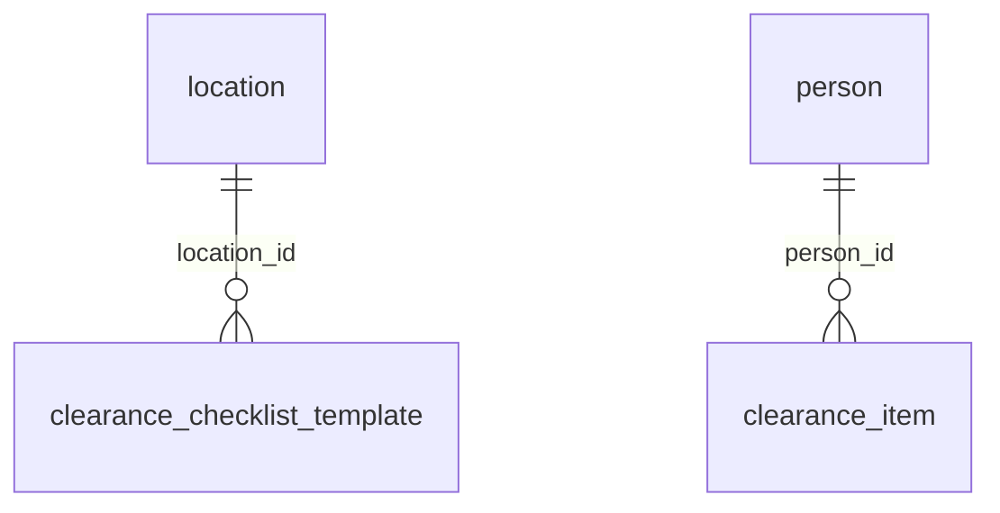

<picture>
  <source media="(prefers-color-scheme: dark)" srcset="../../assets/MultipliersKraftLogoDark.png">
  
</picture>

# FRS-LCY-05 — Lifecycle — Data Model

| Attribute | Value |
| :--- | :--- |
| Document ID | FRS-LCY-05 |
| Title | Lifecycle — Data Model |
| Product | Nucleus Suite (Nucleus HRMS Suite) |
| Version | 1.0.0 |
| Status | Issued for approval |
| Owner (role) | Domain Product Owner — Lifecycle |
| Author | Dhanraj Dadhich |
| Reviewed by | *pending* |
| Approved by | Product Council — *pending* |
| Date | 2026-11-05 |
| Classification | Internal |
| CMMI practice areas | TS, RDM |
| Related documents | FRS-LCY-00, FRS-LCY-01, FRS-LCY-02, FRS-LCY-03, FRS-LCY-04, FRS-LCY-05, FRS-LCY-06, FRS-LCY-07, FRS-LCY-08, FRS-LCY-09, FRS-LCY-10, FRS-LCY-11, FRS-LCY-12, FRS-LCY-13, BRS-01, SRS-01, REQ-01, REQ-02 |
| Quality & process-performance objectives | QPPO-05 (effective requirements reviews), QPPO-01 (escaped defects) — MPM-01 |
| Process performance baseline used | PPB-01 (review defect density), PPB-02 (review rate) — MPM-01 |
| Peer review record | *pending* (PR-xxxx, QA-02) |
| Tailoring record | none |
| Traceability anchor | BG-01 · R-17, R-24 · processes LCY-01–LCY-08 |
| Source of record | Nucleus — Process Flows & Process Maps v1.0 — sheet(s) 06_Data_Dictionary Nucleus HR Demo Points Build Sheet v1.0 — sheet(s) 06_Enum_Values Nucleus HRMS Demo Dataset v1.1 — sheet(s) 65_Enum_Seed_Values |

> **Source of record.** Requirements in this document are taken from the source workbook(s) named above and keep their workbook IDs, which are never renumbered. Changes are made through a change request (CM-02) against the source workbook. Sections marked **Authored** are original additions that are not present in the source workbooks.

Every object carries the platform envelope (`tenant_id`, `entity_id`), effective dating (`effective_from`, `effective_to`) where temporal, and audit columns. Sensitivity classes follow GOV-10.

## 1. Entity relationships

Relationships are derived from the identifier fields in the data dictionary; the tenant envelope is omitted for legibility.

## 2. Data objects

| Object | Fields | Type | Required | Owner / source | Temporal | Sensitivity | Notes | Dataset ref |
| :--- | :--- | :--- | :--- | :--- | :--- | :--- | :--- | :--- |
| clearance_checklist_template | template_id, worker_class, location_id, item, owner_role, blocking, sla_days | mixed | Y | Config | Yes | — | Templates differ by class and location. | 27_Exit_Clearance |
| clearance_item | item_id, person_id, template_ref, item, owner, blocking, status, cleared_on, waived_by, waive_reason, recovery_amount | mixed | N | Dept owners | No | — | F&F cannot release while any blocking item is open. | 27_Exit_Clearance |

### Additional objects and attributes (Authored)

| Object | Fields | Type | Required | Owner / source | Temporal | Sensitivity | Notes | Defined in |
| :--- | :--- | :--- | :--- | :--- | :--- | :--- | :--- | :--- |
| bgv_case | case_ref, candidate_id, offer_id, check_set_version, consent_id, provider_case_id, case_status(INITIATED\|IN_PROGRESS\|INSUFFICIENT\|CLEAR\|DISCREPANT\|UNABLE_TO_VERIFY), check_results[], report_document_id, requested_at, decision, decided_by, decision_reason | mixed | N | Provider (results) / Recruiter (decision) | No | Restricted | case_ref = candidate_id + offer_id + check_set_version; results are provider-owned and read-only; the hiring decision is human with its reason. | ICD-01 §13 |
| bgv_check_set | check_set_version, applies_to, checks, turnaround_days | mixed | Y | Config | Yes | — | Tenant check set per position; the version is recorded on each case. | ICD-01 §13.2, §13.4 |

## 3. Enumerations

| Enum code | Enum name | Module | System or Config | Complete value set | Requirement |
| :--- | :--- | :--- | :--- | :--- | :--- |
| EN_NO_DUES_STATUS | No dues status | FNF | Config | Pending · Cleared · Waived | R-17 |

### Enumeration seed values and tenant defaults

| Enum code | Enum name | Module | System or Config | Complete value set | Default in this tenant | Requirement |
| :--- | :--- | :--- | :--- | :--- | :--- | :--- |
| EN_NO_DUES_STATUS | No dues status | FNF | Config | Pending · Cleared · Waived | Pending | R-17 |

## Approval & Sign-off

| Role | Name | Date | Decision | Conditions / comments |
| :--- | :--- | :--- | :--- | :--- |
| Author | Dhanraj Dadhich | 2026-11-05 | Submitted | |
| Peer review moderator | *pending* | | | PR-xxxx |
| PQA (process compliance) | *pending* | | | |
| Approval authority (DOC-01 §7) | *pending* | | | |

## Measurement Data Captured

| Measure | Value | Unit | Notes |
| :--- | :--- | :--- | :--- |
| Size | 6 | specified items (table rows) | Counted automatically at generation |
| Authoring effort | *to be recorded* | person-hours | |
| Review effort (preparation + meeting) | *pending review* | person-hours | From PR-xxxx |
| Rework effort | *pending review* | person-hours | |
| Review rate | *pending review* | items / hour | Compare with PPB control limits |
| Requirement volatility (changes since baseline) | 0 | CRs touching this artefact | Not yet baselined (CM-03) |

**Defects found, by detection phase and severity**

| Detection phase | Major | Minor | Editorial | Injected in phase (major) |
| :--- | :--- | :--- | :--- | :--- |
| Author self-check | 0 | 0 | 0 | — |
| Peer review | *pending* | | | |
| Design / build | | | | |
| System / integration test | | | | |
| UAT | | | | |
| Production (escaped) | | | | each escaped major opens a CAR record (CAR-01) |

Within control limits of the review-rate PPB? *To be assessed at peer review.*

## Revision History

| Version | Date | Author | Change summary | CR ref | Approved by |
| :--- | :--- | :--- | :--- | :--- | :--- |
| 1.0.0 | 2026-11-05 | Dhanraj Dadhich | Consolidated release | CR-0001 | *pending* |
