

<picture>
  <source media="(prefers-color-scheme: dark)" srcset="../../assets/MultipliersKraftLogoDark.png">
  
</picture>

# FRS-LCY-12 — Lifecycle — Use Case Specifications

| Attribute | Value |
| :--- | :--- |
| Document ID | FRS-LCY-12 |
| Title | Lifecycle — Use Case Specifications |
| Product | Nucleus Suite (Nucleus HRMS Suite) |
| Version | 1.0.0 |
| Status | Issued for approval |
| Owner (role) | Domain Product Owner — Lifecycle |
| Author | Dhanraj Dadhich |
| Reviewed by | *pending* |
| Approved by | Product Council — *pending* |
| Date | 2026-11-05 |
| Classification | Internal |
| CMMI practice areas | RDM, VV |
| Related documents | FRS-LCY-00, FRS-LCY-01, FRS-LCY-02, FRS-LCY-03, FRS-LCY-04, FRS-LCY-05, FRS-LCY-06, FRS-LCY-07, FRS-LCY-08, FRS-LCY-09, FRS-LCY-10, FRS-LCY-11, FRS-LCY-12, FRS-LCY-13, BRS-01, SRS-01, REQ-01, REQ-02 |
| Quality & process-performance objectives | QPPO-05 (effective requirements reviews), QPPO-01 (escaped defects) — MPM-01 |
| Process performance baseline used | PPB-01 (review defect density), PPB-02 (review rate) — MPM-01 |
| Peer review record | *pending* (PR-xxxx, QA-02) |
| Tailoring record | none |
| Traceability anchor | BG-01 · R-17, R-24 · processes LCY-01–LCY-08 |
| Source of record | Nucleus — Process Flows & Process Maps v1.0 — sheet(s) 03_Process_Inventory, 04_Process_Steps, 07_Screens, 09_Business_Rules Authored use cases (marked per use case) |

> **Source of record.** Requirements in this document are taken from the source workbook(s) named above and keep their workbook IDs, which are never renumbered. Changes are made through a change request (CM-02) against the source workbook. Sections marked **Authored** are original additions that are not present in the source workbooks.

This document specifies 16 use cases for Lifecycle: 2 follow the step-level flows of the source workbook and 14 are authored (processes without step-level detail in the source, and capability gaps). User stories derived from each use case are in FRS-LCY-13.

## 1. Use case index

| ID | Use case | Primary actor | Realises | Source | Phase | Criticality |
| :--- | :--- | :--- | :--- | :--- | :--- | :--- |
| [LCY-UC-001](#lcy-uc-001) | Run pre-boarding from offer acceptance to day one | HR operations | LCY-01 | Authored | P1 | High |
| [LCY-UC-002](#lcy-uc-002) | Complete the joining chain | HR operations | LCY-02 | Source workbook | P1 | Critical |
| [LCY-UC-003](#lcy-uc-003) | Confirm an employee at the end of probation | Manager / supervisor | LCY-03 | Authored | P2 | Medium |
| [LCY-UC-004](#lcy-uc-004) | Process a promotion or transfer | HR operations | LCY-04 | Authored | P2 | High |
| [LCY-UC-005](#lcy-uc-005) | Submit and process a resignation with notice | Employee / worker | LCY-05 | Authored | P1 | High |
| [LCY-UC-006](#lcy-uc-006) | Clear no-dues before full and final settlement | HR operations | LCY-06 | Source workbook | P1 | Critical |
| [LCY-UC-007](#lcy-uc-007) | Settle full and final on the last working day | Payroll manager | LCY-07 | Authored | P1 | Critical |
| [LCY-UC-008](#lcy-uc-008) | Allocate and recover company assets | Admin / IT | LCY-08 | Authored | P1 | Medium |
| [LCY-UC-009](#lcy-uc-009) | Orchestrate background verification before joining | HR operations | LCY-CG-001 | Authored | P2 | High |
| [LCY-UC-010](#lcy-uc-010) | Apply for internal roles and run inter-entity transfers | Employee / worker | LCY-CG-002 | Authored | P2 | High |
| [LCY-UC-011](#lcy-uc-011) | Record rehire eligibility and maintain alumni | HR operations | LCY-CG-003 | Authored | P3 | Medium |
| [LCY-UC-012](#lcy-uc-012) | Capture exit interviews and attrition reasons | Employee / worker | LCY-CG-004 | Authored | P2 | Medium |
| [LCY-UC-013](#lcy-uc-013) | Automate probation reviews and outcomes | Manager / supervisor | LCY-CG-005 | Authored | P1 | High |
| [LCY-UC-014](#lcy-uc-014) | Convert a contract or trainee worker to permanent | HR operations | LCY-CG-006 | Authored | P2 | High |
| [LCY-UC-015](#lcy-uc-015) | Compute notice period, shortfall and buy-out | HR operations | LCY-CG-007 | Authored | P1 | High |
| [LCY-UC-016](#lcy-uc-016) | Complete a knowledge-transfer plan before exit clearance | Employee / worker | LCY-CG-008 | Authored | P3 | Medium |

## 2. Use case diagrams

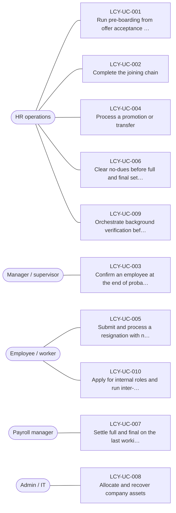

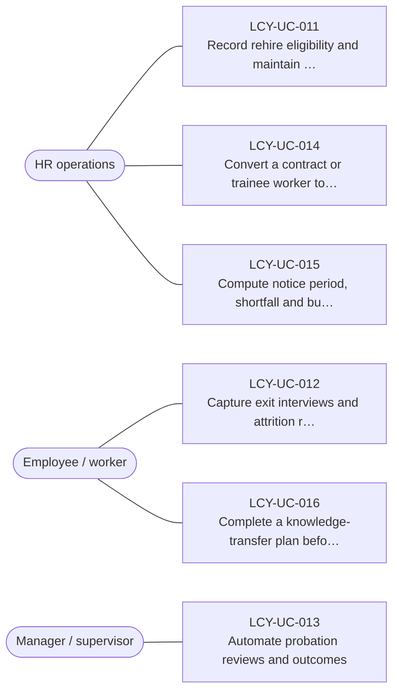

## 3. Use case specifications

### LCY-UC-001

**Run pre-boarding from offer acceptance to day one** — Complete document collection, verification, medical fitness and asset and IT requests in parallel so the joiner is ready on the date of joining.

| Attribute | Value |
| :--- | :--- |
| Realises | LCY-01 |
| Source | Authored |
| Level | User goal |
| Primary actor | HR operations |
| Secondary actors | Candidate, Nucleus platform, Admin / IT, Background verification provider |
| Trigger | The candidate accepts the offer. |
| Frequency | Per hire |
| Criticality | High |
| Phase | P1 |
| Client requirements | — |
| Business rules | RL-390, RL-391 |
| Screens | SCR-010 |
| Data objects (CRUD) | workflow_instance (C), candidate_document (C/U), asset_request (C) |
| Events | — |
| Acceptance tests | — |
| System requirements | SYS-033, SYS-041, SYS-042, SYS-070, SYS-084 |

**Stakeholders and interests**

| Stakeholder | Interest |
| :--- | :--- |
| Candidate | A clear list of what to submit and by when. |
| Manager / supervisor | The joiner is productive from day one. |
| Compliance owner | Factory roles have medical fitness before joining. |

**Preconditions**

- An approved requisition with an open position exists for the offer.
- The offer records joining date, location and worker class.

**Main success scenario**

| # | Actor | Action | Ref |
| ---: | :--- | :--- | :--- |
| 1 | HR operations | Records the offer acceptance; the platform instantiates the pre-boarding chain pinned to the current workflow version. | RL-390 |
| 2 | Nucleus platform | Opens parallel tracks for document collection, verification, medical fitness (factory roles) and asset and IT requests, each with owner and due date. |  |
| 3 | Candidate | Uploads identity, address, education, bank and previous-employment documents through the candidate portal. |  |
| 4 | HR operations | Verifies documents, rejecting any illegible or mismatched item with a reason for re-upload. |  |
| 5 | Background verification provider | Returns status per verification component as checks complete. |  |
| 6 | Admin / IT | Prepares assets and system access for issue on the joining date. |  |
| 7 | Nucleus platform | Runs a readiness check two working days before joining and alerts owners of open blocking items. |  |
| 8 | Nucleus platform | Hands the completed record to the joining chain on the date of joining. | RL-391 |

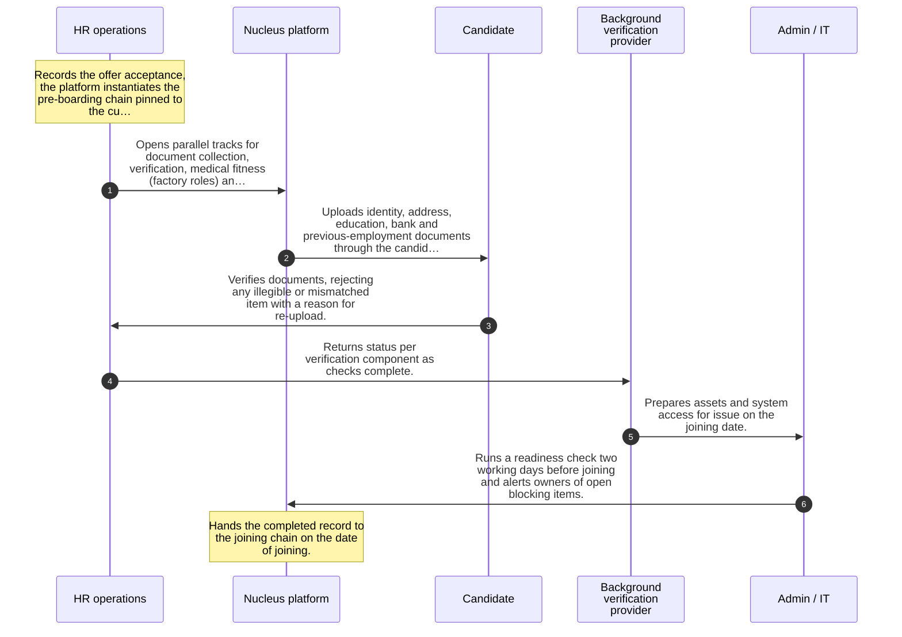

**Alternate flows**

| ID | At step | Condition | Steps | Rejoins |
| :--- | ---: | :--- | :--- | :--- |
| A1 | 1 | The requisition is held at sanctioned strength. | Platform holds the chain at offer acceptance and shows the requisition block. → The chain resumes when the requisition is released. | Returns to step 2 |
| A2 | 7 | A non-blocking item is incomplete. | Platform lets the joining proceed and carries the item into the joining chain. | Returns to step 8 |

**Exception flows**

| ID | At step | Condition | Handling | Rule |
| :--- | ---: | :--- | :--- | :--- |
| E1 | 7 | A blocking item is still open on the day before joining. | HR operations is asked to move the joining date or obtain a recorded waiver; the joining chain does not start. |  |
| E2 | 3 | The candidate withdraws. | The chain is cancelled, collected documents are retained only as the retention policy allows, and the requisition reopens. |  |

**Postconditions — success**

- All items marked Blocks joining are complete and the joining chain can start on the date of joining.
- The person record exists or is ready to be created by the joining chain.

**Postconditions — failure**

- The joining date is held or moved and the blocking items are listed on the pre-boarding tracker.

**Quality requirements**

- Candidate document upload works on a 3G mobile connection for files up to 5 MB.
- Identity numbers are masked on every screen after capture.

### LCY-UC-002

**Complete the joining chain** — Take a new hire from the date of joining to a fully registered, payroll-ready, inducted employee with statutory forms generated inside the chain.

| Attribute | Value |
| :--- | :--- |
| Realises | LCY-02 |
| Source | Source workbook |
| Level | User goal |
| Primary actor | HR operations |
| Secondary actors | Nucleus platform, Employee / worker, Admin / IT, Payroll manager |
| Trigger | The date of joining arrives for a hire whose pre-boarding is complete. |
| Frequency | Per hire |
| Criticality | Critical |
| Phase | P1 |
| Client requirements | R-24 |
| Business rules | RL-390, RL-391, RL-392, RL-382, RL-393, RL-394, RL-395, RL-396, RL-397 |
| Screens | SCR-060, SCR-010, SCR-073, SCR-062, SCR-063, SCR-064, SCR-066 |
| Data objects (CRUD) | workflow_instance (C), person (C), assignment (C/U), statutory_registration (C), statutory_form_instance (C), bank_detail (C), policy_acknowledgement (C), learning_assignment (C), asset_allocation (C), announcement (C) |
| Events | lifecycle.joining.started, people.worker.hired, compliance.registration.done, compliance.form.generated, learning.path.assigned, asset.allocated, experience.announcement.published |
| Acceptance tests | TC-X390, TC-X391, TC-X392, TC-C382, TC-Y393, TC-X394, TC-X395, TC-X396, TC-X397, T-38 |
| System requirements | SYS-012, SYS-032, SYS-033, SYS-042, SYS-053, SYS-086 |

**Stakeholders and interests**

| Stakeholder | Interest |
| :--- | :--- |
| Payroll manager | Bank, payroll group and statutory IDs are in place before the first run. |
| Compliance owner | Form F and registrations are produced in-chain, not chased later. |
| Manager / supervisor | Induction and assets are ready from day one. |

**Preconditions**

- Pre-boarding blocking items are complete.
- A joining workflow definition is published for the worker class and location.
- Clearance templates exist so allocated assets can be tracked to exit.

**Main success scenario**

| # | Actor | Action | Ref |
| ---: | :--- | :--- | :--- |
| 1 | Nucleus platform | Starts the joining chain on the date of joining with the workflow definition version pinned to the instance. | LCY-02.1 |
| 2 | Nucleus platform | Creates the person and assignment, or adopts those already created at pre-boarding. | LCY-02.2 |
| 3 | HR operations | Completes statutory registrations: PF/UAN, ESI IP number and professional tax enrolment where applicable. | LCY-02.3 |
| 4 | Nucleus platform | Generates statutory joining forms, including Form F for factory locations, inside the chain. | LCY-02.4 |
| 5 | HR operations | Captures bank details, assigns the payroll group, and records nominees and emergency contacts. | LCY-02.5 |
| 6 | Employee / worker | Reads and acknowledges assigned policies on SCR-062; the acknowledged policy version is retained. | LCY-02.6 |
| 7 | Nucleus platform | Assigns the induction learning path and the 30/60/90-day plan through the standard assignment mechanism. | LCY-02.7 |
| 8 | Admin / IT | Allocates assets on SCR-064; each allocation is registered as a future clearance item. | LCY-02.8 |
| 9 | Nucleus platform | Publishes the new-joiner announcement to the audience defined by the audience rule. | LCY-02.9 |

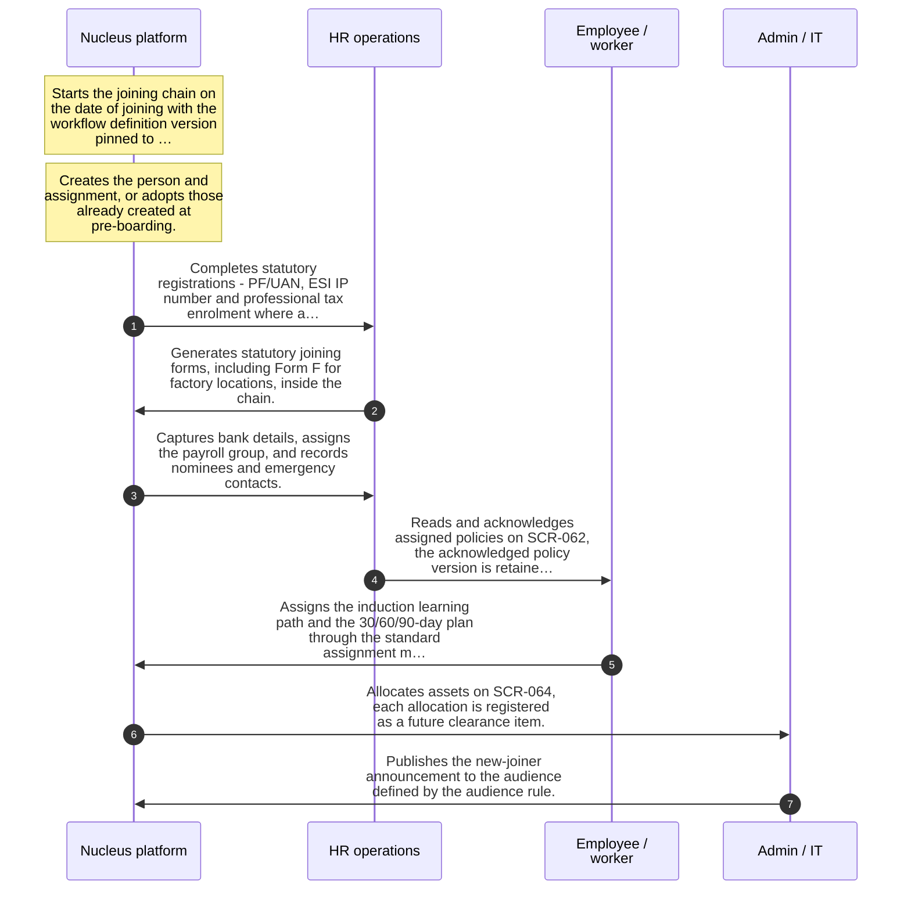

**Alternate flows**

| ID | At step | Condition | Steps | Rejoins |
| :--- | ---: | :--- | :--- | :--- |
| A1 | 1 | The workflow definition is changed while this chain is in flight. | The instance continues on its pinned version. → New chains started after the change use the new version. | Returns to step 2 |
| A2 | 2 | The person and assignment were already created at pre-boarding. | Platform adopts the existing records instead of creating duplicates. | Returns to step 3 |
| A3 | 4 | The location is an office with no Factory Act applicability. | Platform generates only the joining forms applicable to that location; Form F is not generated. | Returns to step 5 |
| A4 | 9 | HR applies an editorial override to the announcement. | HR edits or suppresses the announcement; the override is recorded with the editor's name. | Use case ends |

**Exception flows**

| ID | At step | Condition | Handling | Rule |
| :--- | ---: | :--- | :--- | :--- |
| E1 | 3 | A registration step breaches its SLA. | The step is escalated to the HR operations lead and shown red on SCR-060. | RL-392 |
| E2 | 4 | Form F cannot be generated because a required field is missing. | The step stays open with the missing field named; the chain cannot complete. | RL-382 |
| E3 | 5 | Bank details are captured or changed inside an open payroll window. | An alert is raised to the payroll manager for verification before the run. | RL-393 |
| E4 | 6 | The employee has not acknowledged a mandatory policy by its due date. | A reminder is sent and the open acknowledgement is carried as a blocker for confirmation. | RL-394 |
| E5 | 8 | An asset is not available for issue. | The step stays open with a blocker and an expected issue date. | RL-396 |

**Postconditions — success**

- Person and assignment exist with statutory registrations, bank details and payroll group.
- Form F and other applicable joining forms are generated and linked to the joiner.
- Policy acknowledgements, induction assignments and asset allocations are recorded; the announcement is published.

**Postconditions — failure**

- The chain shows open steps with owners, SLAs and blockers on SCR-060; the joiner is not added to payroll until mandatory steps finish.

**Quality requirements**

- SCR-060 shows chain status for 50 concurrent joiners within 2 seconds.
- Bank account numbers are stored tokenised and shown masked except the last four digits.
- Each chain step records actor, timestamp and outcome in the audit trail.

### LCY-UC-003

**Confirm an employee at the end of probation** — Confirm, extend or end probation on time, gated by mandatory induction completion, and issue the confirmation letter.

| Attribute | Value |
| :--- | :--- |
| Realises | LCY-03 |
| Source | Authored |
| Level | User goal |
| Primary actor | Manager / supervisor |
| Secondary actors | HR operations, Nucleus platform, Employee / worker, Director / approver |
| Trigger | The probation end date is 30 days away. |
| Frequency | Per hire |
| Criticality | Medium |
| Phase | P2 |
| Client requirements | R-24 |
| Business rules | — |
| Screens | SCR-067 |
| Data objects (CRUD) | confirmation (C/U), assignment (U), letter_issue (C) |
| Events | — |
| Acceptance tests | TC-E500, TC-E502, T-38 |
| System requirements | SYS-022, SYS-026, SYS-037, SYS-051, SYS-053 |

**Stakeholders and interests**

| Stakeholder | Interest |
| :--- | :--- |
| Employee / worker | A timely decision and letter. |
| HR operations | Confirmation and dependent events (referral payout, leave credit) fall on the same date. |

**Preconditions**

- Date of joining and probation months are recorded on the assignment.
- The confirmation letter template is published for the entity.

**Main success scenario**

| # | Actor | Action | Ref |
| ---: | :--- | :--- | :--- |
| 1 | Nucleus platform | Raises a confirmation task to the manager 30 days before the confirmation due date. |  |
| 2 | Manager / supervisor | Records the assessment and recommends confirm, extend probation or end employment. |  |
| 3 | Nucleus platform | Checks gates: all mandatory induction items complete and policy acknowledgements recorded. |  |
| 4 | HR operations | Reviews the recommendation and gates and actions the decision. |  |
| 5 | Nucleus platform | Updates the assignment with the confirmation date and fires dependent triggers. |  |
| 6 | Nucleus platform | Generates the confirmation letter on SCR-067 from the current template version for HR to issue. |  |
| 7 | Employee / worker | Receives the letter in self-service and acknowledges receipt. |  |

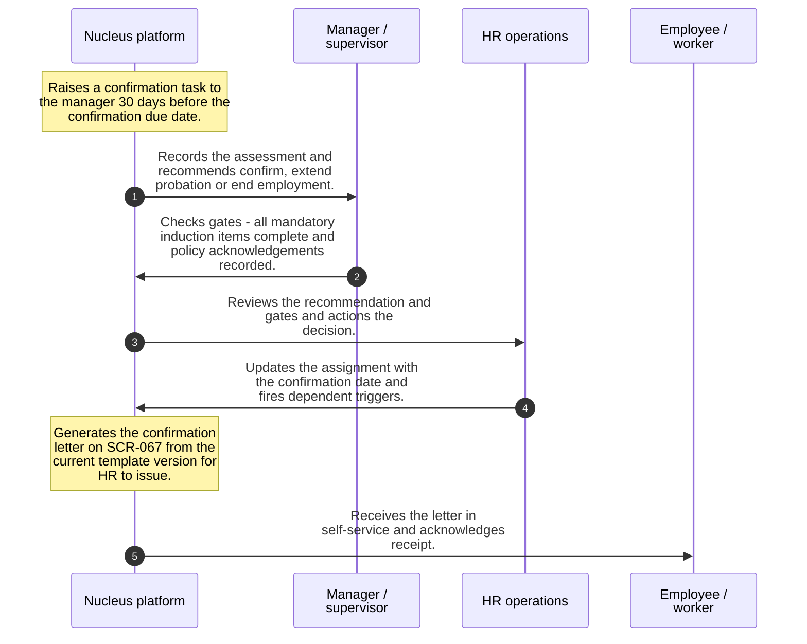

**Alternate flows**

| ID | At step | Condition | Steps | Rejoins |
| :--- | ---: | :--- | :--- | :--- |
| A1 | 2 | The manager recommends extending probation. | Manager states reason and extension period. → HR approves; platform sets the new probation end date and issues an extension letter. | Use case ends |
| A2 | 2 | The manager recommends ending employment. | HR operations routes the case to the Director / approver. → On approval the separation process starts. | Use case ends |

**Exception flows**

| ID | At step | Condition | Handling | Rule |
| :--- | ---: | :--- | :--- | :--- |
| E1 | 3 | A mandatory induction item is still open. | Confirmation cannot be actioned whatever the manager recommends; the blocker is named. |  |
| E2 | 1 | The manager does not respond within 7 days. | The task is escalated to the manager's manager and HR operations. |  |

**Postconditions — success**

- The assignment carries the confirmation date or a new probation end date.
- A confirmation or extension letter is issued with the template version retained.
- Dependent triggers such as a maturing referral award have fired.

**Postconditions — failure**

- Confirmation stays pending with the blocker recorded; probation status continues.

**Quality requirements**

- Issued letters are immutable and retain the template version used.

### LCY-UC-004

**Process a promotion or transfer** — Apply an approved promotion or transfer from its effective date and re-resolve every location-dependent rule.

| Attribute | Value |
| :--- | :--- |
| Realises | LCY-04 |
| Source | Authored |
| Level | User goal |
| Primary actor | HR operations |
| Secondary actors | Nucleus platform, Payroll manager, Manager / supervisor, Plant HR / time office |
| Trigger | A promotion or transfer is approved. |
| Frequency | Monthly |
| Criticality | High |
| Phase | P2 |
| Client requirements | — |
| Business rules | — |
| Screens | SCR-010, SCR-067 |
| Data objects (CRUD) | assignment (C/U), letter_issue (C) |
| Events | — |
| Acceptance tests | — |
| System requirements | SYS-007, SYS-016, SYS-022, SYS-023, SYS-070 |

**Stakeholders and interests**

| Stakeholder | Interest |
| :--- | :--- |
| Payroll manager | PT, LWF and pay changes apply from the right date with correct proration. |
| Employee / worker | Holidays, rest days and access match the new location. |

**Preconditions**

- The change is approved through its workflow.
- The target position, location and grade exist.

**Main success scenario**

| # | Actor | Action | Ref |
| ---: | :--- | :--- | :--- |
| 1 | HR operations | Opens the approved change and confirms effective date, target position, grade, location and manager. |  |
| 2 | Nucleus platform | Creates the new effective-dated assignment and ends the current one the day before. |  |
| 3 | Nucleus platform | Re-resolves professional tax, labour welfare fund, holiday calendar, rest-day pattern and location scope for the new location. |  |
| 4 | Nucleus platform | Flags the payroll period for split computation if the effective date is mid-period. |  |
| 5 | Nucleus platform | Updates manager and plant HR data scopes so the new team can see the employee and the old team cannot. |  |
| 6 | HR operations | Generates and issues the promotion or transfer letter on SCR-067. |  |
| 7 | Nucleus platform | Notifies the employee, old manager and new manager. |  |

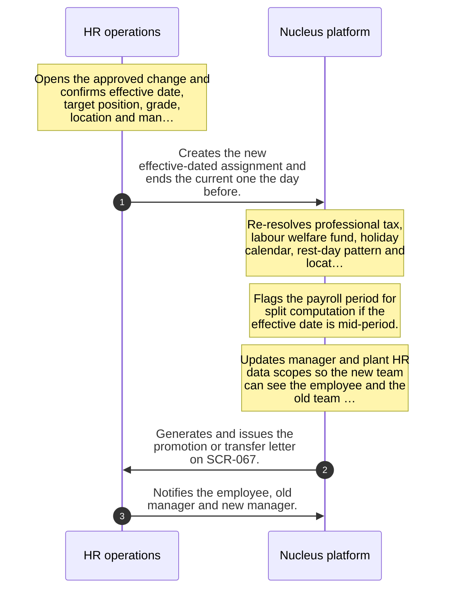

**Alternate flows**

| ID | At step | Condition | Steps | Rejoins |
| :--- | ---: | :--- | :--- | :--- |
| A1 | 1 | The change is a promotion within the same location. | Platform updates grade and pay only; location-dependent rules are not re-resolved. | Returns to step 4 |

**Exception flows**

| ID | At step | Condition | Handling | Rule |
| :--- | ---: | :--- | :--- | :--- |
| E1 | 2 | The effective date falls inside a locked payroll period. | The change is held and HR is asked to choose the next open date or raise an arrears instruction. |  |
| E2 | 3 | The target location has no holiday calendar or PT configuration. | The change is held and the missing configuration is named. |  |

**Postconditions — success**

- A new effective-dated assignment row exists and the old row ends the day before.
- PT, LWF, holiday calendar, rest-day pattern and location scope are re-resolved.
- A letter is issued and affected roles' data scopes are updated.

**Postconditions — failure**

- The current assignment continues unchanged and the change is held with its reason.

**Quality requirements**

- Effective-dated history is preserved and queryable as at any date.

### LCY-UC-005

**Submit and process a resignation with notice** — Record a resignation, fix the last working day and notice position, and start clearance in parallel.

| Attribute | Value |
| :--- | :--- |
| Realises | LCY-05 |
| Source | Authored |
| Level | User goal |
| Primary actor | Employee / worker |
| Secondary actors | Manager / supervisor, HR operations, Nucleus platform, Payroll manager |
| Trigger | The employee submits a resignation. |
| Frequency | Per exit |
| Criticality | High |
| Phase | P1 |
| Client requirements | R-17 |
| Business rules | RL-400, RL-401 |
| Screens | SCR-061 |
| Data objects (CRUD) | resignation (C/U), clearance_item (C) |
| Events | lifecycle.clearance.started |
| Acceptance tests | TC-X400 |
| System requirements | SYS-037, SYS-041, SYS-053, SYS-059 |

**Stakeholders and interests**

| Stakeholder | Interest |
| :--- | :--- |
| Payroll manager | Notice shortfall or buyout is known for F&F. |
| Manager / supervisor | Time for handover and backfill. |

**Preconditions**

- The employee holds an active assignment with a notice period defined by policy.

**Main success scenario**

| # | Actor | Action | Ref |
| ---: | :--- | :--- | :--- |
| 1 | Employee / worker | Submits a resignation from self-service with reason and proposed last working day. |  |
| 2 | Nucleus platform | Computes required notice, notice served and any shortfall from the policy and proposed date. |  |
| 3 | Manager / supervisor | Reviews, records a retention conversation if any, and recommends acceptance with a last working day. |  |
| 4 | HR operations | Accepts the resignation and confirms the last working day and any buyout or recovery decision. |  |
| 5 | Nucleus platform | Instantiates the clearance checklist on acceptance so clearance runs in parallel with notice. | RL-400 |
| 6 | Nucleus platform | Notifies payroll of the last working day and notice position for F&F. |  |

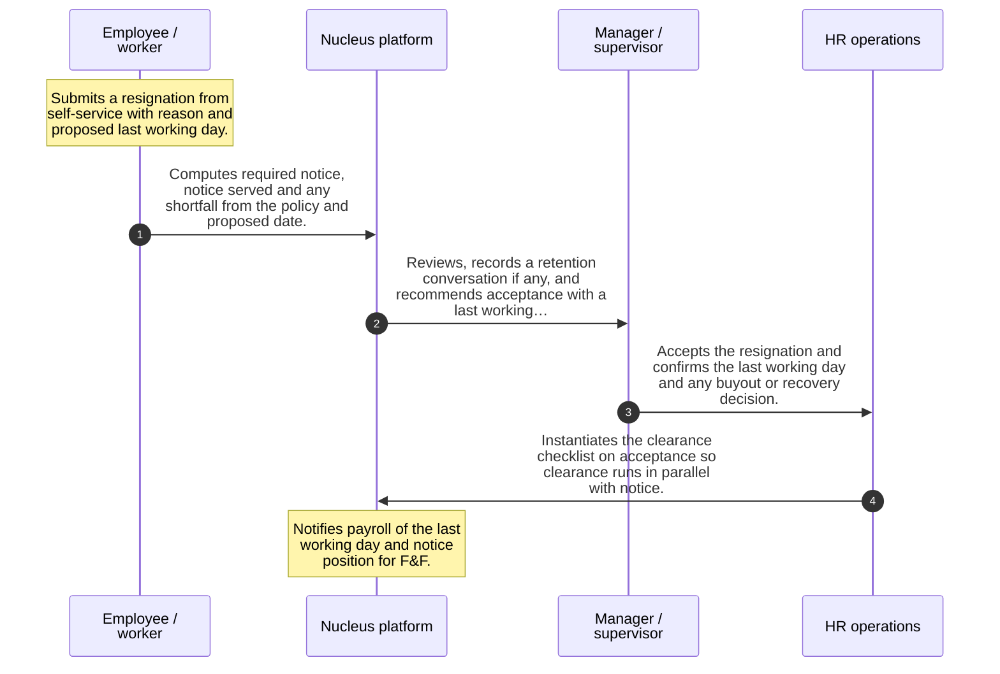

**Alternate flows**

| ID | At step | Condition | Steps | Rejoins |
| :--- | ---: | :--- | :--- | :--- |
| A1 | 1 | The employee withdraws before acceptance. | The resignation is cancelled and no checklist is created. | Use case ends |
| A2 | 4 | HR agrees an early release. | HR records the waived notice days and reason. → Platform recomputes the shortfall as zero for waived days. | Returns to step 5 |

**Exception flows**

| ID | At step | Condition | Handling | Rule |
| :--- | ---: | :--- | :--- | :--- |
| E1 | 3 | The manager does not act within 3 working days. | The item is escalated to HR operations. |  |
| E2 | 5 | No clearance template matches the worker class and location. | HR operations is alerted and the checklist must be created before acceptance completes. | RL-400 |

**Postconditions — success**

- The resignation is accepted with last working day and notice served or short computed.
- The clearance checklist is instantiated on acceptance.

**Postconditions — failure**

- The resignation is withdrawn or remains pending with its status visible to the employee.

**Quality requirements**

- The resignation and every status change are timestamped and visible to the employee.

### LCY-UC-006

**Clear no-dues before full and final settlement** — Clear every departmental no-dues item in parallel with notice so F&F can settle on the last working day, holding F&F while any blocking item is open.

| Attribute | Value |
| :--- | :--- |
| Realises | LCY-06 |
| Source | Source workbook |
| Level | User goal |
| Primary actor | HR operations |
| Secondary actors | Department clearance owner, Nucleus platform, Director / approver, Payroll manager |
| Trigger | A resignation is accepted. |
| Frequency | Per exit |
| Criticality | Critical |
| Phase | P1 |
| Client requirements | R-17 |
| Business rules | RL-400, RL-401, RL-402, RL-403, BS:RL-25 |
| Screens | SCR-061 |
| Data objects (CRUD) | clearance_checklist_template (R), clearance_item (C/U), payroll_input (C) |
| Events | lifecycle.clearance.started, lifecycle.clearance.item_cleared, lifecycle.clearance.waived |
| Acceptance tests | TC-X400, TC-X401, TC-X402, TC-X403, T-30 |
| System requirements | SYS-028, SYS-032, SYS-036, SYS-041, SYS-051 |

**Stakeholders and interests**

| Stakeholder | Interest |
| :--- | :--- |
| Leaver | Settlement on the last working day. |
| Payroll manager | No settlement is released with unrecovered dues. |
| Admin / IT | Assets are returned or recovered. |

**Preconditions**

- A clearance template exists for the worker class and location.
- Asset allocations for the leaver are registered.

**Main success scenario**

| # | Actor | Action | Ref |
| ---: | :--- | :--- | :--- |
| 1 | HR operations | On resignation acceptance, instantiates the clearance checklist from the template for the worker class and location. | LCY-06.1 |
| 2 | Department clearance owner | Works each item in parallel with the notice period, recording status, date and note within the item SLA. | LCY-06.2 |
| 3 | Nucleus platform | Checks whether any blocking item is still open; while one is, F&F stays HELD. | LCY-06.3 |
| 4 | Director / approver | Waives a remaining blocking item explicitly with a reason and a recovery amount where the item has a value. | LCY-06.4 |

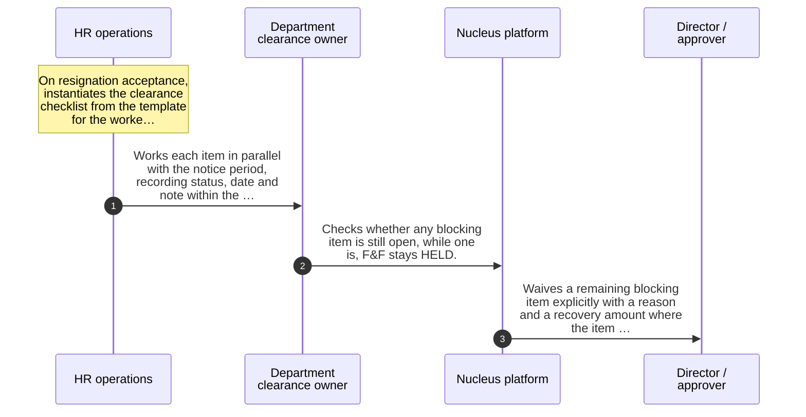

**Alternate flows**

| ID | At step | Condition | Steps | Rejoins |
| :--- | ---: | :--- | :--- | :--- |
| A1 | 3 | No blocking item is open. | Platform moves F&F to READY; no waiver is needed. | Use case ends |
| A2 | 2 | A non-blocking item (for example exit interview) is open on the last working day. | The item stays open without holding F&F. | Returns to step 3 |

**Exception flows**

| ID | At step | Condition | Handling | Rule |
| :--- | ---: | :--- | :--- | :--- |
| E1 | 1 | No template matches the worker class and location. | The checklist cannot be created; HR operations is alerted to configure the template. | RL-400 |
| E2 | 2 | An item breaches its SLA. | The item is escalated to the owner's manager and highlighted on SCR-061. | RL-401 |
| E3 | 3 | A user tries to release F&F while a blocking item is open. | Release is refused and the open items are listed. | RL-402 |
| E4 | 4 | A waiver is submitted without a reason or by a role below HR head. | The waiver is refused. | RL-403 |

**Postconditions — success**

- Every blocking item is Cleared or Waived with reason; any waived value is a recovery line in F&F.
- F&F moves from HELD to READY.

**Postconditions — failure**

- F&F remains HELD with the open blocking items listed.

**Quality requirements**

- Clearance owners can clear items from mobile.
- Each status change stores actor, timestamp and note.

### LCY-UC-007

**Settle full and final on the last working day** — Compute, approve and pay the full and final settlement on the last working day once clearance permits.

| Attribute | Value |
| :--- | :--- |
| Realises | LCY-07 |
| Source | Authored |
| Level | User goal |
| Primary actor | Payroll manager |
| Secondary actors | Nucleus platform, Finance, HR operations, Employee / worker |
| Trigger | All blocking clearance items are cleared or waived. |
| Frequency | Per exit |
| Criticality | Critical |
| Phase | P1 |
| Client requirements | R-17 |
| Business rules | RL-402, RL-403, BS:RL-25 |
| Screens | SCR-056, SCR-061 |
| Data objects (CRUD) | fnf (C/U), payroll_input (R), payslip_line (C) |
| Events | payroll.fnf.settled |
| Acceptance tests | TC-X402, TC-X340, T-30 |
| System requirements | SYS-028, SYS-030, SYS-045, SYS-047, SYS-051, SYS-085 |

**Stakeholders and interests**

| Stakeholder | Interest |
| :--- | :--- |
| Leaver | Correct dues paid on the last day. |
| Finance | Settlement reaches the bank file only when cleared. |

**Preconditions**

- F&F is READY.
- The last working day, notice position and leave balance are final.

**Main success scenario**

| # | Actor | Action | Ref |
| ---: | :--- | :--- | :--- |
| 1 | Nucleus platform | Moves F&F to READY when no blocking item remains and opens the settlement on SCR-056. | RL-402 |
| 2 | Nucleus platform | Computes final salary to the last working day, leave encashment, gratuity where eligible and notice pay or recovery. |  |
| 3 | Nucleus platform | Adds loan, advance and asset recovery lines, including values from waived clearance items. | RL-403 |
| 4 | Nucleus platform | Computes statutory deductions and the net amount. |  |
| 5 | Payroll manager | Reviews the working, line by line with its basis, and approves the settlement. |  |
| 6 | Nucleus platform | Includes the settlement in the full and final run and its bank file. |  |
| 7 | Finance | Releases the payment; the platform marks F&F SETTLED and emits payroll.fnf.settled. |  |
| 8 | HR operations | Issues the relieving letter and experience certificate. |  |

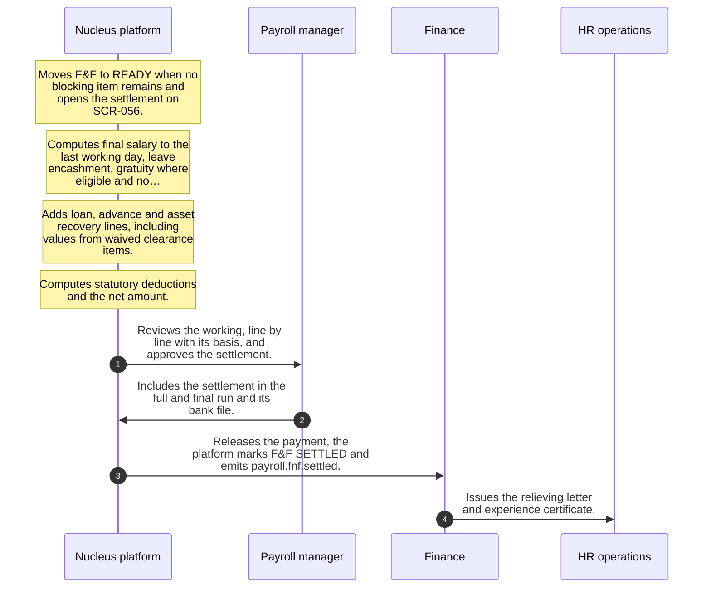

**Alternate flows**

| ID | At step | Condition | Steps | Rejoins |
| :--- | ---: | :--- | :--- | :--- |
| A1 | 4 | The net amount is negative. | Platform shows the amount due from the leaver and creates a recovery request. → No negative payment line enters the bank file. | Returns to step 5 |

**Exception flows**

| ID | At step | Condition | Handling | Rule |
| :--- | ---: | :--- | :--- | :--- |
| E1 | 1 | A blocking item is reopened. | F&F returns to HELD and is removed from the pending bank file. | RL-402 |
| E2 | 5 | Saving the settlement fails. | The error is shown with its cause and no partial record is stored; the user can retry. |  |

**Postconditions — success**

- F&F is SETTLED, included in its own run and bank file, and relieving documents are issued.

**Postconditions — failure**

- F&F stays READY or HELD with reason; no payment is made.

**Quality requirements**

- The settlement working saves successfully at every state transition.
- Each line shows its basis so the leaver can verify it.

### LCY-UC-008

**Allocate and recover company assets** — Maintain an asset register where every allocation is tracked to return and surfaces automatically as a clearance item at exit.

| Attribute | Value |
| :--- | :--- |
| Realises | LCY-08 |
| Source | Authored |
| Level | User goal |
| Primary actor | Admin / IT |
| Secondary actors | Nucleus platform, Employee / worker, HR operations, Payroll manager |
| Trigger | An employee joins, needs an asset, or exits. |
| Frequency | Per hire and exit |
| Criticality | Medium |
| Phase | P1 |
| Client requirements | R-24 |
| Business rules | RL-396, RL-403 |
| Screens | SCR-064, SCR-061 |
| Data objects (CRUD) | asset (U), asset_allocation (C/U), clearance_item (C) |
| Events | asset.allocated |
| Acceptance tests | TC-X396, T-38 |
| System requirements | SYS-032, SYS-051, SYS-053 |

**Stakeholders and interests**

| Stakeholder | Interest |
| :--- | :--- |
| Finance | Unreturned assets are recovered at their value. |
| Employee / worker | A clear record of what was issued and returned. |

**Preconditions**

- Asset types carry a blocking flag and recovery value.

**Main success scenario**

| # | Actor | Action | Ref |
| ---: | :--- | :--- | :--- |
| 1 | Admin / IT | Selects an available asset on SCR-064 and allocates it to the employee with issue date and condition. |  |
| 2 | Employee / worker | Acknowledges receipt of the asset in self-service. |  |
| 3 | Nucleus platform | Registers the allocation as a future clearance item, blocking for high-value assets. | RL-396 |
| 4 | Nucleus platform | At exit, adds each open allocation to the leaver's clearance checklist. | RL-396 |
| 5 | Admin / IT | Records the return with date and condition, clearing the item. |  |
| 6 | Nucleus platform | Updates the asset to Available or Under repair based on condition. |  |

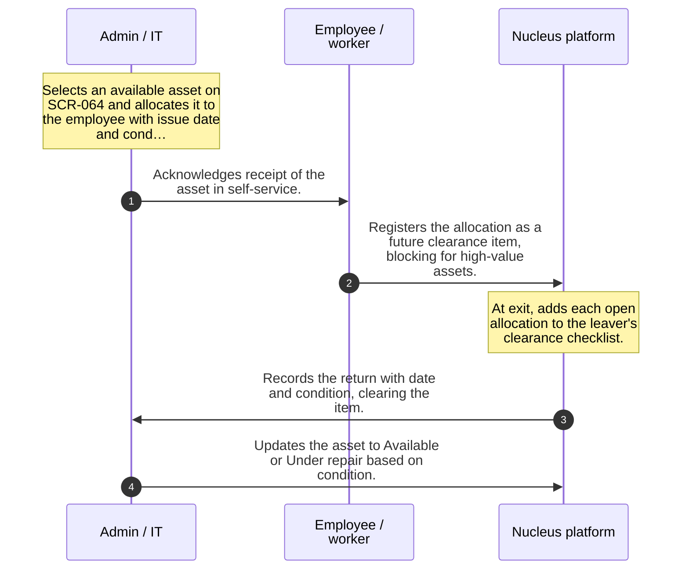

**Alternate flows**

| ID | At step | Condition | Steps | Rejoins |
| :--- | ---: | :--- | :--- | :--- |
| A1 | 5 | The asset is not returned. | Director / approver waives the item with reason. → Platform creates a recovery line at the asset's recovery value. | Use case ends |
| A2 | 6 | The asset is worn beyond use. | Admin / IT writes it off with reason; no recovery is charged. | Use case ends |

**Exception flows**

| ID | At step | Condition | Handling | Rule |
| :--- | ---: | :--- | :--- | :--- |
| E1 | 1 | The asset is already allocated. | Allocation is refused and the current holder is shown. |  |
| E2 | 5 | A return is recorded by someone other than the asset owner role. | The update is refused. |  |

**Postconditions — success**

- Allocation and return are recorded with dates and condition; unreturned assets become recovery lines.

**Postconditions — failure**

- The asset remains allocated and the clearance item stays open.

**Quality requirements**

- Register searchable by asset code or serial within 1 second.

### LCY-UC-009

**Orchestrate background verification before joining** — Initiate background checks with providers, track each component and gate joining on configurable mandatory checks.

| Attribute | Value |
| :--- | :--- |
| Realises | LCY-CG-001 |
| Source | Authored |
| Level | User goal |
| Primary actor | HR operations |
| Secondary actors | Candidate, Background verification provider, Nucleus platform |
| Trigger | An offer is accepted for a role whose check package is configured. |
| Frequency | Per hire |
| Criticality | High |
| Phase | P2 |
| Client requirements | — |
| Business rules | — |
| Screens | SCR-060 |
| Data objects (CRUD) | verification_request (C/U), verification_component (C/U) |
| Events | — |
| Acceptance tests | LCY-TC-001, LCY-TC-002, LCY-TC-003, LCY-TC-004 |
| System requirements | SYS-027, SYS-033, SYS-051, SYS-084 |

**Stakeholders and interests**

| Stakeholder | Interest |
| :--- | :--- |
| Compliance owner | Checks run with consent and within purpose. |
| Manager / supervisor | No delay where checks are not mandatory. |

**Preconditions**

- Check packages are configured per worker class and location, with each component marked mandatory or not.
- The candidate has given consent for verification.

**Main success scenario**

| # | Actor | Action | Ref |
| ---: | :--- | :--- | :--- |
| 1 | Nucleus platform | Selects the check package for the worker class and location and records the candidate's consent. |  |
| 2 | Nucleus platform | Sends the check request to the provider through the integration service. |  |
| 3 | Background verification provider | Returns status updates per component (identity, address, education, previous employment). |  |
| 4 | Nucleus platform | Shows component status on the pre-boarding tracker. |  |
| 5 | HR operations | Reviews any discrepancy with the candidate's explanation and records a decision. |  |
| 6 | Nucleus platform | Opens the joining gate when all mandatory components are Clear or decided. |  |

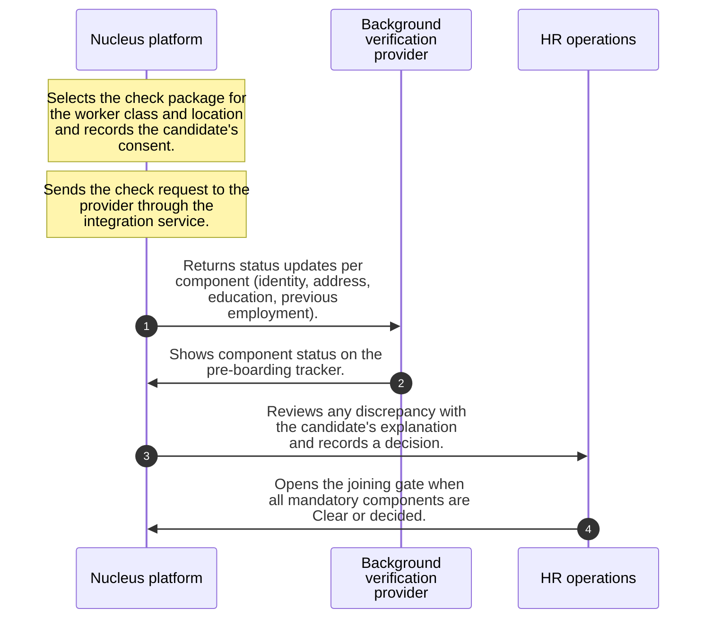

**Alternate flows**

| ID | At step | Condition | Steps | Rejoins |
| :--- | ---: | :--- | :--- | :--- |
| A1 | 5 | HR accepts a minor discrepancy. | HR records the reason; the component is marked Accepted with exception. | Returns to step 6 |

**Exception flows**

| ID | At step | Condition | Handling | Rule |
| :--- | ---: | :--- | :--- | :--- |
| E1 | 1 | The candidate has not given consent. | No request is sent and the candidate is asked for consent. |  |
| E2 | 3 | The provider exceeds its turnaround SLA. | HR operations is alerted; joining remains held if the component is mandatory. |  |

**Postconditions — success**

- Each component has a final status; all mandatory components are Clear and the joining gate is open.

**Postconditions — failure**

- A mandatory component is Discrepant or Pending and joining is held.

**Quality requirements**

- Provider reports are stored encrypted and access is logged.
- Verification data is erased per retention policy when a candidate does not join.

### LCY-UC-010

**Apply for internal roles and run inter-entity transfers** — Let employees apply for internal roles and let HR move people between entities with continuity of service, leave and statutory accounts.

| Attribute | Value |
| :--- | :--- |
| Realises | LCY-CG-002 |
| Source | Authored |
| Level | User goal |
| Primary actor | Employee / worker |
| Secondary actors | HR operations, Manager / supervisor, Nucleus platform, Payroll manager |
| Trigger | An internal role is published, or an inter-entity transfer is approved. |
| Frequency | Monthly |
| Criticality | High |
| Phase | P2 |
| Client requirements | — |
| Business rules | — |
| Screens | SCR-010 |
| Data objects (CRUD) | internal_application (C/U), assignment (C/U), leave_balance (U) |
| Events | — |
| Acceptance tests | LCY-TC-005, LCY-TC-006, LCY-TC-007, LCY-TC-008 |
| System requirements | SYS-006, SYS-022, SYS-037, SYS-045, SYS-049 |

**Stakeholders and interests**

| Stakeholder | Interest |
| :--- | :--- |
| Employee / worker | Career growth without losing service or balances. |
| Payroll manager | Clean cut-over between entity payrolls. |

**Preconditions**

- Internal eligibility rules (minimum tenure, performance band) are configured.
- Both entities are set up with payroll groups and statutory registrations.

**Main success scenario**

| # | Actor | Action | Ref |
| ---: | :--- | :--- | :--- |
| 1 | Employee / worker | Views internal openings for which they are eligible and applies with a short statement. |  |
| 2 | Nucleus platform | Notifies the current manager and routes the application to the hiring manager. |  |
| 3 | Manager / supervisor | Records a release decision and agreed release date. |  |
| 4 | HR operations | Approves the move and, for a different entity, initiates the inter-entity transfer. |  |
| 5 | Nucleus platform | Ends the source assignment and creates the target assignment, preserving the continuous service date. |  |
| 6 | Nucleus platform | Carries leave balances and keeps the same UAN; re-resolves ESI, PT and LWF for the new entity and location. |  |
| 7 | Payroll manager | Confirms the cut-over date in both entity payrolls. |  |

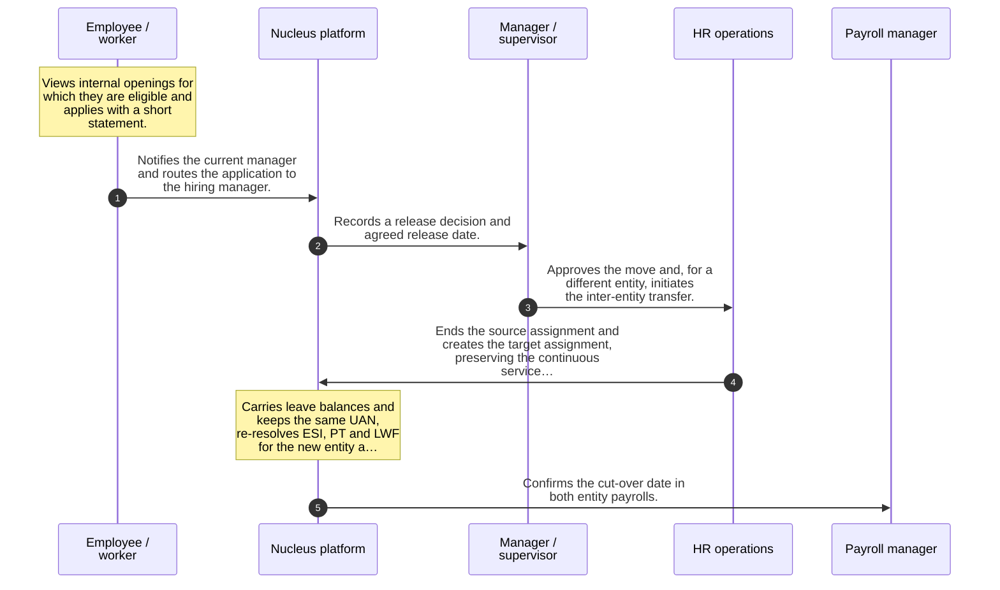

**Alternate flows**

| ID | At step | Condition | Steps | Rejoins |
| :--- | ---: | :--- | :--- | :--- |
| A1 | 1 | HR initiates the transfer without an application. | HR selects employee, target entity and date. | Returns to step 3 |

**Exception flows**

| ID | At step | Condition | Handling | Rule |
| :--- | ---: | :--- | :--- | :--- |
| E1 | 1 | The employee does not meet eligibility. | The apply action is not offered and the unmet criterion is shown. |  |
| E2 | 6 | A leave type does not exist in the target entity. | HR is shown the balance and must map or encash it before the transfer completes. |  |

**Postconditions — success**

- The employee holds an assignment in the target entity with original service date, carried leave balances and continuous UAN.
- No exit or F&F is triggered for an inter-entity transfer.

**Postconditions — failure**

- The application is closed with reason or the transfer is held; the current assignment continues.

**Quality requirements**

- Service continuity is preserved for gratuity and leave accrual purposes (to be validated by Legal).

### LCY-UC-011

**Record rehire eligibility and maintain alumni** — Record whether a leaver may be rehired and keep a consented alumni record for future hiring.

| Attribute | Value |
| :--- | :--- |
| Realises | LCY-CG-003 |
| Source | Authored |
| Level | User goal |
| Primary actor | HR operations |
| Secondary actors | Employee / worker, Nucleus platform |
| Trigger | A leaver's exit is processed. |
| Frequency | Per exit |
| Criticality | Medium |
| Phase | P3 |
| Client requirements | — |
| Business rules | RL-391 |
| Screens | — |
| Data objects (CRUD) | rehire_eligibility (C), alumni_record (C/U) |
| Events | — |
| Acceptance tests | LCY-TC-009, LCY-TC-010, LCY-TC-011, LCY-TC-012 |
| System requirements | SYS-017, SYS-019, SYS-027, SYS-032 |

**Stakeholders and interests**

| Stakeholder | Interest |
| :--- | :--- |
| Talent acquisition | Former good performers are easy to find. |
| Leaver | Alumni contact only with consent. |

**Preconditions**

- Rehire eligibility reason codes are configured.

**Main success scenario**

| # | Actor | Action | Ref |
| ---: | :--- | :--- | :--- |
| 1 | HR operations | Records rehire eligibility (Eligible, Not eligible, Review required) with a reason code at exit. |  |
| 2 | Nucleus platform | Asks the leaver for alumni consent in the exit flow. |  |
| 3 | Employee / worker | Gives or declines consent for alumni contact. |  |
| 4 | Nucleus platform | Creates an alumni record holding only consented contact data, linked to the past employment record. |  |
| 5 | Nucleus platform | Shows a returning-employee flag when the same person applies again. |  |
| 6 | HR operations | Rehires by adopting the existing person record rather than creating a new one. | RL-391 |

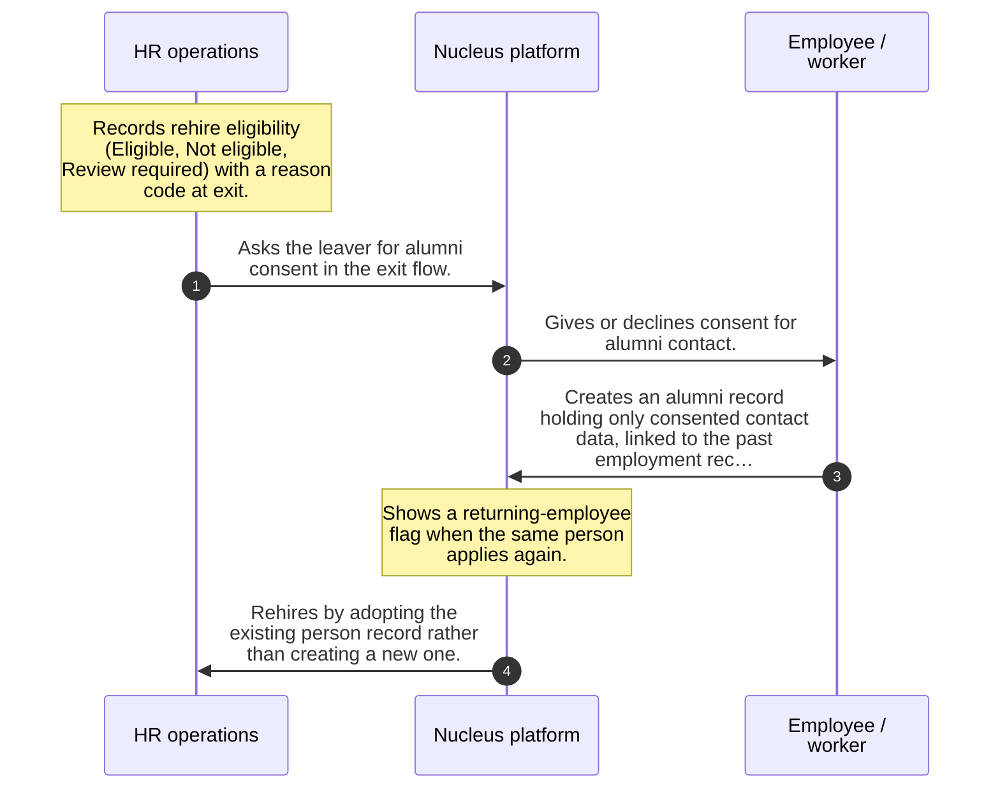

**Alternate flows**

| ID | At step | Condition | Steps | Rejoins |
| :--- | ---: | :--- | :--- | :--- |
| A1 | 3 | The leaver declines consent. | No alumni record is created; rehire eligibility is still recorded. | Use case ends |

**Exception flows**

| ID | At step | Condition | Handling | Rule |
| :--- | ---: | :--- | :--- | :--- |
| E1 | 5 | The applicant is marked Not eligible. | Recruiters see the flag and must obtain HR approval to proceed. |  |
| E2 | 4 | The alumnus withdraws consent. | Alumni contact data is removed and the record leaves the alumni list. |  |

**Postconditions — success**

- Rehire eligibility is recorded and an alumni record exists if consent was given.

**Postconditions — failure**

- No alumni record exists and the rehire flag defaults to Review required.

**Quality requirements**

- The rehire reason is visible only to HR roles.

### LCY-UC-012

**Capture exit interviews and attrition reasons** — Capture structured exit reasons and interview responses and report attrition patterns without identifying individuals.

| Attribute | Value |
| :--- | :--- |
| Realises | LCY-CG-004 |
| Source | Authored |
| Level | User goal |
| Primary actor | Employee / worker |
| Secondary actors | HR operations, Manager / supervisor, Nucleus platform |
| Trigger | A resignation is accepted. |
| Frequency | Per exit |
| Criticality | Medium |
| Phase | P2 |
| Client requirements | — |
| Business rules | RL-400 |
| Screens | SCR-061 |
| Data objects (CRUD) | exit_interview (C/U), attrition_reason (C) |
| Events | — |
| Acceptance tests | LCY-TC-013, LCY-TC-014, LCY-TC-015, LCY-TC-016 |
| System requirements | SYS-017, SYS-019, SYS-066 |

**Stakeholders and interests**

| Stakeholder | Interest |
| :--- | :--- |
| HR head | Reliable attrition drivers by site and department. |
| Leaver | Candid feedback does not reach their manager attributably. |

**Preconditions**

- An exit questionnaire and reason code taxonomy are configured.
- The exit interview is a non-blocking clearance item.

**Main success scenario**

| # | Actor | Action | Ref |
| ---: | :--- | :--- | :--- |
| 1 | Nucleus platform | Adds the exit interview as a non-blocking item to the clearance checklist. | RL-400 |
| 2 | Employee / worker | Completes the structured questionnaire in self-service. |  |
| 3 | HR operations | Holds the interview and records primary and secondary reason codes. |  |
| 4 | Manager / supervisor | Records the manager's view of the reason separately. |  |
| 5 | Nucleus platform | Stores responses with access restricted to HR roles. |  |
| 6 | Nucleus platform | Produces attrition reports by reason, site, department and tenure band with small cohorts suppressed. |  |

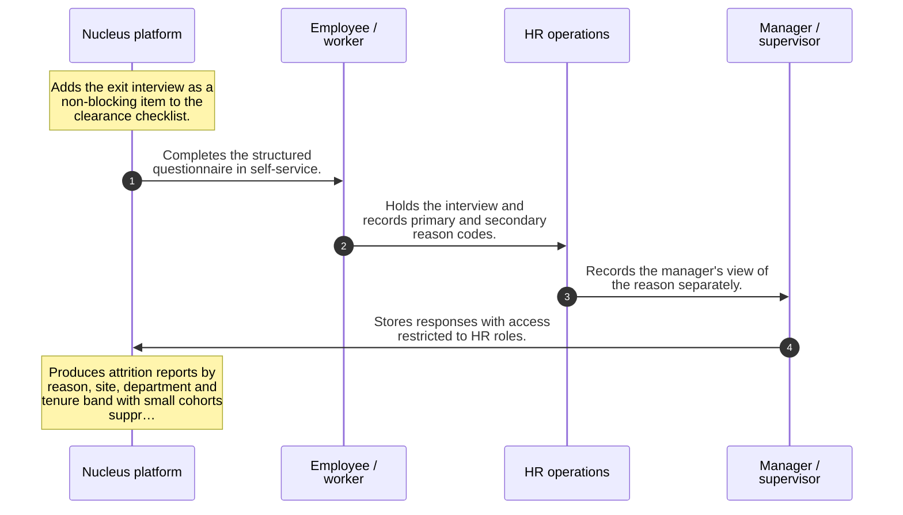

**Alternate flows**

| ID | At step | Condition | Steps | Rejoins |
| :--- | ---: | :--- | :--- | :--- |
| A1 | 2 | The leaver declines the interview. | HR records 'declined' and the item is closed. | Use case ends |

**Exception flows**

| ID | At step | Condition | Handling | Rule |
| :--- | ---: | :--- | :--- | :--- |
| E1 | 6 | A report cell would contain fewer than 5 leavers. | The cell is suppressed and merged into 'Other'. |  |

**Postconditions — success**

- Responses and primary and secondary reasons are stored; reports aggregate them anonymously.

**Postconditions — failure**

- The interview remains open; the leaver's exit proceeds unaffected.

**Quality requirements**

- Free-text answers are excluded from reports viewable by managers.

### LCY-UC-013

**Automate probation reviews and outcomes** — Schedule probation reviews ahead of the due date, collect the manager's assessment and drive confirm, extend or separate outcomes with the right letters.

| Attribute | Value |
| :--- | :--- |
| Realises | LCY-CG-005 |
| Source | Authored |
| Level | User goal |
| Primary actor | Manager / supervisor |
| Secondary actors | HR operations, Employee / worker, Nucleus platform, Director / approver |
| Trigger | An employee's probation end date is 30 days away. |
| Frequency | Daily |
| Criticality | High |
| Phase | P1 |
| Client requirements | — |
| Business rules | RL-390 |
| Screens | SCR-067 |
| Data objects (CRUD) | probation_review (C/U), assignment (U), letter (C), e_signature (C) |
| Events | lifecycle.probation.review_due, lifecycle.probation.decided |
| Acceptance tests | LCY-TC-017, LCY-TC-018, LCY-TC-019, LCY-TC-020, LCY-TC-021, LCY-TC-022 |
| System requirements | SYS-022, SYS-037, SYS-050, SYS-070, SYS-084 |

**Stakeholders and interests**

| Stakeholder | Interest |
| :--- | :--- |
| Employee / worker | Gets a timely decision and a letter, not an indefinite probation. |
| HR operations | No probation lapses unreviewed. |
| Payroll manager | Confirmation-linked pay or benefit changes take effect on the right date. |

**Preconditions**

- The assignment carries a probation end date and the policy for review lead time and allowed extensions.
- Letter templates for confirmation, extension and separation exist per entity.

**Main success scenario**

| # | Actor | Action | Ref |
| ---: | :--- | :--- | :--- |
| 1 | Nucleus platform | Thirty days before probation ends for E1066 Abhinav Rastogi, opens a review task for manager E1039. |  |
| 2 | Notification service | Notifies the manager and HR with the due date and the assessment form. |  |
| 3 | Manager / supervisor | Completes the assessment: objectives met, conduct, attendance summary and recommendation to confirm. |  |
| 4 | Nucleus platform | Attaches attendance and leave facts for the probation period to the assessment. |  |
| 5 | HR operations | Reviews the recommendation and routes it for approval. |  |
| 6 | Director / approver | Approves confirmation. |  |
| 7 | Nucleus platform | Writes the confirmation as a new assignment version effective on the probation end date and queues any benefit changes. |  |
| 8 | Nucleus platform | Generates the confirmation letter, sends it for e-signature and records acknowledgement. |  |

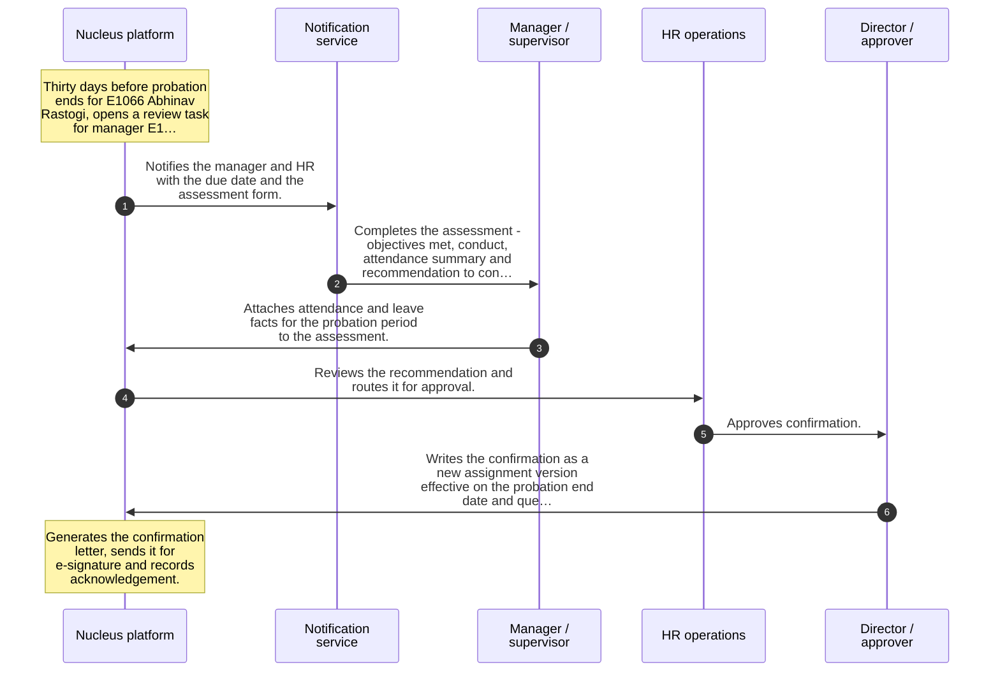

**Alternate flows**

| ID | At step | Condition | Steps | Rejoins |
| :--- | ---: | :--- | :--- | :--- |
| A1 | 3 | The manager recommends extension. | The manager states reason and extension length within policy; the new end date is set and a fresh review is scheduled. | Returns to step 5 |
| A2 | 3 | The manager recommends separation. | The case routes to HR and the director; on approval, a separation letter is issued and exit is initiated. | Ends |

**Exception flows**

| ID | At step | Condition | Handling | Rule |
| :--- | ---: | :--- | :--- | :--- |
| E1 | 3 | The manager has not submitted by the due date. | The task escalates to the manager's manager and HR; status remains on probation. |  |
| E2 | 5 | A requested extension exceeds the maximum allowed by policy. | The extension is refused and the manager must confirm or recommend separation. |  |

**Postconditions — success**

- The outcome is recorded with an effective date, the assignment is updated and the letter is issued and acknowledged.

**Postconditions — failure**

- An overdue review is escalated; the employee's status does not change silently.

**Quality requirements**

- Review tasks are created for 100% of probations ending in the next 30 days by 06:00 daily.
- A letter is generated within 30 s of approval.

### LCY-UC-014

**Convert a contract or trainee worker to permanent** — Convert a contract or trainee worker to permanent employment with service continuity rules, revised worker class and statutory re-registration.

| Attribute | Value |
| :--- | :--- |
| Realises | LCY-CG-006 |
| Source | Authored |
| Level | User goal |
| Primary actor | HR operations |
| Secondary actors | Plant HR / time office, Payroll manager, Director / approver, Nucleus platform |
| Trigger | A manager or HR proposes conversion, for example trainee E1030 Chetan Bhandary on completion of training. |
| Frequency | Monthly |
| Criticality | High |
| Phase | P2 |
| Client requirements | — |
| Business rules | RL-390, RL-391, RL-392, RL-382 |
| Screens | SCR-010, SCR-060, SCR-073 |
| Data objects (CRUD) | person (R), assignment (C/U), service_continuity (C), statutory_registration (U), letter (C) |
| Events | lifecycle.conversion.approved |
| Acceptance tests | LCY-TC-023, LCY-TC-024, LCY-TC-025, LCY-TC-026, LCY-TC-027, LCY-TC-028 |
| System requirements | SYS-022, SYS-037, SYS-048, SYS-057, SYS-086 |

**Stakeholders and interests**

| Stakeholder | Interest |
| :--- | :--- |
| Employee / worker | Keeps the right service continuity for leave, gratuity and seniority. |
| Payroll manager | Pay, statutory deductions and leave entitlements switch on the correct date. |
| Compliance owner | Statutory registrations transfer or are re-registered correctly. |

**Preconditions**

- The person exists once and keeps the same person identifier across the conversion.
- A vacant permanent position exists at the site.
- Service continuity rules per source worker class are configured.

**Main success scenario**

| # | Actor | Action | Ref |
| ---: | :--- | :--- | :--- |
| 1 | Manager / supervisor | Proposes conversion of E1030 from WC-TRN to WC-PERM at Peenya Machining effective 2026-12-01. |  |
| 2 | Nucleus platform | Checks the target permanent position is vacant and computes service continuity under the configured rule. |  |
| 3 | Nucleus platform | Shows the impact: new leave entitlements, statutory deductions, pay structure and continuity date. |  |
| 4 | HR operations | Reviews the impact and routes the conversion for approval. |  |
| 5 | Director / approver | Approves the conversion. |  |
| 6 | Nucleus platform | Ends the trainee assignment, creates the permanent assignment on the same person and queues attendance recompute. |  |
| 7 | Nucleus platform | Opens statutory steps in the chain, such as updating the UAN record and nomination forms. |  |
| 8 | Nucleus platform | Generates the appointment letter and the revised nomination forms for signature. |  |

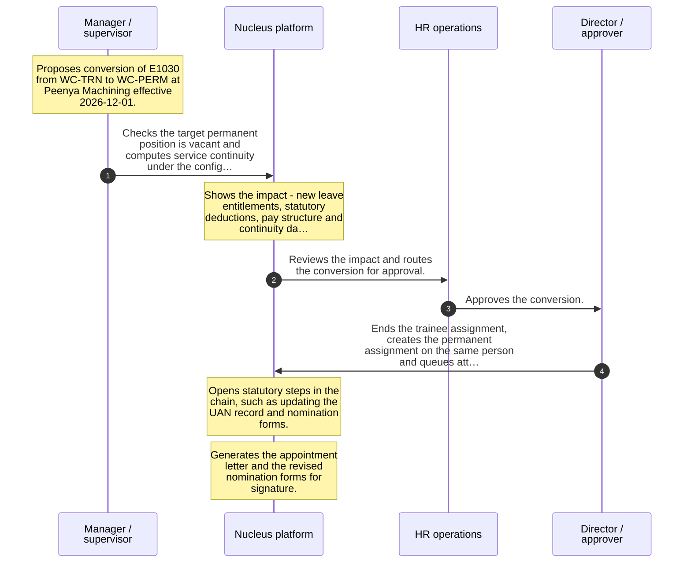

**Alternate flows**

| ID | At step | Condition | Steps | Rejoins |
| :--- | ---: | :--- | :--- | :--- |
| A1 | 1 | The worker is a third-party employee of vendor VN-01. | Conversion is handled as a new hire into LE-01 with person adoption; contractor service is recorded but not counted as continuous service unless policy states otherwise. | Returns to step 2 |

**Exception flows**

| ID | At step | Condition | Handling | Rule |
| :--- | ---: | :--- | :--- | :--- |
| E1 | 2 | No vacant permanent position exists. | Conversion cannot proceed until a position is created within sanctioned strength. |  |
| E2 | 7 | A statutory step is not completed within its SLA. | The step escalates to the compliance owner; the employee's pay continues under the new class. | RL-392 |

**Postconditions — success**

- A new assignment with worker class WC-PERM is effective from the conversion date; service continuity, leave entitlements and statutory registrations are updated and the letter is issued.

**Postconditions — failure**

- The person remains in the original worker class with no partial change.

**Quality requirements**

- The impact preview is shown in under 3 s.
- Conversion never creates a second person record.

### LCY-UC-015

**Compute notice period, shortfall and buy-out** — Compute notice period, shortfall, buy-out amount and leave adjustment for a separating employee and feed the result to full-and-final settlement.

| Attribute | Value |
| :--- | :--- |
| Realises | LCY-CG-007 |
| Source | Authored |
| Level | User goal |
| Primary actor | HR operations |
| Secondary actors | Employee / worker, Manager / supervisor, Payroll manager, Nucleus platform |
| Trigger | An employee submits a resignation or the employer issues a termination notice. |
| Frequency | Weekly |
| Criticality | High |
| Phase | P1 |
| Client requirements | — |
| Business rules | RL-400, RL-401, RL-402, RL-403 |
| Screens | SCR-061, SCR-056 |
| Data objects (CRUD) | resignation (C/U), notice_computation (C), leave_ledger_entry (C), fnf_input (C) |
| Events | lifecycle.notice.computed |
| Acceptance tests | LCY-TC-029, LCY-TC-030, LCY-TC-031, LCY-TC-032, LCY-TC-033, LCY-TC-034 |
| System requirements | SYS-028, SYS-037, SYS-047, SYS-049, SYS-059 |

**Stakeholders and interests**

| Stakeholder | Interest |
| :--- | :--- |
| Employee / worker | Knows exactly how much notice is owed and what a buy-out will cost. |
| Manager / supervisor | Can agree an early release with a clear cost. |
| Payroll manager | Receives a final, approved notice settlement amount for full and final. |

**Preconditions**

- Notice period rules per worker class, band and status (probation or confirmed) are configured.
- The leave ledger and salary structure are current.

**Main success scenario**

| # | Actor | Action | Ref |
| ---: | :--- | :--- | :--- |
| 1 | Employee / worker | Submits resignation on 2026-11-02 requesting last working day 2026-11-19. |  |
| 2 | Nucleus platform | Resolves required notice from the employee's class and band, for example 30 days, ending 2026-12-01. |  |
| 3 | Nucleus platform | Computes the shortfall of 12 days and the buy-out amount on the configured salary basis. |  |
| 4 | Nucleus platform | Shows options: serve full notice, buy out the shortfall, or offset shortfall against earned leave where policy allows. |  |
| 5 | Employee / worker | Chooses to offset 5 days against earned leave and buy out 7 days. |  |
| 6 | Manager / supervisor | Approves the early release and the arrangement. |  |
| 7 | HR operations | Confirms the final last working day and the computed amounts. |  |
| 8 | Nucleus platform | Debits the leave ledger and passes the notice recovery line to the full-and-final settlement. |  |

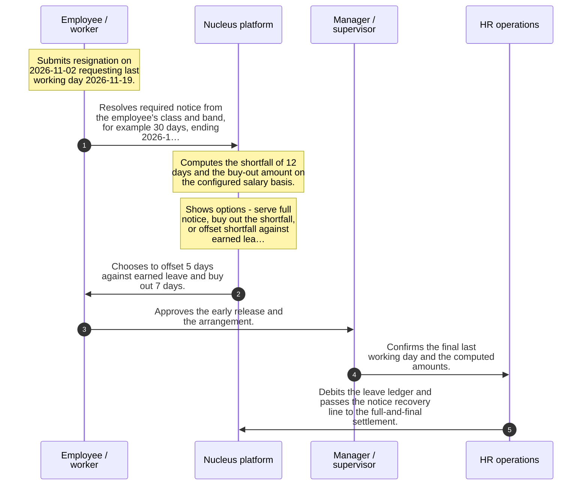

**Alternate flows**

| ID | At step | Condition | Steps | Rejoins |
| :--- | ---: | :--- | :--- | :--- |
| A1 | 6 | The manager waives the shortfall. | The waiver is recorded with reason and approver; no recovery line is created. | Returns to step 7 |
| A2 | 1 | The employer terminates with pay in lieu of notice. | The platform computes notice pay as an earning instead of a recovery. | Returns to step 7 |

**Exception flows**

| ID | At step | Condition | Handling | Rule |
| :--- | ---: | :--- | :--- | :--- |
| E1 | 5 | The employee's earned-leave balance is less than the requested offset. | The offset is capped at the balance and the remainder is added to the buy-out. |  |
| E2 | 8 | A blocking clearance item is still open on the last working day. | Settlement stays on hold until it is closed or waived. | RL-402 |

**Postconditions — success**

- Notice period, last working day, shortfall, buy-out or recovery amount and any leave adjustment are approved and passed to full-and-final settlement.

**Postconditions — failure**

- If the computation cannot be finalised, settlement remains held with the reason recorded.

**Quality requirements**

- Notice computation is returned in under 2 s.
- Buy-out amounts are computed in integer paise and reproduced identically in settlement.

### LCY-UC-016

**Complete a knowledge-transfer plan before exit clearance** — Ensure an exiting employee completes a structured hand-over plan covering documents, access and responsibilities, approved by the manager before clearance closes.

| Attribute | Value |
| :--- | :--- |
| Realises | LCY-CG-008 |
| Source | Authored |
| Level | User goal |
| Primary actor | Employee / worker |
| Secondary actors | Manager / supervisor, HR operations, Nucleus platform |
| Trigger | A resignation is accepted and the notice period starts. |
| Frequency | Weekly |
| Criticality | Medium |
| Phase | P3 |
| Client requirements | — |
| Business rules | RL-400, RL-401, RL-402, RL-403 |
| Screens | SCR-061 |
| Data objects (CRUD) | handover_plan (C/U), handover_item (C/U), clearance_item (U), approval_task (U) |
| Events | lifecycle.handover.completed |
| Acceptance tests | LCY-TC-035, LCY-TC-036, LCY-TC-037, LCY-TC-038, LCY-TC-039, LCY-TC-040 |
| System requirements | SYS-037, SYS-039, SYS-051, SYS-053 |

**Stakeholders and interests**

| Stakeholder | Interest |
| :--- | :--- |
| Manager / supervisor | Critical knowledge and responsibilities are handed over before the person leaves. |
| HR operations | Clearance closes on time with evidence of hand-over. |
| Tenant admin | Access held by the leaver is transferred or revoked. |

**Preconditions**

- A hand-over template exists for the employee's role family.
- The clearance checklist is instantiated for the leaver (RL-400).

**Main success scenario**

| # | Actor | Action | Ref |
| ---: | :--- | :--- | :--- |
| 1 | Nucleus platform | Creates a hand-over plan for E1068 Dinesh Vaidya from the engineering template when the resignation is accepted. |  |
| 2 | Nucleus platform | Pre-fills open approvals, owned documents, system access and recurring responsibilities held by the leaver. |  |
| 3 | Employee / worker | Names a successor for each item and adds hand-over notes and sessions. |  |
| 4 | Manager / supervisor | Reviews the plan, adjusts successors and approves it. |  |
| 5 | Employee / worker | Records completion of each hand-over item with the successor's acknowledgement. |  |
| 6 | Nucleus platform | Reassigns pending approvals and document ownership to the named successors. |  |
| 7 | Manager / supervisor | Signs off the completed plan. |  |
| 8 | Nucleus platform | Closes the knowledge-transfer clearance item. |  |

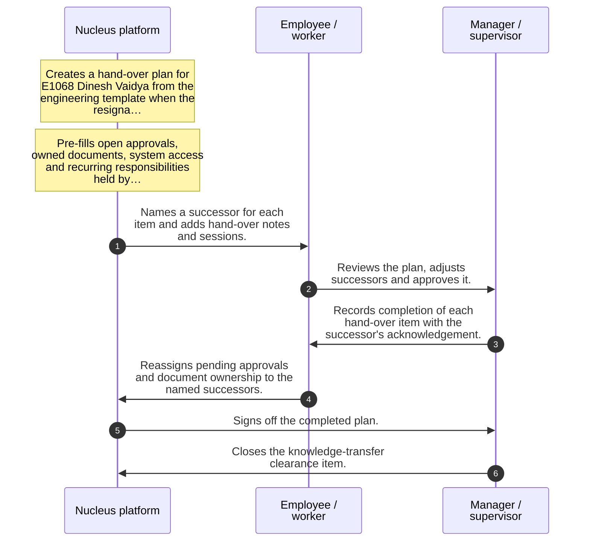

**Alternate flows**

| ID | At step | Condition | Steps | Rejoins |
| :--- | ---: | :--- | :--- | :--- |
| A1 | 3 | The leaver's role has no successor yet. | The manager is named as interim owner for each item. | Returns to step 4 |

**Exception flows**

| ID | At step | Condition | Handling | Rule |
| :--- | ---: | :--- | :--- | :--- |
| E1 | 7 | The plan is not signed off by the last working day. | The clearance item stays open; if blocking, settlement is held until it is closed or waived by an authorised role. | RL-403 |
| E2 | 6 | A successor declines an item. | The item returns to the manager for reassignment. |  |

**Postconditions — success**

- The hand-over plan is completed and approved; responsibilities and documents are reassigned and the knowledge-transfer clearance item is closed.

**Postconditions — failure**

- The clearance item remains open and, if blocking, holds settlement until completed or waived.

**Quality requirements**

- Pre-filled hand-over items are generated within 1 minute of resignation acceptance.
- No pending approval assigned to a leaver remains unrouted after the last working day.

## Approval & Sign-off

| Role | Name | Date | Decision | Conditions / comments |
| :--- | :--- | :--- | :--- | :--- |
| Author | Dhanraj Dadhich | 2026-11-05 | Submitted | |
| Peer review moderator | *pending* | | | PR-xxxx |
| PQA (process compliance) | *pending* | | | |
| Approval authority (DOC-01 §7) | *pending* | | | |

## Measurement Data Captured

| Measure | Value | Unit | Notes |
| :--- | :--- | :--- | :--- |
| Size | 485 | specified items (table rows) | Counted automatically at generation |
| Authoring effort | *to be recorded* | person-hours | |
| Review effort (preparation + meeting) | *pending review* | person-hours | From PR-xxxx |
| Rework effort | *pending review* | person-hours | |
| Review rate | *pending review* | items / hour | Compare with PPB control limits |
| Requirement volatility (changes since baseline) | 0 | CRs touching this artefact | Not yet baselined (CM-03) |

**Defects found, by detection phase and severity**

| Detection phase | Major | Minor | Editorial | Injected in phase (major) |
| :--- | :--- | :--- | :--- | :--- |
| Author self-check | 0 | 0 | 0 | — |
| Peer review | *pending* | | | |
| Design / build | | | | |
| System / integration test | | | | |
| UAT | | | | |
| Production (escaped) | | | | each escaped major opens a CAR record (CAR-01) |

Within control limits of the review-rate PPB? *To be assessed at peer review.*

## Revision History

| Version | Date | Author | Change summary | CR ref | Approved by |
| :--- | :--- | :--- | :--- | :--- | :--- |
| 1.0.0 | 2026-11-05 | Dhanraj Dadhich | Consolidated release | CR-0001 | *pending* |
