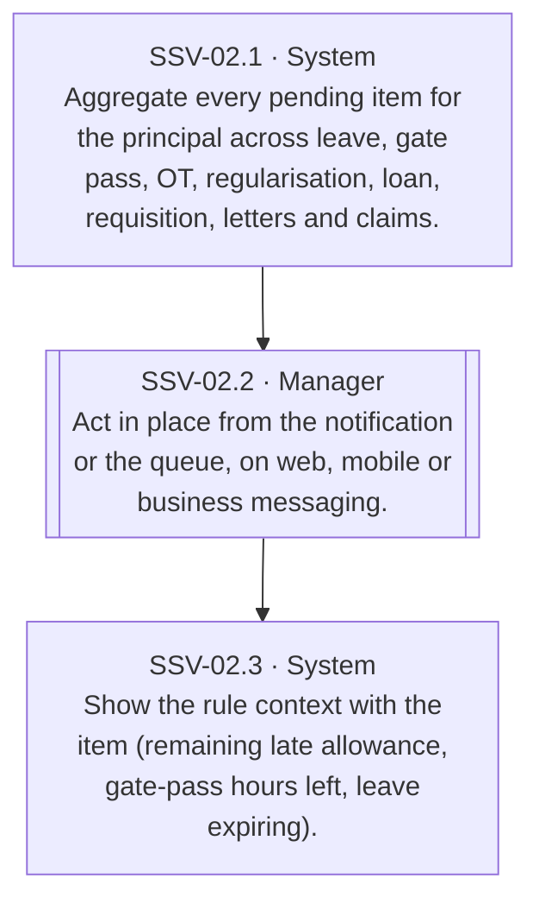
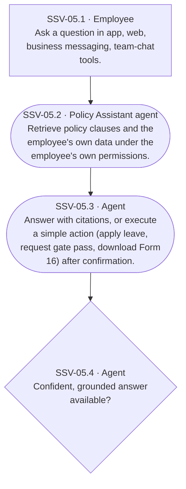

<picture>
  <source media="(prefers-color-scheme: dark)" srcset="../../assets/MultipliersKraftLogoDark.png">
  
</picture>

# FRS-SSV-01 — Self-service & Helpdesk — Process Specifications

| Attribute | Value |
| :--- | :--- |
| Document ID | FRS-SSV-01 |
| Title | Self-service & Helpdesk — Process Specifications |
| Product | Nucleus Suite (Nucleus HRMS Suite) |
| Version | 1.0.0 |
| Status | Issued for approval |
| Owner (role) | Domain Product Owner — Self-service & Helpdesk |
| Author | Dhanraj Dadhich |
| Reviewed by | *pending* |
| Approved by | Product Council — *pending* |
| Date | 2026-11-05 |
| Classification | Internal |
| CMMI practice areas | RDM, TS |
| Related documents | FRS-SSV-00, FRS-SSV-01, FRS-SSV-02, FRS-SSV-03, FRS-SSV-04, FRS-SSV-05, FRS-SSV-06, FRS-SSV-07, FRS-SSV-08, FRS-SSV-09, FRS-SSV-10, FRS-SSV-11, FRS-SSV-12, FRS-SSV-13, BRS-01, SRS-01, REQ-01, REQ-02 |
| Quality & process-performance objectives | QPPO-05 (effective requirements reviews), QPPO-01 (escaped defects) — MPM-01 |
| Process performance baseline used | PPB-01 (review defect density), PPB-02 (review rate) — MPM-01 |
| Peer review record | *pending* (PR-xxxx, QA-02) |
| Tailoring record | none |
| Traceability anchor | BG-02, BG-03 · processes SSV-01–SSV-05 |
| Source of record | Nucleus — Process Flows & Process Maps v1.0 — sheet(s) 03_Process_Inventory, 04_Process_Steps, 05_Swimlane_Maps Nucleus HR Demo Points Build Sheet v1.0 — sheet(s) 07_Approval_Workflows Nucleus HRMS Demo Dataset v1.1 — sheet(s) 64_Approval_Workflows |

> **Source of record.** Requirements in this document are taken from the source workbook(s) named above and keep their workbook IDs, which are never renumbered. Changes are made through a change request (CM-02) against the source workbook. Sections marked **Authored** are original additions that are not present in the source workbooks.

Step types: TASK (human) · SYS (system, unattended) · DEC (decision) · APPR (approval gate) · INT (integration call) · WAIT (timer or external event) · AGENT (agent-executed, governed). CRUD: C create · R read · U update · D delete-by-end-dating (temporal facts are never hard-deleted). In the flow diagrams decisions are diamonds, approvals are double-bordered boxes and integration, wait and agent steps are rounded.

## 1. Process inventory

| Process ID | Process | Trigger | Primary actor | Frequency | Criticality | Blueprint module | Phase | Reuses | Demo pts | Note |
| :--- | :--- | :--- | :--- | :--- | :--- | :--- | :--- | :--- | :--- | :--- |
| SSV-01 | Employee self-service action | Employee intent | Employee | Continuous | High | Module 4 | P1 | CMP-08 | 1,11 | Three taps or fewer. Offline for attendance and payslip. |
| SSV-02 | Manager unified approval inbox | Any pending item | Manager | Daily | High | Module 4 | P1 | CMP-01, CMP-08 | 5 | One queue across every module, not one inbox per module. |
| SSV-03 | business messaging channel transaction | Message received | Employee | Continuous | High | Modules 4, 7 | P2 | CMP-02, CMP-08 | 20 | Parallel first-class channel: apply, approve, check in, payslip. |
| SSV-04 | Helpdesk ticket | Question or issue | Employee | Continuous | Medium | Module 7 | P2 | CMP-01 |  | Routing, SLA, escalation, deflection measurement. |
| SSV-05 | Grounded policy answer | Employee question | Policy Assistant agent | Continuous | Medium | Module 7 | P2 | CMP-11, CMP-06 | 7 | No answer without a retrieved source; unknown creates a ticket and says so. |

## 2. Step-level specifications

### SSV-01 — Employee self-service action

**Trigger:** Employee intent · **Primary actor:** Employee · **Frequency:** Continuous · **Criticality:** High · **Phase:** P1 · **Reuses:** CMP-08

The source workbook specifies this process at inventory level only. Its complete flow is specified in use case SSV-UC-001 (FRS-SSV-12).

### SSV-02 — Manager unified approval inbox

**Trigger:** Any pending item · **Primary actor:** Manager · **Frequency:** Daily · **Criticality:** High · **Phase:** P1 · **Reuses:** CMP-01, CMP-08

| Step | Step ID | Lane / actor | Type | Action or decision | Rule ID(s) | Objects touched (CRUD) | Key fields | Screen | Event emitted | Exception / note | Reuses | Demo pts | Phase |
| :--- | :--- | :--- | :--- | :--- | :--- | :--- | :--- | :--- | :--- | :--- | :--- | :--- | :--- |
| 1 | SSV-02.1 | System | SYS | Aggregate every pending item for the principal across leave, gate pass, OT, regularisation, loan, requisition, letters and claims. | RL-410 | approval_step R | item_type, requester, age, sla_due | SCR-040 |  | ONE queue. Not a leave inbox, an expense inbox and a payroll inbox. | CMP-01 | 5 | P1 |
| 2 | SSV-02.2 | Manager | APPR | Act in place from the notification or the queue, on web, mobile or business messaging. | RL-411 | approval_step U | decision, reason, channel | SCR-040 | platform.approval.step_decided | Every notification is actionable in place. | CMP-08 | 5 | P1 |
| 3 | SSV-02.3 | System | SYS | Show the rule context with the item (remaining late allowance, gate-pass hours left, leave expiring). | RL-412 | various R | context vector | SCR-040 |  | A surprise deduction becomes a ticket; showing the rule prevents it. |  | 5 | P1 |

### SSV-03 — business messaging channel transaction

**Trigger:** Message received · **Primary actor:** Employee · **Frequency:** Continuous · **Criticality:** High · **Phase:** P2 · **Reuses:** CMP-02, CMP-08

The source workbook specifies this process at inventory level only. Its complete flow is specified in use case SSV-UC-003 (FRS-SSV-12).

### SSV-04 — Helpdesk ticket

**Trigger:** Question or issue · **Primary actor:** Employee · **Frequency:** Continuous · **Criticality:** Medium · **Phase:** P2 · **Reuses:** CMP-01

The source workbook specifies this process at inventory level only. Its complete flow is specified in use case SSV-UC-004 (FRS-SSV-12).

### SSV-05 — Grounded policy answer

**Trigger:** Employee question · **Primary actor:** Policy Assistant agent · **Frequency:** Continuous · **Criticality:** Medium · **Phase:** P2 · **Reuses:** CMP-11, CMP-06

| Step | Step ID | Lane / actor | Type | Action or decision | Rule ID(s) | Objects touched (CRUD) | Key fields | Screen | Event emitted | Exception / note | Reuses | Demo pts | Phase |
| :--- | :--- | :--- | :--- | :--- | :--- | :--- | :--- | :--- | :--- | :--- | :--- | :--- | :--- |
| 1 | SSV-05.1 | Employee | TASK | Ask a question in app, web, business messaging, team-chat tools. | RL-420 | conversation C | question, channel, principal_id | SCR-041 |  |  |  | 7 | P2 |
| 2 | SSV-05.2 | Policy Assistant agent | AGENT | Retrieve policy clauses and the employee's own data under the employee's own permissions. | RL-421 | policy_document R; various R | retrieved_sources[], scope_applied | SCR-041 | agent.tool.called | Grounding mandatory: no answer without a retrieved source. | CMP-11 | 7 | P2 |
| 3 | SSV-05.3 | Agent | AGENT | Answer with citations, or execute a simple action (apply leave, request gate pass, download Form 16) after confirmation. | RL-422 | action_ledger C | tool, inputs, dry_run_diff, confirmation | SCR-041 | agent.action.executed | Auto for reads; confirm for writes. | CMP-11 | 7 | P2 |
| 4 | SSV-05.4 | Agent | DEC | Confident, grounded answer available? | RL-423 | ticket C | deflected(Y/N) | SCR-041 | helpdesk.ticket.created | No → create a ticket and say so. Never guess. |  | 7 | P2 |

## 4. Approval workflows

_No entries in source for this scope._

### Workflow behaviour

_No entries in source for this scope._

## Approval & Sign-off

| Role | Name | Date | Decision | Conditions / comments |
| :--- | :--- | :--- | :--- | :--- |
| Author | Dhanraj Dadhich | 2026-11-05 | Submitted | |
| Peer review moderator | *pending* | | | PR-xxxx |
| PQA (process compliance) | *pending* | | | |
| Approval authority (DOC-01 §7) | *pending* | | | |

## Measurement Data Captured

| Measure | Value | Unit | Notes |
| :--- | :--- | :--- | :--- |
| Size | 12 | specified items (table rows) | Counted automatically at generation |
| Authoring effort | *to be recorded* | person-hours | |
| Review effort (preparation + meeting) | *pending review* | person-hours | From PR-xxxx |
| Rework effort | *pending review* | person-hours | |
| Review rate | *pending review* | items / hour | Compare with PPB control limits |
| Requirement volatility (changes since baseline) | 0 | CRs touching this artefact | Not yet baselined (CM-03) |

**Defects found, by detection phase and severity**

| Detection phase | Major | Minor | Editorial | Injected in phase (major) |
| :--- | :--- | :--- | :--- | :--- |
| Author self-check | 0 | 0 | 0 | — |
| Peer review | *pending* | | | |
| Design / build | | | | |
| System / integration test | | | | |
| UAT | | | | |
| Production (escaped) | | | | each escaped major opens a CAR record (CAR-01) |

Within control limits of the review-rate PPB? *To be assessed at peer review.*

## Revision History

| Version | Date | Author | Change summary | CR ref | Approved by |
| :--- | :--- | :--- | :--- | :--- | :--- |
| 1.0.0 | 2026-11-05 | Dhanraj Dadhich | Consolidated release | CR-0001 | *pending* |
