

<picture>
  <source media="(prefers-color-scheme: dark)" srcset="../../assets/MultipliersKraftLogoDark.png">
  
</picture>

# FRS-SSV-12 — Self-service & Helpdesk — Use Case Specifications

| Attribute | Value |
| :--- | :--- |
| Document ID | FRS-SSV-12 |
| Title | Self-service & Helpdesk — Use Case Specifications |
| Product | Nucleus Suite (Nucleus HRMS Suite) |
| Version | 1.0.0 |
| Status | Issued for approval |
| Owner (role) | Domain Product Owner — Self-service & Helpdesk |
| Author | Dhanraj Dadhich |
| Reviewed by | *pending* |
| Approved by | Product Council — *pending* |
| Date | 2026-11-05 |
| Classification | Internal |
| CMMI practice areas | RDM, VV |
| Related documents | FRS-SSV-00, FRS-SSV-01, FRS-SSV-02, FRS-SSV-03, FRS-SSV-04, FRS-SSV-05, FRS-SSV-06, FRS-SSV-07, FRS-SSV-08, FRS-SSV-09, FRS-SSV-10, FRS-SSV-11, FRS-SSV-12, FRS-SSV-13, BRS-01, SRS-01, REQ-01, REQ-02 |
| Quality & process-performance objectives | QPPO-05 (effective requirements reviews), QPPO-01 (escaped defects) — MPM-01 |
| Process performance baseline used | PPB-01 (review defect density), PPB-02 (review rate) — MPM-01 |
| Peer review record | *pending* (PR-xxxx, QA-02) |
| Tailoring record | none |
| Traceability anchor | BG-02, BG-03 · processes SSV-01–SSV-05 |
| Source of record | Nucleus — Process Flows & Process Maps v1.0 — sheet(s) 03_Process_Inventory, 04_Process_Steps, 07_Screens, 09_Business_Rules Authored use cases (marked per use case) |

> **Source of record.** Requirements in this document are taken from the source workbook(s) named above and keep their workbook IDs, which are never renumbered. Changes are made through a change request (CM-02) against the source workbook. Sections marked **Authored** are original additions that are not present in the source workbooks.

This document specifies 12 use cases for Self-service & Helpdesk: 2 follow the step-level flows of the source workbook and 10 are authored (processes without step-level detail in the source, and capability gaps). User stories derived from each use case are in FRS-SSV-13.

## 1. Use case index

| ID | Use case | Primary actor | Realises | Source | Phase | Criticality |
| :--- | :--- | :--- | :--- | :--- | :--- | :--- |
| [SSV-UC-001](#ssv-uc-001) | Complete a self-service action in three taps | Employee / worker | SSV-01 | Authored | P1 | High |
| [SSV-UC-002](#ssv-uc-002) | Act on pending approvals from one unified inbox | Manager / supervisor | SSV-02 | Source workbook | P1 | High |
| [SSV-UC-003](#ssv-uc-003) | Transact through the business messaging channel | Employee / worker | SSV-03 | Authored | P2 | High |
| [SSV-UC-004](#ssv-uc-004) | Raise and resolve a helpdesk ticket | Employee / worker | SSV-04 | Authored | P2 | Medium |
| [SSV-UC-005](#ssv-uc-005) | Answer a policy question with grounded sources | Agent (governed) | SSV-05 | Source workbook | P2 | Medium |
| [SSV-UC-006](#ssv-uc-006) | Publish and find answers in the HR service catalogue and knowledge base | HR operations | SSV-CG-001 | Authored | P1 | High |
| [SSV-UC-007](#ssv-uc-007) | Compose and run a guided employee journey | HR operations | SSV-CG-002 | Authored | P3 | Medium |
| [SSV-UC-008](#ssv-uc-008) | Use self-service with assistive technology | Employee / worker | SSV-CG-003 | Authored | P1 | High |
| [SSV-UC-009](#ssv-uc-009) | Use the native mobile app with offline access and biometric unlock | Employee / worker | SSV-CG-004 | Authored | P2 | High |
| [SSV-UC-010](#ssv-uc-010) | Converse with one HR assistant across web, mobile, kiosk, voice and messaging | Employee / worker | SSV-CG-005 | Authored | P2 | High |
| [SSV-UC-011](#ssv-uc-011) | Handle a confidential HR case in a restricted queue | HR operations | SSV-CG-006 | Authored | P2 | Critical |
| [SSV-UC-012](#ssv-uc-012) | Generate a signed standard letter on demand | Employee / worker | SSV-CG-007 | Authored | P2 | Medium |

## 2. Use case diagrams

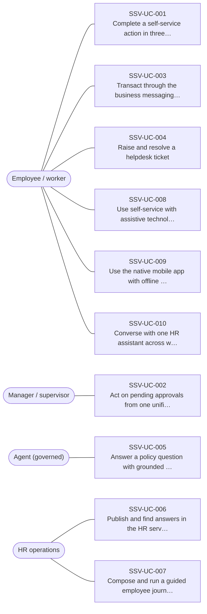

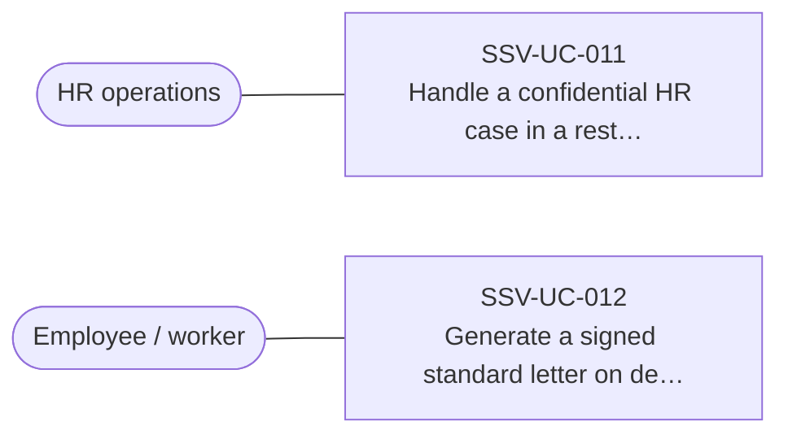

## 3. Use case specifications

### SSV-UC-001

**Complete a self-service action in three taps** — Let an employee punch, view a payslip, apply for leave or a gate pass, or raise a ticket in three taps or fewer, with attendance and payslip available offline.

| Attribute | Value |
| :--- | :--- |
| Realises | SSV-01 |
| Source | Authored |
| Level | User goal |
| Primary actor | Employee / worker |
| Secondary actors | Nucleus platform, Manager / supervisor |
| Trigger | The employee opens the app with an intent (punch, payslip, leave, gate pass, ticket). |
| Frequency | Continuous |
| Criticality | High |
| Phase | P1 |
| Client requirements | — |
| Business rules | — |
| Screens | SCR-042, SCR-021 |
| Data objects (CRUD) | attendance_day (R), payslip (R), regularisation_request (C) |
| Events | — |
| Acceptance tests | — |
| System requirements | SYS-013, SYS-037, SYS-069, SYS-071, SYS-077 |

**Stakeholders and interests**

| Stakeholder | Interest |
| :--- | :--- |
| Plant HR / time office | Fewer walk-in queries about attendance and pay. |
| Manager / supervisor | Requests arrive complete and in one queue. |

**Preconditions**

- The employee has an active assignment and an enrolled device.
- Self-service actions are enabled for the employee's worker class.

**Main success scenario**

| # | Actor | Action | Ref |
| ---: | :--- | :--- | :--- |
| 1 | Employee / worker | Opens SCR-042 and unlocks it with the device's biometric or PIN. |  |
| 2 | Nucleus platform | Shows the home tiles for punch, payslip, leave, gate pass, tickets and announcements permitted to the employee. |  |
| 3 | Employee / worker | Selects an action, for example 'My attendance'. |  |
| 4 | Nucleus platform | Shows the result, such as the day-by-day status on SCR-021 with net hours, late allowance left and the rule applied. |  |
| 5 | Employee / worker | Raises a follow-up such as a regularisation for a specific day, filling only the fields the rule needs. |  |
| 6 | Nucleus platform | Validates and submits the request, confirms it on screen and routes it to the approver's unified inbox. |  |

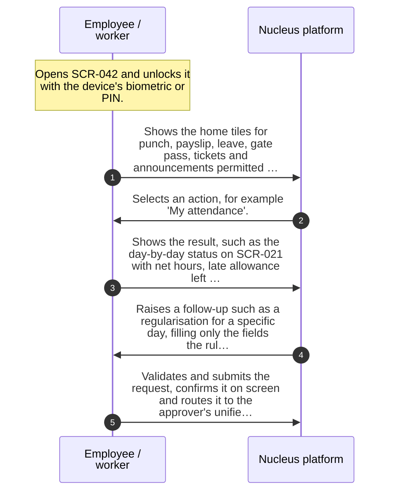

**Alternate flows**

| ID | At step | Condition | Steps | Rejoins |
| :--- | ---: | :--- | :--- | :--- |
| A1 | 2 | The device is offline. | Platform shows cached attendance for the last 60 days and cached payslips, labelled with the last sync time. → Write actions are queued and submitted on reconnection. | Returns to step 3 |
| A2 | 3 | The employee asks for a payslip. | Platform shows the latest payslip with a run selector where the period has more than one run. | Use case ends |

**Exception flows**

| ID | At step | Condition | Handling | Rule |
| :--- | ---: | :--- | :--- | :--- |
| E1 | 6 | A queued offline request conflicts with a change made meanwhile (for example the day was already regularised). | The queued request is rejected on sync and the employee is told why. |  |
| E2 | 3 | The employee selects an action outside their permissions. | The tile is not shown; a deep link to it returns 'not available for your role'. |  |

**Postconditions — success**

- The requested information is shown or the request is submitted and visible in the employee's history.
- Any request requiring approval is in the approver's unified inbox.

**Postconditions — failure**

- Nothing is submitted; the employee sees why and can retry, or the action is queued offline.

**Quality requirements**

- Home loads within 2 seconds at p95 on a mid-range phone over 4G.
- Any listed action is reachable in three taps or fewer from home.
- Offline cache is encrypted on the device.

### SSV-UC-002

**Act on pending approvals from one unified inbox** — Give each approver one queue for every pending item across modules, actionable in place on any channel with the rule context needed to decide.

| Attribute | Value |
| :--- | :--- |
| Realises | SSV-02 |
| Source | Source workbook |
| Level | User goal |
| Primary actor | Manager / supervisor |
| Secondary actors | Nucleus platform, Employee / worker, Business messaging channel |
| Trigger | Any item awaits the approver's decision. |
| Frequency | Daily |
| Criticality | High |
| Phase | P1 |
| Client requirements | — |
| Business rules | RL-410, RL-411, RL-412 |
| Screens | SCR-040 |
| Data objects (CRUD) | approval_step (R/U) |
| Events | platform.approval.step_decided |
| Acceptance tests | TC-S410, TC-S411, TC-S412 |
| System requirements | SYS-020, SYS-037, SYS-040, SYS-071 |

**Stakeholders and interests**

| Stakeholder | Interest |
| :--- | :--- |
| Employee / worker | Requests are decided quickly and with reasons. |
| HR operations | Fewer disputes from surprise deductions. |

**Preconditions**

- The approver is authenticated and holds a reporting line or role that routes items to them.

**Main success scenario**

| # | Actor | Action | Ref |
| ---: | :--- | :--- | :--- |
| 1 | Nucleus platform | Aggregates every pending item for the approver across leave, gate pass, overtime, regularisation, loan, requisition, letters and claims into one queue. | SSV-02.1 |
| 2 | Manager / supervisor | Approves or rejects in place from the notification or the queue, on web, mobile or the business messaging channel. | SSV-02.2 |
| 3 | Nucleus platform | Shows with each item the rule context that bears on the decision, such as late allowance left, gate-pass hours left or leave expiring. | SSV-02.3 |

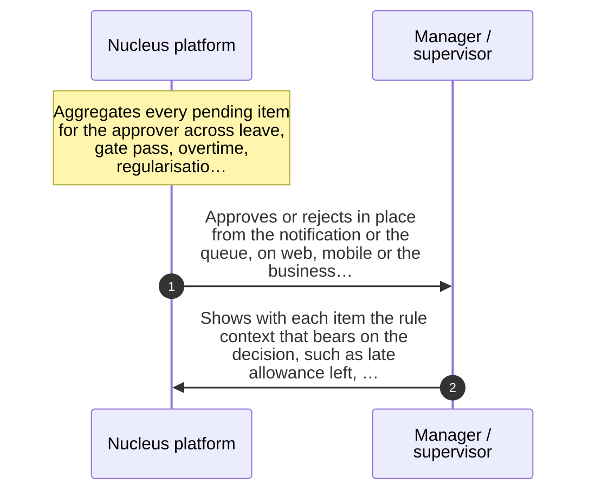

**Alternate flows**

| ID | At step | Condition | Steps | Rejoins |
| :--- | ---: | :--- | :--- | :--- |
| A1 | 2 | The approver delegates the item. | Approver selects a delegate within scope and a validity period. → The item moves to the delegate's queue with the delegation recorded. | Use case ends |
| A2 | 2 | The approver is offline. | The decision is queued on the device. → On reconnection it is submitted with the original decision time. | Use case ends |

**Exception flows**

| ID | At step | Condition | Handling | Rule |
| :--- | ---: | :--- | :--- | :--- |
| E1 | 2 | The item was already decided on another channel. | The second action is not applied; the approver sees the current decision and who made it. | RL-411 |
| E2 | 2 | A rejection is submitted without a reason. | The rejection is refused until a reason is entered. |  |
| E3 | 3 | The context source is unavailable. | The item shows that context could not be loaded rather than hiding the gap. | RL-412 |
| E4 | 1 | The approver is also the requester. | The item is routed to the next approver and never appears in the requester's own queue. |  |

**Postconditions — success**

- The approval step is decided with decision, reason where required, and channel recorded; platform.approval.step_decided is emitted.

**Postconditions — failure**

- The item stays pending with its SLA running and remains in the queue.

**Quality requirements**

- Queue loads 200 items within 2 seconds at p95.
- A decision made on any channel is reflected on all others within 5 seconds.

### SSV-UC-003

**Transact through the business messaging channel** — Let employees apply, approve, check in and fetch payslips through the business messaging channel as a first-class channel with the same rules as the app.

| Attribute | Value |
| :--- | :--- |
| Realises | SSV-03 |
| Source | Authored |
| Level | User goal |
| Primary actor | Employee / worker |
| Secondary actors | Business messaging channel, Nucleus platform, Manager / supervisor |
| Trigger | A message arrives from an employee's registered mobile number. |
| Frequency | Continuous |
| Criticality | High |
| Phase | P2 |
| Client requirements | — |
| Business rules | RL-397 |
| Screens | — |
| Data objects (CRUD) | conversation (C), audit_event (C) |
| Events | — |
| Acceptance tests | TC-X397, TC-E492 |
| System requirements | SYS-013, SYS-032, SYS-070, SYS-071, SYS-079 |

**Stakeholders and interests**

| Stakeholder | Interest |
| :--- | :--- |
| Plant HR / time office | Workers without the app still reach self-service. |
| Compliance owner | Identity is verified before any data is shared. |

**Preconditions**

- The employee's mobile number is registered and verified.
- The tenant's business messaging account is active.

**Main success scenario**

| # | Actor | Action | Ref |
| ---: | :--- | :--- | :--- |
| 1 | Business messaging channel | Delivers the employee's message to the integration service. |  |
| 2 | Nucleus platform | Matches the number to a principal and verifies the session by one-time code if none is active. |  |
| 3 | Nucleus platform | Interprets the intent, such as apply leave, check in, fetch payslip or approve an item. |  |
| 4 | Nucleus platform | For a write, replies with a summary and asks for explicit confirmation. |  |
| 5 | Employee / worker | Confirms the action. |  |
| 6 | Nucleus platform | Executes it through the same domain service as the app and replies with the outcome and reference. |  |
| 7 | Nucleus platform | Records the transaction in the audit trail with the channel as source. |  |

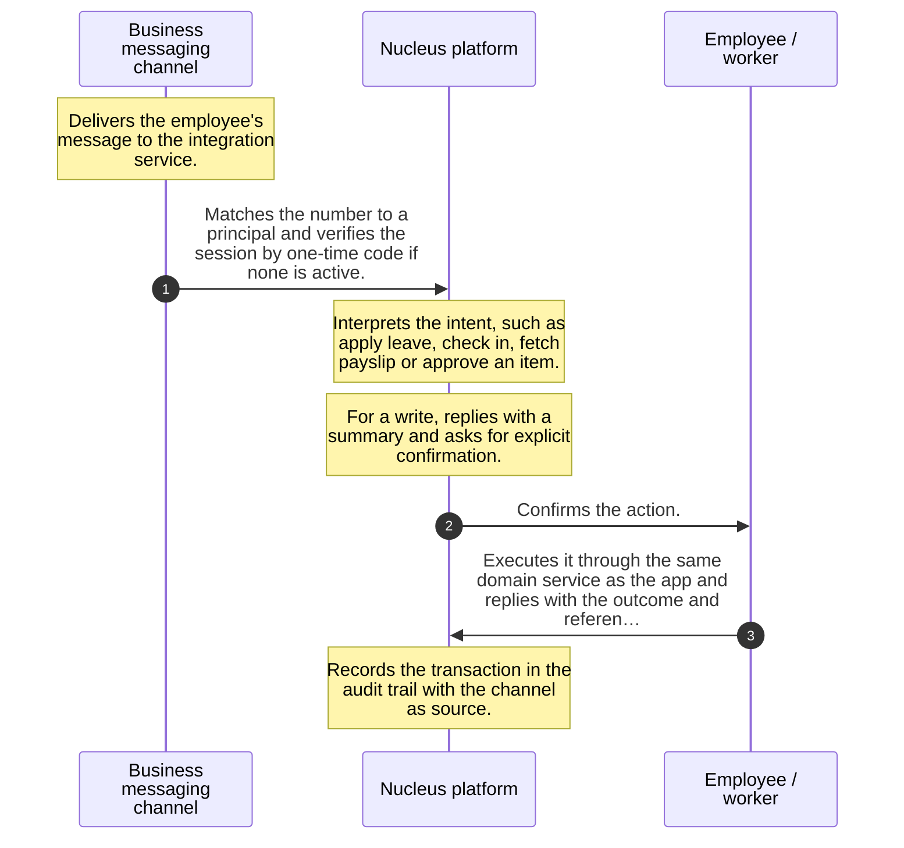

**Alternate flows**

| ID | At step | Condition | Steps | Rejoins |
| :--- | ---: | :--- | :--- | :--- |
| A1 | 3 | The intent is a read such as 'payslip September'. | Platform returns the payslip as a password-protected document after verification. | Returns to step 7 |
| A2 | 1 | The message is a reply to a lifecycle announcement. | Platform records the reaction against the announcement. | Use case ends |

**Exception flows**

| ID | At step | Condition | Handling | Rule |
| :--- | ---: | :--- | :--- | :--- |
| E1 | 2 | The number is not registered. | No data is shared and the sender is told to contact HR. |  |
| E2 | 5 | The employee does not confirm within 10 minutes. | The pending action expires and nothing is written. |  |
| E3 | 6 | The domain rule rejects the request (for example insufficient leave balance). | The reason from the rule is returned in the reply. |  |

**Postconditions — success**

- The requested information is returned or the transaction completes through the same domain services as the app, with an audit entry.

**Postconditions — failure**

- No data is shared and no write happens; the employee is told why.

**Quality requirements**

- Replies are sent within 5 seconds at p95.
- No personal data is sent before verification.

### SSV-UC-004

**Raise and resolve a helpdesk ticket** — Route an employee question to the right resolver, resolve it within SLA using the employee's own record, and measure deflection.

| Attribute | Value |
| :--- | :--- |
| Realises | SSV-04 |
| Source | Authored |
| Level | User goal |
| Primary actor | Employee / worker |
| Secondary actors | HR operations, Nucleus platform, Manager / supervisor, Agent (governed) |
| Trigger | An employee has a question or issue the assistant could not resolve, or chooses to raise a ticket. |
| Frequency | Continuous |
| Criticality | Medium |
| Phase | P2 |
| Client requirements | — |
| Business rules | — |
| Screens | SCR-041 |
| Data objects (CRUD) | ticket (C/U) |
| Events | helpdesk.ticket.created |
| Acceptance tests | — |
| System requirements | SYS-017, SYS-039, SYS-043, SYS-070 |

**Stakeholders and interests**

| Stakeholder | Interest |
| :--- | :--- |
| HR operations | Workload by category and SLA performance are visible. |
| Employee / worker | Answers grounded in their own data. |

**Preconditions**

- Categories, routing rules and SLAs by priority are configured per location.

**Main success scenario**

| # | Actor | Action | Ref |
| ---: | :--- | :--- | :--- |
| 1 | Employee / worker | Raises a ticket on SCR-041 choosing a category and describing the issue. |  |
| 2 | Nucleus platform | Routes it to the resolver group for the category and location and sets the SLA from priority. |  |
| 3 | HR operations | Investigates using the employee's records and records a resolution with the evidence shown. |  |
| 4 | Nucleus platform | Notifies the employee and asks for confirmation. |  |
| 5 | Employee / worker | Confirms resolution or reopens the ticket with a reason. |  |
| 6 | Nucleus platform | Closes the ticket and records whether it could have been deflected by the assistant. |  |

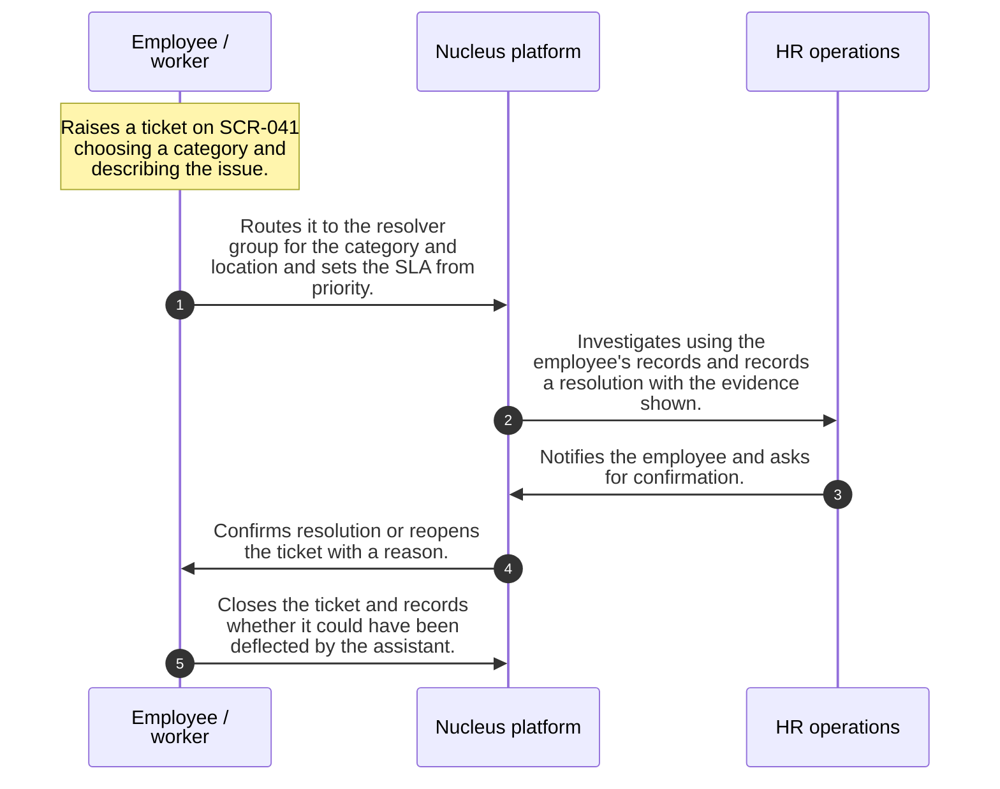

**Alternate flows**

| ID | At step | Condition | Steps | Rejoins |
| :--- | ---: | :--- | :--- | :--- |
| A1 | 5 | The employee does not respond within 3 working days. | The ticket auto-closes as resolved. | Returns to step 6 |
| A2 | 3 | The issue needs a manager's input. | Resolver assigns a sub-task to the manager and the SLA pauses while awaiting employee or manager input. | Returns to step 3 |

**Exception flows**

| ID | At step | Condition | Handling | Rule |
| :--- | ---: | :--- | :--- | :--- |
| E1 | 3 | The SLA is breached. | The ticket escalates to the resolver group lead and is flagged on the dashboard. |  |
| E2 | 1 | The ticket concerns harassment. | The employee is directed to the confidential case channel and the ticket holds no details. |  |

**Postconditions — success**

- The ticket is resolved with a resolution note referencing the employee's records and confirmed or auto-closed.

**Postconditions — failure**

- The ticket is escalated and remains open with the breach recorded.

**Quality requirements**

- Resolvers see only the records within their own data scope.

### SSV-UC-005

**Answer a policy question with grounded sources** — Answer an employee's question only from retrieved policy and the employee's own data, execute simple actions on confirmation, and raise a ticket when unsure.

| Attribute | Value |
| :--- | :--- |
| Realises | SSV-05 |
| Source | Source workbook |
| Level | User goal |
| Primary actor | Agent (governed) |
| Secondary actors | Employee / worker, Nucleus platform, HR operations |
| Trigger | An employee asks a question on any supported channel. |
| Frequency | Continuous |
| Criticality | Medium |
| Phase | P2 |
| Client requirements | — |
| Business rules | RL-420, RL-421, RL-422, RL-423 |
| Screens | SCR-041 |
| Data objects (CRUD) | conversation (C), policy_document (R), action_ledger (C), ticket (C) |
| Events | agent.tool.called, agent.action.executed, helpdesk.ticket.created |
| Acceptance tests | TC-A420, TC-A421, TC-A422, TC-A423 |
| System requirements | SYS-017, SYS-035, SYS-072, SYS-073, SYS-087 |

**Stakeholders and interests**

| Stakeholder | Interest |
| :--- | :--- |
| HR operations | Routine questions are answered correctly without a ticket. |
| Compliance owner | No answer is invented and no write happens without consent. |

**Preconditions**

- Policy documents are published and indexed.
- The agent principal is scoped narrower than the asking employee.

**Main success scenario**

| # | Actor | Action | Ref |
| ---: | :--- | :--- | :--- |
| 1 | Employee / worker | Asks a question in the app, on the web, on the business messaging channel or in the collaboration workspace. | SSV-05.1 |
| 2 | Agent (governed) | Retrieves policy clauses and the employee's own data under the employee's own permissions. | SSV-05.2 |
| 3 | Agent (governed) | Answers with citations, or performs a simple action such as applying leave after the employee confirms it. | SSV-05.3 |
| 4 | Agent (governed) | Checks that a confident, grounded answer exists before closing the conversation. | SSV-05.4 |

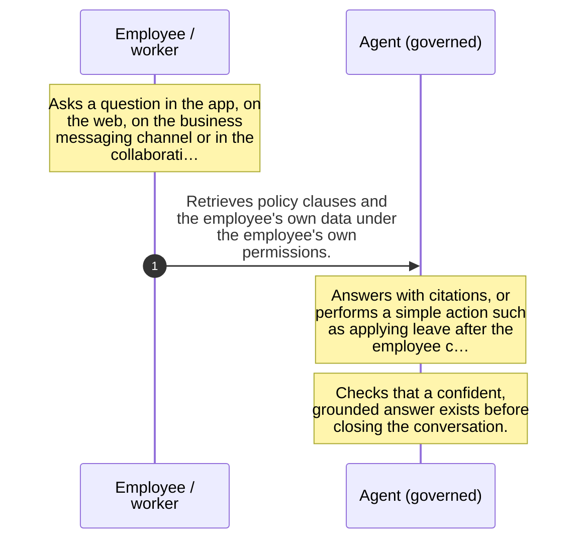

**Alternate flows**

| ID | At step | Condition | Steps | Rejoins |
| :--- | ---: | :--- | :--- | :--- |
| A1 | 3 | The request is a write (apply leave, request gate pass). | Agent shows a dry-run summary of the change. → Employee confirms; agent executes and logs the action in the action ledger. | Returns to step 4 |
| A2 | 4 | No confident, grounded answer is available. | Agent creates a ticket with the question and retrieved context. → Agent tells the employee a ticket was raised and gives its number. | Use case ends |

**Exception flows**

| ID | At step | Condition | Handling | Rule |
| :--- | ---: | :--- | :--- | :--- |
| E1 | 2 | The question asks about another person's data. | Retrieval is limited to the asker's permissions and the agent says it cannot share that data. | RL-420 |
| E2 | 2 | No source is retrieved. | No answer is generated; the flow moves to ticket creation. | RL-421 |
| E3 | 3 | The employee declines the confirmation. | Nothing is written and the cancellation is logged. | RL-422 |
| E4 | 4 | The agent's confidence is below threshold. | A ticket is created and the employee is told so. | RL-423 |

**Postconditions — success**

- The employee receives a cited answer, or a confirmed action is executed and logged in the action ledger.

**Postconditions — failure**

- A ticket is created and the employee is told so; no guessed answer is given.

**Quality requirements**

- First answer token within 3 seconds at p95.
- Every answer shows at least one citation that opens the source clause.

### SSV-UC-006

**Publish and find answers in the HR service catalogue and knowledge base** — Provide a searchable catalogue of HR services and a versioned, owned, multilingual knowledge base.

| Attribute | Value |
| :--- | :--- |
| Realises | SSV-CG-001 |
| Source | Authored |
| Level | User goal |
| Primary actor | HR operations |
| Secondary actors | Employee / worker, Nucleus platform, Agent (governed) |
| Trigger | HR publishes or updates an article or service, or an employee searches. |
| Frequency | Continuous |
| Criticality | High |
| Phase | P1 |
| Client requirements | — |
| Business rules | — |
| Screens | SCR-041 |
| Data objects (CRUD) | kb_article (C/U), service_catalogue_item (C/U) |
| Events | — |
| Acceptance tests | SSV-TC-001, SSV-TC-002, SSV-TC-003, SSV-TC-004 |
| System requirements | SYS-022, SYS-037, SYS-066, SYS-070 |

**Stakeholders and interests**

| Stakeholder | Interest |
| :--- | :--- |
| Employee / worker | Find the right service or article in their language. |
| Agent principal | Grounds answers in current articles only. |

**Preconditions**

- Article owners and review cycles are configured.

**Main success scenario**

| # | Actor | Action | Ref |
| ---: | :--- | :--- | :--- |
| 1 | HR operations | Drafts an article or catalogue entry with owner, audience, review date and linked service form. |  |
| 2 | HR operations | Adds language variants, each marked with its translator and status. |  |
| 3 | HR operations | Submits for review; the reviewer approves and the platform publishes a new version. |  |
| 4 | Nucleus platform | Indexes the version for search and assistant grounding and retires the prior version from grounding. |  |
| 5 | Employee / worker | Searches the catalogue in their language and opens the article or service. |  |
| 6 | Nucleus platform | Reminds the owner 14 days before the review date. |  |

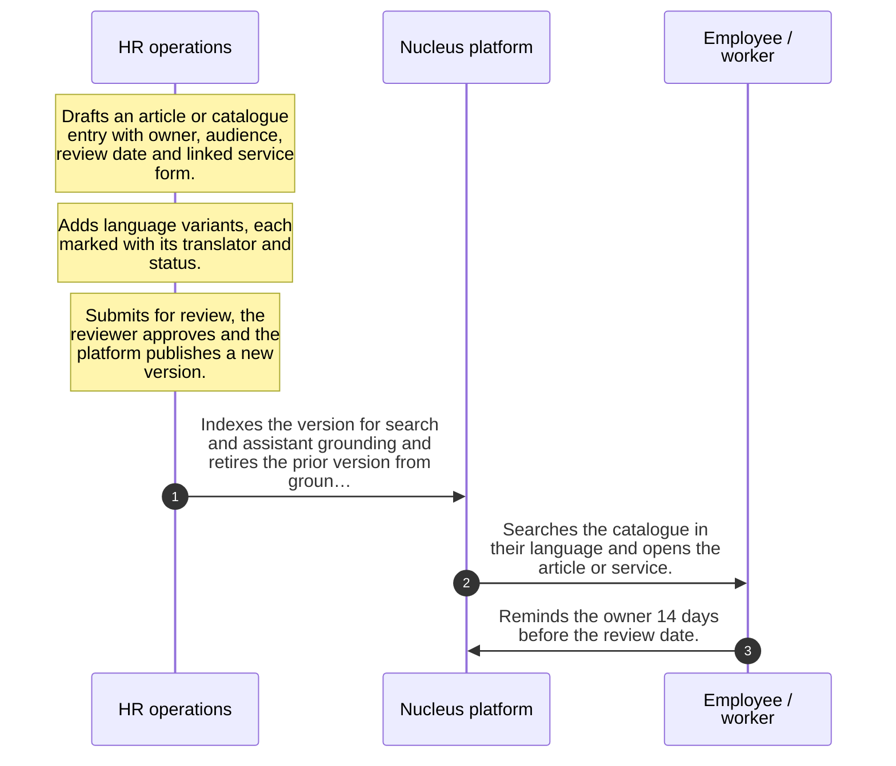

**Alternate flows**

| ID | At step | Condition | Steps | Rejoins |
| :--- | ---: | :--- | :--- | :--- |
| A1 | 5 | No variant exists in the employee's language. | Platform shows the English version with a note that a translation is not available. | Use case ends |

**Exception flows**

| ID | At step | Condition | Handling | Rule |
| :--- | ---: | :--- | :--- | :--- |
| E1 | 6 | The review date passes without review. | The article is flagged stale and excluded from assistant grounding until reviewed. |  |

**Postconditions — success**

- The article is published with owner, version, review date and language variants and is searchable and citable.

**Postconditions — failure**

- The article stays in draft or is withdrawn from search and grounding.

**Quality requirements**

- Search returns results within 1 second at p95.
- Supports the 11 configured interface languages.

### SSV-UC-007

**Compose and run a guided employee journey** — Let HR compose journeys of tasks, content and nudges for life events and deliver them to the right employees at the right time.

| Attribute | Value |
| :--- | :--- |
| Realises | SSV-CG-002 |
| Source | Authored |
| Level | User goal |
| Primary actor | HR operations |
| Secondary actors | Employee / worker, Manager / supervisor, Nucleus platform |
| Trigger | A life event occurs (for example maternity leave approved, relocation, first-time manager promotion). |
| Frequency | Per event |
| Criticality | Medium |
| Phase | P3 |
| Client requirements | — |
| Business rules | — |
| Screens | SCR-042 |
| Data objects (CRUD) | journey_template (C/U), journey_instance (C/U) |
| Events | — |
| Acceptance tests | SSV-TC-005, SSV-TC-006, SSV-TC-007, SSV-TC-008 |
| System requirements | SYS-053, SYS-056, SYS-070 |

**Stakeholders and interests**

| Stakeholder | Interest |
| :--- | :--- |
| Employee / worker | Clear guidance at key life moments. |
| Manager / supervisor | Knows what the employee needs from them. |

**Preconditions**

- A journey template is published with trigger, steps and audience.

**Main success scenario**

| # | Actor | Action | Ref |
| ---: | :--- | :--- | :--- |
| 1 | HR operations | Composes a journey with trigger, ordered tasks, content items and nudges with timing. |  |
| 2 | HR operations | Publishes the journey for a target audience. |  |
| 3 | Nucleus platform | Starts the journey for an employee when the trigger event occurs. |  |
| 4 | Nucleus platform | Delivers each task and nudge at its scheduled time on the employee's preferred channel. |  |
| 5 | Employee / worker | Completes tasks; the platform records progress. |  |
| 6 | Manager / supervisor | Completes manager tasks within the journey, such as a return-to-work conversation. |  |
| 7 | Nucleus platform | Closes the journey and asks the employee for feedback. |  |

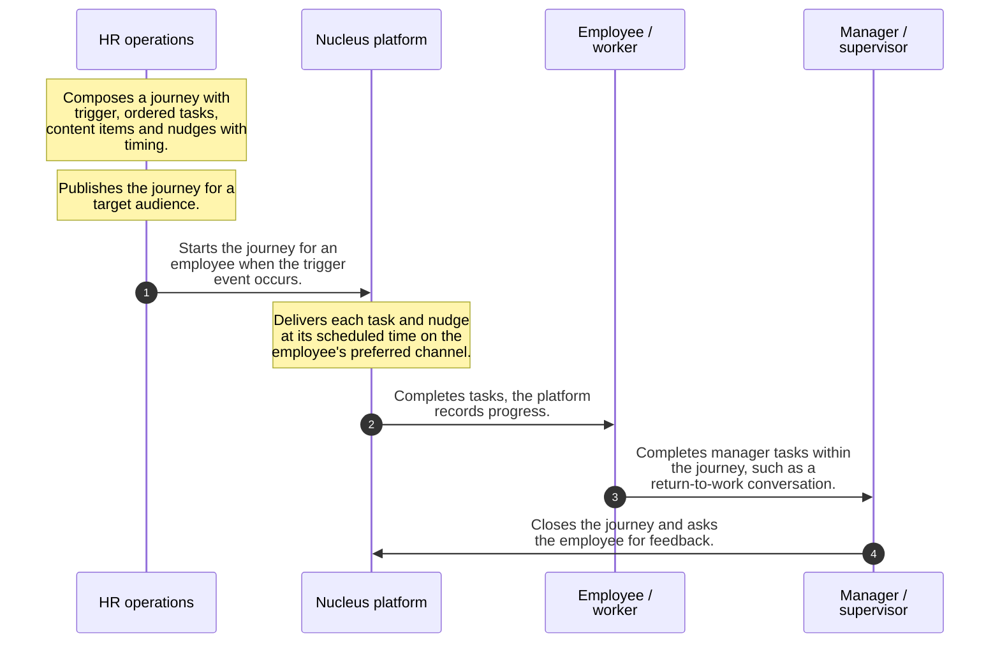

**Alternate flows**

| ID | At step | Condition | Steps | Rejoins |
| :--- | ---: | :--- | :--- | :--- |
| A1 | 3 | The trigger is reversed (for example leave cancelled). | Platform cancels the journey and withdraws pending nudges. | Use case ends |

**Exception flows**

| ID | At step | Condition | Handling | Rule |
| :--- | ---: | :--- | :--- | :--- |
| E1 | 4 | A task links to a retired form or article. | The step is skipped and HR is alerted to fix the journey. |  |

**Postconditions — success**

- The employee completes or is guided through all journey steps; completion is tracked.

**Postconditions — failure**

- The journey is paused or cancelled with reason.

**Quality requirements**

- Journey steps respect the employee's quiet hours for nudges.

### SSV-UC-008

**Use self-service with assistive technology** — Ensure every self-service surface conforms to WCAG 2.2 AA and works with screen readers, keyboard-only use and high-contrast themes.

| Attribute | Value |
| :--- | :--- |
| Realises | SSV-CG-003 |
| Source | Authored |
| Level | User goal |
| Primary actor | Employee / worker |
| Secondary actors | Nucleus platform |
| Trigger | An employee using assistive technology opens a self-service screen. |
| Frequency | Continuous |
| Criticality | High |
| Phase | P1 |
| Client requirements | — |
| Business rules | — |
| Screens | SCR-042, SCR-021 |
| Data objects (CRUD) | — |
| Events | — |
| Acceptance tests | SSV-TC-009, SSV-TC-010, SSV-TC-011, SSV-TC-012 |
| System requirements | SYS-066, SYS-069 |

**Stakeholders and interests**

| Stakeholder | Interest |
| :--- | :--- |
| Employee / worker with a disability | Equal access to all self-service actions. |
| Compliance owner | Accessibility conformance is evidenced. |

**Preconditions**

- Screens have passed automated and manual accessibility checks before release.

**Main success scenario**

| # | Actor | Action | Ref |
| ---: | :--- | :--- | :--- |
| 1 | Employee / worker | Opens SCR-042 with a screen reader active. |  |
| 2 | Nucleus platform | Announces the page title, landmarks and the tile names in a logical order. |  |
| 3 | Employee / worker | Moves through the leave form using only the keyboard. |  |
| 4 | Nucleus platform | Shows a visible focus indicator and keeps focus order matching the visual order. |  |
| 5 | Employee / worker | Submits the form with a missing field. |  |
| 6 | Nucleus platform | Announces the error, moves focus to the first invalid field and describes how to fix it. |  |
| 7 | Employee / worker | Corrects the field and submits successfully; the confirmation is announced. |  |

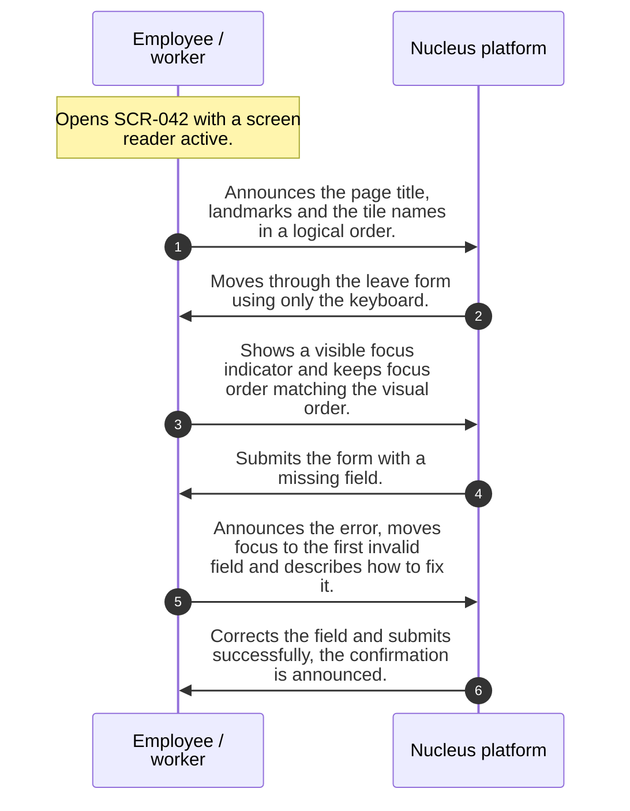

**Alternate flows**

| ID | At step | Condition | Steps | Rejoins |
| :--- | ---: | :--- | :--- | :--- |
| A1 | 1 | The employee selects the high-contrast theme. | Platform applies the theme across all screens with a contrast ratio of at least 4.5:1 for text. | Returns to step 2 |

**Exception flows**

| ID | At step | Condition | Handling | Rule |
| :--- | ---: | :--- | :--- | :--- |
| E1 | 4 | A control is not reachable by keyboard. | Treated as a release-blocking defect. |  |

**Postconditions — success**

- The employee completes the action using only assistive technology.

**Postconditions — failure**

- A defect is logged against the screen with the failed success criterion.

**Quality requirements**

- Conforms to WCAG 2.2 level AA.
- Interactive targets are at least 24 by 24 CSS pixels.

### SSV-UC-009

**Use the native mobile app with offline access and biometric unlock** — Give employees a native mobile app with biometric unlock and offline read of payslips, balances and documents.

| Attribute | Value |
| :--- | :--- |
| Realises | SSV-CG-004 |
| Source | Authored |
| Level | User goal |
| Primary actor | Employee / worker |
| Secondary actors | Nucleus platform, Identity provider, Tenant admin |
| Trigger | The employee installs and signs in to the app. |
| Frequency | Continuous |
| Criticality | High |
| Phase | P2 |
| Client requirements | — |
| Business rules | — |
| Screens | SCR-042, SCR-021 |
| Data objects (CRUD) | device_enrolment (C/U), offline_cache (C) |
| Events | — |
| Acceptance tests | SSV-TC-013, SSV-TC-014, SSV-TC-015, SSV-TC-016 |
| System requirements | SYS-011, SYS-013, SYS-064, SYS-081 |

**Stakeholders and interests**

| Stakeholder | Interest |
| :--- | :--- |
| Tenant admin | Lost or exited devices can be wiped. |
| Employee / worker | Fast access without passwords. |

**Preconditions**

- The tenant has enabled mobile access and single sign-on via OIDC.

**Main success scenario**

| # | Actor | Action | Ref |
| ---: | :--- | :--- | :--- |
| 1 | Employee / worker | Installs the app and signs in through the tenant's identity provider. |  |
| 2 | Identity provider | Authenticates the employee and returns tokens to the app. |  |
| 3 | Nucleus platform | Enrols the device and offers biometric unlock. |  |
| 4 | Employee / worker | Enables biometric unlock. |  |
| 5 | Nucleus platform | Syncs payslips for the last 12 months, leave balances and personal documents into an encrypted cache. |  |
| 6 | Employee / worker | Opens a payslip while offline; the app shows it with the last sync time. |  |

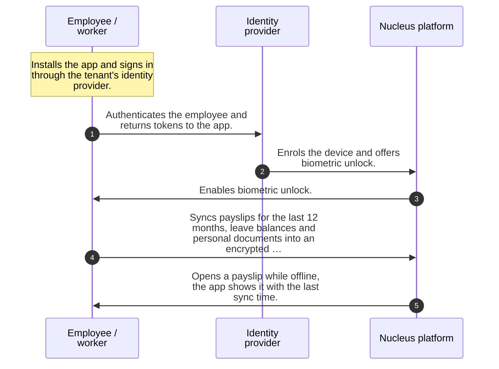

**Alternate flows**

| ID | At step | Condition | Steps | Rejoins |
| :--- | ---: | :--- | :--- | :--- |
| A1 | 4 | The device has no biometric hardware. | The employee sets a 6-digit app PIN instead. | Returns to step 5 |

**Exception flows**

| ID | At step | Condition | Handling | Rule |
| :--- | ---: | :--- | :--- | :--- |
| E1 | 5 | The employee exits or the device is reported lost. | Tenant admin revokes the device; the cache is wiped on next launch and tokens are invalidated. |  |
| E2 | 3 | The device is rooted or jailbroken. | Enrolment is refused and the reason is shown. |  |

**Postconditions — success**

- The device is enrolled, biometric unlock is active and offline data is cached encrypted.

**Postconditions — failure**

- The device is not enrolled and no data is cached.

**Quality requirements**

- Cold start under 3 seconds on a mid-range phone.
- Offline cache encrypted with a device-bound key.

### SSV-UC-010

**Converse with one HR assistant across web, mobile, kiosk, voice and messaging** — Let an employee start an HR conversation on any channel and continue it on another without repeating context, with every write confirmed by the employee and recorded in the action ledger.

| Attribute | Value |
| :--- | :--- |
| Realises | SSV-CG-005 |
| Source | Authored |
| Level | User goal |
| Primary actor | Employee / worker |
| Secondary actors | Agent (governed), Nucleus platform, HR operations, Business messaging channel |
| Trigger | An employee sends a message, speaks to the kiosk or opens the assistant panel in the web or mobile app. |
| Frequency | Continuous |
| Criticality | High |
| Phase | P2 |
| Client requirements | — |
| Business rules | RL-411, RL-420, RL-421, RL-422, RL-423 |
| Screens | SCR-041, SCR-042 |
| Data objects (CRUD) | conversation_session (C, U), channel_binding (R), knowledge_article (R), leave_request (C), helpdesk_ticket (C), action_ledger (C) |
| Events | agent.tool.called, agent.action.executed, leave.request.created, helpdesk.ticket.created |
| Acceptance tests | SSV-TC-017, SSV-TC-018, SSV-TC-019, SSV-TC-020, SSV-TC-021, SSV-TC-022 |
| System requirements | SYS-035, SYS-071, SYS-072, SYS-073, SYS-078, SYS-079 |

**Stakeholders and interests**

| Stakeholder | Interest |
| :--- | :--- |
| Employee / worker | Gets the same answer and the same pending draft whichever channel is at hand, including the canteen kiosk on the shop floor. |
| HR operations | Receives a complete transcript when the assistant hands a question over, instead of starting the case again. |
| Tenant admin | Knows every channel identity is bound to a verified principal and the assistant never exceeds the employee's own scope. |
| Auditor | Can trace each assistant-initiated transaction to the channel, conversation and confirmation that produced it. |

**Preconditions**

- The employee holds an active assignment and a verified principal.
- At least one channel binding exists: a mobile number verified at onboarding for the messaging channel, a badge and PIN for kiosks, or a single sign-on session for web and mobile.
- The assistant runs as an agent principal whose tools are limited to the employee's self scope and are registered with the policy gate.
- Policy sources used for answers are published in the HR knowledge base.

**Main success scenario**

| # | Actor | Action | Ref |
| ---: | :--- | :--- | :--- |
| 1 | Employee / worker | Asks on the messaging channel: how many earned leave days do I have, and can I take 2 days next week? |  |
| 2 | Nucleus platform | Resolves the sender's number to the verified principal and opens or resumes the cross-channel conversation session. |  |
| 3 | Agent (governed) | Reads the balance through the declared leave tool within self scope and answers with the governing policy clause cited. |  |
| 4 | Agent (governed) | Drafts a 2-day earned leave request and shows a confirmation card with dates, leave type and balance after the request. |  |
| 5 | Employee / worker | Confirms the card on the channel. |  |
| 6 | Nucleus platform | Passes the submit call through the policy gate, creates the request in the leave service and routes it to the approval engine. |  |
| 7 | Nucleus platform | Records the action in the action ledger with conversation ID, channel, confirmation timestamp and resulting request ID. |  |
| 8 | Employee / worker | Opens the mobile app later and sees the same thread with the request status updated to pending approval. |  |
| 9 | Nucleus platform | Pushes the approval outcome to the channel the employee used most recently, in the employee's preferred language. |  |

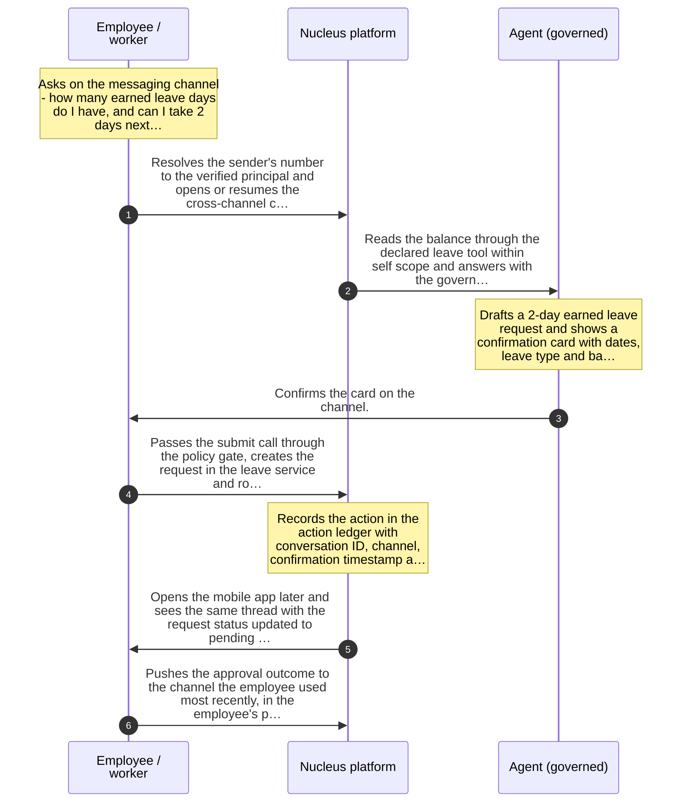

**Alternate flows**

| ID | At step | Condition | Steps | Rejoins |
| :--- | ---: | :--- | :--- | :--- |
| A1 | 1 | The employee is at the Chakan Works canteen kiosk and speaks in Marathi. | Employee taps the badge and enters a 4-digit PIN. → Platform transcribes the speech, replies in Marathi on screen and by voice, and closes the session after 60 seconds of inactivity. | Returns to step 3 |
| A2 | 5 | The employee leaves the messaging channel before confirming and resumes on the web portal. | Platform shows the unconfirmed draft in the web thread. → Confirmation is required again on the new channel; the earlier unconfirmed card is invalidated. | Returns to step 6 |

**Exception flows**

| ID | At step | Condition | Handling | Rule |
| :--- | ---: | :--- | :--- | :--- |
| E1 | 3 | The employee asks for a colleague's leave balance. | Retrieval stays within the asker's permissions and the assistant states it cannot share another person's data. | RL-420 |
| E2 | 3 | No published source supports an answer. | No answer is generated; a helpdesk ticket is raised with the transcript and its number is returned. | RL-421 |
| E3 | 3 | The assistant's confidence is below the tenant threshold of 0.70. | A ticket is created and the employee is told a person will respond. | RL-423 |
| E4 | 5 | The employee declines the confirmation card. | Nothing is written and the cancellation is logged. | RL-422 |
| E5 | 6 | The same draft is confirmed from two channels within seconds. | The second confirmation is not applied; the employee sees the existing request and the channel that submitted it. | RL-411 |
| E6 | 2 | The sender's number is not bound to any principal. | Only public knowledge-base answers are given and the sender is told how to verify the number in the app. |  |

**Postconditions — success**

- The conversation carries one cross-channel conversation ID and shows the same history on every bound channel.
- Any transaction submitted through the assistant exists in its owning service, is routed by the approval engine and is recorded in the action ledger with channel and confirmation reference.

**Postconditions — failure**

- Nothing is written when the employee declines or the policy gate denies the tool call; the reason is recorded.
- Unanswerable or low-confidence questions become a helpdesk ticket carrying the transcript.

**Quality requirements**

- First assistant response within 3 s at p95 on web, mobile and messaging, and within 5 s at p95 on kiosk voice.
- Conversation context is available on every bound channel within 2 s of the last message.
- Kiosk sessions clear all personal data from the screen after 60 s of inactivity.
- Answers and prompts are available in every language enabled for the tenant, including Hindi, Marathi, Tamil and Telugu.

### SSV-UC-011

**Handle a confidential HR case in a restricted queue** — Receive, investigate and close a sensitive case such as harassment, medical disclosure or disciplinary inquiry with need-to-know access and a separate case audit trail.

| Attribute | Value |
| :--- | :--- |
| Realises | SSV-CG-006 |
| Source | Authored |
| Level | User goal |
| Primary actor | HR operations |
| Secondary actors | Employee / worker, Director / approver, Auditor, Tenant admin, Nucleus platform |
| Trigger | An employee raises a concern in a sensitive category, or HR operations reclassifies an existing ticket as confidential. |
| Frequency | On demand |
| Criticality | Critical |
| Phase | P2 |
| Client requirements | — |
| Business rules | — |
| Screens | SCR-041 |
| Data objects (CRUD) | confidential_case (C, U), case_access_grant (C, U), case_evidence (C), case_audit_event (C), approval_instance (C) |
| Events | helpdesk.ticket.created, platform.scope.granted, platform.approval.completed |
| Acceptance tests | SSV-TC-023, SSV-TC-024, SSV-TC-025, SSV-TC-026, SSV-TC-027, SSV-TC-028 |
| System requirements | SYS-017, SYS-019, SYS-020, SYS-033, SYS-034, SYS-037 |

**Stakeholders and interests**

| Stakeholder | Interest |
| :--- | :--- |
| Employee / worker | Trusts that the concern is seen only by the people handling it and not by the person complained about or their reporting line. |
| Director / approver | Decides the outcome on a summary that names the finding without exposing unnecessary personal detail. |
| Auditor | Can verify who accessed the case and when, without reading its content. |
| Tenant admin | Configures restricted queues and committee membership once per entity and does not hold case access by default. |

**Preconditions**

- Restricted queues exist per legal entity for harassment, medical and disciplinary categories, each with a named case owner.
- The harassment queue lists the internal committee members for the entity as required by the applicable workplace harassment statute (to be validated by Legal).
- Confidential case data is encrypted with a key separate from general helpdesk data.

**Main success scenario**

| # | Actor | Action | Ref |
| ---: | :--- | :--- | :--- |
| 1 | Employee / worker | Raises a concern from self-service, selects the category workplace harassment and names the respondent. |  |
| 2 | Nucleus platform | Classifies the case confidential, places it in the entity's restricted harassment queue and removes it from general lists and search. |  |
| 3 | Nucleus platform | Grants access only to the case owner and committee members, automatically excluding the respondent and the respondent's reporting line. |  |
| 4 | HR operations | Acknowledges the case within the configured SLA and records intake notes and evidence in the encrypted case file. |  |
| 5 | HR operations | Adds an investigator with a time-bound need-to-know grant, stating the reason and expiry date. |  |
| 6 | Nucleus platform | Writes every view, download and grant change to the confidential case audit, separate from the general audit trail. |  |
| 7 | HR operations | Records findings and the recommended action, and submits an outcome summary to the approval engine. |  |
| 8 | Director / approver | Approves the recommended action on the outcome summary, which shows the finding but not the evidence. |  |
| 9 | Nucleus platform | Closes the case, sends the complainant the permitted closure text and sets the retention date from the category policy. |  |

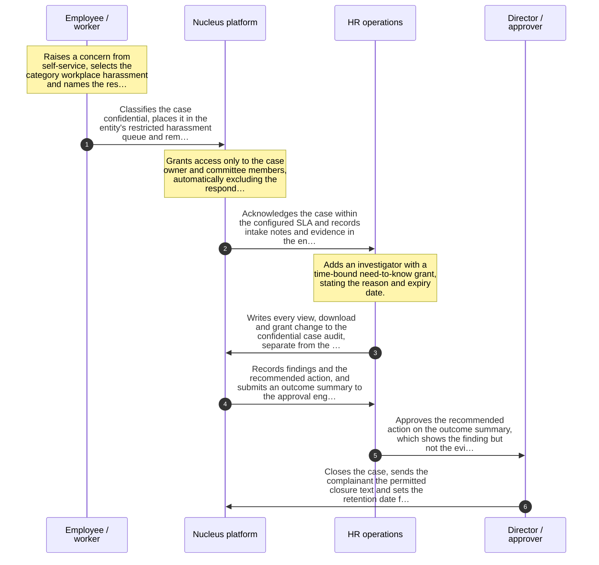

**Alternate flows**

| ID | At step | Condition | Steps | Rejoins |
| :--- | ---: | :--- | :--- | :--- |
| A1 | 1 | HR operations finds a general ticket that discloses a medical condition. | HR operations reclassifies the ticket as confidential medical. → Platform moves it to the restricted medical queue and revokes access for everyone who saw it in the general queue, recording each revocation. | Returns to step 3 |
| A2 | 1 | The concern is raised anonymously from a plant kiosk. | Platform issues a case reference code and PIN for follow-up without storing the reporter's identity. | Returns to step 2 |

**Exception flows**

| ID | At step | Condition | Handling | Rule |
| :--- | ---: | :--- | :--- | :--- |
| E1 | 3 | A configured committee member is the respondent or sits in the respondent's reporting line. | That member is excluded from the case and the case owner is prompted to nominate a replacement. |  |
| E2 | 6 | A user with general HR access opens the case by direct link. | Access is denied, the attempt is written to the confidential case audit and the case owner is alerted within 5 minutes. |  |
| E3 | 7 | Someone tries to export the full case file. | Export requires approval by a second named case member; without it the export is blocked and logged. |  |
| E4 | 4 | The acknowledgement SLA lapses. | The case is escalated to the entity HR head as an alert showing category and age only. |  |

**Postconditions — success**

- The case is closed with findings, approved outcome and retention date, and every access is recorded in the confidential case audit.
- The complainant receives the closure notice permitted by policy.

**Postconditions — failure**

- Unauthorised access attempts are refused, recorded and alerted to the case owner.
- An open case past its tenant-configured SLA is escalated to the entity HR head without widening content access.

**Quality requirements**

- Confidential cases never appear in global search, general helpdesk analytics or agent tool results.
- The confidential case audit is append-only and readable only by principals holding the case-audit grant.
- Time-bound grants expire automatically to the minute of their stated expiry.

### SSV-UC-012

**Generate a signed standard letter on demand** — Let an employee obtain a digitally signed standard letter such as a salary certificate, address proof or experience letter within seconds from an approved template.

| Attribute | Value |
| :--- | :--- |
| Realises | SSV-CG-007 |
| Source | Authored |
| Level | User goal |
| Primary actor | Employee / worker |
| Secondary actors | Nucleus platform, HR operations, Bank |
| Trigger | An employee selects a letter type in self-service documents. |
| Frequency | Daily |
| Criticality | Medium |
| Phase | P2 |
| Client requirements | — |
| Business rules | — |
| Screens | SCR-042 |
| Data objects (CRUD) | letter_template (R), issued_document (C), signature_record (C), document_verification (R), payroll_result (R) |
| Events | experience.letter.issued |
| Acceptance tests | SSV-TC-029, SSV-TC-030, SSV-TC-031, SSV-TC-032, SSV-TC-033, SSV-TC-034 |
| System requirements | SYS-017, SYS-026, SYS-032, SYS-066 |

**Stakeholders and interests**

| Stakeholder | Interest |
| :--- | :--- |
| Employee / worker | Gets a valid letter for a bank, landlord or visa office without waiting for HR. |
| HR operations | Stops handling routine letter requests while keeping control of templates and exceptions. |
| Bank | Can verify that a presented letter is genuine and current. |

**Preconditions**

- The letter type is enabled for self-service for the employee's legal entity and has an approved template version.
- The entity's organisation signing certificate is valid and held in the platform key store.
- Source data used by the template, such as the latest finalised payroll run or the approved address, exists for the employee.

**Main success scenario**

| # | Actor | Action | Ref |
| ---: | :--- | :--- | :--- |
| 1 | Employee / worker | Opens self-service documents and selects Salary certificate. |  |
| 2 | Nucleus platform | Checks eligibility: active assignment, letter type enabled for the entity and the limit of 3 requests per type per month. |  |
| 3 | Employee / worker | Chooses the purpose, the addressee and the language, English or Hindi. |  |
| 4 | Nucleus platform | Merges the approved template version with data from the latest finalised payroll run and shows a preview. |  |
| 5 | Employee / worker | Confirms the preview. |  |
| 6 | Nucleus platform | Applies the entity's digital signature and embeds a verification QR code carrying the document ID. |  |
| 7 | Nucleus platform | Stores the letter in the document vault, records the issue and offers download or email to the personal address on record. |  |
| 8 | Bank | Scans the QR code; the verification page confirms document type, holder name, issue date and status only. |  |

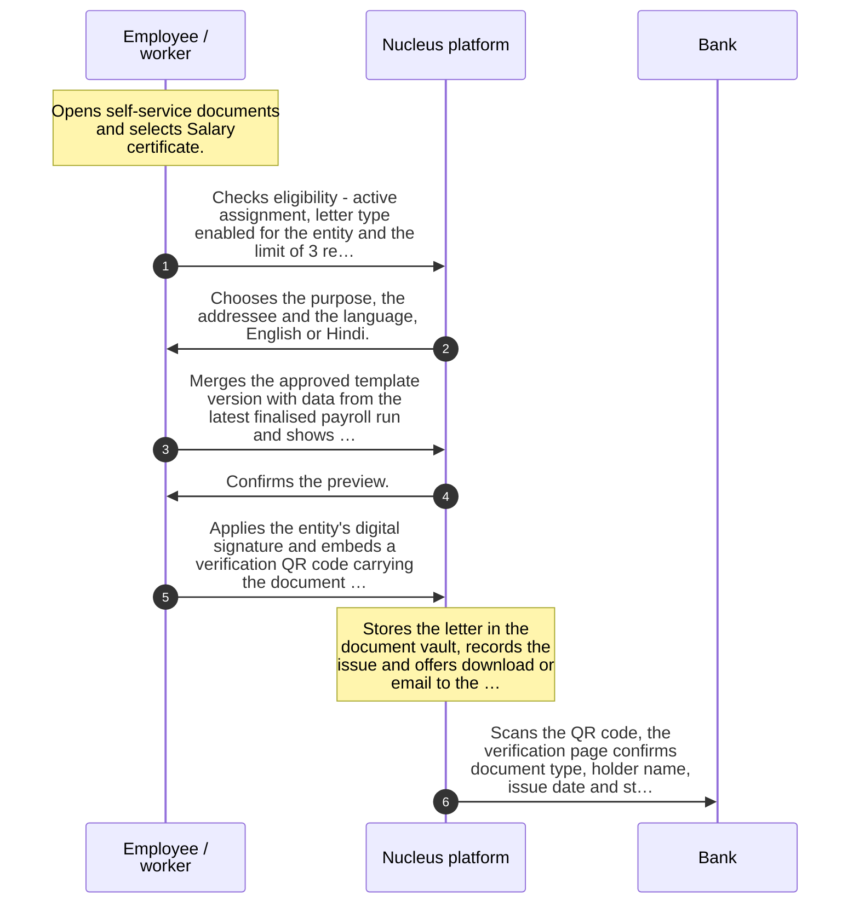

**Alternate flows**

| ID | At step | Condition | Steps | Rejoins |
| :--- | ---: | :--- | :--- | :--- |
| A1 | 2 | The letter type needs HR review, for example a visa letter with free-text addressee details. | Platform routes the request to the HR operations queue with the preview. → HR operations approves or edits the free text within the template's editable fields. | Returns to step 6 |
| A2 | 4 | An address change for the employee is awaiting approval. | Platform uses the last approved address and tells the employee which address appears on the letter. | Returns to step 5 |
| A3 | 1 | A separated employee requests an experience letter through alumni access. | Platform confirms the last working day is recorded and the final settlement is complete. → Template merges the service dates and last designation. | Returns to step 4 |

**Exception flows**

| ID | At step | Condition | Handling | Rule |
| :--- | ---: | :--- | :--- | :--- |
| E1 | 2 | The monthly limit of 3 for this letter type is reached. | The request is refused and the next eligible date is shown. |  |
| E2 | 4 | A new joiner has no finalised payroll run yet. | The salary certificate is not generated; the employee is offered an employment confirmation letter or a ticket. |  |
| E3 | 6 | The signing certificate has expired or the key store is unavailable. | Issue stops, HR operations and the tenant admin are alerted and no unsigned letter is released. |  |
| E4 | 8 | HR has revoked the letter after issue. | The verification page shows status Revoked with the revocation date. |  |

**Postconditions — success**

- A signed PDF with a verification code is stored in the employee's document vault and delivered to the employee.
- The issue is logged with template version, data snapshot date and signature reference.

**Postconditions — failure**

- No unsigned or partially merged letter is ever released.
- The employee is told why the letter could not be produced and is offered a helpdesk ticket.

**Quality requirements**

- Letter generated, signed and available for download within 10 s at p95.
- The verification page exposes no data beyond document type, holder name, issue date and status.

## Approval & Sign-off

| Role | Name | Date | Decision | Conditions / comments |
| :--- | :--- | :--- | :--- | :--- |
| Author | Dhanraj Dadhich | 2026-11-05 | Submitted | |
| Peer review moderator | *pending* | | | PR-xxxx |
| PQA (process compliance) | *pending* | | | |
| Approval authority (DOC-01 §7) | *pending* | | | |

## Measurement Data Captured

| Measure | Value | Unit | Notes |
| :--- | :--- | :--- | :--- |
| Size | 366 | specified items (table rows) | Counted automatically at generation |
| Authoring effort | *to be recorded* | person-hours | |
| Review effort (preparation + meeting) | *pending review* | person-hours | From PR-xxxx |
| Rework effort | *pending review* | person-hours | |
| Review rate | *pending review* | items / hour | Compare with PPB control limits |
| Requirement volatility (changes since baseline) | 0 | CRs touching this artefact | Not yet baselined (CM-03) |

**Defects found, by detection phase and severity**

| Detection phase | Major | Minor | Editorial | Injected in phase (major) |
| :--- | :--- | :--- | :--- | :--- |
| Author self-check | 0 | 0 | 0 | — |
| Peer review | *pending* | | | |
| Design / build | | | | |
| System / integration test | | | | |
| UAT | | | | |
| Production (escaped) | | | | each escaped major opens a CAR record (CAR-01) |

Within control limits of the review-rate PPB? *To be assessed at peer review.*

## Revision History

| Version | Date | Author | Change summary | CR ref | Approved by |
| :--- | :--- | :--- | :--- | :--- | :--- |
| 1.0.0 | 2026-11-05 | Dhanraj Dadhich | Consolidated release | CR-0001 | *pending* |
