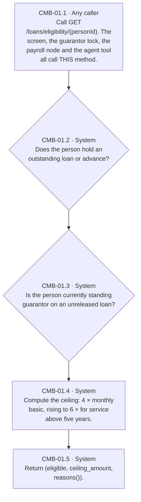
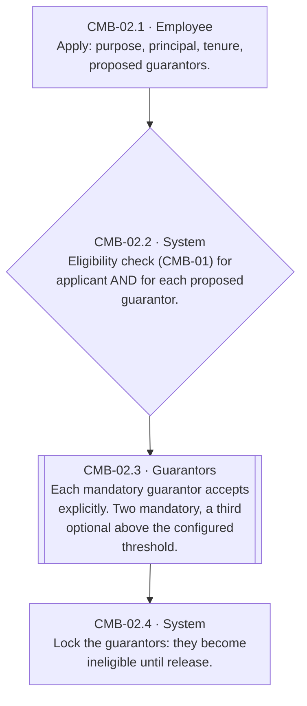
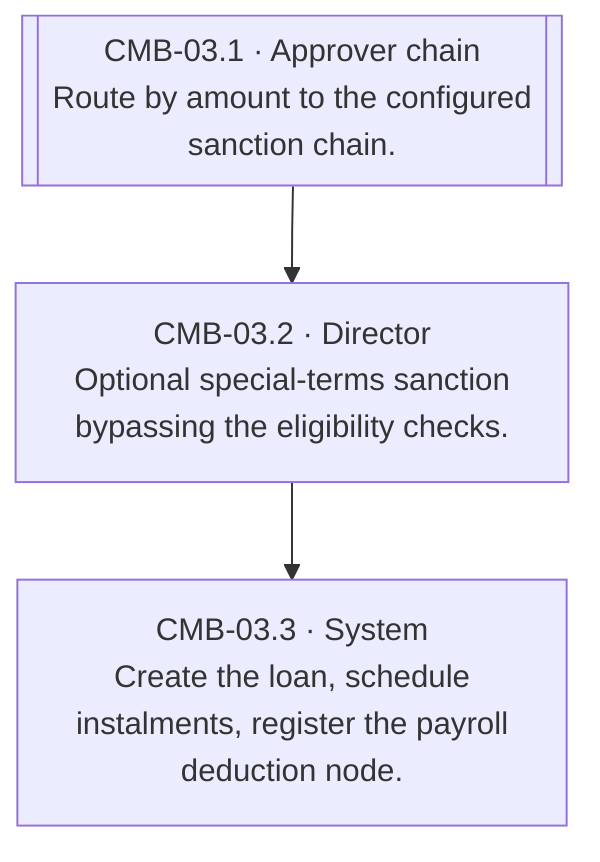
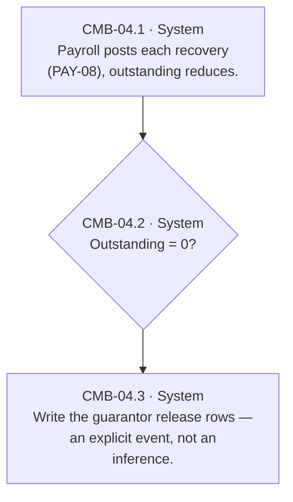
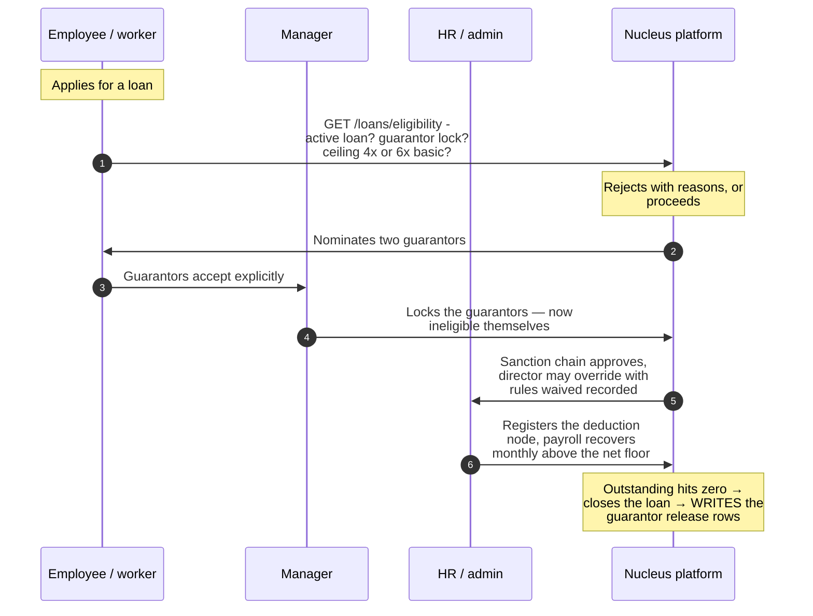

<picture>
  <source media="(prefers-color-scheme: dark)" srcset="../../assets/MultipliersKraftLogoDark.png">
  
</picture>

# FRS-CMB-01 — Compensation, Loans & Benefits — Process Specifications

| Attribute | Value |
| :--- | :--- |
| Document ID | FRS-CMB-01 |
| Title | Compensation, Loans & Benefits — Process Specifications |
| Product | Nucleus Suite (Nucleus HRMS Suite) |
| Version | 1.0.0 |
| Status | Issued for approval |
| Owner (role) | Domain Product Owner — Compensation, Loans & Benefits |
| Author | Dhanraj Dadhich |
| Reviewed by | *pending* |
| Approved by | Product Council — *pending* |
| Date | 2026-11-05 |
| Classification | Internal |
| CMMI practice areas | RDM, TS |
| Related documents | FRS-CMB-00, FRS-CMB-01, FRS-CMB-02, FRS-CMB-03, FRS-CMB-04, FRS-CMB-05, FRS-CMB-06, FRS-CMB-07, FRS-CMB-08, FRS-CMB-09, FRS-CMB-10, FRS-CMB-11, FRS-CMB-12, FRS-CMB-13, BRS-01, SRS-01, REQ-01, REQ-02 |
| Quality & process-performance objectives | QPPO-05 (effective requirements reviews), QPPO-01 (escaped defects) — MPM-01 |
| Process performance baseline used | PPB-01 (review defect density), PPB-02 (review rate) — MPM-01 |
| Peer review record | *pending* (PR-xxxx, QA-02) |
| Tailoring record | none |
| Traceability anchor | BG-04, BG-05 · R-10 · processes CMB-01–CMB-06 |
| Source of record | Nucleus — Process Flows & Process Maps v1.0 — sheet(s) 03_Process_Inventory, 04_Process_Steps, 05_Swimlane_Maps Nucleus HR Demo Points Build Sheet v1.0 — sheet(s) 07_Approval_Workflows Nucleus HRMS Demo Dataset v1.1 — sheet(s) 64_Approval_Workflows |

> **Source of record.** Requirements in this document are taken from the source workbook(s) named above and keep their workbook IDs, which are never renumbered. Changes are made through a change request (CM-02) against the source workbook. Sections marked **Authored** are original additions that are not present in the source workbooks.

Step types: TASK (human) · SYS (system, unattended) · DEC (decision) · APPR (approval gate) · INT (integration call) · WAIT (timer or external event) · AGENT (agent-executed, governed). CRUD: C create · R read · U update · D delete-by-end-dating (temporal facts are never hard-deleted). In the flow diagrams decisions are diamonds, approvals are double-bordered boxes and integration, wait and agent steps are rounded.

## 1. Process inventory

| Process ID | Process | Trigger | Primary actor | Frequency | Criticality | Blueprint module | Phase | Reuses | Demo pts | Note |
| :--- | :--- | :--- | :--- | :--- | :--- | :--- | :--- | :--- | :--- | :--- |
| CMB-01 | Loan eligibility evaluation | Any eligibility question | System | Continuous | Critical | Module 12 | P1 | CMP-02 | 9 | ONE service method read by the screen, the guarantor lock, payroll and the agent tool. |
| CMB-02 | Loan application and guarantor acceptance | Employee applies | Employee, guarantors | Monthly | High | Module 12 | P2 | CMP-01, CMP-02 | 9 | Two mandatory guarantors, third optional above a threshold. |
| CMB-03 | Loan sanction and director override | Application approved | Finance / Director | Monthly | High | Module 12 | P2 | CMP-01 | 9 | Override records approver, reason and the rules waived. |
| CMB-04 | Repayment, closure and guarantor release | Payroll recovery / final instalment | System | Monthly | Critical | Modules 3, 12 | P2 | CMP-02 | 9 | Release is an explicit event. Without it a guarantor is blocked forever. |
| CMB-05 | Salary advance and earned wage access | Employee request | Employee | Monthly | Medium | Modules 3, 12 | P3 | CMP-02, CMP-03 |  | Cap at 50% of accrued net; design in the ledger now even if it ships later. |
| CMB-06 | Compensation revision cycle | Annual cycle | HR, Finance | Annual | High | Module 12 | P3 | CMP-01, CMP-03r | 21 | Budget cascade, manager proposal, simulation, letter generation. |

## 2. Step-level specifications

### CMB-01 — Loan eligibility evaluation

**Trigger:** Any eligibility question · **Primary actor:** System · **Frequency:** Continuous · **Criticality:** Critical · **Phase:** P1 · **Reuses:** CMP-02

| Step | Step ID | Lane / actor | Type | Action or decision | Rule ID(s) | Objects touched (CRUD) | Key fields | Screen | Event emitted | Exception / note | Reuses | Demo pts | Phase |
| :--- | :--- | :--- | :--- | :--- | :--- | :--- | :--- | :--- | :--- | :--- | :--- | :--- | :--- |
| 1 | CMB-01.1 | Any caller | SYS | Call GET /loans/eligibility/{personId}. The screen, the guarantor lock, the payroll node and the agent tool all call THIS method. | RL-430 | loan R; assignment R; salary_structure R | person_id | SCR-080 |  | Implement once or it will drift three ways. | CMP-02 | 9 | P1 |
| 2 | CMB-01.2 | System | DEC | Does the person hold an outstanding loan or advance? | RL-431 | loan R | outstanding, status | — |  | Yes → ineligible for another loan and for a salary advance until full repayment. |  | 9 | P1 |
| 3 | CMB-01.3 | System | DEC | Is the person currently standing guarantor on an unreleased loan? | RL-432 | loan_guarantor R | released_on IS NULL | — |  | Yes → ineligible for their own loan and to stand guarantor again, until released. |  | 9 | P1 |
| 4 | CMB-01.4 | System | SYS | Compute the ceiling: 4 × monthly basic, rising to 6 × for service above five years. | RL-433 | salary_structure R; employment R | basic, service_years, ceiling_multiple, ceiling_amount | — |  | Multiples are configuration, not constants in code. | CMP-10 | 9 | P1 |
| 5 | CMB-01.5 | System | SYS | Return {eligible, ceiling_amount, reasons[]}. | RL-434 | — | eligible, ceiling_amount, reasons[] | SCR-080 |  | Reasons are shown to the applicant verbatim — a rejection without a reason generates a ticket. |  | 9 | P1 |

### CMB-02 — Loan application and guarantor acceptance

**Trigger:** Employee applies · **Primary actor:** Employee, guarantors · **Frequency:** Monthly · **Criticality:** High · **Phase:** P2 · **Reuses:** CMP-01, CMP-02

| Step | Step ID | Lane / actor | Type | Action or decision | Rule ID(s) | Objects touched (CRUD) | Key fields | Screen | Event emitted | Exception / note | Reuses | Demo pts | Phase |
| :--- | :--- | :--- | :--- | :--- | :--- | :--- | :--- | :--- | :--- | :--- | :--- | :--- | :--- |
| 1 | CMB-02.1 | Employee | TASK | Apply: purpose, principal, tenure, proposed guarantors. | RL-440 | loan_application C | application_id, purpose, principal, tenure_months, guarantor_ids[] | SCR-080 | loan.application.created |  |  | 9 | P2 |
| 2 | CMB-02.2 | System | DEC | Eligibility check (CMB-01) for applicant AND for each proposed guarantor. | RL-430 | — | eligible, reasons[] | SCR-080 | loan.application.rejected | Demo: E1041's application is rejected because he guarantees LN-2026-0041. | CMP-02 | 9 | P2 |
| 3 | CMB-02.3 | Guarantors | APPR | Each mandatory guarantor accepts explicitly. Two mandatory; a third optional above the configured threshold. | RL-441 | loan_guarantor C | guarantor_id, mandatory, accepted_on | SCR-040 | loan.guarantor.accepted |  | CMP-01 | 9 | P2 |
| 4 | CMB-02.4 | System | SYS | Lock the guarantors: they become ineligible until release. | RL-442 | loan_guarantor U | currently_blocked | — | loan.guarantor.locked |  |  | 9 | P2 |

### CMB-03 — Loan sanction and director override

**Trigger:** Application approved · **Primary actor:** Finance / Director · **Frequency:** Monthly · **Criticality:** High · **Phase:** P2 · **Reuses:** CMP-01

| Step | Step ID | Lane / actor | Type | Action or decision | Rule ID(s) | Objects touched (CRUD) | Key fields | Screen | Event emitted | Exception / note | Reuses | Demo pts | Phase |
| :--- | :--- | :--- | :--- | :--- | :--- | :--- | :--- | :--- | :--- | :--- | :--- | :--- | :--- |
| 1 | CMB-03.1 | Approver chain | APPR | Route by amount to the configured sanction chain. | RL-010 | approval_instance C | chain_id | SCR-040 | platform.approval.completed |  | CMP-01 | 9 | P2 |
| 2 | CMB-03.2 | Director | TASK | Optional special-terms sanction bypassing the eligibility checks. | RL-443 | loan U | special_terms, approver, reason, rules_waived[] | SCR-080 | loan.override.recorded | Recorded with approver, reason AND the specific rules waived. | CMP-06 | 9 | P2 |
| 3 | CMB-03.3 | System | SYS | Create the loan, schedule instalments, register the payroll deduction node. | RL-444 | loan C; payroll_input C | principal, instalment, tenure, first_recovery_run | SCR-080 | loan.sanctioned |  |  | 9 | P2 |

### CMB-04 — Repayment, closure and guarantor release

**Trigger:** Payroll recovery / final instalment · **Primary actor:** System · **Frequency:** Monthly · **Criticality:** Critical · **Phase:** P2 · **Reuses:** CMP-02

| Step | Step ID | Lane / actor | Type | Action or decision | Rule ID(s) | Objects touched (CRUD) | Key fields | Screen | Event emitted | Exception / note | Reuses | Demo pts | Phase |
| :--- | :--- | :--- | :--- | :--- | :--- | :--- | :--- | :--- | :--- | :--- | :--- | :--- | :--- |
| 1 | CMB-04.1 | System | SYS | Payroll posts each recovery (PAY-08); outstanding reduces. | RL-450 | loan_repayment C; loan U | amount, run_id, outstanding_after | — | loan.repayment.posted |  | CMP-02 | 9 | P2 |
| 2 | CMB-04.2 | System | DEC | Outstanding = 0? | RL-451 | loan R | outstanding | — |  | Yes → close the loan. |  | 9 | P2 |
| 3 | CMB-04.3 | System | SYS | Write the guarantor release rows — an explicit event, not an inference. | RL-452 | loan_guarantor U | released_on, currently_blocked=false | — | loan.guarantor.released | Without this row a guarantor stays blocked forever because a loan they guaranteed closed two years ago. | CMP-02 | 9 | P2 |

### CMB-05 — Salary advance and earned wage access

**Trigger:** Employee request · **Primary actor:** Employee · **Frequency:** Monthly · **Criticality:** Medium · **Phase:** P3 · **Reuses:** CMP-02, CMP-03

The source workbook specifies this process at inventory level only. Its complete flow is specified in use case CMB-UC-005 (FRS-CMB-12).

### CMB-06 — Compensation revision cycle

**Trigger:** Annual cycle · **Primary actor:** HR, Finance · **Frequency:** Annual · **Criticality:** High · **Phase:** P3 · **Reuses:** CMP-01, CMP-03r

The source workbook specifies this process at inventory level only. Its complete flow is specified in use case CMB-UC-006 (FRS-CMB-12).

## 3. Swimlane maps

### SM-6 — LOAN — eligibility, guarantors, sanction, recovery, release (demo point 9)

| Step | Employee / worker | Manager | HR / admin | System (Nucleus) | Agent | External | Note |
| :--- | :--- | :--- | :--- | :--- | :--- | :--- | :--- |
| 1 | Applies for a loan |  |  |  |  |  |  |
| 2 |  |  |  | GET /loans/eligibility: active loan? guarantor lock? ceiling 4x or 6x basic? |  |  | One service method, four consumers |
| 3 |  |  |  | Rejects with reasons, or proceeds |  |  | E1041 rejected: he guarantees an active loan |
| 4 | Nominates two guarantors |  |  |  |  |  |  |
| 5 |  | Guarantors accept explicitly |  |  |  |  |  |
| 6 |  |  |  | Locks the guarantors — now ineligible themselves |  |  |  |
| 7 |  |  | Sanction chain approves; director may override with rules waived recorded |  |  |  |  |
| 8 |  |  |  | Registers the deduction node; payroll recovers monthly above the net floor |  |  |  |
| 9 |  |  |  | Outstanding hits zero → closes the loan → WRITES the guarantor release rows |  |  | Without the release row they are blocked forever |

## 4. Approval workflows

| Workflow ID | Workflow | Form ID | Requirement | Approval chain | How it behaves | What must hold |
| :--- | :--- | :--- | :--- | :--- | :--- | :--- |
| W-05 | Loan application | F-LON-01 | R-10 | HOD → HR Head → Finance | Eligibility, ceiling and guarantor checks run at submission, not at disbursement. | Where special terms are applied a Director approval step is inserted and cannot be skipped. |
| W-06 | Loan special terms | F-LON-01 | R-10 | Director | A separate recorded approval that carries the reason for the override. | Stored as an approval record so it survives an edit to the loan. |

### Workflow behaviour

| Workflow | Name | Form | Chain | Sequential or parallel | Recorded per level | Escalation | Delegation allowed | Return to applicant | Live demo record | Demo point |
| :--- | :--- | :--- | :--- | :--- | :--- | :--- | :--- | :--- | :--- | :--- |
| W-05 | Loan application | F-LON-01 | HOD → HR Head → Finance | Sequential | Actor, decision, timestamp, eligibility snapshot | After 5 days | N | Y | LN-APP-2026-0014 rejected at eligibility before the chain started | Point 9 |
| W-06 | Loan special terms | F-LON-01 | Director | Inserted step, cannot be skipped | Actor, decision, timestamp, override reason | None | N | N | LN-2026-0012 — E1001 sanctioned 150,000 against an 86,000 ceiling as a recorded approval, not an edit | Point 9 |

## Approval & Sign-off

| Role | Name | Date | Decision | Conditions / comments |
| :--- | :--- | :--- | :--- | :--- |
| Author | Dhanraj Dadhich | 2026-11-05 | Submitted | |
| Peer review moderator | *pending* | | | PR-xxxx |
| PQA (process compliance) | *pending* | | | |
| Approval authority (DOC-01 §7) | *pending* | | | |

## Measurement Data Captured

| Measure | Value | Unit | Notes |
| :--- | :--- | :--- | :--- |
| Size | 34 | specified items (table rows) | Counted automatically at generation |
| Authoring effort | *to be recorded* | person-hours | |
| Review effort (preparation + meeting) | *pending review* | person-hours | From PR-xxxx |
| Rework effort | *pending review* | person-hours | |
| Review rate | *pending review* | items / hour | Compare with PPB control limits |
| Requirement volatility (changes since baseline) | 0 | CRs touching this artefact | Not yet baselined (CM-03) |

**Defects found, by detection phase and severity**

| Detection phase | Major | Minor | Editorial | Injected in phase (major) |
| :--- | :--- | :--- | :--- | :--- |
| Author self-check | 0 | 0 | 0 | — |
| Peer review | *pending* | | | |
| Design / build | | | | |
| System / integration test | | | | |
| UAT | | | | |
| Production (escaped) | | | | each escaped major opens a CAR record (CAR-01) |

Within control limits of the review-rate PPB? *To be assessed at peer review.*

## Revision History

| Version | Date | Author | Change summary | CR ref | Approved by |
| :--- | :--- | :--- | :--- | :--- | :--- |
| 1.0.0 | 2026-11-05 | Dhanraj Dadhich | Consolidated release | CR-0001 | *pending* |
