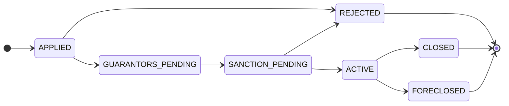

<picture>
  <source media="(prefers-color-scheme: dark)" srcset="../../assets/MultipliersKraftLogoDark.png">
  
</picture>

# FRS-CMB-06 — Compensation, Loans & Benefits — State Machines and Events

| Attribute | Value |
| :--- | :--- |
| Document ID | FRS-CMB-06 |
| Title | Compensation, Loans & Benefits — State Machines and Events |
| Product | Nucleus Suite (Nucleus HRMS Suite) |
| Version | 1.0.0 |
| Status | Issued for approval |
| Owner (role) | Domain Product Owner — Compensation, Loans & Benefits |
| Author | Dhanraj Dadhich |
| Reviewed by | *pending* |
| Approved by | Product Council — *pending* |
| Date | 2026-11-05 |
| Classification | Internal |
| CMMI practice areas | TS, VV |
| Related documents | FRS-CMB-00, FRS-CMB-01, FRS-CMB-02, FRS-CMB-03, FRS-CMB-04, FRS-CMB-05, FRS-CMB-06, FRS-CMB-07, FRS-CMB-08, FRS-CMB-09, FRS-CMB-10, FRS-CMB-11, FRS-CMB-12, FRS-CMB-13, BRS-01, SRS-01, REQ-01, REQ-02 |
| Quality & process-performance objectives | QPPO-05 (effective requirements reviews), QPPO-01 (escaped defects) — MPM-01 |
| Process performance baseline used | PPB-01 (review defect density), PPB-02 (review rate) — MPM-01 |
| Peer review record | *pending* (PR-xxxx, QA-02) |
| Tailoring record | none |
| Traceability anchor | BG-04, BG-05 · R-10 · processes CMB-01–CMB-06 |
| Source of record | Nucleus — Process Flows & Process Maps v1.0 — sheet(s) 11_State_Machines, 12_Events |

> **Source of record.** Requirements in this document are taken from the source workbook(s) named above and keep their workbook IDs, which are never renumbered. Changes are made through a change request (CM-02) against the source workbook. Sections marked **Authored** are original additions that are not present in the source workbooks.

## 1. State machines

### `loan`

| State | Meaning | Entered by | Allowed next states | Guard | Reversible | Event |
| :--- | :--- | :--- | :--- | :--- | :--- | :--- |
| APPLIED | Application submitted | CMB-02 | GUARANTORS_PENDING, REJECTED | Eligibility passed or override requested | Yes | loan.application.created |
| REJECTED | Blocked by eligibility | CMB-02 | — | Reasons shown verbatim | Yes — reapply | loan.application.rejected |
| GUARANTORS_PENDING | Awaiting explicit guarantor acceptance | CMB-02 | SANCTION_PENDING | Two mandatory acceptances | Yes | loan.guarantor.accepted |
| SANCTION_PENDING | In the sanction chain | CMB-03 | ACTIVE, REJECTED | Approval, or a director special-terms override | Yes | platform.approval.started |
| ACTIVE | Recovering through payroll | CMB-03 | CLOSED, FORECLOSED | Net-pay floor respected each run | No | loan.sanctioned |
| CLOSED | Outstanding zero | CMB-04 | — | MUST write guarantor release rows | No | loan.closed |
| FORECLOSED | Settled in F&F | PAY-12 | — | Balance recovered or written off with approval | No | loan.foreclosed |

## 2. Domain events

Event names follow `domain.object.verb` in the past tense. Every event carries the envelope defined in IA-02.

| Event | Emitted by | Payload (beyond envelope) | Consumers | Idempotency key | Retention |
| :--- | :--- | :--- | :--- | :--- | :--- |
| loan.sanctioned | CMB-03 | loan_id, person_id, principal, instalment | Payroll deduction node, notifications | loan_id | Long |
| loan.repayment.posted | PAY-08 | loan_id, run_id, amount, outstanding_after | Loan balance, GL | loan_id + run_id | Long |
| loan.closed | CMB-04 | loan_id, closed_on | Guarantor release, eligibility cache | loan_id | Long |
| loan.guarantor.released | CMB-04 | loan_id, guarantor_person_id, released_on | Eligibility, notifications | loan_id + guarantor | Long |

## Approval & Sign-off

| Role | Name | Date | Decision | Conditions / comments |
| :--- | :--- | :--- | :--- | :--- |
| Author | Dhanraj Dadhich | 2026-11-05 | Submitted | |
| Peer review moderator | *pending* | | | PR-xxxx |
| PQA (process compliance) | *pending* | | | |
| Approval authority (DOC-01 §7) | *pending* | | | |

## Measurement Data Captured

| Measure | Value | Unit | Notes |
| :--- | :--- | :--- | :--- |
| Size | 11 | specified items (table rows) | Counted automatically at generation |
| Authoring effort | *to be recorded* | person-hours | |
| Review effort (preparation + meeting) | *pending review* | person-hours | From PR-xxxx |
| Rework effort | *pending review* | person-hours | |
| Review rate | *pending review* | items / hour | Compare with PPB control limits |
| Requirement volatility (changes since baseline) | 0 | CRs touching this artefact | Not yet baselined (CM-03) |

**Defects found, by detection phase and severity**

| Detection phase | Major | Minor | Editorial | Injected in phase (major) |
| :--- | :--- | :--- | :--- | :--- |
| Author self-check | 0 | 0 | 0 | — |
| Peer review | *pending* | | | |
| Design / build | | | | |
| System / integration test | | | | |
| UAT | | | | |
| Production (escaped) | | | | each escaped major opens a CAR record (CAR-01) |

Within control limits of the review-rate PPB? *To be assessed at peer review.*

## Revision History

| Version | Date | Author | Change summary | CR ref | Approved by |
| :--- | :--- | :--- | :--- | :--- | :--- |
| 1.0.0 | 2026-11-05 | Dhanraj Dadhich | Consolidated release | CR-0001 | *pending* |
