

<picture>
  <source media="(prefers-color-scheme: dark)" srcset="../../assets/MultipliersKraftLogoDark.png">
  
</picture>

# FRS-CMB-12 — Compensation, Loans & Benefits — Use Case Specifications

| Attribute | Value |
| :--- | :--- |
| Document ID | FRS-CMB-12 |
| Title | Compensation, Loans & Benefits — Use Case Specifications |
| Product | Nucleus Suite (Nucleus HRMS Suite) |
| Version | 1.0.0 |
| Status | Issued for approval |
| Owner (role) | Domain Product Owner — Compensation, Loans & Benefits |
| Author | Dhanraj Dadhich |
| Reviewed by | *pending* |
| Approved by | Product Council — *pending* |
| Date | 2026-11-05 |
| Classification | Internal |
| CMMI practice areas | RDM, VV |
| Related documents | FRS-CMB-00, FRS-CMB-01, FRS-CMB-02, FRS-CMB-03, FRS-CMB-04, FRS-CMB-05, FRS-CMB-06, FRS-CMB-07, FRS-CMB-08, FRS-CMB-09, FRS-CMB-10, FRS-CMB-11, FRS-CMB-12, FRS-CMB-13, BRS-01, SRS-01, REQ-01, REQ-02 |
| Quality & process-performance objectives | QPPO-05 (effective requirements reviews), QPPO-01 (escaped defects) — MPM-01 |
| Process performance baseline used | PPB-01 (review defect density), PPB-02 (review rate) — MPM-01 |
| Peer review record | *pending* (PR-xxxx, QA-02) |
| Tailoring record | none |
| Traceability anchor | BG-04, BG-05 · R-10 · processes CMB-01–CMB-06 |
| Source of record | Nucleus — Process Flows & Process Maps v1.0 — sheet(s) 03_Process_Inventory, 04_Process_Steps, 07_Screens, 09_Business_Rules Authored use cases (marked per use case) |

> **Source of record.** Requirements in this document are taken from the source workbook(s) named above and keep their workbook IDs, which are never renumbered. Changes are made through a change request (CM-02) against the source workbook. Sections marked **Authored** are original additions that are not present in the source workbooks.

This document specifies 17 use cases for Compensation, Loans & Benefits: 4 follow the step-level flows of the source workbook and 13 are authored (processes without step-level detail in the source, and capability gaps). User stories derived from each use case are in FRS-CMB-13.

## 1. Use case index

| ID | Use case | Primary actor | Realises | Source | Phase | Criticality |
| :--- | :--- | :--- | :--- | :--- | :--- | :--- |
| [CMB-UC-001](#cmb-uc-001) | Evaluate loan eligibility through the single service method | Nucleus platform | CMB-01 | Source workbook | P1 | Critical |
| [CMB-UC-002](#cmb-uc-002) | Apply for a loan and secure guarantor acceptance | Employee / worker | CMB-02 | Source workbook | P2 | High |
| [CMB-UC-003](#cmb-uc-003) | Sanction a loan, including director special-terms override | Director / approver | CMB-03 | Source workbook | P2 | High |
| [CMB-UC-004](#cmb-uc-004) | Recover loan instalments, close the loan and release guarantors | Nucleus platform | CMB-04 | Source workbook | P2 | Critical |
| [CMB-UC-005](#cmb-uc-005) | Request a salary advance or earned wage access | Employee / worker | CMB-05 | Authored | P3 | Medium |
| [CMB-UC-006](#cmb-uc-006) | Run the annual compensation revision cycle | HR operations | CMB-06 | Authored | P3 | High |
| [CMB-UC-007](#cmb-uc-007) | Maintain salary structures and grade pay ranges | Payroll manager | CMB-CG-001 | Authored | P1 | High |
| [CMB-UC-008](#cmb-uc-008) | Run merit, bonus and variable pay cycles | HR operations | CMB-CG-002 | Authored | P3 | High |
| [CMB-UC-009](#cmb-uc-009) | Administer equity and ESOP grants | HR operations | CMB-CG-003 | Authored | P4 | Medium |
| [CMB-UC-010](#cmb-uc-010) | Enrol employees and dependants in group insurance | Employee / worker | CMB-CG-004 | Authored | P3 | High |
| [CMB-UC-011](#cmb-uc-011) | Manage NPS and superannuation contributions | Employee / worker | CMB-CG-005 | Authored | P3 | High |
| [CMB-UC-012](#cmb-uc-012) | Allocate and reconcile a flexible benefits plan | Employee / worker | CMB-CG-006 | Authored | P3 | Medium |
| [CMB-UC-013](#cmb-uc-013) | View an annual total rewards statement | Employee / worker | CMB-CG-007 | Authored | P3 | Medium |
| [CMB-UC-014](#cmb-uc-014) | Analyse pay equity and track remediation | HR operations | CMB-CG-008 | Authored | P3 | High |
| [CMB-UC-015](#cmb-uc-015) | Administer a retention bonus plan with vesting and clawback | HR operations | CMB-CG-009 | Authored | P4 | Medium |
| [CMB-UC-016](#cmb-uc-016) | Benchmark pay internally and flag outliers before a revision cycle | HR operations | CMB-CG-010 | Authored | P3 | High |
| [CMB-UC-017](#cmb-uc-017) | Compute statutory bonus and gratuity under the published rule pack | Payroll manager | CMB-CG-011 | Authored | P2 | High |

## 2. Use case diagrams

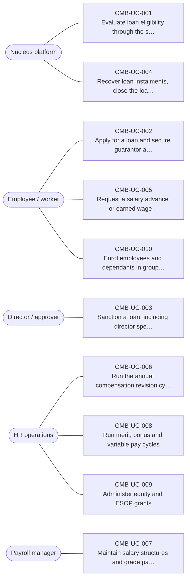

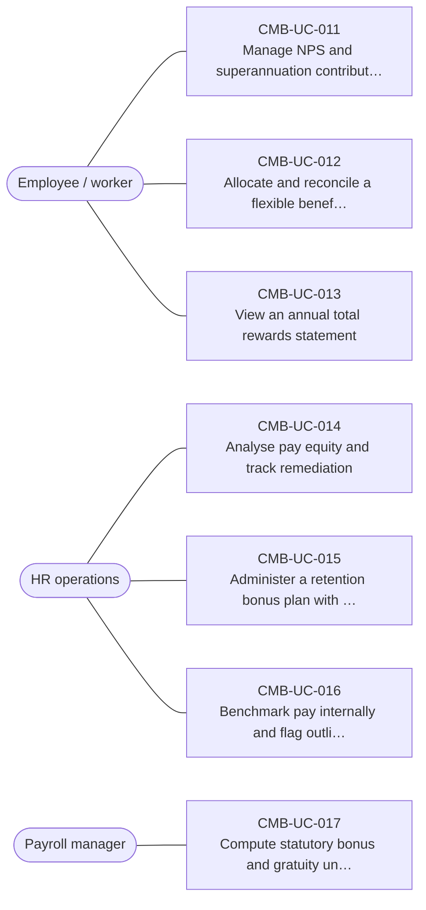

## 3. Use case specifications

### CMB-UC-001

**Evaluate loan eligibility through the single service method** — Return one authoritative eligibility decision, ceiling amount and list of reasons for a person, identical for every caller.

| Attribute | Value |
| :--- | :--- |
| Realises | CMB-01 |
| Source | Source workbook |
| Level | Subfunction |
| Primary actor | Nucleus platform |
| Secondary actors | Employee / worker, Payroll manager, Agent (governed), Finance |
| Trigger | Any caller asks an eligibility question: the loans screen, the guarantor lock, the payroll deduction node or the agent tool. |
| Frequency | Continuous |
| Criticality | Critical |
| Phase | P1 |
| Client requirements | R-10 |
| Business rules | RL-430, RL-431, RL-432, RL-433, RL-434, BS:RL-21, BS:RL-22 |
| Screens | SCR-080 |
| Data objects (CRUD) | loan (R), loan_guarantor (R), assignment (R), salary_structure (R), employment (R) |
| Events | — |
| Acceptance tests | TC-M430, TC-M431, TC-M432, TC-M433, TC-M434, T-19, T-20, T-21 |
| System requirements | SYS-028, SYS-049, SYS-059, SYS-071, SYS-089 |

**Stakeholders and interests**

| Stakeholder | Interest |
| :--- | :--- |
| Employee / worker | Learns before applying whether a loan is possible, how much, and exactly why not. |
| Payroll manager | Payroll deduction node relies on the same answer the employee saw. |
| Finance | Loan book exposure stays within the policy ceilings. |
| Auditor | Can show that one rule set, not three diverging copies, decided every case. |

**Preconditions**

- The person has an active assignment and a salary structure holding monthly basic.
- Loan policy configuration holds multiple_base, multiple_long and the service_years threshold.
- Loan and guarantor ledgers are current up to the last posted payroll recovery.

**Main success scenario**

| # | Actor | Action | Ref |
| ---: | :--- | :--- | :--- |
| 1 | Nucleus platform | Receives the eligibility request for a person through GET /loans/eligibility/{personId}, the only eligibility method any caller may use. | CMB-01.1 |
| 2 | Nucleus platform | Checks the loan ledger for any outstanding loan or salary advance held by the person and records a reason if one exists. | CMB-01.2 |
| 3 | Nucleus platform | Checks the guarantor ledger for any guarantee by the person with no release date and records the guaranteed loan as a reason. | CMB-01.3 |
| 4 | Nucleus platform | Computes the ceiling as configured multiple of monthly basic: 4x by default, 6x once service passes the five-year threshold. | CMB-01.4 |
| 5 | Nucleus platform | Returns eligible, ceiling_amount and the reasons list; the loans screen shows each reason to the applicant word for word. | CMB-01.5 |

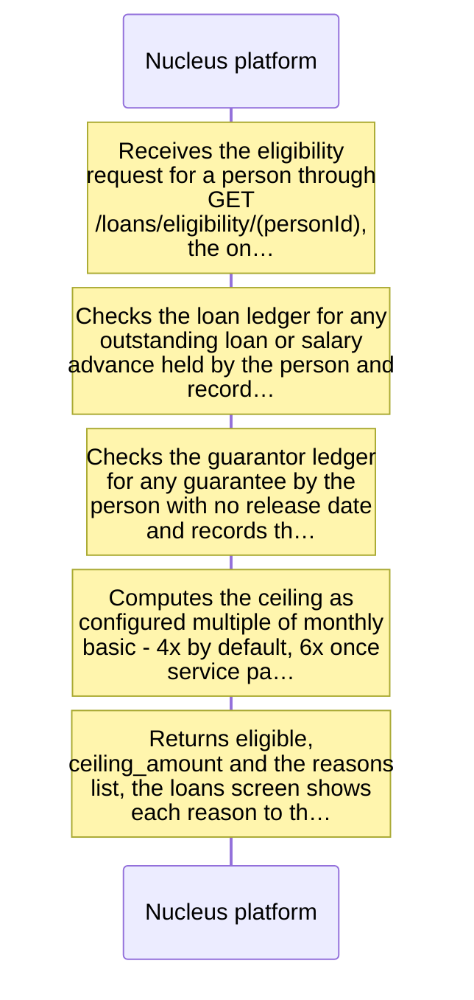

**Alternate flows**

| ID | At step | Condition | Steps | Rejoins |
| :--- | ---: | :--- | :--- | :--- |
| A1 | 2 | Person holds an outstanding loan or salary advance. | Platform marks the person ineligible for both a new loan and a salary advance. → Platform continues to steps 3 and 4 so the caller receives every applicable reason, not only the first. | Returns to step 3 |
| A2 | 3 | Person stands guarantor on an unreleased loan. | Platform marks the person ineligible for an own loan and for standing guarantor again. → Reason names the guaranteed loan number. | Returns to step 4 |
| A3 | 4 | Service exceeds the configured service_years threshold. | Platform applies multiple_long (6x) instead of multiple_base (4x). → Reasons list carries an informational line stating the multiple applied. | Returns to step 5 |

**Exception flows**

| ID | At step | Condition | Handling | Rule |
| :--- | ---: | :--- | :--- | :--- |
| E1 | 1 | Person has no active assignment or the person ID is unknown. | Platform returns ineligible with a reason stating no active assignment; no ceiling is computed. | RL-430 |
| E2 | 4 | Salary structure has no monthly basic for the evaluation date. | Platform returns ineligible with reason salary structure unavailable and alerts the payroll manager queue. | RL-433 |
| E3 | 5 | Decision is ineligible but the reasons list is empty. | Response is withheld from the applicant, a support ticket is raised with the request trace, and the applicant sees a holding message. | RL-434 |

**Postconditions — success**

- Caller receives eligible flag, ceiling_amount and a complete reasons list.
- No loan, guarantor or salary record is modified by the evaluation.

**Postconditions — failure**

- Caller receives an explicit error with a reason; no partial decision is returned.
- A decision with an empty reasons list is never shown to an applicant; a support ticket is raised instead.

**Quality requirements**

- Eligibility response within 300 ms at p95 per tenant under 50 concurrent callers.
- Identical inputs return byte-identical decision, ceiling and reasons for all four callers, verified by a shared contract test.
- Multiples and service threshold are read from configuration; changing them requires no code release.

### CMB-UC-002

**Apply for a loan and secure guarantor acceptance** — Capture a loan application with its proposed guarantors, confirm eligibility for all of them and lock the guarantors once they accept.

| Attribute | Value |
| :--- | :--- |
| Realises | CMB-02 |
| Source | Source workbook |
| Level | User goal |
| Primary actor | Employee / worker |
| Secondary actors | Guarantor (Employee / worker), Nucleus platform, HR operations |
| Trigger | An employee submits a loan application on the loans screen. |
| Frequency | Monthly |
| Criticality | High |
| Phase | P2 |
| Client requirements | R-10 |
| Business rules | RL-430, RL-440, RL-441, RL-442, BS:RL-21 |
| Screens | SCR-080, SCR-040 |
| Data objects (CRUD) | loan_application (C), loan_guarantor (C, U), loan (R) |
| Events | loan.application.created, loan.application.rejected, loan.guarantor.accepted, loan.guarantor.locked |
| Acceptance tests | TC-M430, TC-M432, TC-M440, TC-M441, TC-M442, T-20 |
| System requirements | SYS-037, SYS-040, SYS-049, SYS-051, SYS-053 |

**Stakeholders and interests**

| Stakeholder | Interest |
| :--- | :--- |
| Employee / worker | Gets a fast, reasoned answer and a clear guarantor status. |
| Guarantor (Employee / worker) | Understands that accepting blocks their own borrowing until release. |
| Finance | Only applications with two valid, locked guarantors reach sanction. |

**Preconditions**

- The applicant is signed in with self scope.
- The loan policy defines mandatory_count (2) and third_threshold.
- Proposed guarantors are active employees of the same tenant.

**Main success scenario**

| # | Actor | Action | Ref |
| ---: | :--- | :--- | :--- |
| 1 | Employee / worker | Submits purpose, principal, tenure in months and the proposed guarantors on the loans screen. | CMB-02.1 |
| 2 | Nucleus platform | Runs the single eligibility method for the applicant and for each proposed guarantor and rejects with reasons if any check fails. | CMB-02.2 |
| 3 | Guarantor (Employee / worker) | Each mandatory guarantor reviews the request in the approvals inbox and explicitly accepts the guarantee. | CMB-02.3 |
| 4 | Nucleus platform | Locks every accepting guarantor so they are ineligible to borrow or guarantee again until a release row is written. | CMB-02.4 |

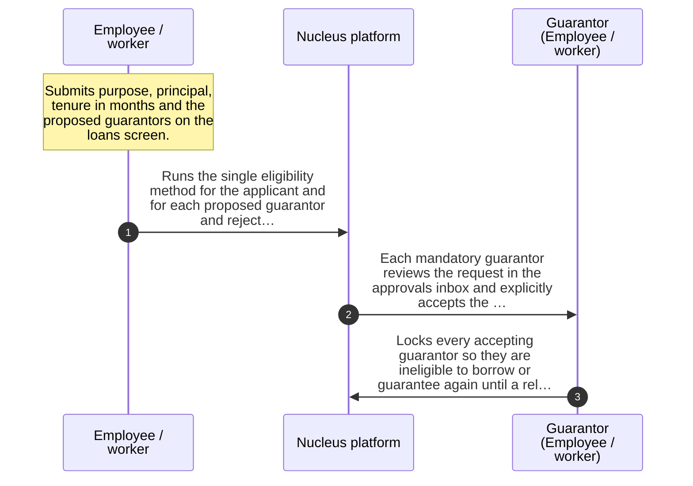

**Alternate flows**

| ID | At step | Condition | Steps | Rejoins |
| :--- | ---: | :--- | :--- | :--- |
| A1 | 2 | Applicant fails eligibility but asks for director special terms. | Platform records the override request with the failing reasons attached. → Application proceeds to guarantor acceptance flagged for director review in sanction. | Returns to step 3 |
| A2 | 3 | Principal exceeds the configured third-guarantor threshold. | Platform invites the third proposed guarantor after eligibility is confirmed for that person. → Third acceptance is recorded with mandatory = false. | Returns to step 4 |

**Exception flows**

| ID | At step | Condition | Handling | Rule |
| :--- | ---: | :--- | :--- | :--- |
| E1 | 1 | Application names fewer guarantors than mandatory_count. | Submission is refused at the form with a message stating two guarantors are required. | RL-440 |
| E2 | 2 | Applicant or any proposed guarantor is ineligible. | Application moves to REJECTED, loan.application.rejected is emitted and each reason is shown; demo case E1041 is rejected because he guarantees LN-2026-0041. | RL-430 |
| E3 | 3 | A guarantor declines or does not respond. | Application stays in GUARANTORS_PENDING; the applicant may substitute a guarantor, which re-runs eligibility for the substitute only. | RL-441 |
| E4 | 4 | Guarantor accepted another guarantee between proposal and acceptance. | Second acceptance is refused because the guarantor is already locked; applicant is asked to substitute. | RL-442 |

**Postconditions — success**

- Loan application exists in state GUARANTORS_PENDING, moving to SANCTION_PENDING once two mandatory acceptances are recorded.
- Each accepting guarantor carries currently_blocked = true.

**Postconditions — failure**

- Application is in state REJECTED with every reason stored and shown verbatim.
- No guarantor is locked for a rejected application.

**Quality requirements**

- Eligibility result for applicant plus three guarantors shown within 2 s at p95 of submission.
- Guarantor lock and acceptance commit atomically; no window exists in which a guarantor has accepted but is not locked.

### CMB-UC-003

**Sanction a loan, including director special-terms override** — Route an accepted application through the amount-based sanction chain and create an active loan with its schedule and payroll deduction.

| Attribute | Value |
| :--- | :--- |
| Realises | CMB-03 |
| Source | Source workbook |
| Level | User goal |
| Primary actor | Director / approver |
| Secondary actors | Finance, Nucleus platform, Payroll manager, Employee / worker |
| Trigger | Loan application reaches SANCTION_PENDING after mandatory guarantor acceptance. |
| Frequency | Monthly |
| Criticality | High |
| Phase | P2 |
| Client requirements | R-10 |
| Business rules | RL-010, RL-443, RL-444, BS:RL-21, BS:RL-22 |
| Screens | SCR-040, SCR-080 |
| Data objects (CRUD) | approval_instance (C), loan (C, U), payroll_input (C) |
| Events | platform.approval.completed, loan.override.recorded, loan.sanctioned |
| Acceptance tests | TC-P10, TC-M443, TC-M444, T-21 |
| System requirements | SYS-028, SYS-036, SYS-038, SYS-053, SYS-055 |

**Stakeholders and interests**

| Stakeholder | Interest |
| :--- | :--- |
| Director / approver | Can grant special terms with an evidential record rather than a silent edit. |
| Finance | Sanctioned loans arrive with schedule and recovery already wired into payroll. |
| Auditor | Every override names the approver, the reason and the rules waived. |
| Employee / worker | Receives a sanction decision and a clear instalment plan. |

**Preconditions**

- Approval chain for loan sanction is configured by amount band.
- override_role is configured as Director.
- At least two mandatory guarantors have accepted and are locked.

**Main success scenario**

| # | Actor | Action | Ref |
| ---: | :--- | :--- | :--- |
| 1 | Director / approver | Receives the application routed by principal band to the configured sanction chain and records a decision on the approvals inbox. | CMB-03.1 |
| 2 | Director / approver | Where policy is exceeded, sanctions on special terms on the loans screen, stating the reason and each rule being waived. | CMB-03.2 |
| 3 | Nucleus platform | Creates the loan, generates the instalment schedule and registers the deduction input for the first recovery run. | CMB-03.3 |

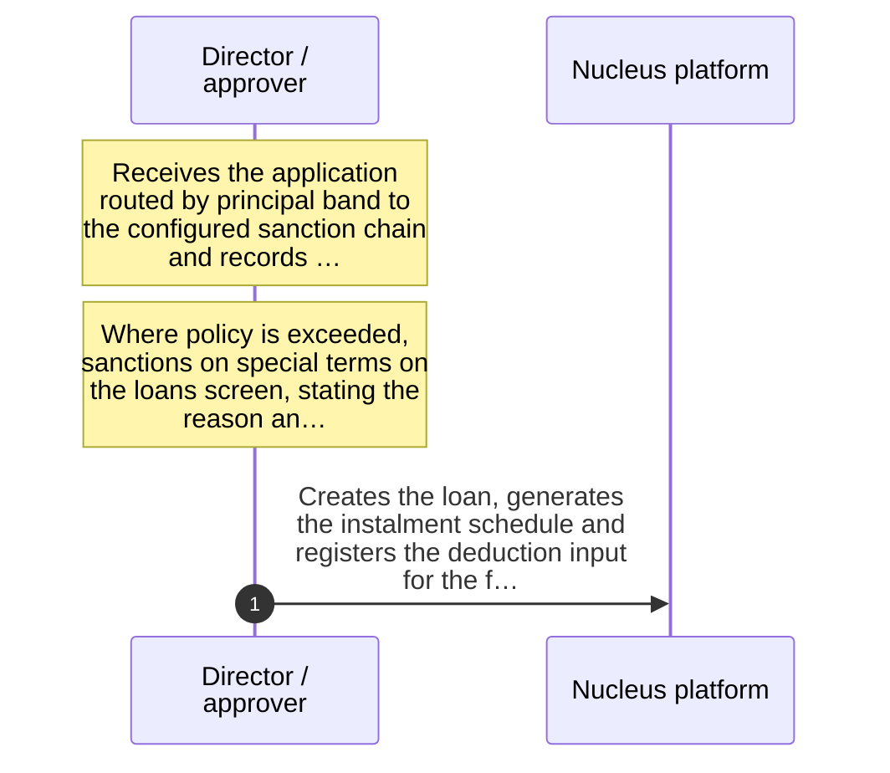

**Alternate flows**

| ID | At step | Condition | Steps | Rejoins |
| :--- | ---: | :--- | :--- | :--- |
| A1 | 2 | Application is within eligibility and ceiling. | No special terms are needed; the chain approval alone sanctions the loan. | Returns to step 3 |
| A2 | 1 | Principal falls in a higher amount band. | Platform appends the additional approver levels defined for that band. → Each level decides in sequence before sanction. | Returns to step 2 |

**Exception flows**

| ID | At step | Condition | Handling | Rule |
| :--- | ---: | :--- | :--- | :--- |
| E1 | 1 | An approver in the chain rejects. | Loan moves to REJECTED, applicant sees the comment, and explicit release rows are written for every locked guarantor. | RL-010 |
| E2 | 2 | A user without the configured override role attempts special terms. | Action is refused and logged; the request stays in SANCTION_PENDING. | RL-443 |
| E3 | 2 | Override is attempted without a reason or without naming the rules waived. | Save is blocked until reason and the rules_waived list are completed. | RL-443 |
| E4 | 3 | Schedule or deduction input cannot be created. | Sanction is rolled back as one unit; loan remains SANCTION_PENDING and finance is alerted. | RL-444 |

**Postconditions — success**

- Loan is ACTIVE with principal, instalment, tenure and first_recovery_run recorded.
- A payroll deduction input exists for the first recovery run.
- Any override is stored as an approval with approver, reason and the rules_waived list.

**Postconditions — failure**

- Loan is REJECTED with approver comment; guarantors receive explicit release rows.
- No payroll input is created.

**Quality requirements**

- loan.sanctioned is delivered exactly once per loan_id to the payroll deduction node.
- Override records are immutable once saved and retained for the long retention class.

### CMB-UC-004

**Recover loan instalments, close the loan and release guarantors** — Post every payroll recovery against the loan, close it at zero outstanding and write explicit guarantor release rows.

| Attribute | Value |
| :--- | :--- |
| Realises | CMB-04 |
| Source | Source workbook |
| Level | Subfunction |
| Primary actor | Nucleus platform |
| Secondary actors | Payroll manager, Employee / worker, Guarantor (Employee / worker), Finance |
| Trigger | A payroll run that includes a loan recovery is finalised. |
| Frequency | Monthly |
| Criticality | Critical |
| Phase | P2 |
| Client requirements | R-10 |
| Business rules | RL-450, RL-451, RL-452, BS:RL-21 |
| Screens | SCR-080 |
| Data objects (CRUD) | loan_repayment (C), loan (U), loan_guarantor (U) |
| Events | loan.repayment.posted, loan.closed, loan.guarantor.released |
| Acceptance tests | TC-M450, TC-M451, TC-M452, T-19, T-20 |
| System requirements | SYS-049, SYS-050, SYS-051, SYS-053, SYS-055 |

**Stakeholders and interests**

| Stakeholder | Interest |
| :--- | :--- |
| Guarantor (Employee / worker) | Regains eligibility the moment the guaranteed loan closes. |
| Employee / worker | Sees an accurate outstanding balance after every payroll. |
| Finance | Loan book reconciles to payroll recoveries. |
| Auditor | Release is evidenced by a dated row, not inferred. |

**Preconditions**

- Loan is ACTIVE with a deduction input in the run.
- Payroll run has passed finalisation.

**Main success scenario**

| # | Actor | Action | Ref |
| ---: | :--- | :--- | :--- |
| 1 | Nucleus platform | Posts the recovery from the finalised run as a repayment row and reduces outstanding by the recovered amount. | CMB-04.1 |
| 2 | Nucleus platform | Checks whether outstanding is now zero and, if so, closes the loan and emits loan.closed. | CMB-04.2 |
| 3 | Nucleus platform | Writes a dated release row for every guarantor of the closed loan and emits loan.guarantor.released for each. | CMB-04.3 |

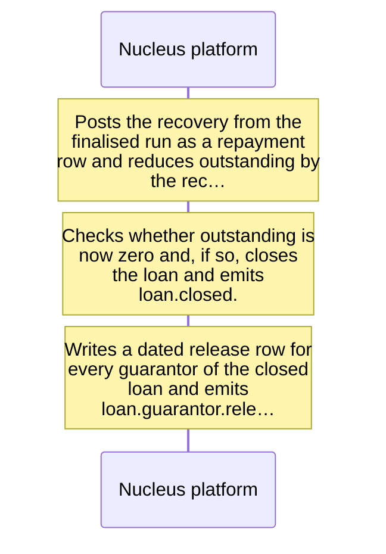

**Alternate flows**

| ID | At step | Condition | Steps | Rejoins |
| :--- | ---: | :--- | :--- | :--- |
| A1 | 2 | Outstanding is still above zero. | Loan stays ACTIVE; the next instalment remains scheduled for the following run. → Use case ends for this run. | Ends |
| A2 | 1 | Employee separates before full repayment. | Remaining balance is recovered in the full and final settlement or written off with approval. → Loan moves to FORECLOSED and guarantor release rows are written as on closure. | Returns to step 3 |

**Exception flows**

| ID | At step | Condition | Handling | Rule |
| :--- | ---: | :--- | :--- | :--- |
| E1 | 1 | Recovery would take net pay below the configured net-pay floor for the run. | Recovery is reduced to protect the floor, the shortfall is rescheduled and the payroll manager is notified. |  |
| E2 | 1 | Finalised run is later reversed. | Linked repayment row is reversed with the run_id reference and outstanding is restored. | RL-450 |
| E3 | 3 | Release row write fails. | Closure is retried idempotently on loan_id plus guarantor until every release row exists; the loan is not reported CLOSED until then. | RL-452 |

**Postconditions — success**

- Repayment row exists for the run and outstanding is reduced.
- At zero outstanding the loan is CLOSED and every guarantor has released_on set and currently_blocked = false.

**Postconditions — failure**

- No repayment is posted for an unfinalised or reversed run.
- Loan stays ACTIVE and guarantors remain locked until a valid closure.

**Quality requirements**

- Repayment posting completes within 5 minutes of run finalisation for 10,000 active loans.
- Release events are idempotent on loan_id plus guarantor and retained for the long retention class.

### CMB-UC-005

**Request a salary advance or earned wage access** — Let an eligible employee draw up to half of net pay already accrued in the open period, recovered automatically in the same payroll.

| Attribute | Value |
| :--- | :--- |
| Realises | CMB-05 |
| Source | Authored |
| Level | User goal |
| Primary actor | Employee / worker |
| Secondary actors | Nucleus platform, Payroll manager, Finance |
| Trigger | Employee requests an advance against the current pay period. |
| Frequency | Monthly |
| Criticality | Medium |
| Phase | P3 |
| Client requirements | R-10 |
| Business rules | RL-430, RL-431, BS:RL-21 |
| Screens | SCR-080 |
| Data objects (CRUD) | loan (C, U), payroll_input (C), attendance_day (R) |
| Events | — |
| Acceptance tests | TC-M431, T-19 |
| System requirements | SYS-028, SYS-047, SYS-049, SYS-085 |

**Stakeholders and interests**

| Stakeholder | Interest |
| :--- | :--- |
| Employee / worker | Access to earned money between paydays without informal borrowing. |
| Payroll manager | Every drawn amount is recovered through the run, with no manual adjustment. |
| Finance | Exposure never exceeds 50% of accrued net per person. |

**Preconditions**

- The payroll period is open and not locked.
- Attendance for elapsed days of the period is processed.
- The employee has no outstanding loan or advance.

**Main success scenario**

| # | Actor | Action | Ref |
| ---: | :--- | :--- | :--- |
| 1 | Employee / worker | Opens loans and advances and requests an earned-wage advance for the current pay period. |  |
| 2 | Nucleus platform | Calls the single eligibility method and stops if any loan or advance is outstanding. |  |
| 3 | Nucleus platform | Computes accrued net pay to date from processed attendance, posted inputs and statutory deductions for elapsed days. |  |
| 4 | Nucleus platform | Shows the available amount as 50% of accrued net minus amounts already drawn this period, with the calculation lines. |  |
| 5 | Employee / worker | Enters an amount within the available limit and confirms the request. |  |
| 6 | Nucleus platform | Records the advance in the loan ledger and raises a recovery input in the current named payroll run. |  |
| 7 | Finance | Releases the disbursement batch; disbursement always needs a named human release. |  |
| 8 | Nucleus platform | On run finalisation posts the recovery, clears the advance and restores eligibility. |  |

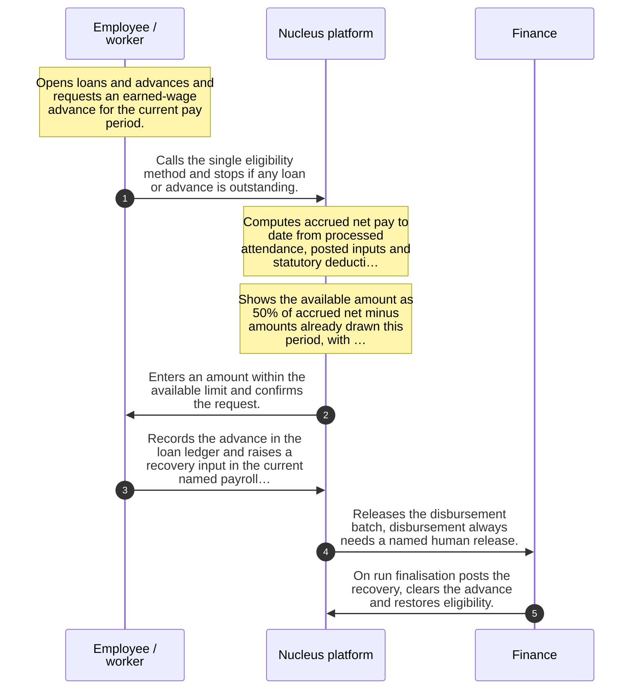

**Alternate flows**

| ID | At step | Condition | Steps | Rejoins |
| :--- | ---: | :--- | :--- | :--- |
| A1 | 5 | Employee enters more than the available amount. | Platform caps the entry at the available amount and explains the cap. | Returns to step 6 |

**Exception flows**

| ID | At step | Condition | Handling | Rule |
| :--- | ---: | :--- | :--- | :--- |
| E1 | 2 | Employee has an outstanding loan or advance. | Request is refused with the same reason a new loan would receive. | RL-431 |
| E2 | 3 | Payroll period is locked for processing. | Request is refused with the date the next period opens. |  |
| E3 | 4 | Accrued net to date is zero, for example all elapsed days are loss of pay. | Available amount is shown as zero and the request cannot proceed. |  |

**Postconditions — success**

- Advance is recorded in the loan ledger with a single recovery input in the current run.
- Available amount for the period is reduced by the drawn amount.

**Postconditions — failure**

- No advance is recorded and the reason is shown to the employee.

**Quality requirements**

- Available amount shown within 2 s at p95.
- Accrued-net computation reuses the payroll engine so the advance limit matches the payslip basis.

### CMB-UC-006

**Run the annual compensation revision cycle** — Cascade a revision budget, collect manager proposals, simulate cost, approve, issue revision letters and hand revised pay to payroll.

| Attribute | Value |
| :--- | :--- |
| Realises | CMB-06 |
| Source | Authored |
| Level | Summary |
| Primary actor | HR operations |
| Secondary actors | Finance, Manager / supervisor, Director / approver, Payroll manager, Employee / worker, Nucleus platform |
| Trigger | HR opens the annual revision cycle. |
| Frequency | Annual |
| Criticality | High |
| Phase | P3 |
| Client requirements | — |
| Business rules | RL-010, RL-500, RL-502 |
| Screens | SCR-040, SCR-067 |
| Data objects (CRUD) | salary_structure (U), payroll_input (C), letter_issued (C) |
| Events | — |
| Acceptance tests | TC-E500, TC-E502 |
| System requirements | SYS-018, SYS-022, SYS-028, SYS-037, SYS-048, SYS-051 |

**Stakeholders and interests**

| Stakeholder | Interest |
| :--- | :--- |
| Finance | Total revision cost stays within the approved budget. |
| Manager / supervisor | Can differentiate increases for their team within a fair guideline. |
| Employee / worker | Receives an accurate, timely revision letter. |
| Payroll manager | Receives effective-dated revisions and arrears as payroll inputs. |

**Preconditions**

- Salary structures and grade ranges are current.
- Revision letter templates are published with versions.
- Approval chain for compensation revision is configured.

**Main success scenario**

| # | Actor | Action | Ref |
| ---: | :--- | :--- | :--- |
| 1 | HR operations | Opens the cycle with effective date, eligibility cut-off and budget pool per legal entity. |  |
| 2 | Finance | Approves the total budget and cascades it by org unit as a percentage of eligible fixed pay. |  |
| 3 | Manager / supervisor | Proposes an increase for each eligible direct report on the manager worksheet within the allocated budget. |  |
| 4 | Nucleus platform | Simulates revised CTC, employer statutory cost and budget utilisation, and flags proposals over budget or outside grade range. |  |
| 5 | Director / approver | Approves proposals through the configured chain, with over-budget items listed separately. |  |
| 6 | HR operations | Locks the cycle; the platform writes effective-dated revised salary structures. |  |
| 7 | Nucleus platform | Drafts revision letters from versioned templates for human review before issue. |  |
| 8 | HR operations | Issues the reviewed letters; each issue record keeps the template version that produced it. |  |
| 9 | Payroll manager | Receives revisions and computed arrears as inputs to the named payroll run. |  |

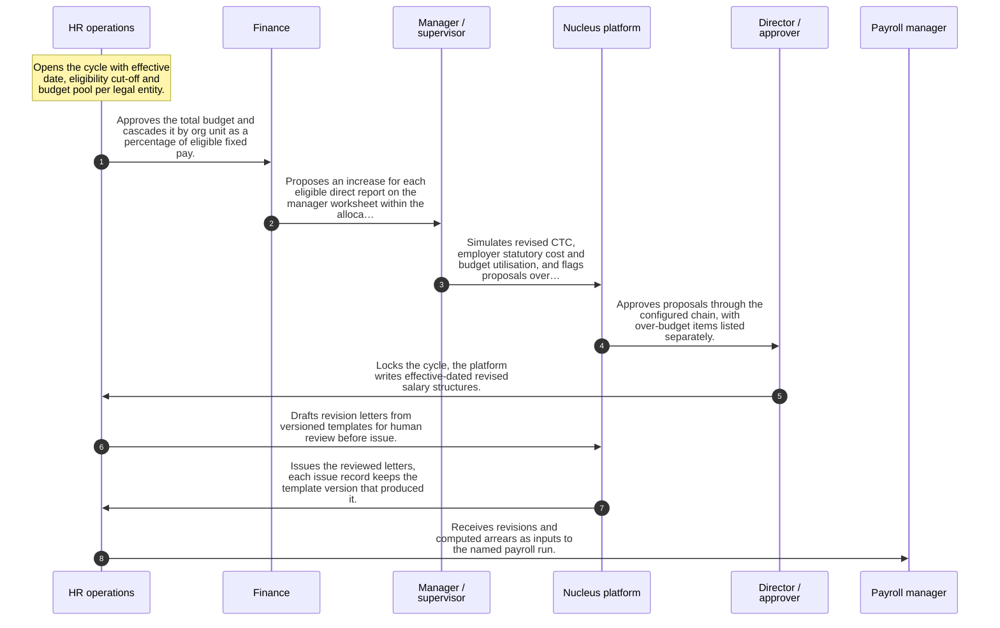

**Alternate flows**

| ID | At step | Condition | Steps | Rejoins |
| :--- | ---: | :--- | :--- | :--- |
| A1 | 4 | A proposal exceeds the manager's budget allocation. | Manager either reduces it or submits it as a budget exception with a reason. → Exception routes to an additional approver level. | Returns to step 5 |

**Exception flows**

| ID | At step | Condition | Handling | Rule |
| :--- | ---: | :--- | :--- | :--- |
| E1 | 6 | Effective date falls in a payroll period already finalised. | Platform computes arrears for the closed periods and raises them as a separate input. |  |
| E2 | 7 | A letter template references a merge field that does not exist. | Template fails validation on save; no draft is produced from it. | RL-500 |
| E3 | 5 | Approver rejects a proposal. | Proposal returns to the manager with the comment; salary structure is unchanged. | RL-010 |

**Postconditions — success**

- Revised salary structures are effective-dated for every approved proposal.
- Revision letters are issued with their template version retained.
- Payroll inputs exist for revisions and any arrears.

**Postconditions — failure**

- Unapproved proposals leave salary structures unchanged.
- Cycle remains open with a list of blocking items.

**Quality requirements**

- Worksheet simulation refreshes within 1 s for a team of 50.
- Cycle supports 10,000 eligible employees per tenant without manual batching.

### CMB-UC-007

**Maintain salary structures and grade pay ranges** — Hold minimum, midpoint and maximum pay per grade and location, and compute compa-ratio and range penetration for every assignment.

| Attribute | Value |
| :--- | :--- |
| Realises | CMB-CG-001 |
| Source | Authored |
| Level | User goal |
| Primary actor | Payroll manager |
| Secondary actors | Implementation consultant, HR operations, Manager / supervisor, Nucleus platform |
| Trigger | A new pay range table is prepared for a grade and location, or a range is revised. |
| Frequency | Annual |
| Criticality | High |
| Phase | P1 |
| Client requirements | — |
| Business rules | — |
| Screens | — |
| Data objects (CRUD) | salary_structure (R), pay_range (C, U), assignment (R) |
| Events | — |
| Acceptance tests | CMB-TC-001, CMB-TC-002, CMB-TC-003, CMB-TC-004, CMB-TC-005, CMB-TC-006 |
| System requirements | SYS-018, SYS-022, SYS-026, SYS-028, SYS-048 |

**Stakeholders and interests**

| Stakeholder | Interest |
| :--- | :--- |
| HR operations | Can spot under- and over-paid employees against their range. |
| Manager / supervisor | Sees where team members sit in range when proposing pay. |
| Finance | Pay ranges reflect approved market positioning. |

**Preconditions**

- Grades and locations exist in the organisation master.
- Payroll manager has entity scope with salary-structure rights.

**Main success scenario**

| # | Actor | Action | Ref |
| ---: | :--- | :--- | :--- |
| 1 | Payroll manager | Opens grade ranges and selects grade and location for the new effective date. |  |
| 2 | Payroll manager | Enters annual minimum, midpoint and maximum fixed pay for each grade-location pair. |  |
| 3 | Nucleus platform | Validates minimum below midpoint below maximum and that the effective date does not overlap a published range. |  |
| 4 | Nucleus platform | Previews employees falling below minimum or above maximum under the proposed range. |  |
| 5 | Payroll manager | Publishes the range; prior range is end-dated the day before. |  |
| 6 | Nucleus platform | Recomputes compa-ratio as fixed pay divided by midpoint and penetration as position between minimum and maximum. |  |
| 7 | HR operations | Reviews the out-of-range list and opens remediation items where needed. |  |

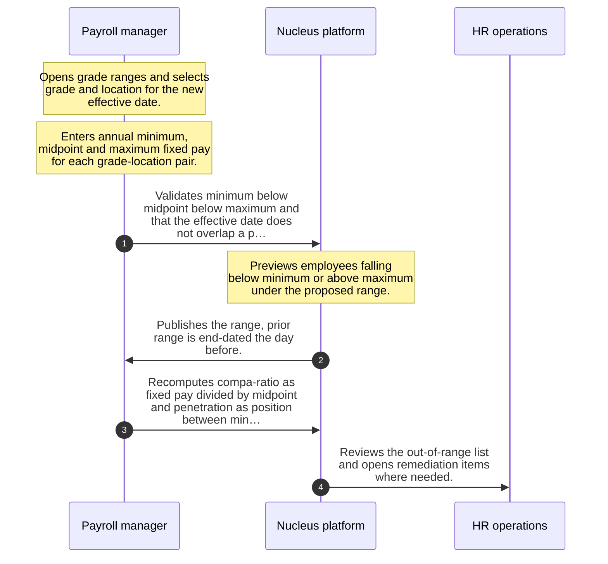

**Alternate flows**

| ID | At step | Condition | Steps | Rejoins |
| :--- | ---: | :--- | :--- | :--- |
| A1 | 2 | Payroll manager imports ranges for many grades from a file. | Platform validates each row and lists rejects with reasons. → Valid rows are staged for preview. | Returns to step 4 |

**Exception flows**

| ID | At step | Condition | Handling | Rule |
| :--- | ---: | :--- | :--- | :--- |
| E1 | 3 | Minimum exceeds midpoint or midpoint exceeds maximum. | Row is rejected with the failing comparison named. |  |
| E2 | 3 | Effective date overlaps an existing published range. | Publication is blocked until the earlier range is end-dated. |  |

**Postconditions — success**

- An effective-dated range exists per grade and location.
- Every assignment carries current compa-ratio and range penetration.

**Postconditions — failure**

- Invalid ranges are not published; existing ranges remain in force.

**Quality requirements**

- Compa-ratio recomputation completes within 10 minutes for 25,000 assignments.
- Range history is retained for seven years.

### CMB-UC-008

**Run merit, bonus and variable pay cycles** — Distribute a budgeted merit or bonus pool using eligibility rules and a performance-by-compa-ratio guideline matrix, then hand approved amounts to payroll.

| Attribute | Value |
| :--- | :--- |
| Realises | CMB-CG-002 |
| Source | Authored |
| Level | Summary |
| Primary actor | HR operations |
| Secondary actors | Manager / supervisor, Finance, Director / approver, Payroll manager, Nucleus platform |
| Trigger | HR opens a merit or bonus cycle after performance ratings are final. |
| Frequency | Annual |
| Criticality | High |
| Phase | P3 |
| Client requirements | — |
| Business rules | — |
| Screens | — |
| Data objects (CRUD) | performance_rating (R), salary_structure (U), payroll_input (C) |
| Events | — |
| Acceptance tests | CMB-TC-007, CMB-TC-008, CMB-TC-009, CMB-TC-010, CMB-TC-011, CMB-TC-012 |
| System requirements | SYS-022, SYS-028, SYS-036, SYS-037, SYS-059 |

**Stakeholders and interests**

| Stakeholder | Interest |
| :--- | :--- |
| Manager / supervisor | Gets clear guidance on what each rating and position in range justifies. |
| Finance | Pool spend stays within the approved budget. |
| Employee / worker | Rewards are consistent with performance and paid on time. |

**Preconditions**

- Final performance ratings exist for the cycle.
- Pay ranges and compa-ratios are current.
- Pool budget is approved by finance.

**Main success scenario**

| # | Actor | Action | Ref |
| ---: | :--- | :--- | :--- |
| 1 | HR operations | Defines the cycle: type (merit or bonus), eligibility rules, pool size and payout run. |  |
| 2 | HR operations | Loads the guideline matrix of increase or payout percentage ranges by rating and compa-ratio band. |  |
| 3 | Nucleus platform | Applies eligibility rules such as minimum service and excludes employees on notice. |  |
| 4 | Nucleus platform | Pre-fills each manager worksheet with the guideline midpoint for every eligible employee. |  |
| 5 | Manager / supervisor | Adjusts recommendations within guideline and enters a justification for any out-of-guideline amount. |  |
| 6 | Director / approver | Approves worksheets through the configured chain with out-of-guideline items highlighted. |  |
| 7 | Finance | Confirms total spend against the pool. |  |
| 8 | Nucleus platform | Raises approved awards as payroll inputs in the named run and updates salary structures for merit increases. |  |

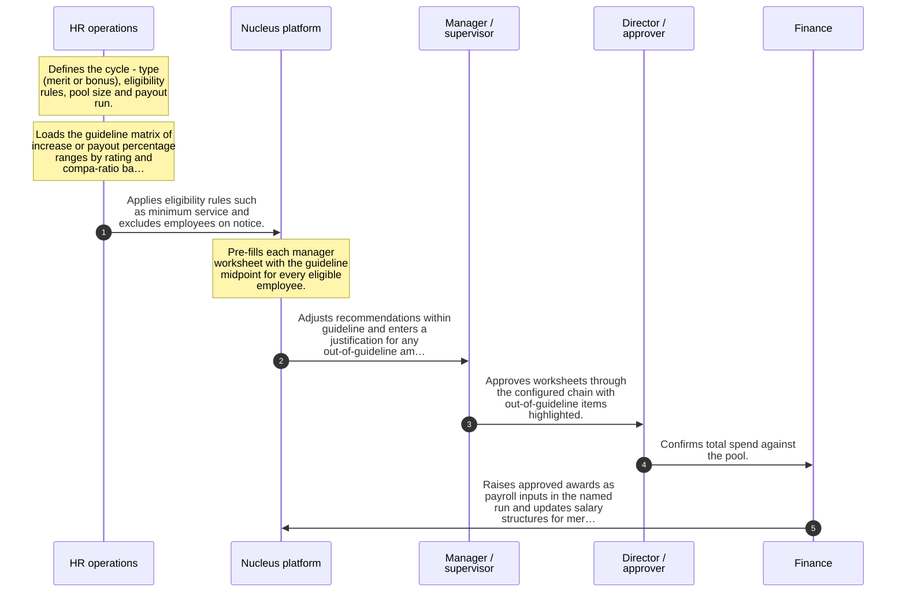

**Alternate flows**

| ID | At step | Condition | Steps | Rejoins |
| :--- | ---: | :--- | :--- | :--- |
| A1 | 5 | Manager's total exceeds the allocated pool share. | Platform shows the excess and blocks submission until it is resolved or flagged as a budget exception. | Returns to step 6 |

**Exception flows**

| ID | At step | Condition | Handling | Rule |
| :--- | ---: | :--- | :--- | :--- |
| E1 | 3 | An employee lacks a final rating. | Employee is listed as pending rating and excluded until the rating is final. |  |
| E2 | 8 | Named payroll run is already finalised. | Inputs move to the next open run with a notice to the payroll manager. |  |

**Postconditions — success**

- Approved awards exist per employee and are raised as payroll inputs in the named run.

**Postconditions — failure**

- Unapproved awards create no payroll input.

**Quality requirements**

- Worksheet guideline recalculates within 1 s per change.
- Every out-of-guideline award retains its justification for audit.

### CMB-UC-009

**Administer equity and ESOP grants** — Track grants, vesting, exercises and the perquisite value that payroll must tax on exercise.

| Attribute | Value |
| :--- | :--- |
| Realises | CMB-CG-003 |
| Source | Authored |
| Level | User goal |
| Primary actor | HR operations |
| Secondary actors | Employee / worker, Payroll manager, Finance, Nucleus platform |
| Trigger | A grant is approved or an employee exercises vested options. |
| Frequency | Quarterly |
| Criticality | Medium |
| Phase | P4 |
| Client requirements | — |
| Business rules | — |
| Screens | — |
| Data objects (CRUD) | esop_grant (C), vesting_tranche (C), esop_exercise (C), payroll_input (C) |
| Events | — |
| Acceptance tests | CMB-TC-013, CMB-TC-014, CMB-TC-015, CMB-TC-016 |
| System requirements | SYS-028, SYS-030, SYS-045, SYS-047 |

**Stakeholders and interests**

| Stakeholder | Interest |
| :--- | :--- |
| Employee / worker | Sees vested and unvested options and tax impact before exercising. |
| Payroll manager | Receives exercise perquisite values for withholding. |
| Finance | Equity records reconcile to the grant register. |

**Preconditions**

- ESOP scheme with vesting rules is configured.
- Fair market value per valuation date is recorded by finance.

**Main success scenario**

| # | Actor | Action | Ref |
| ---: | :--- | :--- | :--- |
| 1 | HR operations | Records a grant with scheme, number of options, exercise price and grant date. |  |
| 2 | Nucleus platform | Generates vesting tranches from the scheme schedule, for example 25% per year over four years. |  |
| 3 | Employee / worker | Views vested, unvested and exercised options on the self-service equity page. |  |
| 4 | Employee / worker | Submits an exercise request for vested options. |  |
| 5 | Nucleus platform | Computes perquisite value as fair market value on exercise date minus exercise price, multiplied by options exercised (to be validated by Legal). |  |
| 6 | Finance | Confirms the exercise and the fair market value used. |  |
| 7 | Nucleus platform | Raises the perquisite value as a taxable payroll input in the exercise month. |  |

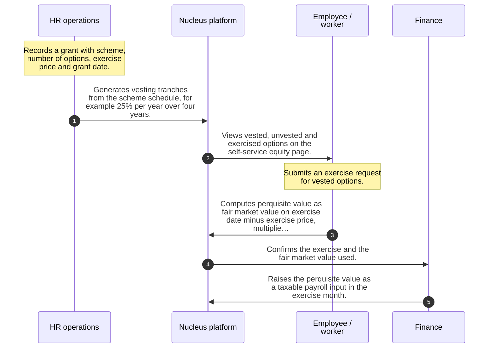

**Alternate flows**

| ID | At step | Condition | Steps | Rejoins |
| :--- | ---: | :--- | :--- | :--- |
| A1 | 2 | Employee separates before vesting completes. | Unvested tranches lapse per scheme rules on the last working day. → Vested options remain exercisable for the scheme's post-exit window. | Ends |

**Exception flows**

| ID | At step | Condition | Handling | Rule |
| :--- | ---: | :--- | :--- | :--- |
| E1 | 4 | Requested options exceed vested balance. | Request is refused with the vested balance shown. |  |
| E2 | 5 | No fair market value is recorded for the exercise date. | Exercise is held until finance records a value. |  |

**Postconditions — success**

- Grant, vesting tranches and exercises are recorded per employee.
- Perquisite value is raised as a payroll input in the exercise month.

**Postconditions — failure**

- Exercise is not recorded and no payroll input is raised.

**Quality requirements**

- Vesting schedule generation is deterministic for the same scheme and grant date.

### CMB-UC-010

**Enrol employees and dependants in group insurance** — Manage medical, accident and life cover enrolment with dependants, top-ups, enrolment windows, life events and insurer data exchange.

| Attribute | Value |
| :--- | :--- |
| Realises | CMB-CG-004 |
| Source | Authored |
| Level | User goal |
| Primary actor | Employee / worker |
| Secondary actors | HR operations, Payroll manager, Nucleus platform, Insurer |
| Trigger | Enrolment window opens, a new joiner is hired, or a life event is reported. |
| Frequency | Annual |
| Criticality | High |
| Phase | P3 |
| Client requirements | — |
| Business rules | — |
| Screens | — |
| Data objects (CRUD) | benefit_enrolment (C, U), dependant (C), payroll_input (C) |
| Events | — |
| Acceptance tests | CMB-TC-017, CMB-TC-018, CMB-TC-019, CMB-TC-020, CMB-TC-021, CMB-TC-022 |
| System requirements | SYS-016, SYS-028, SYS-033, SYS-070, SYS-084 |

**Stakeholders and interests**

| Stakeholder | Interest |
| :--- | :--- |
| Employee / worker | Family is covered from the right date with the chosen top-up. |
| HR operations | Enrolment windows close on time with complete data. |
| Payroll manager | Top-up premiums are deducted correctly. |

**Preconditions**

- Policy plans, sum-insured options and top-up premiums are configured.
- Enrolment window dates are set.

**Main success scenario**

| # | Actor | Action | Ref |
| ---: | :--- | :--- | :--- |
| 1 | HR operations | Opens the enrolment window with start and end dates and notifies eligible employees. |  |
| 2 | Employee / worker | Reviews default cover and adds dependants with relationship, date of birth and identity document. |  |
| 3 | Employee / worker | Selects an optional top-up and sees the annual premium and monthly deduction. |  |
| 4 | Nucleus platform | Validates dependant eligibility rules such as age limits and relationship types. |  |
| 5 | Employee / worker | Submits the enrolment and gives consent for sharing dependant data with the insurer. |  |
| 6 | Nucleus platform | Raises the top-up premium as a recurring payroll deduction. |  |
| 7 | Nucleus platform | Generates the insurer addition and deletion file for the period. |  |
| 8 | HR operations | Reconciles the insurer's confirmation and resolves rejected members. |  |

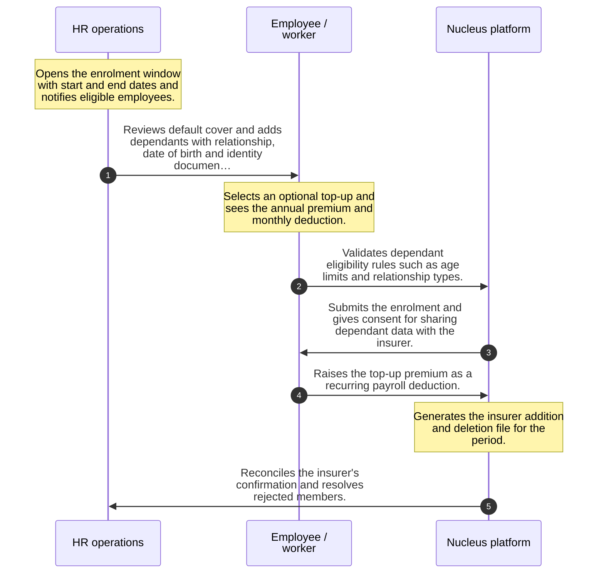

**Alternate flows**

| ID | At step | Condition | Steps | Rejoins |
| :--- | ---: | :--- | :--- | :--- |
| A1 | 2 | Employee reports a life event such as marriage or a birth outside the window. | Platform opens a 30-day life-event window for that employee only. → Employee adds the new dependant with evidence. | Returns to step 4 |

**Exception flows**

| ID | At step | Condition | Handling | Rule |
| :--- | ---: | :--- | :--- | :--- |
| E1 | 4 | Dependant exceeds the configured age limit. | Dependant is rejected with the limit shown. |  |
| E2 | 5 | Window closes before submission. | Default cover applies and the draft is retained for HR review. |  |
| E3 | 8 | Insurer rejects a member record. | Rejection appears on HR's queue with the insurer's reason for correction and resubmission. |  |

**Postconditions — success**

- Enrolment with covered dependants is confirmed and included in the next insurer file.
- Top-up premium deduction is raised as a payroll input.

**Postconditions — failure**

- Enrolment remains in draft and the employee keeps default cover.

**Quality requirements**

- Dependant identity documents are stored encrypted and visible only to self and HR benefits roles.
- Insurer file generation completes within 15 minutes for 20,000 members.

### CMB-UC-011

**Manage NPS and superannuation contributions** — Capture employee choices for NPS and superannuation and compute contributions within configured statutory caps for payroll.

| Attribute | Value |
| :--- | :--- |
| Realises | CMB-CG-005 |
| Source | Authored |
| Level | User goal |
| Primary actor | Employee / worker |
| Secondary actors | Payroll manager, Finance, Nucleus platform |
| Trigger | Employee elects or changes a retirement contribution, or a payroll run computes contributions. |
| Frequency | Monthly |
| Criticality | High |
| Phase | P3 |
| Client requirements | — |
| Business rules | — |
| Screens | — |
| Data objects (CRUD) | retirement_election (C, U), payroll_input (C) |
| Events | — |
| Acceptance tests | CMB-TC-023, CMB-TC-024, CMB-TC-025, CMB-TC-026 |
| System requirements | SYS-022, SYS-026, SYS-028, SYS-045, SYS-047 |

**Stakeholders and interests**

| Stakeholder | Interest |
| :--- | :--- |
| Employee / worker | Contributions follow the elected rate and appear on the payslip. |
| Payroll manager | Contributions are computed within caps without manual overrides. |
| Finance | Remittances reconcile to payroll. |

**Preconditions**

- Retirement plans, allowed rates and statutory caps are configured per entity (to be validated by Legal).
- Employee holds a valid retirement account identifier where the plan requires one.

**Main success scenario**

| # | Actor | Action | Ref |
| ---: | :--- | :--- | :--- |
| 1 | Employee / worker | Opens retirement benefits and views current elections for NPS and superannuation. |  |
| 2 | Employee / worker | Selects a contribution rate from the plan's allowed options and provides the account identifier. |  |
| 3 | Nucleus platform | Validates the account identifier format and the rate against plan options. |  |
| 4 | Nucleus platform | Shows the projected monthly employer and employee contribution and tax treatment note. |  |
| 5 | Employee / worker | Confirms the election, effective from the next open payroll period. |  |
| 6 | Nucleus platform | Computes contributions in each run and applies the configured cap, routing any excess per plan rules. |  |
| 7 | Payroll manager | Reviews the contribution register and generates the remittance file. |  |

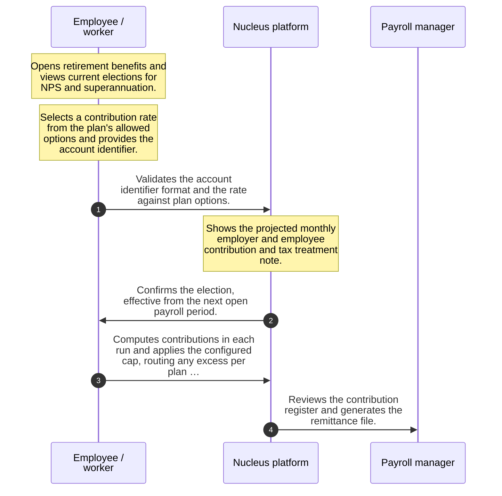

**Alternate flows**

| ID | At step | Condition | Steps | Rejoins |
| :--- | ---: | :--- | :--- | :--- |
| A1 | 5 | Election change window is restricted to once per financial year. | Platform shows the date of the last change and the next permitted change date. | Ends |

**Exception flows**

| ID | At step | Condition | Handling | Rule |
| :--- | ---: | :--- | :--- | :--- |
| E1 | 3 | Account identifier is missing or invalid. | Election cannot be confirmed until a valid identifier is entered. |  |
| E2 | 6 | Employer contribution exceeds the configured cap. | Excess is treated per plan configuration and flagged on the register. |  |

**Postconditions — success**

- Election is stored effective from the next open period.
- Employer and employee contributions appear in the run and the remittance file.

**Postconditions — failure**

- Prior election remains in force.

**Quality requirements**

- Cap rules are versioned with effective dates so past runs recompute identically.

### CMB-UC-012

**Allocate and reconcile a flexible benefits plan** — Let employees allocate a flexi budget across a benefits catalogue, claim against it with proofs and reconcile at year end.

| Attribute | Value |
| :--- | :--- |
| Realises | CMB-CG-006 |
| Source | Authored |
| Level | User goal |
| Primary actor | Employee / worker |
| Secondary actors | Payroll manager, HR operations, Nucleus platform |
| Trigger | Flexi declaration window opens, a claim is submitted, or year end is reached. |
| Frequency | Annual |
| Criticality | Medium |
| Phase | P3 |
| Client requirements | — |
| Business rules | — |
| Screens | — |
| Data objects (CRUD) | flexi_allocation (C, U), flexi_claim (C, U), payroll_input (C) |
| Events | — |
| Acceptance tests | CMB-TC-027, CMB-TC-028, CMB-TC-029, CMB-TC-030 |
| System requirements | SYS-028, SYS-037, SYS-040, SYS-045, SYS-059 |

**Stakeholders and interests**

| Stakeholder | Interest |
| :--- | :--- |
| Employee / worker | Can structure pay tax-efficiently within policy. |
| Payroll manager | Taxable and exempt amounts are correct at year end. |

**Preconditions**

- Flexi budget is part of the salary structure.
- Catalogue items with limits and proof rules are configured.

**Main success scenario**

| # | Actor | Action | Ref |
| ---: | :--- | :--- | :--- |
| 1 | Employee / worker | Opens the flexi plan and sees the annual budget and catalogue items with limits. |  |
| 2 | Employee / worker | Allocates the budget across items such as meal, fuel, telephone and leave travel. |  |
| 3 | Nucleus platform | Validates each allocation against item limits and the total budget. |  |
| 4 | Employee / worker | Submits claims with proofs during the year against allocated items. |  |
| 5 | Payroll manager | Verifies proofs and approves or rejects each claim. |  |
| 6 | Nucleus platform | Pays approved claims as exempt reimbursements in the named run. |  |
| 7 | Nucleus platform | At year end treats allocated but unproven amounts as taxable and raises the input. |  |

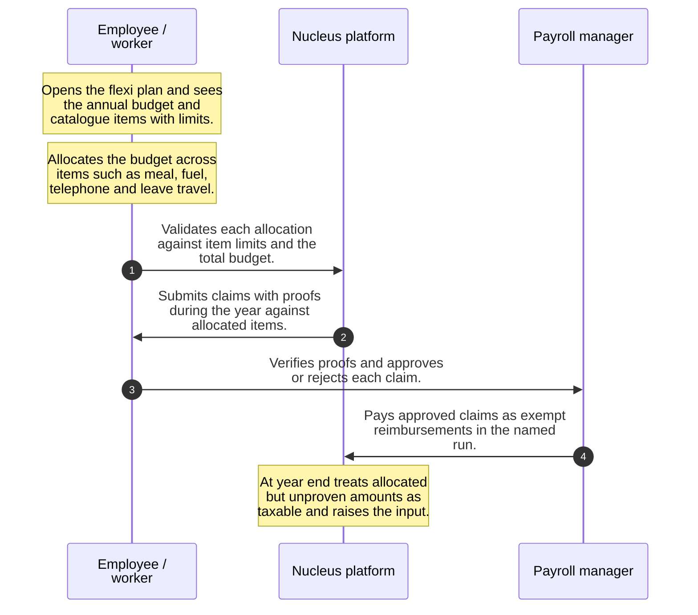

**Alternate flows**

| ID | At step | Condition | Steps | Rejoins |
| :--- | ---: | :--- | :--- | :--- |
| A1 | 2 | Employee makes no allocation by the window close. | Full budget defaults to the taxable allowance. | Returns to step 4 |

**Exception flows**

| ID | At step | Condition | Handling | Rule |
| :--- | ---: | :--- | :--- | :--- |
| E1 | 3 | Allocation exceeds an item limit or the total budget. | Allocation is rejected with the limit shown. |  |
| E2 | 5 | Proof is illegible or does not match the item. | Claim is rejected with reason and the amount stays available to claim. |  |

**Postconditions — success**

- Allocations, claims and year-end taxable residue are recorded and flow to payroll.

**Postconditions — failure**

- Unallocated budget is paid as taxable allowance.

**Quality requirements**

- Year-end reconciliation for 20,000 employees completes within one hour.

### CMB-UC-013

**View an annual total rewards statement** — Give each employee a statement of fixed pay, variable pay, benefits, employer statutory contributions and perks for the year.

| Attribute | Value |
| :--- | :--- |
| Realises | CMB-CG-007 |
| Source | Authored |
| Level | User goal |
| Primary actor | Employee / worker |
| Secondary actors | HR operations, Nucleus platform |
| Trigger | HR publishes statements for a financial year, or an employee opens their statement. |
| Frequency | Annual |
| Criticality | Medium |
| Phase | P3 |
| Client requirements | — |
| Business rules | — |
| Screens | — |
| Data objects (CRUD) | total_rewards_statement (C), payroll_result (R), benefit_enrolment (R) |
| Events | — |
| Acceptance tests | CMB-TC-031, CMB-TC-032, CMB-TC-033, CMB-TC-034 |
| System requirements | SYS-016, SYS-017, SYS-028, SYS-067 |

**Stakeholders and interests**

| Stakeholder | Interest |
| :--- | :--- |
| Employee / worker | Understands the full value of employment beyond take-home pay. |
| HR operations | Can publish statements without manual compilation. |

**Preconditions**

- Payroll for the year is finalised.
- Benefit and perk costs per employee are recorded.

**Main success scenario**

| # | Actor | Action | Ref |
| ---: | :--- | :--- | :--- |
| 1 | HR operations | Selects the financial year and the population and triggers statement generation. |  |
| 2 | Nucleus platform | Aggregates fixed pay, variable pay, employer PF, ESIC and gratuity provision, benefit premiums and perks per employee. |  |
| 3 | Nucleus platform | Reconciles each statement total to finalised payroll and benefit cost registers. |  |
| 4 | HR operations | Reviews a sample and publishes statements. |  |
| 5 | Employee / worker | Opens their statement on mobile or web and views each category with a breakdown. |  |
| 6 | Employee / worker | Downloads the statement as a document. |  |

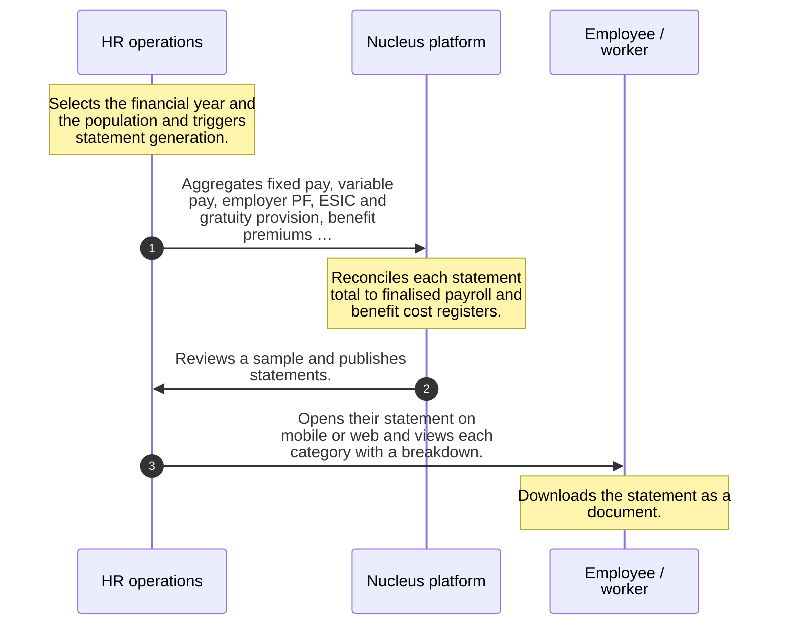

**Alternate flows**

| ID | At step | Condition | Steps | Rejoins |
| :--- | ---: | :--- | :--- | :--- |
| A1 | 5 | Employee joined mid-year. | Statement covers the months of service only and states the period. | Returns to step 6 |

**Exception flows**

| ID | At step | Condition | Handling | Rule |
| :--- | ---: | :--- | :--- | :--- |
| E1 | 3 | Statement total does not reconcile to payroll. | Employee is excluded from publication and listed for HR investigation. |  |

**Postconditions — success**

- Statement is available to the employee only, with each figure traceable to its source.

**Postconditions — failure**

- Statement is not published if any source total fails reconciliation.

**Quality requirements**

- Statement opens within 3 s on a mid-range mobile device.
- Only the employee and HR with entity scope can view a statement.

### CMB-UC-014

**Analyse pay equity and track remediation** — Measure pay gaps by gender and other permitted attributes controlling for grade, location and tenure, and track remediation to closure.

| Attribute | Value |
| :--- | :--- |
| Realises | CMB-CG-008 |
| Source | Authored |
| Level | User goal |
| Primary actor | HR operations |
| Secondary actors | Finance, Director / approver, Auditor, Nucleus platform |
| Trigger | HR runs a scheduled or ad-hoc pay equity analysis. |
| Frequency | Quarterly |
| Criticality | High |
| Phase | P3 |
| Client requirements | — |
| Business rules | — |
| Screens | — |
| Data objects (CRUD) | pay_equity_run (C), remediation_item (C, U), salary_structure (R) |
| Events | — |
| Acceptance tests | CMB-TC-035, CMB-TC-036, CMB-TC-037, CMB-TC-038 |
| System requirements | SYS-017, SYS-018, SYS-019, SYS-033, SYS-037 |

**Stakeholders and interests**

| Stakeholder | Interest |
| :--- | :--- |
| Employee / worker | Is paid fairly for comparable work. |
| Director / approver | Gets evidence for remediation budget decisions. |
| Auditor | Can verify analysis method and remediation actions. |

**Preconditions**

- Attributes used are permitted by tenant policy and consented where required under the DPDP Act 2023 (to be validated by Legal).
- Grade, location and tenure data are complete.

**Main success scenario**

| # | Actor | Action | Ref |
| ---: | :--- | :--- | :--- |
| 1 | HR operations | Selects the population, the attribute to analyse and the control variables grade, location and tenure. |  |
| 2 | Nucleus platform | Checks each comparison group meets the minimum group size and suppresses smaller groups. |  |
| 3 | Nucleus platform | Computes the unadjusted gap and the adjusted gap controlling for the chosen variables. |  |
| 4 | Nucleus platform | Lists individuals whose pay falls outside the expected band for their controls, visible only to authorised HR. |  |
| 5 | HR operations | Creates remediation items with proposed adjustment, owner and target date. |  |
| 6 | Director / approver | Approves the remediation budget. |  |
| 7 | Nucleus platform | Routes approved adjustments into the compensation revision process and tracks closure. |  |

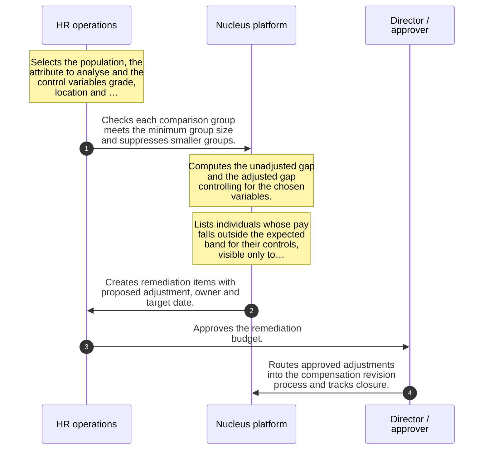

**Alternate flows**

| ID | At step | Condition | Steps | Rejoins |
| :--- | ---: | :--- | :--- | :--- |
| A1 | 1 | Analysis is scheduled quarterly. | Platform runs it automatically and notifies HR when results are ready. | Returns to step 2 |

**Exception flows**

| ID | At step | Condition | Handling | Rule |
| :--- | ---: | :--- | :--- | :--- |
| E1 | 2 | A comparison group has fewer than the minimum members. | Group result is suppressed and marked as insufficient size. |  |
| E2 | 1 | Attribute is not permitted by tenant policy. | Attribute is not selectable and the attempt is logged. |  |

**Postconditions — success**

- Adjusted and unadjusted gaps are published to authorised roles with method notes.
- Remediation items are tracked with owner, amount and status.

**Postconditions — failure**

- Results for groups below the minimum size are suppressed.

**Quality requirements**

- Individual-level results are restricted to roles with explicit pay-equity grant.
- Analysis method and inputs are retained so a run can be reproduced.

### CMB-UC-015

**Administer a retention bonus plan with vesting and clawback** — Award deferred and retention bonuses under a plan with vesting conditions and clawback terms, pay each vested tranche through payroll and recover unearned amounts on early exit.

| Attribute | Value |
| :--- | :--- |
| Realises | CMB-CG-009 |
| Source | Authored |
| Level | User goal |
| Primary actor | HR operations |
| Secondary actors | Director / approver, Payroll manager, Finance, Employee / worker, Nucleus platform |
| Trigger | HR operations launches a retention plan, for example to retain skilled machinists during the Medchal Works capacity ramp-up. |
| Frequency | Monthly |
| Criticality | Medium |
| Phase | P4 |
| Client requirements | — |
| Business rules | RL-010 |
| Screens | SCR-040, SCR-067 |
| Data objects (CRUD) | incentive_plan (C), incentive_award (C, U), vesting_tranche (C, U), payroll_input (C), clawback_assessment (C), approval_instance (C) |
| Events | platform.approval.completed, payroll.input.raised, payroll.fnf.settled |
| Acceptance tests | CMB-TC-039, CMB-TC-040, CMB-TC-041, CMB-TC-042, CMB-TC-043, CMB-TC-044 |
| System requirements | SYS-028, SYS-037, SYS-049, SYS-050, SYS-053 |

**Stakeholders and interests**

| Stakeholder | Interest |
| :--- | :--- |
| Employee / worker | Knows exactly when each tranche vests, what conditions apply and what is repayable if they leave early. |
| Director / approver | Approves awards against a fixed plan budget and sees any clawback waiver as a named exception. |
| Finance | Accrues the deferred liability each month and sees it released when tranches are paid or forfeited. |
| Payroll manager | Receives vested tranches as ordinary payroll inputs, never as payments outside the run. |

**Preconditions**

- A plan is configured with budget, eligible population, vesting schedule, vesting conditions and clawback terms.
- Performance ratings and employment status are available to the eligibility service.
- Payroll inputs can be raised for the employee's payroll group.

**Main success scenario**

| # | Actor | Action | Ref |
| ---: | :--- | :--- | :--- |
| 1 | HR operations | Creates the plan Medchal ramp-up retention 2026: 40% vests at 12 months and 60% at 24 months, subject to service and rating of 3 or above. |  |
| 2 | HR operations | Nominates employees with award amounts; the platform checks the batch total against the plan budget of ₹48,00,000. |  |
| 3 | Nucleus platform | Submits the award batch to the approval engine with plan terms and budget utilisation. |  |
| 4 | Director / approver | Approves the batch. |  |
| 5 | Nucleus platform | Issues award letters from the plan template; each employee accepts in self-service, recording acceptance of the clawback terms. |  |
| 6 | Nucleus platform | Creates vesting tranches in the ledger and publishes the monthly deferred-liability accrual to Finance. |  |
| 7 | Nucleus platform | On each vesting date, the eligibility service checks active status, rating and absence of a pending resignation. |  |
| 8 | Nucleus platform | Raises a payroll input for each vested tranche into the next open run of the employee's payroll group. |  |
| 9 | Payroll manager | Processes the run; the payslip shows the tranche as a separate earning with tax withheld under payroll rules. |  |
| 10 | Nucleus platform | On exit within the clawback window, computes the recoverable amount and routes it for approval and recovery in the final settlement. |  |

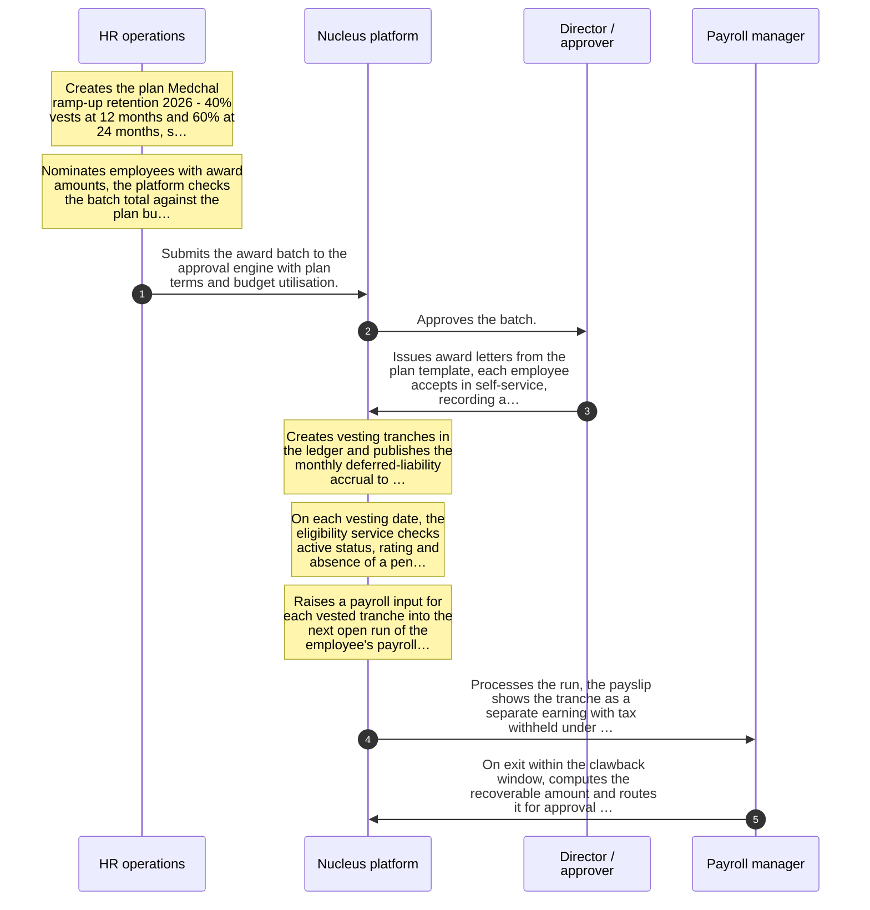

**Alternate flows**

| ID | At step | Condition | Steps | Rejoins |
| :--- | ---: | :--- | :--- | :--- |
| A1 | 7 | An employee's rating for the period is 2. | The eligibility service marks the condition unmet. → The tranche is forfeited or deferred to the next vesting date as the plan specifies, and the employee is notified. | Returns to step 8 for the remaining employees |
| A2 | 10 | The director waives clawback for an employee leaving on medical grounds. | Director records the waiver with reason; the platform names the clawback term being waived. → No recovery is raised and the waiver is kept with the award. | Use case ends |

**Exception flows**

| ID | At step | Condition | Handling | Rule |
| :--- | ---: | :--- | :--- | :--- |
| E1 | 2 | The nominated total exceeds the plan budget. | The batch cannot be submitted and the excess amount is shown. |  |
| E2 | 4 | The director rejects the batch. | No awards, letters or tranches are created and HR operations is notified with the reason. | RL-010 |
| E3 | 8 | The target payroll run is already finalised. | The input is placed in the next open run and the payroll manager is notified. |  |
| E4 | 10 | The recoverable amount exceeds the net payable in the final settlement. | The shortfall is recorded as a receivable and passed to Finance for follow-up. |  |

**Postconditions — success**

- Each award has an accepted letter, a vesting schedule in the ledger and, once vested, a payroll input in a named run.
- Clawback assessments on exit are approved and recovered through the final settlement.

**Postconditions — failure**

- Awards rejected at approval create no schedule or liability.
- Tranches whose conditions are not met are forfeited with the failed condition recorded.

**Quality requirements**

- Vesting evaluation is idempotent: rerunning it for a date never raises a second payroll input for the same tranche.
- The monthly deferred-liability report reconciles to the sum of unvested tranches to the rupee.

### CMB-UC-016

**Benchmark pay internally and flag outliers before a revision cycle** — Compare pay within role, grade, location and tenure bands using internal data and route outliers into the next compensation revision cycle.

| Attribute | Value |
| :--- | :--- |
| Realises | CMB-CG-010 |
| Source | Authored |
| Level | User goal |
| Primary actor | HR operations |
| Secondary actors | Manager / supervisor, Director / approver, Nucleus platform |
| Trigger | HR operations prepares for the annual revision cycle or runs an ad-hoc check after a wage settlement at a plant. |
| Frequency | Quarterly |
| Criticality | High |
| Phase | P3 |
| Client requirements | — |
| Business rules | — |
| Screens | — |
| Data objects (CRUD) | compensation_projection (R), grade_pay_range (R), benchmark_run (C), outlier_flag (C, U), revision_worksheet (U) |
| Events | report.exported |
| Acceptance tests | CMB-TC-045, CMB-TC-046, CMB-TC-047, CMB-TC-048, CMB-TC-049, CMB-TC-050 |
| System requirements | SYS-016, SYS-017, SYS-018, SYS-028, SYS-033 |

**Stakeholders and interests**

| Stakeholder | Interest |
| :--- | :--- |
| Employee / worker | Is paid consistently with colleagues doing comparable work at the same site and tenure. |
| Manager / supervisor | Enters the revision cycle knowing which team members sit outside their band. |
| Director / approver | Sees the cost of correcting outliers before approving the cycle budget. |

**Preconditions**

- Compensation analytics projections are refreshed within the last 24 hours.
- Grade pay ranges with midpoints exist for every grade in scope.
- The user holds a compensation grant covering the selected entities and locations.

**Main success scenario**

| # | Actor | Action | Ref |
| ---: | :--- | :--- | :--- |
| 1 | HR operations | Selects role family CNC machinist, grades S2 to S4, locations Chakan, Peenya and Oragadam, and tenure bands 0–2, 2–5 and 5+ years. |  |
| 2 | Nucleus platform | Reads the compensation analytics projection, limited to the entities and locations in the user's grant. |  |
| 3 | Nucleus platform | Computes for each cell the 25th percentile, median, 75th percentile and compa-ratio to grade midpoint. |  |
| 4 | Nucleus platform | Suppresses cells with fewer than 5 employees and marks them as insufficient size. |  |
| 5 | Nucleus platform | Flags outliers: compa-ratio below 0.85 or above 1.20, and inversions where newer joiners earn more than longer-tenured peers. |  |
| 6 | HR operations | Reviews each outlier, records a reason such as skill premium or legacy structure, and tags those to correct. |  |
| 7 | Nucleus platform | Adds tagged outliers with proposed correction amounts to the revision worksheet as pre-cycle recommendations. |  |
| 8 | Director / approver | Reviews the total correction cost alongside the cycle budget. |  |
| 9 | Manager / supervisor | Sees, during the cycle, each team member's band position without names or pay of people outside the team. |  |

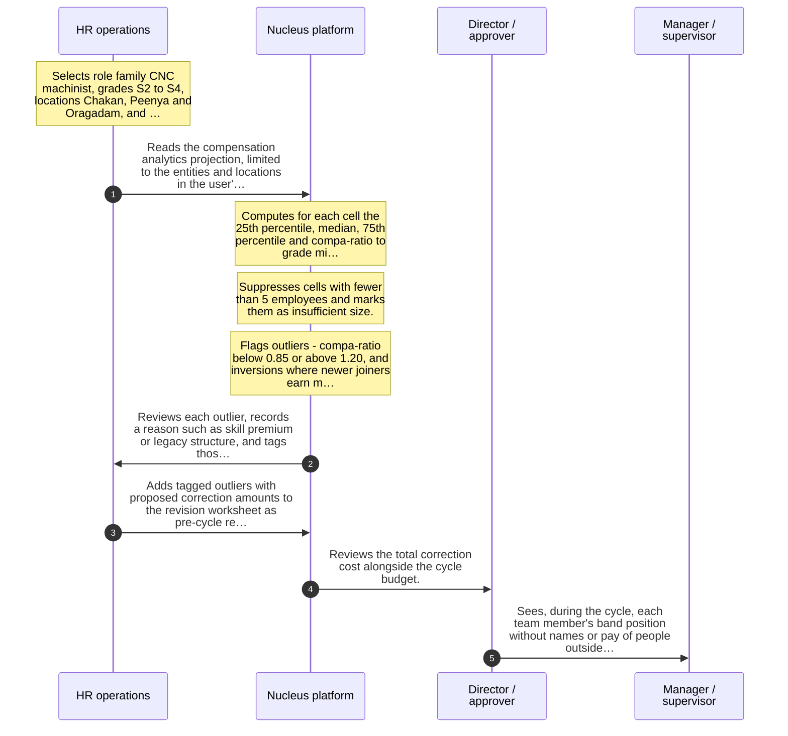

**Alternate flows**

| ID | At step | Condition | Steps | Rejoins |
| :--- | ---: | :--- | :--- | :--- |
| A1 | 3 | The user chooses to normalise for location. | Platform applies the configured location differential before computing compa-ratios. → Results show both raw and location-adjusted figures. | Returns to step 4 |

**Exception flows**

| ID | At step | Condition | Handling | Rule |
| :--- | ---: | :--- | :--- | :--- |
| E1 | 2 | The projection was last refreshed more than 24 hours ago. | A stale-data banner appears and export is disabled until the projection refreshes. |  |
| E2 | 2 | The user lacks a compensation grant. | Amounts and ratios are hidden; only headcounts per cell are shown. |  |
| E3 | 7 | A tagged employee already has an approved revision effective in the cycle. | The recommendation is not added and HR operations is shown the existing revision. |  |

**Postconditions — success**

- Benchmark cells, outliers and HR notes are saved as a dated benchmark run.
- Outliers tagged for correction appear as pre-cycle recommendations in the revision worksheet.

**Postconditions — failure**

- Cells below the minimum group size are suppressed and never exported.
- Users without a compensation grant see headcounts only.

**Quality requirements**

- A benchmark for 3,000 employees across 5 sites returns within 5 s at p95.
- Exports carry a watermark with the user's identity and are recorded in the audit trail.

### CMB-UC-017

**Compute statutory bonus and gratuity under the published rule pack** — Determine statutory bonus and gratuity eligibility and amounts from a published, legally validated rule pack, pay them through payroll and provide provisions to Finance.

| Attribute | Value |
| :--- | :--- |
| Realises | CMB-CG-011 |
| Source | Authored |
| Level | User goal |
| Primary actor | Payroll manager |
| Secondary actors | Compliance owner, Finance, Director / approver, HR operations, Employee / worker, Nucleus platform |
| Trigger | The accounting year closes for statutory bonus, or an employee's separation is recorded for gratuity. |
| Frequency | Annual |
| Criticality | High |
| Phase | P2 |
| Client requirements | — |
| Business rules | RL-010 |
| Screens | SCR-040 |
| Data objects (CRUD) | rule_pack (R), bonus_computation (C), gratuity_computation (C), payroll_input (C), statutory_register (C), nomination (R) |
| Events | compliance.pack.published, payroll.input.raised, payroll.fnf.settled, platform.approval.completed |
| Acceptance tests | CMB-TC-051, CMB-TC-052, CMB-TC-053, CMB-TC-054, CMB-TC-055, CMB-TC-056 |
| System requirements | SYS-028, SYS-030, SYS-037, SYS-045, SYS-047, SYS-086 |

**Stakeholders and interests**

| Stakeholder | Interest |
| :--- | :--- |
| Employee / worker | Receives the statutory bonus and gratuity due, with the working shown. |
| Compliance owner | Maintains the registers required under the Payment of Bonus Act, 1965 and the Payment of Gratuity Act, 1972 (to be validated by Legal). |
| Finance | Provides the allocable surplus and receives monthly provisions for both liabilities. |
| Director / approver | Declares the bonus rate within the permitted range for the accounting year. |

**Preconditions**

- The Compliance owner has published the bonus and gratuity rule pack version for the accounting year after Legal validation, carrying eligibility thresholds, calculation ceiling, minimum and maximum rates, minimum working days and the gratuity service threshold, formula and ceiling.
- Attendance days and wage components for the year are final in the ledger.
- Form F nominations are recorded for employees in service.

**Main success scenario**

| # | Actor | Action | Ref |
| ---: | :--- | :--- | :--- |
| 1 | Payroll manager | Starts the statutory bonus computation for Vindhya Precision Industries Pvt Ltd for accounting year 2025-26. |  |
| 2 | Nucleus platform | Loads the published rule pack version and confirms it carries Legal validation. |  |
| 3 | Nucleus platform | The eligibility service tests each employee for wage threshold, minimum working days from the attendance ledger and exclusions. |  |
| 4 | Finance | Enters the allocable surplus for the year with supporting reference. |  |
| 5 | Director / approver | Declares the bonus rate within the rule pack's minimum and maximum through the approval engine. |  |
| 6 | Nucleus platform | Computes each bonus as rate times eligible salary capped at the calculation ceiling for the months worked, and shows the working. |  |
| 7 | Nucleus platform | Raises payroll inputs into the bonus payment run and generates the statutory bonus register. |  |
| 8 | Nucleus platform | For each separation, computes gratuity as 15/26 of last drawn basic plus DA times completed years, capped at the configured ceiling. |  |
| 9 | Nucleus platform | Passes the gratuity amount to the final settlement, paying the Form F nominee in case of death. |  |
| 10 | Nucleus platform | Publishes monthly bonus and gratuity provisions to Finance for accrual posting. |  |

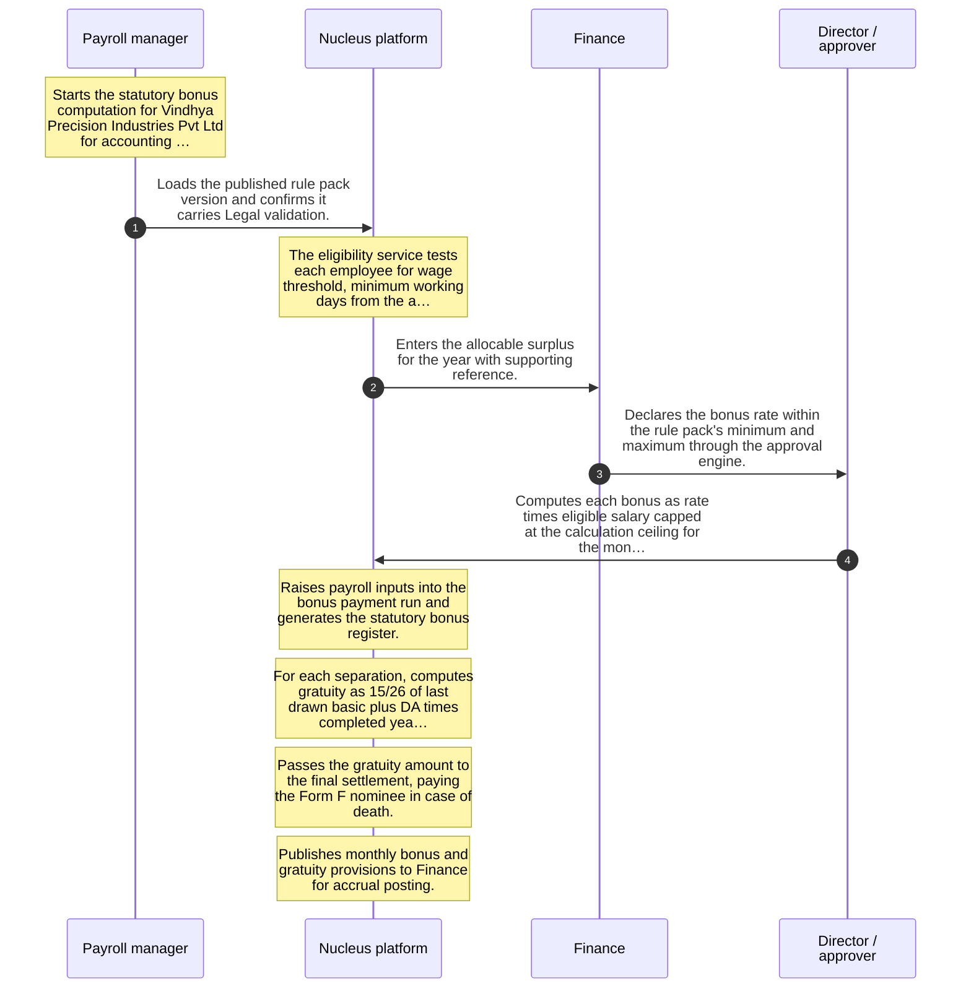

**Alternate flows**

| ID | At step | Condition | Steps | Rejoins |
| :--- | ---: | :--- | :--- | :--- |
| A1 | 8 | The employee has less than the service threshold but separates because of death or disablement. | The eligibility service waives the service threshold as the rule pack specifies. → Gratuity is computed on actual completed service. | Returns to step 9 |
| A2 | 8 | Completed service includes a part year above the rule pack's rounding limit. | The part year is rounded up to a full year as configured, and the rounding is shown in the working. | Returns to step 9 |

**Exception flows**

| ID | At step | Condition | Handling | Rule |
| :--- | ---: | :--- | :--- | :--- |
| E1 | 2 | The rule pack for the year is published but not marked Legal-validated. | The computation cannot start and the Compliance owner is alerted. |  |
| E2 | 3 | An employee worked fewer than the minimum days in the year. | The employee is listed as ineligible with the day count; no bonus is raised. |  |
| E3 | 5 | The declared rate lies outside the rule pack's range. | Approval cannot be submitted and the permitted range is shown. |  |
| E4 | 5 | The director rejects the declared rate. | No bonus inputs are raised and Finance and the payroll manager are notified. | RL-010 |

**Postconditions — success**

- Bonus and gratuity amounts are paid through payroll inputs and recorded in the statutory registers with their working.
- Monthly provisions are available to Finance for posting.

**Postconditions — failure**

- Computation does not start against an unpublished or unvalidated rule pack.
- Ineligible employees are listed with the failed criterion and no payment is raised.

**Quality requirements**

- Every computed amount stores the rule pack version and inputs so it can be recomputed identically.
- The annual bonus computation for 3,000 employees completes within 10 minutes.

## Approval & Sign-off

| Role | Name | Date | Decision | Conditions / comments |
| :--- | :--- | :--- | :--- | :--- |
| Author | Dhanraj Dadhich | 2026-11-05 | Submitted | |
| Peer review moderator | *pending* | | | PR-xxxx |
| PQA (process compliance) | *pending* | | | |
| Approval authority (DOC-01 §7) | *pending* | | | |

## Measurement Data Captured

| Measure | Value | Unit | Notes |
| :--- | :--- | :--- | :--- |
| Size | 533 | specified items (table rows) | Counted automatically at generation |
| Authoring effort | *to be recorded* | person-hours | |
| Review effort (preparation + meeting) | *pending review* | person-hours | From PR-xxxx |
| Rework effort | *pending review* | person-hours | |
| Review rate | *pending review* | items / hour | Compare with PPB control limits |
| Requirement volatility (changes since baseline) | 0 | CRs touching this artefact | Not yet baselined (CM-03) |

**Defects found, by detection phase and severity**

| Detection phase | Major | Minor | Editorial | Injected in phase (major) |
| :--- | :--- | :--- | :--- | :--- |
| Author self-check | 0 | 0 | 0 | — |
| Peer review | *pending* | | | |
| Design / build | | | | |
| System / integration test | | | | |
| UAT | | | | |
| Production (escaped) | | | | each escaped major opens a CAR record (CAR-01) |

Within control limits of the review-rate PPB? *To be assessed at peer review.*

## Revision History

| Version | Date | Author | Change summary | CR ref | Approved by |
| :--- | :--- | :--- | :--- | :--- | :--- |
| 1.0.0 | 2026-11-05 | Dhanraj Dadhich | Consolidated release | CR-0001 | *pending* |
