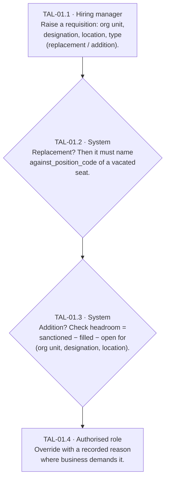
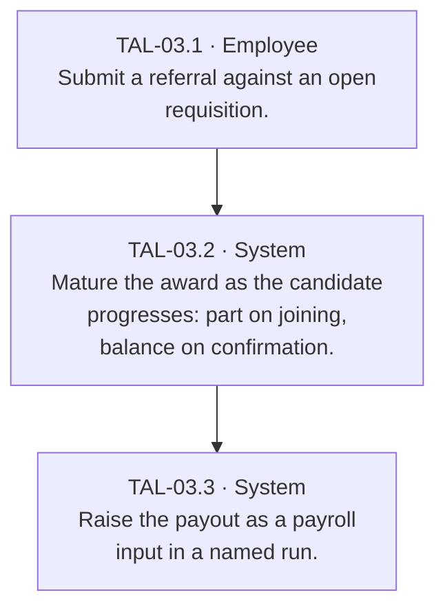

<picture>
  <source media="(prefers-color-scheme: dark)" srcset="../../assets/MultipliersKraftLogoDark.png">
  
</picture>

# FRS-TAL-01 — Talent — Process Specifications

| Attribute | Value |
| :--- | :--- |
| Document ID | FRS-TAL-01 |
| Title | Talent — Process Specifications |
| Product | Nucleus Suite (Nucleus HRMS Suite) |
| Version | 1.0.0 |
| Status | Issued for approval |
| Owner (role) | Domain Product Owner — Talent |
| Author | Dhanraj Dadhich |
| Reviewed by | *pending* |
| Approved by | Product Council — *pending* |
| Date | 2026-11-05 |
| Classification | Internal |
| CMMI practice areas | RDM, TS |
| Related documents | FRS-TAL-00, FRS-TAL-01, FRS-TAL-02, FRS-TAL-03, FRS-TAL-04, FRS-TAL-05, FRS-TAL-06, FRS-TAL-07, FRS-TAL-08, FRS-TAL-09, FRS-TAL-10, FRS-TAL-11, FRS-TAL-12, FRS-TAL-13, BRS-01, SRS-01, REQ-01, REQ-02 |
| Quality & process-performance objectives | QPPO-05 (effective requirements reviews), QPPO-01 (escaped defects) — MPM-01 |
| Process performance baseline used | PPB-01 (review defect density), PPB-02 (review rate) — MPM-01 |
| Peer review record | *pending* (PR-xxxx, QA-02) |
| Tailoring record | none |
| Traceability anchor | BG-05 · R-25, R-26 · processes TAL-01–TAL-05 |
| Source of record | Nucleus — Process Flows & Process Maps v1.0 — sheet(s) 03_Process_Inventory, 04_Process_Steps, 05_Swimlane_Maps Nucleus HR Demo Points Build Sheet v1.0 — sheet(s) 07_Approval_Workflows Nucleus HRMS Demo Dataset v1.1 — sheet(s) 64_Approval_Workflows |

> **Source of record.** Requirements in this document are taken from the source workbook(s) named above and keep their workbook IDs, which are never renumbered. Changes are made through a change request (CM-02) against the source workbook. Sections marked **Authored** are original additions that are not present in the source workbooks.

Step types: TASK (human) · SYS (system, unattended) · DEC (decision) · APPR (approval gate) · INT (integration call) · WAIT (timer or external event) · AGENT (agent-executed, governed). CRUD: C create · R read · U update · D delete-by-end-dating (temporal facts are never hard-deleted). In the flow diagrams decisions are diamonds, approvals are double-bordered boxes and integration, wait and agent steps are rounded.

## 1. Process inventory

| Process ID | Process | Trigger | Primary actor | Frequency | Criticality | Blueprint module | Phase | Reuses | Demo pts | Note |
| :--- | :--- | :--- | :--- | :--- | :--- | :--- | :--- | :--- | :--- | :--- |
| TAL-01 | Requisition raise and position control check | Vacancy or growth | Hiring manager | Weekly | High | Modules 1, 9 | P3 | CMP-01, CMP-02 | 24,25 | Replacement names a vacated position; addition consumes sanction or is blocked. |
| TAL-02 | Candidate pipeline to offer | Requisition open | Recruiter | Continuous | Medium | Module 9 | P3 | CMP-01 |  | No auto-reject. Ranking assists; humans decide; reasons recorded. |
| TAL-03 | Referral tracking and award payout | Referral submitted | Employee, HR | Monthly | Medium | Modules 9, 15 | P2 | CMP-02 | 19 | Part on joining, balance on confirmation, paid through payroll. |
| TAL-04 | Goal, check-in and review cycle | Cycle opened | Manager, employee | Quarterly | Medium | Module 8 | P2 | CMP-01, CMP-11 |  | AI drafts, human decides and signs; the system records that. |
| TAL-05 | Skills inference and learning assignment | Work signal or completion | System | Continuous | Medium | Module 10 | P3 | CMP-07, CMP-11 | 23 | Induction paths assigned by the joining chain use the same mechanism. |

## 2. Step-level specifications

### TAL-01 — Requisition raise and position control check

**Trigger:** Vacancy or growth · **Primary actor:** Hiring manager · **Frequency:** Weekly · **Criticality:** High · **Phase:** P3 · **Reuses:** CMP-01, CMP-02

| Step | Step ID | Lane / actor | Type | Action or decision | Rule ID(s) | Objects touched (CRUD) | Key fields | Screen | Event emitted | Exception / note | Reuses | Demo pts | Phase |
| :--- | :--- | :--- | :--- | :--- | :--- | :--- | :--- | :--- | :--- | :--- | :--- | :--- | :--- |
| 1 | TAL-01.1 | Hiring manager | TASK | Raise a requisition: org unit, designation, location, type (replacement \| addition). | RL-460 | requisition C | requisition_id, requisition_type, org_unit, designation_code, location_id, raised_on | SCR-090 | talent.requisition.raised |  |  | 24,25 | P3 |
| 2 | TAL-01.2 | System | DEC | Replacement? Then it must name against_position_code of a vacated seat. | RL-461 | position R | status(vacant), vacated_on | SCR-090 |  | Consumes no fresh sanctioned strength (demo point 24). |  | 24,25 | P3 |
| 3 | TAL-01.3 | System | DEC | Addition? Check headroom = sanctioned − filled − open for (org unit, designation, location). | RL-462 | sanctioned_position R | sanctioned, filled, open | SCR-090 | talent.requisition.blocked | No headroom → blocked at approval. Demo: Machining at Peenya, 24 of 24 filled. |  | 24,25 | P3 |
| 4 | TAL-01.4 | Authorised role | TASK | Override with a recorded reason where business demands it. | RL-463 | requisition U; audit_entry C | override_by, override_reason | SCR-090 | talent.requisition.overridden | Turns approved manpower from a review-meeting number into a control. | CMP-06 | 24,25 | P3 |

### TAL-02 — Candidate pipeline to offer

**Trigger:** Requisition open · **Primary actor:** Recruiter · **Frequency:** Continuous · **Criticality:** Medium · **Phase:** P3 · **Reuses:** CMP-01

The source workbook specifies this process at inventory level only. Its complete flow is specified in use case TAL-UC-002 (FRS-TAL-12).

### TAL-03 — Referral tracking and award payout

**Trigger:** Referral submitted · **Primary actor:** Employee, HR · **Frequency:** Monthly · **Criticality:** Medium · **Phase:** P2 · **Reuses:** CMP-02

| Step | Step ID | Lane / actor | Type | Action or decision | Rule ID(s) | Objects touched (CRUD) | Key fields | Screen | Event emitted | Exception / note | Reuses | Demo pts | Phase |
| :--- | :--- | :--- | :--- | :--- | :--- | :--- | :--- | :--- | :--- | :--- | :--- | :--- | :--- |
| 1 | TAL-03.1 | Employee | TASK | Submit a referral against an open requisition. | RL-470 | referral C | referral_id, referrer_id, candidate_id, requisition_id, award_amount | SCR-091 | talent.referral.created |  |  | 19 | P2 |
| 2 | TAL-03.2 | System | SYS | Mature the award as the candidate progresses: part on joining, balance on confirmation. | RL-471 | referral U | stage, award_status, part_paid_amount | SCR-091 | talent.referral.matured | The balance on confirmation is the part most implementations drop. |  | 19 | P2 |
| 3 | TAL-03.3 | System | SYS | Raise the payout as a payroll input in a named run. | RL-472 | payroll_input C | component(referral_award), amount, run_id | — | payroll.input.raised | Through payroll, not a spreadsheet — which is why referral schemes quietly stop being paid. | CMP-03 | 19 | P2 |

### TAL-04 — Goal, check-in and review cycle

**Trigger:** Cycle opened · **Primary actor:** Manager, employee · **Frequency:** Quarterly · **Criticality:** Medium · **Phase:** P2 · **Reuses:** CMP-01, CMP-11

The source workbook specifies this process at inventory level only. Its complete flow is specified in use case TAL-UC-004 (FRS-TAL-12).

### TAL-05 — Skills inference and learning assignment

**Trigger:** Work signal or completion · **Primary actor:** System · **Frequency:** Continuous · **Criticality:** Medium · **Phase:** P3 · **Reuses:** CMP-07, CMP-11

The source workbook specifies this process at inventory level only. Its complete flow is specified in use case TAL-UC-005 (FRS-TAL-12).

## 4. Approval workflows

| Workflow ID | Workflow | Form ID | Requirement | Approval chain | How it behaves | What must hold |
| :--- | :--- | :--- | :--- | :--- | :--- | :--- |
| W-09 | Manpower requisition | F-REC-02 | R-26 | HOD → HR Head | Where the sanctioned strength is exceeded, an additional approval level is required. | A replacement against a vacated position code does not consume incremental headcount. |

### Workflow behaviour

| Workflow | Name | Form | Chain | Sequential or parallel | Recorded per level | Escalation | Delegation allowed | Return to applicant | Live demo record | Demo point |
| :--- | :--- | :--- | :--- | :--- | :--- | :--- | :--- | :--- | :--- | :--- |
| W-09 | Manpower requisition | F-REC-02 | HOD → HR Head, plus a level when sanction is exceeded | Sequential | Actor, decision, timestamp, sanction check result | After 5 days | Y | Y | REQ-2026-0041 blocked at approval because Machining is at full sanction | Points 24, 25 |

## Approval & Sign-off

| Role | Name | Date | Decision | Conditions / comments |
| :--- | :--- | :--- | :--- | :--- |
| Author | Dhanraj Dadhich | 2026-11-05 | Submitted | |
| Peer review moderator | *pending* | | | PR-xxxx |
| PQA (process compliance) | *pending* | | | |
| Approval authority (DOC-01 §7) | *pending* | | | |

## Measurement Data Captured

| Measure | Value | Unit | Notes |
| :--- | :--- | :--- | :--- |
| Size | 14 | specified items (table rows) | Counted automatically at generation |
| Authoring effort | *to be recorded* | person-hours | |
| Review effort (preparation + meeting) | *pending review* | person-hours | From PR-xxxx |
| Rework effort | *pending review* | person-hours | |
| Review rate | *pending review* | items / hour | Compare with PPB control limits |
| Requirement volatility (changes since baseline) | 0 | CRs touching this artefact | Not yet baselined (CM-03) |

**Defects found, by detection phase and severity**

| Detection phase | Major | Minor | Editorial | Injected in phase (major) |
| :--- | :--- | :--- | :--- | :--- |
| Author self-check | 0 | 0 | 0 | — |
| Peer review | *pending* | | | |
| Design / build | | | | |
| System / integration test | | | | |
| UAT | | | | |
| Production (escaped) | | | | each escaped major opens a CAR record (CAR-01) |

Within control limits of the review-rate PPB? *To be assessed at peer review.*

## Revision History

| Version | Date | Author | Change summary | CR ref | Approved by |
| :--- | :--- | :--- | :--- | :--- | :--- |
| 1.0.0 | 2026-11-05 | Dhanraj Dadhich | Consolidated release | CR-0001 | *pending* |
