<p align="right">
<picture>
  <source media="(prefers-color-scheme: dark)" srcset="../../assets/MultipliersKraftLogoDark.png">
  
</picture>
</p>

# FRS-TAL-12 — Talent — Use Case Specifications

| Attribute | Value |
| :--- | :--- |
| Document ID | FRS-TAL-12 |
| Title | Talent — Use Case Specifications |
| Product | Nucleus Suite (Nucleus HRMS Suite) |
| Version | 1.0.0 |
| Status | Issued for approval |
| Owner (role) | Domain Product Owner — Talent |
| Author | Dhanraj Dadhich |
| Reviewed by | *pending* |
| Approved by | Product Council — *pending* |
| Date | 2026-11-05 |
| Classification | Internal |
| CMMI practice areas | RDM, VV |
| Related documents | FRS-TAL-00, FRS-TAL-01, FRS-TAL-02, FRS-TAL-03, FRS-TAL-04, FRS-TAL-05, FRS-TAL-06, FRS-TAL-07, FRS-TAL-08, FRS-TAL-09, FRS-TAL-10, FRS-TAL-11, FRS-TAL-12, FRS-TAL-13, BRS-01, SRS-01, REQ-01, REQ-02 |
| Quality & process-performance objectives | QPPO-05 (effective requirements reviews), QPPO-01 (escaped defects) — MPM-01 |
| Process performance baseline used | PPB-01 (review defect density), PPB-02 (review rate) — MPM-01 |
| Peer review record | *pending* (PR-xxxx, QA-02) |
| Tailoring record | none |
| Traceability anchor | BG-05 · R-25, R-26 · processes TAL-01–TAL-05 |
| Source of record | Nucleus — Process Flows & Process Maps v1.0 — sheet(s) 03_Process_Inventory, 04_Process_Steps, 07_Screens, 09_Business_Rules<br>Authored use cases (marked per use case) |

> **Source of record.** Requirements in this document are taken from the source workbook(s) named above and keep their workbook IDs, which are never renumbered. Changes are made through a change request (CM-02) against the source workbook. Sections marked **Authored** are original additions that are not present in the source workbooks.

This document specifies 22 use cases for Talent: 2 follow the step-level flows of the source workbook and 20 are authored (processes without step-level detail in the source, and capability gaps). User stories derived from each use case are in FRS-TAL-13.

## 1. Use case index

| ID | Use case | Primary actor | Realises | Source | Phase | Criticality |
| :--- | :--- | :--- | :--- | :--- | :--- | :--- |
| [TAL-UC-001](#tal-uc-001) | Raise a requisition with position control check | Manager / supervisor (hiring manager) | TAL-01 | Source workbook | P3 | High |
| [TAL-UC-002](#tal-uc-002) | Move candidates through the pipeline to offer | HR operations (recruiter) | TAL-02 | Authored | P3 | Medium |
| [TAL-UC-003](#tal-uc-003) | Track a referral and pay the award through payroll | Employee / worker | TAL-03 | Source workbook | P2 | Medium |
| [TAL-UC-004](#tal-uc-004) | Set goals, hold check-ins and complete the review cycle | Manager / supervisor | TAL-04 | Authored | P2 | Medium |
| [TAL-UC-005](#tal-uc-005) | Infer skills and assign learning paths | Nucleus platform | TAL-05 | Authored | P3 | Medium |
| [TAL-UC-006](#tal-uc-006) | Publish requisitions to sourcing channels and measure source effectiveness | HR operations (recruiter) | TAL-CG-001 | Authored | P2 | High |
| [TAL-UC-007](#tal-uc-007) | Manage candidates through a configurable applicant pipeline | HR operations (recruiter) | TAL-CG-002 | Authored | P2 | High |
| [TAL-UC-008](#tal-uc-008) | Schedule interviews and capture independent scorecards | HR operations (recruiter) | TAL-CG-003 | Authored | P2 | High |
| [TAL-UC-009](#tal-uc-009) | Generate, approve and release an offer | HR operations (recruiter) | TAL-CG-004 | Authored | P2 | High |
| [TAL-UC-010](#tal-uc-010) | Set goals aligned to cascaded objectives | Employee / worker | TAL-CG-005 | Authored | P3 | High |
| [TAL-UC-011](#tal-uc-011) | Give and request continuous feedback | Employee / worker | TAL-CG-006 | Authored | P3 | High |
| [TAL-UC-012](#tal-uc-012) | Run performance reviews with 360 input and calibration | HR operations | TAL-CG-007 | Authored | P3 | High |
| [TAL-UC-013](#tal-uc-013) | Plan succession for critical positions | HR operations | TAL-CG-008 | Authored | P3 | High |
| [TAL-UC-014](#tal-uc-014) | Build career paths and individual development plans | Employee / worker | TAL-CG-009 | Authored | P3 | Medium |
| [TAL-UC-015](#tal-uc-015) | Manage the learning catalogue and ingest content | HR operations | TAL-CG-010 | Authored | P3 | High |
| [TAL-UC-016](#tal-uc-016) | Track certifications and block assignments on expiry | Nucleus platform | TAL-CG-011 | Authored | P3 | High |
| [TAL-UC-017](#tal-uc-017) | Build a consented talent pool and nurture it until a role opens | HR operations (recruiter) | TAL-CG-012 | Authored | P3 | Medium |
| [TAL-UC-018](#tal-uc-018) | Run a bulk hiring drive from registration to batch onboarding | HR operations (recruiter) | TAL-CG-013 | Authored | P3 | High |
| [TAL-UC-019](#tal-uc-019) | Assign an online assessment and shortlist on score | HR operations (recruiter) | TAL-CG-014 | Authored | P3 | Medium |
| [TAL-UC-020](#tal-uc-020) | Engage, train and convert apprentices and trainees | HR operations | TAL-CG-015 | Authored | P2 | High |
| [TAL-UC-021](#tal-uc-021) | Match a mentee with a mentor and track outcomes | Employee / worker | TAL-CG-016 | Authored | P3 | Low |
| [TAL-UC-022](#tal-uc-022) | Author multilingual micro-learning and deliver it to plant workers offline | HR operations | TAL-CG-017 | Authored | P3 | Medium |

## 2. Use case diagrams

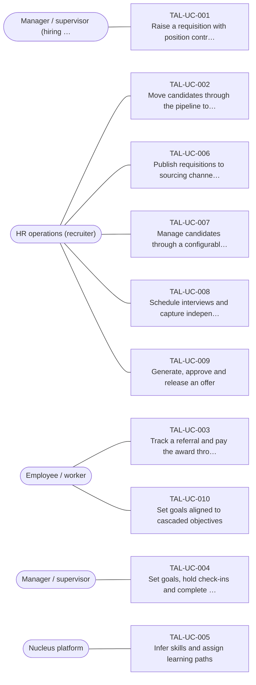

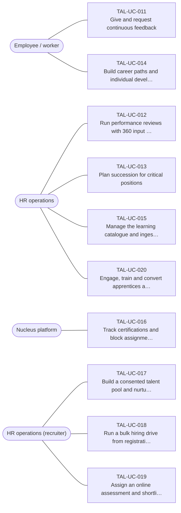

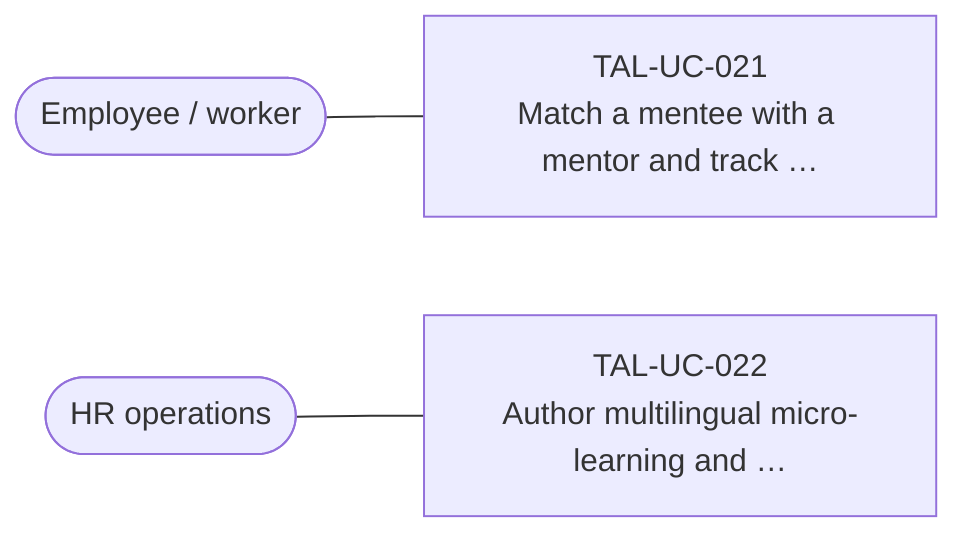

## 3. Use case specifications

### TAL-UC-001

**Raise a requisition with position control check** — Raise a requisition that is either a replacement against a vacated position or an addition within sanctioned headroom, with any override recorded.

| Attribute | Value |
| :--- | :--- |
| Realises | TAL-01 |
| Source | Source workbook |
| Level | User goal |
| Primary actor | Manager / supervisor (hiring manager) |
| Secondary actors | Nucleus platform, Director / approver, HR operations, Finance |
| Trigger | A vacancy arises or the business needs growth headcount. |
| Frequency | Weekly |
| Criticality | High |
| Phase | P3 |
| Client requirements | R-25, R-26 |
| Business rules | RL-010, RL-057, RL-460, RL-461, RL-462, RL-463 |
| Screens | SCR-090, SCR-013 |
| Data objects (CRUD) | requisition (C, U), position (R), sanctioned_position (R), audit_entry (C) |
| Events | talent.requisition.raised, talent.requisition.blocked, talent.requisition.overridden |
| Acceptance tests | TC-R461, TC-R462, TC-R460, TC-R463, TC-R57, TC-P10, T-39, T-40 |
| System requirements | SYS-036, SYS-037, SYS-051, SYS-053 |

**Stakeholders and interests**

| Stakeholder | Interest |
| :--- | :--- |
| Finance | Approved manpower is enforced as a control, not a meeting figure. |
| HR operations | Replacement hiring never double-counts headcount. |
| Director / approver | Overrides carry a recorded business reason. |

**Preconditions**

- Sanctioned strength is set per org unit, designation and location.
- Positions carry status and vacated_on dates.
- Approval chain for requisitions is configured.

**Main success scenario**

| # | Actor | Action | Ref |
| ---: | :--- | :--- | :--- |
| 1 | Manager / supervisor (hiring manager) | Raises a requisition giving org unit, designation, location and type: replacement or addition. | TAL-01.1 |
| 2 | Nucleus platform | For a replacement, requires against_position_code of a vacant position and consumes no fresh sanctioned strength. | TAL-01.2 |
| 3 | Nucleus platform | For an addition, computes headroom as sanctioned minus filled minus open and blocks at approval if headroom is zero. | TAL-01.3 |
| 4 | Director / approver | Where the business demands it, an authorised role overrides the block with a recorded reason. | TAL-01.4 |

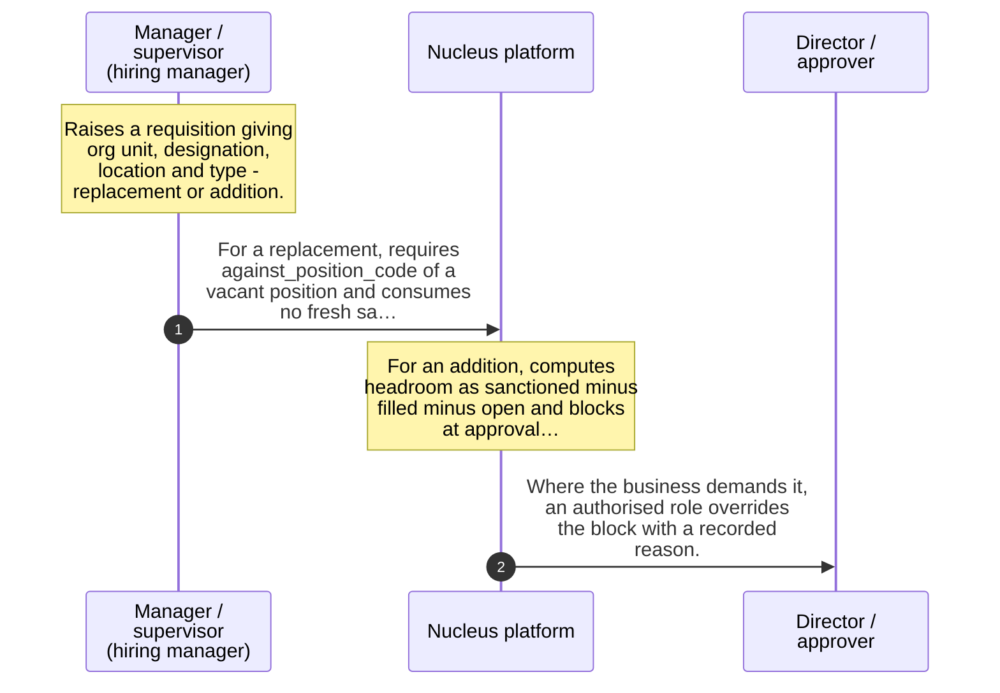

**Alternate flows**

| ID | At step | Condition | Steps | Rejoins |
| :--- | ---: | :--- | :--- | :--- |
| A1 | 2 | Requisition type is addition. | Platform skips the position-code check and proceeds to the headroom check. | Returns to step 3 |
| A2 | 3 | Addition has headroom of one or more. | Platform submits the requisition into the approval chain and reserves one unit of headroom as open. | Ends |
| A3 | 2 | Replacement with a valid vacated position. | Platform submits the requisition without the headroom check. | Ends |

**Exception flows**

| ID | At step | Condition | Handling | Rule |
| :--- | ---: | :--- | :--- | :--- |
| E1 | 2 | Replacement names a position that is filled or does not exist. | Submission is refused stating the position must be vacant. | RL-461 |
| E2 | 3 | Addition finds no headroom, as at Machining in Peenya with 24 of 24 filled. | Requisition moves to BLOCKED and talent.requisition.blocked is emitted with headroom and reason. | RL-462 |
| E3 | 4 | Override attempted by a role without override rights or without a reason. | Override is refused and the requisition stays BLOCKED. | RL-463 |

**Postconditions — success**

- Requisition is SUBMITTED, consuming headroom only if it is an addition.
- Any override is stored with override_by, override_reason and an audit entry.

**Postconditions — failure**

- Requisition is BLOCKED with the headroom shown, or WITHDRAWN by the hiring manager.

**Quality requirements**

- Headroom shown on the requisition form within 1 s of choosing org unit, designation and location.
- Headroom computation is shared with the sanctioned strength board so both show the same figure.

### TAL-UC-002

**Move candidates through the pipeline to offer** — Progress candidates for an approved requisition through stages to an offer, with ranking assisting and humans deciding every disposition.

| Attribute | Value |
| :--- | :--- |
| Realises | TAL-02 |
| Source | Authored |
| Level | User goal |
| Primary actor | HR operations (recruiter) |
| Secondary actors | Manager / supervisor (hiring manager), Interview panel member, Candidate, Agent (governed), Nucleus platform |
| Trigger | A requisition is approved and open for sourcing. |
| Frequency | Continuous |
| Criticality | Medium |
| Phase | P3 |
| Client requirements | — |
| Business rules | — |
| Screens | — |
| Data objects (CRUD) | candidate (C, U), application (C, U), offer (C) |
| Events | — |
| Acceptance tests | — |
| System requirements | SYS-035, SYS-037, SYS-053, SYS-074, SYS-076 |

**Stakeholders and interests**

| Stakeholder | Interest |
| :--- | :--- |
| Candidate | Is assessed fairly and never auto-rejected by a machine. |
| Manager / supervisor (hiring manager) | Sees a ranked shortlist with reasons. |
| Auditor | Every rejection carries a human decision and reason. |

**Preconditions**

- Requisition is APPROVED.
- Pipeline stages are configured for the requisition type.

**Main success scenario**

| # | Actor | Action | Ref |
| ---: | :--- | :--- | :--- |
| 1 | HR operations (recruiter) | Opens the approved requisition and reviews applicants received from all sources. |  |
| 2 | Agent (governed) | Ranks applicants against requisition criteria and shows the evidence behind each ranking; it rejects no one. |  |
| 3 | HR operations (recruiter) | Shortlists candidates and records a reason for each candidate not shortlisted. |  |
| 4 | Interview panel member | Interviews shortlisted candidates and submits scorecards. |  |
| 5 | Manager / supervisor (hiring manager) | Selects the preferred candidate and records the decision reason. |  |
| 6 | HR operations (recruiter) | Prepares the offer from the approved range and routes it for approval. |  |
| 7 | Candidate | Accepts the offer; the platform hands the candidate to pre-boarding. |  |

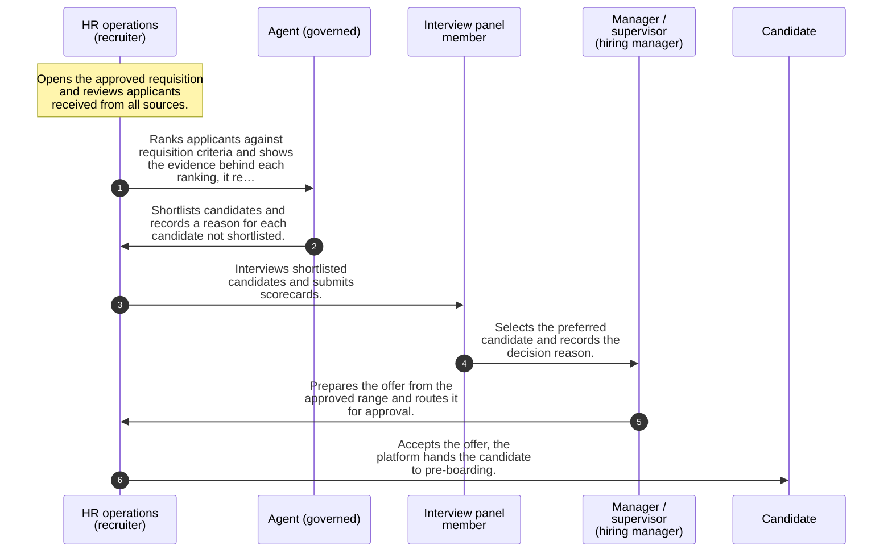

**Alternate flows**

| ID | At step | Condition | Steps | Rejoins |
| :--- | ---: | :--- | :--- | :--- |
| A1 | 7 | Candidate declines the offer. | Recruiter records the decline reason. → Hiring manager selects the next candidate from the shortlist. | Returns to step 6 |

**Exception flows**

| ID | At step | Condition | Handling | Rule |
| :--- | ---: | :--- | :--- | :--- |
| E1 | 2 | Ranking agent proposes rejecting a candidate. | Proposal is ignored as an action; only a human disposition can reject, and the proposal is recorded in the action ledger. |  |
| E2 | 3 | Recruiter dispositions a candidate without a reason. | Disposition cannot be saved until a reason is selected. |  |

**Postconditions — success**

- Selected candidate has an accepted offer and the requisition proceeds toward FILLED on joining.
- Every other candidate has a human disposition with reason.

**Postconditions — failure**

- Requisition remains open with candidates in their last stage.

**Quality requirements**

- Ranking explanation shown with every ranked candidate.
- Disposition history is retained per candidate for the configured retention period.

### TAL-UC-003

**Track a referral and pay the award through payroll** — Capture an employee referral against an open requisition and pay the award in parts on joining and confirmation through named payroll runs.

| Attribute | Value |
| :--- | :--- |
| Realises | TAL-03 |
| Source | Source workbook |
| Level | User goal |
| Primary actor | Employee / worker |
| Secondary actors | Nucleus platform, HR operations, Payroll manager |
| Trigger | An employee submits a referral. |
| Frequency | Monthly |
| Criticality | Medium |
| Phase | P2 |
| Client requirements | R-20 |
| Business rules | RL-470, RL-471, RL-472 |
| Screens | SCR-091 |
| Data objects (CRUD) | referral (C, U), payroll_input (C) |
| Events | talent.referral.created, talent.referral.matured, payroll.input.raised |
| Acceptance tests | TC-R470, TC-R471, TC-R472, T-34 |
| System requirements | SYS-028, SYS-050, SYS-053, SYS-056 |

**Stakeholders and interests**

| Stakeholder | Interest |
| :--- | :--- |
| Employee / worker | Award is paid on time and in full, including the confirmation balance. |
| Payroll manager | Award arrives as a payroll input, not a spreadsheet. |
| HR operations | Referral source effectiveness is measurable. |

**Preconditions**

- Referral programme with award amount and split is configured.
- Requisition is open for sourcing.

**Main success scenario**

| # | Actor | Action | Ref |
| ---: | :--- | :--- | :--- |
| 1 | Employee / worker | Submits a referral with candidate details against an open requisition on the referrals screen. | TAL-03.1 |
| 2 | Nucleus platform | Matures the award as the candidate progresses: the joining part on joining and the balance on confirmation. | TAL-03.2 |
| 3 | Nucleus platform | Raises each matured part as a referral award payroll input in a named run. | TAL-03.3 |

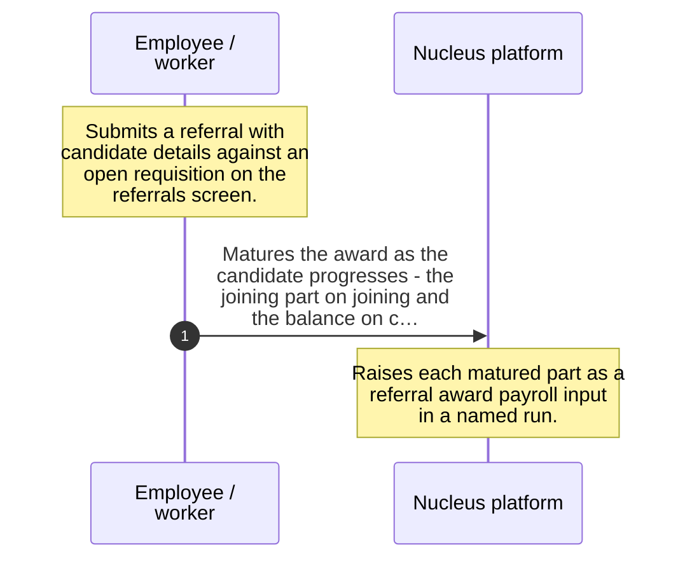

**Alternate flows**

| ID | At step | Condition | Steps | Rejoins |
| :--- | ---: | :--- | :--- | :--- |
| A1 | 2 | Candidate joins but leaves before confirmation. | Joining part remains paid; the balance is cancelled with reason recorded. | Ends |

**Exception flows**

| ID | At step | Condition | Handling | Rule |
| :--- | ---: | :--- | :--- | :--- |
| E1 | 1 | Candidate already exists in the pipeline from another source. | Referral is recorded as duplicate and the referrer is told the candidate was already sourced. | RL-470 |
| E2 | 3 | Named payroll run is finalised before the input is raised. | Input moves to the next open run and the payroll manager is notified. | RL-472 |

**Postconditions — success**

- Joining part and confirmation balance are each raised as payroll inputs in named runs.
- Referral stage and award status are visible to the referrer.

**Postconditions — failure**

- No payroll input is raised if the candidate does not join or is not confirmed.

**Quality requirements**

- Referral status updates within 5 minutes of a candidate stage change.

### TAL-UC-004

**Set goals, hold check-ins and complete the review cycle** — Run a quarterly cycle of goal setting, check-ins and review where AI may draft text but humans decide and sign.

| Attribute | Value |
| :--- | :--- |
| Realises | TAL-04 |
| Source | Authored |
| Level | Summary |
| Primary actor | Manager / supervisor |
| Secondary actors | Employee / worker, Agent (governed), HR operations, Nucleus platform |
| Trigger | HR opens the performance cycle. |
| Frequency | Quarterly |
| Criticality | Medium |
| Phase | P2 |
| Client requirements | — |
| Business rules | — |
| Screens | — |
| Data objects (CRUD) | goal (C, U), check_in (C), performance_review (C, U) |
| Events | — |
| Acceptance tests | — |
| System requirements | SYS-032, SYS-035, SYS-074, SYS-087 |

**Stakeholders and interests**

| Stakeholder | Interest |
| :--- | :--- |
| Employee / worker | Has clear goals and a fair, signed review. |
| Manager / supervisor | Spends less time drafting and more on conversation. |
| Auditor | Can see which text was AI-drafted and who signed it. |

**Preconditions**

- Cycle template and rating scale are configured.
- Reporting lines are current.

**Main success scenario**

| # | Actor | Action | Ref |
| ---: | :--- | :--- | :--- |
| 1 | HR operations | Opens the cycle with dates for goal setting, check-ins and review. |  |
| 2 | Employee / worker | Drafts goals with weights and submits them to the manager. |  |
| 3 | Manager / supervisor | Agrees or edits goals and records agreement. |  |
| 4 | Manager / supervisor | Holds check-ins during the quarter and records notes and progress. |  |
| 5 | Agent (governed) | Drafts a review summary from goals, progress and check-in notes, marked as AI draft. |  |
| 6 | Manager / supervisor | Edits the draft, assigns the rating and signs the review. |  |
| 7 | Employee / worker | Reads the review, adds comments and acknowledges it. |  |
| 8 | Nucleus platform | Records the signed review with the signer and the provenance of each section. |  |

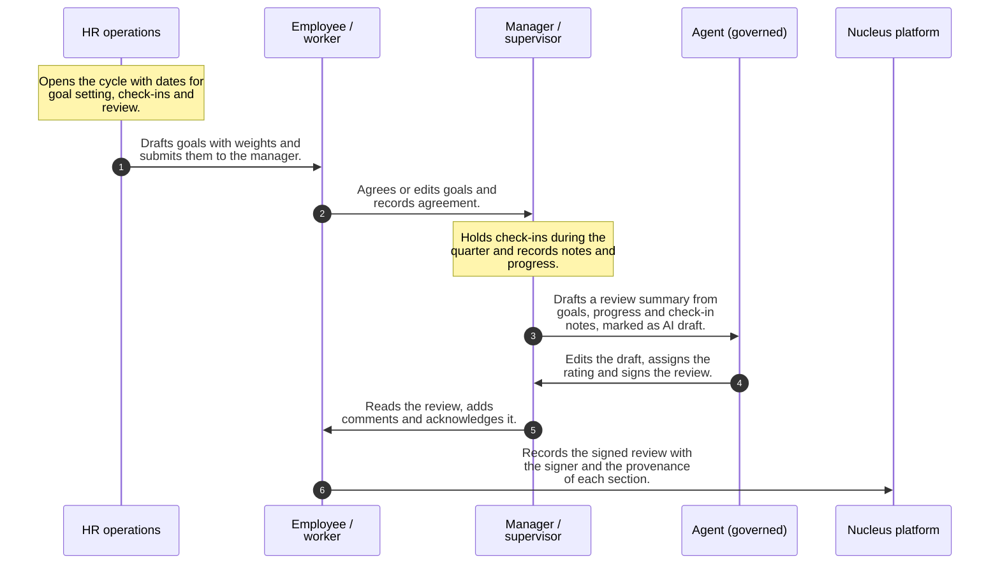

**Alternate flows**

| ID | At step | Condition | Steps | Rejoins |
| :--- | ---: | :--- | :--- | :--- |
| A1 | 5 | Manager chooses not to use the AI draft. | Manager writes the review directly; no draft provenance is recorded. | Returns to step 6 |

**Exception flows**

| ID | At step | Condition | Handling | Rule |
| :--- | ---: | :--- | :--- | :--- |
| E1 | 6 | Manager attempts to sign the AI draft without any review action. | Platform requires the manager to confirm each section before signing. |  |
| E2 | 2 | Goal weights do not total 100%. | Submission is blocked with the current total shown. |  |

**Postconditions — success**

- Goals, check-in notes and a signed review exist for each employee in the cycle.
- Draft provenance is recorded for any AI-drafted text.

**Postconditions — failure**

- Unsigned reviews remain in draft and are excluded from calibration.

**Quality requirements**

- AI drafts are generated within 10 s and stored with model provenance and the inputs used.

### TAL-UC-005

**Infer skills and assign learning paths** — Infer skills from work signals and completions and assign learning paths, using the same assignment mechanism as joining induction.

| Attribute | Value |
| :--- | :--- |
| Realises | TAL-05 |
| Source | Authored |
| Level | Subfunction |
| Primary actor | Nucleus platform |
| Secondary actors | Employee / worker, Manager / supervisor, Agent (governed), HR operations |
| Trigger | A work signal or a learning completion is recorded, or the joining chain reaches its induction step. |
| Frequency | Continuous |
| Criticality | Medium |
| Phase | P3 |
| Client requirements | — |
| Business rules | RL-395 |
| Screens | SCR-063, SCR-060 |
| Data objects (CRUD) | skill_profile (U), learning_assignment (C) |
| Events | — |
| Acceptance tests | TC-X395 |
| System requirements | SYS-035, SYS-053, SYS-072, SYS-074 |

**Stakeholders and interests**

| Stakeholder | Interest |
| :--- | :--- |
| Employee / worker | Receives relevant learning with clear due dates. |
| Manager / supervisor | Sees team skills grounded in evidence. |
| HR operations | Induction and development assignments behave consistently. |

**Preconditions**

- Skills taxonomy and learning paths are configured.
- Employee has an active assignment.

**Main success scenario**

| # | Actor | Action | Ref |
| ---: | :--- | :--- | :--- |
| 1 | Nucleus platform | Receives a work signal or completion such as a course passed or a certification recorded. |  |
| 2 | Agent (governed) | Proposes skill updates with the evidence and a confidence level. |  |
| 3 | Manager / supervisor | Confirms or rejects proposed skills above the tenant's confirmation threshold. |  |
| 4 | Nucleus platform | Stores confirmed skills and identifies gaps against the role's skill profile. |  |
| 5 | Nucleus platform | Assigns learning paths for the gaps using the standard assignment mechanism. |  |
| 6 | Employee / worker | Sees assigned paths with due dates in My learning and starts them. |  |
| 7 | Nucleus platform | Records completion evidence, which feeds back as a new signal. |  |

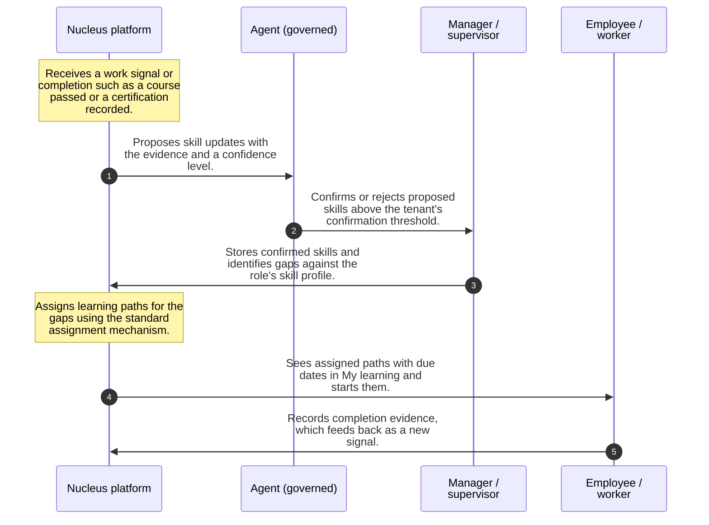

**Alternate flows**

| ID | At step | Condition | Steps | Rejoins |
| :--- | ---: | :--- | :--- | :--- |
| A1 | 1 | Trigger is the joining chain induction step. | Platform assigns the induction path through the same mechanism without inference. | Returns to step 6 |

**Exception flows**

| ID | At step | Condition | Handling | Rule |
| :--- | ---: | :--- | :--- | :--- |
| E1 | 3 | Manager rejects a proposed skill. | Skill is not stored and the rejection is recorded against the proposal. |  |
| E2 | 5 | Employee already holds the path assignment. | No duplicate assignment is created. | RL-395 |

**Postconditions — success**

- Inferred skills are stored with evidence and confidence.
- Assigned paths appear in the employee's learning with due dates.

**Postconditions — failure**

- No assignment is made when evidence is insufficient.

**Quality requirements**

- Skill proposals carry evidence links for every inferred skill.

### TAL-UC-006

**Publish requisitions to sourcing channels and measure source effectiveness** — Publish an approved requisition to the careers site, job boards and social channels and attribute applicants to their source.

| Attribute | Value |
| :--- | :--- |
| Realises | TAL-CG-001 |
| Source | Authored |
| Level | User goal |
| Primary actor | HR operations (recruiter) |
| Secondary actors | Manager / supervisor (hiring manager), Nucleus platform, Job board |
| Trigger | A requisition is approved. |
| Frequency | Weekly |
| Criticality | High |
| Phase | P2 |
| Client requirements | — |
| Business rules | — |
| Screens | — |
| Data objects (CRUD) | job_posting (C, U), candidate (C) |
| Events | — |
| Acceptance tests | TAL-TC-001, TAL-TC-002, TAL-TC-003, TAL-TC-004 |
| System requirements | SYS-037, SYS-053, SYS-084, SYS-088 |

**Stakeholders and interests**

| Stakeholder | Interest |
| :--- | :--- |
| HR operations (recruiter) | Reaches candidates without re-typing postings. |
| HR operations | Knows which sources produce hires. |

**Preconditions**

- Requisition is APPROVED.
- Channel connections are configured for the tenant.

**Main success scenario**

| # | Actor | Action | Ref |
| ---: | :--- | :--- | :--- |
| 1 | HR operations (recruiter) | Opens the approved requisition and generates a job posting from the role description. |  |
| 2 | Manager / supervisor (hiring manager) | Reviews and approves the posting text. |  |
| 3 | HR operations (recruiter) | Selects channels: careers site, job boards and social channels. |  |
| 4 | Nucleus platform | Publishes to each channel with a channel-specific tracked link. |  |
| 5 | Nucleus platform | Attributes each incoming applicant to the channel of first touch. |  |
| 6 | HR operations (recruiter) | Reviews source effectiveness: applicants, shortlisted, offered and joined per channel. |  |
| 7 | Nucleus platform | Withdraws the posting from all channels when the requisition is filled or withdrawn. |  |

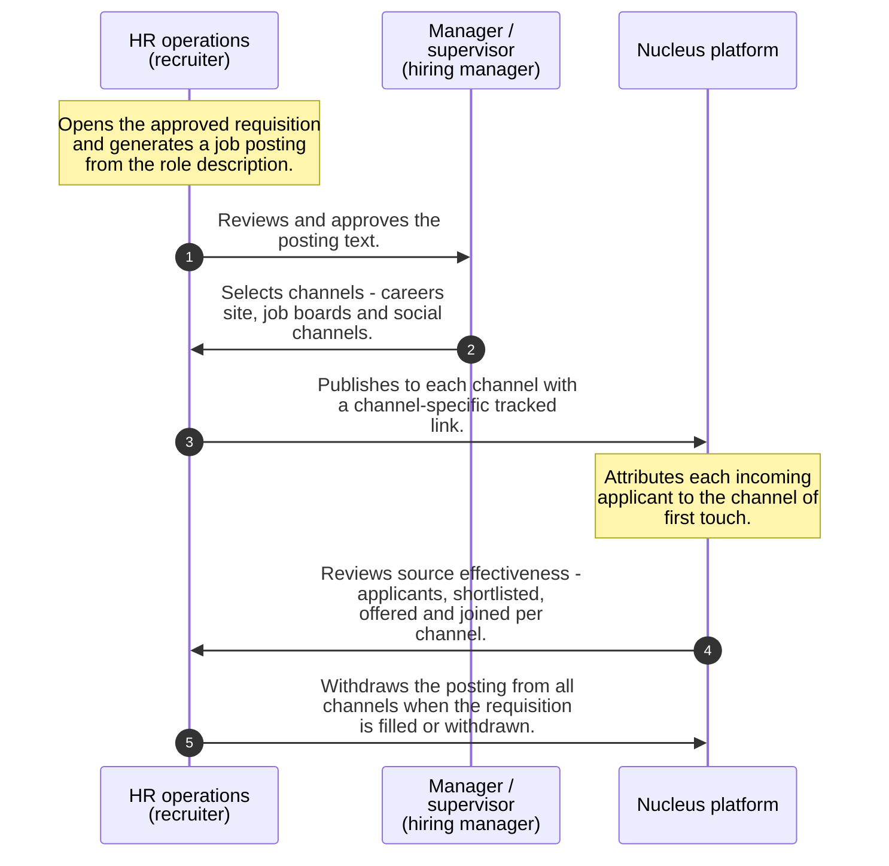

**Alternate flows**

| ID | At step | Condition | Steps | Rejoins |
| :--- | ---: | :--- | :--- | :--- |
| A1 | 3 | Requisition is internal-only. | Only the internal careers page is selectable. | Returns to step 4 |

**Exception flows**

| ID | At step | Condition | Handling | Rule |
| :--- | ---: | :--- | :--- | :--- |
| E1 | 4 | A channel rejects the posting. | Rejection reason is shown and the recruiter can correct and retry that channel. |  |

**Postconditions — success**

- Posting is live on selected channels with a tracked link per channel.
- Applicants carry their source attribution.

**Postconditions — failure**

- Failed channels are listed for retry; successful ones remain live.

**Quality requirements**

- Posting withdrawn from all channels within 1 hour of requisition closure.

### TAL-UC-007

**Manage candidates through a configurable applicant pipeline** — Move candidates through configurable stages with duplicate detection, consent capture, communications and human dispositioning.

| Attribute | Value |
| :--- | :--- |
| Realises | TAL-CG-002 |
| Source | Authored |
| Level | User goal |
| Primary actor | HR operations (recruiter) |
| Secondary actors | Candidate, Manager / supervisor (hiring manager), Nucleus platform |
| Trigger | A candidate applies or is added by a recruiter. |
| Frequency | Continuous |
| Criticality | High |
| Phase | P2 |
| Client requirements | — |
| Business rules | — |
| Screens | — |
| Data objects (CRUD) | candidate (C, U), application (C, U), consent_record (C) |
| Events | — |
| Acceptance tests | TAL-TC-005, TAL-TC-006, TAL-TC-007, TAL-TC-008 |
| System requirements | SYS-027, SYS-032, SYS-070 |

**Stakeholders and interests**

| Stakeholder | Interest |
| :--- | :--- |
| Candidate | Personal data is used only with consent and they are kept informed. |
| HR operations (recruiter) | No duplicate records and a clear view of each stage. |

**Preconditions**

- Stage template is configured.
- Consent text is published.

**Main success scenario**

| # | Actor | Action | Ref |
| ---: | :--- | :--- | :--- |
| 1 | Candidate | Applies and gives consent for processing personal data for this and, optionally, future roles. |  |
| 2 | Nucleus platform | Checks for duplicates by email, mobile and identity attributes and proposes a merge. |  |
| 3 | HR operations (recruiter) | Confirms or rejects the merge proposal. |  |
| 4 | HR operations (recruiter) | Moves the candidate through stages such as screening, interview and offer. |  |
| 5 | Nucleus platform | Sends stage communications from approved message templates. |  |
| 6 | HR operations (recruiter) | Records a disposition with reason for candidates not progressing. |  |
| 7 | Nucleus platform | Applies retention: purges candidate data after the consented period ends. |  |

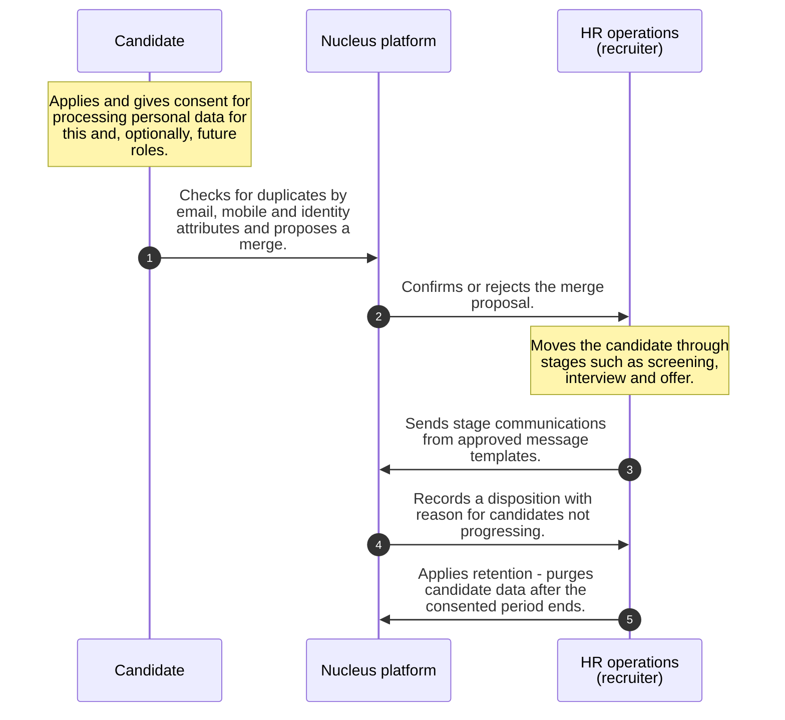

**Alternate flows**

| ID | At step | Condition | Steps | Rejoins |
| :--- | ---: | :--- | :--- | :--- |
| A1 | 1 | Candidate consents only for the current role. | Platform marks the record for purge when the requisition closes. | Returns to step 2 |

**Exception flows**

| ID | At step | Condition | Handling | Rule |
| :--- | ---: | :--- | :--- | :--- |
| E1 | 1 | Candidate declines consent. | Application cannot be submitted. |  |
| E2 | 6 | Disposition without reason. | Save is blocked until a reason is chosen. |  |

**Postconditions — success**

- Candidate record exists once with consent, stage history and communications.

**Postconditions — failure**

- Candidates without consent are not processed beyond capture.

**Quality requirements**

- Duplicate check completes within 2 s of application.
- Candidate data handling aligns with the DPDP Act 2023 (to be validated by Legal).

### TAL-UC-008

**Schedule interviews and capture independent scorecards** — Schedule interviews against panel calendars and collect structured scorecards per competency before other panelists' feedback is visible.

| Attribute | Value |
| :--- | :--- |
| Realises | TAL-CG-003 |
| Source | Authored |
| Level | User goal |
| Primary actor | HR operations (recruiter) |
| Secondary actors | Interview panel member, Candidate, Manager / supervisor (hiring manager), Agent (governed), Nucleus platform, Corporate calendar |
| Trigger | Candidate moves to the interview stage. |
| Frequency | Continuous |
| Criticality | High |
| Phase | P2 |
| Client requirements | — |
| Business rules | — |
| Screens | — |
| Data objects (CRUD) | interview (C, U), scorecard (C) |
| Events | — |
| Acceptance tests | TAL-TC-009, TAL-TC-010, TAL-TC-011, TAL-TC-012 |
| System requirements | SYS-017, SYS-035, SYS-037, SYS-070, SYS-072 |

**Stakeholders and interests**

| Stakeholder | Interest |
| :--- | :--- |
| Interview panel member | Can give independent feedback without anchoring. |
| Candidate | Gets prompt, convenient interview slots. |

**Preconditions**

- Panel and competencies are defined for the requisition.
- Corporate calendar availability is accessible.

**Main success scenario**

| # | Actor | Action | Ref |
| ---: | :--- | :--- | :--- |
| 1 | HR operations (recruiter) | Requests interview scheduling for a candidate with the required panel. |  |
| 2 | Agent (governed) | Proposes slots where all panelists are free; scheduling within the workflow is auto-approved. |  |
| 3 | Candidate | Selects a slot from the proposed options. |  |
| 4 | Nucleus platform | Sends invitations to panel and candidate and reserves the slot. |  |
| 5 | Interview panel member | Conducts the interview and submits a scorecard rating each competency with evidence. |  |
| 6 | Nucleus platform | Reveals other panelists' scorecards to a panelist only after that panelist has submitted. |  |
| 7 | Manager / supervisor (hiring manager) | Reviews consolidated scorecards and decides the next step. |  |

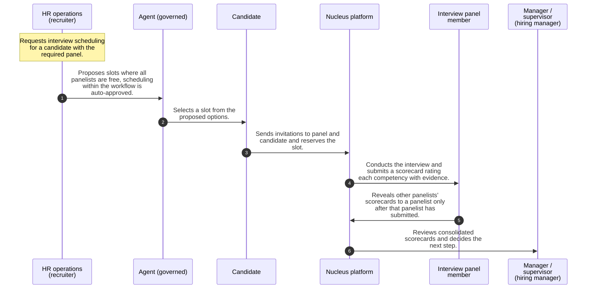

**Alternate flows**

| ID | At step | Condition | Steps | Rejoins |
| :--- | ---: | :--- | :--- | :--- |
| A1 | 3 | No proposed slot suits the candidate. | Candidate requests alternatives; agent proposes new slots. | Returns to step 3 |

**Exception flows**

| ID | At step | Condition | Handling | Rule |
| :--- | ---: | :--- | :--- | :--- |
| E1 | 5 | Panelist has not submitted 24 hours after the interview. | Reminder is sent and the recruiter sees the pending scorecard. |  |
| E2 | 6 | Panelist tries to view others' scores before submitting. | Access is refused until submission. |  |

**Postconditions — success**

- Interviews are scheduled and each panelist's scorecard is submitted.

**Postconditions — failure**

- Unscheduled candidates remain in interview stage with a pending task.

**Quality requirements**

- Scheduling actions by the agent are recorded in the action ledger with requisition and candidate IDs.

### TAL-UC-009

**Generate, approve and release an offer** — Generate an offer from approved compensation ranges, route it for approval, obtain e-signature and hand the candidate to pre-boarding.

| Attribute | Value |
| :--- | :--- |
| Realises | TAL-CG-004 |
| Source | Authored |
| Level | User goal |
| Primary actor | HR operations (recruiter) |
| Secondary actors | Manager / supervisor (hiring manager), Director / approver, Candidate, Agent (governed), Nucleus platform |
| Trigger | Hiring manager selects a candidate. |
| Frequency | Weekly |
| Criticality | High |
| Phase | P2 |
| Client requirements | — |
| Business rules | — |
| Screens | — |
| Data objects (CRUD) | offer (C, U), letter_draft (C) |
| Events | — |
| Acceptance tests | TAL-TC-013, TAL-TC-014, TAL-TC-015, TAL-TC-016 |
| System requirements | SYS-026, SYS-028, SYS-037, SYS-074, SYS-084 |

**Stakeholders and interests**

| Stakeholder | Interest |
| :--- | :--- |
| Candidate | Receives a correct offer quickly. |
| Finance | Offers stay within approved ranges unless explicitly approved. |

**Preconditions**

- Pay range for grade and location is published.
- Offer letter templates are versioned.

**Main success scenario**

| # | Actor | Action | Ref |
| ---: | :--- | :--- | :--- |
| 1 | HR operations (recruiter) | Creates an offer for the selected candidate with grade, location, CTC and joining date. |  |
| 2 | Nucleus platform | Checks CTC against the pay range and flags offers above maximum. |  |
| 3 | Nucleus platform | Drafts the offer letter from the versioned template for recruiter review. |  |
| 4 | Director / approver | Approves the offer through the configured chain. |  |
| 5 | HR operations (recruiter) | Releases the offer; release is always a named human action, never an agent action. |  |
| 6 | Candidate | E-signs the offer. |  |
| 7 | Nucleus platform | Hands the candidate to pre-boarding with offer data. |  |

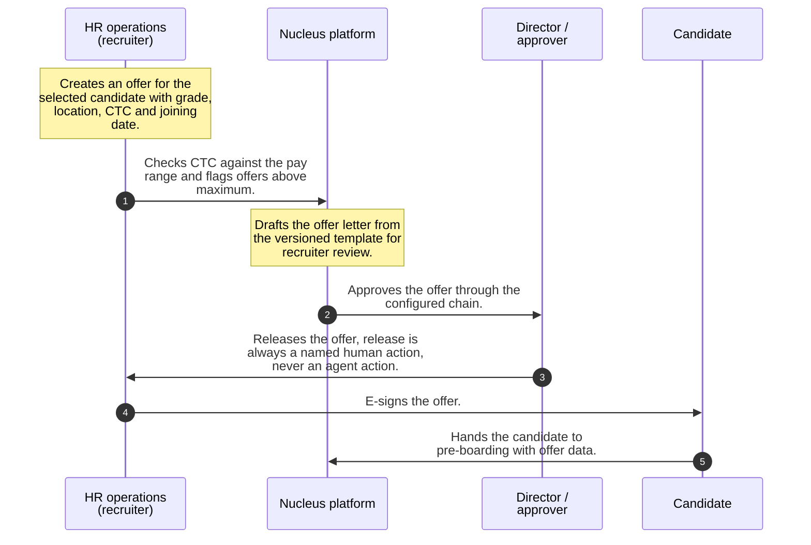

**Alternate flows**

| ID | At step | Condition | Steps | Rejoins |
| :--- | ---: | :--- | :--- | :--- |
| A1 | 2 | CTC exceeds range maximum. | Offer routes to an additional approval level with the excess shown. | Returns to step 3 |

**Exception flows**

| ID | At step | Condition | Handling | Rule |
| :--- | ---: | :--- | :--- | :--- |
| E1 | 5 | Agent attempts to release an offer. | Release is refused by the policy gate; the attempt is recorded in the action ledger. |  |
| E2 | 6 | Candidate does not sign by the offer expiry date. | Offer expires and the recruiter is notified. |  |

**Postconditions — success**

- Signed offer exists and pre-boarding is started.

**Postconditions — failure**

- Offer is withdrawn or declined with reason; requisition stays open.

**Quality requirements**

- Signed offer and template version retained for the employee record.

### TAL-UC-010

**Set goals aligned to cascaded objectives** — Let employees and managers set weighted goals aligned to organisational objectives and track progress.

| Attribute | Value |
| :--- | :--- |
| Realises | TAL-CG-005 |
| Source | Authored |
| Level | User goal |
| Primary actor | Employee / worker |
| Secondary actors | Manager / supervisor, HR operations, Nucleus platform |
| Trigger | Goal-setting window opens. |
| Frequency | Quarterly |
| Criticality | High |
| Phase | P3 |
| Client requirements | — |
| Business rules | — |
| Screens | — |
| Data objects (CRUD) | objective (C), goal (C, U) |
| Events | — |
| Acceptance tests | TAL-TC-017, TAL-TC-018, TAL-TC-019, TAL-TC-020 |
| System requirements | SYS-017, SYS-037, SYS-040 |

**Stakeholders and interests**

| Stakeholder | Interest |
| :--- | :--- |
| Manager / supervisor | Team goals ladder up to organisational objectives. |
| Employee / worker | Knows how their work contributes. |

**Preconditions**

- Organisational objectives are published for the period.

**Main success scenario**

| # | Actor | Action | Ref |
| ---: | :--- | :--- | :--- |
| 1 | HR operations | Publishes organisational objectives for the period. |  |
| 2 | Manager / supervisor | Cascades objectives into team goals. |  |
| 3 | Employee / worker | Creates individual goals with measures, targets and weights, linking each to a team goal. |  |
| 4 | Nucleus platform | Validates that weights total 100%. |  |
| 5 | Manager / supervisor | Approves goals or returns them with comments. |  |
| 6 | Employee / worker | Records progress at check-ins. |  |

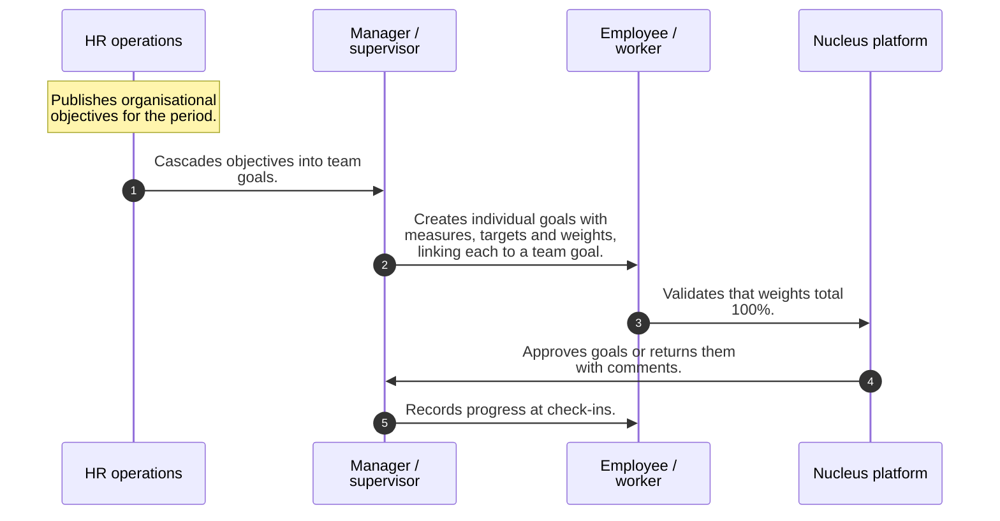

**Alternate flows**

| ID | At step | Condition | Steps | Rejoins |
| :--- | ---: | :--- | :--- | :--- |
| A1 | 5 | Manager returns goals. | Employee revises and resubmits. | Returns to step 4 |

**Exception flows**

| ID | At step | Condition | Handling | Rule |
| :--- | ---: | :--- | :--- | :--- |
| E1 | 4 | Weights do not total 100%. | Submission is blocked with the total shown. |  |

**Postconditions — success**

- Approved goals totalling 100% weight are linked to objectives.

**Postconditions — failure**

- Goals remain in draft.

**Quality requirements**

- Alignment tree renders within 2 s for 5,000 goals.

### TAL-UC-011

**Give and request continuous feedback** — Support requested and unsolicited feedback, private manager notes and periodic check-ins.

| Attribute | Value |
| :--- | :--- |
| Realises | TAL-CG-006 |
| Source | Authored |
| Level | User goal |
| Primary actor | Employee / worker |
| Secondary actors | Manager / supervisor, Nucleus platform |
| Trigger | An employee requests or gives feedback, or a check-in is due. |
| Frequency | Continuous |
| Criticality | High |
| Phase | P3 |
| Client requirements | — |
| Business rules | — |
| Screens | — |
| Data objects (CRUD) | feedback (C), check_in (C) |
| Events | — |
| Acceptance tests | TAL-TC-021, TAL-TC-022, TAL-TC-023, TAL-TC-024 |
| System requirements | SYS-017, SYS-019, SYS-070 |

**Stakeholders and interests**

| Stakeholder | Interest |
| :--- | :--- |
| Employee / worker | Gets timely feedback. |
| Manager / supervisor | Has a record to inform reviews. |

**Preconditions**

- Feedback visibility settings are configured.

**Main success scenario**

| # | Actor | Action | Ref |
| ---: | :--- | :--- | :--- |
| 1 | Employee / worker | Requests feedback from named colleagues on a goal or piece of work. |  |
| 2 | Nucleus platform | Notifies the colleagues with the request context. |  |
| 3 | Employee / worker | Colleague gives feedback, choosing visibility: recipient only or recipient and manager. |  |
| 4 | Manager / supervisor | Records private notes visible only to the manager. |  |
| 5 | Nucleus platform | Reminds manager and employee when a check-in is due. |  |
| 6 | Manager / supervisor | Holds the check-in and records shared notes. |  |

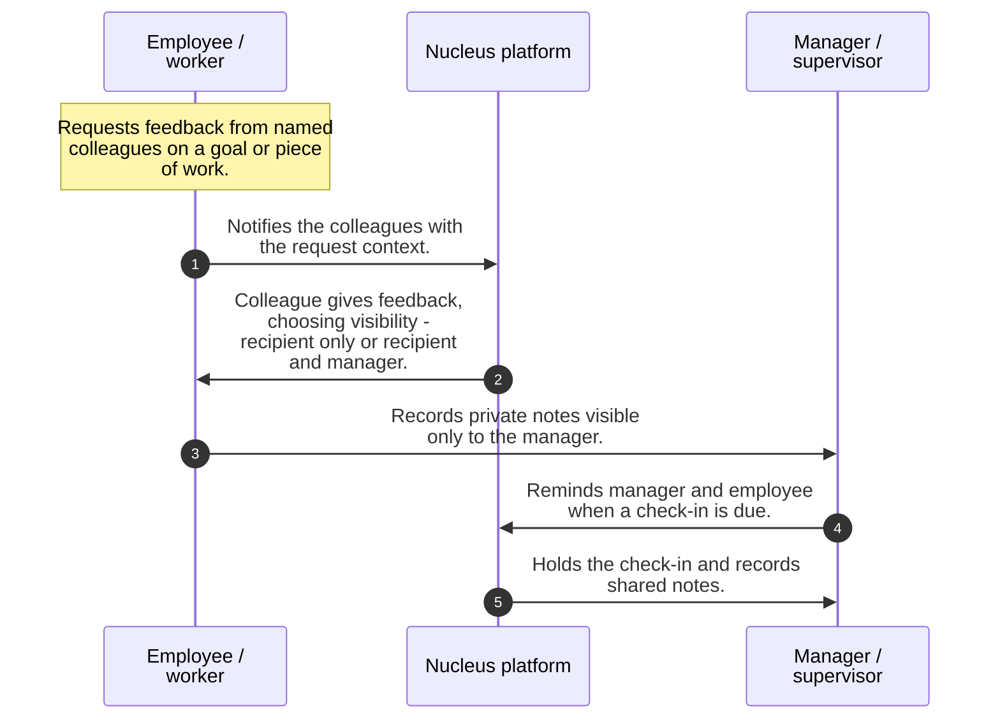

**Alternate flows**

| ID | At step | Condition | Steps | Rejoins |
| :--- | ---: | :--- | :--- | :--- |
| A1 | 1 | Employee gives unsolicited feedback. | Flow begins at step 3. | Returns to step 3 |

**Exception flows**

| ID | At step | Condition | Handling | Rule |
| :--- | ---: | :--- | :--- | :--- |
| E1 | 4 | Anyone other than the author tries to view a private note. | Access is refused. |  |

**Postconditions — success**

- Feedback is stored with visibility honoured.

**Postconditions — failure**

- Nothing is shared beyond the chosen visibility.

**Quality requirements**

- Private notes are excluded from any export except to the author.

### TAL-UC-012

**Run performance reviews with 360 input and calibration** — Run configurable review templates covering self, manager, peer and upward input with rating scales and calibration.

| Attribute | Value |
| :--- | :--- |
| Realises | TAL-CG-007 |
| Source | Authored |
| Level | Summary |
| Primary actor | HR operations |
| Secondary actors | Employee / worker, Manager / supervisor, Director / approver, Nucleus platform |
| Trigger | HR launches a review cycle. |
| Frequency | Annual |
| Criticality | High |
| Phase | P3 |
| Client requirements | — |
| Business rules | — |
| Screens | — |
| Data objects (CRUD) | performance_review (C, U), calibration_session (C) |
| Events | — |
| Acceptance tests | TAL-TC-025, TAL-TC-026, TAL-TC-027, TAL-TC-028 |
| System requirements | SYS-017, SYS-019, SYS-032, SYS-036 |

**Stakeholders and interests**

| Stakeholder | Interest |
| :--- | :--- |
| Employee / worker | Gets a rounded and fair assessment. |
| Director / approver | Ratings are consistent across teams. |

**Preconditions**

- Templates and rating scales are configured.

**Main success scenario**

| # | Actor | Action | Ref |
| ---: | :--- | :--- | :--- |
| 1 | HR operations | Launches the cycle selecting template, population and dates. |  |
| 2 | Employee / worker | Completes the self-assessment. |  |
| 3 | Employee / worker | Peers and direct reports complete 360 input anonymously. |  |
| 4 | Manager / supervisor | Completes the manager assessment with a proposed rating. |  |
| 5 | Director / approver | Calibrates ratings in a session, adjusting with recorded reasons. |  |
| 6 | HR operations | Releases final ratings. |  |
| 7 | Nucleus platform | Shares the final review with each employee. |  |

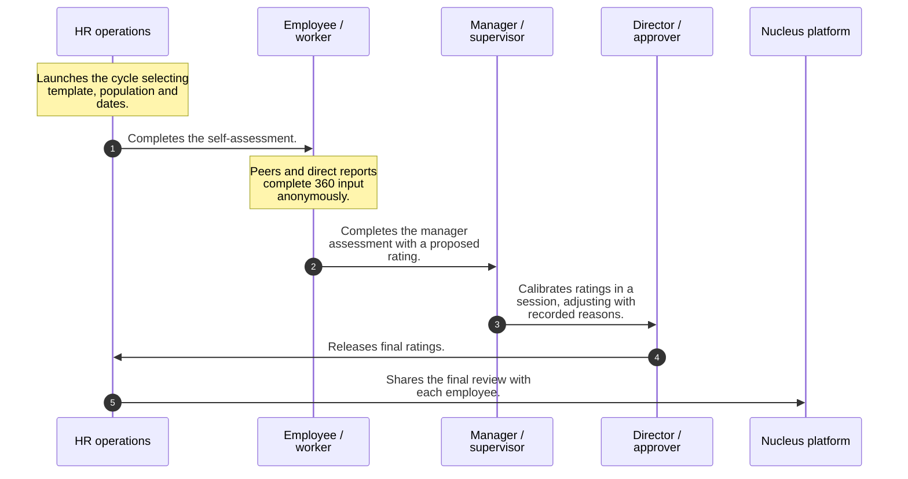

**Alternate flows**

| ID | At step | Condition | Steps | Rejoins |
| :--- | ---: | :--- | :--- | :--- |
| A1 | 3 | Fewer than three 360 responses are received. | Responses are merged into manager view without attribution or suppressed per template. | Returns to step 4 |

**Exception flows**

| ID | At step | Condition | Handling | Rule |
| :--- | ---: | :--- | :--- | :--- |
| E1 | 5 | Rating change in calibration without reason. | Change cannot be saved without a reason. |  |

**Postconditions — success**

- Calibrated final ratings are recorded and shared.

**Postconditions — failure**

- Uncalibrated ratings are not released.

**Quality requirements**

- 360 responder identity is never shown when fewer than three responses exist.

### TAL-UC-013

**Plan succession for critical positions** — Identify critical positions, nominate successors with readiness levels and manage talent pools.

| Attribute | Value |
| :--- | :--- |
| Realises | TAL-CG-008 |
| Source | Authored |
| Level | User goal |
| Primary actor | HR operations |
| Secondary actors | Manager / supervisor, Director / approver, Nucleus platform |
| Trigger | Annual talent review or a critical position becomes at risk. |
| Frequency | Annual |
| Criticality | High |
| Phase | P3 |
| Client requirements | — |
| Business rules | — |
| Screens | — |
| Data objects (CRUD) | position (R), succession_nomination (C), talent_pool (C, U) |
| Events | — |
| Acceptance tests | TAL-TC-029, TAL-TC-030, TAL-TC-031, TAL-TC-032 |
| System requirements | SYS-017, SYS-019, SYS-037 |

**Stakeholders and interests**

| Stakeholder | Interest |
| :--- | :--- |
| Director / approver | Business continuity for key roles. |
| Employee / worker | Development toward future roles. |

**Preconditions**

- Positions are maintained with criticality flags.

**Main success scenario**

| # | Actor | Action | Ref |
| ---: | :--- | :--- | :--- |
| 1 | HR operations | Marks positions as critical with a reason. |  |
| 2 | Manager / supervisor | Nominates successors with readiness: ready now, 1–2 years, 3+ years. |  |
| 3 | Nucleus platform | Shows bench strength per critical position. |  |
| 4 | HR operations | Groups high-potential employees into talent pools. |  |
| 5 | Director / approver | Reviews and endorses the succession slate. |  |
| 6 | Nucleus platform | Links development plans for nominated successors. |  |

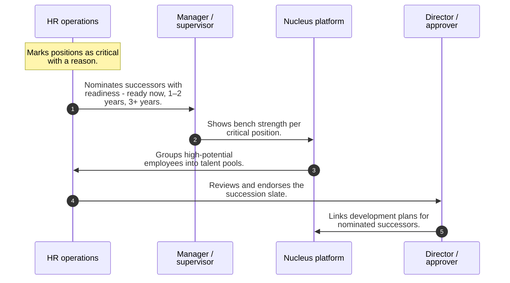

**Alternate flows**

| ID | At step | Condition | Steps | Rejoins |
| :--- | ---: | :--- | :--- | :--- |
| A1 | 2 | No internal successor exists. | Position is flagged for external pipeline planning. | Returns to step 3 |

**Exception flows**

| ID | At step | Condition | Handling | Rule |
| :--- | ---: | :--- | :--- | :--- |
| E1 | 2 | Nominee is in notice period. | Nomination is refused with the reason. |  |

**Postconditions — success**

- Each critical position has nominated successors with readiness.

**Postconditions — failure**

- Positions without successors are flagged.

**Quality requirements**

- Succession data is visible only to HR and endorsed directors.

### TAL-UC-014

**Build career paths and individual development plans** — Provide career paths and competency frameworks and let employees build development plans linked to learning.

| Attribute | Value |
| :--- | :--- |
| Realises | TAL-CG-009 |
| Source | Authored |
| Level | User goal |
| Primary actor | Employee / worker |
| Secondary actors | Manager / supervisor, HR operations, Nucleus platform |
| Trigger | Employee explores careers or a review identifies development needs. |
| Frequency | Quarterly |
| Criticality | Medium |
| Phase | P3 |
| Client requirements | — |
| Business rules | — |
| Screens | SCR-063 |
| Data objects (CRUD) | development_plan (C, U), learning_assignment (C) |
| Events | — |
| Acceptance tests | TAL-TC-033, TAL-TC-034, TAL-TC-035, TAL-TC-036 |
| System requirements | SYS-017, SYS-037, SYS-056 |

**Stakeholders and interests**

| Stakeholder | Interest |
| :--- | :--- |
| Employee / worker | Sees possible next roles and what it takes to reach them. |
| Manager / supervisor | Can support growth with concrete actions. |

**Preconditions**

- Competency framework and career paths are configured.

**Main success scenario**

| # | Actor | Action | Ref |
| ---: | :--- | :--- | :--- |
| 1 | Employee / worker | Explores career paths from the current role. |  |
| 2 | Nucleus platform | Shows competency gaps between current and target role. |  |
| 3 | Employee / worker | Creates a development plan with actions per gap. |  |
| 4 | Nucleus platform | Suggests learning paths for each gap. |  |
| 5 | Manager / supervisor | Agrees the plan. |  |
| 6 | Nucleus platform | Tracks progress as linked learning is completed. |  |

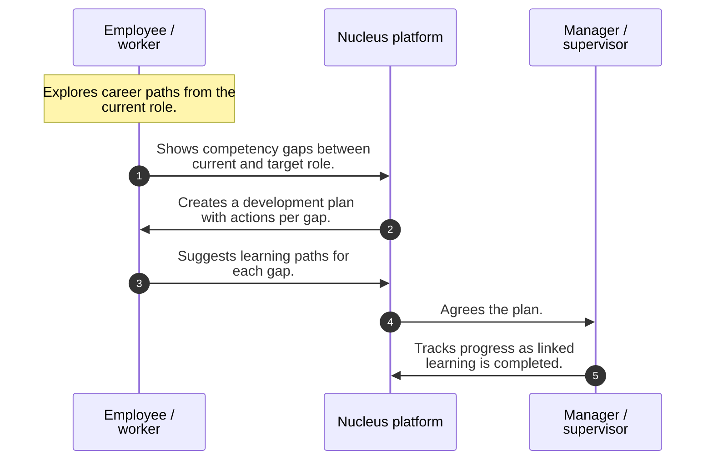

**Alternate flows**

| ID | At step | Condition | Steps | Rejoins |
| :--- | ---: | :--- | :--- | :--- |
| A1 | 1 | Target role is in a different function. | Platform shows lateral path competencies. | Returns to step 2 |

**Exception flows**

| ID | At step | Condition | Handling | Rule |
| :--- | ---: | :--- | :--- | :--- |
| E1 | 5 | Manager returns the plan. | Employee revises with the manager's comments. |  |

**Postconditions — success**

- An agreed development plan with linked learning exists.

**Postconditions — failure**

- Plan remains in draft.

**Quality requirements**

- Gap analysis computed within 2 s.

### TAL-UC-015

**Manage the learning catalogue and ingest content** — Provide a catalogue, curricula, enrolment, classroom sessions and SCORM 1.2/2004 and xAPI content with completion tracking.

| Attribute | Value |
| :--- | :--- |
| Realises | TAL-CG-010 |
| Source | Authored |
| Level | User goal |
| Primary actor | HR operations |
| Secondary actors | Employee / worker, Nucleus platform |
| Trigger | Learning administrator adds content or an employee enrols. |
| Frequency | Weekly |
| Criticality | High |
| Phase | P3 |
| Client requirements | — |
| Business rules | — |
| Screens | SCR-063 |
| Data objects (CRUD) | course (C), enrolment (C), completion (C) |
| Events | — |
| Acceptance tests | TAL-TC-037, TAL-TC-038, TAL-TC-039, TAL-TC-040 |
| System requirements | SYS-053, SYS-066, SYS-069 |

**Stakeholders and interests**

| Stakeholder | Interest |
| :--- | :--- |
| Employee / worker | Finds and completes relevant learning. |
| HR operations | Tracks completion reliably. |

**Preconditions**

- Learning administrator role is granted.

**Main success scenario**

| # | Actor | Action | Ref |
| ---: | :--- | :--- | :--- |
| 1 | HR operations | Uploads a SCORM 1.2, SCORM 2004 or xAPI package. |  |
| 2 | Nucleus platform | Validates the package manifest and registers the course. |  |
| 3 | HR operations | Adds the course to the catalogue and curricula. |  |
| 4 | Employee / worker | Enrols in a course or classroom session. |  |
| 5 | Employee / worker | Completes the content. |  |
| 6 | Nucleus platform | Records completion and score from the package. |  |

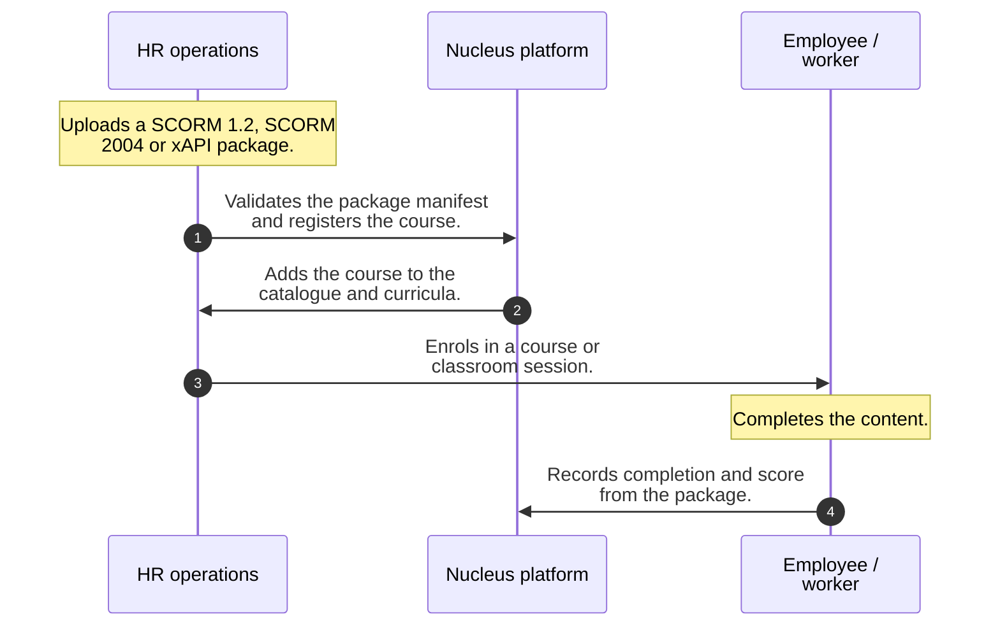

**Alternate flows**

| ID | At step | Condition | Steps | Rejoins |
| :--- | ---: | :--- | :--- | :--- |
| A1 | 4 | Classroom session is full. | Employee is added to a waitlist. | Ends |

**Exception flows**

| ID | At step | Condition | Handling | Rule |
| :--- | ---: | :--- | :--- | :--- |
| E1 | 2 | Package manifest is invalid. | Upload is rejected with validation errors. |  |

**Postconditions — success**

- Content is published and completions recorded.

**Postconditions — failure**

- Invalid packages are not published.

**Quality requirements**

- Content player meets WCAG 2.2 AA.

### TAL-UC-016

**Track certifications and block assignments on expiry** — Track certifications and licences with expiry and renewal reminders, and block work assignment when a mandatory certification has expired.

| Attribute | Value |
| :--- | :--- |
| Realises | TAL-CG-011 |
| Source | Authored |
| Level | User goal |
| Primary actor | Nucleus platform |
| Secondary actors | Employee / worker, Manager / supervisor, Plant HR / time office |
| Trigger | A certification is recorded, nears expiry, or a shift assignment is attempted. |
| Frequency | Daily |
| Criticality | High |
| Phase | P3 |
| Client requirements | — |
| Business rules | — |
| Screens | — |
| Data objects (CRUD) | certification (C, U), shift_assignment (R) |
| Events | — |
| Acceptance tests | TAL-TC-041, TAL-TC-042, TAL-TC-043, TAL-TC-044 |
| System requirements | SYS-022, SYS-050, SYS-051, SYS-070 |

**Stakeholders and interests**

| Stakeholder | Interest |
| :--- | :--- |
| Plant HR / time office | No one works on a regulated task without a valid certification. |
| Employee / worker | Gets enough notice to renew. |

**Preconditions**

- Mandatory certifications per role or task are configured.

**Main success scenario**

| # | Actor | Action | Ref |
| ---: | :--- | :--- | :--- |
| 1 | Employee / worker | Uploads a certification with issue and expiry dates. |  |
| 2 | Plant HR / time office | Verifies the certification. |  |
| 3 | Nucleus platform | Sends renewal reminders at 60, 30 and 7 days before expiry. |  |
| 4 | Nucleus platform | On expiry marks the certification expired. |  |
| 5 | Manager / supervisor | Attempts to assign the employee to a task requiring the certification. |  |
| 6 | Nucleus platform | Blocks the assignment and states the expired certification. |  |

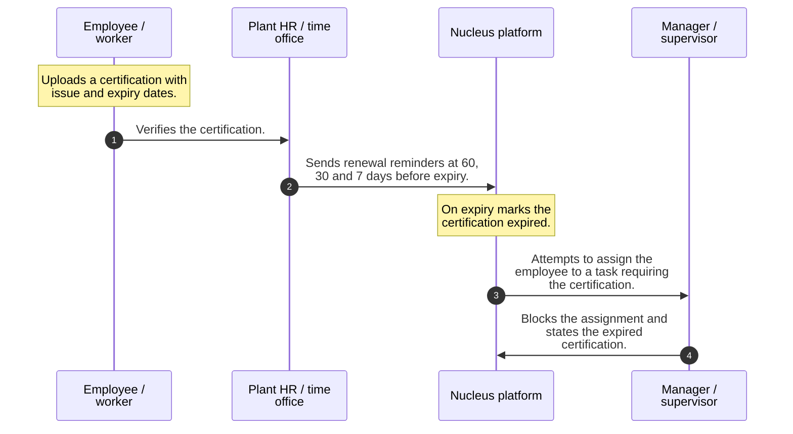

**Alternate flows**

| ID | At step | Condition | Steps | Rejoins |
| :--- | ---: | :--- | :--- | :--- |
| A1 | 3 | Employee renews before expiry. | New certification is verified and replaces the old one. | Ends |

**Exception flows**

| ID | At step | Condition | Handling | Rule |
| :--- | ---: | :--- | :--- | :--- |
| E1 | 6 | Urgent need to assign. | Block stands; no override for mandatory certifications. |  |

**Postconditions — success**

- Valid certifications allow assignment; expired ones block it.

**Postconditions — failure**

- Assignment is blocked with reason.

**Quality requirements**

- Expiry evaluation runs daily before the first shift.

### TAL-UC-017

**Build a consented talent pool and nurture it until a role opens** — Keep past and prospective candidates engaged in talent pools through consent-based campaigns so that approved requisitions can be filled from warm candidates first.

| Attribute | Value |
| :--- | :--- |
| Realises | TAL-CG-012 |
| Source | Authored |
| Level | User goal |
| Primary actor | HR operations (recruiter) |
| Secondary actors | Candidate, Manager / supervisor (hiring manager), Nucleus platform, Business messaging channel |
| Trigger | A recruiter creates a talent pool for a hard-to-fill skill or schedules a nurture campaign. |
| Frequency | Weekly |
| Criticality | Medium |
| Phase | P3 |
| Client requirements | — |
| Business rules | RL-470 |
| Screens | — |
| Data objects (CRUD) | talent_pool (C, U), pool_membership (C, U), candidate_consent (R, U), nurture_campaign (C), campaign_message (C) |
| Events | — |
| Acceptance tests | TAL-TC-045, TAL-TC-046, TAL-TC-047, TAL-TC-048, TAL-TC-049, TAL-TC-050 |
| System requirements | SYS-027, SYS-059, SYS-070 |

**Stakeholders and interests**

| Stakeholder | Interest |
| :--- | :--- |
| Candidate | Hears only about relevant roles, on channels they agreed to, and can withdraw consent at any time. |
| Manager / supervisor (hiring manager) | Gets a shortlist of already-interested candidates within days of the requisition being approved. |
| Compliance owner | Sees that candidate personal data is held only with valid consent under the DPDP Act 2023 (to be validated by Legal). |

**Preconditions**

- Candidate records carry consent with purpose, channel and expiry date.
- Message templates for each campaign language are approved.
- Channel opt-ins for email and the business messaging channel are recorded per candidate.

**Main success scenario**

| # | Actor | Action | Ref |
| ---: | :--- | :--- | :--- |
| 1 | HR operations (recruiter) | Creates the pool CNC setters – Pune and Bengaluru with criteria: 3+ years on vertical machining centres, willing to work shifts. |  |
| 2 | Nucleus platform | Suggests members from past finalists, referrals and career-site sign-ups whose consent is valid, and marks duplicates. |  |
| 3 | HR operations (recruiter) | Adds 85 suggested candidates to the pool. |  |
| 4 | HR operations (recruiter) | Builds a 6-week nurture campaign: plant tour video, Chakan Works open-house invite and a job alert, in Marathi and English. |  |
| 5 | Nucleus platform | Sends each message only on channels the candidate consented to and includes an unsubscribe option in every message. |  |
| 6 | Nucleus platform | Records deliveries, opens and replies and moves responders to the stage Engaged. |  |
| 7 | Candidate | Replies that she is interested and updates her current notice period in the candidate portal. |  |
| 8 | HR operations (recruiter) | Matches the pool to a newly approved requisition and moves 12 engaged candidates into its pipeline. |  |
| 9 | Nucleus platform | Twelve months after a candidate's last interaction, requests re-consent and anonymises the record if none is given within 30 days. |  |

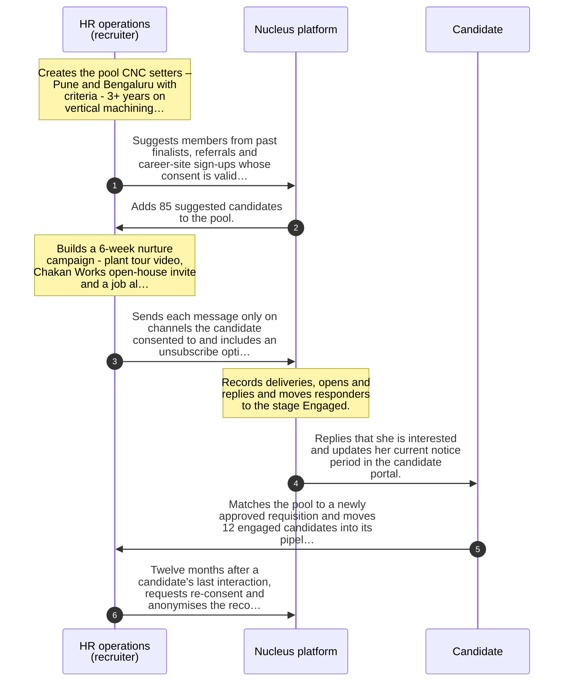

**Alternate flows**

| ID | At step | Condition | Steps | Rejoins |
| :--- | ---: | :--- | :--- | :--- |
| A1 | 5 | A candidate has consented to email but not to the business messaging channel. | Platform sends the campaign by email only and records the channel restriction. | Returns to step 6 |

**Exception flows**

| ID | At step | Condition | Handling | Rule |
| :--- | ---: | :--- | :--- | :--- |
| E1 | 3 | A suggested candidate is already active in another requisition's pipeline. | The candidate is added to the pool but flagged as in process and excluded from campaigns. | RL-470 |
| E2 | 7 | The candidate withdraws consent. | All campaigns stop at once and the record is erased or anonymised within the configured period. |  |
| E3 | 5 | A template has no approved version for a recipient's language. | That recipient is held back and the recruiter is asked to approve a translation. |  |

**Postconditions — success**

- Pool members have an engagement stage and a full contact history.
- Engaged members are moved into a requisition's pipeline without re-entering data.

**Postconditions — failure**

- Candidates without valid consent are never messaged and are anonymised on expiry.

**Quality requirements**

- Consent withdrawal stops all outbound messages within 5 minutes.
- Campaign sends are throttled to the per-channel rate limit configured for the tenant.

### TAL-UC-018

**Run a bulk hiring drive from registration to batch onboarding** — Hire a large frontline or campus cohort through a scheduled drive with mass assessment, batch offers and batch onboarding.

| Attribute | Value |
| :--- | :--- |
| Realises | TAL-CG-013 |
| Source | Authored |
| Level | User goal |
| Primary actor | HR operations (recruiter) |
| Secondary actors | Candidate, Plant HR / time office, Manager / supervisor (hiring manager), Director / approver, Nucleus platform |
| Trigger | A requisition for a large cohort is approved, for example 120 machine operators for the Medchal Works expansion. |
| Frequency | Quarterly |
| Criticality | High |
| Phase | P3 |
| Client requirements | — |
| Business rules | — |
| Screens | SCR-090 |
| Data objects (CRUD) | hiring_drive (C), drive_registration (C, U), assessment_attempt (C), interview_scorecard (C), offer (C), onboarding_cohort (C) |
| Events | platform.approval.completed, lifecycle.joining.started |
| Acceptance tests | TAL-TC-051, TAL-TC-052, TAL-TC-053, TAL-TC-054, TAL-TC-055, TAL-TC-056 |
| System requirements | SYS-037, SYS-053, SYS-066, SYS-078 |

**Stakeholders and interests**

| Stakeholder | Interest |
| :--- | :--- |
| Manager / supervisor (hiring manager) | Gets 120 operators on the floor at Medchal Works on the planned joining date. |
| Candidate | Registers on a phone, gets a clear slot and hears the outcome quickly. |
| Director / approver | Approves one batch of offers against the approved headcount and budget. |

**Preconditions**

- The requisition is approved with headcount and offer budget.
- Assessment templates for aptitude and trade skill are published.
- Offer and onboarding templates for the grade are approved.

**Main success scenario**

| # | Actor | Action | Ref |
| ---: | :--- | :--- | :--- |
| 1 | HR operations (recruiter) | Creates a drive on 2026-12-12 at Medchal Works linked to the requisition, with three slots of 40 candidates each. |  |
| 2 | Nucleus platform | Publishes a registration link and QR code; candidates register on a phone in Telugu, Hindi or English and pick a slot. |  |
| 3 | Plant HR / time office | Checks candidates in at the gate by scanning their QR code and sighting an identity document. |  |
| 4 | Candidate | Takes the 30-minute aptitude and trade test on a site tablet. |  |
| 5 | Nucleus platform | Scores the tests and lists candidates above the cut-off for interview. |  |
| 6 | Manager / supervisor (hiring manager) | Panels record scorecards on tablets; the platform ranks candidates by combined score. |  |
| 7 | HR operations (recruiter) | Selects the top 120 and a waitlist of 20, and generates a batch offer from the grade template. |  |
| 8 | Director / approver | Approves the batch offer through the approval engine within the requisition budget. |  |
| 9 | Nucleus platform | Releases offers by SMS, the business messaging channel and email, and tracks e-signed acceptances. |  |
| 10 | Nucleus platform | Creates an onboarding cohort for accepted candidates with joining date, induction and document collection tasks. |  |

```mermaid
sequenceDiagram
    autonumber
    participant P0 as HR operations<br/>(recruiter)
    participant P1 as Nucleus platform
    participant P2 as Plant HR / time<br/>office
    participant P3 as Candidate
    participant P4 as Manager /<br/>supervisor<br/>(hiring manager)
    participant P5 as Director /<br/>approver
    Note over P0: Creates a drive on 2026-12-12<br/>at Medchal Works linked to the<br/>requisition, with three slots<br/>of 4…
    P0->>P1: Publishes a registration link<br/>and QR code, candidates<br/>register on a phone in Telugu,<br/>Hindi or E…
    P1->>P2: Checks candidates in at the<br/>gate by scanning their QR code<br/>and sighting an identity<br/>document.
    P2->>P3: Takes the 30-minute aptitude<br/>and trade test on a site<br/>tablet.
    P3->>P1: Scores the tests and lists<br/>candidates above the cut-off<br/>for interview.
    P1->>P4: Panels record scorecards on<br/>tablets, the platform ranks<br/>candidates by combined score.
    P4->>P0: Selects the top 120 and a<br/>waitlist of 20, and generates<br/>a batch offer from the grade<br/>template.
    P0->>P5: Approves the batch offer<br/>through the approval engine<br/>within the requisition budget.
    P5->>P1: Releases offers by SMS, the<br/>business messaging channel and<br/>email, and tracks e-signed<br/>acceptanc…
    Note over P1: Creates an onboarding cohort<br/>for accepted candidates with<br/>joining date, induction and<br/>document …
```

**Alternate flows**

| ID | At step | Condition | Steps | Rejoins |
| :--- | ---: | :--- | :--- | :--- |
| A1 | 2 | The drive is a campus drive at an industrial training institute. | Recruiter uploads the institute's student list; students confirm registration. → Offers are issued as conditional on final results. | Returns to step 3 |
| A2 | 9 | Acceptances are 104 of 120 by the deadline. | Platform proposes the next 16 waitlisted candidates in rank order. → Recruiter confirms, and offers are released after the same approval. | Returns to step 10 |

**Exception flows**

| ID | At step | Condition | Handling | Rule |
| :--- | ---: | :--- | :--- | :--- |
| E1 | 2 | A candidate registers twice with the same mobile number. | The registrations are merged and the candidate keeps the earlier slot. |  |
| E2 | 2 | The chosen slot is full. | The candidate is offered the next slot with space. |  |
| E3 | 8 | The batch total exceeds the approved offer budget. | Approval cannot be submitted until the batch is reduced or the budget revised. |  |

**Postconditions — success**

- Accepted candidates form an onboarding cohort with a common joining date and induction plan.
- Drive metrics show registrations, attendance, pass rate, offers and acceptances.

**Postconditions — failure**

- Unfilled positions remain open on the requisition with the waitlist preserved.

**Quality requirements**

- Registration handles 2,000 sign-ups in an hour from mobile networks.
- Gate check-in completes within 5 s per candidate.

### TAL-UC-019

**Assign an online assessment and shortlist on score** — Assess candidates for aptitude, trade skill or language through online tests with appropriate proctoring and shortlist on score with recruiter confirmation.

| Attribute | Value |
| :--- | :--- |
| Realises | TAL-CG-014 |
| Source | Authored |
| Level | User goal |
| Primary actor | HR operations (recruiter) |
| Secondary actors | Candidate, Manager / supervisor (hiring manager), Nucleus platform |
| Trigger | A recruiter assigns an assessment to candidates at a pipeline stage. |
| Frequency | Daily |
| Criticality | Medium |
| Phase | P3 |
| Client requirements | — |
| Business rules | — |
| Screens | — |
| Data objects (CRUD) | assessment_template (R), assessment_attempt (C, U), proctoring_event (C), candidate_stage (U) |
| Events | — |
| Acceptance tests | TAL-TC-057, TAL-TC-058, TAL-TC-059, TAL-TC-060 |
| System requirements | SYS-027, SYS-070, SYS-072, SYS-074 |

**Stakeholders and interests**

| Stakeholder | Interest |
| :--- | :--- |
| Candidate | Takes a fair test, can request reasonable accommodation and knows how proctoring data is used. |
| Manager / supervisor (hiring manager) | Interviews only candidates who meet the skill threshold. |

**Preconditions**

- The assessment template is published with sections, time limits, cut-off score and proctoring mode.
- Candidates have consented to the chosen proctoring mode.

**Main success scenario**

| # | Actor | Action | Ref |
| ---: | :--- | :--- | :--- |
| 1 | HR operations (recruiter) | Assigns the template CNC operator screen: 20-minute aptitude, 20-minute G-code reading and 10-minute Hindi reading. |  |
| 2 | HR operations (recruiter) | Selects the proctoring mode: periodic camera snapshots with consent, locked browser, or supervised test centre. |  |
| 3 | Nucleus platform | Sends each candidate a unique link valid for 72 hours with the proctoring notice. |  |
| 4 | Candidate | Takes the test on a phone or laptop; answers are saved after every question. |  |
| 5 | Nucleus platform | Scores objective sections and records proctoring events such as tab switches or a second face in a snapshot. |  |
| 6 | Nucleus platform | Proposes a shortlist of candidates at or above the cut-off of 60%. |  |
| 7 | HR operations (recruiter) | Reviews proctoring flags, clears or upholds each with a note, and confirms the shortlist. |  |
| 8 | Nucleus platform | Moves confirmed candidates to the interview stage and informs the others of the outcome. |  |

```mermaid
sequenceDiagram
    autonumber
    participant P0 as HR operations<br/>(recruiter)
    participant P1 as Nucleus platform
    participant P2 as Candidate
    Note over P0: Assigns the template CNC<br/>operator screen - 20-minute<br/>aptitude, 20-minute G-code<br/>reading and 10-m…
    Note over P0: Selects the proctoring mode -<br/>periodic camera snapshots with<br/>consent, locked browser, or<br/>supervi…
    P0->>P1: Sends each candidate a unique<br/>link valid for 72 hours with<br/>the proctoring notice.
    P1->>P2: Takes the test on a phone or<br/>laptop, answers are saved<br/>after every question.
    P2->>P1: Scores objective sections and<br/>records proctoring events such<br/>as tab switches or a second<br/>face i…
    Note over P1: Proposes a shortlist of<br/>candidates at or above the<br/>cut-off of 60%.
    P1->>P0: Reviews proctoring flags,<br/>clears or upholds each with a<br/>note, and confirms the<br/>shortlist.
    P0->>P1: Moves confirmed candidates to<br/>the interview stage and<br/>informs the others of the<br/>outcome.
```

**Alternate flows**

| ID | At step | Condition | Steps | Rejoins |
| :--- | ---: | :--- | :--- | :--- |
| A1 | 3 | A candidate requests extra time for a declared disability. | Recruiter approves 25% extra time. → Platform extends that candidate's timer only. | Returns to step 4 |

**Exception flows**

| ID | At step | Condition | Handling | Rule |
| :--- | ---: | :--- | :--- | :--- |
| E1 | 4 | The connection drops mid-test. | The candidate resumes from the last saved answer with the remaining time. |  |
| E2 | 5 | A candidate declines camera proctoring. | The candidate is offered a supervised test centre slot instead. |  |
| E3 | 3 | The 72-hour link expires unused. | The candidate is marked not attempted and the recruiter may reissue once. |  |

**Postconditions — success**

- Scores and section results are on the candidate record and qualifying candidates are moved forward after recruiter confirmation.

**Postconditions — failure**

- Proctoring flags never reject a candidate automatically; they await human review.

**Quality requirements**

- Answers are saved within 1 s of selection.
- Proctoring snapshots are deleted 90 days after the requisition closes.

### TAL-UC-020

**Engage, train and convert apprentices and trainees** — Manage apprentices and trainees from engagement through stipend, training milestones and statutory records to a recorded conversion outcome.

| Attribute | Value |
| :--- | :--- |
| Realises | TAL-CG-015 |
| Source | Authored |
| Level | User goal |
| Primary actor | HR operations |
| Secondary actors | Plant HR / time office, Manager / supervisor, Payroll manager, Compliance owner, Employee / worker, Statutory portal, Nucleus platform |
| Trigger | HR operations engages an apprentice batch, for example 30 fitter and machinist apprentices at Chakan Works. |
| Frequency | Monthly |
| Criticality | High |
| Phase | P2 |
| Client requirements | — |
| Business rules | — |
| Screens | — |
| Data objects (CRUD) | apprentice_engagement (C, U), training_milestone (C, U), stipend_payment (C), statutory_register (U), conversion_outcome (C) |
| Events | payroll.input.raised, people.worker.hired |
| Acceptance tests | TAL-TC-061, TAL-TC-062, TAL-TC-063, TAL-TC-064, TAL-TC-065, TAL-TC-066 |
| System requirements | SYS-007, SYS-028, SYS-037, SYS-045, SYS-053, SYS-086 |

**Stakeholders and interests**

| Stakeholder | Interest |
| :--- | :--- |
| Employee / worker | As an apprentice, receives the stipend on time, knows the training plan and gets a completion record. |
| Compliance owner | Holds the apprenticeship contracts, registers and returns required under the Apprentices Act, 1961 (to be validated by Legal). |
| Manager / supervisor | Trains apprentices against defined milestones and assesses them fairly. |
| Director / approver | Decides conversions to permanent roles against open positions. |

**Preconditions**

- Apprentice trades, durations and stipend tables are configured for the entity (to be validated by Legal).
- The establishment's apprentice engagement limits are configured in the rule pack.
- An apprentice payroll group exists separate from employee payroll.

**Main success scenario**

| # | Actor | Action | Ref |
| ---: | :--- | :--- | :--- |
| 1 | HR operations | Creates 30 apprentice engagements at Chakan Works in fitter and machinist trades, each for 12 months, with stipend from the configured table. |  |
| 2 | Nucleus platform | Checks the batch against the establishment's configured apprentice limits. |  |
| 3 | HR operations | Records the contract registration reference from the statutory portal for each apprentice. |  |
| 4 | Nucleus platform | Assigns the training plan: 2 months basic training, then on-the-job rotation across turning, milling and assembly. |  |
| 5 | Manager / supervisor | Assesses each apprentice at each milestone and records the result. |  |
| 6 | Nucleus platform | Raises the monthly stipend for each apprentice into the apprentice payroll group based on attendance. |  |
| 7 | Nucleus platform | At the end of the term, generates the completion record and lists apprentices eligible for conversion. |  |
| 8 | Director / approver | Approves conversion offers for selected apprentices against open operator positions. |  |
| 9 | Nucleus platform | Records each outcome and, for conversions, starts the hire into the employee population with prior apprenticeship linked. |  |

```mermaid
sequenceDiagram
    autonumber
    participant P0 as HR operations
    participant P1 as Nucleus platform
    participant P2 as Manager /<br/>supervisor
    participant P3 as Director /<br/>approver
    Note over P0: Creates 30 apprentice<br/>engagements at Chakan Works in<br/>fitter and machinist trades,<br/>each for 12 m…
    P0->>P1: Checks the batch against the<br/>establishment's configured<br/>apprentice limits.
    P1->>P0: Records the contract<br/>registration reference from<br/>the statutory portal for each<br/>apprentice.
    P0->>P1: Assigns the training plan - 2<br/>months basic training, then<br/>on-the-job rotation across<br/>turning, mi…
    P1->>P2: Assesses each apprentice at<br/>each milestone and records the<br/>result.
    P2->>P1: Raises the monthly stipend for<br/>each apprentice into the<br/>apprentice payroll group based<br/>on atten…
    Note over P1: At the end of the term,<br/>generates the completion<br/>record and lists apprentices<br/>eligible for conv…
    P1->>P3: Approves conversion offers for<br/>selected apprentices against<br/>open operator positions.
    P3->>P1: Records each outcome and, for<br/>conversions, starts the hire<br/>into the employee population<br/>with pr…
```

**Alternate flows**

| ID | At step | Condition | Steps | Rejoins |
| :--- | ---: | :--- | :--- | :--- |
| A1 | 1 | The engagement is a graduate trainee rather than a statutory apprentice. | HR selects the trainee scheme; statutory contract registration is not required. → A trainee stipend table and 6-month plan are applied. | Returns to step 4 |

**Exception flows**

| ID | At step | Condition | Handling | Rule |
| :--- | ---: | :--- | :--- | :--- |
| E1 | 2 | The batch would exceed the configured apprentice limit. | The excess engagements are blocked and the limit and current count are shown. |  |
| E2 | 5 | An apprentice fails a milestone assessment twice. | The manager and HR are prompted to agree an extension or discontinuation. |  |
| E3 | 6 | An apprentice has unexplained absence above the configured threshold. | Stipend is computed on actual attendance and Plant HR is alerted. |  |

**Postconditions — success**

- Each apprentice has a registered contract, stipend history, milestone record and a recorded outcome: converted, completed without offer or discontinued.

**Postconditions — failure**

- Engagements beyond the configured limit are blocked.
- Discontinued apprentices have the reason and date recorded and stipend stops.

**Quality requirements**

- Apprentice records are retained for the period configured in the rule pack after completion.
- Stipend inputs are raised within the same payroll cut-off as employee inputs.

### TAL-UC-021

**Match a mentee with a mentor and track outcomes** — Match employees with suitable mentors by skills, goals, language and site, log sessions and measure programme outcomes.

| Attribute | Value |
| :--- | :--- |
| Realises | TAL-CG-016 |
| Source | Authored |
| Level | User goal |
| Primary actor | Employee / worker |
| Secondary actors | Manager / supervisor, HR operations, Nucleus platform |
| Trigger | An employee joins a mentoring programme and states a development goal. |
| Frequency | Weekly |
| Criticality | Low |
| Phase | P3 |
| Client requirements | — |
| Business rules | — |
| Screens | SCR-063 |
| Data objects (CRUD) | mentoring_programme (R), mentor_profile (R, U), mentoring_pair (C, U), mentoring_session (C), mentoring_outcome (C) |
| Events | — |
| Acceptance tests | TAL-TC-067, TAL-TC-068, TAL-TC-069, TAL-TC-070 |
| System requirements | SYS-017, SYS-019, SYS-070, SYS-072 |

**Stakeholders and interests**

| Stakeholder | Interest |
| :--- | :--- |
| Employee / worker | Finds a mentor who can help reach a stated goal, such as moving into a shift supervisor role. |
| Manager / supervisor | As a mentor, controls capacity and keeps session notes private to the pair. |
| HR operations | Sees programme outcomes in aggregate to improve the programme. |

**Preconditions**

- The programme is open with an opted-in mentor pool, each mentor having skills, languages and capacity.
- The employee has a skills profile.

**Main success scenario**

| # | Actor | Action | Ref |
| ---: | :--- | :--- | :--- |
| 1 | Employee / worker | Joins the programme with the goal Become a shift supervisor within 18 months and selects Hindi and Marathi as languages. |  |
| 2 | Nucleus platform | Ranks mentors by skill overlap with the goal, language, site and free capacity, and shows the top 3 with the reasons. |  |
| 3 | Employee / worker | Selects a mentor and sends a request. |  |
| 4 | Manager / supervisor | Accepts the request as mentor. |  |
| 5 | Nucleus platform | Creates the pairing with goals, monthly cadence and a 6-month term, and schedules the first session. |  |
| 6 | Employee / worker | Logs each session with date, duration and topics; notes stay visible only to the pair. |  |
| 7 | Nucleus platform | Prompts both at 3 and 6 months to rate progress against the goal. |  |
| 8 | HR operations | Views programme metrics in aggregate: active pairs, session frequency and goal progress. |  |

```mermaid
sequenceDiagram
    autonumber
    participant P0 as Employee /<br/>worker
    participant P1 as Nucleus platform
    participant P2 as Manager /<br/>supervisor
    participant P3 as HR operations
    Note over P0: Joins the programme with the<br/>goal Become a shift supervisor<br/>within 18 months and selects<br/>Hindi …
    P0->>P1: Ranks mentors by skill overlap<br/>with the goal, language, site<br/>and free capacity, and shows<br/>the t…
    P1->>P0: Selects a mentor and sends a<br/>request.
    P0->>P2: Accepts the request as mentor.
    P2->>P1: Creates the pairing with<br/>goals, monthly cadence and a<br/>6-month term, and schedules<br/>the first ses…
    P1->>P0: Logs each session with date,<br/>duration and topics, notes<br/>stay visible only to the pair.
    P0->>P1: Prompts both at 3 and 6 months<br/>to rate progress against the<br/>goal.
    P1->>P3: Views programme metrics in<br/>aggregate - active pairs,<br/>session frequency and goal<br/>progress.
```

**Alternate flows**

| ID | At step | Condition | Steps | Rejoins |
| :--- | ---: | :--- | :--- | :--- |
| A1 | 4 | The mentor declines. | Platform frees the request and shows the mentee the next ranked mentors. | Returns to step 3 |

**Exception flows**

| ID | At step | Condition | Handling | Rule |
| :--- | ---: | :--- | :--- | :--- |
| E1 | 2 | No mentor has free capacity with the needed skills. | The mentee is waitlisted and HR sees the uncovered skill. |  |
| E2 | 8 | A metric slice covers fewer than 5 pairs. | The slice is suppressed in HR reports. |  |

**Postconditions — success**

- An active pairing exists with agreed goals, cadence and logged sessions, and outcomes are recorded at 3 and 6 months.

**Postconditions — failure**

- Unmatched mentees remain on a waitlist and HR is told which skills lack mentors.

**Quality requirements**

- Mentor suggestions appear within 3 s.
- Session notes are excluded from HR reports, search and agent tools.

### TAL-UC-022

**Author multilingual micro-learning and deliver it to plant workers offline** — Author short learning content, publish it in plant languages after human review of any machine translation, and deliver it through a personalised feed with offline viewing and virtual classrooms.

| Attribute | Value |
| :--- | :--- |
| Realises | TAL-CG-017 |
| Source | Authored |
| Level | User goal |
| Primary actor | HR operations |
| Secondary actors | Employee / worker, Manager / supervisor, Agent (governed), Nucleus platform |
| Trigger | An L&D author in HR operations creates a module, or a mandatory module is assigned to an audience. |
| Frequency | Daily |
| Criticality | Medium |
| Phase | P3 |
| Client requirements | — |
| Business rules | RL-395 |
| Screens | SCR-063 |
| Data objects (CRUD) | learning_module (C, U), module_translation (C, U), learning_assignment (C), xapi_statement (C), virtual_session (C) |
| Events | learning.path.assigned |
| Acceptance tests | TAL-TC-071, TAL-TC-072, TAL-TC-073, TAL-TC-074, TAL-TC-075, TAL-TC-076 |
| System requirements | SYS-064, SYS-066, SYS-069, SYS-074, SYS-087 |

**Stakeholders and interests**

| Stakeholder | Interest |
| :--- | :--- |
| Employee / worker | Learns in their own language in short sessions, including where the plant has weak connectivity. |
| Manager / supervisor | Sees team completion of mandatory safety modules. |
| Compliance owner | Has completion evidence for safety training at each site. |

**Preconditions**

- Authoring rights are granted to the author for the target sites.
- Translation reviewers are named for each target language.
- Workers have the mobile app or access to a site kiosk.

**Main success scenario**

| # | Actor | Action | Ref |
| ---: | :--- | :--- | :--- |
| 1 | HR operations | Creates the module Lockout-tagout in five minutes with a 3-minute video, two cards and a 3-question quiz. |  |
| 2 | Agent (governed) | Drafts Hindi, Marathi, Tamil and Telugu translations as proposals only. |  |
| 3 | HR operations | Sends each draft to the named language reviewer, who edits and approves it. |  |
| 4 | Nucleus platform | Publishes approved languages to maintenance technicians at Chakan and Oragadam Works as mandatory, due in 14 days. |  |
| 5 | Nucleus platform | Ranks each learner's feed by mandatory due date, role, skill gaps and language preference. |  |
| 6 | Employee / worker | Downloads the module on the mobile app at the hostel and completes it offline. |  |
| 7 | Nucleus platform | Syncs progress when the device reconnects and records the completion as an xAPI statement. |  |
| 8 | HR operations | Schedules a virtual classroom for supervisors with joining link, roster and attendance capture. |  |
| 9 | Manager / supervisor | Views team completion and overdue learners for mandatory modules. |  |

```mermaid
sequenceDiagram
    autonumber
    participant P0 as HR operations
    participant P1 as Agent (governed)
    participant P2 as Nucleus platform
    participant P3 as Employee /<br/>worker
    participant P4 as Manager /<br/>supervisor
    Note over P0: Creates the module<br/>Lockout-tagout in five minutes<br/>with a 3-minute video, two<br/>cards and a 3-ques…
    P0->>P1: Drafts Hindi, Marathi, Tamil<br/>and Telugu translations as<br/>proposals only.
    P1->>P0: Sends each draft to the named<br/>language reviewer, who edits<br/>and approves it.
    P0->>P2: Publishes approved languages<br/>to maintenance technicians at<br/>Chakan and Oragadam Works as<br/>mandato…
    Note over P2: Ranks each learner's feed by<br/>mandatory due date, role,<br/>skill gaps and language<br/>preference.
    P2->>P3: Downloads the module on the<br/>mobile app at the hostel and<br/>completes it offline.
    P3->>P2: Syncs progress when the device<br/>reconnects and records the<br/>completion as an xAPI<br/>statement.
    P2->>P0: Schedules a virtual classroom<br/>for supervisors with joining<br/>link, roster and attendance<br/>capture.
    P0->>P4: Views team completion and<br/>overdue learners for mandatory<br/>modules.
```

**Alternate flows**

| ID | At step | Condition | Steps | Rejoins |
| :--- | ---: | :--- | :--- | :--- |
| A1 | 6 | The worker has no smartphone. | Worker completes the module on the canteen kiosk after badge sign-in. | Returns to step 7 |

**Exception flows**

| ID | At step | Condition | Handling | Rule |
| :--- | ---: | :--- | :--- | :--- |
| E1 | 3 | The Telugu reviewer has not approved by the publish date. | Telugu is withheld; learners preferring Telugu receive the Hindi version with a notice. |  |
| E2 | 5 | The feed would recommend a learning path the worker already holds. | No duplicate assignment is created. | RL-395 |
| E3 | 7 | An offline completion syncs after the due date but was completed before it. | The completion is recorded with the device timestamp and is not marked overdue. |  |

**Postconditions — success**

- The module is published in every reviewed language and completions are recorded as xAPI statements on each learner's record.

**Postconditions — failure**

- Languages without reviewer approval are not published.

**Quality requirements**

- Offline modules play on low-end mobile devices with up to 30 days between syncs.
- Module pages meet WCAG 2.2 AA.

## Approval & Sign-off

| Role | Name | Date | Decision | Conditions / comments |
| :--- | :--- | :--- | :--- | :--- |
| Author | Dhanraj Dadhich | 2026-11-05 | Submitted | |
| Peer review moderator | *pending* | | | PR-xxxx |
| PQA (process compliance) | *pending* | | | |
| Approval authority (DOC-01 §7) | *pending* | | | |

## Measurement Data Captured

| Measure | Value | Unit | Notes |
| :--- | :--- | :--- | :--- |
| Size | 649 | specified items (table rows) | Counted automatically at generation |
| Authoring effort | *to be recorded* | person-hours | |
| Review effort (preparation + meeting) | *pending review* | person-hours | From PR-xxxx |
| Rework effort | *pending review* | person-hours | |
| Review rate | *pending review* | items / hour | Compare with PPB control limits |
| Requirement volatility (changes since baseline) | 0 | CRs touching this artefact | Not yet baselined (CM-03) |

**Defects found, by detection phase and severity**

| Detection phase | Major | Minor | Editorial | Injected in phase (major) |
| :--- | :--- | :--- | :--- | :--- |
| Author self-check | 0 | 0 | 0 | — |
| Peer review | *pending* | | | |
| Design / build | | | | |
| System / integration test | | | | |
| UAT | | | | |
| Production (escaped) | | | | each escaped major opens a CAR record (CAR-01) |

Within control limits of the review-rate PPB? *To be assessed at peer review.*

## Revision History

| Version | Date | Author | Change summary | CR ref | Approved by |
| :--- | :--- | :--- | :--- | :--- | :--- |
| 1.0.0 | 2026-11-05 | Dhanraj Dadhich | Consolidated release | CR-0001 | *pending* |
