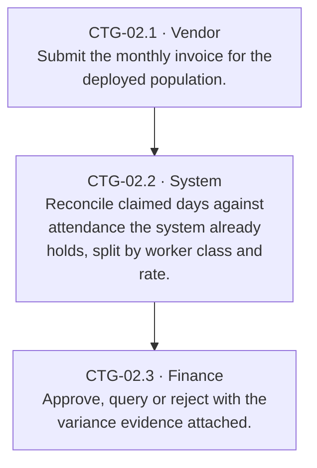

<picture>
  <source media="(prefers-color-scheme: dark)" srcset="../../assets/MultipliersKraftLogoDark.png">
  
</picture>

# FRS-CTG-01 — Contingent Workforce — Process Specifications

| Attribute | Value |
| :--- | :--- |
| Document ID | FRS-CTG-01 |
| Title | Contingent Workforce — Process Specifications |
| Product | Nucleus Suite (Nucleus HRMS Suite) |
| Version | 1.0.0 |
| Status | Issued for approval |
| Owner (role) | Domain Product Owner — Contingent Workforce |
| Author | Dhanraj Dadhich |
| Reviewed by | *pending* |
| Approved by | Product Council — *pending* |
| Date | 2026-11-05 |
| Classification | Internal |
| CMMI practice areas | RDM, TS |
| Related documents | FRS-CTG-00, FRS-CTG-01, FRS-CTG-02, FRS-CTG-03, FRS-CTG-04, FRS-CTG-05, FRS-CTG-06, FRS-CTG-07, FRS-CTG-08, FRS-CTG-09, FRS-CTG-10, FRS-CTG-11, FRS-CTG-12, FRS-CTG-13, BRS-01, SRS-01, REQ-01, REQ-02 |
| Quality & process-performance objectives | QPPO-05 (effective requirements reviews), QPPO-01 (escaped defects) — MPM-01 |
| Process performance baseline used | PPB-01 (review defect density), PPB-02 (review rate) — MPM-01 |
| Peer review record | *pending* (PR-xxxx, QA-02) |
| Tailoring record | none |
| Traceability anchor | BG-03 · processes CTG-01–CTG-03 |
| Source of record | Nucleus — Process Flows & Process Maps v1.0 — sheet(s) 03_Process_Inventory, 04_Process_Steps, 05_Swimlane_Maps Nucleus HR Demo Points Build Sheet v1.0 — sheet(s) 07_Approval_Workflows Nucleus HRMS Demo Dataset v1.1 — sheet(s) 64_Approval_Workflows |

> **Source of record.** Requirements in this document are taken from the source workbook(s) named above and keep their workbook IDs, which are never renumbered. Changes are made through a change request (CM-02) against the source workbook. Sections marked **Authored** are original additions that are not present in the source workbooks.

Step types: TASK (human) · SYS (system, unattended) · DEC (decision) · APPR (approval gate) · INT (integration call) · WAIT (timer or external event) · AGENT (agent-executed, governed). CRUD: C create · R read · U update · D delete-by-end-dating (temporal facts are never hard-deleted). In the flow diagrams decisions are diamonds, approvals are double-bordered boxes and integration, wait and agent steps are rounded.

## 1. Process inventory

| Process ID | Process | Trigger | Primary actor | Frequency | Criticality | Blueprint module | Phase | Reuses | Demo pts | Note |
| :--- | :--- | :--- | :--- | :--- | :--- | :--- | :--- | :--- | :--- | :--- |
| CTG-01 | Contractor engagement and worker registration | Contract signed | HR / Purchase | Per contract | High | Module 13 | P3 | CMP-10 | 3 | One engagement, several worker classes. Class is the unit of policy, not the contract. |
| CTG-02 | Contractor attendance and invoice reconciliation | Vendor invoice | Finance | Monthly | High | Module 13 | P3 | CMP-04 | 3 | Bill against attendance the system already holds; variance visible before payment. |
| CTG-03 | Principal employer compliance verification | Monthly filing cycle | Compliance owner | Monthly | High | Modules 6, 13 | P3 | CMP-01 | 17 | Contractor's own PF and ESI filings held as evidence. |

## 2. Step-level specifications

### CTG-01 — Contractor engagement and worker registration

**Trigger:** Contract signed · **Primary actor:** HR / Purchase · **Frequency:** Per contract · **Criticality:** High · **Phase:** P3 · **Reuses:** CMP-10

The source workbook specifies this process at inventory level only. Its complete flow is specified in use case CTG-UC-001 (FRS-CTG-12).

### CTG-02 — Contractor attendance and invoice reconciliation

**Trigger:** Vendor invoice · **Primary actor:** Finance · **Frequency:** Monthly · **Criticality:** High · **Phase:** P3 · **Reuses:** CMP-04

| Step | Step ID | Lane / actor | Type | Action or decision | Rule ID(s) | Objects touched (CRUD) | Key fields | Screen | Event emitted | Exception / note | Reuses | Demo pts | Phase |
| :--- | :--- | :--- | :--- | :--- | :--- | :--- | :--- | :--- | :--- | :--- | :--- | :--- | :--- |
| 1 | CTG-02.1 | Vendor | TASK | Submit the monthly invoice for the deployed population. | RL-480 | contractor_invoice C | invoice_id, engagement_id, period, claimed_days, claimed_amount | SCR-095 |  |  |  | 3 | P3 |
| 2 | CTG-02.2 | System | SYS | Reconcile claimed days against attendance the system already holds, split by worker class and rate. | RL-481 | attendance_day R; contractor_invoice U | system_days, variance_days, variance_amount | SCR-095 | contingent.invoice.reconciled | Variance visible before payment, not after. This is where clients lose real money. | CMP-04 | 3 | P3 |
| 3 | CTG-02.3 | Finance | TASK | Approve, query or reject with the variance evidence attached. | RL-482 | contractor_invoice U | decision, evidence_ref | SCR-040 |  |  | CMP-01 | 3 | P3 |

### CTG-03 — Principal employer compliance verification

**Trigger:** Monthly filing cycle · **Primary actor:** Compliance owner · **Frequency:** Monthly · **Criticality:** High · **Phase:** P3 · **Reuses:** CMP-01

The source workbook specifies this process at inventory level only. Its complete flow is specified in use case CTG-UC-003 (FRS-CTG-12).

## 4. Approval workflows

_No entries in source for this scope._

### Workflow behaviour

_No entries in source for this scope._

## Approval & Sign-off

| Role | Name | Date | Decision | Conditions / comments |
| :--- | :--- | :--- | :--- | :--- |
| Author | Dhanraj Dadhich | 2026-11-05 | Submitted | |
| Peer review moderator | *pending* | | | PR-xxxx |
| PQA (process compliance) | *pending* | | | |
| Approval authority (DOC-01 §7) | *pending* | | | |

## Measurement Data Captured

| Measure | Value | Unit | Notes |
| :--- | :--- | :--- | :--- |
| Size | 6 | specified items (table rows) | Counted automatically at generation |
| Authoring effort | *to be recorded* | person-hours | |
| Review effort (preparation + meeting) | *pending review* | person-hours | From PR-xxxx |
| Rework effort | *pending review* | person-hours | |
| Review rate | *pending review* | items / hour | Compare with PPB control limits |
| Requirement volatility (changes since baseline) | 0 | CRs touching this artefact | Not yet baselined (CM-03) |

**Defects found, by detection phase and severity**

| Detection phase | Major | Minor | Editorial | Injected in phase (major) |
| :--- | :--- | :--- | :--- | :--- |
| Author self-check | 0 | 0 | 0 | — |
| Peer review | *pending* | | | |
| Design / build | | | | |
| System / integration test | | | | |
| UAT | | | | |
| Production (escaped) | | | | each escaped major opens a CAR record (CAR-01) |

Within control limits of the review-rate PPB? *To be assessed at peer review.*

## Revision History

| Version | Date | Author | Change summary | CR ref | Approved by |
| :--- | :--- | :--- | :--- | :--- | :--- |
| 1.0.0 | 2026-11-05 | Dhanraj Dadhich | Consolidated release | CR-0001 | *pending* |
