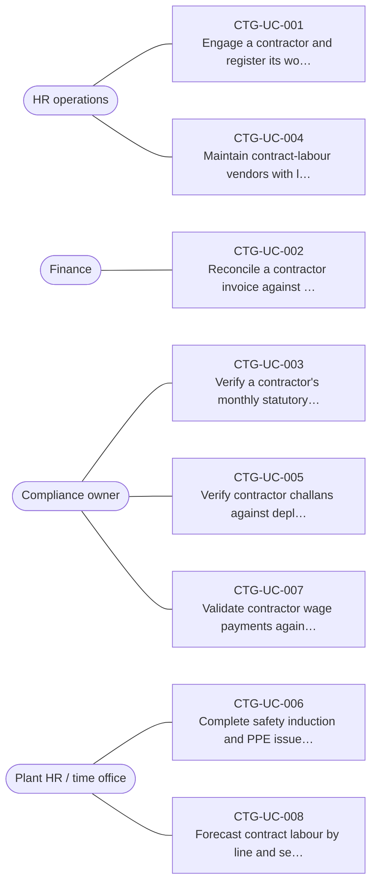
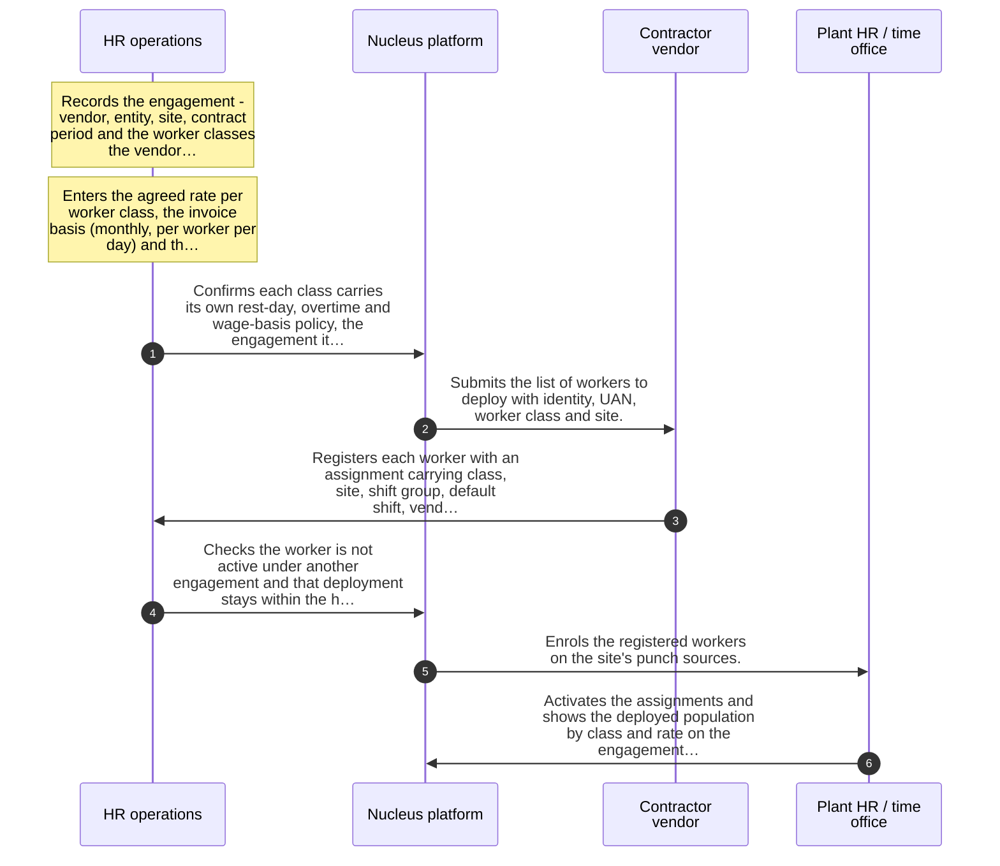
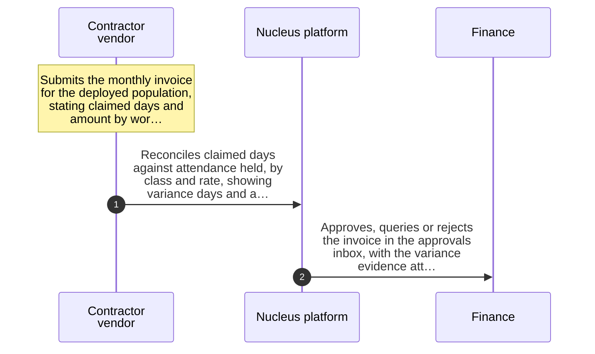
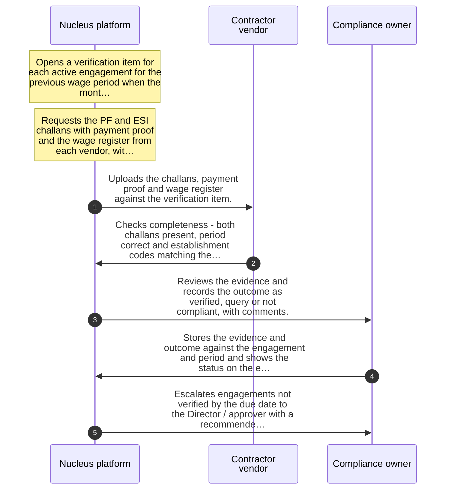
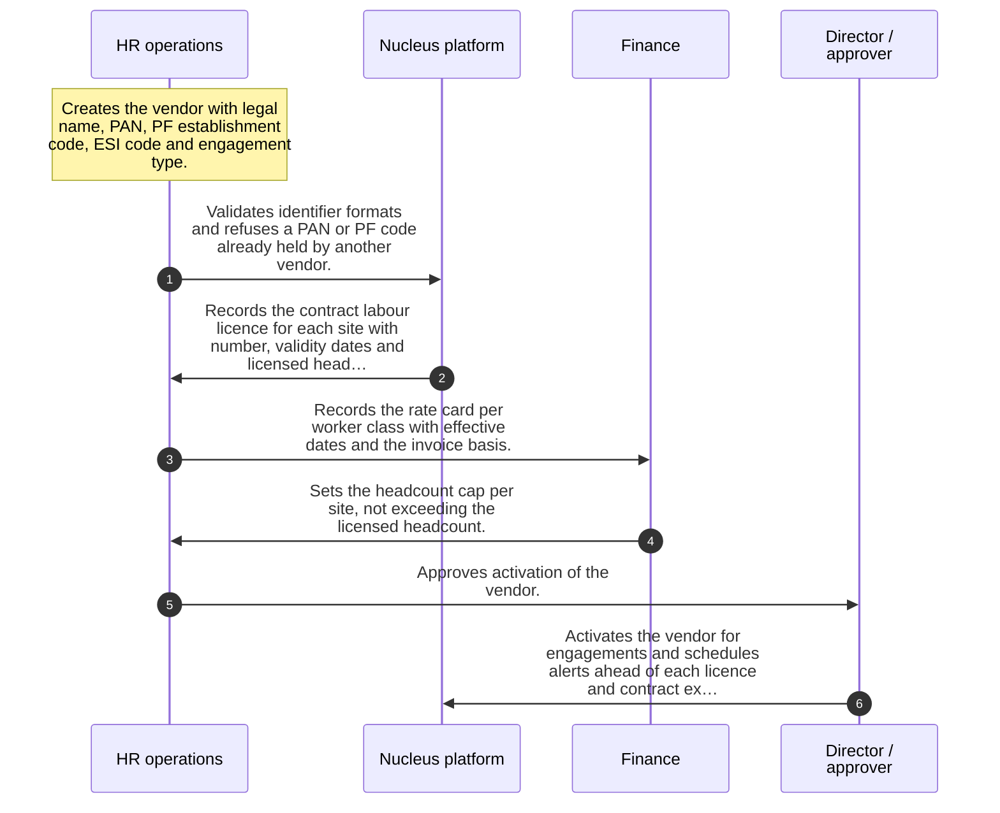
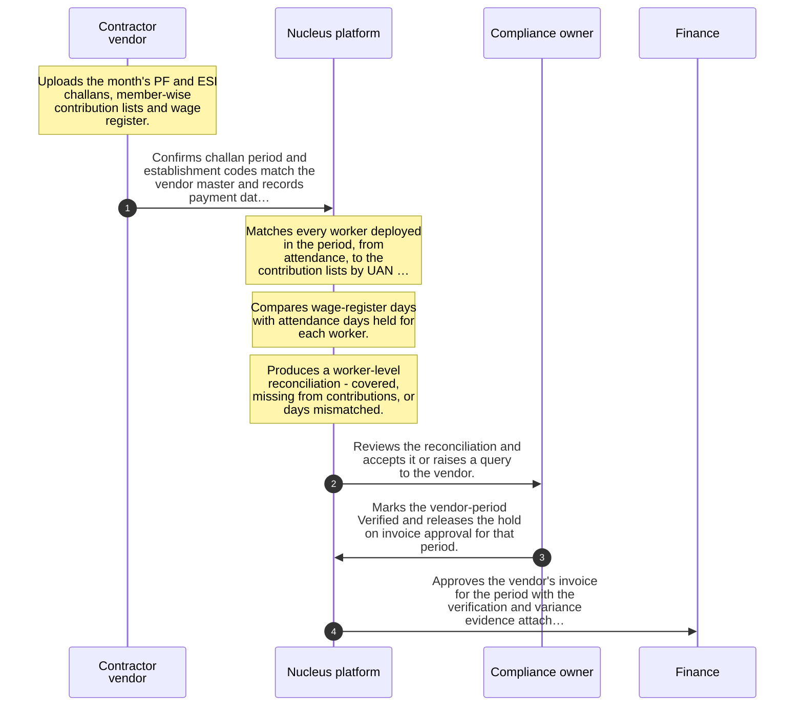
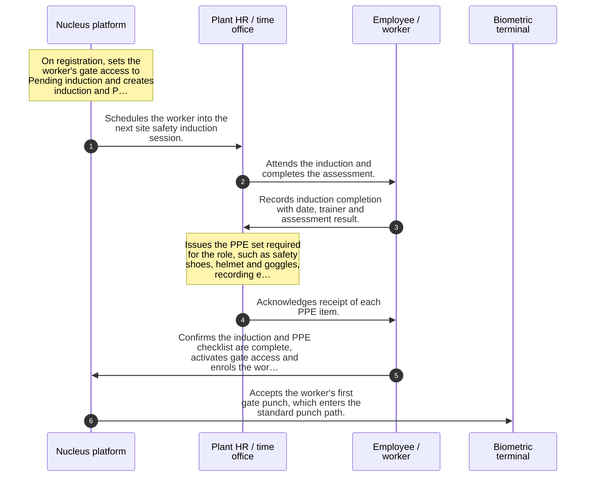
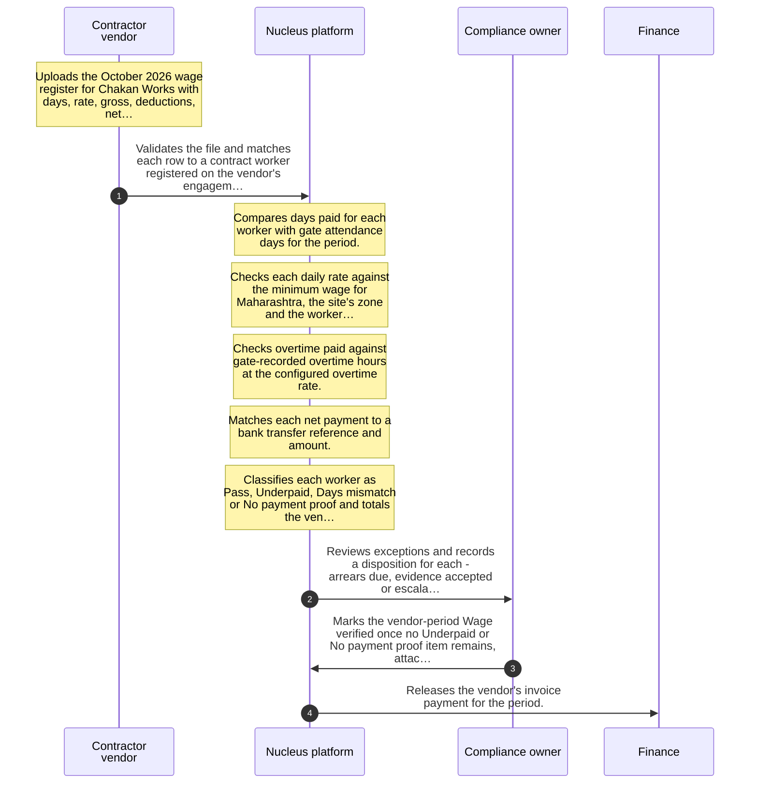
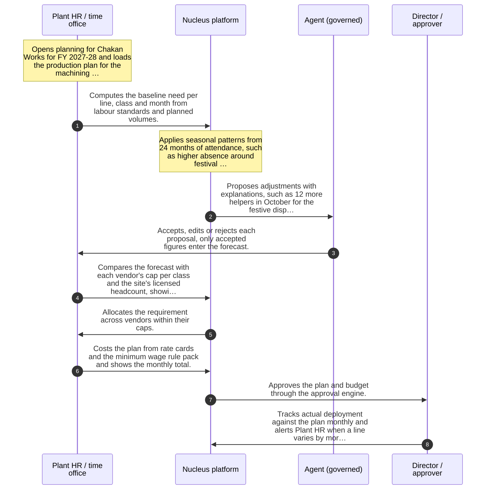

<picture>
  <source media="(prefers-color-scheme: dark)" srcset="../../assets/MultipliersKraftLogoDark.png">
  
</picture>

# FRS-CTG-12 — Contingent Workforce — Use Case Specifications

| Attribute | Value |
| :--- | :--- |
| Document ID | FRS-CTG-12 |
| Title | Contingent Workforce — Use Case Specifications |
| Product | Nucleus Suite (Nucleus HRMS Suite) |
| Version | 1.0.0 |
| Status | Issued for approval |
| Owner (role) | Domain Product Owner — Contingent Workforce |
| Author | Dhanraj Dadhich |
| Reviewed by | *pending* |
| Approved by | Product Council — *pending* |
| Date | 2026-11-05 |
| Classification | Internal |
| CMMI practice areas | RDM, VV |
| Related documents | FRS-CTG-00, FRS-CTG-01, FRS-CTG-02, FRS-CTG-03, FRS-CTG-04, FRS-CTG-05, FRS-CTG-06, FRS-CTG-07, FRS-CTG-08, FRS-CTG-09, FRS-CTG-10, FRS-CTG-11, FRS-CTG-12, FRS-CTG-13, BRS-01, SRS-01, REQ-01, REQ-02 |
| Quality & process-performance objectives | QPPO-05 (effective requirements reviews), QPPO-01 (escaped defects) — MPM-01 |
| Process performance baseline used | PPB-01 (review defect density), PPB-02 (review rate) — MPM-01 |
| Peer review record | *pending* (PR-xxxx, QA-02) |
| Tailoring record | none |
| Traceability anchor | BG-03 · processes CTG-01–CTG-03 |
| Source of record | Nucleus — Process Flows & Process Maps v1.0 — sheet(s) 03_Process_Inventory, 04_Process_Steps, 07_Screens, 09_Business_Rules Authored use cases (marked per use case) |

> **Source of record.** Requirements in this document are taken from the source workbook(s) named above and keep their workbook IDs, which are never renumbered. Changes are made through a change request (CM-02) against the source workbook. Sections marked **Authored** are original additions that are not present in the source workbooks.

This document specifies 8 use cases for Contingent Workforce: 1 follow the step-level flows of the source workbook and 7 are authored (processes without step-level detail in the source, and capability gaps). User stories derived from each use case are in FRS-CTG-13.

## 1. Use case index

| ID | Use case | Primary actor | Realises | Source | Phase | Criticality |
| :--- | :--- | :--- | :--- | :--- | :--- | :--- |
| [CTG-UC-001](#ctg-uc-001) | Engage a contractor and register its workers by class | HR operations | CTG-01 | Authored | P3 | High |
| [CTG-UC-002](#ctg-uc-002) | Reconcile a contractor invoice against attendance | Finance | CTG-02 | Source workbook | P3 | High |
| [CTG-UC-003](#ctg-uc-003) | Verify a contractor's monthly statutory compliance as principal employer | Compliance owner | CTG-03 | Authored | P3 | High |
| [CTG-UC-004](#ctg-uc-004) | Maintain contract-labour vendors with licences, rate cards and caps | HR operations | CTG-CG-001 | Authored | P2 | High |
| [CTG-UC-005](#ctg-uc-005) | Verify contractor challans against deployed workers before invoice approval | Compliance owner | CTG-CG-002 | Authored | P2 | High |
| [CTG-UC-006](#ctg-uc-006) | Complete safety induction and PPE issue before gate access | Plant HR / time office | CTG-CG-003 | Authored | P2 | High |
| [CTG-UC-007](#ctg-uc-007) | Validate contractor wage payments against gate attendance and minimum wages before invoice release | Compliance owner | CTG-CG-004 | Authored | P2 | Critical |
| [CTG-UC-008](#ctg-uc-008) | Forecast contract labour by line and season and compare with vendor capacity | Plant HR / time office | CTG-CG-005 | Authored | P3 | Medium |

## 2. Use case diagrams

## 3. Use case specifications

### CTG-UC-001

**Engage a contractor and register its workers by class** — Record a signed contractor engagement with the worker classes and rates it supplies, and register each deployed worker with an assignment whose class carries the time and pay policy.

| Attribute | Value |
| :--- | :--- |
| Realises | CTG-01 |
| Source | Authored |
| Level | User goal |
| Primary actor | HR operations |
| Secondary actors | Contractor vendor, Finance, Plant HR / time office, Nucleus platform |
| Trigger | A contract with a labour contractor is signed. |
| Frequency | Per contract |
| Criticality | High |
| Phase | P3 |
| Client requirements | — |
| Business rules | RL-101, RL-102 |
| Screens | SCR-095, SCR-011 |
| Data objects (CRUD) | contractor_engagement (C/U), worker_class (R), person (C), assignment (C) |
| Events | — |
| Acceptance tests | TC-T102 |
| System requirements | SYS-007, SYS-022, SYS-026, SYS-059, SYS-080 |

**Stakeholders and interests**

| Stakeholder | Interest |
| :--- | :--- |
| Purchase function | The engagement on file matches the signed contract: vendor, sites, period, classes and rates. |
| Finance | Sees the deployed population by class and rate that later invoices must reconcile against. |
| Plant HR / time office | Every contract worker at the gate is registered, enrolled and governed by the correct class policy. |
| Employee / worker | Rest days and overtime eligibility follow the class they were engaged in, not a blanket contract setting. |

**Preconditions**

- The contractor exists as an active vendor for the entity and site.
- The worker classes to be supplied (for example WC-3PE and WC-3PH) are configured with rest-day, overtime-eligibility and wage-basis policy.

**Main success scenario**

| # | Actor | Action | Ref |
| ---: | :--- | :--- | :--- |
| 1 | HR operations | Records the engagement: vendor, entity, site, contract period and the worker classes the vendor will supply. |  |
| 2 | HR operations | Enters the agreed rate per worker class, the invoice basis (monthly, per worker per day) and the headcount by class. |  |
| 3 | Nucleus platform | Confirms each class carries its own rest-day, overtime and wage-basis policy; the engagement itself holds no such policy. |  |
| 4 | Contractor vendor | Submits the list of workers to deploy with identity, UAN, worker class and site. |  |
| 5 | HR operations | Registers each worker with an assignment carrying class, site, shift group, default shift, vendor and reporting supervisor. |  |
| 6 | Nucleus platform | Checks the worker is not active under another engagement and that deployment stays within the headcount for the class. |  |
| 7 | Plant HR / time office | Enrols the registered workers on the site's punch sources. |  |
| 8 | Nucleus platform | Activates the assignments and shows the deployed population by class and rate on the engagement screen. |  |

**Alternate flows**

| ID | At step | Condition | Steps | Rejoins |
| :--- | ---: | :--- | :--- | :--- |
| A1 | 5 | A deployed worker moves to a different class during the engagement, for example from helper to employee. | HR operations records a new effective-dated assignment with the new class. → From the effective date the new class's rest-day and overtime policy applies and earlier days are unaffected. | Returns to step 8 |
| A2 | 1 | The signed contract renews an existing engagement. | HR operations extends the contract period on the existing engagement and active workers carry over without re-registration. | Returns to step 2 |

**Exception flows**

| ID | At step | Condition | Handling | Rule |
| :--- | ---: | :--- | :--- | :--- |
| E1 | 3 | A class named on the engagement has no rest-day or overtime policy configured. | The engagement cannot be activated until the class policy is configured; policy is never entered on the engagement instead. | RL-102 |
| E2 | 6 | The worker is already active under another engagement. | Registration is refused and the message names the existing engagement and site. |  |
| E3 | 6 | Registering the worker would exceed the engagement's headcount for that class. | Registration is refused with the class headcount and current deployment shown. |  |

**Postconditions — success**

- An active engagement records vendor, entity, site, contract period, classes, rate per class and invoice basis.
- Each deployed worker holds an active assignment with class, site, shift group, vendor and supervisor, and is enrolled on site punch sources.
- The engagement screen shows the deployed population by class and rate.

**Postconditions — failure**

- A worker who is already active under another engagement, or who would exceed the engagement's headcount by class, is not registered.

**Quality requirements**

- Class is the unit of policy: a change to a class's rest-day policy applies to every worker in that class across all engagements from its effective date.
- Engagement and assignment changes are effective-dated and auditable.

### CTG-UC-002

**Reconcile a contractor invoice against attendance** — Reconcile each monthly contractor invoice against the attendance the system already holds, by class and rate, so any variance is visible and decided before payment.

| Attribute | Value |
| :--- | :--- |
| Realises | CTG-02 |
| Source | Source workbook |
| Level | User goal |
| Primary actor | Finance |
| Secondary actors | Contractor vendor, Nucleus platform, Plant HR / time office |
| Trigger | A contractor submits its monthly invoice. |
| Frequency | Monthly |
| Criticality | High |
| Phase | P3 |
| Client requirements | — |
| Business rules | RL-480, RL-481, RL-482 |
| Screens | SCR-095, SCR-040 |
| Data objects (CRUD) | contractor_invoice (C/U), attendance_day (R), contractor_engagement (R) |
| Events | contingent.invoice.reconciled |
| Acceptance tests | TC-G480, TC-G481, TC-G482 |
| System requirements | SYS-028, SYS-037, SYS-040, SYS-053 |

**Stakeholders and interests**

| Stakeholder | Interest |
| :--- | :--- |
| Finance | Pays only for worker-days the attendance supports. |
| Contractor vendor | Receives a clear, evidenced query rather than an unexplained short payment. |
| Auditor | Every invoice decision carries its variance evidence. |

**Preconditions**

- An active engagement defines classes, rates and invoice basis for the vendor and site.
- Attendance days for the deployed workers in the invoice period have been computed.

**Main success scenario**

| # | Actor | Action | Ref |
| ---: | :--- | :--- | :--- |
| 1 | Contractor vendor | Submits the monthly invoice for the deployed population, stating claimed days and amount by worker class and rate. | CTG-02.1 |
| 2 | Nucleus platform | Reconciles claimed days against attendance held, by class and rate, showing variance days and amount before payment. | CTG-02.2 |
| 3 | Finance | Approves, queries or rejects the invoice in the approvals inbox, with the variance evidence attached to the decision. | CTG-02.3 |

**Alternate flows**

| ID | At step | Condition | Steps | Rejoins |
| :--- | ---: | :--- | :--- | :--- |
| A1 | 2 | Claimed days equal attendance days for every class. | The invoice is marked as matching with zero variance and presented for approval at the claimed amount. | Returns to step 3 |
| A2 | 3 | Finance passes only the supported amount and queries the remainder. | The supported amount is passed for payment and the variance amount is held under query with the vendor. | Use case ends |
| A3 | 3 | The vendor answers a query with a corrected invoice or further evidence. | The corrected invoice replaces the original claim and is reconciled again. | Returns to step 2 |

**Exception flows**

| ID | At step | Condition | Handling | Rule |
| :--- | ---: | :--- | :--- | :--- |
| E1 | 1 | An invoice line names a class or rate that is not on the engagement. | The line is refused at submission with the engagement's classes and rates shown. | RL-480 |
| E2 | 2 | A worker-day is claimed with no attendance behind it. | The day is listed in the variance and raised as an exception that blocks vendor payment, not employee payroll. | RL-481 |
| E3 | 3 | A decision is attempted without the variance evidence. | The decision cannot be saved until the reconciliation evidence is attached; by default it is attached automatically. | RL-482 |

**Postconditions — success**

- The invoice is reconciled with system days, variance days and variance amount by class and rate, and contingent.invoice.reconciled is emitted.
- Finance's decision (approve, query or reject) is recorded with the variance evidence attached.

**Postconditions — failure**

- An invoice with unsupported days is not paid in full; the unsupported amount is held under query.

**Quality requirements**

- Reconciliation of a 500-worker monthly invoice completes within 30 seconds of submission.
- Variance is shown before any payment is released, never after.

### CTG-UC-003

**Verify a contractor's monthly statutory compliance as principal employer** — Collect and verify each contractor's monthly PF and ESI filing evidence and hold it per engagement and period, so the principal employer's exposure is known before payment.

| Attribute | Value |
| :--- | :--- |
| Realises | CTG-03 |
| Source | Authored |
| Level | User goal |
| Primary actor | Compliance owner |
| Secondary actors | Contractor vendor, Finance, Director / approver, Nucleus platform |
| Trigger | The monthly statutory filing cycle opens. |
| Frequency | Monthly |
| Criticality | High |
| Phase | P3 |
| Client requirements | — |
| Business rules | — |
| Screens | SCR-095 |
| Data objects (CRUD) | contractor_compliance_verification (C/U), compliance_evidence (C), contractor_engagement (R), contractor_vendor (R) |
| Events | — |
| Acceptance tests | — |
| System requirements | SYS-032, SYS-037, SYS-040, SYS-043 |

**Stakeholders and interests**

| Stakeholder | Interest |
| :--- | :--- |
| Compliance owner | Knows every month which contractors have evidenced their PF and ESI payments; the principal employer may be liable for a contractor's unpaid contributions (to be validated by Legal). |
| Finance | Sees the verification status of a vendor before approving its invoice. |
| Auditor | Can retrieve the evidence and verification decision for any vendor and period. |

**Preconditions**

- The vendor master holds the contractor's PF establishment code and ESI code.
- At least one engagement with that vendor had deployed workers in the previous wage period.

**Main success scenario**

| # | Actor | Action | Ref |
| ---: | :--- | :--- | :--- |
| 1 | Nucleus platform | Opens a verification item for each active engagement for the previous wage period when the monthly cycle starts. |  |
| 2 | Nucleus platform | Requests the PF and ESI challans with payment proof and the wage register from each vendor, with a due date. |  |
| 3 | Contractor vendor | Uploads the challans, payment proof and wage register against the verification item. |  |
| 4 | Nucleus platform | Checks completeness: both challans present, period correct and establishment codes matching the vendor master. |  |
| 5 | Compliance owner | Reviews the evidence and records the outcome as verified, query or not compliant, with comments. |  |
| 6 | Nucleus platform | Stores the evidence and outcome against the engagement and period and shows the status on the engagement and its invoices. |  |
| 7 | Compliance owner | Escalates engagements not verified by the due date to the Director / approver with a recommended payment hold. |  |

**Alternate flows**

| ID | At step | Condition | Steps | Rejoins |
| :--- | ---: | :--- | :--- | :--- |
| A1 | 5 | The compliance owner raises a query. | The vendor receives the query with the points to correct and uploads revised evidence. | Returns to step 4 |
| A2 | 1 | An engagement ended during the period. | A verification item is still opened for the final period worked. | Returns to step 2 |

**Exception flows**

| ID | At step | Condition | Handling | Rule |
| :--- | ---: | :--- | :--- | :--- |
| E1 | 3 | The vendor has not uploaded evidence by the due date. | The item is marked Held, the vendor's invoices show the Held status and the item is escalated. |  |
| E2 | 4 | A challan's establishment code does not match the vendor master. | The evidence is rejected with the expected and received codes shown and the vendor is asked to re-upload. |  |

**Postconditions — success**

- A verification record per engagement and period holds the challans, payment proof and wage register, with outcome, reviewer and date.
- The verification status is visible on the engagement and on the vendor's invoices.

**Postconditions — failure**

- Engagements without evidence by the due date are marked Held and escalated with a recommended payment hold.

**Quality requirements**

- Evidence is retained per vendor and period for the statutory retention period (to be validated by Legal) and is read-only after verification.
- Every verification outcome records reviewer, date and comment.

### CTG-UC-004

**Maintain contract-labour vendors with licences, rate cards and caps** — Maintain each labour contractor with statutory registrations, site licences, rate cards and per-site headcount caps so engagements and invoices rest on verified vendor data.

| Attribute | Value |
| :--- | :--- |
| Realises | CTG-CG-001 |
| Source | Authored |
| Level | User goal |
| Primary actor | HR operations |
| Secondary actors | Compliance owner, Finance, Director / approver, Nucleus platform |
| Trigger | A new labour contractor is onboarded, or a vendor's licence, rate or cap changes. |
| Frequency | Per vendor change |
| Criticality | High |
| Phase | P2 |
| Client requirements | — |
| Business rules | RL-480, RL-102 |
| Screens | SCR-095 |
| Data objects (CRUD) | contractor_vendor (C/U), vendor_licence (C/U), rate_card (C), headcount_cap (C/U) |
| Events | — |
| Acceptance tests | CTG-TC-001, CTG-TC-002, CTG-TC-003, CTG-TC-004, CTG-TC-005, CTG-TC-006 |
| System requirements | SYS-019, SYS-022, SYS-026, SYS-037, SYS-070 |

**Stakeholders and interests**

| Stakeholder | Interest |
| :--- | :--- |
| Compliance owner | No contractor deploys at a site beyond its licence or after the licence or contract expires. |
| Finance | Invoices reconcile against an effective-dated rate card. |
| Plant HR / time office | Knows how many contract workers each vendor may deploy at the site. |

**Preconditions**

- The vendor's PAN, PF establishment code, ESI code and contract labour licence for each site are available.
- The worker classes the vendor will supply are configured.

**Main success scenario**

| # | Actor | Action | Ref |
| ---: | :--- | :--- | :--- |
| 1 | HR operations | Creates the vendor with legal name, PAN, PF establishment code, ESI code and engagement type. |  |
| 2 | Nucleus platform | Validates identifier formats and refuses a PAN or PF code already held by another vendor. |  |
| 3 | HR operations | Records the contract labour licence for each site with number, validity dates and licensed headcount, attaching a copy. |  |
| 4 | Finance | Records the rate card per worker class with effective dates and the invoice basis. |  |
| 5 | HR operations | Sets the headcount cap per site, not exceeding the licensed headcount. |  |
| 6 | Director / approver | Approves activation of the vendor. |  |
| 7 | Nucleus platform | Activates the vendor for engagements and schedules alerts ahead of each licence and contract expiry. |  |

**Alternate flows**

| ID | At step | Condition | Steps | Rejoins |
| :--- | ---: | :--- | :--- | :--- |
| A1 | 4 | An existing vendor's rate is revised. | Finance adds a new rate card row effective from the agreed date; the previous rate remains for earlier periods. | Use case ends |
| A2 | 3 | The vendor serves more than one site. | A separate licence, validity and licensed headcount is recorded for each site. | Returns to step 4 |

**Exception flows**

| ID | At step | Condition | Handling | Rule |
| :--- | ---: | :--- | :--- | :--- |
| E1 | 5 | The headcount cap entered exceeds the site's licensed headcount. | The cap is refused with the licensed headcount shown. |  |
| E2 | 7 | A site licence has expired. | New deployments at that site are blocked and existing deployments are flagged to the compliance owner. |  |
| E3 | 7 | A contract end date is within the alert lead time and no renewal has been raised. | An alert is raised to HR operations and the compliance owner naming the vendor, site and end date. |  |
| E4 | 4 | A new rate card row overlaps an existing row for the same class. | The row is refused with the overlapping period shown. |  |

**Postconditions — success**

- An active vendor holds registrations, site licences with validity and licensed headcount, an effective-dated rate card per class and a headcount cap per site.
- Expiry alerts are scheduled for each licence and contract.

**Postconditions — failure**

- A vendor with missing registrations, an expired licence or a cap above its licence is not activated.

**Quality requirements**

- Vendor identifiers and licence documents are stored with access limited to HR operations, Compliance owner and Finance.
- Rate cards and caps are effective-dated so past invoices always reconcile against the values then in force.

### CTG-UC-005

**Verify contractor challans against deployed workers before invoice approval** — Reconcile each vendor's monthly PF and ESI challans and wage register against the contract workers actually deployed, and hold invoice approval until verification is complete.

| Attribute | Value |
| :--- | :--- |
| Realises | CTG-CG-002 |
| Source | Authored |
| Level | User goal |
| Primary actor | Compliance owner |
| Secondary actors | Contractor vendor, Finance, Director / approver, Nucleus platform |
| Trigger | A vendor uploads its monthly challans and wage register, or the invoice for that period reaches approval. |
| Frequency | Monthly |
| Criticality | High |
| Phase | P2 |
| Client requirements | — |
| Business rules | RL-481, RL-482 |
| Screens | SCR-095, SCR-040 |
| Data objects (CRUD) | statutory_challan (C), wage_register (C), challan_reconciliation (C/U), attendance_day (R), contractor_invoice (U) |
| Events | — |
| Acceptance tests | CTG-TC-007, CTG-TC-008, CTG-TC-009, CTG-TC-010, CTG-TC-011, CTG-TC-012 |
| System requirements | SYS-019, SYS-033, SYS-051, SYS-061 |

**Stakeholders and interests**

| Stakeholder | Interest |
| :--- | :--- |
| Compliance owner | Every deployed contract worker is covered by the contractor's contributions before the contractor is paid. |
| Finance | Invoice approval is gated by a clear, worker-level verification result. |
| Employee / worker | Contract workers' PF and ESI contributions are actually paid. |

**Preconditions**

- The vendor master holds PF and ESI establishment codes (CTG-UC-004).
- Attendance for the vendor's deployed workers in the period has been computed.

**Main success scenario**

| # | Actor | Action | Ref |
| ---: | :--- | :--- | :--- |
| 1 | Contractor vendor | Uploads the month's PF and ESI challans, member-wise contribution lists and wage register. |  |
| 2 | Nucleus platform | Confirms challan period and establishment codes match the vendor master and records payment dates. |  |
| 3 | Nucleus platform | Matches every worker deployed in the period, from attendance, to the contribution lists by UAN and ESI number. |  |
| 4 | Nucleus platform | Compares wage-register days with attendance days held for each worker. |  |
| 5 | Nucleus platform | Produces a worker-level reconciliation: covered, missing from contributions, or days mismatched. |  |
| 6 | Compliance owner | Reviews the reconciliation and accepts it or raises a query to the vendor. |  |
| 7 | Nucleus platform | Marks the vendor-period Verified and releases the hold on invoice approval for that period. |  |
| 8 | Finance | Approves the vendor's invoice for the period with the verification and variance evidence attached. |  |

**Alternate flows**

| ID | At step | Condition | Steps | Rejoins |
| :--- | ---: | :--- | :--- | :--- |
| A1 | 6 | The compliance owner raises a query. | The vendor receives the worker-level discrepancies and uploads corrected evidence. | Returns to step 2 |

**Exception flows**

| ID | At step | Condition | Handling | Rule |
| :--- | ---: | :--- | :--- | :--- |
| E1 | 1 | Challans for the period have not been uploaded. | Invoice approval for that vendor and period is blocked with the reason 'statutory verification incomplete'. |  |
| E2 | 5 | A deployed worker is missing from a contribution list. | The worker is listed as missing and the vendor-period cannot be marked Verified until resolved. |  |
| E3 | 8 | Payment must be released before verification completes. | Only a Director / approver may release it; the release names the waived rule and records approver identity and reason. |  |

**Postconditions — success**

- A worker-level reconciliation shows each deployed worker as covered, missing or mismatched, and the vendor-period is Verified.
- Invoice approval for that vendor and period is released.

**Postconditions — failure**

- Invoice approval remains blocked while verification is incomplete, unless a Director / approver releases it with the waived rule named.

**Quality requirements**

- Worker-level matching for a 500-worker vendor completes within 60 seconds of upload.
- Identifiers in uploaded documents are visible only to roles with a compliance need.

### CTG-UC-006

**Complete safety induction and PPE issue before gate access** — Ensure every contract worker completes the site safety induction and receives the required PPE before their gate access is activated.

| Attribute | Value |
| :--- | :--- |
| Realises | CTG-CG-003 |
| Source | Authored |
| Level | User goal |
| Primary actor | Plant HR / time office |
| Secondary actors | Employee / worker, Nucleus platform, Biometric terminal, Contractor vendor |
| Trigger | A contract worker is registered for deployment at a site (CTG-UC-001). |
| Frequency | Per worker deployment |
| Criticality | High |
| Phase | P2 |
| Client requirements | — |
| Business rules | — |
| Screens | — |
| Data objects (CRUD) | induction_record (C), ppe_issue (C), gate_access (U), assignment (R) |
| Events | — |
| Acceptance tests | CTG-TC-013, CTG-TC-014, CTG-TC-015, CTG-TC-016, CTG-TC-017, CTG-TC-018 |
| System requirements | SYS-051, SYS-053, SYS-062, SYS-080 |

**Stakeholders and interests**

| Stakeholder | Interest |
| :--- | :--- |
| Compliance owner | No contract worker enters the shop floor without induction and PPE, supporting obligations under the Factories Act 1948 (to be validated by Legal). |
| Employee / worker | Knows the site hazards and has the protective equipment before starting work. |
| Contractor vendor | Knows what each worker must complete before they can be deployed. |

**Preconditions**

- The site has a safety induction programme and a PPE requirement list per worker class or role.
- The worker has an assignment at the site with gate access not yet active.

**Main success scenario**

| # | Actor | Action | Ref |
| ---: | :--- | :--- | :--- |
| 1 | Nucleus platform | On registration, sets the worker's gate access to Pending induction and creates induction and PPE checklist items for the site and role. |  |
| 2 | Plant HR / time office | Schedules the worker into the next site safety induction session. |  |
| 3 | Employee / worker | Attends the induction and completes the assessment. |  |
| 4 | Plant HR / time office | Records induction completion with date, trainer and assessment result. |  |
| 5 | Plant HR / time office | Issues the PPE set required for the role, such as safety shoes, helmet and goggles, recording each item and issue date. |  |
| 6 | Employee / worker | Acknowledges receipt of each PPE item. |  |
| 7 | Nucleus platform | Confirms the induction and PPE checklist are complete, activates gate access and enrols the worker on the site's gate terminals. |  |
| 8 | Biometric terminal | Accepts the worker's first gate punch, which enters the standard punch path. |  |

**Alternate flows**

| ID | At step | Condition | Steps | Rejoins |
| :--- | ---: | :--- | :--- | :--- |
| A1 | 2 | The worker completed this site's induction within its validity period under an earlier engagement. | The earlier induction record is reused and only the PPE checklist is completed. | Returns to step 5 |

**Exception flows**

| ID | At step | Condition | Handling | Rule |
| :--- | ---: | :--- | :--- | :--- |
| E1 | 3 | The worker fails the induction assessment. | Gate access stays pending and the worker is scheduled into another session. |  |
| E2 | 8 | The worker attempts a gate punch before access is active. | Entry is refused, the attempt is recorded and an exception is raised to the time office. |  |
| E3 | 7 | A required PPE item has not been issued because it is out of stock. | Gate access stays pending and the shortfall is reported to the time office. |  |
| E4 | 8 | The worker's induction passes its validity period. | Gate access is suspended until a refresher induction is recorded. |  |

**Postconditions — success**

- Induction completion and each PPE item issued are recorded and acknowledged, and gate access is active for the site.

**Postconditions — failure**

- Gate access stays pending and any gate punch attempt is refused and logged.

**Quality requirements**

- Gate access activation reaches the site gate terminals within 5 minutes of the checklist completing.
- Induction and PPE records are retained for the duration required by the applicable safety rules (to be validated by Legal).

### CTG-UC-007

**Validate contractor wage payments against gate attendance and minimum wages before invoice release** — Confirm that each contract worker was paid for every day recorded at the gate, at no less than the applicable minimum wage, before the contractor's invoice for the period is released.

| Attribute | Value |
| :--- | :--- |
| Realises | CTG-CG-004 |
| Source | Authored |
| Level | User goal |
| Primary actor | Compliance owner |
| Secondary actors | Contractor vendor, Plant HR / time office, Finance, Director / approver, Nucleus platform |
| Trigger | A contractor vendor uploads the wage register and payment evidence for a wage period. |
| Frequency | Monthly |
| Criticality | Critical |
| Phase | P2 |
| Client requirements | — |
| Business rules | RL-481, RL-482 |
| Screens | SCR-095, SCR-040 |
| Data objects (CRUD) | contractor_wage_register (C), wage_validation_result (C, U), attendance_day (R), rule_pack (R), contractor_invoice (U) |
| Events | contingent.invoice.reconciled |
| Acceptance tests | CTG-TC-019, CTG-TC-020, CTG-TC-021, CTG-TC-022, CTG-TC-023, CTG-TC-024 |
| System requirements | SYS-028, SYS-045, SYS-051, SYS-061 |

**Stakeholders and interests**

| Stakeholder | Interest |
| :--- | :--- |
| Employee / worker | As a contract worker, is paid for every day worked at no less than the minimum wage. |
| Compliance owner | Discharges the principal employer's duty to ensure contractor wages are paid, as set out in contract labour law (to be validated by Legal). |
| Finance | Releases vendor payments only for periods with verified wage payment. |
| Contractor vendor | Sees exactly which workers and days are disputed and how to clear them. |

**Preconditions**

- The vendor's engagement, worker registrations by class and rate card are active.
- Gate punches for the period are ingested and attendance days are computed for contract workers.
- A minimum wage rule pack for the state, zone and skill category is published (to be validated by Legal).

**Main success scenario**

| # | Actor | Action | Ref |
| ---: | :--- | :--- | :--- |
| 1 | Contractor vendor | Uploads the October 2026 wage register for Chakan Works with days, rate, gross, deductions, net and bank transfer reference per worker. |  |
| 2 | Nucleus platform | Validates the file and matches each row to a contract worker registered on the vendor's engagement. |  |
| 3 | Nucleus platform | Compares days paid for each worker with gate attendance days for the period. |  |
| 4 | Nucleus platform | Checks each daily rate against the minimum wage for Maharashtra, the site's zone and the worker's skill category. |  |
| 5 | Nucleus platform | Checks overtime paid against gate-recorded overtime hours at the configured overtime rate. |  |
| 6 | Nucleus platform | Matches each net payment to a bank transfer reference and amount. |  |
| 7 | Nucleus platform | Classifies each worker as Pass, Underpaid, Days mismatch or No payment proof and totals the vendor-period. |  |
| 8 | Compliance owner | Reviews exceptions and records a disposition for each: arrears due, evidence accepted or escalated. |  |
| 9 | Nucleus platform | Marks the vendor-period Wage verified once no Underpaid or No payment proof item remains, attaching evidence to the invoice decision. |  |
| 10 | Finance | Releases the vendor's invoice payment for the period. |  |

**Alternate flows**

| ID | At step | Condition | Steps | Rejoins |
| :--- | ---: | :--- | :--- | :--- |
| A1 | 8 | The vendor pays arrears to underpaid workers. | Vendor uploads a supplementary register with new bank transfer references. → Platform re-runs the checks for the affected workers only. | Returns to step 7 |
| A2 | 9 | Payment must be released before verification completes. | Director / approver releases it, and the release names the waived rule with approver identity and reason. | Returns to step 10 |

**Exception flows**

| ID | At step | Condition | Handling | Rule |
| :--- | ---: | :--- | :--- | :--- |
| E1 | 2 | A row names a worker not registered on the engagement. | The row is rejected and flagged to Plant HR as a possible unregistered deployment. |  |
| E2 | 3 | The invoice claims worker-days with no gate attendance behind them. | The days are listed in the variance and block vendor payment, not employee payroll. | RL-481 |
| E3 | 4 | No minimum wage rule pack is published for the state and period. | Validation stops for that vendor-period and the compliance owner is alerted. |  |
| E4 | 9 | A decision is attempted without the variance evidence. | The decision cannot be saved until the evidence is attached; by default it is attached automatically. | RL-482 |

**Postconditions — success**

- The vendor-period is marked Wage verified with per-worker results and evidence attached to the invoice decision.

**Postconditions — failure**

- The vendor's invoice for the period stays Held while any underpayment or missing payment proof is unresolved.

**Quality requirements**

- Validation of a 600-worker wage register completes within 60 s.
- Uploaded wage registers and bank evidence are retained for the period set by the compliance retention policy.

### CTG-UC-008

**Forecast contract labour by line and season and compare with vendor capacity** — Forecast contract labour needs by production line, worker class and month, test them against vendor caps and site licences, and approve a costed plan.

| Attribute | Value |
| :--- | :--- |
| Realises | CTG-CG-005 |
| Source | Authored |
| Level | User goal |
| Primary actor | Plant HR / time office |
| Secondary actors | Agent (governed), Director / approver, Finance, Compliance owner, Nucleus platform, ERP system |
| Trigger | The annual production plan is published, or Plant HR reviews the forecast before a peak season. |
| Frequency | Quarterly |
| Criticality | Medium |
| Phase | P3 |
| Client requirements | — |
| Business rules | — |
| Screens | SCR-095 |
| Data objects (CRUD) | labour_forecast (C, U), forecast_adjustment (C), vendor_allocation (C), vendor_cap (R), rate_card (R), action_ledger (C) |
| Events | agent.action.proposed, platform.approval.completed |
| Acceptance tests | CTG-TC-025, CTG-TC-026, CTG-TC-027, CTG-TC-028, CTG-TC-029, CTG-TC-030 |
| System requirements | SYS-028, SYS-035, SYS-045, SYS-072, SYS-074 |

**Stakeholders and interests**

| Stakeholder | Interest |
| :--- | :--- |
| Plant HR / time office | Arranges labour ahead of peak months instead of reacting to shortfalls on the line. |
| Director / approver | Approves a contract labour budget grounded in the production plan. |
| Compliance owner | Sees early if planned deployment would exceed a site's licensed headcount. |

**Preconditions**

- At least 12 months of contract worker attendance by line and class exist in the analytics projections.
- Production volumes by line and month for the plan year are available from the ERP system as a file in R0.
- Vendor headcount caps, rate cards and site licensed headcounts are maintained.

**Main success scenario**

| # | Actor | Action | Ref |
| ---: | :--- | :--- | :--- |
| 1 | Plant HR / time office | Opens planning for Chakan Works for FY 2027-28 and loads the production plan for the machining and assembly lines. |  |
| 2 | Nucleus platform | Computes the baseline need per line, class and month from labour standards and planned volumes. |  |
| 3 | Nucleus platform | Applies seasonal patterns from 24 months of attendance, such as higher absence around festival months. |  |
| 4 | Agent (governed) | Proposes adjustments with explanations, such as 12 more helpers in October for the festive dispatch peak. |  |
| 5 | Plant HR / time office | Accepts, edits or rejects each proposal; only accepted figures enter the forecast. |  |
| 6 | Nucleus platform | Compares the forecast with each vendor's cap per class and the site's licensed headcount, showing shortfall or excess. |  |
| 7 | Plant HR / time office | Allocates the requirement across vendors within their caps. |  |
| 8 | Nucleus platform | Costs the plan from rate cards and the minimum wage rule pack and shows the monthly total. |  |
| 9 | Director / approver | Approves the plan and budget through the approval engine. |  |
| 10 | Nucleus platform | Tracks actual deployment against the plan monthly and alerts Plant HR when a line varies by more than 10%. |  |

**Alternate flows**

| ID | At step | Condition | Steps | Rejoins |
| :--- | ---: | :--- | :--- | :--- |
| A1 | 2 | A new line has no attendance history. | Plant HR enters the labour standard and expected attendance rate manually. → The forecast marks those figures as manual inputs. | Returns to step 4 |

**Exception flows**

| ID | At step | Condition | Handling | Rule |
| :--- | ---: | :--- | :--- | :--- |
| E1 | 6 | Peak-month forecast exceeds the site's licensed headcount. | The excess cannot be allocated and the compliance owner is alerted to consider a licence amendment. |  |
| E2 | 7 | An allocation would exceed a vendor's class cap. | The allocation is refused with the cap and current allocation shown. |  |
| E3 | 8 | A vendor's rate card ends within the plan year. | Costs after that date are marked provisional and HR operations is alerted. |  |

**Postconditions — success**

- An approved plan exists by line, class, month and vendor with cost, and monthly actuals are tracked against it.

**Postconditions — failure**

- Allocations that would breach a vendor cap or site licence are not accepted into the plan.

**Quality requirements**

- A plan for 5 sites, 12 lines and 6 worker classes recomputes within 10 s after any edit.
- Each accepted agent proposal is recorded in the action ledger with the user who accepted it.

## Approval & Sign-off

| Role | Name | Date | Decision | Conditions / comments |
| :--- | :--- | :--- | :--- | :--- |
| Author | Dhanraj Dadhich | 2026-11-05 | Submitted | |
| Peer review moderator | *pending* | | | PR-xxxx |
| PQA (process compliance) | *pending* | | | |
| Approval authority (DOC-01 §7) | *pending* | | | |

## Measurement Data Captured

| Measure | Value | Unit | Notes |
| :--- | :--- | :--- | :--- |
| Size | 263 | specified items (table rows) | Counted automatically at generation |
| Authoring effort | *to be recorded* | person-hours | |
| Review effort (preparation + meeting) | *pending review* | person-hours | From PR-xxxx |
| Rework effort | *pending review* | person-hours | |
| Review rate | *pending review* | items / hour | Compare with PPB control limits |
| Requirement volatility (changes since baseline) | 0 | CRs touching this artefact | Not yet baselined (CM-03) |

**Defects found, by detection phase and severity**

| Detection phase | Major | Minor | Editorial | Injected in phase (major) |
| :--- | :--- | :--- | :--- | :--- |
| Author self-check | 0 | 0 | 0 | — |
| Peer review | *pending* | | | |
| Design / build | | | | |
| System / integration test | | | | |
| UAT | | | | |
| Production (escaped) | | | | each escaped major opens a CAR record (CAR-01) |

Within control limits of the review-rate PPB? *To be assessed at peer review.*

## Revision History

| Version | Date | Author | Change summary | CR ref | Approved by |
| :--- | :--- | :--- | :--- | :--- | :--- |
| 1.0.0 | 2026-11-05 | Dhanraj Dadhich | Consolidated release | CR-0001 | *pending* |
