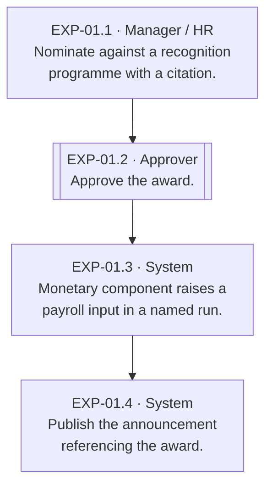
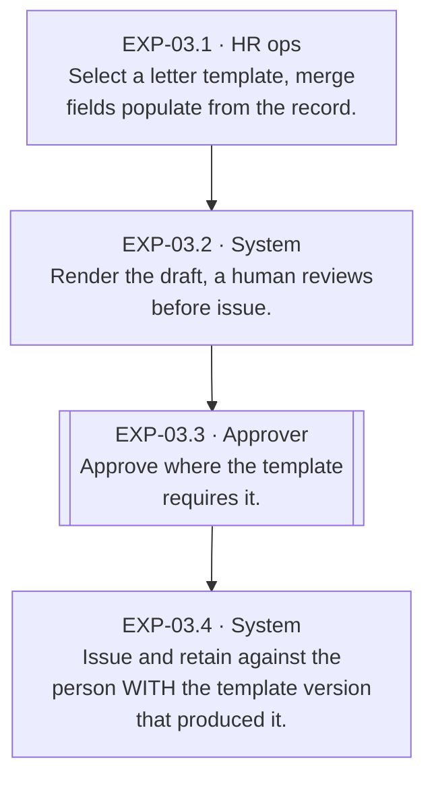

<picture>
  <source media="(prefers-color-scheme: dark)" srcset="../../assets/MultipliersKraftLogoDark.png">
  
</picture>

# FRS-EXP-01 — Experience — Process Specifications

| Attribute | Value |
| :--- | :--- |
| Document ID | FRS-EXP-01 |
| Title | Experience — Process Specifications |
| Product | Nucleus Suite (Nucleus HRMS Suite) |
| Version | 1.0.0 |
| Status | Issued for approval |
| Owner (role) | Domain Product Owner — Experience |
| Author | Dhanraj Dadhich |
| Reviewed by | *pending* |
| Approved by | Product Council — *pending* |
| Date | 2026-11-05 |
| Classification | Internal |
| CMMI practice areas | RDM, TS |
| Related documents | FRS-EXP-00, FRS-EXP-01, FRS-EXP-02, FRS-EXP-03, FRS-EXP-04, FRS-EXP-05, FRS-EXP-06, FRS-EXP-07, FRS-EXP-08, FRS-EXP-09, FRS-EXP-10, FRS-EXP-11, FRS-EXP-12, FRS-EXP-13, BRS-01, SRS-01, REQ-01, REQ-02 |
| Quality & process-performance objectives | QPPO-05 (effective requirements reviews), QPPO-01 (escaped defects) — MPM-01 |
| Process performance baseline used | PPB-01 (review defect density), PPB-02 (review rate) — MPM-01 |
| Peer review record | *pending* (PR-xxxx, QA-02) |
| Tailoring record | none |
| Traceability anchor | BG-05 · R-19, R-20, R-21, R-22 · processes EXP-01–EXP-03 |
| Source of record | Nucleus — Process Flows & Process Maps v1.0 — sheet(s) 03_Process_Inventory, 04_Process_Steps, 05_Swimlane_Maps Nucleus HR Demo Points Build Sheet v1.0 — sheet(s) 07_Approval_Workflows Nucleus HRMS Demo Dataset v1.1 — sheet(s) 64_Approval_Workflows |

> **Source of record.** Requirements in this document are taken from the source workbook(s) named above and keep their workbook IDs, which are never renumbered. Changes are made through a change request (CM-02) against the source workbook. Sections marked **Authored** are original additions that are not present in the source workbooks.

Step types: TASK (human) · SYS (system, unattended) · DEC (decision) · APPR (approval gate) · INT (integration call) · WAIT (timer or external event) · AGENT (agent-executed, governed). CRUD: C create · R read · U update · D delete-by-end-dating (temporal facts are never hard-deleted). In the flow diagrams decisions are diamonds, approvals are double-bordered boxes and integration, wait and agent steps are rounded.

## 1. Process inventory

| Process ID | Process | Trigger | Primary actor | Frequency | Criticality | Blueprint module | Phase | Reuses | Demo pts | Note |
| :--- | :--- | :--- | :--- | :--- | :--- | :--- | :--- | :--- | :--- | :--- |
| EXP-01 | Recognition nomination, award and payout | Programme cycle | Manager, HR | Monthly | Medium | Module 15 | P2 | CMP-01, CMP-03 | 18 | Monetary component raises a payroll input in a named run. |
| EXP-02 | Announcement generation and publish | Event or manual | System / HR | Daily | Low | Module 15 | P2 | CMP-03r, CMP-07 | 20 | Audience rule + channel list, with an editorial override before publish. |
| EXP-03 | Letter generation and issue register | Lifecycle event | HR ops | Weekly | Medium | Module 15 | P2 | CMP-03r, CMP-01 | 21 | Issued letter retains the template version that produced it. |

## 2. Step-level specifications

### EXP-01 — Recognition nomination, award and payout

**Trigger:** Programme cycle · **Primary actor:** Manager, HR · **Frequency:** Monthly · **Criticality:** Medium · **Phase:** P2 · **Reuses:** CMP-01, CMP-03

| Step | Step ID | Lane / actor | Type | Action or decision | Rule ID(s) | Objects touched (CRUD) | Key fields | Screen | Event emitted | Exception / note | Reuses | Demo pts | Phase |
| :--- | :--- | :--- | :--- | :--- | :--- | :--- | :--- | :--- | :--- | :--- | :--- | :--- | :--- |
| 1 | EXP-01.1 | Manager / HR | TASK | Nominate against a recognition programme with a citation. | RL-490 | recognition_award C | award_id, programme_id, person_id, period, citation, award_amount | SCR-065 | experience.recognition.nominated |  |  | 18 | P2 |
| 2 | EXP-01.2 | Approver | APPR | Approve the award. | RL-010 | recognition_award U | status, approved_by | SCR-040 | platform.approval.completed |  | CMP-01 | 18 | P2 |
| 3 | EXP-01.3 | System | SYS | Monetary component raises a payroll input in a named run. | RL-491 | payroll_input C | component(recognition_award), amount, run_id | — | payroll.input.raised | Never paid outside the system. | CMP-03 | 18 | P2 |
| 4 | EXP-01.4 | System | SYS | Publish the announcement referencing the award. | RL-492 | announcement C | source_event(award_id) | SCR-066 | experience.announcement.published |  |  | 18 | P2 |

### EXP-02 — Announcement generation and publish

**Trigger:** Event or manual · **Primary actor:** System / HR · **Frequency:** Daily · **Criticality:** Low · **Phase:** P2 · **Reuses:** CMP-03r, CMP-07

The source workbook specifies this process at inventory level only. Its complete flow is specified in use case EXP-UC-002 (FRS-EXP-12).

### EXP-03 — Letter generation and issue register

**Trigger:** Lifecycle event · **Primary actor:** HR ops · **Frequency:** Weekly · **Criticality:** Medium · **Phase:** P2 · **Reuses:** CMP-03r, CMP-01

| Step | Step ID | Lane / actor | Type | Action or decision | Rule ID(s) | Objects touched (CRUD) | Key fields | Screen | Event emitted | Exception / note | Reuses | Demo pts | Phase |
| :--- | :--- | :--- | :--- | :--- | :--- | :--- | :--- | :--- | :--- | :--- | :--- | :--- | :--- |
| 1 | EXP-03.1 | HR ops | TASK | Select a letter template; merge fields populate from the record. | RL-500 | letter_template R | template_id, version, merge_fields[] | SCR-067 |  |  |  | 21 | P2 |
| 2 | EXP-03.2 | System | SYS | Render the draft; a human reviews before issue. | RL-501 | letter_draft C | rendered_body, drafted_by(system\|agent) | SCR-067 |  | Nothing is issued directly from a model without a human review step. | CMP-03r | 21 | P2 |
| 3 | EXP-03.3 | Approver | APPR | Approve where the template requires it. | RL-010 | letter_draft U | approved_by | SCR-040 | platform.approval.completed |  | CMP-01 | 21 | P2 |
| 4 | EXP-03.4 | System | SYS | Issue and retain against the person WITH the template version that produced it. | RL-502 | letter_issued C | issue_id, person_id, template_version, issued_by, issued_at, file_ref | SCR-067 | experience.letter.issued | This is what makes a reprint two years later defensible. |  | 21 | P2 |

## 4. Approval workflows

_No entries in source for this scope._

### Workflow behaviour

_No entries in source for this scope._

## Approval & Sign-off

| Role | Name | Date | Decision | Conditions / comments |
| :--- | :--- | :--- | :--- | :--- |
| Author | Dhanraj Dadhich | 2026-11-05 | Submitted | |
| Peer review moderator | *pending* | | | PR-xxxx |
| PQA (process compliance) | *pending* | | | |
| Approval authority (DOC-01 §7) | *pending* | | | |

## Measurement Data Captured

| Measure | Value | Unit | Notes |
| :--- | :--- | :--- | :--- |
| Size | 11 | specified items (table rows) | Counted automatically at generation |
| Authoring effort | *to be recorded* | person-hours | |
| Review effort (preparation + meeting) | *pending review* | person-hours | From PR-xxxx |
| Rework effort | *pending review* | person-hours | |
| Review rate | *pending review* | items / hour | Compare with PPB control limits |
| Requirement volatility (changes since baseline) | 0 | CRs touching this artefact | Not yet baselined (CM-03) |

**Defects found, by detection phase and severity**

| Detection phase | Major | Minor | Editorial | Injected in phase (major) |
| :--- | :--- | :--- | :--- | :--- |
| Author self-check | 0 | 0 | 0 | — |
| Peer review | *pending* | | | |
| Design / build | | | | |
| System / integration test | | | | |
| UAT | | | | |
| Production (escaped) | | | | each escaped major opens a CAR record (CAR-01) |

Within control limits of the review-rate PPB? *To be assessed at peer review.*

## Revision History

| Version | Date | Author | Change summary | CR ref | Approved by |
| :--- | :--- | :--- | :--- | :--- | :--- |
| 1.0.0 | 2026-11-05 | Dhanraj Dadhich | Consolidated release | CR-0001 | *pending* |
