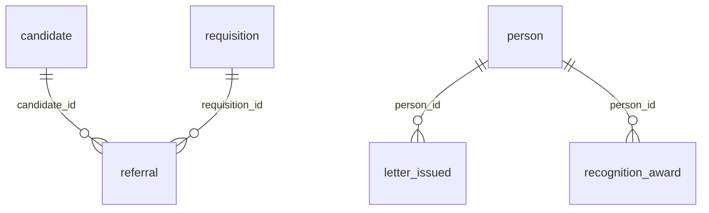

<picture>
  <source media="(prefers-color-scheme: dark)" srcset="../../assets/MultipliersKraftLogoDark.png">
  
</picture>

# FRS-EXP-05 — Experience — Data Model

| Attribute | Value |
| :--- | :--- |
| Document ID | FRS-EXP-05 |
| Title | Experience — Data Model |
| Product | Nucleus Suite (Nucleus HRMS Suite) |
| Version | 1.0.0 |
| Status | Issued for approval |
| Owner (role) | Domain Product Owner — Experience |
| Author | Dhanraj Dadhich |
| Reviewed by | *pending* |
| Approved by | Product Council — *pending* |
| Date | 2026-11-05 |
| Classification | Internal |
| CMMI practice areas | TS, RDM |
| Related documents | FRS-EXP-00, FRS-EXP-01, FRS-EXP-02, FRS-EXP-03, FRS-EXP-04, FRS-EXP-05, FRS-EXP-06, FRS-EXP-07, FRS-EXP-08, FRS-EXP-09, FRS-EXP-10, FRS-EXP-11, FRS-EXP-12, FRS-EXP-13, BRS-01, SRS-01, REQ-01, REQ-02 |
| Quality & process-performance objectives | QPPO-05 (effective requirements reviews), QPPO-01 (escaped defects) — MPM-01 |
| Process performance baseline used | PPB-01 (review defect density), PPB-02 (review rate) — MPM-01 |
| Peer review record | *pending* (PR-xxxx, QA-02) |
| Tailoring record | none |
| Traceability anchor | BG-05 · R-19, R-20, R-21, R-22 · processes EXP-01–EXP-03 |
| Source of record | Nucleus — Process Flows & Process Maps v1.0 — sheet(s) 06_Data_Dictionary Nucleus HR Demo Points Build Sheet v1.0 — sheet(s) 06_Enum_Values Nucleus HRMS Demo Dataset v1.1 — sheet(s) 65_Enum_Seed_Values |

> **Source of record.** Requirements in this document are taken from the source workbook(s) named above and keep their workbook IDs, which are never renumbered. Changes are made through a change request (CM-02) against the source workbook. Sections marked **Authored** are original additions that are not present in the source workbooks.

Every object carries the platform envelope (`tenant_id`, `entity_id`), effective dating (`effective_from`, `effective_to`) where temporal, and audit columns. Sensitivity classes follow GOV-10.

## 1. Entity relationships

Relationships are derived from the identifier fields in the data dictionary; the tenant envelope is omitted for legibility.

## 2. Data objects

| Object | Fields | Type | Required | Owner / source | Temporal | Sensitivity | Notes | Dataset ref |
| :--- | :--- | :--- | :--- | :--- | :--- | :--- | :--- | :--- |
| recognition_programme | programme_id, name, cadence, award_amount_default, audience_rule | mixed | N | HR | Yes | — |  | 30_Recognition_Referral |
| recognition_award | award_id, programme_id, person_id, period, cited_by, citation, award_amount, status, pay_in_run_id, announcement_ref | mixed | N | HR | No | — | Monetary component raises a payroll input. | 30_Recognition_Referral |
| referral | referral_id, referrer_id, candidate_id, requisition_id, stage, award_amount, part_paid_amount, award_status, pay_in_run_id | mixed | N | System | No | — | Part on joining, balance on confirmation, paid through payroll. | 30_Recognition_Referral |
| announcement | announcement_id, type, title, body, audience_rule, channels[], publish_from, publish_to, source_event, created_by, status | mixed | N | HR/System | No | — | A broadcast with an audience rule — distinct from the activity feed, which is a log. | 31_Announcements |
| letter_template | template_id, type, version, effective_from, body, merge_fields[], approval_required | mixed | Y | HR | Yes | — |  | 32_Letter_Templates |
| letter_issued | issue_id, template_id, template_version, person_id, issued_by, issued_at, file_ref | mixed | N | HR | No | Personal | Retaining the template version is what makes a reprint two years later defensible. | 32_Letter_Templates |

### Additional objects and attributes (Authored)

| Object | Fields | Type | Required | Owner / source | Temporal | Sensitivity | Notes | Defined in |
| :--- | :--- | :--- | :--- | :--- | :--- | :--- | :--- | :--- |
| esign_envelope | envelope_ref, issue_id, revision, template_id, template_version, document_sha256, signers[], signature_method(OTP_ESIGN\|AADHAAR_ESIGN\|DSC), expires_at, status(SENT\|VIEWED\|SIGNED\|DECLINED\|EXPIRED\|COMPLETED), signed_file_ref, audit_certificate_ref, completed_at | mixed | N | System / Provider (evidence) | No | Personal | envelope_ref = issue_id + revision; signed artefact kept with the template version; becomes Restricted when the letter carries compensation. | ICD-01 §14 |
| authorised_signatory | legal_entity_id, person_id, document_types[], allowed_signature_methods[], effective_from, effective_to | mixed | Y | HR | Yes | — | Only methods approved for the document type are offered (EXP-INT-001.04). | ICD-01 §14.2 |
| letter_issued | revision, signature_status | mixed | N | HR | No | Personal | A re-issue after DECLINED or EXPIRED creates a new revision. | ICD-01 §14.1, §14.4 |

## 3. Enumerations

_No entries in source for this scope._

### Enumeration seed values and tenant defaults

_No entries in source for this scope._

## Approval & Sign-off

| Role | Name | Date | Decision | Conditions / comments |
| :--- | :--- | :--- | :--- | :--- |
| Author | Dhanraj Dadhich | 2026-11-05 | Submitted | |
| Peer review moderator | *pending* | | | PR-xxxx |
| PQA (process compliance) | *pending* | | | |
| Approval authority (DOC-01 §7) | *pending* | | | |

## Measurement Data Captured

| Measure | Value | Unit | Notes |
| :--- | :--- | :--- | :--- |
| Size | 9 | specified items (table rows) | Counted automatically at generation |
| Authoring effort | *to be recorded* | person-hours | |
| Review effort (preparation + meeting) | *pending review* | person-hours | From PR-xxxx |
| Rework effort | *pending review* | person-hours | |
| Review rate | *pending review* | items / hour | Compare with PPB control limits |
| Requirement volatility (changes since baseline) | 0 | CRs touching this artefact | Not yet baselined (CM-03) |

**Defects found, by detection phase and severity**

| Detection phase | Major | Minor | Editorial | Injected in phase (major) |
| :--- | :--- | :--- | :--- | :--- |
| Author self-check | 0 | 0 | 0 | — |
| Peer review | *pending* | | | |
| Design / build | | | | |
| System / integration test | | | | |
| UAT | | | | |
| Production (escaped) | | | | each escaped major opens a CAR record (CAR-01) |

Within control limits of the review-rate PPB? *To be assessed at peer review.*

## Revision History

| Version | Date | Author | Change summary | CR ref | Approved by |
| :--- | :--- | :--- | :--- | :--- | :--- |
| 1.0.0 | 2026-11-05 | Dhanraj Dadhich | Consolidated release | CR-0001 | *pending* |
