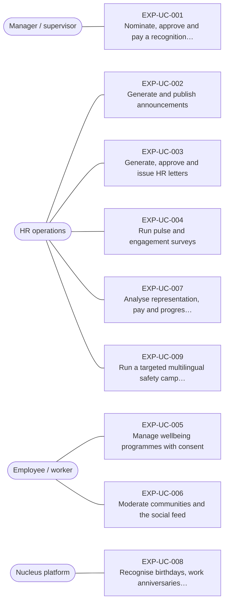
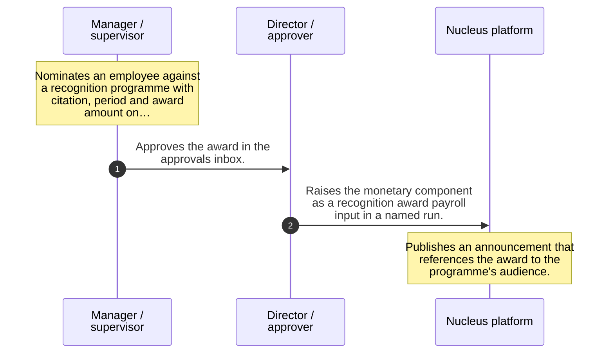
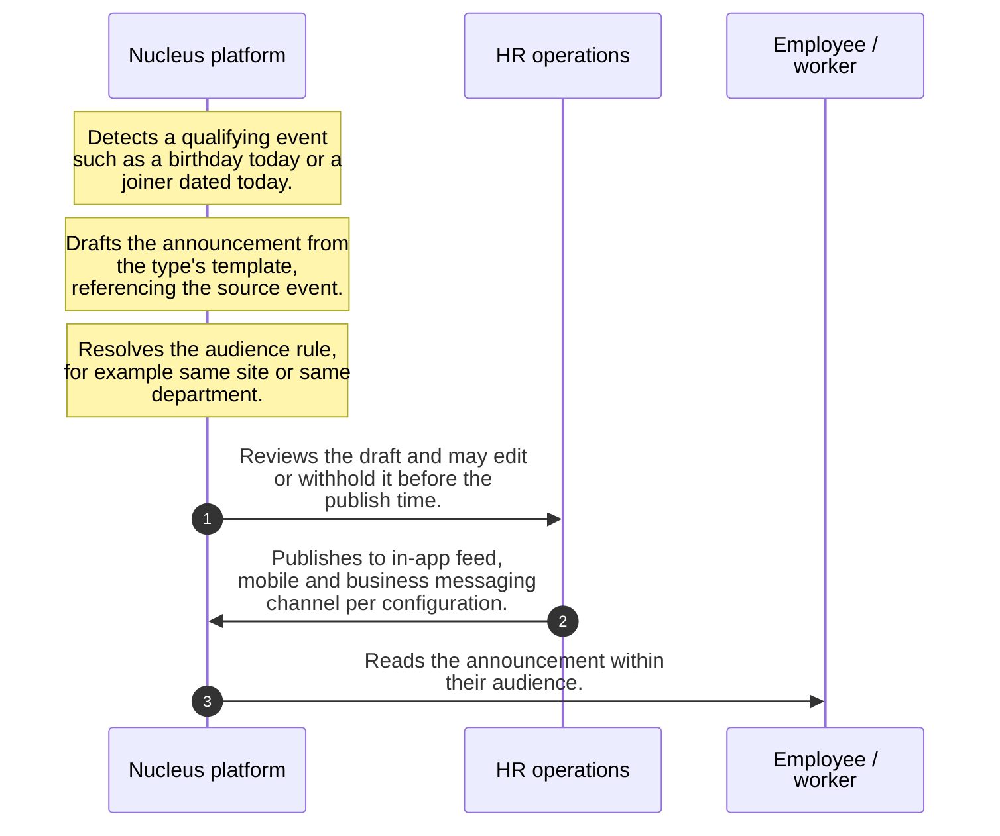
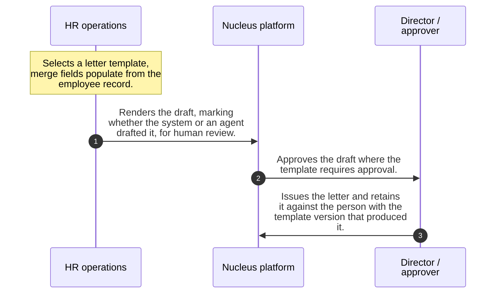
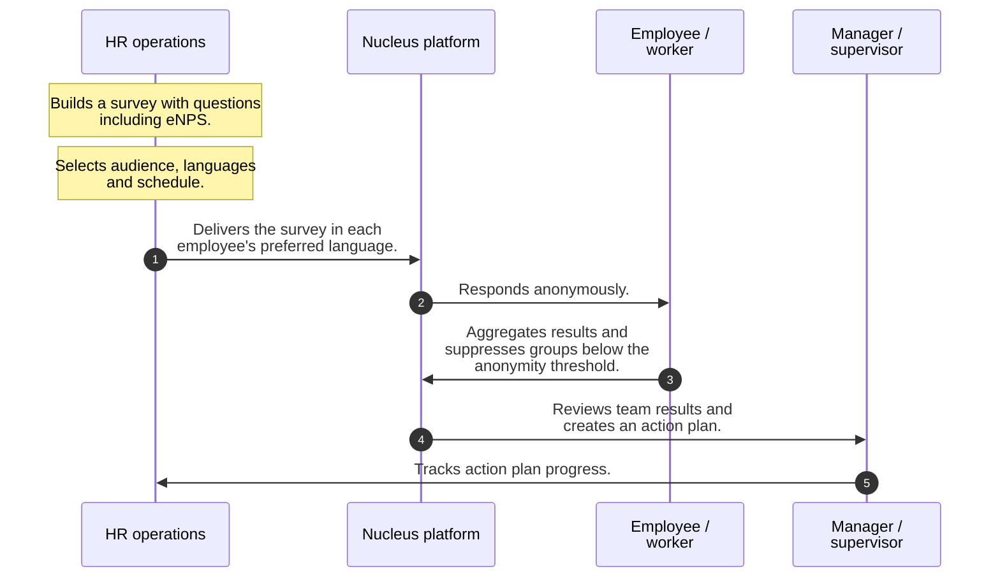
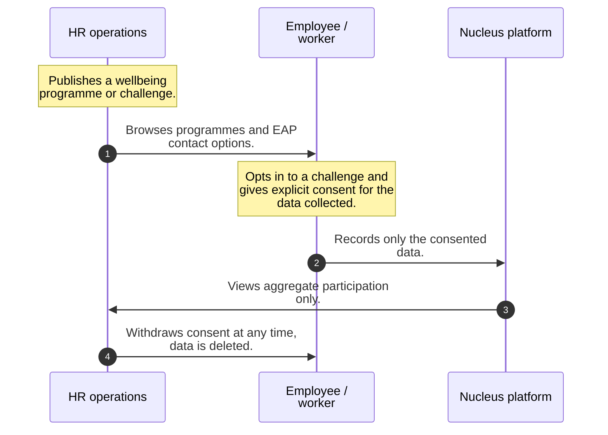
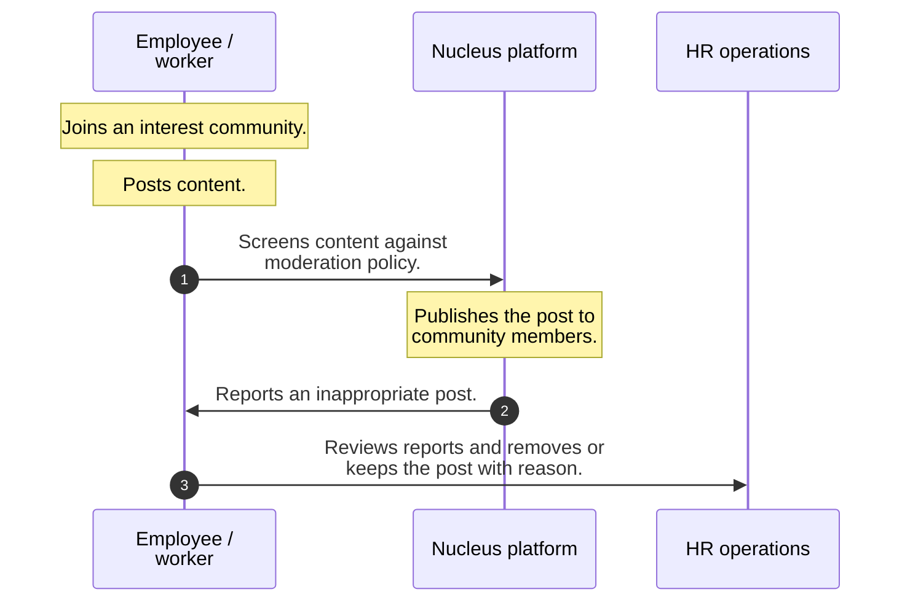
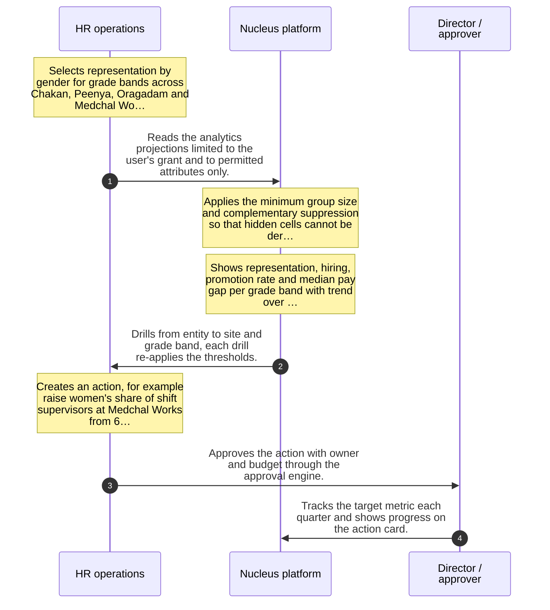
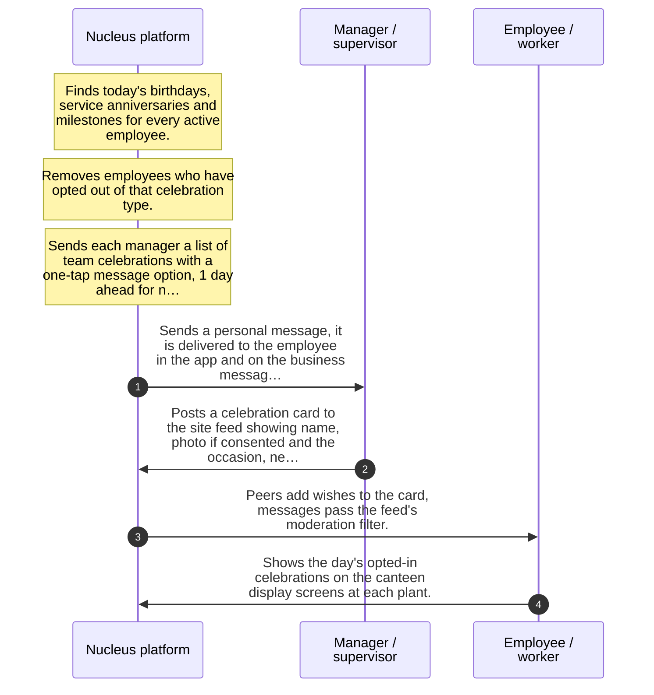
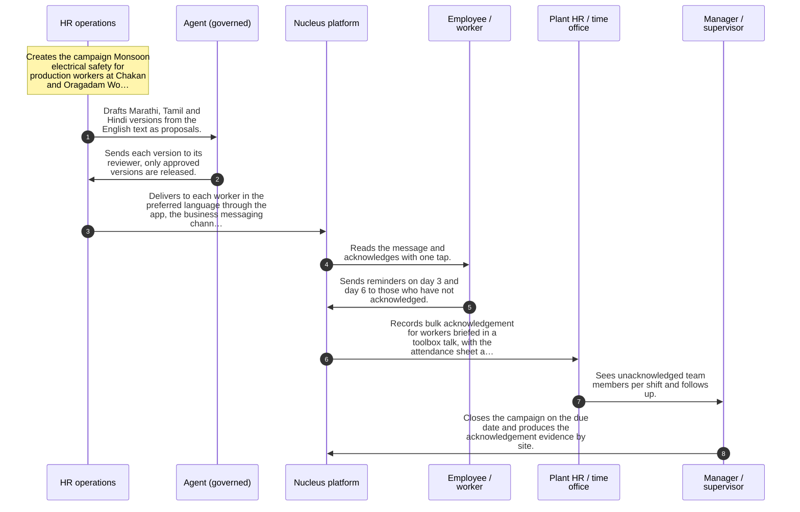

<picture>
  <source media="(prefers-color-scheme: dark)" srcset="../../assets/MultipliersKraftLogoDark.png">
  
</picture>

# FRS-EXP-12 — Experience — Use Case Specifications

| Attribute | Value |
| :--- | :--- |
| Document ID | FRS-EXP-12 |
| Title | Experience — Use Case Specifications |
| Product | Nucleus Suite (Nucleus HRMS Suite) |
| Version | 1.0.0 |
| Status | Issued for approval |
| Owner (role) | Domain Product Owner — Experience |
| Author | Dhanraj Dadhich |
| Reviewed by | *pending* |
| Approved by | Product Council — *pending* |
| Date | 2026-11-05 |
| Classification | Internal |
| CMMI practice areas | RDM, VV |
| Related documents | FRS-EXP-00, FRS-EXP-01, FRS-EXP-02, FRS-EXP-03, FRS-EXP-04, FRS-EXP-05, FRS-EXP-06, FRS-EXP-07, FRS-EXP-08, FRS-EXP-09, FRS-EXP-10, FRS-EXP-11, FRS-EXP-12, FRS-EXP-13, BRS-01, SRS-01, REQ-01, REQ-02 |
| Quality & process-performance objectives | QPPO-05 (effective requirements reviews), QPPO-01 (escaped defects) — MPM-01 |
| Process performance baseline used | PPB-01 (review defect density), PPB-02 (review rate) — MPM-01 |
| Peer review record | *pending* (PR-xxxx, QA-02) |
| Tailoring record | none |
| Traceability anchor | BG-05 · R-19, R-20, R-21, R-22 · processes EXP-01–EXP-03 |
| Source of record | Nucleus — Process Flows & Process Maps v1.0 — sheet(s) 03_Process_Inventory, 04_Process_Steps, 07_Screens, 09_Business_Rules Authored use cases (marked per use case) |

> **Source of record.** Requirements in this document are taken from the source workbook(s) named above and keep their workbook IDs, which are never renumbered. Changes are made through a change request (CM-02) against the source workbook. Sections marked **Authored** are original additions that are not present in the source workbooks.

This document specifies 9 use cases for Experience: 2 follow the step-level flows of the source workbook and 7 are authored (processes without step-level detail in the source, and capability gaps). User stories derived from each use case are in FRS-EXP-13.

## 1. Use case index

| ID | Use case | Primary actor | Realises | Source | Phase | Criticality |
| :--- | :--- | :--- | :--- | :--- | :--- | :--- |
| [EXP-UC-001](#exp-uc-001) | Nominate, approve and pay a recognition award | Manager / supervisor | EXP-01 | Source workbook | P2 | Medium |
| [EXP-UC-002](#exp-uc-002) | Generate and publish announcements | HR operations | EXP-02 | Authored | P2 | Low |
| [EXP-UC-003](#exp-uc-003) | Generate, approve and issue HR letters | HR operations | EXP-03 | Source workbook | P2 | Medium |
| [EXP-UC-004](#exp-uc-004) | Run pulse and engagement surveys | HR operations | EXP-CG-001 | Authored | P3 | High |
| [EXP-UC-005](#exp-uc-005) | Manage wellbeing programmes with consent | Employee / worker | EXP-CG-002 | Authored | P3 | Medium |
| [EXP-UC-006](#exp-uc-006) | Moderate communities and the social feed | Employee / worker | EXP-CG-003 | Authored | P4 | Low |
| [EXP-UC-007](#exp-uc-007) | Analyse representation, pay and progression with privacy thresholds and track actions | HR operations | EXP-CG-004 | Authored | P3 | High |
| [EXP-UC-008](#exp-uc-008) | Recognise birthdays, work anniversaries and milestones automatically | Nucleus platform | EXP-CG-005 | Authored | P2 | Low |
| [EXP-UC-009](#exp-uc-009) | Run a targeted multilingual safety campaign with acknowledgement tracking | HR operations | EXP-CG-006 | Authored | P2 | Medium |

## 2. Use case diagrams

## 3. Use case specifications

### EXP-UC-001

**Nominate, approve and pay a recognition award** — Nominate an employee under a recognition programme, approve the award, pay any monetary part through payroll and announce it.

| Attribute | Value |
| :--- | :--- |
| Realises | EXP-01 |
| Source | Source workbook |
| Level | User goal |
| Primary actor | Manager / supervisor |
| Secondary actors | HR operations, Director / approver, Nucleus platform, Payroll manager, Employee / worker |
| Trigger | A recognition programme cycle opens, such as star employee of the month. |
| Frequency | Monthly |
| Criticality | Medium |
| Phase | P2 |
| Client requirements | R-19 |
| Business rules | RL-010, RL-472, RL-490, RL-491, RL-492 |
| Screens | SCR-065, SCR-040, SCR-066 |
| Data objects (CRUD) | recognition_award (C, U), payroll_input (C), announcement (C) |
| Events | experience.recognition.nominated, platform.approval.completed, payroll.input.raised, experience.announcement.published |
| Acceptance tests | TC-E490, TC-E491, TC-E492, TC-R472, T-33 |
| System requirements | SYS-020, SYS-028, SYS-037, SYS-053, SYS-070 |

**Stakeholders and interests**

| Stakeholder | Interest |
| :--- | :--- |
| Employee / worker | Recognition is visible and any cash award is paid correctly. |
| Payroll manager | Monetary awards arrive as payroll inputs, never side payments. |
| HR operations | Star employee selection flows into the announcement without retyping. |

**Preconditions**

- Recognition programme with period, criteria and optional award amount is configured.
- Approval chain for recognition is configured.

**Main success scenario**

| # | Actor | Action | Ref |
| ---: | :--- | :--- | :--- |
| 1 | Manager / supervisor | Nominates an employee against a recognition programme with citation, period and award amount on the recognition screen. | EXP-01.1 |
| 2 | Director / approver | Approves the award in the approvals inbox. | EXP-01.2 |
| 3 | Nucleus platform | Raises the monetary component as a recognition award payroll input in a named run. | EXP-01.3 |
| 4 | Nucleus platform | Publishes an announcement that references the award to the programme's audience. | EXP-01.4 |

**Alternate flows**

| ID | At step | Condition | Steps | Rejoins |
| :--- | ---: | :--- | :--- | :--- |
| A1 | 3 | Award has no monetary component. | No payroll input is raised. | Returns to step 4 |
| A2 | 4 | HR applies an editorial override before publish. | HR edits the announcement text or withholds publication with a reason. | Ends |

**Exception flows**

| ID | At step | Condition | Handling | Rule |
| :--- | ---: | :--- | :--- | :--- |
| E1 | 1 | Nomination lacks citation or period. | Nomination cannot be submitted. | RL-490 |
| E2 | 3 | Someone attempts to record the cash award as a payment outside payroll. | No such path exists; the award is payable only via a payroll input. | RL-491 |
| E3 | 2 | Approver rejects the nomination. | Nominator is informed with the comment; no input or announcement is produced. | RL-010 |

**Postconditions — success**

- Award is approved with citation and period.
- Monetary part is a payroll input in a named run.
- Announcement referencing the award is published.

**Postconditions — failure**

- Rejected nomination creates no payroll input and no announcement.

**Quality requirements**

- Announcement published within 5 minutes of approval.
- Award certificate shows period and criteria.

### EXP-UC-002

**Generate and publish announcements** — Generate announcements from lifecycle and recognition events or manual input, apply audience rules and channels, and allow editorial override before publish.

| Attribute | Value |
| :--- | :--- |
| Realises | EXP-02 |
| Source | Authored |
| Level | User goal |
| Primary actor | HR operations |
| Secondary actors | Nucleus platform, Employee / worker, Business messaging channel |
| Trigger | A lifecycle event (birthday, new joiner, award, referral) occurs or HR creates a manual message. |
| Frequency | Daily |
| Criticality | Low |
| Phase | P2 |
| Client requirements | R-21 |
| Business rules | RL-397, RL-492 |
| Screens | SCR-066 |
| Data objects (CRUD) | announcement (C, U) |
| Events | — |
| Acceptance tests | TC-X397, TC-E492, T-35 |
| System requirements | SYS-017, SYS-053, SYS-066, SYS-070 |

**Stakeholders and interests**

| Stakeholder | Interest |
| :--- | :--- |
| Employee / worker | Receives relevant announcements in their language and channel. |
| HR operations | Routine announcements raise themselves. |

**Preconditions**

- Announcement types with audience rules and channels are configured.

**Main success scenario**

| # | Actor | Action | Ref |
| ---: | :--- | :--- | :--- |
| 1 | Nucleus platform | Detects a qualifying event such as a birthday today or a joiner dated today. |  |
| 2 | Nucleus platform | Drafts the announcement from the type's template, referencing the source event. |  |
| 3 | Nucleus platform | Resolves the audience rule, for example same site or same department. |  |
| 4 | HR operations | Reviews the draft and may edit or withhold it before the publish time. |  |
| 5 | Nucleus platform | Publishes to in-app feed, mobile and business messaging channel per configuration. |  |
| 6 | Employee / worker | Reads the announcement within their audience. |  |

**Alternate flows**

| ID | At step | Condition | Steps | Rejoins |
| :--- | ---: | :--- | :--- | :--- |
| A1 | 1 | HR creates a manual management message. | HR writes the message and selects audience and channels. | Returns to step 4 |

**Exception flows**

| ID | At step | Condition | Handling | Rule |
| :--- | ---: | :--- | :--- | :--- |
| E1 | 3 | Employee has opted out of birthday announcements. | No birthday announcement is generated for that employee. | RL-397 |
| E2 | 5 | Delivery to a channel fails. | Failure is logged and retried; in-app delivery is unaffected. |  |

**Postconditions — success**

- Announcement is published to the resolved audience on chosen channels.

**Postconditions — failure**

- Withheld announcements are recorded with reason.

**Quality requirements**

- Announcements visible only within the resolved audience.

### EXP-UC-003

**Generate, approve and issue HR letters** — Produce HR letters from versioned templates, ensure human review, approve where required and issue with the template version retained.

| Attribute | Value |
| :--- | :--- |
| Realises | EXP-03 |
| Source | Source workbook |
| Level | User goal |
| Primary actor | HR operations |
| Secondary actors | Nucleus platform, Director / approver, Agent (governed), Employee / worker |
| Trigger | A lifecycle event needs a letter, such as appointment, confirmation or revision. |
| Frequency | Weekly |
| Criticality | Medium |
| Phase | P2 |
| Client requirements | R-22 |
| Business rules | RL-010, RL-500, RL-501, RL-502 |
| Screens | SCR-067, SCR-040 |
| Data objects (CRUD) | letter_template (R), letter_draft (C, U), letter_issued (C) |
| Events | platform.approval.completed, experience.letter.issued |
| Acceptance tests | TC-E500, TC-E501, TC-E502, T-36 |
| System requirements | SYS-026, SYS-032, SYS-035, SYS-037, SYS-074 |

**Stakeholders and interests**

| Stakeholder | Interest |
| :--- | :--- |
| Employee / worker | Receives correct letters. |
| Auditor | Any reprint reproduces exactly what was issued. |
| HR operations | Letters are produced quickly without retyping. |

**Preconditions**

- Templates are versioned and validated.

**Main success scenario**

| # | Actor | Action | Ref |
| ---: | :--- | :--- | :--- |
| 1 | HR operations | Selects a letter template; merge fields populate from the employee record. | EXP-03.1 |
| 2 | Nucleus platform | Renders the draft, marking whether the system or an agent drafted it, for human review. | EXP-03.2 |
| 3 | Director / approver | Approves the draft where the template requires approval. | EXP-03.3 |
| 4 | Nucleus platform | Issues the letter and retains it against the person with the template version that produced it. | EXP-03.4 |

**Alternate flows**

| ID | At step | Condition | Steps | Rejoins |
| :--- | ---: | :--- | :--- | :--- |
| A1 | 3 | Template does not require approval. | Draft proceeds to issue after HR review. | Returns to step 4 |
| A2 | 4 | HR reprints a previously issued letter. | Platform reproduces the letter from the retained version. | Ends |

**Exception flows**

| ID | At step | Condition | Handling | Rule |
| :--- | ---: | :--- | :--- | :--- |
| E1 | 1 | Template references a non-existent merge field. | Template fails validation on save, not at issue. | RL-500 |
| E2 | 2 | Attempt to issue an agent-drafted letter without human review. | Issue is refused until a human reviews it. | RL-501 |

**Postconditions — success**

- Issued letter is stored with template version, issuer and file reference.

**Postconditions — failure**

- Unreviewed drafts are never issued.

**Quality requirements**

- Reprint reproduces byte-identical content to the original issue.

### EXP-UC-004

**Run pulse and engagement surveys** — Run pulse and engagement surveys including eNPS with anonymity thresholds, multilingual delivery and action planning.

| Attribute | Value |
| :--- | :--- |
| Realises | EXP-CG-001 |
| Source | Authored |
| Level | User goal |
| Primary actor | HR operations |
| Secondary actors | Employee / worker, Manager / supervisor, Nucleus platform |
| Trigger | HR schedules a survey. |
| Frequency | Quarterly |
| Criticality | High |
| Phase | P3 |
| Client requirements | — |
| Business rules | — |
| Screens | — |
| Data objects (CRUD) | survey (C), survey_response (C), action_plan (C) |
| Events | — |
| Acceptance tests | EXP-TC-001, EXP-TC-002, EXP-TC-003, EXP-TC-004 |
| System requirements | SYS-017, SYS-066, SYS-069, SYS-070 |

**Stakeholders and interests**

| Stakeholder | Interest |
| :--- | :--- |
| Employee / worker | Answers are anonymous. |
| Manager / supervisor | Gets actionable team results. |

**Preconditions**

- Anonymity threshold is configured.

**Main success scenario**

| # | Actor | Action | Ref |
| ---: | :--- | :--- | :--- |
| 1 | HR operations | Builds a survey with questions including eNPS. |  |
| 2 | HR operations | Selects audience, languages and schedule. |  |
| 3 | Nucleus platform | Delivers the survey in each employee's preferred language. |  |
| 4 | Employee / worker | Responds anonymously. |  |
| 5 | Nucleus platform | Aggregates results and suppresses groups below the anonymity threshold. |  |
| 6 | Manager / supervisor | Reviews team results and creates an action plan. |  |
| 7 | HR operations | Tracks action plan progress. |  |

**Alternate flows**

| ID | At step | Condition | Steps | Rejoins |
| :--- | ---: | :--- | :--- | :--- |
| A1 | 3 | Employee lacks app access. | Survey link is sent through the business messaging channel. | Returns to step 4 |

**Exception flows**

| ID | At step | Condition | Handling | Rule |
| :--- | ---: | :--- | :--- | :--- |
| E1 | 5 | Team has fewer respondents than the threshold. | Results are rolled up to the next level. |  |

**Postconditions — success**

- Results are available above the threshold and action plans are tracked.

**Postconditions — failure**

- Results below the threshold are suppressed.

**Quality requirements**

- Responses are not linkable to respondents by any role.

### EXP-UC-005

**Manage wellbeing programmes with consent** — Manage wellbeing programmes, EAP access and opt-in challenges without storing health data beyond explicit consent.

| Attribute | Value |
| :--- | :--- |
| Realises | EXP-CG-002 |
| Source | Authored |
| Level | User goal |
| Primary actor | Employee / worker |
| Secondary actors | HR operations, Nucleus platform |
| Trigger | HR launches a programme or an employee seeks support. |
| Frequency | Monthly |
| Criticality | Medium |
| Phase | P3 |
| Client requirements | — |
| Business rules | — |
| Screens | — |
| Data objects (CRUD) | wellbeing_participation (C, D), consent_record (C) |
| Events | — |
| Acceptance tests | EXP-TC-005, EXP-TC-006, EXP-TC-007, EXP-TC-008 |
| System requirements | SYS-017, SYS-019, SYS-027, SYS-032 |

**Stakeholders and interests**

| Stakeholder | Interest |
| :--- | :--- |
| Employee / worker | Health data stays private. |
| HR operations | Programme participation is measurable in aggregate. |

**Preconditions**

- Programmes and consent text are configured.

**Main success scenario**

| # | Actor | Action | Ref |
| ---: | :--- | :--- | :--- |
| 1 | HR operations | Publishes a wellbeing programme or challenge. |  |
| 2 | Employee / worker | Browses programmes and EAP contact options. |  |
| 3 | Employee / worker | Opts in to a challenge and gives explicit consent for the data collected. |  |
| 4 | Nucleus platform | Records only the consented data. |  |
| 5 | HR operations | Views aggregate participation only. |  |
| 6 | Employee / worker | Withdraws consent at any time; data is deleted. |  |

**Alternate flows**

| ID | At step | Condition | Steps | Rejoins |
| :--- | ---: | :--- | :--- | :--- |
| A1 | 2 | Employee accesses EAP. | Contact details are shown; no access record is stored. | Ends |

**Exception flows**

| ID | At step | Condition | Handling | Rule |
| :--- | ---: | :--- | :--- | :--- |
| E1 | 3 | Consent not given. | Employee cannot join the challenge. |  |

**Postconditions — success**

- Participation recorded with consent.

**Postconditions — failure**

- No data stored without consent.

**Quality requirements**

- No individual wellbeing signal is visible to managers.

### EXP-UC-006

**Moderate communities and the social feed** — Provide moderated communities and a social feed for announcements, recognition and interest groups.

| Attribute | Value |
| :--- | :--- |
| Realises | EXP-CG-003 |
| Source | Authored |
| Level | User goal |
| Primary actor | Employee / worker |
| Secondary actors | HR operations, Nucleus platform |
| Trigger | Employee posts or joins a community. |
| Frequency | Daily |
| Criticality | Low |
| Phase | P4 |
| Client requirements | — |
| Business rules | — |
| Screens | — |
| Data objects (CRUD) | community (C), post (C, U) |
| Events | — |
| Acceptance tests | EXP-TC-009, EXP-TC-010, EXP-TC-011, EXP-TC-012 |
| System requirements | SYS-017, SYS-032, SYS-036, SYS-070 |

**Stakeholders and interests**

| Stakeholder | Interest |
| :--- | :--- |
| Employee / worker | Connects with colleagues. |
| HR operations | Content stays appropriate. |

**Preconditions**

- Moderation policy is configured.

**Main success scenario**

| # | Actor | Action | Ref |
| ---: | :--- | :--- | :--- |
| 1 | Employee / worker | Joins an interest community. |  |
| 2 | Employee / worker | Posts content. |  |
| 3 | Nucleus platform | Screens content against moderation policy. |  |
| 4 | Nucleus platform | Publishes the post to community members. |  |
| 5 | Employee / worker | Reports an inappropriate post. |  |
| 6 | HR operations | Reviews reports and removes or keeps the post with reason. |  |

**Alternate flows**

| ID | At step | Condition | Steps | Rejoins |
| :--- | ---: | :--- | :--- | :--- |
| A1 | 3 | Content is flagged by screening. | Post is held for moderator review. | Returns to step 6 |

**Exception flows**

| ID | At step | Condition | Handling | Rule |
| :--- | ---: | :--- | :--- | :--- |
| E1 | 6 | Post violates policy. | Post is removed and the author notified with reason. |  |

**Postconditions — success**

- Approved posts are visible to the community.

**Postconditions — failure**

- Removed posts are hidden with reason recorded.

**Quality requirements**

- Reported posts reviewed within 24 hours.

### EXP-UC-007

**Analyse representation, pay and progression with privacy thresholds and track actions** — Give authorised HR users diversity, equity and inclusion metrics by permitted attributes, protected by minimum group sizes, and track the actions taken in response.

| Attribute | Value |
| :--- | :--- |
| Realises | EXP-CG-004 |
| Source | Authored |
| Level | User goal |
| Primary actor | HR operations |
| Secondary actors | Director / approver, Manager / supervisor, Auditor, Tenant admin, Nucleus platform |
| Trigger | HR operations opens the inclusion analytics workspace or a quarterly review pack is generated. |
| Frequency | Quarterly |
| Criticality | High |
| Phase | P3 |
| Client requirements | — |
| Business rules | — |
| Screens | — |
| Data objects (CRUD) | people_projection (R), compensation_projection (R), inclusion_metric (C), inclusion_action (C, U), suppression_log (C) |
| Events | report.exported, platform.approval.completed |
| Acceptance tests | EXP-TC-013, EXP-TC-014, EXP-TC-015, EXP-TC-016, EXP-TC-017, EXP-TC-018 |
| System requirements | SYS-017, SYS-019, SYS-024, SYS-033, SYS-037 |

**Stakeholders and interests**

| Stakeholder | Interest |
| :--- | :--- |
| Employee / worker | Self-declared attributes are used only for permitted aggregate analysis and never identify an individual. |
| Director / approver | Sees credible trends across sites and commits owners to measurable actions. |
| Tenant admin | Controls which attributes are permitted and who may analyse them. |
| Auditor | Can verify that suppression rules were applied to every published figure. |

**Preconditions**

- Permitted attributes such as gender, age band and self-declared disability are configured by the tenant admin, with consent recorded where required under the DPDP Act 2023 (to be validated by Legal).
- The minimum group size is configured, for example 10 people per reported cell.
- People, compensation and promotion analytics projections are refreshed within the last 24 hours.

**Main success scenario**

| # | Actor | Action | Ref |
| ---: | :--- | :--- | :--- |
| 1 | HR operations | Selects representation by gender for grade bands across Chakan, Peenya, Oragadam and Medchal Works and the Pune office. |  |
| 2 | Nucleus platform | Reads the analytics projections limited to the user's grant and to permitted attributes only. |  |
| 3 | Nucleus platform | Applies the minimum group size and complementary suppression so that hidden cells cannot be derived from totals. |  |
| 4 | Nucleus platform | Shows representation, hiring, promotion rate and median pay gap per grade band with trend over 8 quarters. |  |
| 5 | HR operations | Drills from entity to site and grade band; each drill re-applies the thresholds. |  |
| 6 | HR operations | Creates an action, for example raise women's share of shift supervisors at Medchal Works from 6% to 12% by 2027-12-31. |  |
| 7 | Director / approver | Approves the action with owner and budget through the approval engine. |  |
| 8 | Nucleus platform | Tracks the target metric each quarter and shows progress on the action card. |  |

**Alternate flows**

| ID | At step | Condition | Steps | Rejoins |
| :--- | ---: | :--- | :--- | :--- |
| A1 | 1 | A manager opens inclusion metrics for their own team. | Platform shows only metrics where the team meets the minimum group size; otherwise it shows the site-level figure. | Returns to step 4 |

**Exception flows**

| ID | At step | Condition | Handling | Rule |
| :--- | ---: | :--- | :--- | :--- |
| E1 | 3 | A cell has 7 people against a minimum of 10. | The cell is suppressed and one further cell is suppressed so the value cannot be derived from the total. |  |
| E2 | 1 | The user tries to select an attribute not permitted by the tenant. | The attribute is not offered and the attempt is recorded. |  |
| E3 | 5 | A filter combination would identify one person. | The query returns a suppression notice and no figure. |  |

**Postconditions — success**

- Published metrics show only cells meeting the minimum group size, with suppression shown explicitly.
- Each action has an owner, target metric, due date and status, reviewed each quarter.

**Postconditions — failure**

- A query that would expose a small group returns a suppression notice rather than a figure.

**Quality requirements**

- No export, chart or agent response bypasses the minimum group size.
- Every figure records the projection version so a quarter's pack can be reproduced.

### EXP-UC-008

**Recognise birthdays, work anniversaries and milestones automatically** — Detect celebrations each day, prompt managers and peers to send messages, and publish them only for employees who have not opted out.

| Attribute | Value |
| :--- | :--- |
| Realises | EXP-CG-005 |
| Source | Authored |
| Level | Subfunction |
| Primary actor | Nucleus platform |
| Secondary actors | Manager / supervisor, Employee / worker, HR operations |
| Trigger | The daily celebrations job runs at 06:00 IST. |
| Frequency | Daily |
| Criticality | Low |
| Phase | P2 |
| Client requirements | — |
| Business rules | RL-397 |
| Screens | SCR-066 |
| Data objects (CRUD) | celebration_preference (R), celebration_event (C), feed_post (C), celebration_message (C) |
| Events | experience.announcement.published |
| Acceptance tests | EXP-TC-019, EXP-TC-020, EXP-TC-021, EXP-TC-022 |
| System requirements | SYS-017, SYS-050, SYS-053, SYS-070 |

**Stakeholders and interests**

| Stakeholder | Interest |
| :--- | :--- |
| Employee / worker | Is celebrated without having to tell anyone, and can opt out of any or all celebrations. |
| Manager / supervisor | Is reminded in time to wish team members, including those on night shifts. |
| HR operations | Builds a culture of recognition across five sites with no manual tracking. |

**Preconditions**

- Dates of birth, joining dates and milestone definitions such as probation confirmation and service years 1, 5, 10 and 20 are configured.
- Each employee's celebration preferences are recorded, defaulting to the tenant setting.

**Main success scenario**

| # | Actor | Action | Ref |
| ---: | :--- | :--- | :--- |
| 1 | Nucleus platform | Finds today's birthdays, service anniversaries and milestones for every active employee. |  |
| 2 | Nucleus platform | Removes employees who have opted out of that celebration type. |  |
| 3 | Nucleus platform | Sends each manager a list of team celebrations with a one-tap message option, 1 day ahead for night-shift staff. |  |
| 4 | Manager / supervisor | Sends a personal message; it is delivered to the employee in the app and on the business messaging channel if opted in. |  |
| 5 | Nucleus platform | Posts a celebration card to the site feed showing name, photo if consented and the occasion, never the age or year of birth. |  |
| 6 | Employee / worker | Peers add wishes to the card; messages pass the feed's moderation filter. |  |
| 7 | Nucleus platform | Shows the day's opted-in celebrations on the canteen display screens at each plant. |  |

**Alternate flows**

| ID | At step | Condition | Steps | Rejoins |
| :--- | ---: | :--- | :--- | :--- |
| A1 | 5 | The anniversary is 10 or more years. | Platform also notifies HR to arrange the long-service award. | Returns to step 6 |

**Exception flows**

| ID | At step | Condition | Handling | Rule |
| :--- | ---: | :--- | :--- | :--- |
| E1 | 2 | The employee has opted out of birthday announcements. | No birthday card or manager prompt is generated for that employee. | RL-397 |
| E2 | 6 | A peer message fails moderation. | It is held for HR review and not shown on the card. |  |
| E3 | 1 | The date of birth is missing. | No birthday is generated and no date is assumed. |  |

**Postconditions — success**

- Celebrations for opted-in employees are published to the feed and site screens, and managers have been prompted.

**Postconditions — failure**

- No celebration is produced for an employee who has opted out.

**Quality requirements**

- The daily job completes for 3,000 employees within 2 minutes.
- An opt-out takes effect from the next daily run.

### EXP-UC-009

**Run a targeted multilingual safety campaign with acknowledgement tracking** — Deliver a policy or safety communication to a targeted audience in their languages across channels and track acknowledgement to completion.

| Attribute | Value |
| :--- | :--- |
| Realises | EXP-CG-006 |
| Source | Authored |
| Level | User goal |
| Primary actor | HR operations |
| Secondary actors | Agent (governed), Manager / supervisor, Plant HR / time office, Employee / worker, Compliance owner, Nucleus platform, Business messaging channel |
| Trigger | HR operations launches a campaign, for example monsoon electrical safety for production workers. |
| Frequency | Weekly |
| Criticality | Medium |
| Phase | P2 |
| Client requirements | — |
| Business rules | — |
| Screens | SCR-066 |
| Data objects (CRUD) | campaign (C), campaign_audience (C), campaign_translation (C, U), acknowledgement (C), toolbox_talk_record (C) |
| Events | experience.announcement.published |
| Acceptance tests | EXP-TC-023, EXP-TC-024, EXP-TC-025, EXP-TC-026 |
| System requirements | SYS-066, SYS-070, SYS-071, SYS-074, SYS-076 |

**Stakeholders and interests**

| Stakeholder | Interest |
| :--- | :--- |
| Employee / worker | Receives safety instructions in a language they read, on a channel they use. |
| Plant HR / time office | Knows which workers on each shift have not yet acknowledged. |
| Compliance owner | Has acknowledgement evidence for each site. |

**Preconditions**

- The audience can be defined by site, department, shift and worker type.
- Reviewers are named for each campaign language.
- Channel opt-ins for the business messaging channel are recorded.

**Main success scenario**

| # | Actor | Action | Ref |
| ---: | :--- | :--- | :--- |
| 1 | HR operations | Creates the campaign Monsoon electrical safety for production workers at Chakan and Oragadam Works, due in 7 days. |  |
| 2 | Agent (governed) | Drafts Marathi, Tamil and Hindi versions from the English text as proposals. |  |
| 3 | HR operations | Sends each version to its reviewer; only approved versions are released. |  |
| 4 | Nucleus platform | Delivers to each worker in the preferred language through the app, the business messaging channel if opted in and the kiosk. |  |
| 5 | Employee / worker | Reads the message and acknowledges with one tap. |  |
| 6 | Nucleus platform | Sends reminders on day 3 and day 6 to those who have not acknowledged. |  |
| 7 | Plant HR / time office | Records bulk acknowledgement for workers briefed in a toolbox talk, with the attendance sheet attached. |  |
| 8 | Manager / supervisor | Sees unacknowledged team members per shift and follows up. |  |
| 9 | Nucleus platform | Closes the campaign on the due date and produces the acknowledgement evidence by site. |  |

**Alternate flows**

| ID | At step | Condition | Steps | Rejoins |
| :--- | ---: | :--- | :--- | :--- |
| A1 | 4 | The campaign is a policy update that also needs a quiz. | Platform attaches a 3-question check and records acknowledgement only on a passing answer. | Returns to step 6 |

**Exception flows**

| ID | At step | Condition | Handling | Rule |
| :--- | ---: | :--- | :--- | :--- |
| E1 | 3 | A language version is not approved by launch time. | Recipients of that language receive the Hindi version with a notice that their language follows. |  |
| E2 | 4 | A worker has no app, no messaging opt-in and no kiosk use in 30 days. | The worker is listed for supervisor briefing. |  |
| E3 | 9 | Recipients remain unacknowledged at the due date. | They are escalated to their supervisors and Plant HR with the list. |  |

**Postconditions — success**

- Each recipient's acknowledgement status, channel and timestamp is recorded and exportable as site evidence.

**Postconditions — failure**

- Recipients not reached by the due date are escalated to their supervisors.

**Quality requirements**

- Delivery to 2,500 recipients across channels completes within 10 minutes.
- Acknowledgement evidence is retained for the period set by the compliance retention policy.

## Approval & Sign-off

| Role | Name | Date | Decision | Conditions / comments |
| :--- | :--- | :--- | :--- | :--- |
| Author | Dhanraj Dadhich | 2026-11-05 | Submitted | |
| Peer review moderator | *pending* | | | PR-xxxx |
| PQA (process compliance) | *pending* | | | |
| Approval authority (DOC-01 §7) | *pending* | | | |

## Measurement Data Captured

| Measure | Value | Unit | Notes |
| :--- | :--- | :--- | :--- |
| Size | 264 | specified items (table rows) | Counted automatically at generation |
| Authoring effort | *to be recorded* | person-hours | |
| Review effort (preparation + meeting) | *pending review* | person-hours | From PR-xxxx |
| Rework effort | *pending review* | person-hours | |
| Review rate | *pending review* | items / hour | Compare with PPB control limits |
| Requirement volatility (changes since baseline) | 0 | CRs touching this artefact | Not yet baselined (CM-03) |

**Defects found, by detection phase and severity**

| Detection phase | Major | Minor | Editorial | Injected in phase (major) |
| :--- | :--- | :--- | :--- | :--- |
| Author self-check | 0 | 0 | 0 | — |
| Peer review | *pending* | | | |
| Design / build | | | | |
| System / integration test | | | | |
| UAT | | | | |
| Production (escaped) | | | | each escaped major opens a CAR record (CAR-01) |

Within control limits of the review-rate PPB? *To be assessed at peer review.*

## Revision History

| Version | Date | Author | Change summary | CR ref | Approved by |
| :--- | :--- | :--- | :--- | :--- | :--- |
| 1.0.0 | 2026-11-05 | Dhanraj Dadhich | Consolidated release | CR-0001 | *pending* |
