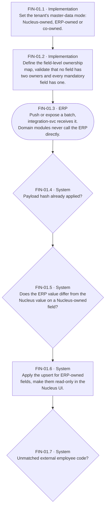
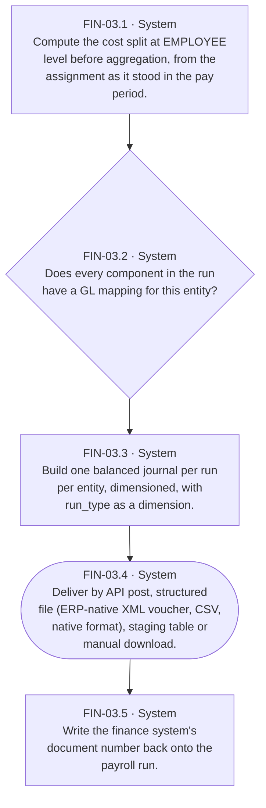
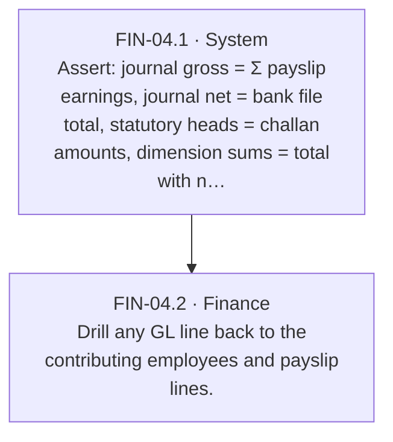
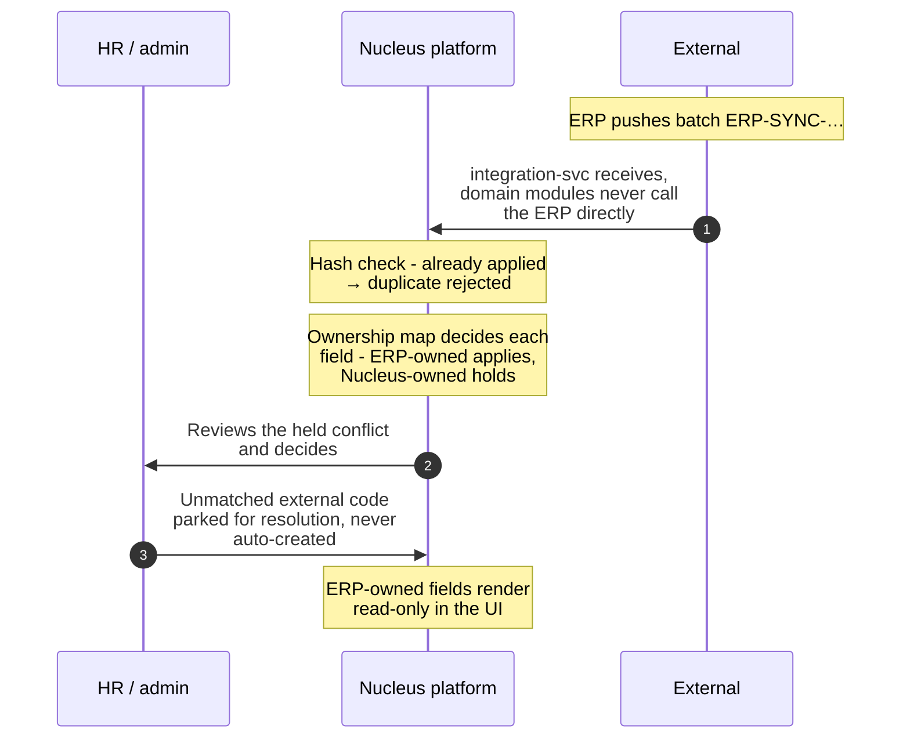

<picture>
  <source media="(prefers-color-scheme: dark)" srcset="../../assets/MultipliersKraftLogoDark.png">
  
</picture>

# FRS-FIN-01 — Finance & ERP — Process Specifications

| Attribute | Value |
| :--- | :--- |
| Document ID | FRS-FIN-01 |
| Title | Finance & ERP — Process Specifications |
| Product | Nucleus Suite (Nucleus HRMS Suite) |
| Version | 1.0.0 |
| Status | Issued for approval |
| Owner (role) | Domain Product Owner — Finance & ERP |
| Author | Dhanraj Dadhich |
| Reviewed by | *pending* |
| Approved by | Product Council — *pending* |
| Date | 2026-11-05 |
| Classification | Internal |
| CMMI practice areas | RDM, TS |
| Related documents | FRS-FIN-00, FRS-FIN-01, FRS-FIN-02, FRS-FIN-03, FRS-FIN-04, FRS-FIN-05, FRS-FIN-06, FRS-FIN-07, FRS-FIN-08, FRS-FIN-09, FRS-FIN-10, FRS-FIN-11, FRS-FIN-12, FRS-FIN-13, BRS-01, SRS-01, REQ-01, REQ-02 |
| Quality & process-performance objectives | QPPO-05 (effective requirements reviews), QPPO-01 (escaped defects) — MPM-01 |
| Process performance baseline used | PPB-01 (review defect density), PPB-02 (review rate) — MPM-01 |
| Peer review record | *pending* (PR-xxxx, QA-02) |
| Tailoring record | none |
| Traceability anchor | BG-07 · R-15, R-16 · processes FIN-01–FIN-05 |
| Source of record | Nucleus — Process Flows & Process Maps v1.0 — sheet(s) 03_Process_Inventory, 04_Process_Steps, 05_Swimlane_Maps Nucleus HR Demo Points Build Sheet v1.0 — sheet(s) 07_Approval_Workflows Nucleus HRMS Demo Dataset v1.1 — sheet(s) 64_Approval_Workflows |

> **Source of record.** Requirements in this document are taken from the source workbook(s) named above and keep their workbook IDs, which are never renumbered. Changes are made through a change request (CM-02) against the source workbook. Sections marked **Authored** are original additions that are not present in the source workbooks.

Step types: TASK (human) · SYS (system, unattended) · DEC (decision) · APPR (approval gate) · INT (integration call) · WAIT (timer or external event) · AGENT (agent-executed, governed). CRUD: C create · R read · U update · D delete-by-end-dating (temporal facts are never hard-deleted). In the flow diagrams decisions are diamonds, approvals are double-bordered boxes and integration, wait and agent steps are rounded.

## 1. Process inventory

| Process ID | Process | Trigger | Primary actor | Frequency | Criticality | Blueprint module | Phase | Reuses | Demo pts | Note |
| :--- | :--- | :--- | :--- | :--- | :--- | :--- | :--- | :--- | :--- | :--- |
| FIN-01 | ERP employee master inbound sync | Scheduled batch or webhook | System | Nightly | Critical | Blueprint §9.2 | P1 | CMP-07, CMP-10 | 14 | Three ownership modes; co-owned is the common answer. Never implicit last-write-wins. |
| FIN-02 | GL mapping maintenance and validation | New component or account | Implementation / Finance | Occasional | Critical | Blueprint §9.1 | P1 | CMP-10 | 15 | Unmapped component blocks the run reaching APPROVED. |
| FIN-03 | Salary journal generation and posting | Run approved | System | Per run | Critical | Blueprint §9.1 | P1 | CMP-03 | 15 | Dimensioned at employee level BEFORE aggregation. One journal per run per entity. |
| FIN-04 | Reconciliation reporting | Post-posting | Finance | Per run | Critical | Blueprint §9.4 | P1 | CMP-08 | 15 | A product screen, not a support script. |
| FIN-05 | Bank file generation and dual control | Run approved | Finance | Per run | Critical | Module 3 | P1 | CMP-05 |  | Out-of-band total verification; alert on bank-detail change inside a payroll window. |

## 2. Step-level specifications

### FIN-01 — ERP employee master inbound sync

**Trigger:** Scheduled batch or webhook · **Primary actor:** System · **Frequency:** Nightly · **Criticality:** Critical · **Phase:** P1 · **Reuses:** CMP-07, CMP-10

| Step | Step ID | Lane / actor | Type | Action or decision | Rule ID(s) | Objects touched (CRUD) | Key fields | Screen | Event emitted | Exception / note | Reuses | Demo pts | Phase |
| :--- | :--- | :--- | :--- | :--- | :--- | :--- | :--- | :--- | :--- | :--- | :--- | :--- | :--- |
| 1 | FIN-01.1 | Implementation | TASK | Set the tenant's master-data mode: Nucleus-owned, ERP-owned or co-owned. | RL-510 | integration_config C | master_mode | SCR-100 |  | Co-owned is the common real answer — build for it directly. | CMP-10 | 14 | P1 |
| 2 | FIN-01.2 | Implementation | TASK | Define the field-level ownership map; validate that no field has two owners and every mandatory field has one. | RL-511 | field_ownership_map C | field, owner(ERP\|Nucleus), mandatory | SCR-100 |  | Typically ERP owns employee code, name, joining date, department, cost centre; Nucleus owns grade, worker class, shift, leave policy, manager and all time and talent data. |  | 14 | P1 |
| 3 | FIN-01.3 | ERP | INT | Push or expose a batch; integration-svc receives it. Domain modules never call the ERP directly. | RL-512 | employee_sync_log C | external_code, payload_hash, received_at | SCR-101 | integration.sync.received |  |  | 14 | P1 |
| 4 | FIN-01.4 | System | DEC | Payload hash already applied? | RL-513 | employee_sync_log R | payload_hash | — |  | Yes → reject as duplicate, idempotent on the external employee code. | CMP-07 | 14 | P1 |
| 5 | FIN-01.5 | System | DEC | Does the ERP value differ from the Nucleus value on a Nucleus-owned field? | RL-514 | field_ownership_map R | owner | SCR-101 | integration.sync.conflict | Yes → hold for review. Conflict policy is explicit configuration, NEVER implicit last-write-wins. |  | 14 | P1 |
| 6 | FIN-01.6 | System | SYS | Apply the upsert for ERP-owned fields; make them read-only in the Nucleus UI. | RL-515 | person U; assignment U | applied_at, status | SCR-101 | integration.sync.applied | Silent overwriting of an HR edit by a nightly sync is a month-two trust failure. | CMP-10 | 14 | P1 |
| 7 | FIN-01.7 | System | DEC | Unmatched external employee code? | RL-516 | employee_sync_log U | status(unmatched) | SCR-101 |  | Park for HR resolution; never auto-create a person from an unmatched code. | CMP-11 | 14 | P1 |

### FIN-02 — GL mapping maintenance and validation

**Trigger:** New component or account · **Primary actor:** Implementation / Finance · **Frequency:** Occasional · **Criticality:** Critical · **Phase:** P1 · **Reuses:** CMP-10

The source workbook specifies this process at inventory level only. Its complete flow is specified in use case FIN-UC-002 (FRS-FIN-12).

### FIN-03 — Salary journal generation and posting

**Trigger:** Run approved · **Primary actor:** System · **Frequency:** Per run · **Criticality:** Critical · **Phase:** P1 · **Reuses:** CMP-03

| Step | Step ID | Lane / actor | Type | Action or decision | Rule ID(s) | Objects touched (CRUD) | Key fields | Screen | Event emitted | Exception / note | Reuses | Demo pts | Phase |
| :--- | :--- | :--- | :--- | :--- | :--- | :--- | :--- | :--- | :--- | :--- | :--- | :--- | :--- |
| 1 | FIN-03.1 | System | SYS | Compute the cost split at EMPLOYEE level before aggregation, from the assignment as it stood in the pay period. | RL-520 | payslip_line R; assignment R (as-at) | cost_centre, department, location, project, custom dims | — |  | A lump salary figure left for finance to allocate is the commonest HRMS-to-ERP failure, and it recurs monthly. | CMP-10 | 15 | P1 |
| 2 | FIN-03.2 | System | DEC | Does every component in the run have a GL mapping for this entity? | RL-521 | gl_mapping R | component, account_code | SCR-102 | payroll.journal.blocked | No → block the run reaching APPROVED (demo point 15). |  | 15 | P1 |
| 3 | FIN-03.3 | System | SYS | Build one balanced journal per run per entity, dimensioned, with run_type as a dimension. | RL-522 | gl_journal C; gl_journal_line C | dr/cr, account, amount, dimensions, run_type | SCR-102 | payroll.journal.ready |  |  | 15 | P1 |
| 4 | FIN-03.4 | System | INT | Deliver by API post, structured file (ERP-native XML voucher, CSV, native format), staging table or manual download. | RL-523 | gl_posting_log C | mechanism, sent_at, target_system, result, external_doc_no | SCR-102 | integration.journal.posted | Whatever the mechanism, record what was sent, when, where, with what result and what reference came back. |  | 15 | P1 |
| 5 | FIN-03.5 | System | SYS | Write the finance system's document number back onto the payroll run. | RL-524 | payroll_run U | gl_posted_on, external_doc_no, run_state(POSTED_TO_GL) | SCR-050 | payroll.run.posted |  |  | 15 | P1 |

### FIN-04 — Reconciliation reporting

**Trigger:** Post-posting · **Primary actor:** Finance · **Frequency:** Per run · **Criticality:** Critical · **Phase:** P1 · **Reuses:** CMP-08

| Step | Step ID | Lane / actor | Type | Action or decision | Rule ID(s) | Objects touched (CRUD) | Key fields | Screen | Event emitted | Exception / note | Reuses | Demo pts | Phase |
| :--- | :--- | :--- | :--- | :--- | :--- | :--- | :--- | :--- | :--- | :--- | :--- | :--- | :--- |
| 1 | FIN-04.1 | System | SYS | Assert: journal gross = Σ payslip earnings; journal net = bank file total; statutory heads = challan amounts; dimension sums = total with no residue; OT in the off-cycle run = approved OT hours; loan recovery = movement in outstanding. | RL-530 | reconciliation_report C | check, expected, actual, variance, status | SCR-103 | finance.reconciliation.run | Build it as a product screen, not a support script. It closes month-end arguments before they start. | CMP-08 | 15 | P1 |
| 2 | FIN-04.2 | Finance | TASK | Drill any GL line back to the contributing employees and payslip lines. | RL-531 | gl_journal_line R; payslip_line R | drill path | SCR-103 |  |  |  | 15 | P1 |

### FIN-05 — Bank file generation and dual control

**Trigger:** Run approved · **Primary actor:** Finance · **Frequency:** Per run · **Criticality:** Critical · **Phase:** P1 · **Reuses:** CMP-05

The source workbook specifies this process at inventory level only. Its complete flow is specified in use case FIN-UC-005 (FRS-FIN-12).

## 3. Swimlane maps

### SM-8 — ERP EMPLOYEE MASTER INBOUND (demo point 14)

| Step | Employee / worker | Manager | HR / admin | System (Nucleus) | Agent | External | Note |
| :--- | :--- | :--- | :--- | :--- | :--- | :--- | :--- |
| 1 |  |  |  |  |  | ERP pushes batch ERP-SYNC-… |  |
| 2 |  |  |  | integration-svc receives; domain modules never call the ERP directly |  |  |  |
| 3 |  |  |  | Hash check: already applied → duplicate rejected |  |  | Idempotent on the external employee code |
| 4 |  |  |  | Ownership map decides each field: ERP-owned applies, Nucleus-owned holds |  |  | Never implicit last-write-wins |
| 5 |  |  | Reviews the held conflict and decides |  |  |  |  |
| 6 |  |  |  | Unmatched external code parked for resolution, never auto-created |  |  |  |
| 7 |  |  |  | ERP-owned fields render read-only in the UI |  |  |  |

## 4. Approval workflows

_No entries in source for this scope._

### Workflow behaviour

_No entries in source for this scope._

## Approval & Sign-off

| Role | Name | Date | Decision | Conditions / comments |
| :--- | :--- | :--- | :--- | :--- |
| Author | Dhanraj Dadhich | 2026-11-05 | Submitted | |
| Peer review moderator | *pending* | | | PR-xxxx |
| PQA (process compliance) | *pending* | | | |
| Approval authority (DOC-01 §7) | *pending* | | | |

## Measurement Data Captured

| Measure | Value | Unit | Notes |
| :--- | :--- | :--- | :--- |
| Size | 26 | specified items (table rows) | Counted automatically at generation |
| Authoring effort | *to be recorded* | person-hours | |
| Review effort (preparation + meeting) | *pending review* | person-hours | From PR-xxxx |
| Rework effort | *pending review* | person-hours | |
| Review rate | *pending review* | items / hour | Compare with PPB control limits |
| Requirement volatility (changes since baseline) | 0 | CRs touching this artefact | Not yet baselined (CM-03) |

**Defects found, by detection phase and severity**

| Detection phase | Major | Minor | Editorial | Injected in phase (major) |
| :--- | :--- | :--- | :--- | :--- |
| Author self-check | 0 | 0 | 0 | — |
| Peer review | *pending* | | | |
| Design / build | | | | |
| System / integration test | | | | |
| UAT | | | | |
| Production (escaped) | | | | each escaped major opens a CAR record (CAR-01) |

Within control limits of the review-rate PPB? *To be assessed at peer review.*

## Revision History

| Version | Date | Author | Change summary | CR ref | Approved by |
| :--- | :--- | :--- | :--- | :--- | :--- |
| 1.0.0 | 2026-11-05 | Dhanraj Dadhich | Consolidated release | CR-0001 | *pending* |
