

<picture>
  <source media="(prefers-color-scheme: dark)" srcset="../../assets/MultipliersKraftLogoDark.png">
  
</picture>

# FRS-FIN-12 — Finance & ERP — Use Case Specifications

| Attribute | Value |
| :--- | :--- |
| Document ID | FRS-FIN-12 |
| Title | Finance & ERP — Use Case Specifications |
| Product | Nucleus Suite (Nucleus HRMS Suite) |
| Version | 1.0.0 |
| Status | Issued for approval |
| Owner (role) | Domain Product Owner — Finance & ERP |
| Author | Dhanraj Dadhich |
| Reviewed by | *pending* |
| Approved by | Product Council — *pending* |
| Date | 2026-11-05 |
| Classification | Internal |
| CMMI practice areas | RDM, VV |
| Related documents | FRS-FIN-00, FRS-FIN-01, FRS-FIN-02, FRS-FIN-03, FRS-FIN-04, FRS-FIN-05, FRS-FIN-06, FRS-FIN-07, FRS-FIN-08, FRS-FIN-09, FRS-FIN-10, FRS-FIN-11, FRS-FIN-12, FRS-FIN-13, BRS-01, SRS-01, REQ-01, REQ-02 |
| Quality & process-performance objectives | QPPO-05 (effective requirements reviews), QPPO-01 (escaped defects) — MPM-01 |
| Process performance baseline used | PPB-01 (review defect density), PPB-02 (review rate) — MPM-01 |
| Peer review record | *pending* (PR-xxxx, QA-02) |
| Tailoring record | none |
| Traceability anchor | BG-07 · R-15, R-16 · processes FIN-01–FIN-05 |
| Source of record | Nucleus — Process Flows & Process Maps v1.0 — sheet(s) 03_Process_Inventory, 04_Process_Steps, 07_Screens, 09_Business_Rules Authored use cases (marked per use case) |

> **Source of record.** Requirements in this document are taken from the source workbook(s) named above and keep their workbook IDs, which are never renumbered. Changes are made through a change request (CM-02) against the source workbook. Sections marked **Authored** are original additions that are not present in the source workbooks.

This document specifies 10 use cases for Finance & ERP: 3 follow the step-level flows of the source workbook and 7 are authored (processes without step-level detail in the source, and capability gaps). User stories derived from each use case are in FRS-FIN-13.

## 1. Use case index

| ID | Use case | Primary actor | Realises | Source | Phase | Criticality |
| :--- | :--- | :--- | :--- | :--- | :--- | :--- |
| [FIN-UC-001](#fin-uc-001) | Synchronise the employee master from the ERP system | Nucleus platform | FIN-01 | Source workbook | P1 | Critical |
| [FIN-UC-002](#fin-uc-002) | Maintain and validate the GL mapping | Finance | FIN-02 | Authored | P1 | Critical |
| [FIN-UC-003](#fin-uc-003) | Generate and post the salary journal to the ERP system | Nucleus platform | FIN-03 | Source workbook | P1 | Critical |
| [FIN-UC-004](#fin-uc-004) | Reconcile payroll to the general ledger, bank and statutory payments | Finance | FIN-04 | Source workbook | P1 | Critical |
| [FIN-UC-005](#fin-uc-005) | Generate and release the bank file under dual control | Finance | FIN-05 | Authored | P1 | Critical |
| [FIN-UC-006](#fin-uc-006) | Allocate labour cost to projects and grants | Finance | FIN-CG-001 | Authored | P2 | High |
| [FIN-UC-007](#fin-uc-007) | Accrue leave encashment and gratuity liabilities | Nucleus platform | FIN-CG-002 | Authored | P3 | Medium |
| [FIN-UC-008](#fin-uc-008) | Compare workforce budget with actuals | Finance | FIN-CG-003 | Authored | P3 | Medium |
| [FIN-UC-009](#fin-uc-009) | Request travel, claim expenses and settle the advance | Employee / worker | FIN-CG-004 | Authored | P3 | High |
| [FIN-UC-010](#fin-uc-010) | Account for employer statutory contributions, benefit costs and liabilities | Finance | FIN-CG-005 | Authored | P2 | High |

## 2. Use case diagrams

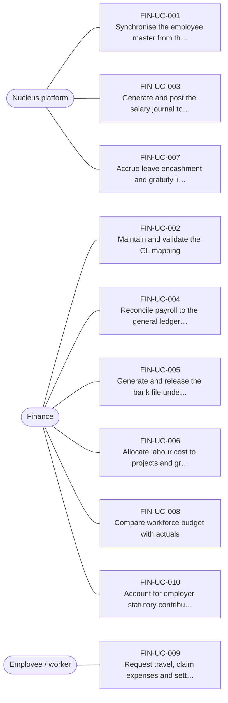

## 3. Use case specifications

### FIN-UC-001

**Synchronise the employee master from the ERP system** — Apply ERP employee master changes to Nucleus under an explicit field-ownership map, never silently overwriting Nucleus-owned data.

| Attribute | Value |
| :--- | :--- |
| Realises | FIN-01 |
| Source | Source workbook |
| Level | User goal |
| Primary actor | Nucleus platform |
| Secondary actors | Implementation consultant, ERP system, HR operations |
| Trigger | A scheduled nightly batch runs or the ERP system pushes a change. |
| Frequency | Nightly |
| Criticality | Critical |
| Phase | P1 |
| Client requirements | R-15 |
| Business rules | RL-510, RL-511, RL-512, RL-513, RL-514, RL-515, RL-516 |
| Screens | SCR-100, SCR-101 |
| Data objects (CRUD) | integration_config (C), field_ownership_map (C), employee_sync_log (C/U), person (U), assignment (U) |
| Events | integration.sync.received, integration.sync.conflict, integration.sync.applied |
| Acceptance tests | TC-F510, TC-F511, TC-F512, TC-F513, TC-F514, TC-F515, TC-F516, T-28 |
| System requirements | SYS-022, SYS-032, SYS-053, SYS-055, SYS-084 |

**Stakeholders and interests**

| Stakeholder | Interest |
| :--- | :--- |
| HR operations | HR edits to Nucleus-owned fields are never overwritten by a nightly sync. |
| Finance | Cost centre and department match the ERP for posting. |
| Auditor | Every applied, held, rejected and parked row is logged. |

**Preconditions**

- The tenant's master-data mode and field ownership map are configured and validated.
- The integration service has valid credentials for the ERP system.

**Main success scenario**

| # | Actor | Action | Ref |
| ---: | :--- | :--- | :--- |
| 1 | Implementation consultant | Sets the tenant's master-data mode on SCR-100: Nucleus-owned, ERP-owned or co-owned. | FIN-01.1 |
| 2 | Implementation consultant | Defines the field ownership map and validates that no field has two owners and every mandatory field has one. | FIN-01.2 |
| 3 | ERP system | Pushes or exposes a batch; the integration service receives and logs it. Domain modules never call the ERP directly. | FIN-01.3 |
| 4 | Nucleus platform | Checks each row's payload hash against rows already applied; new hashes proceed. | FIN-01.4 |
| 5 | Nucleus platform | Compares ERP values with Nucleus values on Nucleus-owned fields; where none differ the row proceeds. | FIN-01.5 |
| 6 | Nucleus platform | Applies the upsert for ERP-owned fields and keeps those fields read-only in the Nucleus UI. | FIN-01.6 |
| 7 | Nucleus platform | Checks for an unmatched external employee code; matched rows complete and are shown as applied on SCR-101. | FIN-01.7 |

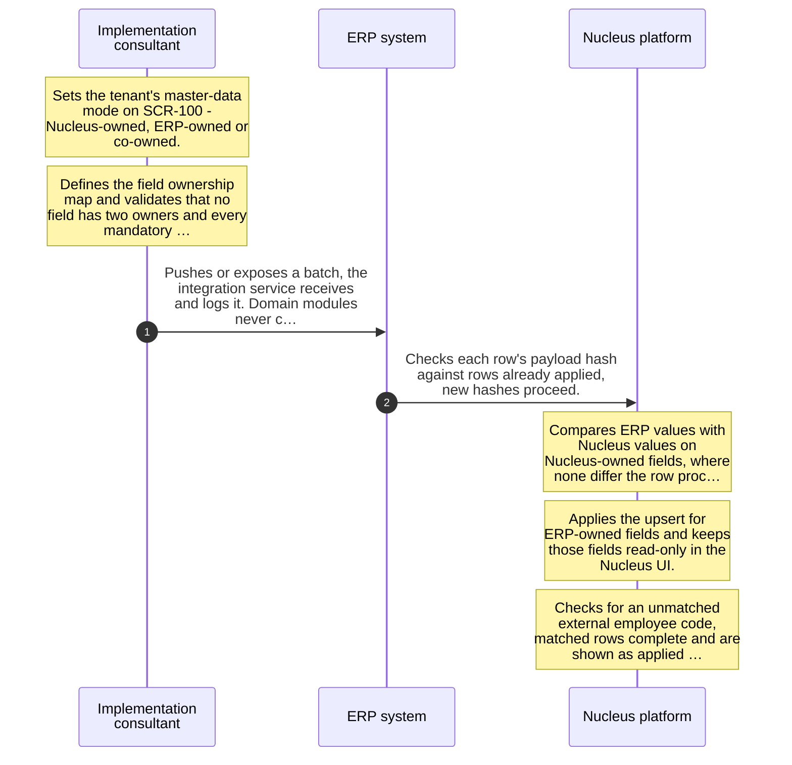

**Alternate flows**

| ID | At step | Condition | Steps | Rejoins |
| :--- | ---: | :--- | :--- | :--- |
| A1 | 5 | An ERP value differs from the Nucleus value on a Nucleus-owned field. | Platform holds the row for review and emits integration.sync.conflict. → HR operations resolves it on SCR-101 under the configured conflict policy. | Returns to step 6 |
| A2 | 1 | The tenant chooses ERP-owned mode. | Every master field is mapped to the ERP and is read-only in Nucleus. | Returns to step 3 |

**Exception flows**

| ID | At step | Condition | Handling | Rule |
| :--- | ---: | :--- | :--- | :--- |
| E1 | 2 | A field is mapped to both owners or a mandatory field has no owner. | The map cannot be saved; the offending fields are listed. | RL-511 |
| E2 | 4 | The payload hash has already been applied. | The row is rejected as a duplicate and logged, keyed on the external employee code. | RL-513 |
| E3 | 7 | The external employee code does not match any person. | The row is parked for HR resolution; no person is auto-created. | RL-516 |
| E4 | 3 | A domain module attempts a direct ERP call. | The call is blocked by architecture; only the integration service may call the ERP. | RL-512 |
| E5 | 6 | A user edits an ERP-owned field in Nucleus. | The field is read-only and the edit is not possible. | RL-515 |

**Postconditions — success**

- ERP-owned field changes are applied and emitted as integration.sync.applied.
- Conflicts on Nucleus-owned fields are held for review; duplicates and unmatched codes are logged.

**Postconditions — failure**

- No record is changed for failed rows; each failure appears in the sync monitor with its reason and can be replayed.

**Quality requirements**

- A nightly batch of 5,000 rows completes within 15 minutes.
- Every row outcome is retained in the sync log for audit.
- Failed rows can be replayed individually without reprocessing the batch.

### FIN-UC-002

**Maintain and validate the GL mapping** — Keep every pay component mapped to a GL account with balancing legs and dimensions so no run is blocked at approval.

| Attribute | Value |
| :--- | :--- |
| Realises | FIN-02 |
| Source | Authored |
| Level | User goal |
| Primary actor | Finance |
| Secondary actors | Implementation consultant, Nucleus platform, Payroll manager |
| Trigger | A new pay component or GL account is introduced. |
| Frequency | Occasional |
| Criticality | Critical |
| Phase | P1 |
| Client requirements | R-16 |
| Business rules | RL-321, RL-520, RL-521, RL-522 |
| Screens | SCR-102 |
| Data objects (CRUD) | gl_mapping (C/U) |
| Events | — |
| Acceptance tests | TC-F520, TC-F521, TC-F530 |
| System requirements | SYS-020, SYS-022, SYS-026, SYS-037, SYS-051 |

**Stakeholders and interests**

| Stakeholder | Interest |
| :--- | :--- |
| Payroll manager | Runs are not blocked by missing mappings at the last minute. |
| Auditor | Mapping changes are versioned and approved. |

**Preconditions**

- The chart of accounts for each entity is available.
- Pay components are defined per entity.

**Main success scenario**

| # | Actor | Action | Ref |
| ---: | :--- | :--- | :--- |
| 1 | Nucleus platform | Lists components per entity with no effective mapping on SCR-102. |  |
| 2 | Finance | Maps each component to an account with debit or credit side and the cost-centre source and dimensions. |  |
| 3 | Nucleus platform | Validates that each mapped account exists for the entity and that every debit-only provision has a matching credit leg. |  |
| 4 | Finance | Saves the mapping as a new effective-dated version. |  |
| 5 | Implementation consultant | Reviews and approves the mapping version as the second approver. |  |
| 6 | Nucleus platform | Revalidates open draft runs and clears the mapping block where all components are now mapped. | RL-521 |

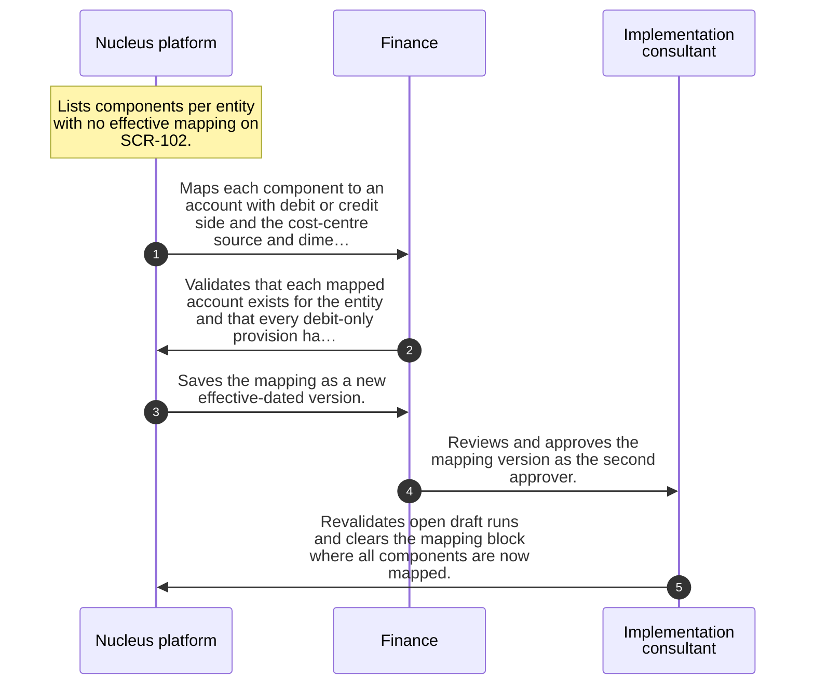

**Alternate flows**

| ID | At step | Condition | Steps | Rejoins |
| :--- | ---: | :--- | :--- | :--- |
| A1 | 2 | A component's account changes from a future date. | Finance creates a new version effective from that date; earlier periods keep the old account. | Returns to step 3 |

**Exception flows**

| ID | At step | Condition | Handling | Rule |
| :--- | ---: | :--- | :--- | :--- |
| E1 | 6 | A run still contains an unmapped component. | The run cannot reach APPROVED and the message names the component. | RL-321 |
| E2 | 3 | A provision is mapped with a debit leg only. | Validation fails and names the missing credit leg. | RL-522 |
| E3 | 5 | The same user who saved the mapping tries to approve it. | Approval is refused; a second person is required. |  |

**Postconditions — success**

- Every component in use has an effective mapping with account, debit or credit side and dimension source, and validation passes.

**Postconditions — failure**

- Unmapped or unbalanced components are listed and any run containing them cannot reach APPROVED.

**Quality requirements**

- Mapping history is retained so any past journal can be explained with the mapping effective at the time.

### FIN-UC-003

**Generate and post the salary journal to the ERP system** — Produce one balanced, employee-level dimensioned journal per run per entity, deliver it to the ERP system and write back the document number.

| Attribute | Value |
| :--- | :--- |
| Realises | FIN-03 |
| Source | Source workbook |
| Level | User goal |
| Primary actor | Nucleus platform |
| Secondary actors | ERP system, Finance, Payroll manager |
| Trigger | A payroll run is approved. |
| Frequency | Per run |
| Criticality | Critical |
| Phase | P1 |
| Client requirements | R-16 |
| Business rules | RL-321, RL-324, RL-520, RL-521, RL-522, RL-523, RL-524 |
| Screens | SCR-102, SCR-050 |
| Data objects (CRUD) | payslip_line (R), assignment (R), gl_mapping (R), gl_journal (C), gl_journal_line (C), gl_posting_log (C), payroll_run (U) |
| Events | payroll.journal.blocked, payroll.journal.ready, integration.journal.posted, payroll.run.posted |
| Acceptance tests | TC-Y321, TC-F324, TC-F520, TC-F521, TC-F522, TC-F523, TC-F524, T-29 |
| System requirements | SYS-028, SYS-050, SYS-051, SYS-053, SYS-084 |

**Stakeholders and interests**

| Stakeholder | Interest |
| :--- | :--- |
| Finance | No lump salary figure to allocate by hand each month. |
| Payroll manager | The run closes only when posting is confirmed. |
| Auditor | Each posting is traceable to what was sent and what came back. |

**Preconditions**

- Every component in the run has a GL mapping for the entity.
- The delivery mechanism for the entity is configured.

**Main success scenario**

| # | Actor | Action | Ref |
| ---: | :--- | :--- | :--- |
| 1 | Nucleus platform | Computes the cost split at employee level before aggregation, from each assignment as it stood in the pay period. | FIN-03.1 |
| 2 | Nucleus platform | Confirms every component in the run has a GL mapping for the entity. | FIN-03.2 |
| 3 | Nucleus platform | Builds one balanced journal for the run and entity, dimensioned, with run type as a dimension, and emits payroll.journal.ready. | FIN-03.3 |
| 4 | Nucleus platform | Delivers the journal by API, structured file, staging table or manual download, and records what was sent, when, where and the result. | FIN-03.4 |
| 5 | Nucleus platform | Writes the ERP document number back onto the payroll run and moves it to POSTED_TO_GL. | FIN-03.5 |

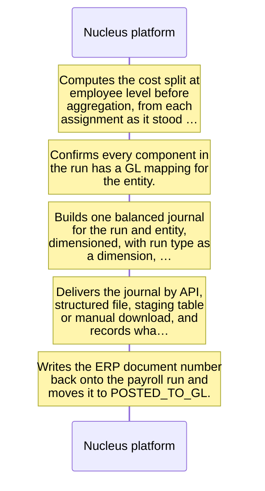

**Alternate flows**

| ID | At step | Condition | Steps | Rejoins |
| :--- | ---: | :--- | :--- | :--- |
| A1 | 4 | The entity uses a structured file or manual download. | Finance downloads the file and imports it into the ERP system. → Finance records the ERP document number on SCR-102. | Returns to step 5 |
| A2 | 3 | The period has more than one run (for example an off-cycle overtime run). | Platform builds a separate journal for each run with its run type as a dimension. | Returns to step 4 |

**Exception flows**

| ID | At step | Condition | Handling | Rule |
| :--- | ---: | :--- | :--- | :--- |
| E1 | 2 | A component has no GL mapping. | payroll.journal.blocked is emitted and the run cannot reach APPROVED; the message names the component. | RL-521 |
| E2 | 3 | Debits do not equal credits. | The journal is not released and the imbalance is shown by account. | RL-522 |
| E3 | 4 | The ERP system rejects the posting or times out. | The failure is logged and shown; a retry reuses the same journal ID so no duplicate is created. | RL-523 |
| E4 | 5 | No document number is returned. | The run stays short of POSTED_TO_GL and is flagged for Finance. | RL-524 |

**Postconditions — success**

- A balanced journal exists for the run and entity, is delivered and logged, and the run carries the ERP document number in POSTED_TO_GL.

**Postconditions — failure**

- The run is not marked POSTED_TO_GL; the failure is visible in the posting log and can be retried without creating a duplicate posting.

**Quality requirements**

- Journal for a 600-employee run is built within 60 seconds.
- Posting is idempotent on journal ID.

### FIN-UC-004

**Reconcile payroll to the general ledger, bank and statutory payments** — Prove after posting that the journal, payslips, bank file, challans, dimensions, overtime and loans all agree, with drill-down from any GL line.

| Attribute | Value |
| :--- | :--- |
| Realises | FIN-04 |
| Source | Source workbook |
| Level | User goal |
| Primary actor | Finance |
| Secondary actors | Nucleus platform, Payroll manager, Auditor |
| Trigger | A journal is posted for a run. |
| Frequency | Per run |
| Criticality | Critical |
| Phase | P1 |
| Client requirements | R-16 |
| Business rules | RL-530, RL-531 |
| Screens | SCR-103 |
| Data objects (CRUD) | reconciliation_report (C), gl_journal_line (R), payslip_line (R) |
| Events | finance.reconciliation.run |
| Acceptance tests | TC-F530, TC-F531 |
| System requirements | SYS-028, SYS-030, SYS-085, SYS-086 |

**Stakeholders and interests**

| Stakeholder | Interest |
| :--- | :--- |
| Finance | Month-end disputes are settled by the screen, not by spreadsheets. |
| Auditor | Reconciliation evidence is reproducible. |

**Preconditions**

- The run is POSTED_TO_GL and its bank file and challans exist.

**Main success scenario**

| # | Actor | Action | Ref |
| ---: | :--- | :--- | :--- |
| 1 | Nucleus platform | Runs the assertions: gross, net versus bank file, statutory heads versus challans, dimension residue, overtime and loan movement. | FIN-04.1 |
| 2 | Finance | Drills any GL line back to the contributing employees and payslip lines. | FIN-04.2 |

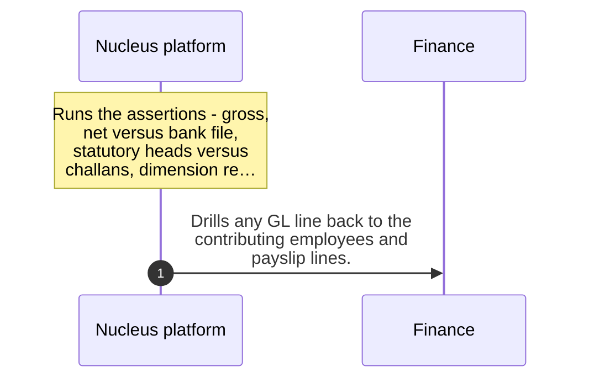

**Alternate flows**

| ID | At step | Condition | Steps | Rejoins |
| :--- | ---: | :--- | :--- | :--- |
| A1 | 2 | Finance needs evidence for audit. | Finance exports the reconciliation report with drill-through detail. | Use case ends |

**Exception flows**

| ID | At step | Condition | Handling | Rule |
| :--- | ---: | :--- | :--- | :--- |
| E1 | 1 | An assertion fails. | The check shows Fail with expected, actual and variance; the period stays open. | RL-530 |
| E2 | 1 | Dimension sums leave a residue against the total. | The residue is shown by dimension and the assertion fails. | RL-530 |
| E3 | 2 | A GL line cannot be drilled to payslip lines. | Treated as a failed drill-through assertion and flagged. | RL-531 |

**Postconditions — success**

- A reconciliation report shows all seven assertions passing; any GL line can be drilled to employees and payslip lines.

**Postconditions — failure**

- Failing assertions are shown with expected, actual and variance and the period cannot be marked reconciled.

**Quality requirements**

- Reconciliation for a 600-employee run completes within 30 seconds.
- Drill-down returns within 2 seconds.

### FIN-UC-005

**Generate and release the bank file under dual control** — Produce the salary bank file for an approved run and release it only after an independent second person verifies totals out of band.

| Attribute | Value |
| :--- | :--- |
| Realises | FIN-05 |
| Source | Authored |
| Level | User goal |
| Primary actor | Finance |
| Secondary actors | Nucleus platform, Bank, Payroll manager |
| Trigger | A payroll run is approved. |
| Frequency | Per run |
| Criticality | Critical |
| Phase | P1 |
| Client requirements | — |
| Business rules | RL-530, RL-393, RL-402 |
| Screens | SCR-055 |
| Data objects (CRUD) | bank_file (C/U), bank_acknowledgement (C) |
| Events | — |
| Acceptance tests | — |
| System requirements | SYS-020, SYS-028, SYS-033, SYS-085, SYS-088 |

**Stakeholders and interests**

| Stakeholder | Interest |
| :--- | :--- |
| Employee / worker | Salary arrives on the pay date to the right account. |
| Auditor | No single person can generate and release payments. |

**Preconditions**

- The run is APPROVED.
- Two distinct Finance users hold maker and checker roles.

**Main success scenario**

| # | Actor | Action | Ref |
| ---: | :--- | :--- | :--- |
| 1 | Finance | Generates the bank file for the run on SCR-055 in the bank's bulk payment format. |  |
| 2 | Nucleus platform | Computes record count, total and checksum and confirms the total equals the salary payable credit on the journal. | RL-530 |
| 3 | Nucleus platform | Flags any employee whose bank details changed inside the payroll window. | RL-393 |
| 4 | Finance | Submits the file for release as maker. |  |
| 5 | Finance | As checker, verifies the total and checksum out of band against the run summary and reviews flagged accounts. |  |
| 6 | Finance | Releases the file to the bank. |  |
| 7 | Bank | Returns an acknowledgement, and later any failed credits. |  |
| 8 | Nucleus platform | Records the acknowledgement and creates follow-up items for failed credits. |  |

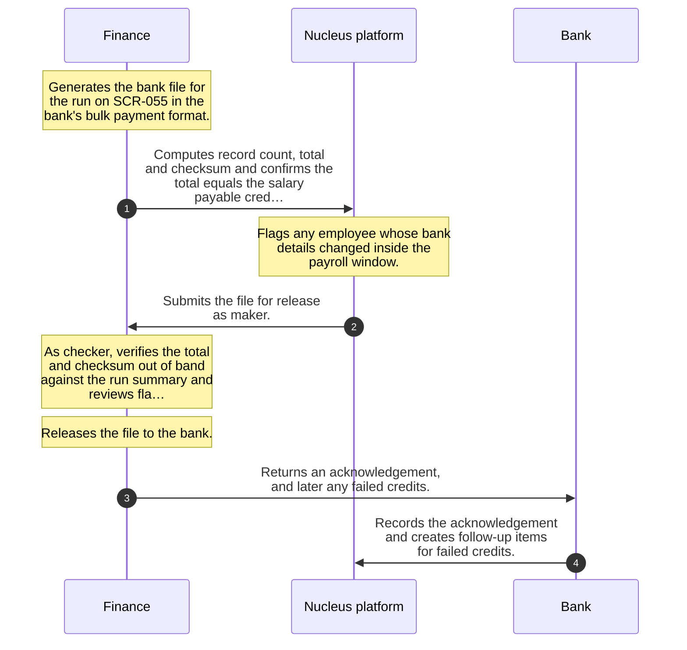

**Alternate flows**

| ID | At step | Condition | Steps | Rejoins |
| :--- | ---: | :--- | :--- | :--- |
| A1 | 7 | Some credits fail (for example closed account). | Platform lists failed credits for correction. → A follow-up payment is made after details are corrected and re-verified. | Use case ends |

**Exception flows**

| ID | At step | Condition | Handling | Rule |
| :--- | ---: | :--- | :--- | :--- |
| E1 | 2 | The file total does not equal journal net. | The file is held and the variance shown. | RL-530 |
| E2 | 5 | The checker is the same user as the maker. | Release is refused. |  |
| E3 | 1 | A settlement in the run is HELD by clearance. | That settlement is excluded from the file. | RL-402 |

**Postconditions — success**

- The bank file is released and acknowledged; its total equals journal net.

**Postconditions — failure**

- The file is held with its reason and no payment instruction is sent.

**Quality requirements**

- The bank file is stored encrypted and its download is logged.
- Checksum algorithm and format follow the bank's specification.

### FIN-UC-006

**Allocate labour cost to projects and grants** — Allocate each employee's payroll cost across cost centres, projects and grants by percentage or timesheet and carry it into the journal.

| Attribute | Value |
| :--- | :--- |
| Realises | FIN-CG-001 |
| Source | Authored |
| Level | User goal |
| Primary actor | Finance |
| Secondary actors | Nucleus platform, Manager / supervisor, Payroll manager |
| Trigger | A payroll run is computed for employees with allocation rules. |
| Frequency | Per run |
| Criticality | High |
| Phase | P2 |
| Client requirements | — |
| Business rules | RL-520, RL-522, RL-530 |
| Screens | SCR-102, SCR-103 |
| Data objects (CRUD) | allocation_rule (C/U), timesheet (R), gl_journal_line (C) |
| Events | — |
| Acceptance tests | FIN-TC-001, FIN-TC-002, FIN-TC-003, FIN-TC-004 |
| System requirements | SYS-026, SYS-028, SYS-029, SYS-037, SYS-084 |

**Stakeholders and interests**

| Stakeholder | Interest |
| :--- | :--- |
| Project owner | Projects carry their true labour cost. |
| Auditor | Grant-funded cost is evidenced by timesheet. |

**Preconditions**

- Allocation rules or approved timesheets exist for the period.

**Main success scenario**

| # | Actor | Action | Ref |
| ---: | :--- | :--- | :--- |
| 1 | Finance | Defines effective-dated allocation rules per employee by percentage across cost centres, projects and grants. |  |
| 2 | Manager / supervisor | Approves timesheets for employees allocated by time. |  |
| 3 | Nucleus platform | Computes each employee's allocation per component before aggregation. | RL-520 |
| 4 | Nucleus platform | Builds journal lines dimensioned by project and grant. | RL-522 |
| 5 | Nucleus platform | Asserts that dimension totals equal the run total with no residue. | RL-530 |
| 6 | Finance | Reviews project cost and drills to employees. |  |

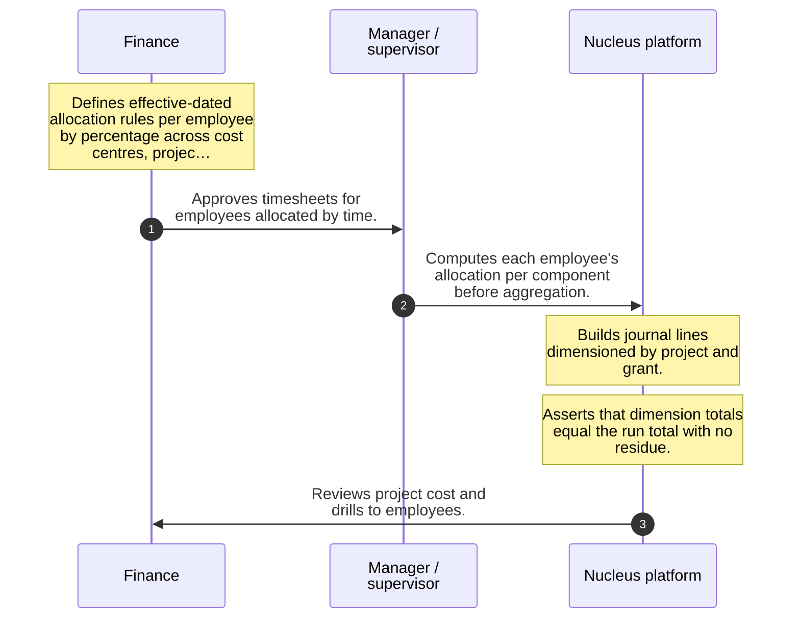

**Alternate flows**

| ID | At step | Condition | Steps | Rejoins |
| :--- | ---: | :--- | :--- | :--- |
| A1 | 1 | An employee changes projects mid-period. | Platform prorates allocation by days in each rule. | Returns to step 3 |

**Exception flows**

| ID | At step | Condition | Handling | Rule |
| :--- | ---: | :--- | :--- | :--- |
| E1 | 1 | Percentages do not sum to 100. | The rule cannot be saved. |  |
| E2 | 3 | An approved timesheet is missing. | Cost goes to the default cost centre and the employee is flagged. |  |

**Postconditions — success**

- Journal lines carry project and grant dimensions with no residue.

**Postconditions — failure**

- Unallocated cost is posted to the default cost centre and flagged.

**Quality requirements**

- Allocation adds no more than 20% to journal build time.

### FIN-UC-007

**Accrue leave encashment and gratuity liabilities** — Compute monthly accruals for leave encashment and gratuity liabilities and post them to the GL with balancing entries.

| Attribute | Value |
| :--- | :--- |
| Realises | FIN-CG-002 |
| Source | Authored |
| Level | Subfunction |
| Primary actor | Nucleus platform |
| Secondary actors | Finance, ERP system |
| Trigger | Month end after the regular payroll run is approved. |
| Frequency | Monthly |
| Criticality | Medium |
| Phase | P3 |
| Client requirements | — |
| Business rules | RL-522, RL-523 |
| Screens | SCR-102 |
| Data objects (CRUD) | liability_accrual (C), gl_journal (C) |
| Events | — |
| Acceptance tests | FIN-TC-005, FIN-TC-006, FIN-TC-007, FIN-TC-008 |
| System requirements | SYS-028, SYS-037, SYS-045, SYS-047, SYS-049, SYS-084 |

**Stakeholders and interests**

| Stakeholder | Interest |
| :--- | :--- |
| Finance | Liabilities in the books match employee entitlements. |
| Auditor | Accruals reconcile to the annual valuation (to be validated by Legal). |

**Preconditions**

- Leave balances and wage bases are final for the month.
- Provision and payable accounts are mapped with both legs.

**Main success scenario**

| # | Actor | Action | Ref |
| ---: | :--- | :--- | :--- |
| 1 | Nucleus platform | Computes leave encashment liability per employee as encashable balance times daily wage base. |  |
| 2 | Nucleus platform | Computes gratuity liability per employee as 15/26 of last drawn Basic plus DA times completed years (to be validated by Legal). |  |
| 3 | Nucleus platform | Computes the movement against the prior month's closing liability. |  |
| 4 | Nucleus platform | Builds a balanced accrual journal debiting provisions and crediting payables. | RL-522 |
| 5 | Finance | Reviews and approves the accrual journal. |  |
| 6 | Nucleus platform | Posts the journal to the ERP system and records the document number. | RL-523 |

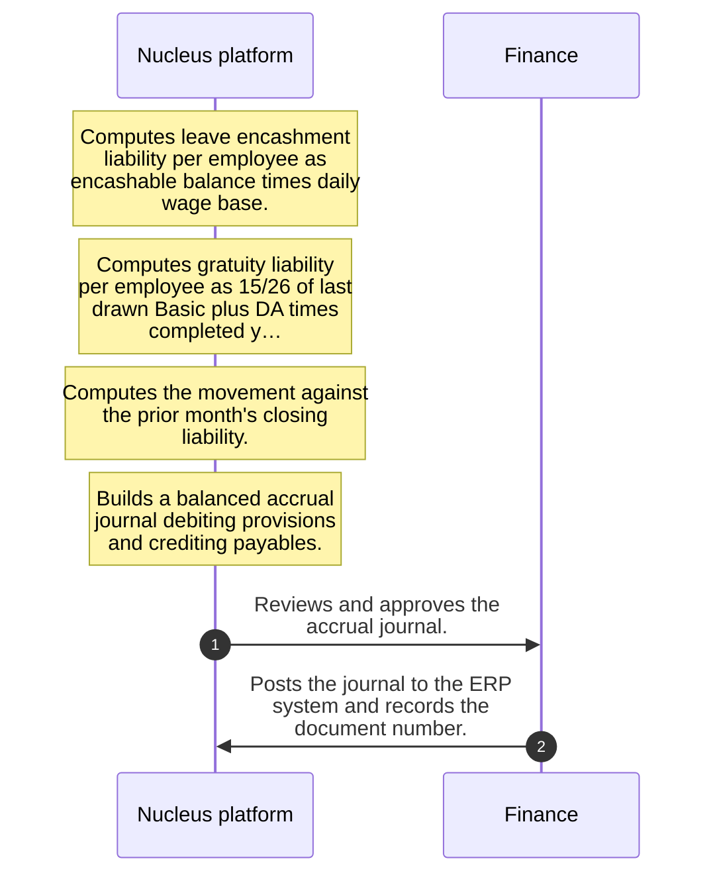

**Alternate flows**

| ID | At step | Condition | Steps | Rejoins |
| :--- | ---: | :--- | :--- | :--- |
| A1 | 2 | An actuarial valuation figure is supplied for the year. | Finance enters the valuation and the platform posts a true-up entry. | Returns to step 4 |

**Exception flows**

| ID | At step | Condition | Handling | Rule |
| :--- | ---: | :--- | :--- | :--- |
| E1 | 4 | A provision has no credit leg mapped. | The journal is not built and the missing account is named. | RL-522 |

**Postconditions — success**

- An accrual journal is posted with movement from the prior month and per-employee detail.

**Postconditions — failure**

- The accrual journal is not posted and the reason is shown.

**Quality requirements**

- Accrual for 600 employees completes within 2 minutes.

### FIN-UC-008

**Compare workforce budget with actuals** — Show budgeted versus actual headcount and cost by entity, site and cost centre so Finance can act on variances.

| Attribute | Value |
| :--- | :--- |
| Realises | FIN-CG-003 |
| Source | Authored |
| Level | User goal |
| Primary actor | Finance |
| Secondary actors | Nucleus platform, HR operations |
| Trigger | Month end or a budget review. |
| Frequency | Monthly |
| Criticality | Medium |
| Phase | P3 |
| Client requirements | — |
| Business rules | — |
| Screens | SCR-103 |
| Data objects (CRUD) | workforce_budget (C/U), assignment (R), gl_journal_line (R) |
| Events | — |
| Acceptance tests | FIN-TC-009, FIN-TC-010, FIN-TC-011, FIN-TC-012 |
| System requirements | SYS-016, SYS-017, SYS-023, SYS-028 |

**Stakeholders and interests**

| Stakeholder | Interest |
| :--- | :--- |
| HR operations | Hiring stays within sanctioned manpower. |
| Director / approver | Variances are visible early. |

**Preconditions**

- Budgets by entity, site, cost centre and month are loaded.
- The month's payroll is posted.

**Main success scenario**

| # | Actor | Action | Ref |
| ---: | :--- | :--- | :--- |
| 1 | Finance | Loads or edits the monthly budget for headcount and cost by entity, site and cost centre. |  |
| 2 | Nucleus platform | Computes actual headcount as at month end from assignments. |  |
| 3 | Nucleus platform | Computes actual cost from posted journals by the same dimensions. |  |
| 4 | Nucleus platform | Shows variance in number and percent and highlights over-budget lines beyond a 5% threshold. |  |
| 5 | Finance | Drills a variance to positions and employees. |  |
| 6 | Finance | Exports the comparison for the budget review. |  |

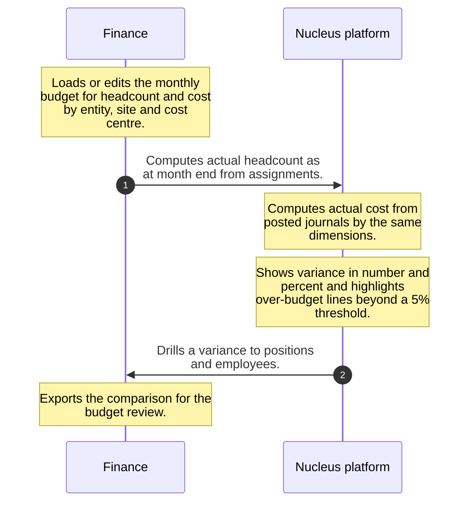

**Alternate flows**

| ID | At step | Condition | Steps | Rejoins |
| :--- | ---: | :--- | :--- | :--- |
| A1 | 1 | A revised budget is approved mid-year. | Finance loads it as a new version from its effective month. | Returns to step 2 |

**Exception flows**

| ID | At step | Condition | Handling | Rule |
| :--- | ---: | :--- | :--- | :--- |
| E1 | 3 | The month's payroll is not posted. | Cost actuals are shown as provisional with the unposted run named. |  |

**Postconditions — success**

- A variance view exists for the month with drill-down.

**Postconditions — failure**

- The comparison is not produced and the missing budget or posting is named.

**Quality requirements**

- Comparison for 2 entities and 5 sites loads within 3 seconds.

### FIN-UC-009

**Request travel, claim expenses and settle the advance** — Let an employee request business travel with an advance, claim expenses against policy limits with receipt capture, and have the claim approved, settled and posted to the ERP system.

| Attribute | Value |
| :--- | :--- |
| Realises | FIN-CG-004 |
| Source | Authored |
| Level | User goal |
| Primary actor | Employee / worker |
| Secondary actors | Manager / supervisor, Finance, Payroll manager, Agent (governed), Nucleus platform, ERP system |
| Trigger | An employee plans a business trip, for example a 3-day process audit from the Pune office to Medchal Works. |
| Frequency | Daily |
| Criticality | High |
| Phase | P3 |
| Client requirements | — |
| Business rules | RL-521, RL-523, RL-524 |
| Screens | SCR-102 |
| Data objects (CRUD) | travel_request (C, U), travel_advance (C, U), expense_claim (C, U), expense_line (C, U), receipt_image (C), journal (C) |
| Events | platform.approval.completed, integration.journal.posted |
| Acceptance tests | FIN-TC-013, FIN-TC-014, FIN-TC-015, FIN-TC-016, FIN-TC-017, FIN-TC-018 |
| System requirements | SYS-028, SYS-037, SYS-040, SYS-074, SYS-084, SYS-087 |

**Stakeholders and interests**

| Stakeholder | Interest |
| :--- | :--- |
| Employee / worker | Is reimbursed quickly and correctly, with the advance netted off automatically. |
| Manager / supervisor | Approves only business-justified travel and sees policy deviations named. |
| Finance | Receives balanced, cost-centre-coded postings and clears advances on time. |
| Auditor | Can trace every reimbursement to receipts, approvals and the ERP document. |

**Preconditions**

- Travel and expense policy limits are configured by grade and city class.
- Expense categories are mapped to GL accounts and cost centres.
- The employee has an active assignment with a cost centre.

**Main success scenario**

| # | Actor | Action | Ref |
| ---: | :--- | :--- | :--- |
| 1 | Employee / worker | Raises a travel request for 2026-11-17 to 2026-11-19 to Medchal Works, with purpose, cost centre and an advance of ₹15,000. |  |
| 2 | Nucleus platform | Checks the estimate against grade limits for hotel, per diem and travel class and highlights any deviation. |  |
| 3 | Manager / supervisor | Approves the request through the approval engine; the advance is queued for Finance payment. |  |
| 4 | Employee / worker | After the trip, photographs receipts in the mobile app. |  |
| 5 | Agent (governed) | Extracts vendor, date, amount and tax details from each receipt as a draft line for the employee to check. |  |
| 6 | Employee / worker | Corrects and confirms each line and submits the claim of ₹21,400. |  |
| 7 | Nucleus platform | Checks each line against policy limits, duplicate receipts and travel dates, and flags exceptions with the limit breached. |  |
| 8 | Manager / supervisor | Approves the claim; lines over limit need a stated justification before approval. |  |
| 9 | Finance | Audits flagged lines and approves; the platform nets the ₹15,000 advance and schedules ₹6,400 for reimbursement. |  |
| 10 | Nucleus platform | Builds the expense journal by GL and cost centre and posts it to the ERP system, storing the returned document number. |  |

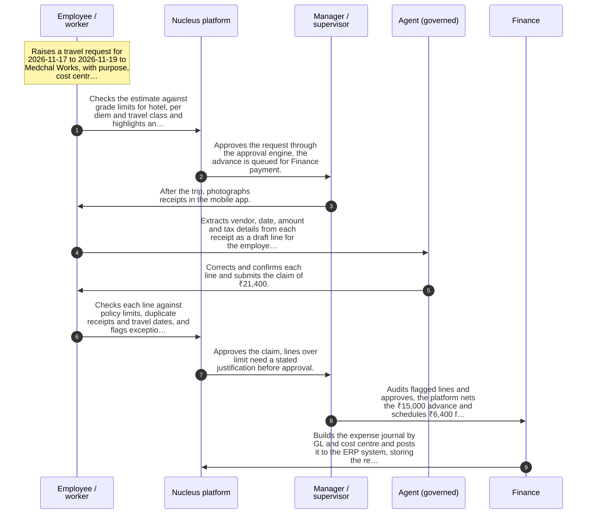

**Alternate flows**

| ID | At step | Condition | Steps | Rejoins |
| :--- | ---: | :--- | :--- | :--- |
| A1 | 9 | The claim is less than the advance. | Platform computes the excess advance. → The employee repays it, or it is raised as a payroll recovery in the next open run after the employee confirms. | Returns to step 10 |
| A2 | 9 | The tenant reimburses expenses through payroll. | Platform raises a non-taxable reimbursement payroll input for the net amount. | Returns to step 10 |

**Exception flows**

| ID | At step | Condition | Handling | Rule |
| :--- | ---: | :--- | :--- | :--- |
| E1 | 7 | The same receipt has been claimed before. | The line is blocked and both claims are shown. |  |
| E2 | 10 | An expense category has no GL mapping. | The journal is blocked and the message names the category. | RL-521 |
| E3 | 10 | The ERP system rejects the posting or times out. | The failure is shown and the retry reuses the same journal ID so no duplicate is created. | RL-523 |
| E4 | 10 | No document number is returned. | The claim batch is not marked posted and is flagged for Finance. | RL-524 |

**Postconditions — success**

- The claim is settled against the advance, the net amount is paid or recovered, and the journal is posted to the ERP system with a document number.

**Postconditions — failure**

- Claims rejected or returned keep their history and no payment or posting occurs.
- Unsettled advances older than the policy limit are flagged to Finance.

**Quality requirements**

- Receipt extraction returns a draft within 5 s per receipt; nothing is submitted without employee confirmation.
- Receipt images are retained for the period configured in the finance retention policy.

### FIN-UC-010

**Account for employer statutory contributions, benefit costs and liabilities** — Post employer statutory contributions, benefit costs and related liabilities to the general ledger with period-end accruals, reversals and clearing on payment.

| Attribute | Value |
| :--- | :--- |
| Realises | FIN-CG-005 |
| Source | Authored |
| Level | User goal |
| Primary actor | Finance |
| Secondary actors | Payroll manager, Compliance owner, Auditor, Nucleus platform, ERP system |
| Trigger | A payroll run reaches APPROVED, a statutory payment is recorded, or the accounting period closes. |
| Frequency | Monthly |
| Criticality | High |
| Phase | P2 |
| Client requirements | — |
| Business rules | RL-521, RL-522, RL-523, RL-530, RL-531 |
| Screens | SCR-102, SCR-103 |
| Data objects (CRUD) | payroll_result (R), gl_mapping (R), journal (C), accrual_entry (C), statutory_payment (R), reconciliation_check (C) |
| Events | payroll.journal.ready, payroll.journal.blocked, integration.journal.posted, finance.reconciliation.run |
| Acceptance tests | FIN-TC-019, FIN-TC-020, FIN-TC-021, FIN-TC-022, FIN-TC-023, FIN-TC-024 |
| System requirements | SYS-028, SYS-037, SYS-045, SYS-051, SYS-084 |

**Stakeholders and interests**

| Stakeholder | Interest |
| :--- | :--- |
| Finance | Books the full employer cost of people in the right period and cost centre. |
| Compliance owner | Sees liabilities cleared when statutory payments are made. |
| Auditor | Can drill from each GL line to the payroll lines and payments behind it. |

**Preconditions**

- Employer contribution components (PF and pension, ESIC, labour welfare fund, group insurance premium, gratuity and leave encashment provisions) are mapped to expense and liability GL accounts.
- Accrual and reversal method is configured per component.
- The ERP system accepts journals for the entity and period.

**Main success scenario**

| # | Actor | Action | Ref |
| ---: | :--- | :--- | :--- |
| 1 | Nucleus platform | Derives employer contributions and benefit costs from the approved November 2026 run for both legal entities. |  |
| 2 | Nucleus platform | Validates that every component has both an expense and a liability mapping by cost centre. |  |
| 3 | Nucleus platform | Builds the cost journal debiting expense by cost centre and crediting statutory and benefit liabilities. |  |
| 4 | Finance | Reviews the journal summary by entity, site and component and approves it. |  |
| 5 | Nucleus platform | Posts the journal to the ERP system and stores the returned document number. |  |
| 6 | Finance | At period close, posts accruals for costs incurred but not yet in a run, such as provisions for the last week of attendance. |  |
| 7 | Nucleus platform | Reverses the accruals on day 1 of the next period as configured. |  |
| 8 | Compliance owner | Records the statutory payment reference when the contribution is paid. |  |
| 9 | Nucleus platform | Posts the clearing journal debiting the liability and crediting the bank clearing account. |  |
| 10 | Nucleus platform | Reconciles each liability balance to statutory payments and shows the result to Finance. |  |

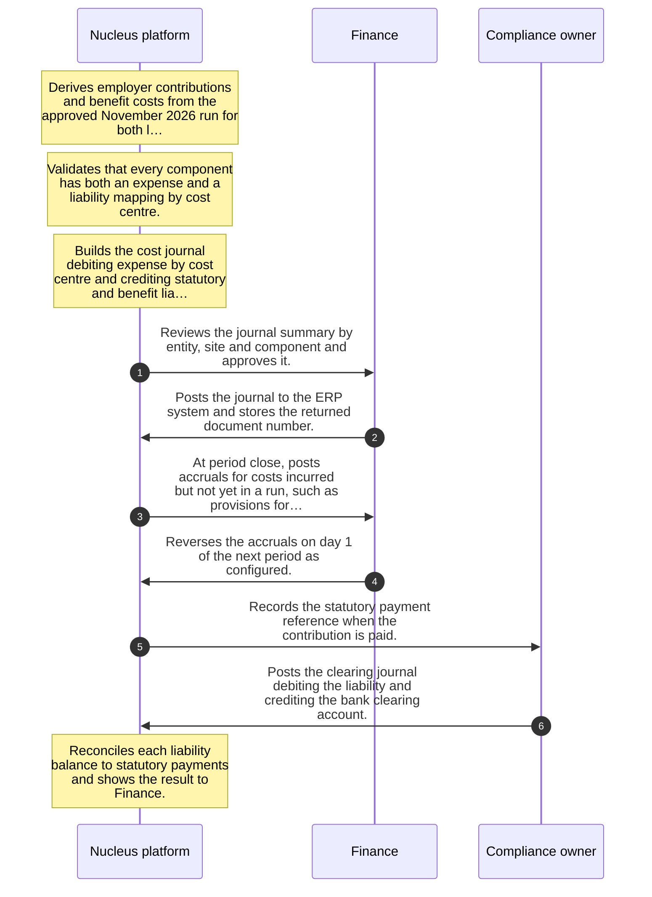

**Alternate flows**

| ID | At step | Condition | Steps | Rejoins |
| :--- | ---: | :--- | :--- | :--- |
| A1 | 6 | The tenant uses gratuity and leave encashment valuations rather than monthly provisions. | Finance uploads the actuarial valuation figure. → Platform posts the difference from the booked liability as a true-up journal. | Returns to step 8 |

**Exception flows**

| ID | At step | Condition | Handling | Rule |
| :--- | ---: | :--- | :--- | :--- |
| E1 | 2 | A component has no GL mapping. | The journal is blocked and the message names the component. | RL-521 |
| E2 | 2 | A provision is mapped with a debit leg only. | Validation fails and names the missing credit leg. | RL-522 |
| E3 | 5 | The ERP system rejects the posting. | The failure is shown and the retry reuses the journal ID. | RL-523 |
| E4 | 10 | The liability does not reconcile to the payment. | The check shows Fail with expected, actual and variance and the period stays open. | RL-530 |
| E5 | 10 | A GL line cannot be drilled to payslip lines. | It is treated as a failed drill-through assertion and flagged. | RL-531 |

**Postconditions — success**

- Expense and liability journals are posted with document numbers, and liability balances reconcile to statutory payments.

**Postconditions — failure**

- Unmapped or unbalanced journals are blocked and the period stays open.

**Quality requirements**

- Debits equal credits for every journal before posting.
- Journals for a 3,000-employee run are built within 60 s.

## Approval & Sign-off

| Role | Name | Date | Decision | Conditions / comments |
| :--- | :--- | :--- | :--- | :--- |
| Author | Dhanraj Dadhich | 2026-11-05 | Submitted | |
| Peer review moderator | *pending* | | | PR-xxxx |
| PQA (process compliance) | *pending* | | | |
| Approval authority (DOC-01 §7) | *pending* | | | |

## Measurement Data Captured

| Measure | Value | Unit | Notes |
| :--- | :--- | :--- | :--- |
| Size | 305 | specified items (table rows) | Counted automatically at generation |
| Authoring effort | *to be recorded* | person-hours | |
| Review effort (preparation + meeting) | *pending review* | person-hours | From PR-xxxx |
| Rework effort | *pending review* | person-hours | |
| Review rate | *pending review* | items / hour | Compare with PPB control limits |
| Requirement volatility (changes since baseline) | 0 | CRs touching this artefact | Not yet baselined (CM-03) |

**Defects found, by detection phase and severity**

| Detection phase | Major | Minor | Editorial | Injected in phase (major) |
| :--- | :--- | :--- | :--- | :--- |
| Author self-check | 0 | 0 | 0 | — |
| Peer review | *pending* | | | |
| Design / build | | | | |
| System / integration test | | | | |
| UAT | | | | |
| Production (escaped) | | | | each escaped major opens a CAR record (CAR-01) |

Within control limits of the review-rate PPB? *To be assessed at peer review.*

## Revision History

| Version | Date | Author | Change summary | CR ref | Approved by |
| :--- | :--- | :--- | :--- | :--- | :--- |
| 1.0.0 | 2026-11-05 | Dhanraj Dadhich | Consolidated release | CR-0001 | *pending* |
