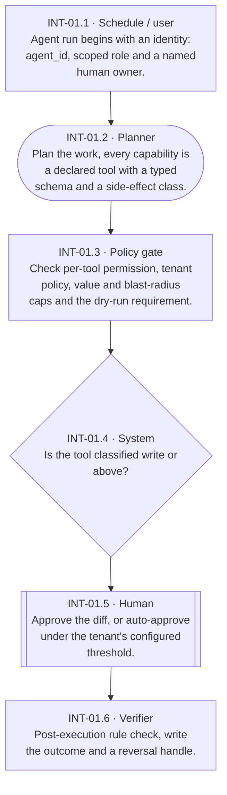

<picture>
  <source media="(prefers-color-scheme: dark)" srcset="../../assets/MultipliersKraftLogoDark.png">
  
</picture>

# FRS-INT-01 — Intelligence & Agents — Process Specifications

| Attribute | Value |
| :--- | :--- |
| Document ID | FRS-INT-01 |
| Title | Intelligence & Agents — Process Specifications |
| Product | Nucleus Suite (Nucleus HRMS Suite) |
| Version | 1.0.0 |
| Status | Issued for approval |
| Owner (role) | Domain Product Owner — Intelligence & Agents |
| Author | Dhanraj Dadhich |
| Reviewed by | *pending* |
| Approved by | Product Council — *pending* |
| Date | 2026-11-05 |
| Classification | Internal |
| CMMI practice areas | RDM, TS |
| Related documents | FRS-INT-00, FRS-INT-01, FRS-INT-02, FRS-INT-03, FRS-INT-04, FRS-INT-05, FRS-INT-06, FRS-INT-07, FRS-INT-08, FRS-INT-09, FRS-INT-10, FRS-INT-11, FRS-INT-12, FRS-INT-13, BRS-01, SRS-01, REQ-01, REQ-02 |
| Quality & process-performance objectives | QPPO-05 (effective requirements reviews), QPPO-01 (escaped defects) — MPM-01 |
| Process performance baseline used | PPB-01 (review defect density), PPB-02 (review rate) — MPM-01 |
| Peer review record | *pending* (PR-xxxx, QA-02) |
| Tailoring record | none |
| Traceability anchor | BG-02, BG-08 · processes INT-01–INT-04 |
| Source of record | Nucleus — Process Flows & Process Maps v1.0 — sheet(s) 03_Process_Inventory, 04_Process_Steps, 05_Swimlane_Maps Nucleus HR Demo Points Build Sheet v1.0 — sheet(s) 07_Approval_Workflows Nucleus HRMS Demo Dataset v1.1 — sheet(s) 64_Approval_Workflows |

> **Source of record.** Requirements in this document are taken from the source workbook(s) named above and keep their workbook IDs, which are never renumbered. Changes are made through a change request (CM-02) against the source workbook. Sections marked **Authored** are original additions that are not present in the source workbooks.

Step types: TASK (human) · SYS (system, unattended) · DEC (decision) · APPR (approval gate) · INT (integration call) · WAIT (timer or external event) · AGENT (agent-executed, governed). CRUD: C create · R read · U update · D delete-by-end-dating (temporal facts are never hard-deleted). In the flow diagrams decisions are diamonds, approvals are double-bordered boxes and integration, wait and agent steps are rounded.

## 1. Process inventory

| Process ID | Process | Trigger | Primary actor | Frequency | Criticality | Blueprint module | Phase | Reuses | Demo pts | Note |
| :--- | :--- | :--- | :--- | :--- | :--- | :--- | :--- | :--- | :--- | :--- |
| INT-01 | Agent invocation through the policy gate | Schedule or user ask | Agent | Continuous | Critical | Blueprint §6.2 | P2 | CMP-11, CMP-06 |  | Identity, scoped role, per-tool permission, blast-radius cap, dry-run requirement. |
| INT-02 | Action ledger write and reversal | Agent action executed | System | Continuous | Critical | Blueprint §6.2 | P2 | CMP-06 |  | Simulation result, approval, outcome, reversal handle. Watch the reversal rate. |
| INT-03 | Analytics projection and operational reports | Event or schedule | System | Continuous | High | Module 11 | P2 | CMP-07, CMP-08 | 1 | Shipped configured: break, OT register, late summary, gate-pass utilisation, team history. |
| INT-04 | Predictive scoring with explanation | Monthly scoring | System | Monthly | Medium | Module 11 | P3 | CMP-11 |  | HR-only by default; manager exposure is a tenant opt-in with guidance. |

## 2. Step-level specifications

### INT-01 — Agent invocation through the policy gate

**Trigger:** Schedule or user ask · **Primary actor:** Agent · **Frequency:** Continuous · **Criticality:** Critical · **Phase:** P2 · **Reuses:** CMP-11, CMP-06

| Step | Step ID | Lane / actor | Type | Action or decision | Rule ID(s) | Objects touched (CRUD) | Key fields | Screen | Event emitted | Exception / note | Reuses | Demo pts | Phase |
| :--- | :--- | :--- | :--- | :--- | :--- | :--- | :--- | :--- | :--- | :--- | :--- | :--- | :--- |
| 1 | INT-01.1 | Schedule / user | SYS | Agent run begins with an identity: agent_id, scoped role and a named human owner. | RL-540 | agent_principal R | agent_id, scoped_role, owner_principal_id | SCR-110 | agent.run.started | An agent that can do something a user cannot is a security hole. | CMP-11 |  | P2 |
| 2 | INT-01.2 | Planner | AGENT | Plan the work; every capability is a declared tool with a typed schema and a side-effect class. | RL-541 | tool_registry R | tool, schema, permission, side_effect(read\|propose\|write\|irreversible) | — | agent.plan.created | Agents never touch the database, never call internal functions, never hold credentials. | CMP-11 |  | P2 |
| 3 | INT-01.3 | Policy gate | SYS | Check per-tool permission, tenant policy, value and blast-radius caps and the dry-run requirement. | RL-542 | policy_gate_decision C | decision, caps_applied, reason | — | agent.policy.evaluated | Same agent, different rails per tenant. | CMP-11 |  | P2 |
| 4 | INT-01.4 | System | DEC | Is the tool classified write or above? | RL-543 | — | side_effect | — |  | Yes → produce a dry-run diff first. The diff is what the human approves. | CMP-11 |  | P2 |
| 5 | INT-01.5 | Human | APPR | Approve the diff, or auto-approve under the tenant's configured threshold. | RL-544 | approval_instance C | threshold, decision | SCR-110 | platform.approval.completed | Nothing irreversible without a named human: disbursement, termination, offer release, statutory filing, loan sanction. | CMP-01 |  | P2 |
| 6 | INT-01.6 | Verifier | SYS | Post-execution rule check; write the outcome and a reversal handle. | RL-545 | action_ledger C | agent_id, human_principal_id, inputs, plan, simulation_result, approval, outcome, reversal_handle | — | agent.action.executed | The ledger IS the product. Auditors and boards will ask what the AI did. | CMP-06 |  | P2 |

### INT-02 — Action ledger write and reversal

**Trigger:** Agent action executed · **Primary actor:** System · **Frequency:** Continuous · **Criticality:** Critical · **Phase:** P2 · **Reuses:** CMP-06

The source workbook specifies this process at inventory level only. Its complete flow is specified in use case INT-UC-002 (FRS-INT-12).

### INT-03 — Analytics projection and operational reports

**Trigger:** Event or schedule · **Primary actor:** System · **Frequency:** Continuous · **Criticality:** High · **Phase:** P2 · **Reuses:** CMP-07, CMP-08

The source workbook specifies this process at inventory level only. Its complete flow is specified in use case INT-UC-003 (FRS-INT-12).

### INT-04 — Predictive scoring with explanation

**Trigger:** Monthly scoring · **Primary actor:** System · **Frequency:** Monthly · **Criticality:** Medium · **Phase:** P3 · **Reuses:** CMP-11

The source workbook specifies this process at inventory level only. Its complete flow is specified in use case INT-UC-004 (FRS-INT-12).

## 4. Approval workflows

_No entries in source for this scope._

### Workflow behaviour

_No entries in source for this scope._

## Approval & Sign-off

| Role | Name | Date | Decision | Conditions / comments |
| :--- | :--- | :--- | :--- | :--- |
| Author | Dhanraj Dadhich | 2026-11-05 | Submitted | |
| Peer review moderator | *pending* | | | PR-xxxx |
| PQA (process compliance) | *pending* | | | |
| Approval authority (DOC-01 §7) | *pending* | | | |

## Measurement Data Captured

| Measure | Value | Unit | Notes |
| :--- | :--- | :--- | :--- |
| Size | 10 | specified items (table rows) | Counted automatically at generation |
| Authoring effort | *to be recorded* | person-hours | |
| Review effort (preparation + meeting) | *pending review* | person-hours | From PR-xxxx |
| Rework effort | *pending review* | person-hours | |
| Review rate | *pending review* | items / hour | Compare with PPB control limits |
| Requirement volatility (changes since baseline) | 0 | CRs touching this artefact | Not yet baselined (CM-03) |

**Defects found, by detection phase and severity**

| Detection phase | Major | Minor | Editorial | Injected in phase (major) |
| :--- | :--- | :--- | :--- | :--- |
| Author self-check | 0 | 0 | 0 | — |
| Peer review | *pending* | | | |
| Design / build | | | | |
| System / integration test | | | | |
| UAT | | | | |
| Production (escaped) | | | | each escaped major opens a CAR record (CAR-01) |

Within control limits of the review-rate PPB? *To be assessed at peer review.*

## Revision History

| Version | Date | Author | Change summary | CR ref | Approved by |
| :--- | :--- | :--- | :--- | :--- | :--- |
| 1.0.0 | 2026-11-05 | Dhanraj Dadhich | Consolidated release | CR-0001 | *pending* |
