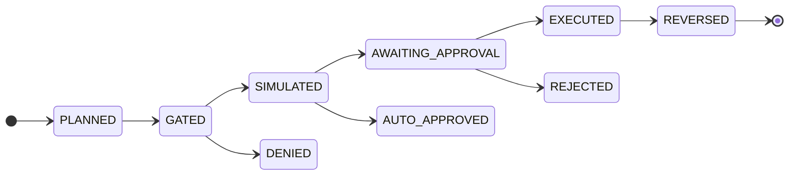

<picture>
  <source media="(prefers-color-scheme: dark)" srcset="../../assets/MultipliersKraftLogoDark.png">
  
</picture>

# FRS-INT-06 — Intelligence & Agents — State Machines and Events

| Attribute | Value |
| :--- | :--- |
| Document ID | FRS-INT-06 |
| Title | Intelligence & Agents — State Machines and Events |
| Product | Nucleus Suite (Nucleus HRMS Suite) |
| Version | 1.0.0 |
| Status | Issued for approval |
| Owner (role) | Domain Product Owner — Intelligence & Agents |
| Author | Dhanraj Dadhich |
| Reviewed by | *pending* |
| Approved by | Product Council — *pending* |
| Date | 2026-11-05 |
| Classification | Internal |
| CMMI practice areas | TS, VV |
| Related documents | FRS-INT-00, FRS-INT-01, FRS-INT-02, FRS-INT-03, FRS-INT-04, FRS-INT-05, FRS-INT-06, FRS-INT-07, FRS-INT-08, FRS-INT-09, FRS-INT-10, FRS-INT-11, FRS-INT-12, FRS-INT-13, BRS-01, SRS-01, REQ-01, REQ-02 |
| Quality & process-performance objectives | QPPO-05 (effective requirements reviews), QPPO-01 (escaped defects) — MPM-01 |
| Process performance baseline used | PPB-01 (review defect density), PPB-02 (review rate) — MPM-01 |
| Peer review record | *pending* (PR-xxxx, QA-02) |
| Tailoring record | none |
| Traceability anchor | BG-02, BG-08 · processes INT-01–INT-04 |
| Source of record | Nucleus — Process Flows & Process Maps v1.0 — sheet(s) 11_State_Machines, 12_Events |

> **Source of record.** Requirements in this document are taken from the source workbook(s) named above and keep their workbook IDs, which are never renumbered. Changes are made through a change request (CM-02) against the source workbook. Sections marked **Authored** are original additions that are not present in the source workbooks.

## 1. State machines

### `agent action`

| State | Meaning | Entered by | Allowed next states | Guard | Reversible | Event |
| :--- | :--- | :--- | :--- | :--- | :--- | :--- |
| PLANNED | Planner produced a tool plan | INT-01 | GATED | — | Yes | agent.plan.created |
| GATED | Policy gate evaluated permission and caps | INT-01 | SIMULATED, DENIED | Within tenant caps | Yes | agent.policy.evaluated |
| SIMULATED | Dry-run diff produced | INT-01 | AWAITING_APPROVAL, AUTO_APPROVED | Required for write and above | Yes | — |
| AWAITING_APPROVAL | Human must approve the diff | INT-01 | EXECUTED, REJECTED | Named human for irreversible actions | Yes | — |
| EXECUTED | Action performed and verified | INT-01 | REVERSED | Reversal handle stored | Yes where reversible | agent.action.executed |
| REVERSED | Rolled back | INT-02 | — | Counted in the reversal rate metric | No | agent.action.reversed |

## 2. Domain events

Event names follow `domain.object.verb` in the past tense. Every event carries the envelope defined in IA-02.

| Event | Emitted by | Payload (beyond envelope) | Consumers | Idempotency key | Retention |
| :--- | :--- | :--- | :--- | :--- | :--- |
| agent.action.executed | INT-01 | action_id, agent_id, human_principal_id, tool, outcome, reversal_handle | Action ledger, analytics, audit | action_id | Long |
| agent.action.reversed | INT-02 | action_id, reversed_by, reason | Reversal-rate metric, audit | action_id | Long |

## Approval & Sign-off

| Role | Name | Date | Decision | Conditions / comments |
| :--- | :--- | :--- | :--- | :--- |
| Author | Dhanraj Dadhich | 2026-11-05 | Submitted | |
| Peer review moderator | *pending* | | | PR-xxxx |
| PQA (process compliance) | *pending* | | | |
| Approval authority (DOC-01 §7) | *pending* | | | |

## Measurement Data Captured

| Measure | Value | Unit | Notes |
| :--- | :--- | :--- | :--- |
| Size | 8 | specified items (table rows) | Counted automatically at generation |
| Authoring effort | *to be recorded* | person-hours | |
| Review effort (preparation + meeting) | *pending review* | person-hours | From PR-xxxx |
| Rework effort | *pending review* | person-hours | |
| Review rate | *pending review* | items / hour | Compare with PPB control limits |
| Requirement volatility (changes since baseline) | 0 | CRs touching this artefact | Not yet baselined (CM-03) |

**Defects found, by detection phase and severity**

| Detection phase | Major | Minor | Editorial | Injected in phase (major) |
| :--- | :--- | :--- | :--- | :--- |
| Author self-check | 0 | 0 | 0 | — |
| Peer review | *pending* | | | |
| Design / build | | | | |
| System / integration test | | | | |
| UAT | | | | |
| Production (escaped) | | | | each escaped major opens a CAR record (CAR-01) |

Within control limits of the review-rate PPB? *To be assessed at peer review.*

## Revision History

| Version | Date | Author | Change summary | CR ref | Approved by |
| :--- | :--- | :--- | :--- | :--- | :--- |
| 1.0.0 | 2026-11-05 | Dhanraj Dadhich | Consolidated release | CR-0001 | *pending* |
