

<picture>
  <source media="(prefers-color-scheme: dark)" srcset="../../assets/MultipliersKraftLogoDark.png">
  
</picture>

# FRS-INT-12 — Intelligence & Agents — Use Case Specifications

| Attribute | Value |
| :--- | :--- |
| Document ID | FRS-INT-12 |
| Title | Intelligence & Agents — Use Case Specifications |
| Product | Nucleus Suite (Nucleus HRMS Suite) |
| Version | 1.0.0 |
| Status | Issued for approval |
| Owner (role) | Domain Product Owner — Intelligence & Agents |
| Author | Dhanraj Dadhich |
| Reviewed by | *pending* |
| Approved by | Product Council — *pending* |
| Date | 2026-11-05 |
| Classification | Internal |
| CMMI practice areas | RDM, VV |
| Related documents | FRS-INT-00, FRS-INT-01, FRS-INT-02, FRS-INT-03, FRS-INT-04, FRS-INT-05, FRS-INT-06, FRS-INT-07, FRS-INT-08, FRS-INT-09, FRS-INT-10, FRS-INT-11, FRS-INT-12, FRS-INT-13, BRS-01, SRS-01, REQ-01, REQ-02 |
| Quality & process-performance objectives | QPPO-05 (effective requirements reviews), QPPO-01 (escaped defects) — MPM-01 |
| Process performance baseline used | PPB-01 (review defect density), PPB-02 (review rate) — MPM-01 |
| Peer review record | *pending* (PR-xxxx, QA-02) |
| Tailoring record | none |
| Traceability anchor | BG-02, BG-08 · processes INT-01–INT-04 |
| Source of record | Nucleus — Process Flows & Process Maps v1.0 — sheet(s) 03_Process_Inventory, 04_Process_Steps, 07_Screens, 09_Business_Rules Authored use cases (marked per use case) |

> **Source of record.** Requirements in this document are taken from the source workbook(s) named above and keep their workbook IDs, which are never renumbered. Changes are made through a change request (CM-02) against the source workbook. Sections marked **Authored** are original additions that are not present in the source workbooks.

This document specifies 12 use cases for Intelligence & Agents: 1 follow the step-level flows of the source workbook and 11 are authored (processes without step-level detail in the source, and capability gaps). User stories derived from each use case are in FRS-INT-13.

## 1. Use case index

| ID | Use case | Primary actor | Realises | Source | Phase | Criticality |
| :--- | :--- | :--- | :--- | :--- | :--- | :--- |
| [INT-UC-001](#int-uc-001) | Invoke an agent through the policy gate | Agent (governed) | INT-01 | Source workbook | P2 | Critical |
| [INT-UC-002](#int-uc-002) | Write the action ledger and reverse an agent action | Nucleus platform | INT-02 | Authored | P2 | Critical |
| [INT-UC-003](#int-uc-003) | Project analytics and produce operational reports | Nucleus platform | INT-03 | Authored | P2 | High |
| [INT-UC-004](#int-uc-004) | Score predictive risk with explanations | Nucleus platform | INT-04 | Authored | P3 | Medium |
| [INT-UC-005](#int-uc-005) | Build and schedule self-service reports | HR operations | INT-CG-001 | Authored | P2 | High |
| [INT-UC-006](#int-uc-006) | View executive dashboards and people analytics | Director / approver | INT-CG-002 | Authored | P2 | High |
| [INT-UC-007](#int-uc-007) | Export de-identified data to a customer data warehouse | Tenant admin | INT-CG-003 | Authored | P3 | Medium |
| [INT-UC-008](#int-uc-008) | Produce statutory and regulatory reports from rule packs | Compliance owner | INT-CG-004 | Authored | P2 | High |
| [INT-UC-009](#int-uc-009) | Analyse skills gaps and act on recommended learning and hiring | HR operations | INT-CG-005 | Authored | P3 | High |
| [INT-UC-010](#int-uc-010) | Analyse collaboration networks from consented, aggregated metadata | HR operations | INT-CG-006 | Authored | P5 | Low |
| [INT-UC-011](#int-uc-011) | Show context metrics embedded in transactional screens | Manager / supervisor | INT-CG-007 | Authored | P3 | Medium |
| [INT-UC-012](#int-uc-012) | Connect a client AI environment through the governed MCP tool surface | Tenant admin | IA-03 MCP server flow | Authored | P4 | High |

## 2. Use case diagrams

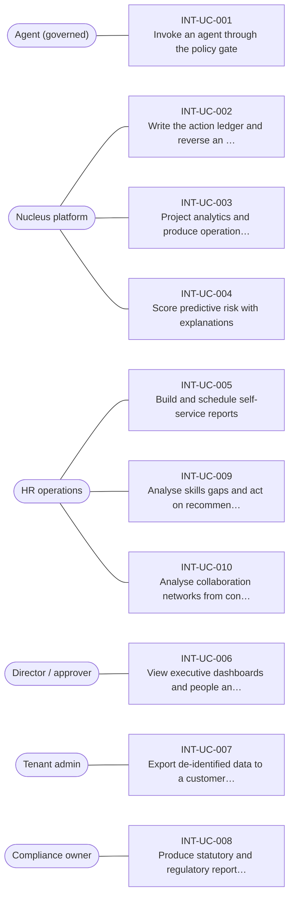

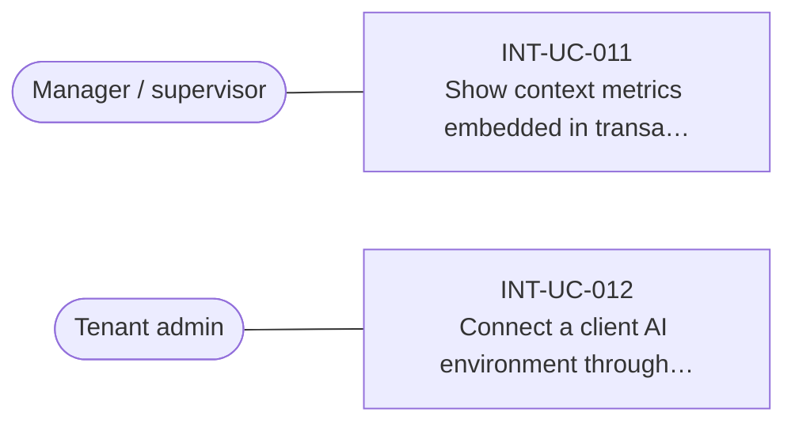

## 3. Use case specifications

### INT-UC-001

**Invoke an agent through the policy gate** — Run an agent as a scoped principal whose every tool call passes the policy gate, is simulated if it writes, is approved by a human where required and lands in the action ledger.

| Attribute | Value |
| :--- | :--- |
| Realises | INT-01 |
| Source | Source workbook |
| Level | User goal |
| Primary actor | Agent (governed) |
| Secondary actors | Nucleus platform, Director / approver, Tenant admin, Auditor |
| Trigger | A schedule fires or a user asks an agent to act. |
| Frequency | Continuous |
| Criticality | Critical |
| Phase | P2 |
| Client requirements | — |
| Business rules | RL-001, RL-141, RL-540, RL-541, RL-542, RL-543, RL-544, RL-545 |
| Screens | SCR-110 |
| Data objects (CRUD) | agent_principal (R), tool_registry (R), policy_gate_decision (C), approval_instance (C), action_ledger (C) |
| Events | agent.run.started, agent.plan.created, agent.policy.evaluated, platform.approval.completed, agent.action.executed |
| Acceptance tests | TC-P01, TC-A141, TC-A540, TC-A541, TC-A542, TC-A543, TC-A544, TC-A545 |
| System requirements | SYS-009, SYS-010, SYS-035, SYS-072, SYS-073, SYS-074 |

**Stakeholders and interests**

| Stakeholder | Interest |
| :--- | :--- |
| Tenant admin | Agents never exceed the rights of their human owner or tenant caps. |
| Director / approver | Approves exactly the diff that will execute. |
| Auditor | Can reconstruct what any agent did, why and who approved it. |

**Preconditions**

- Agent principal exists with agent_id, scoped role and named human owner.
- Tools are registered with typed schemas and side-effect classes.
- Tenant policy defines caps and auto-approval thresholds, for example 120 minutes for regularisations.

**Main success scenario**

| # | Actor | Action | Ref |
| ---: | :--- | :--- | :--- |
| 1 | Nucleus platform | Starts the agent run with identity: agent_id, scoped role and named human owner. | INT-01.1 |
| 2 | Agent (governed) | Plans the work using only declared tools, each with a typed schema and a side-effect class. | INT-01.2 |
| 3 | Nucleus platform | Policy gate checks per-tool permission, tenant policy, value and blast-radius caps and the dry-run requirement. | INT-01.3 |
| 4 | Nucleus platform | Determines whether the tool is classified write or irreversible and, if so, produces a dry-run diff. | INT-01.4 |
| 5 | Director / approver | Approves the diff, or the platform auto-approves only when within the tenant's configured threshold. | INT-01.5 |
| 6 | Nucleus platform | Verifier runs post-execution rule checks and writes outcome and reversal handle to the action ledger. | INT-01.6 |

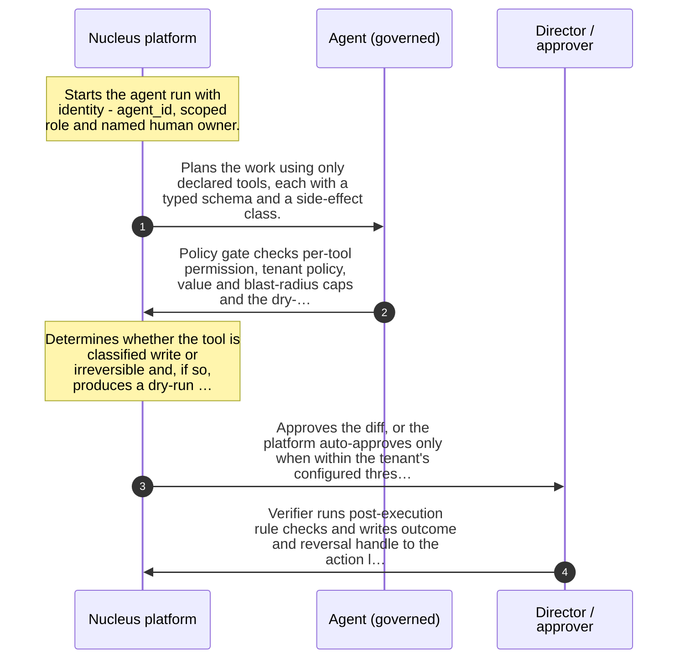

**Alternate flows**

| ID | At step | Condition | Steps | Rejoins |
| :--- | ---: | :--- | :--- | :--- |
| A1 | 4 | Tool is read or propose only. | No dry-run is needed; execution proceeds and is ledgered. | Returns to step 6 |
| A2 | 5 | Proposed regularisation of 45 minutes is under the 120-minute tenant threshold. | Platform auto-approves and records the threshold applied. | Returns to step 6 |

**Exception flows**

| ID | At step | Condition | Handling | Rule |
| :--- | ---: | :--- | :--- | :--- |
| E1 | 1 | Agent principal has no named human owner. | Run is refused. | RL-001 |
| E2 | 2 | Plan requires a capability outside declared tools, such as direct data access. | Plan is rejected; agents never touch the database or hold credentials. | RL-541 |
| E3 | 3 | Action exceeds value or blast-radius caps. | Action is DENIED and recorded with reason. | RL-542 |
| E4 | 5 | Action is irreversible: disbursement, termination, offer release, statutory filing or loan sanction. | Auto-approval is disabled; a named human must approve. | RL-544 |
| E5 | 6 | Post-execution check fails. | Action is reversed using the handle and the failure is recorded. | RL-545 |

**Postconditions — success**

- Action executed within caps, verified, and recorded in the ledger with plan, simulation, approval, outcome and reversal handle.

**Postconditions — failure**

- Denied or rejected actions are recorded in the ledger with reason and no side effect.

**Quality requirements**

- Policy gate decision within 200 ms at p95.
- Action ledger is append-only; no update or delete path exists.

### INT-UC-002

**Write the action ledger and reverse an agent action** — Record every agent action in an append-only ledger and allow authorised humans to reverse reversible actions, tracking the reversal rate.

| Attribute | Value |
| :--- | :--- |
| Realises | INT-02 |
| Source | Authored |
| Level | Subfunction |
| Primary actor | Nucleus platform |
| Secondary actors | Tenant admin, Auditor, Director / approver |
| Trigger | An agent action executes or a human requests reversal. |
| Frequency | Continuous |
| Criticality | Critical |
| Phase | P2 |
| Client requirements | — |
| Business rules | RL-544, RL-545 |
| Screens | SCR-110 |
| Data objects (CRUD) | action_ledger (C) |
| Events | agent.action.executed, agent.action.reversed |
| Acceptance tests | TC-A545 |
| System requirements | SYS-034, SYS-035, SYS-036, SYS-053, SYS-074 |

**Stakeholders and interests**

| Stakeholder | Interest |
| :--- | :--- |
| Auditor | Complete, tamper-evident record. |
| Tenant admin | Can undo a wrong agent action quickly. |

**Preconditions**

- Action has executed with a stored reversal handle.

**Main success scenario**

| # | Actor | Action | Ref |
| ---: | :--- | :--- | :--- |
| 1 | Nucleus platform | Receives agent.action.executed and writes the ledger entry with plan, simulation, approval, outcome and reversal handle. |  |
| 2 | Tenant admin | Reviews an executed action in the agent console. |  |
| 3 | Tenant admin | Requests reversal stating a reason. |  |
| 4 | Nucleus platform | Shows a dry-run of the reversal for confirmation. |  |
| 5 | Tenant admin | Confirms the reversal. |  |
| 6 | Nucleus platform | Executes the reversal, marks the action REVERSED and emits agent.action.reversed. |  |
| 7 | Nucleus platform | Updates the reversal-rate metric per agent and tool. |  |

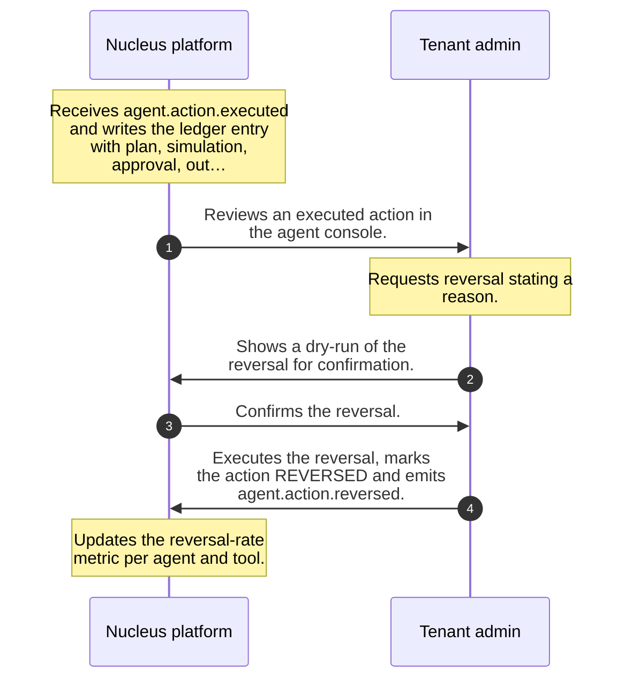

**Alternate flows**

| ID | At step | Condition | Steps | Rejoins |
| :--- | ---: | :--- | :--- | :--- |
| A1 | 3 | Reversal concerns an approved payroll-impacting change. | Reversal requires the original approver's role to confirm. | Returns to step 4 |

**Exception flows**

| ID | At step | Condition | Handling | Rule |
| :--- | ---: | :--- | :--- | :--- |
| E1 | 3 | Action has no reversal handle (irreversible). | Reversal is refused; a compensating manual process is opened. | RL-545 |
| E2 | 1 | Ledger write fails. | Action is rolled back; no action exists without a ledger entry. | RL-545 |

**Postconditions — success**

- Ledger entry exists; reversed actions are marked REVERSED with reason.

**Postconditions — failure**

- Irreversible actions remain as executed with a note.

**Quality requirements**

- Ledger entries are retained for the long retention class and hash-chained.

### INT-UC-003

**Project analytics and produce operational reports** — Project events into analytics stores and deliver configured operational reports within each user's scope.

| Attribute | Value |
| :--- | :--- |
| Realises | INT-03 |
| Source | Authored |
| Level | User goal |
| Primary actor | Nucleus platform |
| Secondary actors | HR operations, Manager / supervisor, Plant HR / time office, Agent (governed) |
| Trigger | Events arrive or a report schedule fires. |
| Frequency | Continuous |
| Criticality | High |
| Phase | P2 |
| Client requirements | — |
| Business rules | — |
| Screens | SCR-111 |
| Data objects (CRUD) | analytics_projection (U), report_schedule (C) |
| Events | — |
| Acceptance tests | — |
| System requirements | SYS-017, SYS-035, SYS-055, SYS-072, SYS-073 |

**Stakeholders and interests**

| Stakeholder | Interest |
| :--- | :--- |
| Plant HR / time office | Gets break, OT, late and gate-pass reports without building them. |
| Manager / supervisor | Sees team history. |

**Preconditions**

- Shipped report definitions are configured.

**Main success scenario**

| # | Actor | Action | Ref |
| ---: | :--- | :--- | :--- |
| 1 | Nucleus platform | Consumes domain events and updates analytics projections. |  |
| 2 | Plant HR / time office | Opens operational reports: break, OT register, late summary, gate-pass utilisation. |  |
| 3 | Nucleus platform | Resolves the user's scope and filters rows accordingly. |  |
| 4 | Plant HR / time office | Filters by date, site and shift and exports. |  |
| 5 | Plant HR / time office | Schedules recurring delivery. |  |
| 6 | Agent (governed) | Answers a natural-language question with a read-only governed query and records question, query and row count in the ledger. |  |

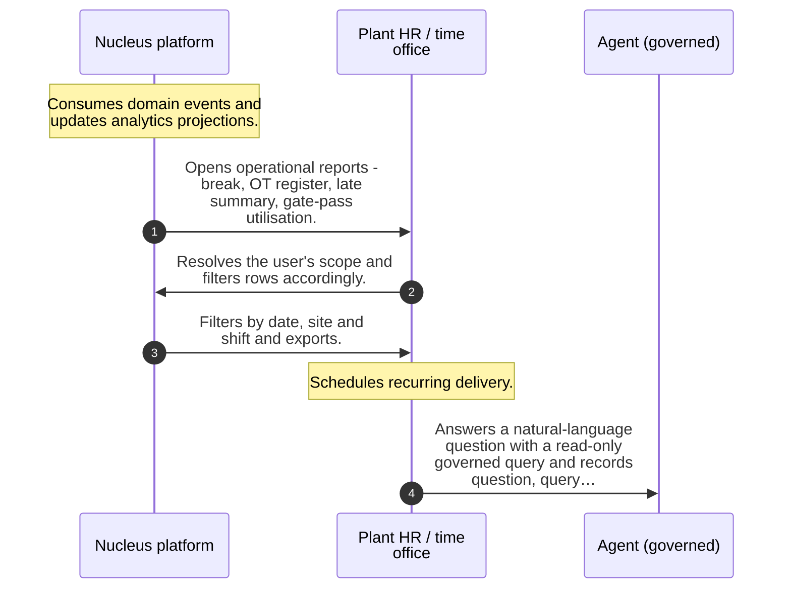

**Alternate flows**

| ID | At step | Condition | Steps | Rejoins |
| :--- | ---: | :--- | :--- | :--- |
| A1 | 2 | Manager opens team history. | Rows are limited to the manager's subtree. | Returns to step 4 |

**Exception flows**

| ID | At step | Condition | Handling | Rule |
| :--- | ---: | :--- | :--- | :--- |
| E1 | 1 | Projection lag exceeds target. | Report shows last refresh time and a stale banner. |  |

**Postconditions — success**

- Reports reflect events within freshness targets and respect scope.

**Postconditions — failure**

- Stale data is labelled with last refresh time.

**Quality requirements**

- Projection lag under 5 minutes at p95.

### INT-UC-004

**Score predictive risk with explanations** — Produce monthly predictive scores such as attrition risk with explanations, visible to HR by default, with manager exposure only by tenant opt-in.

| Attribute | Value |
| :--- | :--- |
| Realises | INT-04 |
| Source | Authored |
| Level | User goal |
| Primary actor | Nucleus platform |
| Secondary actors | HR operations, Manager / supervisor, Tenant admin, Agent (governed) |
| Trigger | Monthly scoring schedule. |
| Frequency | Monthly |
| Criticality | Medium |
| Phase | P3 |
| Client requirements | — |
| Business rules | RL-544 |
| Screens | — |
| Data objects (CRUD) | prediction_score (C), action_ledger (C) |
| Events | — |
| Acceptance tests | — |
| System requirements | SYS-035, SYS-074, SYS-076, SYS-087 |

**Stakeholders and interests**

| Stakeholder | Interest |
| :--- | :--- |
| Employee / worker | Scores do not drive automated decisions. |
| HR operations | Gets early warning with reasons. |

**Preconditions**

- Model is approved by tenant admin.
- Features exclude prohibited attributes.

**Main success scenario**

| # | Actor | Action | Ref |
| ---: | :--- | :--- | :--- |
| 1 | Nucleus platform | Runs monthly scoring on approved features. |  |
| 2 | Nucleus platform | Computes top factors explaining each score. |  |
| 3 | Nucleus platform | Runs bias and drift checks before publishing. |  |
| 4 | HR operations | Reviews scores with explanations. |  |
| 5 | HR operations | Records any intervention decision; no automated action follows a score. |  |
| 6 | Nucleus platform | Records scoring run, model version and viewers in the ledger. |  |

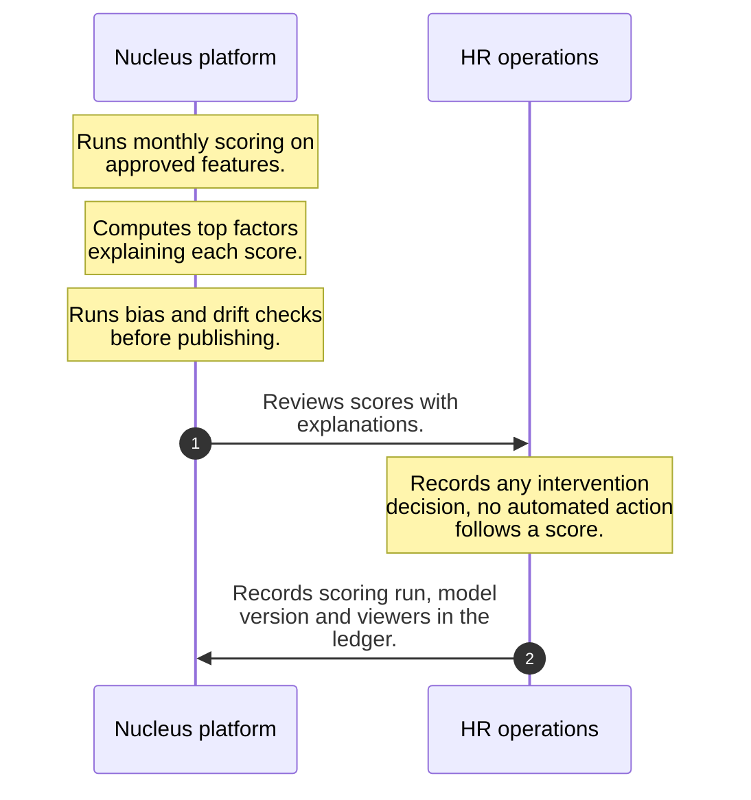

**Alternate flows**

| ID | At step | Condition | Steps | Rejoins |
| :--- | ---: | :--- | :--- | :--- |
| A1 | 4 | Tenant has opted in manager exposure. | Managers see scores for their subtree with guidance text. | Returns to step 5 |

**Exception flows**

| ID | At step | Condition | Handling | Rule |
| :--- | ---: | :--- | :--- | :--- |
| E1 | 3 | Bias or drift check fails. | Publication is withheld and the tenant admin alerted. |  |

**Postconditions — success**

- Scores with top contributing factors are available to permitted roles.

**Postconditions — failure**

- No scores published if model checks fail.

**Quality requirements**

- Every score shows at least three contributing factors.

### INT-UC-005

**Build and schedule self-service reports** — Let authorised users build ad-hoc reports on secured data sources with filters, grouping, calculated fields and scheduled distribution while honouring field-level security.

| Attribute | Value |
| :--- | :--- |
| Realises | INT-CG-001 |
| Source | Authored |
| Level | User goal |
| Primary actor | HR operations |
| Secondary actors | Nucleus platform, Agent (governed), Tenant admin |
| Trigger | User creates a report. |
| Frequency | Daily |
| Criticality | High |
| Phase | P2 |
| Client requirements | — |
| Business rules | — |
| Screens | SCR-111 |
| Data objects (CRUD) | report_definition (C), report_schedule (C) |
| Events | — |
| Acceptance tests | INT-TC-001, INT-TC-002, INT-TC-003, INT-TC-004 |
| System requirements | SYS-015, SYS-017, SYS-018, SYS-019, SYS-070 |

**Stakeholders and interests**

| Stakeholder | Interest |
| :--- | :--- |
| HR operations | Answers questions without waiting for IT. |
| Tenant admin | Field-level security is never bypassed. |

**Preconditions**

- User has report-builder rights on the data source.

**Main success scenario**

| # | Actor | Action | Ref |
| ---: | :--- | :--- | :--- |
| 1 | HR operations | Selects a secured data source. |  |
| 2 | Nucleus platform | Lists only fields the user may see. |  |
| 3 | HR operations | Adds filters, grouping and calculated fields. |  |
| 4 | Nucleus platform | Previews the result applying row and field security. |  |
| 5 | HR operations | Saves the report and sets a distribution schedule and recipients. |  |
| 6 | Nucleus platform | Delivers each scheduled run only to recipients with access to the fields. |  |

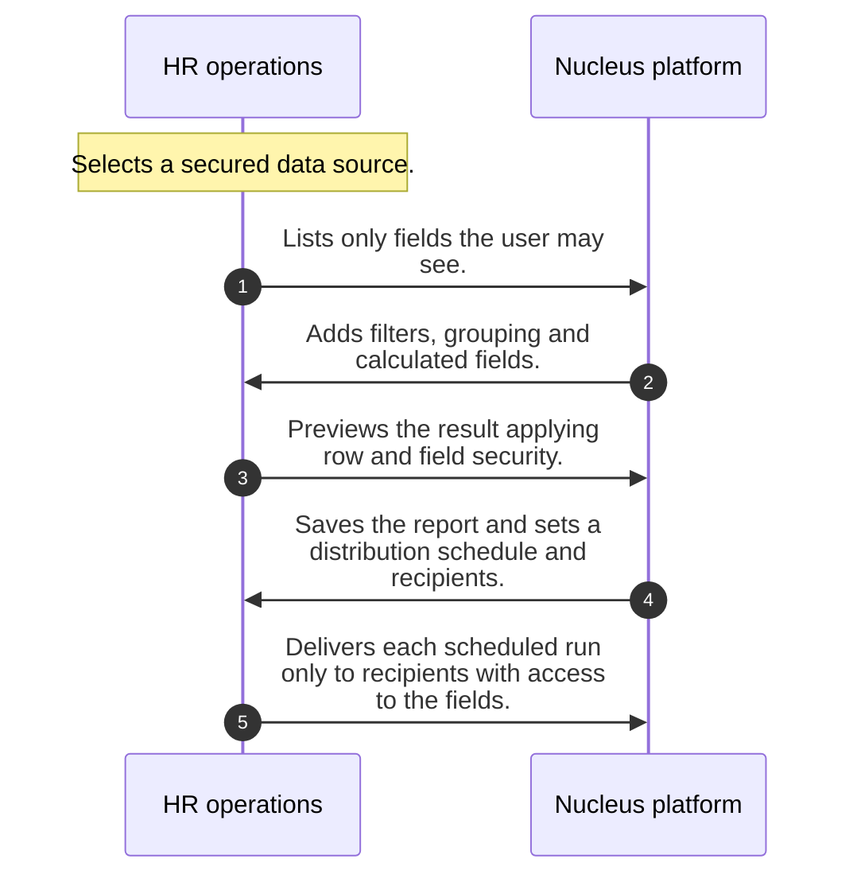

**Alternate flows**

| ID | At step | Condition | Steps | Rejoins |
| :--- | ---: | :--- | :--- | :--- |
| A1 | 1 | User asks the agent to build the report in plain words. | Agent drafts a report definition; the user confirms it before saving; the ledger records the request and draft. | Returns to step 4 |

**Exception flows**

| ID | At step | Condition | Handling | Rule |
| :--- | ---: | :--- | :--- | :--- |
| E1 | 6 | A recipient lacks access to some fields. | Those fields are masked for that recipient. |  |

**Postconditions — success**

- Report saved and optionally scheduled.

**Postconditions — failure**

- Fields outside permission are not available.

**Quality requirements**

- Preview returns within 5 s for 100,000 rows.

### INT-UC-006

**View executive dashboards and people analytics** — Provide headcount, attrition, diversity, cost, absenteeism and overtime dashboards with drill-down within the viewer's scope.

| Attribute | Value |
| :--- | :--- |
| Realises | INT-CG-002 |
| Source | Authored |
| Level | User goal |
| Primary actor | Director / approver |
| Secondary actors | HR operations, Nucleus platform, Agent (governed) |
| Trigger | User opens dashboards. |
| Frequency | Daily |
| Criticality | High |
| Phase | P2 |
| Client requirements | — |
| Business rules | — |
| Screens | SCR-111 |
| Data objects (CRUD) | analytics_projection (R) |
| Events | — |
| Acceptance tests | INT-TC-005, INT-TC-006, INT-TC-007, INT-TC-008 |
| System requirements | SYS-016, SYS-017, SYS-067, SYS-077 |

**Stakeholders and interests**

| Stakeholder | Interest |
| :--- | :--- |
| Director / approver | Sees workforce health at a glance. |

**Preconditions**

- Analytics projections are current.

**Main success scenario**

| # | Actor | Action | Ref |
| ---: | :--- | :--- | :--- |
| 1 | Director / approver | Opens the people analytics dashboard. |  |
| 2 | Nucleus platform | Renders KPIs for the viewer's scope. |  |
| 3 | Director / approver | Drills from entity to site to department. |  |
| 4 | Nucleus platform | Suppresses diversity cuts below the minimum group size. |  |
| 5 | Director / approver | Exports a view. |  |

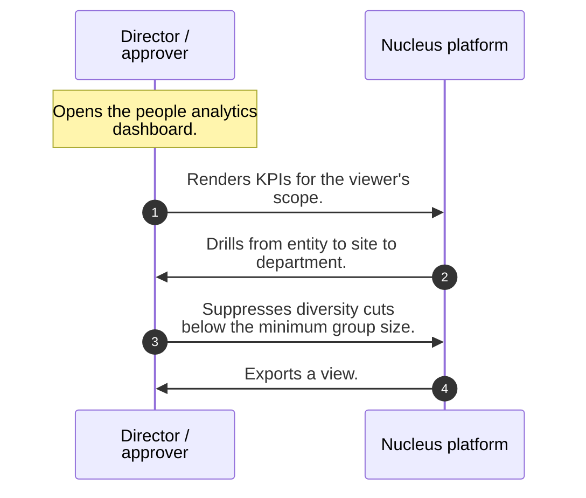

**Alternate flows**

| ID | At step | Condition | Steps | Rejoins |
| :--- | ---: | :--- | :--- | :--- |
| A1 | 3 | Drill target is outside scope. | Drill is not offered. | Returns to step 5 |
| A2 | 3 | Viewer asks the analyst agent to explain a movement in a KPI. | Agent runs a read-only governed query within the viewer's scope and returns a chart with the query used. → Ledger records question, generated query and row count; any follow-up write action, such as scheduling the view, requires the viewer's explicit confirmation. | Returns to step 5 |

**Exception flows**

| ID | At step | Condition | Handling | Rule |
| :--- | ---: | :--- | :--- | :--- |
| E1 | 2 | Projection is stale. | Last refresh time is shown. |  |

**Postconditions — success**

- Dashboards render within scope.

**Postconditions — failure**

- Small groups are suppressed.

**Quality requirements**

- Dashboard loads within 3 s.

### INT-UC-007

**Export de-identified data to a customer data warehouse** — Export analytics-ready, de-identified datasets to the customer's data warehouse on a schedule with schema documentation.

| Attribute | Value |
| :--- | :--- |
| Realises | INT-CG-003 |
| Source | Authored |
| Level | User goal |
| Primary actor | Tenant admin |
| Secondary actors | Nucleus platform, Auditor |
| Trigger | Scheduled export time or admin request. |
| Frequency | Daily |
| Criticality | Medium |
| Phase | P3 |
| Client requirements | — |
| Business rules | — |
| Screens | — |
| Data objects (CRUD) | export_definition (C), export_run (C) |
| Events | — |
| Acceptance tests | INT-TC-009, INT-TC-010, INT-TC-011, INT-TC-012 |
| System requirements | SYS-017, SYS-033, SYS-037, SYS-088 |

**Stakeholders and interests**

| Stakeholder | Interest |
| :--- | :--- |
| Tenant admin | Data leaves only in de-identified form. |
| Auditor | Exports are logged. |

**Preconditions**

- Target warehouse connection is configured.
- De-identification rules are configured.

**Main success scenario**

| # | Actor | Action | Ref |
| ---: | :--- | :--- | :--- |
| 1 | Tenant admin | Selects datasets and de-identification rules. |  |
| 2 | Nucleus platform | Generates schema documentation for the datasets. |  |
| 3 | Tenant admin | Approves the export definition. |  |
| 4 | Nucleus platform | Runs the export on schedule applying de-identification. |  |
| 5 | Nucleus platform | Delivers to the warehouse and logs row counts. |  |

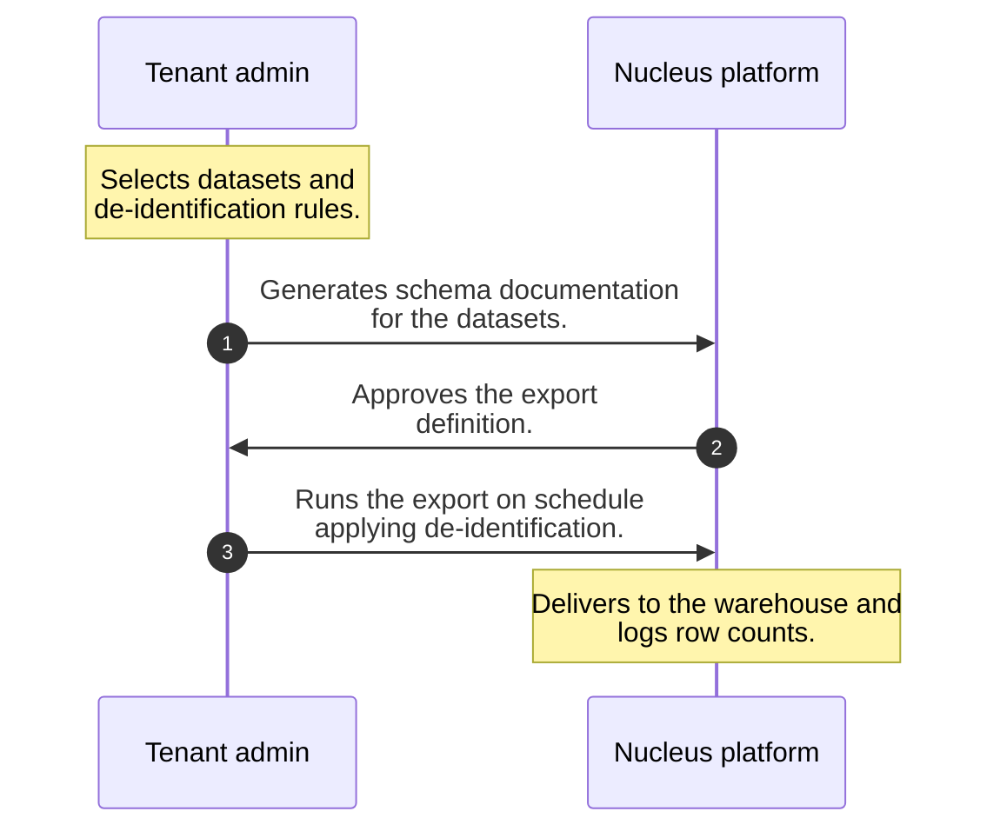

**Alternate flows**

| ID | At step | Condition | Steps | Rejoins |
| :--- | ---: | :--- | :--- | :--- |
| A1 | 4 | Schema changed since last run. | New schema version is documented and admin notified. | Returns to step 5 |

**Exception flows**

| ID | At step | Condition | Handling | Rule |
| :--- | ---: | :--- | :--- | :--- |
| E1 | 5 | Delivery fails. | Retry with backoff and alert after three failures. |  |

**Postconditions — success**

- Dataset delivered with schema documentation and logged.

**Postconditions — failure**

- Failed exports are retried and alerted.

**Quality requirements**

- No direct identifiers leave the tenant in any export.

### INT-UC-008

**Produce statutory and regulatory reports from rule packs** — Provide a library of statutory reports per jurisdiction maintained with rule packs, prepared by the platform or agent and filed by a human.

| Attribute | Value |
| :--- | :--- |
| Realises | INT-CG-004 |
| Source | Authored |
| Level | User goal |
| Primary actor | Compliance owner |
| Secondary actors | Nucleus platform, Agent (governed), Auditor |
| Trigger | Obligation due date approaches. |
| Frequency | Monthly |
| Criticality | High |
| Phase | P2 |
| Client requirements | — |
| Business rules | RL-544, RL-545 |
| Screens | — |
| Data objects (CRUD) | statutory_report (C), action_ledger (C) |
| Events | — |
| Acceptance tests | TC-A544, INT-TC-013, INT-TC-014, INT-TC-015, INT-TC-016 |
| System requirements | SYS-035, SYS-045, SYS-074, SYS-086 |

**Stakeholders and interests**

| Stakeholder | Interest |
| :--- | :--- |
| Compliance owner | Reports are correct and on time. |
| Auditor | Can trace reports to rule pack versions. |

**Preconditions**

- Rule packs for the jurisdiction are current.

**Main success scenario**

| # | Actor | Action | Ref |
| ---: | :--- | :--- | :--- |
| 1 | Compliance owner | Opens the statutory report library filtered by entity and state. |  |
| 2 | Agent (governed) | Prepares the report from posted data under the current rule pack version and records the preparation in the ledger. |  |
| 3 | Compliance owner | Reviews the prepared report and confirms it. |  |
| 4 | Compliance owner | Files the report; filing is always a named human action. |  |
| 5 | Nucleus platform | Stores the report with rule pack version and filing evidence. |  |

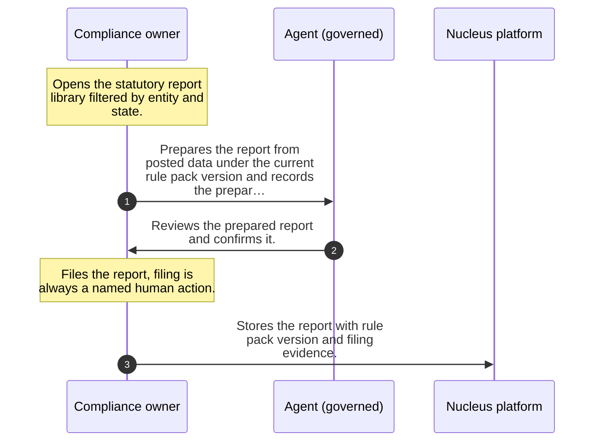

**Alternate flows**

| ID | At step | Condition | Steps | Rejoins |
| :--- | ---: | :--- | :--- | :--- |
| A1 | 2 | Rule pack updated after preparation. | Report is regenerated and the change highlighted. | Returns to step 3 |

**Exception flows**

| ID | At step | Condition | Handling | Rule |
| :--- | ---: | :--- | :--- | :--- |
| E1 | 4 | Agent attempts to file. | Policy gate refuses; attempt recorded. | RL-544 |

**Postconditions — success**

- Report generated, reviewed and filed by a named human.

**Postconditions — failure**

- Unreviewed reports are not filed.

**Quality requirements**

- Reports reproducible from stored rule pack version.

### INT-UC-009

**Analyse skills gaps and act on recommended learning and hiring** — Show current versus required skills by role, team and site and turn agent-recommended learning and hiring actions into approved, ledgered changes.

| Attribute | Value |
| :--- | :--- |
| Realises | INT-CG-005 |
| Source | Authored |
| Level | User goal |
| Primary actor | HR operations |
| Secondary actors | Agent (governed), Manager / supervisor, Director / approver, Auditor, Nucleus platform |
| Trigger | HR operations opens skills gap analysis, or a new role profile is published for a planned line. |
| Frequency | Monthly |
| Criticality | High |
| Phase | P3 |
| Client requirements | — |
| Business rules | RL-141, RL-541, RL-542, RL-545 |
| Screens | SCR-111 |
| Data objects (CRUD) | role_profile (R), skill_profile (R), skills_projection (R), learning_assignment (C), requisition (C), action_ledger (C) |
| Events | agent.action.proposed, agent.policy.evaluated, agent.action.executed, learning.path.assigned, talent.requisition.raised |
| Acceptance tests | INT-TC-017, INT-TC-018, INT-TC-019, INT-TC-020, INT-TC-021, INT-TC-022 |
| System requirements | SYS-017, SYS-035, SYS-037, SYS-072, SYS-073, SYS-074 |

**Stakeholders and interests**

| Stakeholder | Interest |
| :--- | :--- |
| Manager / supervisor | Knows which skills the line lacks before a new product launch and how the gap will close. |
| Director / approver | Approves hiring only where learning cannot close the gap in time. |
| Auditor | Can see which recommendations were accepted, by whom, and what changed as a result. |

**Preconditions**

- Role profiles define required skills and proficiency levels.
- Employee skill profiles are populated from assessments, certifications and inferred skills confirmed by the employee or manager.
- The skills agent runs as an agent principal whose tools can read the skills projection and propose assignments and requisitions.

**Main success scenario**

| # | Actor | Action | Ref |
| ---: | :--- | :--- | :--- |
| 1 | HR operations | Selects the role CNC programmer for the new aerospace line at Peenya Works and the team of 26 programmers and setters. |  |
| 2 | Nucleus platform | Reads the skills analytics projection and compares each person's proficiency with the role profile. |  |
| 3 | Nucleus platform | Shows a heatmap of required versus current proficiency by skill, team and site, with gap counts. |  |
| 4 | Agent (governed) | Recommends actions: assign 5-axis programming path to 9 people, and raise 2 requisitions where no internal candidate is within reach in 6 months. |  |
| 5 | Nucleus platform | Passes each recommended write through the policy gate and shows the dry-run: who gets which path and which requisitions would be raised. |  |
| 6 | HR operations | Reviews and confirms the learning assignments, removing one person on long leave. |  |
| 7 | Director / approver | Approves the 2 requisitions through the approval engine. |  |
| 8 | Nucleus platform | Creates the 8 assignments and 2 requisitions and records each in the action ledger with recommendation, approver and reversal handle. |  |
| 9 | Nucleus platform | Tracks gap closure monthly as learners complete paths and certifications. |  |

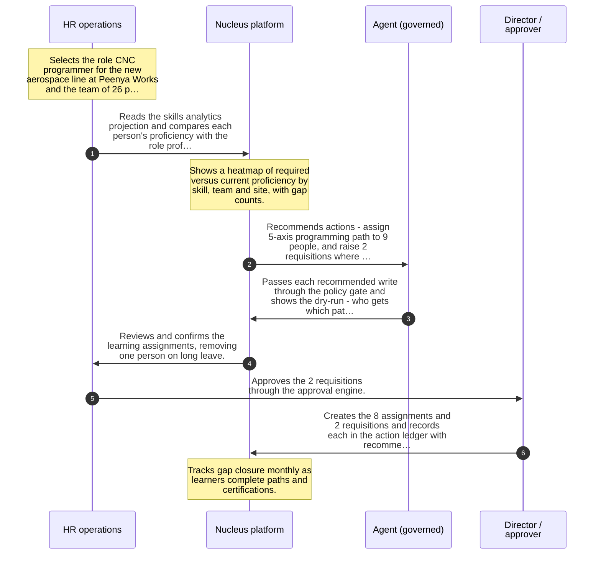

**Alternate flows**

| ID | At step | Condition | Steps | Rejoins |
| :--- | ---: | :--- | :--- | :--- |
| A1 | 4 | The recommended assignments are within the tenant auto-approval threshold of 10 learners and no cost. | Platform assigns them without separate approval and records the threshold applied in the action ledger. | Returns to step 8 |

**Exception flows**

| ID | At step | Condition | Handling | Rule |
| :--- | ---: | :--- | :--- | :--- |
| E1 | 5 | The proposed change exceeds the auto-resolve threshold. | The agent may only propose; the change waits for a human decision. | RL-141 |
| E2 | 5 | A bulk assignment exceeds the blast-radius cap of 50 learners. | The action is denied and recorded with reason. | RL-542 |
| E3 | 4 | A recommendation would require reading data outside declared tools, such as individual pay. | The plan is rejected; the agent uses only declared tools. | RL-541 |
| E4 | 8 | A created assignment fails the post-execution check because the learner already holds the path. | The action is reversed using the handle and the failure is recorded. | RL-545 |

**Postconditions — success**

- Approved learning assignments and requisitions exist in their owning services and each action is recorded in the action ledger.

**Postconditions — failure**

- Rejected recommendations are recorded with reason and nothing is assigned or raised.

**Quality requirements**

- The heatmap for 3,000 employees and 400 skills renders within 4 s at p95.
- Every recommendation states the evidence used, such as assessment date or certification.

### INT-UC-010

**Analyse collaboration networks from consented, aggregated metadata** — Identify silos and connecting teams from consented collaboration metadata, aggregated above privacy thresholds and never using message or meeting content.

| Attribute | Value |
| :--- | :--- |
| Realises | INT-CG-006 |
| Source | Authored |
| Level | User goal |
| Primary actor | HR operations |
| Secondary actors | Director / approver, Tenant admin, Employee / worker, Auditor, Nucleus platform, Corporate calendar |
| Trigger | HR operations proposes a network study, for example on the handover between design engineering and plant production. |
| Frequency | Annual |
| Criticality | Low |
| Phase | P5 |
| Client requirements | — |
| Business rules | RL-541 |
| Screens | SCR-111 |
| Data objects (CRUD) | ona_study (C, U), ona_consent (C, U), interaction_aggregate (C, D), team_network (C), action_ledger (C) |
| Events | platform.approval.completed, agent.tool.called |
| Acceptance tests | INT-TC-023, INT-TC-024, INT-TC-025, INT-TC-026 |
| System requirements | SYS-017, SYS-027, SYS-035, SYS-037, SYS-072 |

**Stakeholders and interests**

| Stakeholder | Interest |
| :--- | :--- |
| Employee / worker | Takes part only with consent, can withdraw at any time, and is never ranked or judged individually. |
| Director / approver | Sees where sites or functions work in isolation, for example between engineering at Pune and production at Medchal Works. |
| Tenant admin | Approves the study scope, data sources and retention before any data is read. |

**Preconditions**

- A study charter defines purpose, population, metadata sources, thresholds and a 90-day retention, approved by the tenant admin and the data protection lead (to be validated by Legal).
- Connectors to the corporate calendar and the business messaging channel are declared tools limited to sender, recipient, time and count.
- Employees in scope have been asked for consent under the DPDP Act 2023.

**Main success scenario**

| # | Actor | Action | Ref |
| ---: | :--- | :--- | :--- |
| 1 | HR operations | Submits the study charter for the design-to-production handover across Pune and Medchal Works. |  |
| 2 | Tenant admin | Approves the charter through the approval engine with the data protection lead. |  |
| 3 | Nucleus platform | Requests consent from the 420 employees in scope, explaining that only counts and timing are used, never content. |  |
| 4 | Nucleus platform | Collects 8 weeks of metadata only for consenting employees through the declared connectors. |  |
| 5 | Nucleus platform | Pseudonymises identities and aggregates interactions to team level, applying a minimum of 8 people per node. |  |
| 6 | Nucleus platform | Computes cross-team link strength, isolated teams and bridging teams. |  |
| 7 | HR operations | Reviews findings and adds interventions such as a weekly design-production stand-up. |  |
| 8 | Director / approver | Views the team-level map and approves the interventions. |  |
| 9 | Nucleus platform | Deletes raw metadata at day 90 and keeps only the aggregated results. |  |

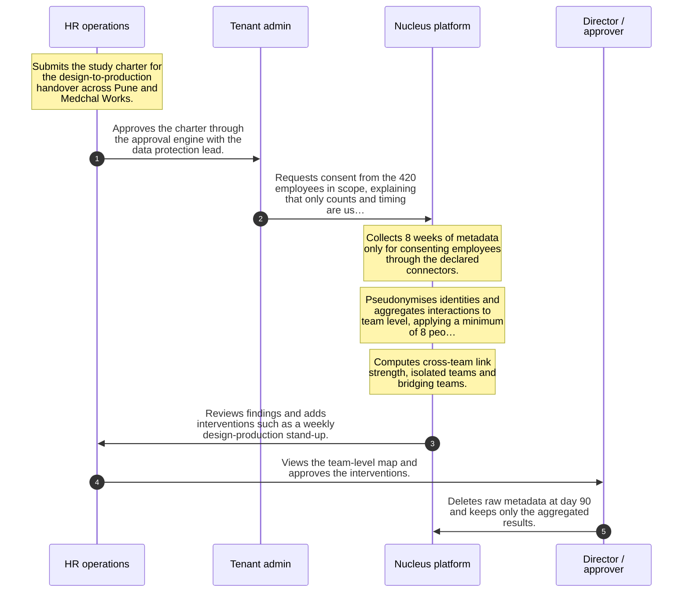

**Alternate flows**

| ID | At step | Condition | Steps | Rejoins |
| :--- | ---: | :--- | :--- | :--- |
| A1 | 6 | An individual has opted in to be named as a connector for a recognition programme. | Platform shows that person's name only in the recognition view and only with their opt-in recorded. | Returns to step 7 |

**Exception flows**

| ID | At step | Condition | Handling | Rule |
| :--- | ---: | :--- | :--- | :--- |
| E1 | 3 | Consent coverage is below 60% of the population. | The study does not proceed and HR is told the coverage. |  |
| E2 | 5 | A team node has fewer than 8 consenting members. | It is merged into its parent unit or suppressed. |  |
| E3 | 4 | A connector tool returns content fields such as message text. | The tool call is rejected by the policy gate and the connector is disabled pending review. | RL-541 |
| E4 | 3 | An employee withdraws consent during the study. | Their metadata is deleted within 24 hours and excluded from results. |  |

**Postconditions — success**

- A team-level network map and findings are published to authorised viewers, and raw metadata is deleted at the end of retention.

**Postconditions — failure**

- The study does not run if consent coverage is below the configured minimum.

**Quality requirements**

- No output, export or agent answer contains an individual node unless that person opted in to be named.
- Raw metadata is deleted within 24 hours of the retention end date.

### INT-UC-011

**Show context metrics embedded in transactional screens** — Display metrics relevant to the decision on the screen, within the viewer's scope, such as team absence trend beside a leave approval.

| Attribute | Value |
| :--- | :--- |
| Realises | INT-CG-007 |
| Source | Authored |
| Level | User goal |
| Primary actor | Manager / supervisor |
| Secondary actors | Nucleus platform, Implementation consultant, Plant HR / time office, HR operations |
| Trigger | A user opens a transactional screen that has context widgets configured. |
| Frequency | Continuous |
| Criticality | Medium |
| Phase | P3 |
| Client requirements | — |
| Business rules | — |
| Screens | SCR-111 |
| Data objects (CRUD) | context_widget (R), analytics_projection (R), widget_render_log (C) |
| Events | leave.request.approved |
| Acceptance tests | INT-TC-027, INT-TC-028, INT-TC-029, INT-TC-030 |
| System requirements | SYS-016, SYS-017, SYS-037, SYS-040 |

**Stakeholders and interests**

| Stakeholder | Interest |
| :--- | :--- |
| Manager / supervisor | Decides approvals with coverage and trend in view, without opening a separate report. |
| Implementation consultant | Configures which metric widgets appear on which screen for the tenant. |
| Employee / worker | Personal data shown in context never exceeds what the viewer may already see. |

**Preconditions**

- Context widgets are registered with the screen, metric, scope rule and minimum group size.
- Analytics projections for the metrics are refreshed on their configured schedule.

**Main success scenario**

| # | Actor | Action | Ref |
| ---: | :--- | :--- | :--- |
| 1 | Manager / supervisor | Opens a leave request from E1066 for 2026-11-23 to 2026-11-25 at Peenya Works. |  |
| 2 | Nucleus platform | Looks up the context widgets registered for the screen: team absence trend, overlap on the dates and shift coverage. |  |
| 3 | Nucleus platform | Resolves the viewer's scope and queries the analytics projections within it. |  |
| 4 | Nucleus platform | Shows an 8-week team absence trend, 3 others already approved for 2026-11-24 and shift A coverage dropping to 82%. |  |
| 5 | Manager / supervisor | Drills into the coverage figure to see the roster for those dates within the team. |  |
| 6 | Manager / supervisor | Approves the request with the context in view. |  |
| 7 | Nucleus platform | Records which widgets were shown with the decision for later review. |  |

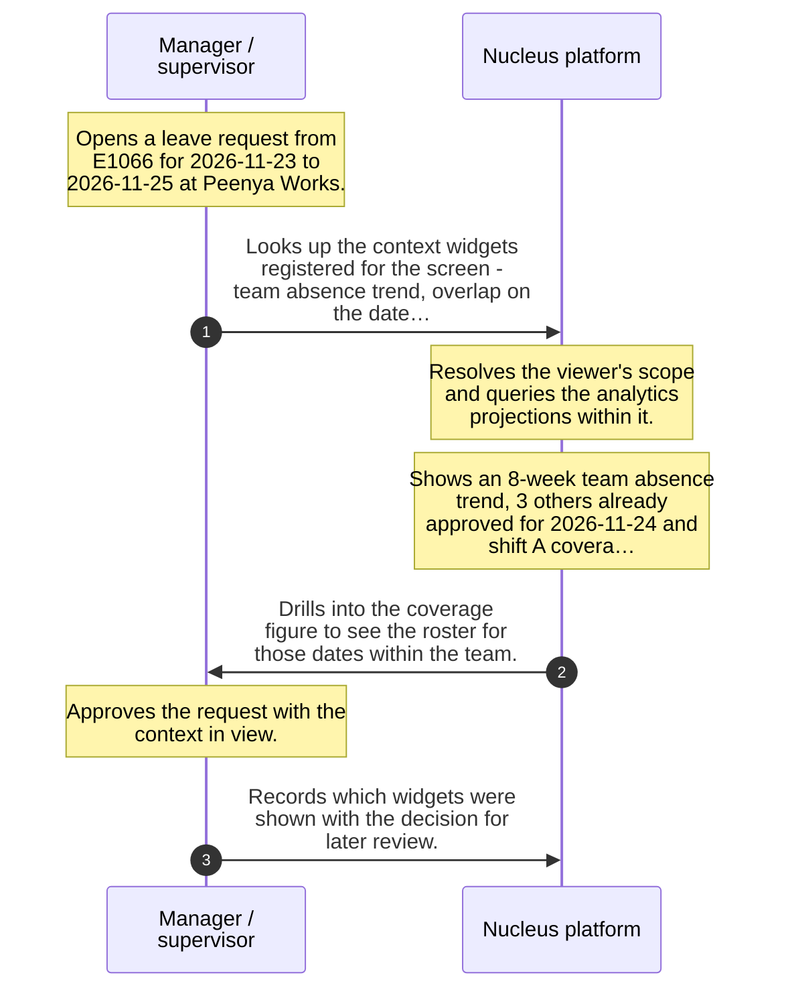

**Alternate flows**

| ID | At step | Condition | Steps | Rejoins |
| :--- | ---: | :--- | :--- | :--- |
| A1 | 2 | An implementation consultant adds a widget to the overtime approval screen. | Consultant selects the metric and scope rule in configuration and previews it as a sample manager. → The widget appears for all managers after publishing. | Use case ends |

**Exception flows**

| ID | At step | Condition | Handling | Rule |
| :--- | ---: | :--- | :--- | :--- |
| E1 | 3 | A metric would cover fewer than 5 people, such as team wellbeing scores. | The widget is suppressed and shows the minimum-size notice. |  |
| E2 | 4 | The projection is unavailable or older than its freshness limit. | The widget shows Context unavailable or the data age, and the approval remains possible. |  |
| E3 | 5 | The drill-through would leave the viewer's scope. | The drill stops at the scope boundary. |  |

**Postconditions — success**

- The screen shows its widgets with the projection timestamp, scoped to the viewer.

**Postconditions — failure**

- When a widget cannot load, the screen states that context is unavailable and the transaction remains usable.

**Quality requirements**

- Widgets load within 800 ms at p95 and never delay the transactional form from rendering.
- Each widget shows the timestamp of the projection it used.

### INT-UC-012

**Connect a client AI environment through the governed MCP tool surface** — Let a client's own AI assistant call Nucleus Suite tools with exactly the permissions, approvals and ledger recording that apply to internal agents and human users.

| Attribute | Value |
| :--- | :--- |
| Realises | IA-03 MCP server flow |
| Source | Authored |
| Level | User goal |
| Primary actor | Tenant admin |
| Secondary actors | Client AI environment, Nucleus platform, HR administrator |
| Trigger | The client wants its enterprise AI assistant to read leave balances and draft letters for HR staff at Vindhya Precision Industries. |
| Frequency | Continuous once connected |
| Criticality | High |
| Phase | P4 |
| Client requirements | — |
| Business rules | — |
| Screens | — |
| Data objects (CRUD) | tool_connection (C, U), action_ledger (C), approval_request (C) |
| Events | — |
| Acceptance tests | — |
| System requirements | SYS-009, SYS-035, SYS-072, SYS-073, SYS-074, SYS-075 |

**Stakeholders and interests**

| Stakeholder | Interest |
| :--- | :--- |
| Data Protection Officer | No data leaves the tenant beyond the scopes granted to the calling identity, and every call is auditable. |
| Client IT | Their assistant can use HR tools without a separate integration or a parallel permission model. |
| Employee / worker | An external assistant cannot see or change their record unless a permitted person asked it to. |

**Preconditions**

- The tenant has the MCP connection capability enabled and a service identity registered for the client AI environment.
- Each tool on the governed tool surface carries a permission scope, a side-effect class and an approval threshold.
- The calling human is authenticated through the client identity provider and mapped to a Nucleus principal.

**Main success scenario**

| # | Actor | Action | Ref |
| ---: | :--- | :--- | :--- |
| 1 | Tenant admin | Registers the client AI environment as a connection and selects the tools to expose: read_employee, apply_leave and draft_letter. |  |
| 2 | Nucleus platform | Shows each tool's permission scope, side-effect class and approval threshold, and blocks tools whose class exceeds the connection ceiling. |  |
| 3 | HR administrator | Approves the connection through the approval engine after reviewing the exposed tools. |  |
| 4 | Client AI environment | Lists the available tools for the signed-in HR user and receives only those the user's role and data scope allow. |  |
| 5 | Client AI environment | Calls read_employee for E1043 on behalf of the HR user. |  |
| 6 | Nucleus platform | Evaluates the call at the policy gate against the user's scope, returns masked fields as masked, and writes the call to the action ledger. |  |
| 7 | Client AI environment | Calls draft_letter for a salary certificate; the platform returns a draft for human review because the tool is write-class. |  |
| 8 | HR administrator | Reviews the draft in Nucleus Suite and confirms issue; the ledger links the confirmation to the original tool call. |  |

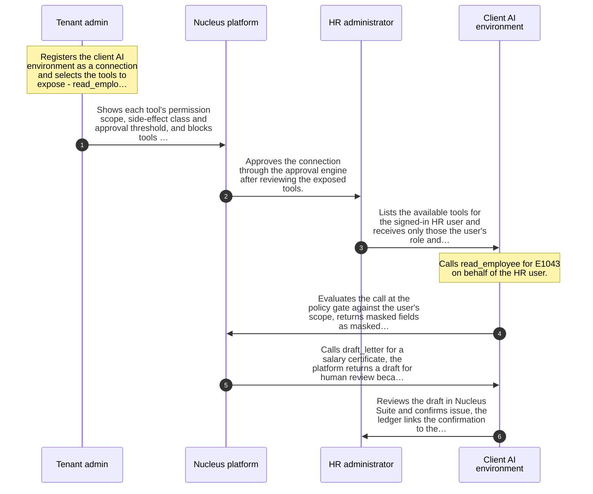

**Alternate flows**

| ID | At step | Condition | Steps | Rejoins |
| :--- | ---: | :--- | :--- | :--- |
| A1 | 5 | The call is for an employee outside the HR user's data scope. | The policy gate denies the call. → The client AI environment receives a refusal naming the scope rule, without any employee data. | Use case ends for that call |
| A2 | 7 | The tool's side-effect class is above the connection's approval threshold. | The platform creates an approval request instead of executing. → The call result tells the client AI environment that a human decision is pending. | Returns to step 8 |

**Exception flows**

| ID | At step | Condition | Handling | Rule |
| :--- | ---: | :--- | :--- | :--- |
| E1 | 4 | The service identity's credential has expired or been revoked. | The connection is refused, no tools are listed and the tenant admin is notified. |  |
| E2 | 6 | The call rate exceeds the connection's quota. | The platform throttles further calls, returns a retry-after value and records the event. |  |

**Postconditions — success**

- The client AI environment can list and call only the tools allowed for the connection and for the calling person.
- Every call, its inputs, the policy decision and the outcome are written to the action ledger under both the service identity and the human principal.

**Postconditions — failure**

- No tool is exposed and the connection stays disabled.
- Rejected calls are recorded in the action ledger with the reason.

**Quality requirements**

- A permitted read tool call returns within 2 seconds at p95 excluding the client's own processing time.
- No tool exposed through MCP bypasses the policy gate; verified by a property test on every build.

## Approval & Sign-off

| Role | Name | Date | Decision | Conditions / comments |
| :--- | :--- | :--- | :--- | :--- |
| Author | Dhanraj Dadhich | 2026-11-05 | Submitted | |
| Peer review moderator | *pending* | | | PR-xxxx |
| PQA (process compliance) | *pending* | | | |
| Approval authority (DOC-01 §7) | *pending* | | | |

## Measurement Data Captured

| Measure | Value | Unit | Notes |
| :--- | :--- | :--- | :--- |
| Size | 352 | specified items (table rows) | Counted automatically at generation |
| Authoring effort | *to be recorded* | person-hours | |
| Review effort (preparation + meeting) | *pending review* | person-hours | From PR-xxxx |
| Rework effort | *pending review* | person-hours | |
| Review rate | *pending review* | items / hour | Compare with PPB control limits |
| Requirement volatility (changes since baseline) | 0 | CRs touching this artefact | Not yet baselined (CM-03) |

**Defects found, by detection phase and severity**

| Detection phase | Major | Minor | Editorial | Injected in phase (major) |
| :--- | :--- | :--- | :--- | :--- |
| Author self-check | 0 | 0 | 0 | — |
| Peer review | *pending* | | | |
| Design / build | | | | |
| System / integration test | | | | |
| UAT | | | | |
| Production (escaped) | | | | each escaped major opens a CAR record (CAR-01) |

Within control limits of the review-rate PPB? *To be assessed at peer review.*

## Revision History

| Version | Date | Author | Change summary | CR ref | Approved by |
| :--- | :--- | :--- | :--- | :--- | :--- |
| 1.0.0 | 2026-11-05 | Dhanraj Dadhich | Consolidated release | CR-0001 | *pending* |
