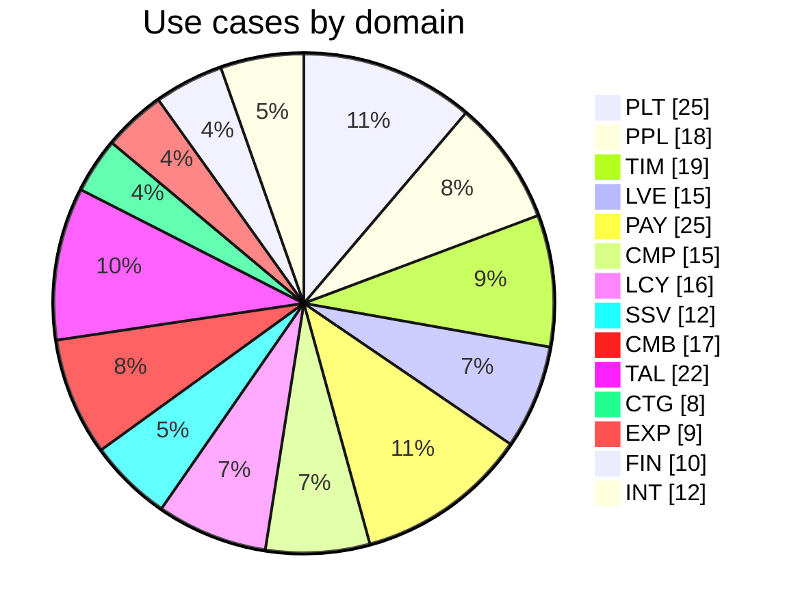

<picture>
  <source media="(prefers-color-scheme: dark)" srcset="../assets/MultipliersKraftLogoDark.png">
  
</picture>

# UCC-01 — Use Case Catalogue

| Attribute | Value |
| :--- | :--- |
| Document ID | UCC-01 |
| Title | Use Case Catalogue |
| Product | Nucleus Suite (Nucleus HRMS Suite) |
| Version | 1.0.0 |
| Status | Issued for approval |
| Owner (role) | Business Analyst Lead |
| Author | Dhanraj Dadhich |
| Reviewed by | *pending* |
| Approved by | Product Council — *pending* |
| Date | 2026-11-05 |
| Classification | Internal |
| CMMI practice areas | RDM, VV |
| Related documents | FRS-<DOM>-12, REQ-02 |
| Quality & process-performance objectives | QPPO-05 (effective requirements reviews), QPPO-01 (escaped defects) — MPM-01 |
| Process performance baseline used | PPB-01 (review defect density), PPB-02 (review rate) — MPM-01 |
| Peer review record | *pending* (PR-xxxx, QA-02) |
| Tailoring record | none |
| Traceability anchor | BG-01 – BG-10 |
| Source of record | FRS-<DOM>-12 use case specifications |

> **Source of record.** Requirements in this document are taken from the source workbook(s) named above and keep their workbook IDs, which are never renumbered. Changes are made through a change request (CM-02) against the source workbook. Sections marked **Authored** are original additions that are not present in the source workbooks.

All 223 use cases across the 14 domains, with what each realises and how it is verified.

## Platform & Foundations (PLT)

| ID | Use case | Primary actor | Realises | Source | Client req. | System req. | Tests | Phase |
| :--- | :--- | :--- | :--- | :--- | :--- | :--- | :--- | :--- |
| [PLT-UC-001](01_PLT_Platform_and_Foundations/FRS-PLT-12_Use_Case_Specifications.md#plt-uc-001) | Provision a new client tenant | Implementation consultant | PLT-01 | Authored | — | SYS-001, SYS-003, SYS-004, SYS-005, SYS-006, SYS-009 | TC-PR09 | P0 |
| [PLT-UC-002](01_PLT_Platform_and_Foundations/FRS-PLT-12_Use_Case_Specifications.md#plt-uc-002) | Grant identity, role and data scope | Tenant admin | PLT-02 | Source workbook | R-09 | SYS-002, SYS-009, SYS-015, SYS-016, SYS-018, SYS-019 | TC-P01, TC-P02, TC-P03, TC-P04, TC-P05, TC-PR09, T-18 | P0 |
| [PLT-UC-003](01_PLT_Platform_and_Foundations/FRS-PLT-12_Use_Case_Specifications.md#plt-uc-003) | Author and effective-date configuration | Implementation consultant | PLT-03 | Authored | — | SYS-026, SYS-032, SYS-037, SYS-048, SYS-053, SYS-059 | TC-P20, TC-P21 | P0 |
| [PLT-UC-004](01_PLT_Platform_and_Foundations/FRS-PLT-12_Use_Case_Specifications.md#plt-uc-004) | Define and version an approval workflow | Implementation consultant | PLT-04 | Authored | — | SYS-038, SYS-039, SYS-041, SYS-042, SYS-043 | TC-P10, TC-P11, TC-P12 | P0 |
| [PLT-UC-005](01_PLT_Platform_and_Foundations/FRS-PLT-12_Use_Case_Specifications.md#plt-uc-005) | Execute an approval chain | Employee / worker | PLT-05 | Source workbook | — | SYS-036, SYS-037, SYS-038, SYS-039, SYS-040, SYS-064 | TC-P10, TC-P11, TC-P12, TC-P13, TC-L15 | P0 |
| [PLT-UC-006](01_PLT_Platform_and_Foundations/FRS-PLT-12_Use_Case_Specifications.md#plt-uc-006) | Write the audit and action ledger | Nucleus platform | PLT-06 | Authored | — | SYS-014, SYS-032, SYS-033, SYS-034, SYS-035 | TC-L15 | P0 |
| [PLT-UC-007](01_PLT_Platform_and_Foundations/FRS-PLT-12_Use_Case_Specifications.md#plt-uc-007) | Publish domain events through the outbox relay | Nucleus platform | PLT-07 | Authored | — | SYS-053, SYS-054, SYS-055, SYS-058 | — | P0 |
| [PLT-UC-008](01_PLT_Platform_and_Foundations/FRS-PLT-12_Use_Case_Specifications.md#plt-uc-008) | Write bi-temporal versions and read as at a point in time | Nucleus platform | PLT-08 | Source workbook | — | SYS-021, SYS-022, SYS-023, SYS-024 | TC-P20, TC-P21 | P0 |
| [PLT-UC-009](01_PLT_Platform_and_Foundations/FRS-PLT-12_Use_Case_Specifications.md#plt-uc-009) | Enforce adaptive MFA and step-up authentication | Payroll manager | PLT-CG-001 | Authored | — | SYS-011, SYS-015, SYS-032, SYS-083 | PLT-TC-001, PLT-TC-002, PLT-TC-003, PLT-TC-004, PLT-TC-005, PLT-TC-006 | P0 |
| [PLT-UC-010](01_PLT_Platform_and_Foundations/FRS-PLT-12_Use_Case_Specifications.md#plt-uc-010) | Deliver notifications through a channel matrix and preference centre | Tenant admin | PLT-CG-002 | Authored | — | SYS-017, SYS-055, SYS-066, SYS-070 | PLT-TC-007, PLT-TC-008, PLT-TC-009, PLT-TC-010, PLT-TC-011, PLT-TC-012 | P1 |
| [PLT-UC-011](01_PLT_Platform_and_Foundations/FRS-PLT-12_Use_Case_Specifications.md#plt-uc-011) | Design approval processes without code | Tenant admin | PLT-CG-003 | Authored | — | SYS-039, SYS-042, SYS-044, SYS-048, SYS-069 | TC-P10, TC-P11, TC-P12, PLT-TC-013, PLT-TC-014, PLT-TC-015, PLT-TC-016 | P2 |
| [PLT-UC-012](01_PLT_Platform_and_Foundations/FRS-PLT-12_Use_Case_Specifications.md#plt-uc-012) | Promote configuration from sandbox to production | Implementation consultant | PLT-CG-004 | Authored | — | SYS-008, SYS-022, SYS-026, SYS-037 | PLT-TC-017, PLT-TC-018, PLT-TC-019, PLT-TC-020 | P2 |
| [PLT-UC-013](01_PLT_Platform_and_Foundations/FRS-PLT-12_Use_Case_Specifications.md#plt-uc-013) | Delegate approval authority and act as a user | Manager / supervisor | PLT-CG-005 | Authored | — | SYS-014, SYS-020, SYS-032, SYS-039 | TC-P12, TC-P13, PLT-TC-021, PLT-TC-022, PLT-TC-023, PLT-TC-024, PLT-TC-025, PLT-TC-026 | P1 |
| [PLT-UC-014](01_PLT_Platform_and_Foundations/FRS-PLT-12_Use_Case_Specifications.md#plt-uc-014) | Load data in bulk with validation and rollback | HR operations | PLT-CG-006 | Authored | — | SYS-017, SYS-022, SYS-032, SYS-061, SYS-070 | PLT-TC-027, PLT-TC-028, PLT-TC-029, PLT-TC-030, PLT-TC-031, PLT-TC-032 | P1 |
| [PLT-UC-015](01_PLT_Platform_and_Foundations/FRS-PLT-12_Use_Case_Specifications.md#plt-uc-015) | Add custom fields and custom objects | Tenant admin | PLT-CG-007 | Authored | — | SYS-017, SYS-018, SYS-026, SYS-060 | PLT-TC-033, PLT-TC-034, PLT-TC-035, PLT-TC-036 | P3 |
| [PLT-UC-016](01_PLT_Platform_and_Foundations/FRS-PLT-12_Use_Case_Specifications.md#plt-uc-016) | Migrate data from a legacy HRMS and payroll system | Implementation consultant | PLT-CG-008 | Authored | — | SYS-022, SYS-028, SYS-049, SYS-061 | PLT-TC-037, PLT-TC-038, PLT-TC-039, PLT-TC-040, PLT-TC-041, PLT-TC-042 | P1 |
| [PLT-UC-017](01_PLT_Platform_and_Foundations/FRS-PLT-12_Use_Case_Specifications.md#plt-uc-017) | Handle a data-principal rights request | Employee / worker | PLT-CG-009 | Authored | — | SYS-027, SYS-032, SYS-033, SYS-039, SYS-070 | PLT-TC-043, PLT-TC-044, PLT-TC-045, PLT-TC-046, PLT-TC-047, PLT-TC-048 | P1 |
| [PLT-UC-018](01_PLT_Platform_and_Foundations/FRS-PLT-12_Use_Case_Specifications.md#plt-uc-018) | Provision identities to the enterprise directory | Nucleus platform | PLT-CG-010 | Authored | — | SYS-012, SYS-032, SYS-055, SYS-083 | PLT-TC-049, PLT-TC-050, PLT-TC-051, PLT-TC-052, PLT-TC-053, PLT-TC-054 | P2 |
| [PLT-UC-019](01_PLT_Platform_and_Foundations/FRS-PLT-12_Use_Case_Specifications.md#plt-uc-019) | View any record, report or chart as at a past date | HR operations | PLT-CG-011 | Authored | — | SYS-016, SYS-021, SYS-023, SYS-032 | PLT-TC-055, PLT-TC-056, PLT-TC-057, PLT-TC-058, PLT-TC-059, PLT-TC-060 | P2 |
| [PLT-UC-020](01_PLT_Platform_and_Foundations/FRS-PLT-12_Use_Case_Specifications.md#plt-uc-020) | Publish a policy change through automated regression | Implementation consultant | PLT-CG-012 | Authored | — | SYS-022, SYS-026, SYS-037, SYS-046, SYS-057 | PLT-TC-061, PLT-TC-062, PLT-TC-063, PLT-TC-064, PLT-TC-065, PLT-TC-066 | P2 |
| [PLT-UC-021](01_PLT_Platform_and_Foundations/FRS-PLT-12_Use_Case_Specifications.md#plt-uc-021) | Publish and install a governed extension | Tenant admin | PLT-CG-013 | Authored | — | SYS-009, SYS-016, SYS-032, SYS-072, SYS-073 | PLT-TC-067, PLT-TC-068, PLT-TC-069, PLT-TC-070, PLT-TC-071, PLT-TC-072 | P4 |
| [PLT-UC-022](01_PLT_Platform_and_Foundations/FRS-PLT-12_Use_Case_Specifications.md#plt-uc-022) | Consolidate multi-entity reporting across currencies | Finance | PLT-CG-014 | Authored | — | SYS-006, SYS-026, SYS-028, SYS-029 | PLT-TC-073, PLT-TC-074, PLT-TC-075, PLT-TC-076, PLT-TC-077, PLT-TC-078 | P3 |
| [PLT-UC-023](01_PLT_Platform_and_Foundations/FRS-PLT-12_Use_Case_Specifications.md#plt-uc-023) | Classify, extract and confirm employee documents | HR operations | PLT-CG-015 | Authored | — | SYS-022, SYS-070, SYS-074, SYS-087 | PLT-TC-079, PLT-TC-080, PLT-TC-081, PLT-TC-082, PLT-TC-083, PLT-TC-084 | P2 |
| [PLT-UC-024](01_PLT_Platform_and_Foundations/FRS-PLT-12_Use_Case_Specifications.md#plt-uc-024) | Register visitors and control gate entry and exit | Plant HR / time office | PLT-CG-016 | Authored | — | SYS-032, SYS-053, SYS-070, SYS-078 | PLT-TC-085, PLT-TC-086, PLT-TC-087, PLT-TC-088, PLT-TC-089, PLT-TC-090 | P3 |
| [PLT-UC-025](01_PLT_Platform_and_Foundations/FRS-PLT-12_Use_Case_Specifications.md#plt-uc-025) | Enable an additional Indian language for a tenant | Tenant admin | PLT-CG-017 | Authored | — | SYS-032, SYS-037, SYS-066, SYS-067, SYS-087 | PLT-TC-091, PLT-TC-092, PLT-TC-093, PLT-TC-094 | P2 |

## People Core (PPL)

| ID | Use case | Primary actor | Realises | Source | Client req. | System req. | Tests | Phase |
| :--- | :--- | :--- | :--- | :--- | :--- | :--- | :--- | :--- |
| [PPL-UC-001](02_PPL_People_Core/FRS-PPL-12_Use_Case_Specifications.md#ppl-uc-001) | Create person, position and assignment | HR operations | PPL-01 | Source workbook | — | SYS-006, SYS-007, SYS-022, SYS-033, SYS-053 | TC-H30, TC-H31, TC-H32, TC-H33, TC-H34, TC-H35, TC-H36, TC-H37, TC-H38, TC-P05 | P1 |
| [PPL-UC-002](02_PPL_People_Core/FRS-PPL-12_Use_Case_Specifications.md#ppl-uc-002) | Change an assignment with an effective date | HR operations | PPL-02 | Source workbook | — | SYS-022, SYS-025, SYS-037, SYS-053, SYS-057 | TC-H40, TC-Y41, TC-T42, TC-P20 | P1 |
| [PPL-UC-003](02_PPL_People_Core/FRS-PPL-12_Use_Case_Specifications.md#ppl-uc-003) | Resolve worker class and policy attributes | Nucleus platform | PPL-03 | Source workbook | R-03, R-04, R-05 | SYS-023, SYS-026, SYS-059, SYS-071 | TC-H37, TC-H50, TC-H51, TC-T52, TC-H53, TC-T101, TC-T102, TC-T130, TC-T132, TC-Y290, T-04, T-06, T-07 | P1 |
| [PPL-UC-004](02_PPL_People_Core/FRS-PPL-12_Use_Case_Specifications.md#ppl-uc-004) | Control positions and sanctioned strength | Finance | PPL-04 | Source workbook | — | SYS-016, SYS-022, SYS-023, SYS-053 | TC-R55, TC-R56, TC-R57, TC-R58, TC-R461, TC-R462 | P3 |
| [PPL-UC-005](02_PPL_People_Core/FRS-PPL-12_Use_Case_Specifications.md#ppl-uc-005) | Change an org unit or reorganise | HR operations | PPL-05 | Authored | R-23 | SYS-022, SYS-023, SYS-037, SYS-038, SYS-048 | TC-H35, TC-R56, T-37 | P1 |
| [PPL-UC-006](02_PPL_People_Core/FRS-PPL-12_Use_Case_Specifications.md#ppl-uc-006) | Capture, classify and track documents | Employee / worker | PPL-06 | Source workbook | — | SYS-033, SYS-070, SYS-087 | TC-H60, TC-H61, TC-H62 | P1 |
| [PPL-UC-007](02_PPL_People_Core/FRS-PPL-12_Use_Case_Specifications.md#ppl-uc-007) | Rehire, transfer between entities or change worker class | HR operations | PPL-07 | Authored | — | SYS-006, SYS-022, SYS-053, SYS-059 | TC-H32, TC-H34, TC-H38 | P2 |
| [PPL-UC-008](02_PPL_People_Core/FRS-PPL-12_Use_Case_Specifications.md#ppl-uc-008) | Detect duplicate persons | Nucleus platform | PPL-08 | Authored | — | SYS-032, SYS-033, SYS-053, SYS-084 | TC-H30, TC-H31 | P2 |
| [PPL-UC-009](02_PPL_People_Core/FRS-PPL-12_Use_Case_Specifications.md#ppl-uc-009) | Maintain job architecture | HR operations | PPL-CG-001 | Authored | — | SYS-022, SYS-023, SYS-037 | PPL-TC-001, PPL-TC-002, PPL-TC-003, PPL-TC-004 | P1 |
| [PPL-UC-010](02_PPL_People_Core/FRS-PPL-12_Use_Case_Specifications.md#ppl-uc-010) | Maintain multiple and matrix hierarchies | HR operations | PPL-CG-002 | Authored | — | SYS-016, SYS-022, SYS-038, SYS-039 | PPL-TC-005, PPL-TC-006, PPL-TC-007, PPL-TC-008 | P1 |
| [PPL-UC-011](02_PPL_People_Core/FRS-PPL-12_Use_Case_Specifications.md#ppl-uc-011) | Manage global and expatriate assignments | HR operations | PPL-CG-003 | Authored | — | SYS-006, SYS-007, SYS-028, SYS-070 | TC-H62, PPL-TC-009, PPL-TC-010, PPL-TC-011, PPL-TC-012 | P4 |
| [PPL-UC-012](02_PPL_People_Core/FRS-PPL-12_Use_Case_Specifications.md#ppl-uc-012) | Record dependants, nominees and emergency contacts | Employee / worker | PPL-CG-004 | Authored | — | SYS-017, SYS-022, SYS-033, SYS-037 | PPL-TC-013, PPL-TC-014, PPL-TC-015, PPL-TC-016, PPL-TC-017, PPL-TC-018 | P1 |
| [PPL-UC-013](02_PPL_People_Core/FRS-PPL-12_Use_Case_Specifications.md#ppl-uc-013) | Stage and commit a mass reorganisation | HR operations | PPL-CG-005 | Authored | — | SYS-016, SYS-022, SYS-037, SYS-048, SYS-053, SYS-057 | TC-T42, PPL-TC-019, PPL-TC-020, PPL-TC-021, PPL-TC-022 | P2 |
| [PPL-UC-014](02_PPL_People_Core/FRS-PPL-12_Use_Case_Specifications.md#ppl-uc-014) | Explore the interactive organisation chart | Manager / supervisor | PPL-CG-006 | Authored | R-23 | SYS-016, SYS-017, SYS-069 | T-37, TC-R56, PPL-TC-023, PPL-TC-024, PPL-TC-025, PPL-TC-026, PPL-TC-027, PPL-TC-028 | P1 |
| [PPL-UC-015](02_PPL_People_Core/FRS-PPL-12_Use_Case_Specifications.md#ppl-uc-015) | Hold concurrent assignments for one person | HR operations | PPL-CG-007 | Authored | — | SYS-006, SYS-007, SYS-037, SYS-045, SYS-057 | PPL-TC-029, PPL-TC-030, PPL-TC-031, PPL-TC-032, PPL-TC-033, PPL-TC-034 | P2 |
| [PPL-UC-016](02_PPL_People_Core/FRS-PPL-12_Use_Case_Specifications.md#ppl-uc-016) | Plan headcount and positions against sanctioned strength | HR operations | PPL-CG-008 | Authored | — | SYS-017, SYS-022, SYS-028, SYS-037 | PPL-TC-035, PPL-TC-036, PPL-TC-037, PPL-TC-038, PPL-TC-039, PPL-TC-040 | P3 |
| [PPL-UC-017](02_PPL_People_Core/FRS-PPL-12_Use_Case_Specifications.md#ppl-uc-017) | Present a digital ID and download verifiable employment letters | Employee / worker | PPL-CG-009 | Authored | — | SYS-017, SYS-032, SYS-033, SYS-088 | PPL-TC-041, PPL-TC-042, PPL-TC-043, PPL-TC-044, PPL-TC-045, PPL-TC-046 | P2 |
| [PPL-UC-018](02_PPL_People_Core/FRS-PPL-12_Use_Case_Specifications.md#ppl-uc-018) | Monitor organisation health metrics by unit | Manager / supervisor | PPL-CG-010 | Authored | — | SYS-016, SYS-017, SYS-077 | PPL-TC-047, PPL-TC-048, PPL-TC-049, PPL-TC-050, PPL-TC-051, PPL-TC-052 | P3 |

## Time & Attendance (TIM)

| ID | Use case | Primary actor | Realises | Source | Client req. | System req. | Tests | Phase |
| :--- | :--- | :--- | :--- | :--- | :--- | :--- | :--- | :--- |
| [TIM-UC-001](03_TIM_Time_and_Attendance/FRS-TIM-12_Use_Case_Specifications.md#tim-uc-001) | Ingest punches from every enrolled source | Employee / worker | TIM-01 | Source workbook | R-01 | SYS-057, SYS-062, SYS-063, SYS-064, SYS-080, SYS-082 | TC-T70, TC-T71, TC-T72, TC-T73, TC-T74, TC-T75, T-01 | P1 |
| [TIM-UC-002](03_TIM_Time_and_Attendance/FRS-TIM-12_Use_Case_Specifications.md#tim-uc-002) | Derive the attendance day from paired punches | Nucleus platform | TIM-02 | Source workbook | R-01, R-12 | SYS-024, SYS-026, SYS-047, SYS-059, SYS-068 | TC-T80, TC-T81, TC-T82, TC-T83, TC-T84, TC-T85, TC-T86, TC-T87, TC-T88, TC-T89, TC-PR06, TC-PR07, T-01, T-02, T-03 | P1 |
| [TIM-UC-003](03_TIM_Time_and_Attendance/FRS-TIM-12_Use_Case_Specifications.md#tim-uc-003) | Infer the applied shift from the first in-punch | Nucleus platform | TIM-03 | Source workbook | R-14 | SYS-026, SYS-036, SYS-059, SYS-068 | TC-T90, TC-T91, TC-T92, TC-T93, TC-T94, T-27 | P1 |
| [TIM-UC-004](03_TIM_Time_and_Attendance/FRS-TIM-12_Use_Case_Specifications.md#tim-uc-004) | Resolve the day type before disposition | Nucleus platform | TIM-04 | Source workbook | — | SYS-007, SYS-023, SYS-026, SYS-068 | TC-T100, TC-T101, TC-T102, TC-T103 | P1 |
| [TIM-UC-005](03_TIM_Time_and_Attendance/FRS-TIM-12_Use_Case_Specifications.md#tim-uc-005) | Dispose the attendance day against shift thresholds and late rules | Nucleus platform | TIM-05 | Source workbook | R-13 | SYS-026, SYS-049, SYS-059, SYS-068 | TC-T52, TC-T94, TC-T110, TC-T111, TC-T112, TC-T113, TC-T114, TC-T115, TC-T116, TC-T117, TC-T118, TC-T119, T-24, T-25, T-26 | P1 |
| [TIM-UC-006](03_TIM_Time_and_Attendance/FRS-TIM-12_Use_Case_Specifications.md#tim-uc-006) | Request, approve and credit a gate pass | Employee / worker | TIM-06 | Source workbook | R-12 | SYS-037, SYS-049, SYS-057, SYS-059, SYS-071 | TC-P10, TC-T86, TC-T120, TC-T121, TC-T122, TC-T123, T-23 | P1 |
| [TIM-UC-007](03_TIM_Time_and_Attendance/FRS-TIM-12_Use_Case_Specifications.md#tim-uc-007) | Compute and approve overtime | Manager / supervisor | TIM-07 | Source workbook | R-01, R-11 | SYS-037, SYS-045, SYS-059, SYS-086 | TC-T130, TC-T131, TC-T132, TC-T133, TC-Y134, T-03, T-22 | P1 |
| [TIM-UC-008](03_TIM_Time_and_Attendance/FRS-TIM-12_Use_Case_Specifications.md#tim-uc-008) | Resolve attendance exceptions through regularisation | Manager / supervisor | TIM-08 | Source workbook | — | SYS-035, SYS-037, SYS-057, SYS-072, SYS-074, SYS-082 | TC-T140, TC-A141, TC-T142 | P1 |
| [TIM-UC-009](03_TIM_Time_and_Attendance/FRS-TIM-12_Use_Case_Specifications.md#tim-uc-009) | Recompute attendance after a change | Nucleus platform | TIM-09 | Source workbook | — | SYS-024, SYS-025, SYS-052, SYS-055, SYS-057 | TC-P21, TC-T42, TC-T75, TC-T150, TC-T151, TC-N152, TC-Y153, TC-Y154 | P1 |
| [TIM-UC-010](03_TIM_Time_and_Attendance/FRS-TIM-12_Use_Case_Specifications.md#tim-uc-010) | View and export team attendance history | Manager / supervisor | TIM-10 | Source workbook | R-02 | SYS-016, SYS-017, SYS-033 | TC-T160, TC-T161, TC-C162, T-05 | P1 |
| [TIM-UC-011](03_TIM_Time_and_Attendance/FRS-TIM-12_Use_Case_Specifications.md#tim-uc-011) | Log and approve project and task timesheets | Employee / worker | TIM-CG-001 | Authored | — | SYS-026, SYS-028, SYS-037, SYS-038, SYS-084 | TIM-TC-001, TIM-TC-002, TIM-TC-003, TIM-TC-004, TIM-TC-005, TIM-TC-006 | P3 |
| [TIM-UC-012](03_TIM_Time_and_Attendance/FRS-TIM-12_Use_Case_Specifications.md#tim-uc-012) | Punch from mobile inside a geofence with a live selfie | Employee / worker | TIM-CG-002 | Authored | — | SYS-062, SYS-063, SYS-064, SYS-065, SYS-081 | TC-T70, TC-T71, TC-T73, TIM-TC-007, TIM-TC-008, TIM-TC-009, TIM-TC-010, TIM-TC-011, TIM-TC-012, TIM-TC-013, TIM-TC-014 | P1 |
| [TIM-UC-013](03_TIM_Time_and_Attendance/FRS-TIM-12_Use_Case_Specifications.md#tim-uc-013) | Swap shifts and claim open shifts | Employee / worker | TIM-CG-003 | Authored | — | SYS-037, SYS-038, SYS-057, SYS-059 | TIM-TC-015, TIM-TC-016, TIM-TC-017, TIM-TC-018, TIM-TC-019, TIM-TC-020 | P3 |
| [TIM-UC-014](03_TIM_Time_and_Attendance/FRS-TIM-12_Use_Case_Specifications.md#tim-uc-014) | Work flexi-time and manage a time bank | Employee / worker | TIM-CG-004 | Authored | — | SYS-037, SYS-049, SYS-050, SYS-059 | TIM-TC-021, TIM-TC-022, TIM-TC-023, TIM-TC-024, TIM-TC-025, TIM-TC-026 | P3 |
| [TIM-UC-015](03_TIM_Time_and_Attendance/FRS-TIM-12_Use_Case_Specifications.md#tim-uc-015) | Generate rosters from forecast labour demand | Plant HR / time office | TIM-CG-005 | Authored | — | SYS-045, SYS-057, SYS-059, SYS-070 | TIM-TC-027, TIM-TC-028, TIM-TC-029, TIM-TC-030, TIM-TC-031, TIM-TC-032 | P4 |
| [TIM-UC-016](03_TIM_Time_and_Attendance/FRS-TIM-12_Use_Case_Specifications.md#tim-uc-016) | Pre-approve overtime against a line budget | Manager / supervisor | TIM-CG-006 | Authored | — | SYS-028, SYS-037, SYS-045, SYS-051 | TIM-TC-033, TIM-TC-034, TIM-TC-035, TIM-TC-036, TIM-TC-037, TIM-TC-038 | P1 |
| [TIM-UC-017](03_TIM_Time_and_Attendance/FRS-TIM-12_Use_Case_Specifications.md#tim-uc-017) | Reconcile canteen and transport usage with attendance | Plant HR / time office | TIM-CG-007 | Authored | — | SYS-017, SYS-028, SYS-053, SYS-084 | TIM-TC-039, TIM-TC-040, TIM-TC-041, TIM-TC-042, TIM-TC-043, TIM-TC-044 | P3 |
| [TIM-UC-018](03_TIM_Time_and_Attendance/FRS-TIM-12_Use_Case_Specifications.md#tim-uc-018) | Declare work location and book a desk | Employee / worker | TIM-CG-008 | Authored | — | SYS-017, SYS-059, SYS-062 | TIM-TC-045, TIM-TC-046, TIM-TC-047, TIM-TC-048, TIM-TC-049, TIM-TC-050 | P3 |
| [TIM-UC-019](03_TIM_Time_and_Attendance/FRS-TIM-12_Use_Case_Specifications.md#tim-uc-019) | Accept opt-in presence signals from wearables or beacons | Employee / worker | TIM-CG-009 | Authored | — | SYS-027, SYS-062, SYS-063, SYS-080 | TIM-TC-051, TIM-TC-052, TIM-TC-053, TIM-TC-054, TIM-TC-055, TIM-TC-056 | P4 |

## Leave (LVE)

| ID | Use case | Primary actor | Realises | Source | Client req. | System req. | Tests | Phase |
| :--- | :--- | :--- | :--- | :--- | :--- | :--- | :--- | :--- |
| [LVE-UC-001](04_LVE_Leave/FRS-LVE-12_Use_Case_Specifications.md#lve-uc-001) | Run the leave accrual job | Nucleus platform | LVE-01 | Source workbook | R-08 | SYS-026, SYS-049, SYS-050, SYS-053, SYS-059 | TC-L170, TC-L171, TC-L172, TC-L173, TC-PR08, T-11, T-12, T-13 | P1 |
| [LVE-UC-002](04_LVE_Leave/FRS-LVE-12_Use_Case_Specifications.md#lve-uc-002) | Prorate casual and sick leave for a new joiner | Nucleus platform | LVE-02 | Source workbook | R-08 | SYS-049, SYS-053, SYS-056, SYS-059 | TC-L180, TC-L181, TC-L182, T-14 | P1 |
| [LVE-UC-003](04_LVE_Leave/FRS-LVE-12_Use_Case_Specifications.md#lve-uc-003) | Apply for leave with rule validation | Employee / worker | LVE-03 | Source workbook | R-08 | SYS-023, SYS-049, SYS-059, SYS-066, SYS-071 | TC-L190, TC-L191, TC-L192, TC-L193, TC-L194, T-15, T-16 | P1 |
| [LVE-UC-004](04_LVE_Leave/FRS-LVE-12_Use_Case_Specifications.md#lve-uc-004) | Approve leave through the three-level chain | Manager / supervisor | LVE-04 | Source workbook | R-06 | SYS-020, SYS-036, SYS-037, SYS-039, SYS-040, SYS-041 | TC-P10, TC-L14, TC-L15, TC-L195, T-09 | P1 |
| [LVE-UC-005](04_LVE_Leave/FRS-LVE-12_Use_Case_Specifications.md#lve-uc-005) | Record early return and re-credit unused leave | HR operations | LVE-05 | Source workbook | R-06 | SYS-025, SYS-049, SYS-052, SYS-053, SYS-057 | TC-L200, TC-L201, TC-L202, TC-Y203, T-08 | P1 |
| [LVE-UC-006](04_LVE_Leave/FRS-LVE-12_Use_Case_Specifications.md#lve-uc-006) | Credit, consume and lapse compensatory off | Nucleus platform | LVE-06 | Source workbook | R-07 | SYS-049, SYS-050, SYS-059, SYS-070 | TC-L210, TC-L211, TC-L212, TC-L213, TC-PR08, T-10 | P1 |
| [LVE-UC-007](04_LVE_Leave/FRS-LVE-12_Use_Case_Specifications.md#lve-uc-007) | Process leave year end and birthday leave | Nucleus platform | LVE-07 | Source workbook | R-08 | SYS-028, SYS-045, SYS-048, SYS-049, SYS-050 | TC-L220, TC-Y221, TC-L222, T-17 | P1 |
| [LVE-UC-008](04_LVE_Leave/FRS-LVE-12_Use_Case_Specifications.md#lve-uc-008) | View projected leave balance and its ledger trail | Employee / worker | LVE-08 | Source workbook | R-07 | SYS-023, SYS-049, SYS-071 | TC-L191, TC-L230, TC-L231 | P1 |
| [LVE-UC-009](04_LVE_Leave/FRS-LVE-12_Use_Case_Specifications.md#lve-uc-009) | Manage maternity and paternity leave | Employee / worker | LVE-CG-001 | Authored | — | SYS-033, SYS-037, SYS-045, SYS-049, SYS-070 | LVE-TC-001, LVE-TC-002, LVE-TC-003, LVE-TC-004, LVE-TC-005, LVE-TC-006 | P1 |
| [LVE-UC-010](04_LVE_Leave/FRS-LVE-12_Use_Case_Specifications.md#lve-uc-010) | Grant and close a leave of absence | Employee / worker | LVE-CG-002 | Authored | — | SYS-022, SYS-037, SYS-038, SYS-041, SYS-053 | LVE-TC-007, LVE-TC-008, LVE-TC-009, LVE-TC-010 | P2 |
| [LVE-UC-011](04_LVE_Leave/FRS-LVE-12_Use_Case_Specifications.md#lve-uc-011) | Donate earned leave to a colleague or shared bank | Employee / worker | LVE-CG-003 | Authored | — | SYS-037, SYS-049, SYS-059, SYS-070 | LVE-TC-011, LVE-TC-012, LVE-TC-013, LVE-TC-014 | P3 |
| [LVE-UC-012](04_LVE_Leave/FRS-LVE-12_Use_Case_Specifications.md#lve-uc-012) | Publish approved leave to the corporate calendar | Nucleus platform | LVE-CG-004 | Authored | — | SYS-053, SYS-055, SYS-056, SYS-088 | LVE-TC-015, LVE-TC-016, LVE-TC-017, LVE-TC-018 | P2 |
| [LVE-UC-013](04_LVE_Leave/FRS-LVE-12_Use_Case_Specifications.md#lve-uc-013) | Choose optional and restricted holidays | Employee / worker | LVE-CG-005 | Authored | — | SYS-026, SYS-059, SYS-068 | LVE-TC-019, LVE-TC-020, LVE-TC-021, LVE-TC-022 | P1 |
| [LVE-UC-014](04_LVE_Leave/FRS-LVE-12_Use_Case_Specifications.md#lve-uc-014) | Simulate a leave policy change before publishing | HR operations | LVE-CG-006 | Authored | — | SYS-026, SYS-028, SYS-037, SYS-048, SYS-049 | LVE-TC-023, LVE-TC-024, LVE-TC-025, LVE-TC-026, LVE-TC-027, LVE-TC-028 | P2 |
| [LVE-UC-015](04_LVE_Leave/FRS-LVE-12_Use_Case_Specifications.md#lve-uc-015) | Flag leave requests that breach team coverage | Manager / supervisor | LVE-CG-007 | Authored | — | SYS-026, SYS-036, SYS-037, SYS-040, SYS-070 | LVE-TC-029, LVE-TC-030, LVE-TC-031, LVE-TC-032, LVE-TC-033, LVE-TC-034 | P2 |

## Payroll (PAY)

| ID | Use case | Primary actor | Realises | Source | Client req. | System req. | Tests | Phase |
| :--- | :--- | :--- | :--- | :--- | :--- | :--- | :--- | :--- |
| [PAY-UC-001](05_PAY_Payroll/FRS-PAY-12_Use_Case_Specifications.md#pay-uc-001) | Create a payroll run for a period | Payroll manager | PAY-01 | Source workbook | — | SYS-006, SYS-007, SYS-016, SYS-024 | TC-Y240, TC-Y241, TC-Y242, TC-Y134 | P1 |
| [PAY-UC-002](05_PAY_Payroll/FRS-PAY-12_Use_Case_Specifications.md#pay-uc-002) | Lock payroll inputs and take an immutable snapshot | Payroll manager | PAY-02 | Source workbook | — | SYS-024, SYS-031, SYS-051, SYS-052, SYS-053 | TC-Y250, TC-Y251, TC-PR03 | P1 |
| [PAY-UC-003](05_PAY_Payroll/FRS-PAY-12_Use_Case_Specifications.md#pay-uc-003) | Run the pre-payroll audit | Payroll manager | PAY-03 | Source workbook | — | SYS-035, SYS-036, SYS-051, SYS-072, SYS-074 | TC-H33, TC-Y154, TC-Y260, TC-A261, TC-Y262 | P1 |
| [PAY-UC-004](05_PAY_Payroll/FRS-PAY-12_Use_Case_Specifications.md#pay-uc-004) | Execute gross-to-net calculation | Nucleus platform | PAY-04 | Source workbook | — | SYS-024, SYS-028, SYS-029, SYS-030, SYS-045, SYS-047 | TC-Y270, TC-Y271, TC-Y272, TC-Y273, TC-PR04 | P1 |
| [PAY-UC-005](05_PAY_Payroll/FRS-PAY-12_Use_Case_Specifications.md#pay-uc-005) | Compute the statutory wage base with the 50% floor | Nucleus platform | PAY-05 | Source workbook | — | SYS-028, SYS-045, SYS-047, SYS-048 | TC-Y280, TC-Y281, TC-Y282, TC-Y283 | P1 |
| [PAY-UC-006](05_PAY_Payroll/FRS-PAY-12_Use_Case_Specifications.md#pay-uc-006) | Compute daily-wage earnings | Nucleus platform | PAY-06 | Source workbook | — | SYS-024, SYS-028, SYS-047, SYS-059 | TC-Y290, TC-Y291, TC-Y292, TC-T101 | P1 |
| [PAY-UC-007](05_PAY_Payroll/FRS-PAY-12_Use_Case_Specifications.md#pay-uc-007) | Compute statutory deductions and provisions | Nucleus platform | PAY-07 | Source workbook | — | SYS-028, SYS-030, SYS-045, SYS-046, SYS-047 | TC-Y300, TC-Y301, TC-Y302, TC-Y303, TC-Y304, TC-C380, TC-C382 | P1 |
| [PAY-UC-008](05_PAY_Payroll/FRS-PAY-12_Use_Case_Specifications.md#pay-uc-008) | Recover loans, advances and earned wage access | Nucleus platform | PAY-08 | Source workbook | — | SYS-028, SYS-045, SYS-049, SYS-053, SYS-055 | TC-Y310, TC-Y311, TC-Y312, TC-Y313, TC-PR02, TC-M430, TC-M452 | P1 |
| [PAY-UC-009](05_PAY_Payroll/FRS-PAY-12_Use_Case_Specifications.md#pay-uc-009) | Review, approve and disburse a payroll run | Payroll manager | PAY-09 | Source workbook | — | SYS-020, SYS-037, SYS-051, SYS-053, SYS-084, SYS-085 | TC-Y320, TC-Y321, TC-Y322, TC-Y323, TC-F324 | P1 |
| [PAY-UC-010](05_PAY_Payroll/FRS-PAY-12_Use_Case_Specifications.md#pay-uc-010) | Run off-cycle overtime payroll | Payroll manager | PAY-10 | Source workbook | — | SYS-028, SYS-045, SYS-047, SYS-084, SYS-085 | TC-Y330, TC-Y331, TC-Y332, TC-F333, TC-Y134 | P1 |
| [PAY-UC-011](05_PAY_Payroll/FRS-PAY-12_Use_Case_Specifications.md#pay-uc-011) | Process retro changes as arrears | Nucleus platform | PAY-11 | Authored | — | SYS-024, SYS-025, SYS-028, SYS-031, SYS-047 | TC-Y41, TC-PR03 | P2 |
| [PAY-UC-012](05_PAY_Payroll/FRS-PAY-12_Use_Case_Specifications.md#pay-uc-012) | Settle full and final on the last working day | Payroll manager | PAY-12 | Source workbook | — | SYS-028, SYS-045, SYS-047, SYS-049, SYS-051 | TC-X340, TC-X341, TC-X342, TC-X400, TC-X402 | P1 |
| [PAY-UC-013](05_PAY_Payroll/FRS-PAY-12_Use_Case_Specifications.md#pay-uc-013) | View and download payslips | Employee / worker | PAY-13 | Source workbook | — | SYS-017, SYS-030, SYS-033, SYS-067, SYS-069 | TC-Y350, TC-Y351 | P1 |
| [PAY-UC-014](05_PAY_Payroll/FRS-PAY-12_Use_Case_Specifications.md#pay-uc-014) | Roll back a payroll run before disbursement | Payroll manager | PAY-14 | Authored | — | SYS-032, SYS-036, SYS-051, SYS-085 | TC-Y323, TC-Y321 | P1 |
| [PAY-UC-015](05_PAY_Payroll/FRS-PAY-12_Use_Case_Specifications.md#pay-uc-015) | Run payroll for another country on a country pack | Implementation consultant | PAY-CG-001 | Authored | — | SYS-006, SYS-028, SYS-045, SYS-047, SYS-066 | TC-Y270, TC-PR03, PAY-TC-001, PAY-TC-002, PAY-TC-003, PAY-TC-004 | P4 |
| [PAY-UC-016](05_PAY_Payroll/FRS-PAY-12_Use_Case_Specifications.md#pay-uc-016) | Compute and pay retro differences with an arrears statement | Payroll manager | PAY-CG-002 | Authored | — | SYS-024, SYS-025, SYS-031, SYS-037, SYS-047 | TC-Y41, TC-Y240, PAY-TC-005, PAY-TC-006, PAY-TC-007, PAY-TC-008 | P1 |
| [PAY-UC-017](05_PAY_Payroll/FRS-PAY-12_Use_Case_Specifications.md#pay-uc-017) | Declare tax regime and investments with proof verification | Employee / worker | PAY-CG-003 | Authored | — | SYS-028, SYS-033, SYS-040, SYS-045, SYS-048 | TC-Y303, PAY-TC-009, PAY-TC-010, PAY-TC-011, PAY-TC-012 | P1 |
| [PAY-UC-018](05_PAY_Payroll/FRS-PAY-12_Use_Case_Specifications.md#pay-uc-018) | Claim reimbursements and flexible benefits | Employee / worker | PAY-CG-004 | Authored | — | SYS-028, SYS-037, SYS-045, SYS-053 | TC-Y242, PAY-TC-013, PAY-TC-014, PAY-TC-015, PAY-TC-016 | P2 |
| [PAY-UC-019](05_PAY_Payroll/FRS-PAY-12_Use_Case_Specifications.md#pay-uc-019) | Apply court-ordered deductions | Payroll manager | PAY-CG-005 | Authored | — | SYS-019, SYS-028, SYS-047, SYS-049, SYS-070 | TC-PR02, TC-Y311, PAY-TC-017, PAY-TC-018, PAY-TC-019, PAY-TC-020 | P3 |
| [PAY-UC-020](05_PAY_Payroll/FRS-PAY-12_Use_Case_Specifications.md#pay-uc-020) | Send change extracts to an external payroll provider | Payroll manager | PAY-CG-006 | Authored | — | SYS-022, SYS-050, SYS-084, SYS-088 | PAY-TC-021, PAY-TC-022, PAY-TC-023, PAY-TC-024 | P4 |
| [PAY-UC-021](05_PAY_Payroll/FRS-PAY-12_Use_Case_Specifications.md#pay-uc-021) | Close the payroll financial year | Compliance owner | PAY-CG-007 | Authored | — | SYS-020, SYS-032, SYS-045, SYS-051, SYS-086 | TC-Y303, PAY-TC-025, PAY-TC-026, PAY-TC-027, PAY-TC-028, PAY-TC-029, PAY-TC-030 | P2 |
| [PAY-UC-022](05_PAY_Payroll/FRS-PAY-12_Use_Case_Specifications.md#pay-uc-022) | Run payrolls of different frequencies side by side | Payroll manager | PAY-CG-008 | Authored | — | SYS-007, SYS-026, SYS-045, SYS-047, SYS-051, SYS-085 | PAY-TC-031, PAY-TC-032, PAY-TC-033, PAY-TC-034, PAY-TC-035, PAY-TC-036 | P2 |
| [PAY-UC-023](05_PAY_Payroll/FRS-PAY-12_Use_Case_Specifications.md#pay-uc-023) | Model take-home pay before submitting a choice | Employee / worker | PAY-CG-009 | Authored | — | SYS-028, SYS-030, SYS-045, SYS-047, SYS-048 | PAY-TC-037, PAY-TC-038, PAY-TC-039, PAY-TC-040, PAY-TC-041, PAY-TC-042 | P3 |
| [PAY-UC-024](05_PAY_Payroll/FRS-PAY-12_Use_Case_Specifications.md#pay-uc-024) | Trace a payslip line to its inputs, rules and approvals | Auditor | PAY-CG-010 | Authored | — | SYS-023, SYS-024, SYS-030, SYS-031, SYS-032 | PAY-TC-043, PAY-TC-044, PAY-TC-045, PAY-TC-046, PAY-TC-047, PAY-TC-048 | P2 |
| [PAY-UC-025](05_PAY_Payroll/FRS-PAY-12_Use_Case_Specifications.md#pay-uc-025) | Hold and release an individual's net pay | Payroll manager | PAY-CG-011 | Authored | — | SYS-028, SYS-032, SYS-037, SYS-070, SYS-085 | PAY-TC-049, PAY-TC-050, PAY-TC-051, PAY-TC-052, PAY-TC-053, PAY-TC-054 | P1 |

## Compliance (CMP)

| ID | Use case | Primary actor | Realises | Source | Client req. | System req. | Tests | Phase |
| :--- | :--- | :--- | :--- | :--- | :--- | :--- | :--- | :--- |
| [CMP-UC-001](06_CMP_Compliance/FRS-CMP-12_Use_Case_Specifications.md#cmp-uc-001) | Author, test and deploy a statutory rule pack | Compliance engineer | CMP-01p | Source workbook | R-18 | SYS-022, SYS-026, SYS-032, SYS-045, SYS-046 | TC-C360, TC-C361, TC-C362, TC-C363, TC-C364 | P1 |
| [CMP-UC-002](06_CMP_Compliance/FRS-CMP-12_Use_Case_Specifications.md#cmp-uc-002) | Prepare, file and close a statutory obligation | Compliance owner | CMP-02p | Source workbook | R-18 | SYS-035, SYS-072, SYS-073, SYS-074, SYS-086 | TC-C370, TC-C371, TC-C372 | P1 |
| [CMP-UC-003](06_CMP_Compliance/FRS-CMP-12_Use_Case_Specifications.md#cmp-uc-003) | Generate statutory forms and registers for a location | Nucleus platform | CMP-03p | Source workbook | R-18, R-27 | SYS-022, SYS-026, SYS-045, SYS-086 | TC-C380, TC-C381, TC-C382, TC-C383, T-31, T-32 | P1 |
| [CMP-UC-004](06_CMP_Compliance/FRS-CMP-12_Use_Case_Specifications.md#cmp-uc-004) | Simulate a salary structure against the Labour Codes wage base | HR operations | CMP-04p | Authored | — | SYS-028, SYS-030, SYS-045, SYS-047, SYS-048 | — | P2 |
| [CMP-UC-005](06_CMP_Compliance/FRS-CMP-12_Use_Case_Specifications.md#cmp-uc-005) | Log, label and disclose AI inferences | Nucleus platform | CMP-05p | Authored | — | SYS-034, SYS-035, SYS-072, SYS-074, SYS-076, SYS-087 | — | P2 |
| [CMP-UC-006](06_CMP_Compliance/FRS-CMP-12_Use_Case_Specifications.md#cmp-uc-006) | Manage DPDP consent, retention and erasure requests | Data protection officer | CMP-06p | Authored | — | SYS-005, SYS-027, SYS-032, SYS-037, SYS-070 | — | P3 |
| [CMP-UC-007](06_CMP_Compliance/FRS-CMP-12_Use_Case_Specifications.md#cmp-uc-007) | Switch payroll to labour code rule packs by effective date | Compliance engineer | CMP-CG-001 | Authored | — | SYS-026, SYS-045, SYS-046, SYS-048, SYS-057 | TC-C362, TC-C363, TC-C364, CMP-TC-001, CMP-TC-002, CMP-TC-003, CMP-TC-004 | P2 |
| [CMP-UC-008](06_CMP_Compliance/FRS-CMP-12_Use_Case_Specifications.md#cmp-uc-008) | Run a confidential workplace harassment case | Employee / worker | CMP-CG-002 | Authored | — | SYS-016, SYS-019, SYS-032, SYS-033, SYS-070 | CMP-TC-005, CMP-TC-006, CMP-TC-007, CMP-TC-008, CMP-TC-009, CMP-TC-010 | P2 |
| [CMP-UC-009](06_CMP_Compliance/FRS-CMP-12_Use_Case_Specifications.md#cmp-uc-009) | Maintain contract labour registers and returns | Compliance owner | CMP-CG-003 | Authored | R-18 | SYS-022, SYS-045, SYS-070, SYS-086 | TC-C380, TC-C381, CMP-TC-011, CMP-TC-012, CMP-TC-013, CMP-TC-014 | P2 |
| [CMP-UC-010](06_CMP_Compliance/FRS-CMP-12_Use_Case_Specifications.md#cmp-uc-010) | Produce workforce disclosures for sustainability reporting | Compliance owner | CMP-CG-004 | Authored | — | SYS-017, SYS-023, SYS-024, SYS-051 | CMP-TC-015, CMP-TC-016, CMP-TC-017, CMP-TC-018 | P3 |
| [CMP-UC-011](06_CMP_Compliance/FRS-CMP-12_Use_Case_Specifications.md#cmp-uc-011) | Assign and enforce mandatory compliance training | Nucleus platform | CMP-CG-005 | Authored | — | SYS-053, SYS-056, SYS-059, SYS-070 | CMP-TC-019, CMP-TC-020, CMP-TC-021, CMP-TC-022 | P2 |
| [CMP-UC-012](06_CMP_Compliance/FRS-CMP-12_Use_Case_Specifications.md#cmp-uc-012) | Report, investigate and close a safety incident | Plant HR / time office | CMP-CG-006 | Authored | — | SYS-045, SYS-053, SYS-070, SYS-086 | CMP-TC-023, CMP-TC-024, CMP-TC-025, CMP-TC-026, CMP-TC-027, CMP-TC-028 | P2 |
| [CMP-UC-013](06_CMP_Compliance/FRS-CMP-12_Use_Case_Specifications.md#cmp-uc-013) | Raise and handle a grievance or protected disclosure | Employee / worker | CMP-CG-007 | Authored | — | SYS-019, SYS-020, SYS-032, SYS-033 | CMP-TC-029, CMP-TC-030, CMP-TC-031, CMP-TC-032, CMP-TC-033, CMP-TC-034 | P2 |
| [CMP-UC-014](06_CMP_Compliance/FRS-CMP-12_Use_Case_Specifications.md#cmp-uc-014) | Track and renew licences and registrations | Compliance owner | CMP-CG-008 | Authored | — | SYS-022, SYS-037, SYS-070, SYS-086 | CMP-TC-035, CMP-TC-036, CMP-TC-037, CMP-TC-038, CMP-TC-039, CMP-TC-040 | P2 |
| [CMP-UC-015](06_CMP_Compliance/FRS-CMP-12_Use_Case_Specifications.md#cmp-uc-015) | Record inspection visits and close resulting orders | Plant HR / time office | CMP-CG-009 | Authored | — | SYS-016, SYS-023, SYS-032, SYS-086 | CMP-TC-041, CMP-TC-042, CMP-TC-043, CMP-TC-044, CMP-TC-045, CMP-TC-046 | P2 |

## Lifecycle (LCY)

| ID | Use case | Primary actor | Realises | Source | Client req. | System req. | Tests | Phase |
| :--- | :--- | :--- | :--- | :--- | :--- | :--- | :--- | :--- |
| [LCY-UC-001](07_LCY_Lifecycle/FRS-LCY-12_Use_Case_Specifications.md#lcy-uc-001) | Run pre-boarding from offer acceptance to day one | HR operations | LCY-01 | Authored | — | SYS-033, SYS-041, SYS-042, SYS-070, SYS-084 | — | P1 |
| [LCY-UC-002](07_LCY_Lifecycle/FRS-LCY-12_Use_Case_Specifications.md#lcy-uc-002) | Complete the joining chain | HR operations | LCY-02 | Source workbook | R-24 | SYS-012, SYS-032, SYS-033, SYS-042, SYS-053, SYS-086 | TC-X390, TC-X391, TC-X392, TC-C382, TC-Y393, TC-X394, TC-X395, TC-X396, TC-X397, T-38 | P1 |
| [LCY-UC-003](07_LCY_Lifecycle/FRS-LCY-12_Use_Case_Specifications.md#lcy-uc-003) | Confirm an employee at the end of probation | Manager / supervisor | LCY-03 | Authored | R-24 | SYS-022, SYS-026, SYS-037, SYS-051, SYS-053 | TC-E500, TC-E502, T-38 | P2 |
| [LCY-UC-004](07_LCY_Lifecycle/FRS-LCY-12_Use_Case_Specifications.md#lcy-uc-004) | Process a promotion or transfer | HR operations | LCY-04 | Authored | — | SYS-007, SYS-016, SYS-022, SYS-023, SYS-070 | — | P2 |
| [LCY-UC-005](07_LCY_Lifecycle/FRS-LCY-12_Use_Case_Specifications.md#lcy-uc-005) | Submit and process a resignation with notice | Employee / worker | LCY-05 | Authored | R-17 | SYS-037, SYS-041, SYS-053, SYS-059 | TC-X400 | P1 |
| [LCY-UC-006](07_LCY_Lifecycle/FRS-LCY-12_Use_Case_Specifications.md#lcy-uc-006) | Clear no-dues before full and final settlement | HR operations | LCY-06 | Source workbook | R-17 | SYS-028, SYS-032, SYS-036, SYS-041, SYS-051 | TC-X400, TC-X401, TC-X402, TC-X403, T-30 | P1 |
| [LCY-UC-007](07_LCY_Lifecycle/FRS-LCY-12_Use_Case_Specifications.md#lcy-uc-007) | Settle full and final on the last working day | Payroll manager | LCY-07 | Authored | R-17 | SYS-028, SYS-030, SYS-045, SYS-047, SYS-051, SYS-085 | TC-X402, TC-X340, T-30 | P1 |
| [LCY-UC-008](07_LCY_Lifecycle/FRS-LCY-12_Use_Case_Specifications.md#lcy-uc-008) | Allocate and recover company assets | Admin / IT | LCY-08 | Authored | R-24 | SYS-032, SYS-051, SYS-053 | TC-X396, T-38 | P1 |
| [LCY-UC-009](07_LCY_Lifecycle/FRS-LCY-12_Use_Case_Specifications.md#lcy-uc-009) | Orchestrate background verification before joining | HR operations | LCY-CG-001 | Authored | — | SYS-027, SYS-033, SYS-051, SYS-084 | LCY-TC-001, LCY-TC-002, LCY-TC-003, LCY-TC-004 | P2 |
| [LCY-UC-010](07_LCY_Lifecycle/FRS-LCY-12_Use_Case_Specifications.md#lcy-uc-010) | Apply for internal roles and run inter-entity transfers | Employee / worker | LCY-CG-002 | Authored | — | SYS-006, SYS-022, SYS-037, SYS-045, SYS-049 | LCY-TC-005, LCY-TC-006, LCY-TC-007, LCY-TC-008 | P2 |
| [LCY-UC-011](07_LCY_Lifecycle/FRS-LCY-12_Use_Case_Specifications.md#lcy-uc-011) | Record rehire eligibility and maintain alumni | HR operations | LCY-CG-003 | Authored | — | SYS-017, SYS-019, SYS-027, SYS-032 | LCY-TC-009, LCY-TC-010, LCY-TC-011, LCY-TC-012 | P3 |
| [LCY-UC-012](07_LCY_Lifecycle/FRS-LCY-12_Use_Case_Specifications.md#lcy-uc-012) | Capture exit interviews and attrition reasons | Employee / worker | LCY-CG-004 | Authored | — | SYS-017, SYS-019, SYS-066 | LCY-TC-013, LCY-TC-014, LCY-TC-015, LCY-TC-016 | P2 |
| [LCY-UC-013](07_LCY_Lifecycle/FRS-LCY-12_Use_Case_Specifications.md#lcy-uc-013) | Automate probation reviews and outcomes | Manager / supervisor | LCY-CG-005 | Authored | — | SYS-022, SYS-037, SYS-050, SYS-070, SYS-084 | LCY-TC-017, LCY-TC-018, LCY-TC-019, LCY-TC-020, LCY-TC-021, LCY-TC-022 | P1 |
| [LCY-UC-014](07_LCY_Lifecycle/FRS-LCY-12_Use_Case_Specifications.md#lcy-uc-014) | Convert a contract or trainee worker to permanent | HR operations | LCY-CG-006 | Authored | — | SYS-022, SYS-037, SYS-048, SYS-057, SYS-086 | LCY-TC-023, LCY-TC-024, LCY-TC-025, LCY-TC-026, LCY-TC-027, LCY-TC-028 | P2 |
| [LCY-UC-015](07_LCY_Lifecycle/FRS-LCY-12_Use_Case_Specifications.md#lcy-uc-015) | Compute notice period, shortfall and buy-out | HR operations | LCY-CG-007 | Authored | — | SYS-028, SYS-037, SYS-047, SYS-049, SYS-059 | LCY-TC-029, LCY-TC-030, LCY-TC-031, LCY-TC-032, LCY-TC-033, LCY-TC-034 | P1 |
| [LCY-UC-016](07_LCY_Lifecycle/FRS-LCY-12_Use_Case_Specifications.md#lcy-uc-016) | Complete a knowledge-transfer plan before exit clearance | Employee / worker | LCY-CG-008 | Authored | — | SYS-037, SYS-039, SYS-051, SYS-053 | LCY-TC-035, LCY-TC-036, LCY-TC-037, LCY-TC-038, LCY-TC-039, LCY-TC-040 | P3 |

## Self-service & Helpdesk (SSV)

| ID | Use case | Primary actor | Realises | Source | Client req. | System req. | Tests | Phase |
| :--- | :--- | :--- | :--- | :--- | :--- | :--- | :--- | :--- |
| [SSV-UC-001](08_SSV_Self_Service_and_Helpdesk/FRS-SSV-12_Use_Case_Specifications.md#ssv-uc-001) | Complete a self-service action in three taps | Employee / worker | SSV-01 | Authored | — | SYS-013, SYS-037, SYS-069, SYS-071, SYS-077 | — | P1 |
| [SSV-UC-002](08_SSV_Self_Service_and_Helpdesk/FRS-SSV-12_Use_Case_Specifications.md#ssv-uc-002) | Act on pending approvals from one unified inbox | Manager / supervisor | SSV-02 | Source workbook | — | SYS-020, SYS-037, SYS-040, SYS-071 | TC-S410, TC-S411, TC-S412 | P1 |
| [SSV-UC-003](08_SSV_Self_Service_and_Helpdesk/FRS-SSV-12_Use_Case_Specifications.md#ssv-uc-003) | Transact through the business messaging channel | Employee / worker | SSV-03 | Authored | — | SYS-013, SYS-032, SYS-070, SYS-071, SYS-079 | TC-X397, TC-E492 | P2 |
| [SSV-UC-004](08_SSV_Self_Service_and_Helpdesk/FRS-SSV-12_Use_Case_Specifications.md#ssv-uc-004) | Raise and resolve a helpdesk ticket | Employee / worker | SSV-04 | Authored | — | SYS-017, SYS-039, SYS-043, SYS-070 | — | P2 |
| [SSV-UC-005](08_SSV_Self_Service_and_Helpdesk/FRS-SSV-12_Use_Case_Specifications.md#ssv-uc-005) | Answer a policy question with grounded sources | Agent (governed) | SSV-05 | Source workbook | — | SYS-017, SYS-035, SYS-072, SYS-073, SYS-087 | TC-A420, TC-A421, TC-A422, TC-A423 | P2 |
| [SSV-UC-006](08_SSV_Self_Service_and_Helpdesk/FRS-SSV-12_Use_Case_Specifications.md#ssv-uc-006) | Publish and find answers in the HR service catalogue and knowledge base | HR operations | SSV-CG-001 | Authored | — | SYS-022, SYS-037, SYS-066, SYS-070 | SSV-TC-001, SSV-TC-002, SSV-TC-003, SSV-TC-004 | P1 |
| [SSV-UC-007](08_SSV_Self_Service_and_Helpdesk/FRS-SSV-12_Use_Case_Specifications.md#ssv-uc-007) | Compose and run a guided employee journey | HR operations | SSV-CG-002 | Authored | — | SYS-053, SYS-056, SYS-070 | SSV-TC-005, SSV-TC-006, SSV-TC-007, SSV-TC-008 | P3 |
| [SSV-UC-008](08_SSV_Self_Service_and_Helpdesk/FRS-SSV-12_Use_Case_Specifications.md#ssv-uc-008) | Use self-service with assistive technology | Employee / worker | SSV-CG-003 | Authored | — | SYS-066, SYS-069 | SSV-TC-009, SSV-TC-010, SSV-TC-011, SSV-TC-012 | P1 |
| [SSV-UC-009](08_SSV_Self_Service_and_Helpdesk/FRS-SSV-12_Use_Case_Specifications.md#ssv-uc-009) | Use the native mobile app with offline access and biometric unlock | Employee / worker | SSV-CG-004 | Authored | — | SYS-011, SYS-013, SYS-064, SYS-081 | SSV-TC-013, SSV-TC-014, SSV-TC-015, SSV-TC-016 | P2 |
| [SSV-UC-010](08_SSV_Self_Service_and_Helpdesk/FRS-SSV-12_Use_Case_Specifications.md#ssv-uc-010) | Converse with one HR assistant across web, mobile, kiosk, voice and messaging | Employee / worker | SSV-CG-005 | Authored | — | SYS-035, SYS-071, SYS-072, SYS-073, SYS-078, SYS-079 | SSV-TC-017, SSV-TC-018, SSV-TC-019, SSV-TC-020, SSV-TC-021, SSV-TC-022 | P2 |
| [SSV-UC-011](08_SSV_Self_Service_and_Helpdesk/FRS-SSV-12_Use_Case_Specifications.md#ssv-uc-011) | Handle a confidential HR case in a restricted queue | HR operations | SSV-CG-006 | Authored | — | SYS-017, SYS-019, SYS-020, SYS-033, SYS-034, SYS-037 | SSV-TC-023, SSV-TC-024, SSV-TC-025, SSV-TC-026, SSV-TC-027, SSV-TC-028 | P2 |
| [SSV-UC-012](08_SSV_Self_Service_and_Helpdesk/FRS-SSV-12_Use_Case_Specifications.md#ssv-uc-012) | Generate a signed standard letter on demand | Employee / worker | SSV-CG-007 | Authored | — | SYS-017, SYS-026, SYS-032, SYS-066 | SSV-TC-029, SSV-TC-030, SSV-TC-031, SSV-TC-032, SSV-TC-033, SSV-TC-034 | P2 |

## Compensation, Loans & Benefits (CMB)

| ID | Use case | Primary actor | Realises | Source | Client req. | System req. | Tests | Phase |
| :--- | :--- | :--- | :--- | :--- | :--- | :--- | :--- | :--- |
| [CMB-UC-001](09_CMB_Compensation_Loans_and_Benefits/FRS-CMB-12_Use_Case_Specifications.md#cmb-uc-001) | Evaluate loan eligibility through the single service method | Nucleus platform | CMB-01 | Source workbook | R-10 | SYS-028, SYS-049, SYS-059, SYS-071, SYS-089 | TC-M430, TC-M431, TC-M432, TC-M433, TC-M434, T-19, T-20, T-21 | P1 |
| [CMB-UC-002](09_CMB_Compensation_Loans_and_Benefits/FRS-CMB-12_Use_Case_Specifications.md#cmb-uc-002) | Apply for a loan and secure guarantor acceptance | Employee / worker | CMB-02 | Source workbook | R-10 | SYS-037, SYS-040, SYS-049, SYS-051, SYS-053 | TC-M430, TC-M432, TC-M440, TC-M441, TC-M442, T-20 | P2 |
| [CMB-UC-003](09_CMB_Compensation_Loans_and_Benefits/FRS-CMB-12_Use_Case_Specifications.md#cmb-uc-003) | Sanction a loan, including director special-terms override | Director / approver | CMB-03 | Source workbook | R-10 | SYS-028, SYS-036, SYS-038, SYS-053, SYS-055 | TC-P10, TC-M443, TC-M444, T-21 | P2 |
| [CMB-UC-004](09_CMB_Compensation_Loans_and_Benefits/FRS-CMB-12_Use_Case_Specifications.md#cmb-uc-004) | Recover loan instalments, close the loan and release guarantors | Nucleus platform | CMB-04 | Source workbook | R-10 | SYS-049, SYS-050, SYS-051, SYS-053, SYS-055 | TC-M450, TC-M451, TC-M452, T-19, T-20 | P2 |
| [CMB-UC-005](09_CMB_Compensation_Loans_and_Benefits/FRS-CMB-12_Use_Case_Specifications.md#cmb-uc-005) | Request a salary advance or earned wage access | Employee / worker | CMB-05 | Authored | R-10 | SYS-028, SYS-047, SYS-049, SYS-085 | TC-M431, T-19 | P3 |
| [CMB-UC-006](09_CMB_Compensation_Loans_and_Benefits/FRS-CMB-12_Use_Case_Specifications.md#cmb-uc-006) | Run the annual compensation revision cycle | HR operations | CMB-06 | Authored | — | SYS-018, SYS-022, SYS-028, SYS-037, SYS-048, SYS-051 | TC-E500, TC-E502 | P3 |
| [CMB-UC-007](09_CMB_Compensation_Loans_and_Benefits/FRS-CMB-12_Use_Case_Specifications.md#cmb-uc-007) | Maintain salary structures and grade pay ranges | Payroll manager | CMB-CG-001 | Authored | — | SYS-018, SYS-022, SYS-026, SYS-028, SYS-048 | CMB-TC-001, CMB-TC-002, CMB-TC-003, CMB-TC-004, CMB-TC-005, CMB-TC-006 | P1 |
| [CMB-UC-008](09_CMB_Compensation_Loans_and_Benefits/FRS-CMB-12_Use_Case_Specifications.md#cmb-uc-008) | Run merit, bonus and variable pay cycles | HR operations | CMB-CG-002 | Authored | — | SYS-022, SYS-028, SYS-036, SYS-037, SYS-059 | CMB-TC-007, CMB-TC-008, CMB-TC-009, CMB-TC-010, CMB-TC-011, CMB-TC-012 | P3 |
| [CMB-UC-009](09_CMB_Compensation_Loans_and_Benefits/FRS-CMB-12_Use_Case_Specifications.md#cmb-uc-009) | Administer equity and ESOP grants | HR operations | CMB-CG-003 | Authored | — | SYS-028, SYS-030, SYS-045, SYS-047 | CMB-TC-013, CMB-TC-014, CMB-TC-015, CMB-TC-016 | P4 |
| [CMB-UC-010](09_CMB_Compensation_Loans_and_Benefits/FRS-CMB-12_Use_Case_Specifications.md#cmb-uc-010) | Enrol employees and dependants in group insurance | Employee / worker | CMB-CG-004 | Authored | — | SYS-016, SYS-028, SYS-033, SYS-070, SYS-084 | CMB-TC-017, CMB-TC-018, CMB-TC-019, CMB-TC-020, CMB-TC-021, CMB-TC-022 | P3 |
| [CMB-UC-011](09_CMB_Compensation_Loans_and_Benefits/FRS-CMB-12_Use_Case_Specifications.md#cmb-uc-011) | Manage NPS and superannuation contributions | Employee / worker | CMB-CG-005 | Authored | — | SYS-022, SYS-026, SYS-028, SYS-045, SYS-047 | CMB-TC-023, CMB-TC-024, CMB-TC-025, CMB-TC-026 | P3 |
| [CMB-UC-012](09_CMB_Compensation_Loans_and_Benefits/FRS-CMB-12_Use_Case_Specifications.md#cmb-uc-012) | Allocate and reconcile a flexible benefits plan | Employee / worker | CMB-CG-006 | Authored | — | SYS-028, SYS-037, SYS-040, SYS-045, SYS-059 | CMB-TC-027, CMB-TC-028, CMB-TC-029, CMB-TC-030 | P3 |
| [CMB-UC-013](09_CMB_Compensation_Loans_and_Benefits/FRS-CMB-12_Use_Case_Specifications.md#cmb-uc-013) | View an annual total rewards statement | Employee / worker | CMB-CG-007 | Authored | — | SYS-016, SYS-017, SYS-028, SYS-067 | CMB-TC-031, CMB-TC-032, CMB-TC-033, CMB-TC-034 | P3 |
| [CMB-UC-014](09_CMB_Compensation_Loans_and_Benefits/FRS-CMB-12_Use_Case_Specifications.md#cmb-uc-014) | Analyse pay equity and track remediation | HR operations | CMB-CG-008 | Authored | — | SYS-017, SYS-018, SYS-019, SYS-033, SYS-037 | CMB-TC-035, CMB-TC-036, CMB-TC-037, CMB-TC-038 | P3 |
| [CMB-UC-015](09_CMB_Compensation_Loans_and_Benefits/FRS-CMB-12_Use_Case_Specifications.md#cmb-uc-015) | Administer a retention bonus plan with vesting and clawback | HR operations | CMB-CG-009 | Authored | — | SYS-028, SYS-037, SYS-049, SYS-050, SYS-053 | CMB-TC-039, CMB-TC-040, CMB-TC-041, CMB-TC-042, CMB-TC-043, CMB-TC-044 | P4 |
| [CMB-UC-016](09_CMB_Compensation_Loans_and_Benefits/FRS-CMB-12_Use_Case_Specifications.md#cmb-uc-016) | Benchmark pay internally and flag outliers before a revision cycle | HR operations | CMB-CG-010 | Authored | — | SYS-016, SYS-017, SYS-018, SYS-028, SYS-033 | CMB-TC-045, CMB-TC-046, CMB-TC-047, CMB-TC-048, CMB-TC-049, CMB-TC-050 | P3 |
| [CMB-UC-017](09_CMB_Compensation_Loans_and_Benefits/FRS-CMB-12_Use_Case_Specifications.md#cmb-uc-017) | Compute statutory bonus and gratuity under the published rule pack | Payroll manager | CMB-CG-011 | Authored | — | SYS-028, SYS-030, SYS-037, SYS-045, SYS-047, SYS-086 | CMB-TC-051, CMB-TC-052, CMB-TC-053, CMB-TC-054, CMB-TC-055, CMB-TC-056 | P2 |

## Talent (TAL)

| ID | Use case | Primary actor | Realises | Source | Client req. | System req. | Tests | Phase |
| :--- | :--- | :--- | :--- | :--- | :--- | :--- | :--- | :--- |
| [TAL-UC-001](10_TAL_Talent/FRS-TAL-12_Use_Case_Specifications.md#tal-uc-001) | Raise a requisition with position control check | Manager / supervisor (hiring manager) | TAL-01 | Source workbook | R-25, R-26 | SYS-036, SYS-037, SYS-051, SYS-053 | TC-R461, TC-R462, TC-R460, TC-R463, TC-R57, TC-P10, T-39, T-40 | P3 |
| [TAL-UC-002](10_TAL_Talent/FRS-TAL-12_Use_Case_Specifications.md#tal-uc-002) | Move candidates through the pipeline to offer | HR operations (recruiter) | TAL-02 | Authored | — | SYS-035, SYS-037, SYS-053, SYS-074, SYS-076 | — | P3 |
| [TAL-UC-003](10_TAL_Talent/FRS-TAL-12_Use_Case_Specifications.md#tal-uc-003) | Track a referral and pay the award through payroll | Employee / worker | TAL-03 | Source workbook | R-20 | SYS-028, SYS-050, SYS-053, SYS-056 | TC-R470, TC-R471, TC-R472, T-34 | P2 |
| [TAL-UC-004](10_TAL_Talent/FRS-TAL-12_Use_Case_Specifications.md#tal-uc-004) | Set goals, hold check-ins and complete the review cycle | Manager / supervisor | TAL-04 | Authored | — | SYS-032, SYS-035, SYS-074, SYS-087 | — | P2 |
| [TAL-UC-005](10_TAL_Talent/FRS-TAL-12_Use_Case_Specifications.md#tal-uc-005) | Infer skills and assign learning paths | Nucleus platform | TAL-05 | Authored | — | SYS-035, SYS-053, SYS-072, SYS-074 | TC-X395 | P3 |
| [TAL-UC-006](10_TAL_Talent/FRS-TAL-12_Use_Case_Specifications.md#tal-uc-006) | Publish requisitions to sourcing channels and measure source effectiveness | HR operations (recruiter) | TAL-CG-001 | Authored | — | SYS-037, SYS-053, SYS-084, SYS-088 | TAL-TC-001, TAL-TC-002, TAL-TC-003, TAL-TC-004 | P2 |
| [TAL-UC-007](10_TAL_Talent/FRS-TAL-12_Use_Case_Specifications.md#tal-uc-007) | Manage candidates through a configurable applicant pipeline | HR operations (recruiter) | TAL-CG-002 | Authored | — | SYS-027, SYS-032, SYS-070 | TAL-TC-005, TAL-TC-006, TAL-TC-007, TAL-TC-008 | P2 |
| [TAL-UC-008](10_TAL_Talent/FRS-TAL-12_Use_Case_Specifications.md#tal-uc-008) | Schedule interviews and capture independent scorecards | HR operations (recruiter) | TAL-CG-003 | Authored | — | SYS-017, SYS-035, SYS-037, SYS-070, SYS-072 | TAL-TC-009, TAL-TC-010, TAL-TC-011, TAL-TC-012 | P2 |
| [TAL-UC-009](10_TAL_Talent/FRS-TAL-12_Use_Case_Specifications.md#tal-uc-009) | Generate, approve and release an offer | HR operations (recruiter) | TAL-CG-004 | Authored | — | SYS-026, SYS-028, SYS-037, SYS-074, SYS-084 | TAL-TC-013, TAL-TC-014, TAL-TC-015, TAL-TC-016 | P2 |
| [TAL-UC-010](10_TAL_Talent/FRS-TAL-12_Use_Case_Specifications.md#tal-uc-010) | Set goals aligned to cascaded objectives | Employee / worker | TAL-CG-005 | Authored | — | SYS-017, SYS-037, SYS-040 | TAL-TC-017, TAL-TC-018, TAL-TC-019, TAL-TC-020 | P3 |
| [TAL-UC-011](10_TAL_Talent/FRS-TAL-12_Use_Case_Specifications.md#tal-uc-011) | Give and request continuous feedback | Employee / worker | TAL-CG-006 | Authored | — | SYS-017, SYS-019, SYS-070 | TAL-TC-021, TAL-TC-022, TAL-TC-023, TAL-TC-024 | P3 |
| [TAL-UC-012](10_TAL_Talent/FRS-TAL-12_Use_Case_Specifications.md#tal-uc-012) | Run performance reviews with 360 input and calibration | HR operations | TAL-CG-007 | Authored | — | SYS-017, SYS-019, SYS-032, SYS-036 | TAL-TC-025, TAL-TC-026, TAL-TC-027, TAL-TC-028 | P3 |
| [TAL-UC-013](10_TAL_Talent/FRS-TAL-12_Use_Case_Specifications.md#tal-uc-013) | Plan succession for critical positions | HR operations | TAL-CG-008 | Authored | — | SYS-017, SYS-019, SYS-037 | TAL-TC-029, TAL-TC-030, TAL-TC-031, TAL-TC-032 | P3 |
| [TAL-UC-014](10_TAL_Talent/FRS-TAL-12_Use_Case_Specifications.md#tal-uc-014) | Build career paths and individual development plans | Employee / worker | TAL-CG-009 | Authored | — | SYS-017, SYS-037, SYS-056 | TAL-TC-033, TAL-TC-034, TAL-TC-035, TAL-TC-036 | P3 |
| [TAL-UC-015](10_TAL_Talent/FRS-TAL-12_Use_Case_Specifications.md#tal-uc-015) | Manage the learning catalogue and ingest content | HR operations | TAL-CG-010 | Authored | — | SYS-053, SYS-066, SYS-069 | TAL-TC-037, TAL-TC-038, TAL-TC-039, TAL-TC-040 | P3 |
| [TAL-UC-016](10_TAL_Talent/FRS-TAL-12_Use_Case_Specifications.md#tal-uc-016) | Track certifications and block assignments on expiry | Nucleus platform | TAL-CG-011 | Authored | — | SYS-022, SYS-050, SYS-051, SYS-070 | TAL-TC-041, TAL-TC-042, TAL-TC-043, TAL-TC-044 | P3 |
| [TAL-UC-017](10_TAL_Talent/FRS-TAL-12_Use_Case_Specifications.md#tal-uc-017) | Build a consented talent pool and nurture it until a role opens | HR operations (recruiter) | TAL-CG-012 | Authored | — | SYS-027, SYS-059, SYS-070 | TAL-TC-045, TAL-TC-046, TAL-TC-047, TAL-TC-048, TAL-TC-049, TAL-TC-050 | P3 |
| [TAL-UC-018](10_TAL_Talent/FRS-TAL-12_Use_Case_Specifications.md#tal-uc-018) | Run a bulk hiring drive from registration to batch onboarding | HR operations (recruiter) | TAL-CG-013 | Authored | — | SYS-037, SYS-053, SYS-066, SYS-078 | TAL-TC-051, TAL-TC-052, TAL-TC-053, TAL-TC-054, TAL-TC-055, TAL-TC-056 | P3 |
| [TAL-UC-019](10_TAL_Talent/FRS-TAL-12_Use_Case_Specifications.md#tal-uc-019) | Assign an online assessment and shortlist on score | HR operations (recruiter) | TAL-CG-014 | Authored | — | SYS-027, SYS-070, SYS-072, SYS-074 | TAL-TC-057, TAL-TC-058, TAL-TC-059, TAL-TC-060 | P3 |
| [TAL-UC-020](10_TAL_Talent/FRS-TAL-12_Use_Case_Specifications.md#tal-uc-020) | Engage, train and convert apprentices and trainees | HR operations | TAL-CG-015 | Authored | — | SYS-007, SYS-028, SYS-037, SYS-045, SYS-053, SYS-086 | TAL-TC-061, TAL-TC-062, TAL-TC-063, TAL-TC-064, TAL-TC-065, TAL-TC-066 | P2 |
| [TAL-UC-021](10_TAL_Talent/FRS-TAL-12_Use_Case_Specifications.md#tal-uc-021) | Match a mentee with a mentor and track outcomes | Employee / worker | TAL-CG-016 | Authored | — | SYS-017, SYS-019, SYS-070, SYS-072 | TAL-TC-067, TAL-TC-068, TAL-TC-069, TAL-TC-070 | P3 |
| [TAL-UC-022](10_TAL_Talent/FRS-TAL-12_Use_Case_Specifications.md#tal-uc-022) | Author multilingual micro-learning and deliver it to plant workers offline | HR operations | TAL-CG-017 | Authored | — | SYS-064, SYS-066, SYS-069, SYS-074, SYS-087 | TAL-TC-071, TAL-TC-072, TAL-TC-073, TAL-TC-074, TAL-TC-075, TAL-TC-076 | P3 |

## Contingent Workforce (CTG)

| ID | Use case | Primary actor | Realises | Source | Client req. | System req. | Tests | Phase |
| :--- | :--- | :--- | :--- | :--- | :--- | :--- | :--- | :--- |
| [CTG-UC-001](11_CTG_Contingent_Workforce/FRS-CTG-12_Use_Case_Specifications.md#ctg-uc-001) | Engage a contractor and register its workers by class | HR operations | CTG-01 | Authored | — | SYS-007, SYS-022, SYS-026, SYS-059, SYS-080 | TC-T102 | P3 |
| [CTG-UC-002](11_CTG_Contingent_Workforce/FRS-CTG-12_Use_Case_Specifications.md#ctg-uc-002) | Reconcile a contractor invoice against attendance | Finance | CTG-02 | Source workbook | — | SYS-028, SYS-037, SYS-040, SYS-053 | TC-G480, TC-G481, TC-G482 | P3 |
| [CTG-UC-003](11_CTG_Contingent_Workforce/FRS-CTG-12_Use_Case_Specifications.md#ctg-uc-003) | Verify a contractor's monthly statutory compliance as principal employer | Compliance owner | CTG-03 | Authored | — | SYS-032, SYS-037, SYS-040, SYS-043 | — | P3 |
| [CTG-UC-004](11_CTG_Contingent_Workforce/FRS-CTG-12_Use_Case_Specifications.md#ctg-uc-004) | Maintain contract-labour vendors with licences, rate cards and caps | HR operations | CTG-CG-001 | Authored | — | SYS-019, SYS-022, SYS-026, SYS-037, SYS-070 | CTG-TC-001, CTG-TC-002, CTG-TC-003, CTG-TC-004, CTG-TC-005, CTG-TC-006 | P2 |
| [CTG-UC-005](11_CTG_Contingent_Workforce/FRS-CTG-12_Use_Case_Specifications.md#ctg-uc-005) | Verify contractor challans against deployed workers before invoice approval | Compliance owner | CTG-CG-002 | Authored | — | SYS-019, SYS-033, SYS-051, SYS-061 | CTG-TC-007, CTG-TC-008, CTG-TC-009, CTG-TC-010, CTG-TC-011, CTG-TC-012 | P2 |
| [CTG-UC-006](11_CTG_Contingent_Workforce/FRS-CTG-12_Use_Case_Specifications.md#ctg-uc-006) | Complete safety induction and PPE issue before gate access | Plant HR / time office | CTG-CG-003 | Authored | — | SYS-051, SYS-053, SYS-062, SYS-080 | CTG-TC-013, CTG-TC-014, CTG-TC-015, CTG-TC-016, CTG-TC-017, CTG-TC-018 | P2 |
| [CTG-UC-007](11_CTG_Contingent_Workforce/FRS-CTG-12_Use_Case_Specifications.md#ctg-uc-007) | Validate contractor wage payments against gate attendance and minimum wages before invoice release | Compliance owner | CTG-CG-004 | Authored | — | SYS-028, SYS-045, SYS-051, SYS-061 | CTG-TC-019, CTG-TC-020, CTG-TC-021, CTG-TC-022, CTG-TC-023, CTG-TC-024 | P2 |
| [CTG-UC-008](11_CTG_Contingent_Workforce/FRS-CTG-12_Use_Case_Specifications.md#ctg-uc-008) | Forecast contract labour by line and season and compare with vendor capacity | Plant HR / time office | CTG-CG-005 | Authored | — | SYS-028, SYS-035, SYS-045, SYS-072, SYS-074 | CTG-TC-025, CTG-TC-026, CTG-TC-027, CTG-TC-028, CTG-TC-029, CTG-TC-030 | P3 |

## Experience (EXP)

| ID | Use case | Primary actor | Realises | Source | Client req. | System req. | Tests | Phase |
| :--- | :--- | :--- | :--- | :--- | :--- | :--- | :--- | :--- |
| [EXP-UC-001](12_EXP_Experience/FRS-EXP-12_Use_Case_Specifications.md#exp-uc-001) | Nominate, approve and pay a recognition award | Manager / supervisor | EXP-01 | Source workbook | R-19 | SYS-020, SYS-028, SYS-037, SYS-053, SYS-070 | TC-E490, TC-E491, TC-E492, TC-R472, T-33 | P2 |
| [EXP-UC-002](12_EXP_Experience/FRS-EXP-12_Use_Case_Specifications.md#exp-uc-002) | Generate and publish announcements | HR operations | EXP-02 | Authored | R-21 | SYS-017, SYS-053, SYS-066, SYS-070 | TC-X397, TC-E492, T-35 | P2 |
| [EXP-UC-003](12_EXP_Experience/FRS-EXP-12_Use_Case_Specifications.md#exp-uc-003) | Generate, approve and issue HR letters | HR operations | EXP-03 | Source workbook | R-22 | SYS-026, SYS-032, SYS-035, SYS-037, SYS-074 | TC-E500, TC-E501, TC-E502, T-36 | P2 |
| [EXP-UC-004](12_EXP_Experience/FRS-EXP-12_Use_Case_Specifications.md#exp-uc-004) | Run pulse and engagement surveys | HR operations | EXP-CG-001 | Authored | — | SYS-017, SYS-066, SYS-069, SYS-070 | EXP-TC-001, EXP-TC-002, EXP-TC-003, EXP-TC-004 | P3 |
| [EXP-UC-005](12_EXP_Experience/FRS-EXP-12_Use_Case_Specifications.md#exp-uc-005) | Manage wellbeing programmes with consent | Employee / worker | EXP-CG-002 | Authored | — | SYS-017, SYS-019, SYS-027, SYS-032 | EXP-TC-005, EXP-TC-006, EXP-TC-007, EXP-TC-008 | P3 |
| [EXP-UC-006](12_EXP_Experience/FRS-EXP-12_Use_Case_Specifications.md#exp-uc-006) | Moderate communities and the social feed | Employee / worker | EXP-CG-003 | Authored | — | SYS-017, SYS-032, SYS-036, SYS-070 | EXP-TC-009, EXP-TC-010, EXP-TC-011, EXP-TC-012 | P4 |
| [EXP-UC-007](12_EXP_Experience/FRS-EXP-12_Use_Case_Specifications.md#exp-uc-007) | Analyse representation, pay and progression with privacy thresholds and track actions | HR operations | EXP-CG-004 | Authored | — | SYS-017, SYS-019, SYS-024, SYS-033, SYS-037 | EXP-TC-013, EXP-TC-014, EXP-TC-015, EXP-TC-016, EXP-TC-017, EXP-TC-018 | P3 |
| [EXP-UC-008](12_EXP_Experience/FRS-EXP-12_Use_Case_Specifications.md#exp-uc-008) | Recognise birthdays, work anniversaries and milestones automatically | Nucleus platform | EXP-CG-005 | Authored | — | SYS-017, SYS-050, SYS-053, SYS-070 | EXP-TC-019, EXP-TC-020, EXP-TC-021, EXP-TC-022 | P2 |
| [EXP-UC-009](12_EXP_Experience/FRS-EXP-12_Use_Case_Specifications.md#exp-uc-009) | Run a targeted multilingual safety campaign with acknowledgement tracking | HR operations | EXP-CG-006 | Authored | — | SYS-066, SYS-070, SYS-071, SYS-074, SYS-076 | EXP-TC-023, EXP-TC-024, EXP-TC-025, EXP-TC-026 | P2 |

## Finance & ERP (FIN)

| ID | Use case | Primary actor | Realises | Source | Client req. | System req. | Tests | Phase |
| :--- | :--- | :--- | :--- | :--- | :--- | :--- | :--- | :--- |
| [FIN-UC-001](13_FIN_Finance_and_ERP/FRS-FIN-12_Use_Case_Specifications.md#fin-uc-001) | Synchronise the employee master from the ERP system | Nucleus platform | FIN-01 | Source workbook | R-15 | SYS-022, SYS-032, SYS-053, SYS-055, SYS-084 | TC-F510, TC-F511, TC-F512, TC-F513, TC-F514, TC-F515, TC-F516, T-28 | P1 |
| [FIN-UC-002](13_FIN_Finance_and_ERP/FRS-FIN-12_Use_Case_Specifications.md#fin-uc-002) | Maintain and validate the GL mapping | Finance | FIN-02 | Authored | R-16 | SYS-020, SYS-022, SYS-026, SYS-037, SYS-051 | TC-F520, TC-F521, TC-F530 | P1 |
| [FIN-UC-003](13_FIN_Finance_and_ERP/FRS-FIN-12_Use_Case_Specifications.md#fin-uc-003) | Generate and post the salary journal to the ERP system | Nucleus platform | FIN-03 | Source workbook | R-16 | SYS-028, SYS-050, SYS-051, SYS-053, SYS-084 | TC-Y321, TC-F324, TC-F520, TC-F521, TC-F522, TC-F523, TC-F524, T-29 | P1 |
| [FIN-UC-004](13_FIN_Finance_and_ERP/FRS-FIN-12_Use_Case_Specifications.md#fin-uc-004) | Reconcile payroll to the general ledger, bank and statutory payments | Finance | FIN-04 | Source workbook | R-16 | SYS-028, SYS-030, SYS-085, SYS-086 | TC-F530, TC-F531 | P1 |
| [FIN-UC-005](13_FIN_Finance_and_ERP/FRS-FIN-12_Use_Case_Specifications.md#fin-uc-005) | Generate and release the bank file under dual control | Finance | FIN-05 | Authored | — | SYS-020, SYS-028, SYS-033, SYS-085, SYS-088 | — | P1 |
| [FIN-UC-006](13_FIN_Finance_and_ERP/FRS-FIN-12_Use_Case_Specifications.md#fin-uc-006) | Allocate labour cost to projects and grants | Finance | FIN-CG-001 | Authored | — | SYS-026, SYS-028, SYS-029, SYS-037, SYS-084 | FIN-TC-001, FIN-TC-002, FIN-TC-003, FIN-TC-004 | P2 |
| [FIN-UC-007](13_FIN_Finance_and_ERP/FRS-FIN-12_Use_Case_Specifications.md#fin-uc-007) | Accrue leave encashment and gratuity liabilities | Nucleus platform | FIN-CG-002 | Authored | — | SYS-028, SYS-037, SYS-045, SYS-047, SYS-049, SYS-084 | FIN-TC-005, FIN-TC-006, FIN-TC-007, FIN-TC-008 | P3 |
| [FIN-UC-008](13_FIN_Finance_and_ERP/FRS-FIN-12_Use_Case_Specifications.md#fin-uc-008) | Compare workforce budget with actuals | Finance | FIN-CG-003 | Authored | — | SYS-016, SYS-017, SYS-023, SYS-028 | FIN-TC-009, FIN-TC-010, FIN-TC-011, FIN-TC-012 | P3 |
| [FIN-UC-009](13_FIN_Finance_and_ERP/FRS-FIN-12_Use_Case_Specifications.md#fin-uc-009) | Request travel, claim expenses and settle the advance | Employee / worker | FIN-CG-004 | Authored | — | SYS-028, SYS-037, SYS-040, SYS-074, SYS-084, SYS-087 | FIN-TC-013, FIN-TC-014, FIN-TC-015, FIN-TC-016, FIN-TC-017, FIN-TC-018 | P3 |
| [FIN-UC-010](13_FIN_Finance_and_ERP/FRS-FIN-12_Use_Case_Specifications.md#fin-uc-010) | Account for employer statutory contributions, benefit costs and liabilities | Finance | FIN-CG-005 | Authored | — | SYS-028, SYS-037, SYS-045, SYS-051, SYS-084 | FIN-TC-019, FIN-TC-020, FIN-TC-021, FIN-TC-022, FIN-TC-023, FIN-TC-024 | P2 |

## Intelligence & Agents (INT)

| ID | Use case | Primary actor | Realises | Source | Client req. | System req. | Tests | Phase |
| :--- | :--- | :--- | :--- | :--- | :--- | :--- | :--- | :--- |
| [INT-UC-001](14_INT_Intelligence_and_Agents/FRS-INT-12_Use_Case_Specifications.md#int-uc-001) | Invoke an agent through the policy gate | Agent (governed) | INT-01 | Source workbook | — | SYS-009, SYS-010, SYS-035, SYS-072, SYS-073, SYS-074 | TC-P01, TC-A141, TC-A540, TC-A541, TC-A542, TC-A543, TC-A544, TC-A545 | P2 |
| [INT-UC-002](14_INT_Intelligence_and_Agents/FRS-INT-12_Use_Case_Specifications.md#int-uc-002) | Write the action ledger and reverse an agent action | Nucleus platform | INT-02 | Authored | — | SYS-034, SYS-035, SYS-036, SYS-053, SYS-074 | TC-A545 | P2 |
| [INT-UC-003](14_INT_Intelligence_and_Agents/FRS-INT-12_Use_Case_Specifications.md#int-uc-003) | Project analytics and produce operational reports | Nucleus platform | INT-03 | Authored | — | SYS-017, SYS-035, SYS-055, SYS-072, SYS-073 | — | P2 |
| [INT-UC-004](14_INT_Intelligence_and_Agents/FRS-INT-12_Use_Case_Specifications.md#int-uc-004) | Score predictive risk with explanations | Nucleus platform | INT-04 | Authored | — | SYS-035, SYS-074, SYS-076, SYS-087 | — | P3 |
| [INT-UC-005](14_INT_Intelligence_and_Agents/FRS-INT-12_Use_Case_Specifications.md#int-uc-005) | Build and schedule self-service reports | HR operations | INT-CG-001 | Authored | — | SYS-015, SYS-017, SYS-018, SYS-019, SYS-070 | INT-TC-001, INT-TC-002, INT-TC-003, INT-TC-004 | P2 |
| [INT-UC-006](14_INT_Intelligence_and_Agents/FRS-INT-12_Use_Case_Specifications.md#int-uc-006) | View executive dashboards and people analytics | Director / approver | INT-CG-002 | Authored | — | SYS-016, SYS-017, SYS-067, SYS-077 | INT-TC-005, INT-TC-006, INT-TC-007, INT-TC-008 | P2 |
| [INT-UC-007](14_INT_Intelligence_and_Agents/FRS-INT-12_Use_Case_Specifications.md#int-uc-007) | Export de-identified data to a customer data warehouse | Tenant admin | INT-CG-003 | Authored | — | SYS-017, SYS-033, SYS-037, SYS-088 | INT-TC-009, INT-TC-010, INT-TC-011, INT-TC-012 | P3 |
| [INT-UC-008](14_INT_Intelligence_and_Agents/FRS-INT-12_Use_Case_Specifications.md#int-uc-008) | Produce statutory and regulatory reports from rule packs | Compliance owner | INT-CG-004 | Authored | — | SYS-035, SYS-045, SYS-074, SYS-086 | TC-A544, INT-TC-013, INT-TC-014, INT-TC-015, INT-TC-016 | P2 |
| [INT-UC-009](14_INT_Intelligence_and_Agents/FRS-INT-12_Use_Case_Specifications.md#int-uc-009) | Analyse skills gaps and act on recommended learning and hiring | HR operations | INT-CG-005 | Authored | — | SYS-017, SYS-035, SYS-037, SYS-072, SYS-073, SYS-074 | INT-TC-017, INT-TC-018, INT-TC-019, INT-TC-020, INT-TC-021, INT-TC-022 | P3 |
| [INT-UC-010](14_INT_Intelligence_and_Agents/FRS-INT-12_Use_Case_Specifications.md#int-uc-010) | Analyse collaboration networks from consented, aggregated metadata | HR operations | INT-CG-006 | Authored | — | SYS-017, SYS-027, SYS-035, SYS-037, SYS-072 | INT-TC-023, INT-TC-024, INT-TC-025, INT-TC-026 | P5 |
| [INT-UC-011](14_INT_Intelligence_and_Agents/FRS-INT-12_Use_Case_Specifications.md#int-uc-011) | Show context metrics embedded in transactional screens | Manager / supervisor | INT-CG-007 | Authored | — | SYS-016, SYS-017, SYS-037, SYS-040 | INT-TC-027, INT-TC-028, INT-TC-029, INT-TC-030 | P3 |
| [INT-UC-012](14_INT_Intelligence_and_Agents/FRS-INT-12_Use_Case_Specifications.md#int-uc-012) | Connect a client AI environment through the governed MCP tool surface | Tenant admin | IA-03 MCP server flow | Authored | — | SYS-009, SYS-035, SYS-072, SYS-073, SYS-074, SYS-075 | — | P4 |

## Approval & Sign-off

| Role | Name | Date | Decision | Conditions / comments |
| :--- | :--- | :--- | :--- | :--- |
| Author | Dhanraj Dadhich | 2026-11-05 | Submitted | |
| Peer review moderator | *pending* | | | PR-xxxx |
| PQA (process compliance) | *pending* | | | |
| Approval authority (DOC-01 §7) | *pending* | | | |

## Measurement Data Captured

| Measure | Value | Unit | Notes |
| :--- | :--- | :--- | :--- |
| Size | 223 | specified items (table rows) | Counted automatically at generation |
| Authoring effort | *to be recorded* | person-hours | |
| Review effort (preparation + meeting) | *pending review* | person-hours | From PR-xxxx |
| Rework effort | *pending review* | person-hours | |
| Review rate | *pending review* | items / hour | Compare with PPB control limits |
| Requirement volatility (changes since baseline) | 0 | CRs touching this artefact | Not yet baselined (CM-03) |

**Defects found, by detection phase and severity**

| Detection phase | Major | Minor | Editorial | Injected in phase (major) |
| :--- | :--- | :--- | :--- | :--- |
| Author self-check | 0 | 0 | 0 | — |
| Peer review | *pending* | | | |
| Design / build | | | | |
| System / integration test | | | | |
| UAT | | | | |
| Production (escaped) | | | | each escaped major opens a CAR record (CAR-01) |

Within control limits of the review-rate PPB? *To be assessed at peer review.*

## Revision History

| Version | Date | Author | Change summary | CR ref | Approved by |
| :--- | :--- | :--- | :--- | :--- | :--- |
| 1.0.0 | 2026-11-05 | Dhanraj Dadhich | Consolidated release | CR-0001 | *pending* |
