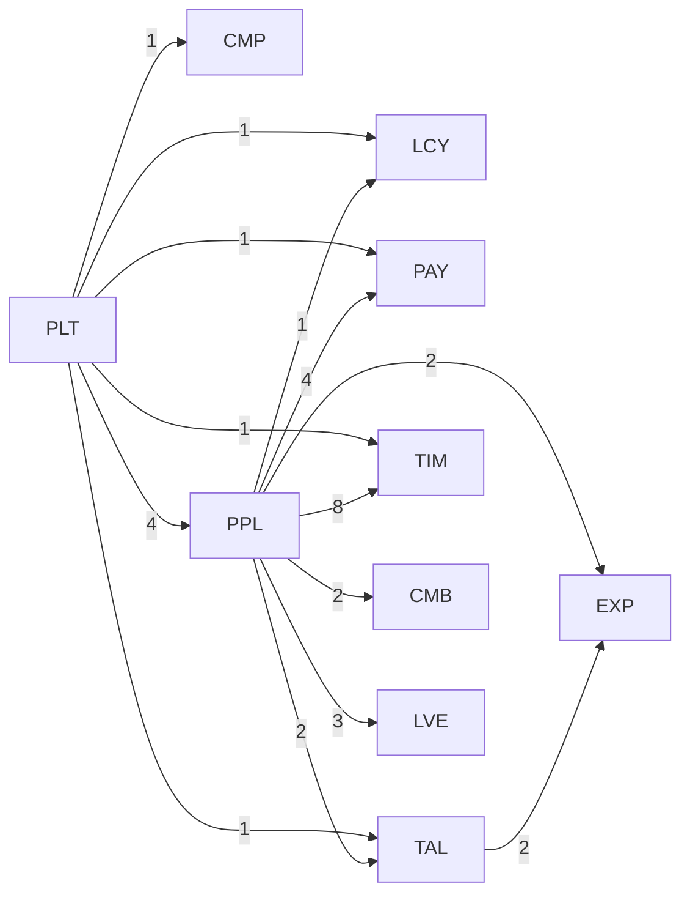

<picture>
  <source media="(prefers-color-scheme: dark)" srcset="../assets/MultipliersKraftLogoDark.png">
  
</picture>

# DA-01 — Enterprise Data Dictionary

| Attribute | Value |
| :--- | :--- |
| Document ID | DA-01 |
| Title | Enterprise Data Dictionary |
| Product | Nucleus Suite (Nucleus HRMS Suite) |
| Version | 1.0.0 |
| Status | Issued for approval |
| Owner (role) | Data Architect |
| Author | Dhanraj Dadhich |
| Reviewed by | *pending* |
| Approved by | Architecture Review Board — *pending* |
| Date | 2026-11-05 |
| Classification | Internal |
| CMMI practice areas | TS |
| Related documents | GOV-10, MIG-01, FRS-<DOM>-05 |
| Quality & process-performance objectives | QPPO-05 (effective requirements reviews), QPPO-01 (escaped defects) — MPM-01 |
| Process performance baseline used | PPB-01 (review defect density), PPB-02 (review rate) — MPM-01 |
| Peer review record | *pending* (PR-xxxx, QA-02) |
| Tailoring record | none |
| Traceability anchor | BG-01 – BG-10 |
| Source of record | Nucleus — Process Flows & Process Maps v1.0 — sheet(s) 06_Data_Dictionary |

> **Source of record.** Requirements in this document are taken from the source workbook(s) named above and keep their workbook IDs, which are never renumbered. Changes are made through a change request (CM-02) against the source workbook. Sections marked **Authored** are original additions that are not present in the source workbooks.

## 1. Domain data dependencies

Arrows point from the domain that owns a referenced object to the domain whose objects reference it.

## Platform

| Object | Domain | Fields | Type | Required | Owner / source | Temporal | Sensitivity | Notes | Dataset ref |
| :--- | :--- | :--- | :--- | :--- | :--- | :--- | :--- | :--- | :--- |
| tenant | PLT | tenant_id | uuid | Y | System | No | — | On every tenant-scoped table without exception; RLS forced. |  |
| tenant | PLT | name, region, data_residency | text | Y | Config | No | — | Indian tenant data resides in India, enforced at the infrastructure layer. |  |
| legal_entity | PLT | entity_code, registered_name, cin_llpin, pan, gstin, registered_office, pf_code, financial_year, status | text | Y | Config | Yes | Confidential | Multi-entity is the norm; retrofitting entity scope into payroll and GL is one of the worst refactors available. | 02_Legal_Entities |
| location | PLT | location_code, name, entity_code, city, state, state_code, establishment_type, pin, factory_licence, pt_slab_set, lwf_set, payroll_group_default, factory_act_applies | text | Y | Config | Yes | — | Payroll group and location are INDEPENDENT. Do not derive one from the other. | 03_Locations |
| principal | PLT | principal_id, display_name, principal_type(user\|agent\|service), owner_principal_id, status | text | Y | Admin | Yes | — | Agent principals must name a human owner. |  |
| entity_grant | PLT | principal_id, legal_entity_id, granted_by, effective_from, effective_to | ref | Y | Admin | Yes | — |  |  |
| location_grant | PLT | principal_id, location_id, can_edit_time, granted_by, effective_from, effective_to | ref | Y | Admin | Yes | — | v1.1 addition. This is what lets a plant user record time without seeing rate. |  |
| role | PLT | role_code, name, permission_set[], scope_dimensions[] | text/json | Y | Config | Yes | — | RBAC for shape, ABAC for data scope, evaluated at query time. |  |
| approval_chain | PLT | chain_id, request_type, applies_to(worker_class, location, amount band), steps[] | json | Y | Config | Yes | — | One engine for every approvable object in the product. |  |
| approval_step | PLT | step_no, approver_principal_id, resolution_mode(role\|position\|named), mandatory, sla_hours, decision, decided_by, decided_at, reason, channel | mixed | Y | System | No | — | Decision channel matters: business messaging approvals are first class. |  |
| workflow_definition | PLT | workflow_id, name, version, steps[], branches[], sla[] | json | Y | Config | Yes | — | In-flight instances finish on the version they started under. |  |
| audit_entry | PLT | entry_id, actor_principal_id, agent_id, action, object_type, object_id, before, after, ip, reason, occurred_at | json | Y | System | Restricted | Append-only. Covers every write and every read of a sensitive field. |  |  |
| action_ledger | PLT | action_id, agent_id, human_principal_id, tool, inputs, plan, simulation_result, approval_ref, outcome, reversal_handle, occurred_at | json | Y | System | Restricted | The ledger is the product. Reversal rate is the number a prospect will ask for. |  |  |
| outbox | PLT | outbox_id, aggregate, event_type, payload, created_at, relayed_at | json | Y | System | No | — | Written in the same transaction as the domain write. |  |

## People Core

| Object | Domain | Fields | Type | Required | Owner / source | Temporal | Sensitivity | Notes | Dataset ref |
| :--- | :--- | :--- | :--- | :--- | :--- | :--- | :--- | :--- | :--- |
| person | PPL | person_id | uuid | Y | Nucleus or ERP | No | — | Survives rehire, contract-to-permanent conversion and entity transfer. | 12_Employees |
| person | PPL | full_name, gender, date_of_birth, blood_group, marital_status | text/date | Y | ERP (co-owned) | Yes | Personal | Name and DOB are the duplicate-detection keys. | 12_Employees |
| person | PPL | mobile, personal_email, permanent_address, present_address, emergency_contact | text | Y | Employee | Yes | Personal |  |  |
| person | PPL | aadhaar_token, pan_token, passport_token, uan, esi_ip | token | N | Employee | Yes | Restricted | Tokenised. Raw values live in a separate vault table with its own access policy. Never in logs, events or an LLM prompt. | 12_Employees |
| person | PPL | photo_ref, nominee[] | ref/json | N | Employee | Yes | Personal |  |  |
| employment | PPL | employment_id, person_id, legal_entity_id, employment_start, employment_end, probation_months, confirmation_date, notice_days, tenure_continuity_ref | mixed | Y | Nucleus | Yes | — | Tenure and gratuity continuity on rehire or transfer is decided by rule here. |  |
| position | PPL | position_code, title, org_unit, location_id, grade, cost_centre, status(filled\|vacant\|frozen\|abolished), current_incumbent_id, last_incumbent_id, vacated_on, sanctioned_ref | mixed | Y | Nucleus | Yes | — | A budgeted seat that exists with or without a person in it. | 11_Positions |
| assignment | PPL | assignment_id, employment_id, person_id, position_code, org_unit, designation_code, band, worker_class, manager_assignment_id, shift_group, default_shift, payroll_group, location_id, cost_centre, project_ref, vendor_id, effective_from, effective_to | mixed | Y | Nucleus | Yes | — | The unit everything else references. | 12_Employees |
| assignment | PPL | override_has_rest_days, override_rest_day_pattern, override_wage_type, override_ot_eligibility, override_grace_exempt, override_leave_policy_ref, override_reason | mixed | N | HR | Yes | — | Class supplies the default; the individual may differ. Override without a reason fails validation. | 06_Worker_Classes |
| org_unit | PPL | org_unit_code, name, parent, level, type, primary_location, cost_centre | text | Y | ERP (co-owned) | Yes | — | Effective-dated so reorganisations are history, not destruction. | 04_Org_Units |
| designation | PPL | designation_code, title, band, grace_exempt, leave_band, ot_default, notice_days | mixed | Y | Config | Yes | — | Grace exemption lives on the band, never as a hardcoded grade string. | 05_Designations |
| worker_class | PPL | class_code, label, has_rest_days, rest_day_pattern, wage_type, ot_eligibility, leave_eligible, leave_policy_ref, statutory_set, obligation_party | mixed | Y | Config | Yes | — | Nine classes in the demo tenant. Every attribute overridable per assignment. | 06_Worker_Classes |
| sanctioned_position | PPL | record_id, org_unit, designation_code, location_id, sanctioned_count, effective_from, approved_by | mixed | Y | Finance/HR | Yes | — | Filled and open counts are derived, never stored. | 10_Sanctioned_Manpower |
| document | PPL | document_id, person_id, assignment_id, class, file_ref, issued_on, expires_on, verified_by, extracted_fields, confidence | mixed | N | Employee/HR | Yes | Personal | Encrypted at rest, expiry-tracked. |  |
| asset | PPL | asset_code, type, description, serial, status, condition | text | N | Admin | Yes | — |  | 33_Assets |
| asset_allocation | PPL | allocation_id, asset_code, person_id, issued_on, returned_on, condition, clearance_item_ref | mixed | N | Admin | Yes | — | Allocation at joining; return is a blocking clearance item at exit. | 33_Assets |

## Time

| Object | Domain | Fields | Type | Required | Owner / source | Temporal | Sensitivity | Notes | Dataset ref |
| :--- | :--- | :--- | :--- | :--- | :--- | :--- | :--- | :--- | :--- |
| attendance_event | TIM | event_id, person_id, punch_ts, direction, source, device_id, geo_lat, geo_lng, selfie_ref, received_at, is_duplicate, drift_correction_ms | mixed | Y | Device | No | Personal | IMMUTABLE. Never edited, never deleted. | 20_Punch_Events |
| attendance_segment | TIM | segment_id, attendance_day_id, segment_no, in_event_id, out_event_id, start_ts, end_ts, minutes | mixed | Y | System | No | — | One row per paired in/out. | 20_Punch_Events |
| attendance_break | TIM | break_id, attendance_day_id, break_no, start_ts, end_ts, minutes, break_type(meal\|gate_pass\|other), is_paid, is_deducted | mixed | Y | System | No | — | First-class rows are why the break report exists without a special query. | 21_Expected_Attendance |
| attendance_day | TIM | attendance_day_id, person_id, attendance_date, shift_id_assigned, shift_id_applied, inference_reason, shift_minutes, day_type | mixed | Y | System | No | — | DERIVED and recomputable. Keyed on the date the shift started. | 21_Expected_Attendance |
| attendance_day | TIM | first_in, last_out, gross_minutes, break_minutes_recorded, break_minutes_deducted, gate_pass_minutes_deducted, gate_pass_minutes_credited, net_minutes | mixed | Y | System | No | — | Demo client: breaks recorded not deducted (gate-to-gate). | 21_Expected_Attendance |
| attendance_day | TIM | ot_basis(gross\|net), ot_minutes_raw, ot_minutes_payable, ot_eligibility_applied | mixed | Y | System | No | — | Basis is tenant configuration and must be stated, never assumed. | 21_Expected_Attendance |
| attendance_day | TIM | late_by_minutes, late_instance_no, late_beyond_allowance, grace_exempt_applied, long_night_relief | mixed | Y | System | No | — |  |  |
| attendance_day | TIM | status(Present\|Half Day\|Absent\|Weekly Off\|Holiday\|Leave\|…), applied_rule_ids[], computed_at, computed_by_ruleset_version, input_hash | mixed | Y | System | No | — | Provenance is what makes a March recomputation explainable in September. | 21_Expected_Attendance |
| attendance_day_delta | TIM | delta_id, attendance_day_id, field, old_value, new_value, reason, recomputed_at | mixed | N | System | No | — | Audit delta, never a silent overwrite. |  |
| shift | TIM | shift_code, name, shift_group, start_time, end_time, duration_min, break_recorded_min, break_deducted_min, crosses_midnight | mixed | Y | Config | Yes | — |  | 07_Shifts |
| shift_window | TIM | shift_code, earliest_in, latest_in | time | Y | Config | Yes | — | Must not overlap inside a shift group; overlap fails validation at save. | 07_Shifts |
| roster | TIM | roster_id, person_id, date, shift_code, published_at, published_by | mixed | N | Supervisor | Yes | — | Republishing a roster queues recompute. |  |
| work_calendar | TIM | calendar_id, location_id, date, day_type(working\|weekly_off\|holiday\|festival) | mixed | Y | Config | Yes | — | Multi-plant operations do not share one holiday list. | 09_Holiday_Calendar |
| holiday_calendar | TIM | date, holiday_name, applicable_locations[], type(National\|Statutory\|Festival) | mixed | Y | Config | Yes | — |  | 09_Holiday_Calendar |
| attendance_rule_set | TIM | ruleset_id, version, shift_hours, half_day_below_min, absent_below_min, grace_in_min, grace_out_min, late_allowance_per_month, long_night_after, next_day_relief_until, effective_from | mixed | Y | Config | Yes | — | The whole disposition rule is four data rows. A new shift length is a row, not a release. | 08_Attendance_Rules |
| gate_pass | TIM | gate_pass_id, person_id, date, from_ts, to_ts, minutes, pass_type(personal\|official), reason, status, approver, minutes_used_this_month, instances_this_month | mixed | N | Employee | No | — | Ceiling enforced in the service so business messaging obeys the same rule. | 22_Gate_Pass |
| overtime_record | TIM | ot_record_id, person_id, date, day_type, ot_minutes, rate_multiplier, eligibility_basis, approved_by, approved_on, pay_in_run_id | mixed | N | System | No | — | Every minute must reconcile to the attendance day. | 23_Overtime_Register |
| regularisation | TIM | regularisation_id, person_id, date, requested_change, reason, evidence_ref, approver, decided_at | mixed | N | Employee/Mgr | No | — | Regularisation rate per 100 employees is a product health metric. |  |
| attendance_exception | TIM | exception_id, type, person_id, date, severity, evidence_ref, state, resolved_by | mixed | N | System | No | — | The Attendance Steward's queue. |  |
| late_counter | TIM | person_id, month, instance_count, reset_at | mixed | Y | System | No | — | Visible to the employee — a rule that penalises silently generates tickets. |  |

## Leave

| Object | Domain | Fields | Type | Required | Owner / source | Temporal | Sensitivity | Notes | Dataset ref |
| :--- | :--- | :--- | :--- | :--- | :--- | :--- | :--- | :--- | :--- |
| leave_type | LVE | leave_type, name, unit, accrual, carry_forward, year_end_action, max_per_month, excluded_with[], expiry_rule, applies_to_bands[] | mixed | Y | Config | Yes | — |  | 14_Leave_Types |
| leave_accrual_policy | LVE | policy_code, leave_band, leave_type, annual_days, accrual_frequency, days_per_period, eligibility_wait_months, credit_on_completion, credit_date | mixed | Y | Config | Yes | — |  | 15_Leave_Accrual_Policy |
| leave_proration_rule | LVE | rule_code, joining_month_from, joining_month_to, cl_days, sl_days | mixed | Y | Config | Yes | — |  | 16_Leave_Proration |
| leave_combination_rule | LVE | rule_id, leave_type, excluded_with[], max_per_month, message | mixed | Y | Config | Yes | — | Evaluated before the approval chain starts; message names the rule. | 14_Leave_Types |
| leave_ledger | LVE | ledger_id, person_id, leave_type, txn_type(Credit\|Debit\|Lapse\|Encash\|Reversal), days, effective_date, expires_on, source_ref, narration, idempotency_key, created_at | mixed | Y | System | No | — | REPLACES the v1.0 balance column. Balance is a projection over this table. | 17_Leave_Ledger |
| leave_request | LVE | request_id, person_id, leave_type, date_from, date_to, days_applied, days_availed, is_half_day_start, is_half_day_end, reason, status, actual_return_date, hr_edit_note | mixed | N | Employee | No | — |  | 18_Leave_Requests |
| compoff_credit | LVE | credit_id, person_id, earned_on, reason, days, expires_on, status, consumed_on, days_remaining | mixed | N | System | No | — | Implemented as leave_ledger rows; this is the reporting view. 60-day clock PER CREDIT. | 19_CompOff_Ledger |

## Payroll

| Object | Domain | Fields | Type | Required | Owner / source | Temporal | Sensitivity | Notes | Dataset ref |
| :--- | :--- | :--- | :--- | :--- | :--- | :--- | :--- | :--- | :--- |
| payroll_run | PAY | run_id, legal_entity_id, period, payroll_group, run_type(regular\|off_cycle_ot\|arrears\|fnf\|bonus), run_state, employee_count, gross, net, statutory, pay_date, gl_posted_on, external_doc_no | mixed | Y | Payroll | No | Confidential | A period carries several runs. Every screen needs a run selector. | 26_Payroll_Runs |
| payroll_snapshot | PAY | snapshot_id, run_id, input_hash, rule_pack_versions[], config_version, snapshot_ts | mixed | Y | System | No | — | Reproducibility to the paisa eleven months later depends on this row. |  |
| pay_component | PAY | component_code, name, type(earning\|deduction\|employer_cost\|provision), depends_on[], formula, sequence, taxable, pf_applicable, esi_applicable, display_on_payslip | mixed | Y | Config | Yes | — | Nodes in the gross-to-net DAG. | 35_GL_Mapping |
| salary_structure | PAY | person_id, effective_from, basic, da, hra, conveyance, special_allowance, daily_rate, monthly_retainer, gross, wage_base, excluded_components, excluded_pct, floor_addback, statutory_wage_base | money | Y | HR/Comp | Yes | Restricted | Columns after gross are DERIVED by the wage-base node, not entered. | 13_Salary_Structure |
| payslip | PAY | payslip_id, run_id, person_id, payable_days, lop_days, gross, deductions, net, published_at | money | Y | System | No | Restricted |  |  |
| payslip_line | PAY | line_id, payslip_id, component_code, amount_paise, basis, rule_ref, rule_pack_version | mixed | Y | System | No | Restricted | Integer money in the smallest currency unit. No floating point, ever. |  |
| payslip_line_trace | PAY | trace_id, line_id, node, inputs, output, rule_pack_version | json | Y | System | No | Restricted | Every line drills to the rule that produced it and the inputs it consumed. |  |
| payroll_audit_flag | PAY | flag_id, run_id, check_code, severity(CRITICAL\|HIGH\|INFO), person_id, detail, owner, state, resolution_note | mixed | N | System | No | — | A CRITICAL flag blocks approval. |  |
| payroll_input | PAY | input_id, run_id, person_id, component_code, amount, source(leave_encashment\|recognition\|referral\|claim\|arrears\|manual), source_ref, created_by | mixed | N | Various | No | — | Awards and referral payouts enter payroll HERE, never as side payments. | 30_Recognition_Referral |
| bank_file | PAY | file_ref, run_id, total_amount, account_count, checksum, generated_at, released_by, verified_by | mixed | Y | Finance | No | Restricted | Dual control; out-of-band total verification. |  |
| statutory_output | PAY | output_id, run_id, type(PF_ECR\|ESI\|PT\|LWF\|24Q\|Form16), state, period, file_ref, filed_on, ack_ref | mixed | N | Compliance | No | Confidential |  | 28_Statutory_Calendar |

## Compensation & Loans

| Object | Domain | Fields | Type | Required | Owner / source | Temporal | Sensitivity | Notes | Dataset ref |
| :--- | :--- | :--- | :--- | :--- | :--- | :--- | :--- | :--- | :--- |
| loan | CMB | loan_id, person_id, purpose, principal, rate, tenure_months, instalment, outstanding, status, sanctioned_on, sanctioned_by, special_terms, rules_waived[], eligibility_basis | mixed | N | Finance | Yes | Confidential | Ceiling 4x basic, 6x above five years' service — configuration, not constants. | 24_Loans |
| loan_guarantor | CMB | loan_id, guarantor_person_id, mandatory, accepted_on, released_on, currently_blocked | mixed | N | System | Yes | Confidential | Release on full repayment is an EXPLICIT event. | 25_Loan_Guarantors |
| loan_repayment | CMB | repayment_id, loan_id, run_id, amount, source, outstanding_after, posted_at | mixed | N | System | No | Confidential |  |  |
| salary_advance | CMB | advance_id, person_id, amount, requested_on, recovery_run_id, status | mixed | N | System | No | Confidential | EWA is structurally an advance recovered in the same cycle; cap at 50% of accrued net. |  |

## Compliance

| Object | Domain | Fields | Type | Required | Owner / source | Temporal | Sensitivity | Notes | Dataset ref |
| :--- | :--- | :--- | :--- | :--- | :--- | :--- | :--- | :--- | :--- |
| rule_pack | CMP | pack_id, jurisdiction, state, effective_from, supersedes, rules[], test_count, changelog, reviewed_by, deployed_at | mixed | Y | Compliance | Yes | — | Declarative JSON evaluated by a sandboxed interpreter in v1. Keep the interface stable for compiled packs later. |  |
| obligation | CMP | obligation_id, obligation, authority, entity, state, period, due_date, owner, status, evidence_ref, filed_on, ack_ref | mixed | Y | Compliance | Yes | — | The screen the HR head opens every morning. | 28_Statutory_Calendar |
| statutory_form | CMP | form_code, name, act, state, applicability_rule, frequency, due_rule, template_ref | mixed | Y | Config | Yes | — | The library is the deliverable, not any particular form. | 29_Statutory_Forms |
| statutory_form_instance | CMP | instance_id, form_code, entity, location_id, period, generated_at, filed_on, ack_ref, file_ref, trigger | mixed | N | System | No | Confidential | Form F is generated inside the joining chain. | 29_Statutory_Forms |
| consent_record | CMP | consent_id, data_principal_id, purpose, granted_at, withdrawn_at, notice_version | mixed | N | System | Yes | Restricted | DPDP: itemised notice, purpose-bound processing, erasure with 48-hour pre-intimation. |  |
| inference_log | CMP | inference_id, model, model_version, inputs_ref, output, human_decision, decided_by, occurred_at | mixed | Y | System | No | Restricted | EU AI Act Annex III: log every inference with the human decision attached. |  |

## Lifecycle & Experience

| Object | Domain | Fields | Type | Required | Owner / source | Temporal | Sensitivity | Notes | Dataset ref |
| :--- | :--- | :--- | :--- | :--- | :--- | :--- | :--- | :--- | :--- |
| clearance_checklist_template | LCY | template_id, worker_class, location_id, item, owner_role, blocking, sla_days | mixed | Y | Config | Yes | — | Templates differ by class and location. | 27_Exit_Clearance |
| clearance_item | LCY | item_id, person_id, template_ref, item, owner, blocking, status, cleared_on, waived_by, waive_reason, recovery_amount | mixed | N | Dept owners | No | — | F&F cannot release while any blocking item is open. | 27_Exit_Clearance |
| recognition_programme | EXP | programme_id, name, cadence, award_amount_default, audience_rule | mixed | N | HR | Yes | — |  | 30_Recognition_Referral |
| recognition_award | EXP | award_id, programme_id, person_id, period, cited_by, citation, award_amount, status, pay_in_run_id, announcement_ref | mixed | N | HR | No | — | Monetary component raises a payroll input. | 30_Recognition_Referral |
| referral | EXP | referral_id, referrer_id, candidate_id, requisition_id, stage, award_amount, part_paid_amount, award_status, pay_in_run_id | mixed | N | System | No | — | Part on joining, balance on confirmation, paid through payroll. | 30_Recognition_Referral |
| announcement | EXP | announcement_id, type, title, body, audience_rule, channels[], publish_from, publish_to, source_event, created_by, status | mixed | N | HR/System | No | — | A broadcast with an audience rule — distinct from the activity feed, which is a log. | 31_Announcements |
| letter_template | EXP | template_id, type, version, effective_from, body, merge_fields[], approval_required | mixed | Y | HR | Yes | — |  | 32_Letter_Templates |
| letter_issued | EXP | issue_id, template_id, template_version, person_id, issued_by, issued_at, file_ref | mixed | N | HR | No | Personal | Retaining the template version is what makes a reprint two years later defensible. | 32_Letter_Templates |
| learning_assignment | TAL | assignment_id, person_id, item, type, assigned_on, due_on, completed_on, status, trigger | mixed | N | System | No | — | Same mechanism whether triggered by joining, review, promotion or a policy update. | 34_Induction_Learning |

## Talent & Contingent

| Object | Domain | Fields | Type | Required | Owner / source | Temporal | Sensitivity | Notes | Dataset ref |
| :--- | :--- | :--- | :--- | :--- | :--- | :--- | :--- | :--- | :--- |
| requisition | TAL | requisition_id, requisition_type(replacement\|addition), against_position_code, org_unit, designation_code, location_id, raised_on, hiring_manager, status, blocker, override_by, override_reason | mixed | N | Hiring mgr | Yes | — | A replacement consumes no fresh sanction; an addition does. | 37_Requisitions |
| candidate | TAL | candidate_id, name, contact, source_channel, referral_ref, skills[], stage, consent_ref | mixed | N | Recruiter | No | Personal | No auto-reject. Ranking assists; humans decide; reasons recorded. |  |
| contractor_engagement | CTG | engagement_id, vendor_id, contract_ref, start, end, site, rate_card[], compliance_status | mixed | N | Purchase/HR | Yes | Confidential | The commercial relationship. Policy attaches to worker class, not to the contract. |  |
| contractor_invoice | CTG | invoice_id, engagement_id, period, claimed_days, claimed_amount, system_days, variance_days, variance_amount, decision | mixed | N | Vendor/Finance | No | Confidential | Variance visible before payment rather than after. |  |

## Finance & Integration

| Object | Domain | Fields | Type | Required | Owner / source | Temporal | Sensitivity | Notes | Dataset ref |
| :--- | :--- | :--- | :--- | :--- | :--- | :--- | :--- | :--- | :--- |
| gl_mapping | FIN | mapping_id, entity, component_code, dr_cr, gl_account_code, gl_account_name, cost_centre_source, dimensioned_by[] | mixed | Y | Finance | Yes | — | Validated: every component in a run must be mapped before APPROVED. | 35_GL_Mapping |
| gl_journal | FIN | journal_id, run_id, entity, period, run_type, total_dr, total_cr, status, posted_at, external_doc_no | mixed | Y | System | No | Confidential | One balanced journal per run per entity. | 35_GL_Mapping |
| gl_journal_line | FIN | line_id, journal_id, account_code, dr_cr, amount, cost_centre, department, location, project, custom_dims | mixed | Y | System | No | Confidential | Split at employee level BEFORE aggregation. |  |
| employee_sync_log | FIN | sync_id, batch, external_code, nucleus_code, field, erp_value, nucleus_value, field_owner, payload_hash, received_at, applied_at, status, error | mixed | Y | System | No | Personal | Idempotent on the external employee code; conflict policy explicit. | 36_ERP_Inbound_Master |
| field_ownership_map | FIN | field, owner(ERP\|Nucleus), mandatory, conflict_policy | mixed | Y | Config | Yes | — | No field owned by both; every mandatory field owned by one. | 36_ERP_Inbound_Master |
| reconciliation_report | FIN | report_id, run_id, check, expected, actual, variance, status | mixed | Y | System | No | Confidential | A product screen, not a support script. |  |

## Additional objects and attributes defined in ICD-01 and MIG-01 (Authored)

| Object | Domain | Fields | Type | Required | Owner / source | Temporal | Sensitivity | Notes | Defined in |
| :--- | :--- | :--- | :--- | :--- | :--- | :--- | :--- | :--- | :--- |
| tenant | PLT | verified_domains[], provisioning_mode(worker_driven\|directory_driven), step_up_acr | mixed | Y | Admin | Yes | — | Sign-in email must fall in a verified domain; provisioning mode A (Nucleus to directory) is the default; step-up context gates payroll approval, bank release and salary view. | ICD-01 §15 |
| principal | PLT | idp_subject_id, identity_provider, scim_external_id, link_status(linked\|awaiting_linkage), account_source(federated\|scim\|local) | mixed | N | Identity provider / Admin | Yes | Personal | A subject identifier links to exactly one principal; SCIM creates in mode B wait for linkage; no password is stored for federated tenants. | ICD-01 §15.2, PLT-INT-003.01, PLT-INT-004.03 |
| location | PLT | pt_registration_no, lwf_registration_no | text | N | Config | Yes | Confidential | Registration carried on professional-tax and labour-welfare returns; the form set follows the plant's registration (RL-380). | ICD-01 §12.2 (CMP-INT-003) |
| action_ledger | PLT | idempotency_key | text | N | System | No | Restricted | Caller key for write tools over MCP; a repeat from the same principal within 24 hours returns the original result and action_id. | ICD-01 §17.2, §17.4 |
| integration_log | PLT | log_id, message_id, tenant_id, interface_id, direction, counterparty, business_key, payload_hash, size_bytes, outcome, latency_ms, retry_count, occurred_at | mixed | Y | System | No | Confidential | One row per exchange on every interface; Personal and Restricted payload bodies are never written, only hashes and business keys (PLT-INT-108). | ICD-01 §5.9 |
| idempotency_record | PLT | idempotency_key, client_id, principal_id, endpoint, request_hash, first_response, created_at, expires_at | mixed | Y | System | No | Confidential | Kept 24 hours; a repeat returns the first response unchanged (PLT-INT-103). | ICD-01 §5.4, §18.3 |
| dead_letter_entry | PLT | entry_id, interface_id, message_id, business_key, attempts, last_error, dead_lettered_at, incident_ref, replay_status, replayed_at | mixed | Y | System | No | Confidential | Created after the sixth failed attempt; visible on the owning monitor screen with a replay action (PLT-INT-105). | ICD-01 §5.5, §19.4 |
| integration_credential | PLT | credential_ref, counterparty, interface_id, environment, credential_type(oauth_client\|mtls_certificate\|hmac_secret\|sftp_key\|openpgp_key), vault_path, rotated_at, expires_at, next_rotation_due | mixed | Y | Integration administrator | Yes | Restricted | Metadata only; the secret itself lives in the tenant secrets vault and never in configuration, logs, events or LLM prompts; distinct per environment (PLT-INT-111). | ICD-01 §5.1, §5.2, §5.10 |
| webhook_subscription | PLT | subscription_id, client_id, endpoint_url, event_types[], scope(entity, location), secret_ref, mtls_enabled, status(active\|paused), failing_since, created_by | mixed | Y | Partner via /v1/webhooks | Yes | Confidential | Scoped no wider than the subscribing client's grants; paused after 72 hours of continuous failure and the owner notified. | ICD-01 §19 |
| webhook_delivery_log | PLT | delivery_id, subscription_id, event_id, nucleus_idempotency_key, attempt_no, http_status, latency_ms, outcome(delivered\|retried\|dead_lettered), attempted_at | mixed | Y | System | No | — | Inspectable and replayable by event id within the event's retention class (PLT-INT-002.04). | ICD-01 §19.4 |
| provisioning_operation | PLT | operation_id, external_id, assignment_id, version, operation(create\|update\|deactivate), target, status, attempts, last_error, completed_at | mixed | Y | System | No | Personal | Keyed on assignment_id + version so replays reach the same end state; a leaver deactivation still failing after attempt 3 raises a security incident. | ICD-01 §15.1, §15.4 |
| reconciliation_report | FIN | interface_id, batch_ref, drill_ref | text | N | System | No | Confidential | Every interface writes its reconciliation here; universal assertion received = applied + held + rejected + duplicate (PLT-INT-106). | ICD-01 §5.6 |
| person | PPL | erp_employee_key, official_email, preferred_language | text | N | ERP / Nucleus | Yes | Personal | erp_employee_key holds the ERP key (for example VPI-1018) so the mapping survives a code change on either side; official_email feeds the SCIM userName and the sign-in email claim; preferred_language selects the message template language. | ICD-01 §6.2, §11.2, §15.2; MIG-01 §5.2 |
| person | PPL | bank_account_token, bank_ifsc, bank_account_holder_name, bank_verification_status, bank_verified_by, bank_verified_on | token | N | Employee (HR-verified) | Yes | Restricted | Account number detokenised only inside the bank file builder; a change inside a payroll window raises an alert (RL-393); unverified accounts are excluded from the bank file. | ICD-01 §9.2; MIG-01 PLT-MIG-027 |
| person | PPL | pf_membership_date, eps_eligible, vpf_rate_pct, esi_coverage_status, esi_coverage_period | mixed | N | Payroll | Yes | Confidential | Carried at migration so PF and ESI files continue correctly; coverage is re-evaluated when cut-over opens a new ESI contribution period. | MIG-01 §8.3 |
| employment | PPL | continuous_service_start, recognised_prior_service_months, prior_service_basis | mixed | N | HR | Yes | Confidential | Gratuity eligibility and the 6x loan ceiling compute from these facts (PLT-MIG-035). | MIG-01 §8.3 |
| employment_category | PPL | category_code, sub_category_code, label, worker_class_code | text | Y | Config | Yes | — | Worker class resolves from category, sub-category and employee-level overrides, never from a legacy grade string (PLT-MIG-014). | MIG-01 §4, §5.2 |
| attendance_event | TIM | device_event_id, agent_batch_id, punch_ts_device, verification_mode(FINGER\|FACE\|CARD\|PIN), offline_queued, signed_ts | mixed | N | Device | No | Personal | Raw device timestamp kept beside the corrected punch_ts; offline events need a signed timestamp and are accepted up to 7 days old (RL-071). | ICD-01 §10.2 |
| attendance_device | TIM | device_id, location_id, agent_id, device_type(BIOMETRIC\|ACCESS_CONTROL\|KIOSK), status, last_heartbeat_at, buffer_depth, clock_offset_ms | mixed | Y | Plant IT | Yes | — | Registered terminal at the agent's location; feeds the per-shift device health report. | ICD-01 §10.2, §10.4 |
| site_agent | TIM | agent_id, location_id, client_id, certificate_ref, certificate_expires_on, software_version, schema_version, status | mixed | Y | Plant IT | Yes | Confidential | Enrolled with a per-agent certificate and bound to a location grant; signs each batch. | ICD-01 §10.1 |
| device_enrolment | TIM | device_id, enrolment_no, person_id, effective_from, effective_to | mixed | Y | Nucleus (HR / Plant HR) | Yes | Personal | Resolves a terminal enrolment number to exactly one active person; biometric templates are never transmitted or stored. | ICD-01 §10.2, §10.4 |
| attendance_event_quarantine | TIM | quarantine_id, agent_batch_id, device_id, device_event_id, enrolment_no, punch_ts_device, reason(unknown_device\|unknown_enrolment), exception_id, resolved_by, resolved_at | mixed | N | System | No | Personal | Unresolvable punches are landed here and raise an exception on SCR-025, never discarded. | ICD-01 §10.4 |
| leave_accrual_state | LVE | person_id, leave_type, policy_code, months_accrued, eligibility_wait_served_months, completion_credit_due, as_of_date | mixed | N | System (migrated) | Yes | — | Migrated so the first Nucleus accrual and any completion credit are neither lost nor duplicated (PLT-MIG-032). | MIG-01 §8.3 |
| payroll_run | PAY | migrated | flag | N | System | No | Confidential | Year-to-date history loads as closed historic runs flagged migrated and is never recomputed. | MIG-01 §8.3 |
| bank_file | PAY | legal_entity_code, value_date, mechanism(host_to_host\|file), file_kind(run\|re_payment), original_file_ref, status(generated\|released\|verified\|transmitted\|cancelled) | mixed | Y | Finance | No | Restricted | One file per run and entity unless the first is formally cancelled with the bank; returned lines are re-paid in a separate file. | ICD-01 §9 |
| statutory_output | PAY | obligation_id, layout_version, revision_no, revision_reason | mixed | N | Compliance | No | Confidential | A repeat generation for a filed period creates revision n+1 with a reason; the layout in force for the period is selected from the rule pack. | ICD-01 §12.1, §12.4 |
| tax_declaration | PAY | person_id, financial_year, regime(OLD\|NEW), declaration_status, proof_status | mixed | N | Employee | Yes | Confidential | Regime is carried on the TDS statement deductee record; migrated with year-to-date tax. | ICD-01 §12.2 (CMP-INT-004); MIG-01 §8.3 |
| previous_employer_income | PAY | person_id, financial_year, previous_employer_name, taxable_income, tds_deducted, proof_ref | mixed | N | Employee | No | Confidential | Joiners in the year; needed for the TDS projection and annual tax statement (PLT-MIG-034). | MIG-01 §8.3 |
| statutory_register_serial | CMP | form_code, location_id, last_serial_no, as_of_date, source(migrated\|generated) | mixed | Y | Compliance | No | — | Keeps gapless registers such as Form F continuous across cut-over (PLT-MIG-009). | MIG-01 §4 |
| integration_config | FIN | master_mode(nucleus_owns\|erp_owns\|co_owned), erp_system, sync_frequency, match_key, unmatched_action, primary_mechanism, fallback_mechanisms[], connector_ref | mixed | Y | Implementation | Yes | — | Per tenant; source_system on an inbound batch must equal erp_system; every tenant has a primary and at least one fallback journal delivery mechanism. | FRS-FIN-01 FIN-01.1; ICD-01 §6.1, §7.1 |
| department_cross_reference | FIN | legal_entity_code, department_code, org_unit_code, effective_from, maintained_by | mixed | Y | Nucleus (implementation consultant) | Yes | — | Maps ERP departments to Nucleus org units; an unmapped department on an inbound record is held. | ICD-01 §6.2, §8.2, §8.4 |
| erp_reference_code | FIN | master_type(COST_CENTRE\|PROJECT\|DEPARTMENT\|GL_ACCOUNT), code, name, status(Active\|Inactive\|Blocked), parent_code, level, legal_entity_code, account_type, valid_from, valid_to | mixed | Y | ERP | Yes | — | Read-only reference store; deactivation is effective-dated so historic journals stay valid; unknown or inactive codes raise HIGH pre-audit flags and an unknown account blocks journal generation. | ICD-01 §8 |
| reference_sync_log | FIN | snapshot_id, master_type, snapshot_mode(FULL\|DELTA), code, payload_hash, received_at, applied_at, status(applied\|applied_no_change\|rejected\|held), error | mixed | Y | System | No | — | Reference sync report: received = applied + no change + rejected + held. | ICD-01 §8.2, §8.4 |
| gl_journal | FIN | journal_version, idempotency_key | mixed | Y | System | No | Confidential | Key {tenant_id}:{run_id}:{legal_entity_code}:{journal_version} travels in the ERP reference field; a posted journal is immutable. | ICD-01 §7.1, §7.4 |
| gl_posting_log | FIN | posting_id, journal_id, run_id, idempotency_key, mechanism(api\|xml_voucher\|csv\|staging_table\|manual_download), target_system, attempt_no, sent_at, result(posted\|rejected\|pending\|dead_lettered), external_doc_no, error | mixed | Y | System | No | Confidential | Records what was sent, when, where, with what result and what reference came back, whatever the mechanism (RL-523); source of RP-15. | FRS-FIN-01 FIN-03.4; ICD-01 §7 |
| bank_payment_line | FIN | payment_ref, file_ref, seq_no, person_id, amount, status(ACCEPTED\|PROCESSED\|REJECTED\|RETURNED), bank_txn_ref, reason_code, status_at, repaid_by_payment_ref | mixed | Y | System / Bank | No | Restricted | Rejected or returned lines form the returned-payment queue and are re-paid only through a separate file; account numbers never stored here. | ICD-01 §9.2, §9.4 |
| bank_layout_template | FIN | bank_code, layout_version, format(fixed_width\|csv\|credit_transfer_xml), effective_from, test_file_ref, approved_by_bank_on | mixed | Y | Finance | Yes | — | Switching layout is configuration with a test file approved by the bank. | ICD-01 §9.1, §9.4 |
| channel_message_log | SSV | message_id, direction(inbound\|outbound), person_id, template_code, language, category(transactional\|announcement), idempotency_key, context_message_id, source_event_id, status(sent\|delivered\|read\|failed), occurred_at | mixed | Y | System | No | Personal | Outbound key source_event_id + recipient + template_code; free text purged after 30 days; source of the message delivery log. | ICD-01 §11.2, §11.4 |
| channel_binding | SSV | binding_id, person_id, mobile, verified_at, consent_id, status(bound\|withdrawn) | mixed | N | Employee | Yes | Personal | A number is bound to exactly one person by one-time code before any personal data is sent; messages stop within 1 hour of withdrawal. | ICD-01 §11.1, SSV-INT-001.03, SSV-INT-001.05 |
| message_action_token | SSV | token_id, approval_step_ref, action, person_id, issued_at, expires_at, used_at | mixed | N | System | No | Confidential | Signed and single use with 24-hour expiry, so a double tap approves once. | ICD-01 §11.2, §11.4 |
| message_template | SSV | template_code, language, version, category, parameters[], approval_status | mixed | Y | HR / Config | Yes | — | Approved per tenant and language; parameters never carry Aadhaar, PAN, account numbers or salary figures. | ICD-01 §11.2, §11.4 |
| bgv_case | LCY | case_ref, candidate_id, offer_id, check_set_version, consent_id, provider_case_id, case_status(INITIATED\|IN_PROGRESS\|INSUFFICIENT\|CLEAR\|DISCREPANT\|UNABLE_TO_VERIFY), check_results[], report_document_id, requested_at, decision, decided_by, decision_reason | mixed | N | Provider (results) / Recruiter (decision) | No | Restricted | case_ref = candidate_id + offer_id + check_set_version; results are provider-owned and read-only; the hiring decision is human with its reason. | ICD-01 §13 |
| bgv_check_set | LCY | check_set_version, applies_to, checks, turnaround_days | mixed | Y | Config | Yes | — | Tenant check set per position; the version is recorded on each case. | ICD-01 §13.2, §13.4 |
| esign_envelope | EXP | envelope_ref, issue_id, revision, template_id, template_version, document_sha256, signers[], signature_method(OTP_ESIGN\|AADHAAR_ESIGN\|DSC), expires_at, status(SENT\|VIEWED\|SIGNED\|DECLINED\|EXPIRED\|COMPLETED), signed_file_ref, audit_certificate_ref, completed_at | mixed | N | System / Provider (evidence) | No | Personal | envelope_ref = issue_id + revision; signed artefact kept with the template version; becomes Restricted when the letter carries compensation. | ICD-01 §14 |
| authorised_signatory | EXP | legal_entity_id, person_id, document_types[], allowed_signature_methods[], effective_from, effective_to | mixed | Y | HR | Yes | — | Only methods approved for the document type are offered (EXP-INT-001.04). | ICD-01 §14.2 |
| letter_issued | EXP | revision, signature_status | mixed | N | HR | No | Personal | A re-issue after DECLINED or EXPIRED creates a new revision. | ICD-01 §14.1, §14.4 |
| vendor | CTG | vendor_code, vendor_name, status(Active\|Inactive\|Blocked), engagement_type, clra_licence, pf_code, esi_code, gstin, sites_served[], statutory_verification_status | mixed | Y | ERP (registration fields) / Nucleus (verification status) | Yes | Confidential | Reconciles to the client's vendor master by vendor_code; ERP-owned fields are read-only in Nucleus. | ICD-01 §16; MIG-01 §6.1 W4 |
| contractor_engagement | CTG | engagement_type | text | Y | ERP | Yes | Confidential | Picklist value received on the vendor master interface. | ICD-01 §16.2 |
| migration_provenance | PLT | legacy_key, migration_batch_id | text | Y | Migration load service | No | — | Column set carried on every record loaded with treatment M, H or O so each reconciliation query traces back to source (PLT-MIG-004). | MIG-01 §3 |
| migration_batch | PLT | migration_batch_id, tenant_id, rehearsal(mock_1\|mock_2\|mock_3\|cut_over), wave(W0..W8), extract_ref, extract_signature_verified, cross_reference_version, started_at, completed_at, records_extracted, records_loaded, records_rejected, records_excluded, wave_check_status, status | mixed | Y | Migration Lead | No | Confidential | A wave is refused until its predecessors pass their wave checks (PLT-MIG-015, PLT-MIG-016). | MIG-01 §6, §10 |
| migration_reconciliation | PLT | migration_batch_id, level(L1\|L2\|L3\|L4\|L5), object, scope(entity, location, worker_class, payroll_group), check, expected, actual, variance, tolerance, status, drill_ref | mixed | Y | System | No | Confidential | Persisted as reconciliation_report rows of the migration batch and shown on the migration reconciliation screen with drill-down; amounts masked unless the viewer may see compensation. | MIG-01 §4, §9, PLT-MIG-056 |
| migration_cross_reference | PLT | xref_type(employee_key\|department\|grade\|employment_type\|leave_code\|pay_head\|location_payroll_group\|shift), legacy_value, nucleus_value, version, used_in_mock, approved_by | mixed | Y | Migration Lead | Yes | — | Versioned and applied by the load service, never by editing extracts (PLT-MIG-012). | MIG-01 §5.2 |
| migration_mapping_spec | PLT | target_object, target_field, source_system, source_field, extraction_filter, rule(direct\|lookup\|transform\|default\|derived), mandatory, owner(ERP\|Nucleus), validation, sample_evidence, signed_by | mixed | Y | Data owner | Yes | — | One specification per target object under configuration management; zero unmapped mandatory fields before Mock 2 (PLT-MIG-011). | MIG-01 §5.1 |
| migration_scope_register | PLT | object, treatment(M\|H\|O\|C\|D\|N), history_depth, demo_dataset_ref, legacy_source, data_owner_role, signed_by | mixed | Y | Migration Lead | No | — | Covers every DA-01 object before Mock 1 (PLT-MIG-007). | MIG-01 §4 |
| migration_load_error | PLT | error_id, migration_batch_id, object, legacy_key, field, rule_id, reason, status, resolved_by | mixed | N | Migration load service | No | Confidential | Error queue; Restricted values appear only as tokens or masked (PLT-MIG-020). | MIG-01 §7 |
| migration_correction_log | PLT | correction_id, object, legacy_key, field, legacy_value_masked, corrected_value_masked, reason, approved_by, approved_at | mixed | N | Data owner | No | Confidential | Cleansing is never done silently in an extract (PLT-MIG-028). | MIG-01 §7 |
| migration_defect | PLT | defect_id, mock, classification(extract\|mapping\|transformation\|product\|legacy_data), severity, object, owner, status | mixed | N | Migration Lead | No | — | No open blocking defect at any mock exit (PLT-MIG-043). | MIG-01 §10 |
| data_quality_result | PLT | migration_batch_id, dimension(completeness\|validity\|accuracy\|uniqueness\|consistency\|integrity\|timeliness), object_scope, threshold, measured_value, blocking, status | mixed | Y | Migration Lead | No | — | Measured on every mock and trended; a blocking breach stops cut-over (PLT-MIG-051, PLT-MIG-052). | MIG-01 §13 |
| parallel_payroll_variance | PLT | cycle_period, person_id, component_code, legacy_amount, nucleus_amount, variance, classification(legacy_defect\|nucleus_defect\|agreed_rule_difference), resolved_by, signed_off_by | mixed | Y | Client Payroll Head | No | Restricted | Final cycle must show zero unexplained variance to the paisa (PLT-MIG-038). | MIG-01 §9 |
| cutover_freeze_item | PLT | item_id, legacy_key, change_type(joiner\|leaver\|change), captured_on, captured_by, applied_on, status | mixed | N | Client HR Head | No | Personal | Applied in Nucleus within one working day of go-live (PLT-MIG-046). | MIG-01 §11.2 |
| legacy_archive_inventory | PLT | data_set, legacy_system, archived_on, retention_until, custodian, access_roles[] | mixed | Y | Client IT | No | Confidential | Legacy audit trails, GL history and bank-file history are archived read-only, never migrated as live data (PLT-MIG-010). | MIG-01 §4 |

## Approval & Sign-off

| Role | Name | Date | Decision | Conditions / comments |
| :--- | :--- | :--- | :--- | :--- |
| Author | Dhanraj Dadhich | 2026-11-05 | Submitted | |
| Peer review moderator | *pending* | | | PR-xxxx |
| PQA (process compliance) | *pending* | | | |
| Approval authority (DOC-01 §7) | *pending* | | | |

## Measurement Data Captured

| Measure | Value | Unit | Notes |
| :--- | :--- | :--- | :--- |
| Size | 158 | specified items (table rows) | Counted automatically at generation |
| Authoring effort | *to be recorded* | person-hours | |
| Review effort (preparation + meeting) | *pending review* | person-hours | From PR-xxxx |
| Rework effort | *pending review* | person-hours | |
| Review rate | *pending review* | items / hour | Compare with PPB control limits |
| Requirement volatility (changes since baseline) | 0 | CRs touching this artefact | Not yet baselined (CM-03) |

**Defects found, by detection phase and severity**

| Detection phase | Major | Minor | Editorial | Injected in phase (major) |
| :--- | :--- | :--- | :--- | :--- |
| Author self-check | 0 | 0 | 0 | — |
| Peer review | *pending* | | | |
| Design / build | | | | |
| System / integration test | | | | |
| UAT | | | | |
| Production (escaped) | | | | each escaped major opens a CAR record (CAR-01) |

Within control limits of the review-rate PPB? *To be assessed at peer review.*

## Revision History

| Version | Date | Author | Change summary | CR ref | Approved by |
| :--- | :--- | :--- | :--- | :--- | :--- |
| 1.0.0 | 2026-11-05 | Dhanraj Dadhich | Consolidated release | CR-0001 | *pending* |
