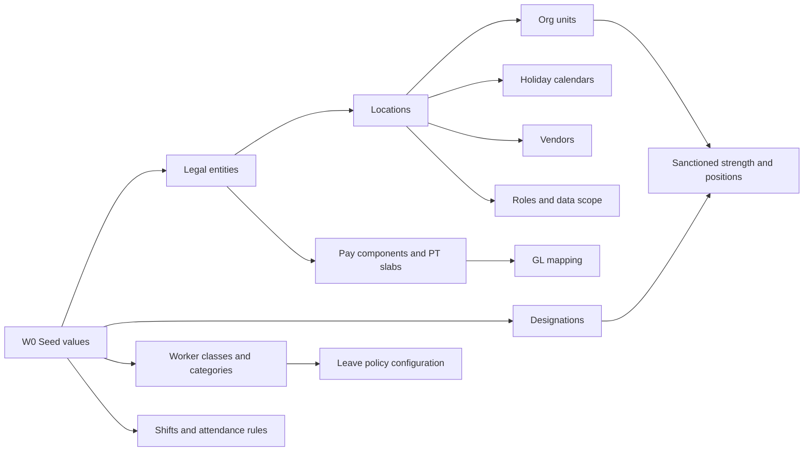
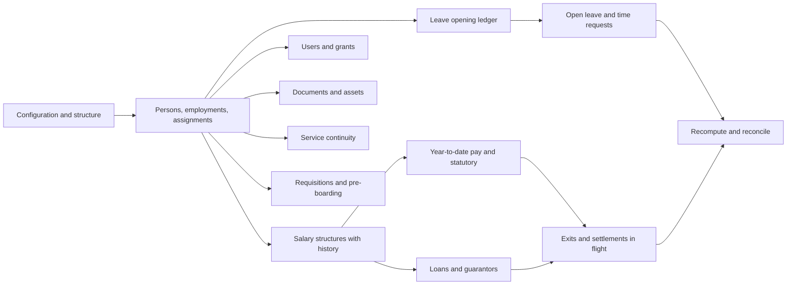
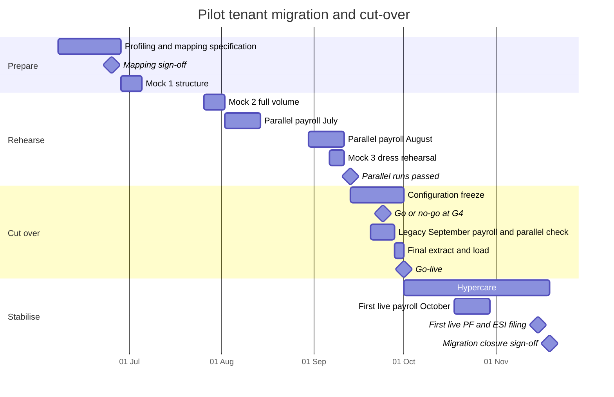
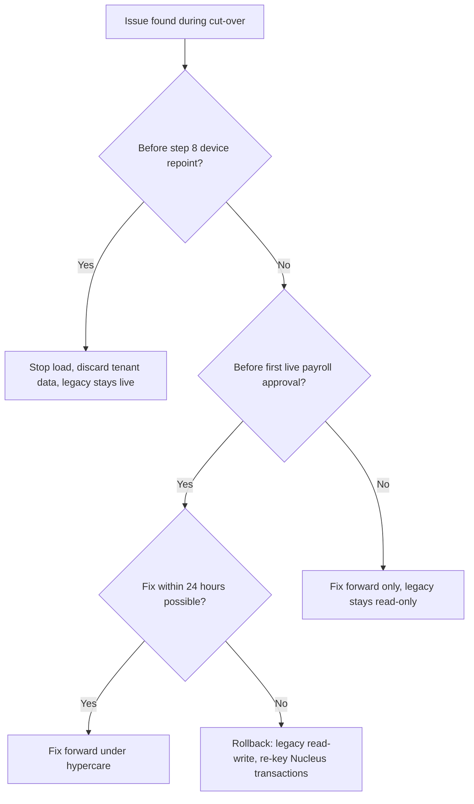

<picture>
  <source media="(prefers-color-scheme: dark)" srcset="../assets/MultipliersKraftLogoDark.png">
  
</picture>

# MIG-01 — Data Migration and Cut-over Requirements

| Attribute | Value |
| :--- | :--- |
| Document ID | MIG-01 |
| Title | Data Migration and Cut-over Requirements |
| Product | Nucleus Suite (Nucleus HRMS Suite) |
| Version | 1.0.0 |
| Status | Issued for approval |
| Owner (role) | Migration Lead |
| Author | Dhanraj Dadhich |
| Reviewed by | *pending* |
| Approved by | Product Council — *pending* |
| Date | 2026-11-05 |
| Classification | Internal |
| CMMI practice areas | PI, TS, VV, RSK, PLAN |
| Related documents | DA-01, DA-02, DA-03, DA-04, DA-05, ICD-01, IA-03, GOV-10, NFR-01, QA-03, VV-03, PLN-02, RSK-03, FRS-PAY-11, FRS-TIM-11, FRS-PLT-11 |
| Quality & process-performance objectives | QPPO-01 (escaped defects), QPPO-03 (exact payroll), QPPO-04 (predictable phase delivery) |
| Process performance baseline used | PPB-01 (review defect density), PPB-02 (review rate), PPB-04 (parallel-run variance) |
| Peer review record | *pending* (PR-xxxx, QA-02) |
| Tailoring record | none |
| Traceability anchor | BG-04, BG-06, BG-09 · M-P2.1, M-P2.2, G4 · RSK-D-015 |

---

## 1. Purpose and Scope

This document states what must be true for a client's people, time, leave, payroll and compliance data to move from its existing systems into Nucleus Suite, and for the client to switch over without losing a rupee, a leave day, a year of service or a statutory acknowledgement. It covers migration scope by object, the mapping approach, load sequence, transformation and cleansing, effective-dated history and opening balances, validation and reconciliation, rehearsals, the cut-over plan and timeline, rollback, data-quality thresholds, the security of migration data, sign-offs and acceptance criteria.

The requirements apply to every tenant implementation. Worked examples use the pilot demo tenant, Vindhya Precision Industries Pvt Ltd (two legal entities, five sites, four states), and the record keys of the HRMS Demo Dataset v1.1, whose numbered load order is the reference sequence for seeding a tenant.

| In scope | Out of scope |
| :--- | :--- |
| Master, configuration, balance and in-flight transaction data needed to operate from go-live | Legacy audit trails as live data (archived read-only instead) |
| Effective-dated history needed for arrears, statutory returns, gratuity and dispute resolution | General-ledger history (remains in the ERP system) |
| Opening balances: leave, comp-off, loans, year-to-date pay and tax, PF and ESI, professional tax, service continuity | Bank-file history and payment instructions (never migrated) |
| Validation, reconciliation and parallel payroll | Training, communications and organisational change (OCM-01, OCM-02) |
| Cut-over, rollback and post-go-live stabilisation | Ongoing interfaces after go-live (ICD-01) |

## 2. Delivery-Stage Constraint

The current delivery stage is **R0 — UI-validation prototype on local JSON**. Under DEC-0002 nothing in this document authorises extracting data from any client system, provisioning a production tenant or loading live data. During R0 the demo dataset is loaded as local JSON fixtures, which exercises the same load order and validations specified here on synthetic data only. Migration build starts with the migration load service in P1; rehearsals and cut-over happen in P2 for the pilot tenant, before Gate G4 (pilot go-live, M-P2.2).

## 3. Migration Principles

| ID | Requirement | Rationale | Source / trace | Realises SYS | Priority | Verification | Acceptance criterion |
| :--- | :--- | :--- | :--- | :--- | :--- | :--- | :--- |
| PLT-MIG-001 | Every migrated record MUST enter Nucleus through the same validation services as an online create or the governed import path; no direct writes to tables. | Migrated data must obey the same rules as live data. | GOV-10 §7 operation 1 | SYS-015, SYS-061 | Must | I | Load-service design shows no direct store writes; a rule-violating record is rejected during load with the rule ID. |
| PLT-MIG-002 | Balances MUST be migrated as ledger movements, never as stored balance columns. | Balance is a projection over the ledger (DA-01 leave_ledger). | DA-01, `17_Leave_Ledger`, `53_Leave_Balance_AsOn` | SYS-049 | Must | T | Every migrated balance is explainable movement by movement from the ledger. |
| PLT-MIG-003 | Temporal objects MUST be migrated with effective dates; history is never flattened into a single current row where arrears, statutory or service calculations depend on it. | History, not destruction. | DA-01 temporal column | SYS-021, SYS-022 | Must | T | An assignment change of the current financial year is visible as a dated version after migration. |
| PLT-MIG-004 | Every migrated record MUST carry its legacy key and a migration batch reference. | Traceability back to source for every reconciliation query. | Authored | SYS-032, SYS-061 | Must | I | Sampled records show `legacy_key` and `migration_batch_id`. |
| PLT-MIG-005 | Values that Nucleus derives (attendance days, balances, filled and open positions, wage base, ceilings) MUST be recomputed in Nucleus and compared with the legacy value, not loaded. | Derived values loaded as facts hide rule differences. | DA-01 notes (derived columns), `13_Salary_Structure` | SYS-047, SYS-057 | Must | T | Loaded structures recompute the wage base and 50% floor add-back identically to `13_Salary_Structure` for E1014 and E1049. |
| PLT-MIG-006 | Migration MUST be repeatable end to end from extract to reconciliation, and each run MUST produce the same result for the same extract. | Rehearsals are only meaningful if repeatable. | QA-03 §5.12 | SYS-050, SYS-061 | Must | D | Two loads of the same Mock 2 extract into fresh tenants produce identical reconciliation reports. |

## 4. Migration Scope by Object

Treatment codes: **M** migrate, **H** migrate with effective-dated history, **O** migrate as opening balance or open item, **C** configure (set up, not migrated), **D** derive by recomputation in Nucleus, **N** not migrated (legacy archived read-only).

| Group | Object (DA-01) | Treatment | History depth and selection | Demo dataset reference | Legacy source (typical) | Data owner role |
| :--- | :--- | :--- | :--- | :--- | :--- | :--- |
| Platform | tenant | C | Provisioned, not migrated | — | — | Platform engineer |
| Platform | legal_entity | M | Current, with registration numbers | `02_Legal_Entities` | Legacy HRMS, statutory registers | Client HR Head |
| Platform | location | M | Current, with factory licence and slab sets | `03_Locations` | Legacy HRMS | Client HR Head |
| Platform | role, entity_grant, location_grant | C | Rebuilt from the agreed role design, not copied from legacy permissions | `43_Roles_and_Data_Scope` | Role design workshop | Client HR Head with Security Lead |
| Platform | principal | M | Active users only, linked to the identity provider | `44_Demo_Users` | Enterprise directory | Client IT |
| Platform | approval_chain, workflow_definition | C | Configured | `64_Approval_Workflows` | Policy documents | Implementation consultant |
| Platform | approval_step | O | Pending steps of migrated open requests, re-created on the configured chain at the step already reached, with prior decisions as history | `64_Approval_Workflows` | Legacy workflow | Client HR Head |
| Platform | audit_entry, action_ledger, outbox | N | Legacy audit archived read-only | — | Legacy HRMS | Client HR Head |
| People | person | M | Active employees, plus separated employees within the current and previous financial year | `12_Employees` | Legacy HRMS or ERP system | Client HR Head |
| People | employment | H | Full employment spells, including prior spells recognised for continuity | `12_Employees` | Legacy HRMS | Client HR Head |
| People | assignment | H | Current version plus every change since the start of the previous financial year | `12_Employees` | Legacy HRMS | Client HR Head |
| People | org_unit | H | Current hierarchy plus changes in the current financial year | `04_Org_Units` | ERP system or legacy HRMS | Client HR Head |
| People | designation, worker_class, employment categories | C | Configured, then validated against legacy usage | `05_Designations`, `06_Worker_Classes`, `38_Employment_Categories` | Policy documents | Implementation consultant |
| People | position | M | All positions with status, incumbent and last incumbent | `11_Positions` | Legacy HRMS or budget sheet | Client HR Head |
| People | sanctioned_position | M | Current financial year | `10_Sanctioned_Manpower` | Budget approval | Client Finance Controller |
| People | document | M | Mandatory and unexpired documents of active workers, with files | `62_Documents` | Document store | Client HR Head |
| People | asset, asset_allocation | O | Assets currently issued | `33_Assets` | Asset register | Client Admin Head |
| Time | shift, shift_window, attendance_rule_set, work_calendar, holiday_calendar | C | Configured; holiday calendars for the current and next calendar year | `07_Shifts`, `08_Attendance_Rules`, `09_Holiday_Calendar`, `41_Grace_Late_Policy`, `42_Night_Extension_Rule` | Policy documents | Implementation consultant |
| Time | roster | O | Published rosters from go-live onward | `52_Shift_Roster` | Supervisor rosters | Plant HR |
| Time | attendance_event | O | Raw punches of any open (unlocked) period only; none when go-live is the first day of a pay period | `20_Punch_Events` | Device buffers or legacy time system | Plant HR |
| Time | attendance_day, attendance_segment, attendance_break | D | Derived in Nucleus; the last closed month is recomputed for comparison only | `21_Expected_Attendance`, `49_Break_Register` | — | Plant HR |
| Time | gate_pass, overtime_record, regularisation, attendance_exception | O | Open or approved-but-unpaid items | `22_Gate_Pass`, `23_Overtime_Register`, `50_Attendance_Regularisation`, `51_Attendance_Exceptions` | Legacy time system | Plant HR |
| Time | attendance_day_delta, late_counter | N | Created by Nucleus; late counters start fresh with the first pay period after go-live | `41_Grace_Late_Policy` | — | Plant HR |
| Leave | leave_type, leave_accrual_policy, leave_proration_rule, leave_combination_rule | C | Configured | `14_Leave_Types`, `15_Leave_Accrual_Policy`, `16_Leave_Proration`, `39_Leave_Schemes`, `40_Leave_Rules_Matrix` | Policy documents | Implementation consultant |
| Leave | leave_ledger | O | Opening movement per person per leave type at the cut-over date, plus one movement per open comp-off credit | `17_Leave_Ledger`, `19_CompOff_Ledger`, `53_Leave_Balance_AsOn` | Legacy leave module | Client HR Head |
| Leave | leave_request | O | Pending requests and approved requests dated on or after go-live; current leave-year history as read-only reference | `18_Leave_Requests` | Legacy leave module | Client HR Head |
| Payroll | pay_component, gl_mapping | C | Configured and validated against the last legacy payslip and journal | `47_Pay_Components`, `35_GL_Mapping` | Legacy payroll, ERP system | Client Finance Controller |
| Payroll | salary_structure | H | Current structure plus revisions inside the arrears window (current financial year) | `13_Salary_Structure` | Legacy payroll | Client Payroll Head |
| Payroll | payroll_run, payslip, payslip_line | O | Year-to-date summary per person per component for the current financial year as closed historic runs; last 12 payslips as documents | `26_Payroll_Runs`, `55_Payroll_Register` | Legacy payroll | Client Payroll Head |
| Payroll | payroll_input | O | Inputs approved for a run after go-live | `30_Recognition_Referral` | Legacy payroll | Client Payroll Head |
| Payroll | statutory_output | O | Returns filed in the current financial year with acknowledgement references, as evidence | `28_Statutory_Calendar`, `29_Statutory_Forms` | Compliance files | Client Compliance Owner |
| Payroll | bank_file, payroll_snapshot, gl_journal | N | Not migrated | `56_GL_Journal`, `57_Bank_File` (reference only) | — | — |
| Payroll | payslip_line_trace, payroll_audit_flag | N | Created by Nucleus runs only | — | — | — |
| Compensation and loans | loan, loan_guarantor, loan_repayment, salary_advance | O | Active loans and advances with outstanding; guarantor links of active loans; repayment summary for the current financial year | `24_Loans`, `25_Loan_Guarantors` | Legacy payroll loan ledger | Client Finance Controller |
| Compliance | rule_pack, statutory_form | C | Deployed and configured | `48_PT_Slabs`, `29_Statutory_Forms` | — | Compliance engineer |
| Compliance | obligation | O | Open obligations and those filed in the current financial year | `28_Statutory_Calendar` | Compliance calendar | Client Compliance Owner |
| Compliance | statutory_form_instance | O | Last serial number per register and establishment, plus instances of the current year | `29_Statutory_Forms` | Statutory registers | Client Compliance Owner |
| Compliance | consent_record | M | Existing consents with notice version; otherwise re-collected after go-live | — | Legacy HRMS | DPO |
| Compliance | inference_log | N | Not applicable | — | — | — |
| Lifecycle and experience | clearance_checklist_template, letter_template, recognition_programme | C | Configured | `27_Exit_Clearance`, `32_Letter_Templates` | Policy documents | Implementation consultant |
| Lifecycle and experience | clearance_item | O | Exits in progress | `27_Exit_Clearance`, `58_FnF_Settlement` | Legacy HRMS | Client HR Head |
| Lifecycle and experience | letter_issued | M | Letters of active workers, as documents with template version where known | `32_Letter_Templates` | Document store | Client HR Head |
| Lifecycle and experience | recognition_award, referral | O | Awards and referral payouts not yet paid, including part-paid referrals | `30_Recognition_Referral` | Legacy HRMS | Client HR Head |
| Lifecycle and experience | learning_assignment | O | Open assignments | `34_Induction_Learning` | Learning records | Client L&D Head |
| Lifecycle and experience | announcement | O | Scheduled announcements with a publish date after go-live | `31_Announcements` | Communications calendar | Client HR Head |
| Talent | requisition, candidate | O | Open requisitions; candidates in process with consent | `37_Requisitions`, `59_Candidates_and_Offers`, `61_Preboarding_Chain` | Recruitment tracker | Client Talent Head |
| Contingent | contractor_engagement, contractor_invoice | O | Active engagements and unpaid invoices | `45_Vendors_Contractors`, `46_Contractor_Invoices` | ERP system, contract files | Client Finance Controller |
| Finance | field_ownership_map | C | Configured before any employee load when the ERP system owns fields | `36_ERP_Inbound_Master` | Integration design | Implementation consultant |
| Finance | gl_journal_line, employee_sync_log, reconciliation_report | N | Created by Nucleus after go-live; migration reconciliation results are stored as reconciliation_report rows of the migration batch | — | — | — |

| ID | Requirement | Rationale | Source / trace | Realises SYS | Priority | Verification | Acceptance criterion |
| :--- | :--- | :--- | :--- | :--- | :--- | :--- | :--- |
| PLT-MIG-007 | A signed migration scope register MUST list every DA-01 object with its treatment code, history depth and data owner before Mock 1. | Unscoped objects surface as defects at go-live. | DA-01 | SYS-061 | Must | I | Register covers every DA-01 object and carries the sign-offs in §15. |
| PLT-MIG-008 | Separated employees of the current and previous financial year MUST be migrated with employment, final settlement status and year-to-date pay. | Tax statements, gratuity disputes and rehire continuity need them. | DA-01 employment note | SYS-021, SYS-061 | Must | T | A rehire of a separated employee resolves to the same person and continuity rule. |
| PLT-MIG-009 | The last used serial number of every gapless statutory register MUST be migrated per establishment. | Registers such as Form F must remain gapless across the switch. | RP-13, T-31 | SYS-086 | Must | T | The first Form F generated after go-live at LOC-PLA carries the next serial after the migrated one. |
| PLT-MIG-010 | Legacy audit trails, general-ledger history and bank-file history MUST NOT be migrated as live data and MUST be archived read-only for the retention period. | Avoids false provenance in Nucleus while keeping evidence. | GOV-10 §8 | SYS-027, SYS-034 | Must | I | Archive inventory lists each excluded data set with its retention period and custodian. |

## 5. Source-to-Target Mapping Approach

### 5.1 Mapping specification

One mapping specification is kept per target object. It is a controlled artefact under configuration management (CM-01) and is signed by the data owner before Mock 1. Each row maps one target field.

| Column | Content |
| :--- | :--- |
| Target | `object.field` from DA-01, with type and length from DA-05 and FRS-&lt;DOM&gt;-03 |
| Source | Legacy system, table or file, field, and extraction filter |
| Rule | Direct, cross-reference lookup, transformation rule ID (§7), default, or derived in Nucleus (treatment D) |
| Mandatory | As DA-05; a mandatory target with no source and no default is a blocking gap |
| Owner | ERP system or Nucleus, per the field ownership map when the tenant runs in ERP-owned or co-owned mode |
| Validation | Picklist or enumeration code (DA-02, DA-03), format rule, referential check |
| Sample evidence | Three legacy records and their expected Nucleus values |

### 5.2 Cross-reference tables

Codes are re-keyed through cross-reference tables rather than by editing source extracts, so that each rehearsal reapplies the same mapping.

| Cross-reference | Legacy value example | Nucleus value example |
| :--- | :--- | :--- |
| Employee key | `VPI-1018` | `E1018`, with `VPI-1018` kept as `person.erp_employee_key` |
| Department to org unit | `Machining` | `OU-111` |
| Grade to designation and band | `Sr Engr` | `DES-08`, band `B` |
| Employment type to category, sub-category and worker class | `Contract - Helper` | `CAT-3P` sub-category, resolves to `WC-3PH` |
| Leave code | `PL` | `EL` |
| Pay head | `BASIC` | `PC-BASIC` |
| Location and payroll group | `Chennai plant, salary at HO` | `LOC-CHN`, payroll group `HO` (independent) |
| Shift | `Gen-A` | `SH-A` |

### 5.3 ERP-mastered fields

When the tenant runs in ERP-owned or co-owned mode (OD-07), the fields the ERP system owns are loaded through the employee master inbound interface (ICD-01 FIN-INT-001) from the ERP system itself, not from the legacy HRMS, so that the first nightly synchronisation after go-live finds nothing to change. Nucleus-owned fields are loaded by the migration load service.

| ID | Requirement | Rationale | Source / trace | Realises SYS | Priority | Verification | Acceptance criterion |
| :--- | :--- | :--- | :--- | :--- | :--- | :--- | :--- |
| PLT-MIG-011 | A mapping specification MUST exist for every object with treatment M, H or O, and every mandatory target field MUST have a source, a default or a derivation. | Unmapped mandatory fields fail at load. | DA-05 | SYS-061 | Must | I | Gap report shows zero unmapped mandatory fields before Mock 2. |
| PLT-MIG-012 | Code conversions MUST be held in versioned cross-reference tables and applied by the load service, not by editing extracts. | Repeatability across rehearsals. | PLT-MIG-006 | SYS-026, SYS-061 | Must | I | Cross-reference tables are under version control with the mock in which each version was used. |
| PLT-MIG-013 | In ERP-owned or co-owned mode, ERP-owned fields MUST be loaded from the ERP system through FIN-INT-001, and the first post-go-live synchronisation MUST report zero changes for unchanged records. | Avoids a day-one flood of conflicts. | RL-510 to RL-516, OD-07 | SYS-084 | Must | T | First nightly batch after cut-over shows only `applied_no_change` for records untouched in the ERP system. |
| PLT-MIG-014 | Worker class MUST be resolved from category, sub-category and employee-level overrides as configured, never mapped by name from a legacy grade string. | Policy attaches to class and band, not to labels. | `38_Employment_Categories`, DA-01 worker_class | SYS-026, SYS-059 | Must | T | Third-party employees and helpers in the same category resolve to WC-3PE and WC-3PH respectively. |

## 6. Load Sequence

### 6.1 Waves

The sequence follows the numbered order of the HRMS Demo Dataset v1.1: sheets 02 to 19 are master and configuration data and must exist before any transaction sheet; configuration sheets 38 to 45, 47, 48, 65 and 66 load before `12_Employees`; transaction and output sheets from 46 and 49 onward load after `37_Requisitions`.

| Wave | Content | Demo dataset sheets | Depends on |
| :--- | :--- | :--- | :--- |
| W0 | Tenant, enumeration and picklist seed values | 65, 66 | Tenant provisioned |
| W1 | Legal entities, locations, org units, designations, worker classes and categories | 02, 03, 04, 05, 06, 38 | W0 |
| W2 | Shifts, attendance rules, grace and night rules, holiday calendars, leave types, schemes, accrual, proration and combination rules | 07, 08, 09, 14, 15, 16, 39, 40, 41, 42 | W1 |
| W3 | Pay components, PT slabs, GL mapping, rule packs | 47, 48, 35 | W1 and FIN-INT-003 reference codes |
| W4 | Sanctioned strength, positions, vendors, roles and data scope | 10, 11, 45, 43 | W1 |
| W5 | Persons, employments, assignments with history, salary structures, users and grants, documents, asset allocations | 12, 13, 44, 62, 33 | W2, W3, W4 |
| W6 | Opening balances: leave ledger and comp-off, loans and guarantors, year-to-date pay and tax, statutory year-to-date, service continuity | 17, 19, 24, 25, 55 (year-to-date form) | W5 |
| W7 | In-flight transactions: leave requests, gate passes, overtime, regularisations, exceptions, requisitions, candidates, pre-boarding, exits and clearance, contractor invoices, recognition and referral payouts | 18, 22, 23, 50, 51, 37, 59, 60, 61, 27, 58, 46, 30 | W5, W6 |
| W8 | Derivation and comparison: recompute attendance for the comparison month, project balances, run reconciliation | 20 → 21, 53 | W5 to W7 |

### 6.2 Dependency graph — configuration and structure

### 6.3 Dependency graph — people, balances and transactions

| ID | Requirement | Rationale | Source / trace | Realises SYS | Priority | Verification | Acceptance criterion |
| :--- | :--- | :--- | :--- | :--- | :--- | :--- | :--- |
| PLT-MIG-015 | Loads MUST follow waves W0 to W8, and the load service MUST refuse a wave whose predecessors have not passed their wave checks. | A transaction cannot reference a master that does not exist. | `00_README` load order, `70_Change_Log_v1_1` | SYS-051, SYS-061 | Must | T | Attempting W7 before W6 passes is refused with the failing check named. |
| PLT-MIG-016 | Each wave MUST end with a wave check of counts and referential integrity before the next wave starts. | Errors are cheapest to fix where they enter. | GOV-10 §7 integrity | SYS-061 | Must | T | Wave check report exists for every wave in each mock. |
| PLT-MIG-017 | Seeding the demo tenant from the HRMS Demo Dataset v1.1 MUST use the same load service and wave order as client migrations. | The demo tenant is a permanent rehearsal of the migration path (OD-12). | VV-03, QA-03 | SYS-004, SYS-061 | Should | D | Demo tenant build log shows waves W0 to W8 and a clean reconciliation against `21_Expected_Attendance` and `53_Leave_Balance_AsOn`. |

## 7. Transformation and Cleansing Rules

| ID | Requirement | Rationale | Source / trace | Realises SYS | Priority | Verification | Acceptance criterion |
| :--- | :--- | :--- | :--- | :--- | :--- | :--- | :--- |
| PLT-MIG-018 | Dates MUST be converted to ISO 8601, and timestamps MUST carry the source offset; ambiguous day-month formats MUST be rejected rather than guessed. | A transposed date of joining corrupts service, leave and gratuity. | ICD-01 §5.3 | SYS-067, SYS-068 | Must | T | A legacy date `04/05/2019` without a declared format is rejected to the error queue. |
| PLT-MIG-019 | Money MUST be converted to integer paise with no floating-point step, and every converted amount MUST round-trip to the legacy value. | Exact payroll to the paisa. | DA-01 payslip_line, QPPO-03 | SYS-028 | Must | T | Sum of converted year-to-date amounts equals the legacy control total exactly. |
| PLT-MIG-020 | Aadhaar, PAN, passport and bank account values MUST be tokenised before landing in any Nucleus store and MUST never appear in error queues, logs or reconciliation output. | Restricted data handling. | DA-01 person tokens, GOV-10 §5 | SYS-033 | Must | I | Error-queue and log inspection after Mock 2 shows only tokens or masked values. |
| PLT-MIG-021 | Duplicate persons MUST be detected on name plus date of birth plus government-ID token and resolved by a data steward before load; one person ID per human. | Rehires and conversions must not create second identities. | GOV-10 §6 | SYS-061 | Must | T | A planted duplicate pair is reported, merged by the steward and loaded once. |
| PLT-MIG-022 | Formats MUST be validated and normalised: mobile to `+91` followed by ten digits, email to RFC 5322, PAN to the five-four-one pattern, IFSC to four letters, zero and six alphanumerics, UAN to 12 digits, PIN to six digits. | Invalid identifiers break statutory files and payments. | GOV-10 §7 validity, DA-05 | SYS-061, SYS-067 | Must | T | Invalid values are listed per record with the rule; none loads. |
| PLT-MIG-023 | Picklist and enumeration values MUST be mapped to codes in DA-02 and DA-03; an unmapped legacy value is a blocking error, never a free-text load. | Free text defeats rule evaluation. | DA-02, DA-03 | SYS-059, SYS-061 | Must | T | An unknown legacy leave code is rejected until the cross-reference is extended. |
| PLT-MIG-024 | Payroll group and work location MUST be mapped independently and never derived one from the other. | Salary at head office, attendance at plant (R-09). | DA-01 location note, `12_Employees` E1056 | SYS-007 | Must | T | E1056 loads with location LOC-CHN and payroll group HO. |
| PLT-MIG-025 | Every active assignment MUST resolve a position, org unit, cost centre, location, manager, shift group, payroll group and worker class on its effective date; unresolved references block the record. | Integrity on the effective date. | GOV-10 §7 completeness and integrity | SYS-006, SYS-061 | Must | T | Completeness report shows 100% for these attributes on active assignments. |
| PLT-MIG-026 | Employee-level policy overrides (rest day, wage type, OT eligibility, grace exemption, leave policy) MUST be migrated only with a recorded reason; an override without a reason fails validation. | Class supplies the default; the individual may differ with a reason. | DA-01 assignment overrides | SYS-036 | Must | T | An override row without a reason is rejected. |
| PLT-MIG-027 | Bank details MUST be migrated together with their last verification status; unverified details MUST be flagged for verification before the first salary paid by Nucleus. | Accuracy before first salary. | GOV-10 §7 accuracy, RL-393 | SYS-085 | Must | T | First-run pre-audit lists every unverified account; none is in the bank file without a recorded verification. |
| PLT-MIG-028 | Cleansing performed during migration MUST be done in the legacy system or in a documented correction log approved by the data owner, never silently in the extract. | Keeps legacy and Nucleus reconcilable and auditable. | Authored | SYS-032, SYS-036 | Must | I | Correction log lists each correction with approver and reason. |

## 8. Effective-Dated History and Opening Balances

### 8.1 Cut-over date choice

The cut-over date is the first day of a pay period. The recommended date is the first day of a financial quarter, and for tenants with ESI-covered workers the first day of an ESI contribution period (1 April or 1 October), because tax-quarter returns, ESI coverage and half-yearly professional tax then start cleanly in Nucleus (to be validated by Legal). The pilot plan in §11 uses 1 October.

### 8.2 History depth

| Data | Depth migrated | Why |
| :--- | :--- | :--- |
| Assignment and org history | Every change since the start of the previous financial year, plus the version in force at that date | Arrears, reorganisation reporting, as-at cost split |
| Salary structure | Every revision in the current financial year, plus the structure in force at its start | Arrears and year-to-date recomputation of tax |
| Employment spells | All spells, including prior spells recognised for continuity | Gratuity and loan-ceiling service |
| Payroll results | Year-to-date per person per component for the current financial year; payslip documents for the last 12 months | Tax projection, annual tax statement, employee self-service |
| Leave | Opening movement at cut-over; current leave-year movements as a read-only reference | Explain balances without importing every legacy transaction |
| Attendance | None as live data when cut-over is the first day of a pay period; last closed month recomputed for comparison | Attendance days are derived, not loaded |

### 8.3 Opening balances

| Balance | Migrated as | Rules | Reconciles to |
| :--- | :--- | :--- | :--- |
| Leave balance | One `Credit` ledger movement per person per leave type, effective the day before go-live, `source_ref` = migration batch, narration carrying the legacy opening, credited, availed, lapsed and encashed figures for the leave year | Exclude from the opening any leave dated on or after go-live; those requests migrate as approved requests and are debited by Nucleus. Accrual progress (months accrued, eligibility wait served, credit on completion due) is migrated as policy state so the next accrual is correct | Legacy balance report per person and type, exactly |
| Comp-off | One ledger credit per open comp-off credit with its own earned date and expiry | 60-day clock per credit; a credit already lapsed is not migrated | `19_CompOff_Ledger` pattern: each credit separately, never a summed balance |
| Loans and advances | Loan with principal, rate, tenure, instalment, outstanding after the last legacy recovery, sanction details and special terms; guarantor rows with acceptance and blocked status; advances with recovery run | Outstanding is the legacy loan ledger after the last legacy payroll; guarantors of active loans remain blocked; closed loans in the year carry explicit release rows | Legacy loan ledger and the ERP employee-loans account per employee |
| Year-to-date pay and tax | Per person per component for the financial year to date: gross earnings, exempt allowances, perquisites, PF employee and voluntary PF, professional tax, TDS deducted; previous-employer income and tax for joiners in the year; tax regime chosen; declaration and proof status | Loaded as closed historic runs flagged `migrated`; never recomputed | Legacy payroll register year-to-date and the filed TDS statements of earlier quarters |
| PF and ESI | UAN, PF membership date, pension eligibility, voluntary PF rate; ESI IP number and coverage status for the contribution period in progress | When cut-over starts a new ESI contribution period, coverage is evaluated afresh; otherwise the legacy coverage decision for the period is carried (to be validated by Legal) | Last filed PF return and ESI contribution file per employee |
| Professional tax and LWF | Year-to-date PT per state and LWF contributions of the period in progress | Half-yearly and annual levies continue from the migrated amounts | Legacy PT register per state |
| Gratuity service | Continuous service start date, recognised prior service and its basis, last-drawn basic plus DA, nominations | Eligibility and amount are computed in Nucleus from these facts; the gratuity provision balance stays in the ERP system | Legacy service records; `58_FnF_Settlement` gratuity contrast (seven years pays, four does not) |
| Notice and probation | Probation end, confirmation date, notice days in force | Confirmation workflows in flight continue on the version they started under | Legacy HR records |

| ID | Requirement | Rationale | Source / trace | Realises SYS | Priority | Verification | Acceptance criterion |
| :--- | :--- | :--- | :--- | :--- | :--- | :--- | :--- |
| PLT-MIG-029 | The cut-over date MUST be the first day of a pay period, and SHOULD be the first day of a financial quarter. | Avoids split-period payroll and mid-quarter tax statements. | §8.1 | SYS-024 | Must | I | Cut-over plan states the date and the period it opens. |
| PLT-MIG-030 | Leave opening balances MUST be single ledger credits per person and type with narration that reproduces the legacy computation, excluding leave dated on or after go-live. | Explainable balances and no double deduction. | `53_Leave_Balance_AsOn`, DA-01 leave_ledger | SYS-049 | Must | T | For every person and type, projected balance on go-live equals the legacy balance less approved future leave migrated as requests. |
| PLT-MIG-031 | Open comp-off credits MUST be migrated individually with their own expiry dates. | A summed balance cannot express separate 60-day clocks. | R-07, `17_Leave_Ledger` LL-0022 and LL-0023 | SYS-049, SYS-050 | Must | T | Two credits for one person lapse on their own dates after go-live. |
| PLT-MIG-032 | Accrual policy state (months accrued, eligibility wait served, completion credit due) MUST be migrated so the first Nucleus accrual is correct. | A standard-band joiner's catch-up credit must not be lost or duplicated. | `15_Leave_Accrual_Policy`, `17_Leave_Ledger` E1067 example | SYS-049, SYS-050 | Must | T | A worker reaching six months in the first month after go-live receives exactly the completion credit. |
| PLT-MIG-033 | Active loans MUST be migrated with outstanding, instalment, remaining tenure, guarantors and their blocked status, and closed loans of the year with explicit guarantor releases. | Eligibility, guarantor lock and deduction read the same facts. | R-10, RL-450 to RL-452, `24_Loans`, `25_Loan_Guarantors` | SYS-049, SYS-051 | Must | T | Post-migration eligibility for E1044 returns not eligible with ceiling 87,000.00, and E1050 returns eligible. |
| PLT-MIG-034 | Year-to-date pay and tax per person per component MUST be migrated for the financial year to date, together with previous-employer income and tax regime. | TDS projection and annual tax statements need the whole year. | CMP-INT-004 (ICD-01) | SYS-045, SYS-047 | Must | T | The first Nucleus TDS projection for each employee matches the legacy projection with the same declarations. |
| PLT-MIG-035 | Continuous service start date and recognised prior service MUST be migrated for every worker. | Gratuity eligibility and loan ceilings depend on service. | DA-01 employment tenure_continuity_ref, `24_Loans` 6x ceiling | SYS-021, SYS-047 | Must | T | E1056 shows service of more than five years and the 6x loan ceiling after migration. |
| PLT-MIG-036 | Approved but unpaid overtime of the last legacy period MUST be migrated as overtime records and paid in the first Nucleus off-cycle overtime run, unless the cut-over plan records that the legacy system pays it. | Overtime is paid after salary in its own run. | R-11, RL-333 | SYS-025, SYS-047 | Must | T | Migrated overtime minutes equal the legacy approved-unpaid total and appear in exactly one run. |

## 9. Validation and Reconciliation

Reconciliation runs at five levels after every mock and at cut-over. Results are stored as `reconciliation_report` rows and shown on a migration reconciliation screen with drill-down to records, in the same style as the payroll reconciliation (SCR-103).

| Level | Check | Method | Tolerance |
| :--- | :--- | :--- | :--- |
| L1 Counts | Records extracted = loaded + rejected + intentionally excluded, per object, entity and location | Automated count comparison | Exact; zero unaccounted |
| L2 Control totals | Headcount by entity, location, worker class and payroll group; sum of monthly gross of current structures; sum of loan outstanding; sum of leave balances by type; year-to-date gross, PF, ESI, PT and TDS by entity | Hash and sum totals computed on both sides | Exact, to the paisa and to the half day |
| L3 Field-level sample | Field-by-field comparison of a stratified random sample: at least 5% of persons or 200 persons, whichever is larger, covering every worker class, location and payroll group | Automated comparison plus data-owner review | Zero differences on mandatory fields; differences on optional fields explained |
| L4 Business reconciliation | Leave balance per person and type; loan outstanding per loan; year-to-date per person per component; service years per person; open requests per state; last Form F serial per establishment | Automated, with the legacy report as the expected value | Exact |
| L5 Parallel payroll | Gross-to-net for every employee in at least two consecutive cycles computed in Nucleus from migrated data and compared with the legacy payroll; statutory totals; bank-file total; journal | Line-by-line variance analysis per employee and component (MET-13, PPB-04) | Zero unexplained variance; every variance classified as legacy defect, Nucleus defect or agreed rule difference |

Attendance is reconciled separately: the last closed legacy month is recomputed in Nucleus from its raw punches and compared day by day with the legacy attendance status, in the same way the demo tenant is reconciled against `21_Expected_Attendance`; any disagreement is a defect to explain before go-live, not a data error.

| ID | Requirement | Rationale | Source / trace | Realises SYS | Priority | Verification | Acceptance criterion |
| :--- | :--- | :--- | :--- | :--- | :--- | :--- | :--- |
| PLT-MIG-037 | Levels L1 to L4 MUST pass with the tolerances in §9 in Mock 3 and at cut-over. | Completeness and accuracy of the switch. | QA-03 §5.12 | SYS-031, SYS-061 | Must | T | Reconciliation report for Mock 3 and cut-over shows every L1 to L4 check passing. |
| PLT-MIG-038 | Parallel payroll MUST run for at least two consecutive cycles, and the final cycle MUST show zero unexplained variance at the paisa, signed by the client Payroll Head. | Payroll accuracy before money moves. | QA-03 parallel runs, M-P2.1, MET-13, PPB-04 | SYS-031, SYS-048 | Must | T | Variance register for both cycles is closed with classifications and sign-off. |
| PLT-MIG-039 | The last closed legacy attendance month MUST be recomputed in Nucleus and compared day by day with the legacy status. | Rule differences surface before they reach pay. | `00_README` step 3, R-13 | SYS-057, SYS-068 | Must | T | Day-status agreement report shows every disagreement explained. |
| PLT-MIG-040 | Every reconciliation check MUST drill down to the records that make up its expected and actual values. | Disputes are settled with records, not totals. | RL-531 pattern | SYS-030, SYS-061 | Should | D | Drilling a leave-balance mismatch lists the legacy and Nucleus movements behind it. |

## 10. Mock-Migration Rehearsals

| Mock | Purpose | Entry criteria | Exit criteria | Environment and data |
| :--- | :--- | :--- | :--- | :--- |
| Mock 1 — structure | Prove configuration, mapping specifications and cross-references with a representative subset | Mapping specifications signed; configuration workbook for the tenant complete | W0 to W5 load for one entity and one plant; L1 and L2 pass for the subset; defect log triaged | Migration rehearsal environment (see §14); subset extract |
| Mock 2 — full volume | Load all waves at full volume with history and balances | Mock 1 exit; all mapping gaps closed; data-quality thresholds of §13 met on the extract | W0 to W8 complete; L1 to L4 pass or every failure has an owned defect; load duration measured | Migration rehearsal environment; full extract |
| Mock 3 — dress rehearsal | Execute the cut-over runbook end to end, timed, with the people who will do it | Mock 2 exit; first parallel payroll cycle compared; runbook approved | Runbook completed inside the cut-over window with 25% contingency; L1 to L4 pass; rollback steps rehearsed; go or no-go criteria evaluated | Migration rehearsal environment; extract taken with cut-over timing |

| ID | Requirement | Rationale | Source / trace | Realises SYS | Priority | Verification | Acceptance criterion |
| :--- | :--- | :--- | :--- | :--- | :--- | :--- | :--- |
| PLT-MIG-041 | At least three mock migrations (structure, full volume, timed dress rehearsal) MUST be executed before go-live, with entry and exit criteria as in §10. | QA-03 requires at least two; the third proves the timed runbook. | QA-03 §5.12 | SYS-008, SYS-061 | Must | I | Mock exit reports for all three mocks are signed. |
| PLT-MIG-042 | The dress rehearsal MUST complete the full runbook within the planned cut-over window including 25% contingency. | A cut-over that only fits on paper fails on the night. | PLN-02 G4 criteria | SYS-061 | Must | D | Mock 3 timing log shows completion inside the window. |
| PLT-MIG-043 | Defects found in mocks MUST be logged, classified (extract, mapping, transformation, product, legacy data) and closed or accepted before the next mock starts. | Prevents defects carrying forward to cut-over. | QA-03, CAR-01 | SYS-061 | Must | I | Defect log shows no open blocking defect at each mock exit. |

## 11. Cut-over Plan and Timeline

### 11.1 Timeline

Calendar dates are a planning illustration for the pilot tenant. They assume programme week 1 begins on Monday 8 February 2027, so that pilot go-live (M-P2.2, around week 34) falls on Friday 1 October 2027, the first day of a tax quarter and of an ESI contribution period. The Migration Lead re-bases the plan as a block when the pilot go-live date is fixed at Gate G3.

### 11.2 Cut-over runbook

| Step | When (relative to go-live T, 00:00 on 1 October) | Activity | Owner | Verification |
| :--- | :--- | :--- | :--- | :--- |
| 1 | T−18 days | Configuration freeze in Nucleus; changes only through the cut-over change board | Implementation Lead | Configuration snapshot hash recorded |
| 2 | T−7 days | Go or no-go meeting against §11.3 criteria | Steering Committee | Signed decision |
| 3 | T−11 to T−4 days | Legacy September payroll processed and closed; September run also computed in Nucleus as a confirmation parallel cycle | Client Payroll Head | Variance register closed |
| 4 | T−3 days | Freeze of master-data changes in legacy; joiners and leavers for the freeze window captured on a controlled list | Client HR Head | Freeze notice issued; list maintained |
| 5 | T−3 to T−2 days | Final extract and load of waves W0 to W5; L1 to L3 reconciliation | Migration Lead | Reconciliation report |
| 6 | T−1 day, after legacy close of business | Final extract and load of W6 and W7 balances and open items as at end of day; L4 reconciliation | Migration Lead | Reconciliation report signed by data owners |
| 7 | T−1 day, 22:00 | Identity provider federation and SCIM provisioning enabled for all users (ICD-01 PLT-INT-003, PLT-INT-004) | Integration Architect | Parity report shows zero gaps |
| 8 | T 00:00 | Site agents repointed to Nucleus ingestion (ICD-01 TIM-INT-001); legacy device collection stopped | Plant IT | First punches visible in Nucleus; device health green |
| 9 | T 00:00 | ERP employee master sync, GL journal and bank connectors switched to production credentials | Integration Architect | First nightly sync reports only expected changes |
| 10 | T 06:00 | Legacy system set to read-only; access restricted to named roles | Client IT | Write attempt in legacy refused |
| 11 | T to T+3 days | Hypercare war room; daily reconciliation of punches, leave applications and approvals | Delivery Lead | Daily hypercare report |
| 12 | First live payroll | October payroll run in Nucleus with heightened pre-audit and Payroll SME review | Client Payroll Head with Payroll SME | Run approved with zero CRITICAL flags |
| 13 | First statutory filing | PF and ESI files for October generated from posted records and filed | Client Compliance Owner | Acknowledgements captured |

### 11.3 Go or no-go criteria

| Criterion | Threshold |
| :--- | :--- |
| Mock 3 reconciliation | L1 to L4 pass |
| Parallel payroll | Two consecutive cycles with zero unexplained variance |
| Data quality | All blocking thresholds in §13 met |
| Defects | No open Severity 1 or 2 migration or product defect affecting pay, time or statutory output |
| Interfaces | All P1 interfaces in ICD-01 passed in pre-production with counterparty test endpoints |
| People | Cut-over team trained and named for every runbook step; hypercare roster published |
| Rollback | Rollback rehearsed in Mock 3 and the legacy system confirmed available read-write until step 10 |

| ID | Requirement | Rationale | Source / trace | Realises SYS | Priority | Verification | Acceptance criterion |
| :--- | :--- | :--- | :--- | :--- | :--- | :--- | :--- |
| PLT-MIG-044 | A cut-over runbook with step, time, owner and verification MUST be approved before Mock 3 and executed under change control. | Predictable cut-over. | PLN-02 G4, QPPO-04 | SYS-036, SYS-061 | Must | I | Approved runbook exists and the cut-over log records each step's verification. |
| PLT-MIG-045 | Go-live MUST NOT proceed unless every go or no-go criterion in §11.3 is met or explicitly waived by the Steering Committee with recorded conditions. | Gate discipline. | G4 criteria | SYS-036, SYS-051 | Must | I | Signed go or no-go record lists each criterion and its status. |
| PLT-MIG-046 | Joiners, leavers and changes during the legacy freeze window MUST be captured on a controlled list and applied in Nucleus within one working day of go-live. | Nothing falls between systems. | Authored | SYS-012, SYS-061 | Must | T | Freeze-window list reconciles to Nucleus records on T+1. |
| PLT-MIG-047 | Hypercare MUST run at least until the first live payroll is paid and the first live PF and ESI filings are acknowledged. | The first month proves the migration. | Authored | SYS-086 | Must | I | Hypercare exit report references the paid run and the acknowledgements. |

## 12. Rollback

| Point | Rollback action | Data handling |
| :--- | :--- | :--- |
| Before step 8 (device repoint) | Stop the cut-over; legacy remains the system of record | Nucleus tenant data discarded and the tenant re-provisioned for the next attempt |
| After step 8 and before the first live payroll approval | Steering Committee may order rollback when a rollback trigger occurs and a fix within 24 hours is not credible | Site agents repointed to legacy collection (devices retain their buffers); transactions created in Nucleus since go-live are exported and re-keyed into legacy from a reconciled list; legacy restored to read-write |
| After the first live payroll approval | No rollback; fix forward | Legacy stays read-only as the evidence archive |

Rollback triggers: an L4 reconciliation failure on balances or year-to-date that cannot be corrected within 24 hours; punch ingestion below 99% of expected events for two consecutive shifts; a Severity 1 defect in pay computation or access control; loss of a P1 interface without a working fallback.

| ID | Requirement | Rationale | Source / trace | Realises SYS | Priority | Verification | Acceptance criterion |
| :--- | :--- | :--- | :--- | :--- | :--- | :--- | :--- |
| PLT-MIG-048 | Rollback points, triggers and steps MUST be defined in the runbook and rehearsed in Mock 3. | Rollback that has never been run will not work on the night. | §12 | SYS-061 | Must | D | Mock 3 log shows the rollback from after step 8 executed and timed. |
| PLT-MIG-049 | The legacy system MUST remain available read-write until step 10 and read-only thereafter for at least the retention period of payroll records. | Rollback option and statutory evidence. | GOV-10 §8 | SYS-027 | Must | I | Legacy access plan states dates, custodians and retention. |
| PLT-MIG-050 | Transactions created in Nucleus after go-live MUST be exportable as a reconciled list for re-keying in case of rollback. | No employee action is lost if rollback is ordered. | Authored | SYS-017, SYS-061 | Must | D | Export of the first-day transactions in Mock 3 matches the Nucleus counts. |

## 13. Data-Quality Thresholds

Thresholds apply to the final extract before load and are re-measured after load. Blocking thresholds stop the cut-over; non-blocking thresholds require an owned remediation plan.

| Dimension | Object scope | Threshold | Blocking |
| :--- | :--- | :--- | :--- |
| Completeness | Payroll-critical fields of active workers: legal entity, payroll group, salary structure, bank details, PAN, UAN where PF applies, IP number where ESI applies, date of joining, date of birth | 100% | Yes |
| Completeness | Other mandatory fields of active workers: position, cost centre, location, manager, shift group, worker class | ≥ 99.5% | Yes |
| Completeness | Optional fields (personal email, blood group, emergency contact) | ≥ 90% | No |
| Validity | Formats and code values (PAN, IFSC, UAN, mobile, email, picklists) | ≥ 99.9%, and 100% on payroll-critical fields | Yes |
| Accuracy | Bank accounts verified before first Nucleus salary | ≥ 99.5% verified; unverified accounts excluded from the bank file until verified | Yes |
| Uniqueness | One person per human; one active employment per person per legal entity unless concurrent employment is configured | 100% | Yes |
| Consistency | Payroll location equals the worker's payroll group on the pay date; assignment dates within employment dates | 100% | Yes |
| Integrity | Every reference valid on its effective date | 100% | Yes |
| Timeliness | Balances and year-to-date extracted after the last legacy payroll close | 100% | Yes |

| ID | Requirement | Rationale | Source / trace | Realises SYS | Priority | Verification | Acceptance criterion |
| :--- | :--- | :--- | :--- | :--- | :--- | :--- | :--- |
| PLT-MIG-051 | Migration data MUST meet the thresholds in §13 before cut-over; a blocking threshold breach stops the cut-over. | Migration data must pass the production quality thresholds. | GOV-10 §7 operation 4 | SYS-051, SYS-061 | Must | T | Data-quality report of the final extract shows every blocking threshold met. |
| PLT-MIG-052 | Data-quality results MUST be measured on every mock and trended. | Shows whether remediation is converging before go-live. | MPM-01 | SYS-061 | Should | A | Trend chart across Mock 1 to Mock 3 shows each dimension. |

## 14. Security of Migration Data

| ID | Requirement | Rationale | Source / trace | Realises SYS | Priority | Verification | Acceptance criterion |
| :--- | :--- | :--- | :--- | :--- | :--- | :--- | :--- |
| PLT-MIG-053 | Extracts MUST be transferred only by SFTP or another encrypted channel, encrypted at rest with AES-256, and signed so that tampering is detected. | Extracts contain Restricted data. | GOV-10 §5, ICD-01 §5.1 | SYS-088 | Must | I | Transfer log shows encrypted channels and verified signatures for every extract. |
| PLT-MIG-054 | Mock migrations using client production data MUST run in a dedicated migration rehearsal environment that carries production-grade controls, resides in the cloud region in India, and is destroyed after each mock; its use requires the DPO's documented approval. | Production Restricted data must not be copied to development or test. | GOV-10 §13, NFR-01 residency | SYS-005 | Must | I | DPO approval and destruction certificates exist for each mock. |
| PLT-MIG-055 | Access to extracts, staging and reconciliation output MUST be limited to named migration team members through time-bound grants, with every access logged. | Least privilege and accountability. | GOV-10 §9 | SYS-019, SYS-033 | Must | T | Access review after Mock 2 shows only named principals with unexpired grants. |
| PLT-MIG-056 | Reconciliation reports and defect logs MUST show identifiers masked and amounts only where the viewer is entitled to see compensation. | Salary visibility rules apply to migration artefacts too. | RL-005, R-09 | SYS-018, SYS-033 | Must | I | A plant HR reviewer sees masked compensation in migration reports. |
| PLT-MIG-057 | Extract files and staging data MUST be securely destroyed within 30 days of migration closure sign-off, with a destruction certificate, except the archive set retained under PLT-MIG-010. | Storage limitation. | GOV-10 §2 P6, §8 | SYS-027 | Must | I | Destruction certificate is filed with the closure sign-off. |
| PLT-MIG-058 | Processing personal data for migration MUST be recorded in the record of processing activities with purpose and lawful basis (to be validated by Legal). | Lawful purpose for every processing activity. | GOV-10 §2 P1 | SYS-027, SYS-033 | Must | I | Record of processing contains the migration activity before Mock 1. |

## 15. Sign-offs

| Artefact or event | Signatories (roles) | Gate or timing |
| :--- | :--- | :--- |
| Migration scope register and mapping specifications | Client HR Head, Client Payroll Head, Client Finance Controller, Data Architect, Migration Lead | Before Mock 1 |
| Mock 1, Mock 2 and Mock 3 exit reports | Migration Lead, QA Lead, client data owners | Each mock exit |
| Parallel payroll variance registers | Client Payroll Head, Payroll SME, Client Finance Controller | Each cycle; final before M-P2.1 |
| Data-protection approval for rehearsal environment | DPO, Security Lead | Before Mock 1 |
| Cut-over runbook and rollback plan | Delivery Lead, Migration Lead, Integration Architect, Client IT | Before Mock 3 |
| Go or no-go decision | Steering Committee | G4 |
| Cut-over reconciliation (L1 to L4) | Client HR Head, Client Payroll Head, Client Finance Controller | T−1 day |
| Migration closure (hypercare exit, archive and destruction certificates) | Migration Lead, Client HR Head, DPO | After first live statutory filing |

| ID | Requirement | Rationale | Source / trace | Realises SYS | Priority | Verification | Acceptance criterion |
| :--- | :--- | :--- | :--- | :--- | :--- | :--- | :--- |
| PLT-MIG-059 | Each artefact or event in §15 MUST be signed by the listed roles before the stated gate or timing. | Accountable acceptance of the migrated data. | DOC-01 §8, PLN-02 G4 | SYS-051 | Must | I | Sign-off records exist for every row in §15. |

## 16. Acceptance Criteria Summary

The migration is accepted when all of the following are true:

1. The scope register, mapping specifications and cross-references are signed and under configuration control (PLT-MIG-007, PLT-MIG-011, PLT-MIG-012).
2. Three mocks have been executed with signed exit reports, and the dress rehearsal fitted the window (PLT-MIG-041, PLT-MIG-042).
3. Cut-over reconciliation passes levels L1 to L4 exactly, including leave balances, loan outstanding, year-to-date per component and service years (PLT-MIG-037).
4. Two consecutive parallel payroll cycles show zero unexplained variance (PLT-MIG-038).
5. Data-quality blocking thresholds are met (PLT-MIG-051).
6. The first live payroll is paid from Nucleus with zero CRITICAL pre-audit flags, its journal posts and reconciles, and the first PF and ESI filings are acknowledged (PLT-MIG-047).
7. Extracts are destroyed and the legacy archive is in custody (PLT-MIG-010, PLT-MIG-057).

## 17. Traceability to system requirements

Every requirement in this document carries a **Realises SYS** column naming the one to three system requirements in SRS-01 that it realises or refines; the choice is the most specific SYS ID by meaning, not by domain prefix. The table below reads that column the other way: for each SYS ID cited it lists the requirements here that realise it. In total, 59 requirements cite 38 distinct SYS IDs, and every cited ID exists in SRS-01 §11 or §12.

| SYS ID | SRS-01 group | Requirements in this document | Count |
| :--- | :--- | :--- | :--- |
| SYS-004 | 11.1 Tenancy, entities and residency | PLT-MIG-017 | 1 |
| SYS-005 | 11.1 Tenancy, entities and residency | PLT-MIG-054 | 1 |
| SYS-006 | 11.1 Tenancy, entities and residency | PLT-MIG-025 | 1 |
| SYS-007 | 11.1 Tenancy, entities and residency | PLT-MIG-024 | 1 |
| SYS-008 | 11.1 Tenancy, entities and residency | PLT-MIG-041 | 1 |
| SYS-012 | 11.2 Identity and principals | PLT-MIG-046 | 1 |
| SYS-015 | 11.3 Authorisation and data scope | PLT-MIG-001 | 1 |
| SYS-017 | 11.3 Authorisation and data scope | PLT-MIG-050 | 1 |
| SYS-018 | 11.3 Authorisation and data scope | PLT-MIG-056 | 1 |
| SYS-019 | 11.3 Authorisation and data scope | PLT-MIG-055 | 1 |
| SYS-021 | 11.4 Effective dating and bi-temporal data | PLT-MIG-003, PLT-MIG-008, PLT-MIG-035 | 3 |
| SYS-022 | 11.4 Effective dating and bi-temporal data | PLT-MIG-003 | 1 |
| SYS-024 | 11.4 Effective dating and bi-temporal data | PLT-MIG-029 | 1 |
| SYS-025 | 11.4 Effective dating and bi-temporal data | PLT-MIG-036 | 1 |
| SYS-026 | 11.4 Effective dating and bi-temporal data | PLT-MIG-012, PLT-MIG-014 | 2 |
| SYS-027 | 11.4 Effective dating and bi-temporal data | PLT-MIG-010, PLT-MIG-049, PLT-MIG-057, PLT-MIG-058 | 4 |
| SYS-028 | 11.5 Money and calculation integrity | PLT-MIG-019 | 1 |
| SYS-030 | 11.5 Money and calculation integrity | PLT-MIG-040 | 1 |
| SYS-031 | 11.5 Money and calculation integrity | PLT-MIG-037, PLT-MIG-038 | 2 |
| SYS-032 | 11.6 Audit and action ledger | PLT-MIG-004, PLT-MIG-028 | 2 |
| SYS-033 | 11.6 Audit and action ledger | PLT-MIG-020, PLT-MIG-055, PLT-MIG-056, PLT-MIG-058 | 4 |
| SYS-034 | 11.6 Audit and action ledger | PLT-MIG-010 | 1 |
| SYS-036 | 11.6 Audit and action ledger | PLT-MIG-026, PLT-MIG-028, PLT-MIG-044, PLT-MIG-045 | 4 |
| SYS-045 | 11.8 Rules, ledgers and locks | PLT-MIG-034 | 1 |
| SYS-047 | 11.8 Rules, ledgers and locks | PLT-MIG-005, PLT-MIG-034 to PLT-MIG-036 | 4 |
| SYS-048 | 11.8 Rules, ledgers and locks | PLT-MIG-038 | 1 |
| SYS-049 | 11.8 Rules, ledgers and locks | PLT-MIG-002, PLT-MIG-030 to PLT-MIG-033 | 5 |
| SYS-050 | 11.8 Rules, ledgers and locks | PLT-MIG-006, PLT-MIG-031, PLT-MIG-032 | 3 |
| SYS-051 | 11.8 Rules, ledgers and locks | PLT-MIG-015, PLT-MIG-033, PLT-MIG-045, PLT-MIG-051, PLT-MIG-059 | 5 |
| SYS-057 | 11.9 Events, outbox and recompute | PLT-MIG-005, PLT-MIG-039 | 2 |
| SYS-059 | 11.10 Configuration, extensibility and data load | PLT-MIG-014, PLT-MIG-023 | 2 |
| SYS-061 | 11.10 Configuration, extensibility and data load | PLT-MIG-001, PLT-MIG-004, PLT-MIG-006 to PLT-MIG-008, PLT-MIG-011, PLT-MIG-012, PLT-MIG-015 to PLT-MIG-017, PLT-MIG-021 to PLT-MIG-023, PLT-MIG-025, PLT-MIG-037, PLT-MIG-040 to PLT-MIG-044, PLT-MIG-046, PLT-MIG-048, PLT-MIG-050 to PLT-MIG-052 | 25 |
| SYS-067 | 11.12 Localisation and accessibility | PLT-MIG-018, PLT-MIG-022 | 2 |
| SYS-068 | 11.12 Localisation and accessibility | PLT-MIG-018, PLT-MIG-039 | 2 |
| SYS-084 | 12.3 Software interfaces | PLT-MIG-013 | 1 |
| SYS-085 | 12.3 Software interfaces | PLT-MIG-027 | 1 |
| SYS-086 | 12.3 Software interfaces | PLT-MIG-009, PLT-MIG-047 | 2 |
| SYS-088 | 12.4 Communications interfaces | PLT-MIG-053 | 1 |

## Approval & Sign-off

| Role | Name | Date | Decision | Conditions / comments |
| :--- | :--- | :--- | :--- | :--- |
| Author | Dhanraj Dadhich | 2026-11-05 | Submitted | |
| Peer review moderator | *pending* | | | PR-xxxx |
| PQA (process compliance) | *pending* | | | |
| Product Council | *pending* | | | |

## Measurement Data Captured

| Measure | Value | Unit | Notes |
| :--- | :--- | :--- | :--- |
| Size | 59 | requirements (PLT-MIG-001 – PLT-MIG-059) | 17 body sections, 4 Mermaid diagrams |
| Authoring effort | *to be recorded* | person-hours | |
| Review effort (preparation + meeting) | *pending review* | person-hours | From PR-xxxx |
| Review rate | *pending review* | items / hour | Compare with PPB-02 control limits |
| Requirement volatility | 0 | CRs since baseline | |

## Revision History

| Version | Date | Author | Change summary | CR ref | Approved by |
| :--- | :--- | :--- | :--- | :--- | :--- |
| 1.0.0 | 2026-11-05 | Dhanraj Dadhich | Consolidated release | CR-0001 | *pending* |
