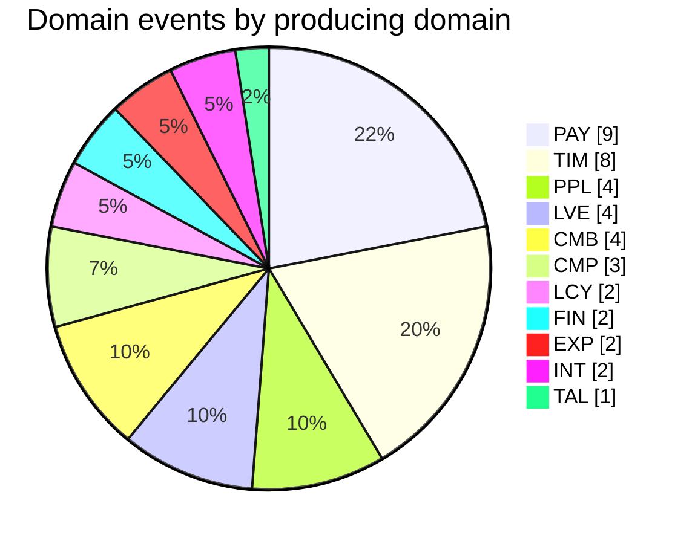

<picture>
  <source media="(prefers-color-scheme: dark)" srcset="../assets/MultipliersKraftLogoDark.png">
  
</picture>

# IA-02 — Event Catalogue

| Attribute | Value |
| :--- | :--- |
| Document ID | IA-02 |
| Title | Event Catalogue |
| Product | Nucleus Suite (Nucleus HRMS Suite) |
| Version | 1.0.0 |
| Status | Issued for approval |
| Owner (role) | Integration Architect |
| Author | Dhanraj Dadhich |
| Reviewed by | *pending* |
| Approved by | Architecture Review Board — *pending* |
| Date | 2026-11-05 |
| Classification | Internal |
| CMMI practice areas | TS, PI |
| Related documents | IA-01, NOT-01, FRS-<DOM>-06 |
| Quality & process-performance objectives | QPPO-05 (effective requirements reviews), QPPO-01 (escaped defects) — MPM-01 |
| Process performance baseline used | PPB-01 (review defect density), PPB-02 (review rate) — MPM-01 |
| Peer review record | *pending* (PR-xxxx, QA-02) |
| Tailoring record | none |
| Traceability anchor | BG-01 – BG-10 |
| Source of record | Nucleus — Process Flows & Process Maps v1.0 — sheet(s) 12_Events |

> **Source of record.** Requirements in this document are taken from the source workbook(s) named above and keep their workbook IDs, which are never renumbered. Changes are made through a change request (CM-02) against the source workbook. Sections marked **Authored** are original additions that are not present in the source workbooks.

**Envelope.** ENVELOPE — every event carries tenant_id, entity_id, location_id, actor, agent_id?, occurred_at, schema_version (CloudEvents-shaped)

| Event | Emitted by | Payload (beyond envelope) | Consumers | Idempotency key | Retention |
| :--- | :--- | :--- | :--- | :--- | :--- |
| people.worker.hired | PPL-01 | person_id, assignment_id, worker_class, location_id, doj | Lifecycle, learning, compliance, announcements, analytics, ERP outbound | assignment_id + doj | Long — dispute replay |
| people.assignment.changed | PPL-02 | assignment_id, changed_fields, effective_from | Time recompute, payroll, access, analytics | assignment_id + version | Long |
| people.position.vacated | PPL-04 | position_code, last_incumbent_id, vacated_on | Recruiting (replacement requisitions), analytics | position_code + vacated_on | Long |
| people.document.expiring | PPL-06 | document_id, person_id, class, expires_on | Notifications, compliance | document_id + remind_at | Short |
| time.punch.ingested | TIM-01 | event_id, person_id, punch_ts, source, device_id | Derivation queue, device health | event_id | Medium |
| time.recompute.requested | TIM-01/09 | person_id, date_from, date_to, reason | Recompute worker | person + range + reason + requested_at | Short |
| time.attendance_day.computed | TIM-02 | attendance_day_id, status, net_minutes, ot_minutes, ruleset_version | Payroll inputs, analytics, manager views | attendance_day_id + computed_at | Long |
| time.attendance_day.recomputed | TIM-09 | attendance_day_id, delta[], reason | Payroll staleness check, audit | attendance_day_id + computed_at | Long |
| time.shift.inferred | TIM-03 | attendance_day_id, assigned, applied, reason | Roster owner alert, analytics | attendance_day_id | Medium |
| time.exception.raised | TIM-08 | exception_id, type, person_id, date | Attendance Steward, supervisor queue | exception_id | Medium |
| time.gate_pass.approved | TIM-06 | gate_pass_id, minutes, date | Recompute, payroll input | gate_pass_id | Medium |
| time.overtime.approved | TIM-07 | ot_record_id, minutes, multiplier, pay_in_run_id | Payroll, statutory register (Form 28) | ot_record_id | Long |
| leave.credit.posted | LVE-01/02 | ledger_id, person_id, leave_type, days, expires_on | Balance projection, notifications | idempotency_key | Long |
| leave.request.approved | LVE-04 | request_id, dates, days, leave_type | Attendance, payroll, team calendar | request_id + version | Long |
| leave.credit.reversed | LVE-05 | ledger_id, original_ref, days | Balance projection, recompute | ledger_id | Long |
| leave.compoff.lapsed | LVE-06 | ledger_id, days, expired_on | Balance projection, employee notice | ledger_id | Long |
| payroll.inputs.locked | PAY-02 | run_id, period, locked_at | Time module (lock guard), integrations | run_id + state | Long |
| payroll.snapshot.taken | PAY-02 | snapshot_id, input_hash, pack_versions | Audit, reproducibility | snapshot_id | Long |
| payroll.run.approved | PAY-09 | run_id, totals | Bank file, journal, notifications | run_id + state | Long |
| payroll.run.disbursed | PAY-09 | run_id, pay_date, net_total | Payslip publication, analytics, GL | run_id + state | Long |
| payroll.journal.ready | FIN-03 | journal_id, run_id, line_count, totals | Integration dispatcher | journal_id | Long |
| payroll.run.posted | FIN-03 | run_id, external_doc_no, posted_at | Reconciliation, finance | run_id + doc_no | Long |
| payroll.arrears.requested | TIM-09/LVE-05/PPL-02 | person_id, period, reason, amount_basis | Next open run | person + period + reason | Long |
| payroll.input.raised | EXP/TAL/LVE | input_id, run_id, component, amount, source_ref | Payroll run assembly | input_id | Long |
| loan.sanctioned | CMB-03 | loan_id, person_id, principal, instalment | Payroll deduction node, notifications | loan_id | Long |
| loan.repayment.posted | PAY-08 | loan_id, run_id, amount, outstanding_after | Loan balance, GL | loan_id + run_id | Long |
| loan.closed | CMB-04 | loan_id, closed_on | Guarantor release, eligibility cache | loan_id | Long |
| loan.guarantor.released | CMB-04 | loan_id, guarantor_person_id, released_on | Eligibility, notifications | loan_id + guarantor | Long |
| lifecycle.joining.started | LCY-02 | person_id, chain_id, workflow_version | Compliance forms, learning, assets, IT | workflow_instance_id | Long |
| lifecycle.clearance.item_cleared | LCY-06 | item_id, person_id, blocking | F&F gate, exit coordinator | item_id + status | Long |
| payroll.fnf.settled | PAY-12 | person_id, run_id, net | Alumni record, access revocation, analytics | person_id + run_id | Long |
| compliance.form.generated | CMP-03p | instance_id, form_code, state, period | Obligation calendar, document vault | instance_id | Long |
| compliance.obligation.filed | CMP-02p | obligation_id, ack_ref, filed_on | Compliance dashboard, audit | obligation_id + period | Long |
| compliance.pack.deployed | CMP-01p | pack_id, jurisdiction, effective_from | Payroll, time, recompute triggers | pack_id + version | Long |
| integration.sync.applied | FIN-01 | sync_id, external_code, fields[] | People core, audit | payload_hash | Medium |
| integration.sync.conflict | FIN-01 | sync_id, field, erp_value, nucleus_value | HR review queue | payload_hash + field | Medium |
| experience.recognition.nominated | EXP-01 | award_id, person_id, programme_id | Approval, announcement, payroll input | award_id | Medium |
| experience.letter.issued | EXP-03 | issue_id, person_id, template_version | Document vault, audit | issue_id | Long |
| talent.requisition.blocked | TAL-01 | requisition_id, reason, headroom | Hiring manager, HR, analytics | requisition_id + state | Medium |
| agent.action.executed | INT-01 | action_id, agent_id, human_principal_id, tool, outcome, reversal_handle | Action ledger, analytics, audit | action_id | Long |
| agent.action.reversed | INT-02 | action_id, reversed_by, reason | Reversal-rate metric, audit | action_id | Long |

## Additional events defined in ICD-01 and process specifications (Authored)

| Event | Emitted by | Payload (beyond envelope) | Consumers | Idempotency key | Retention | Domain | Defined in |
| :--- | :--- | :--- | :--- | :--- | :--- | :--- | :--- |
| integration.sync.received | FIN-01.3 (FIN-INT-001) | sync_id, batch, external_code, payload_hash, received_at | Sync monitor (SCR-101), duplicate check FIN-01.4, sync reconciliation | batch + external_code + payload_hash | Medium | FIN | FRS-FIN-01 FIN-01.3; ICD-01 §6 |
| payroll.journal.blocked | FIN-03.2 | run_id, legal_entity_id, unmapped_component_codes[], blocked_at | Payroll run approval gate (SCR-050), GL mapping screen (SCR-102), Finance notifications | run_id + legal_entity_id + unmapped component set | Medium | FIN | FRS-FIN-01 FIN-03.2; ICD-01 §7.4 |
| integration.journal.posted | FIN-03.4 (FIN-INT-002) | journal_id, run_id, mechanism, target_system, attempt_no, result(posted\|rejected\|pending), external_doc_no | Posting log (RP-15), payroll run write-back FIN-03.5, Finance alerts, reconciliation | journal idempotency key ({tenant_id}:{run_id}:{legal_entity_code}:{journal_version}) + attempt_no | Long | FIN | FRS-FIN-01 FIN-03.4; ICD-01 §7 |
| finance.reconciliation.run | FIN-04.1 | report_id, run_id, checks_passed, checks_failed, failed_checks[] | Reconciliation screen (SCR-103), Finance, payroll period close, analytics | report_id | Long | FIN | FRS-FIN-01 FIN-04.1; ICD-01 §5.6, §7.4 |

## Approval & Sign-off

| Role | Name | Date | Decision | Conditions / comments |
| :--- | :--- | :--- | :--- | :--- |
| Author | Dhanraj Dadhich | 2026-11-05 | Submitted | |
| Peer review moderator | *pending* | | | PR-xxxx |
| PQA (process compliance) | *pending* | | | |
| Approval authority (DOC-01 §7) | *pending* | | | |

## Measurement Data Captured

| Measure | Value | Unit | Notes |
| :--- | :--- | :--- | :--- |
| Size | 45 | specified items (table rows) | Counted automatically at generation |
| Authoring effort | *to be recorded* | person-hours | |
| Review effort (preparation + meeting) | *pending review* | person-hours | From PR-xxxx |
| Rework effort | *pending review* | person-hours | |
| Review rate | *pending review* | items / hour | Compare with PPB control limits |
| Requirement volatility (changes since baseline) | 0 | CRs touching this artefact | Not yet baselined (CM-03) |

**Defects found, by detection phase and severity**

| Detection phase | Major | Minor | Editorial | Injected in phase (major) |
| :--- | :--- | :--- | :--- | :--- |
| Author self-check | 0 | 0 | 0 | — |
| Peer review | *pending* | | | |
| Design / build | | | | |
| System / integration test | | | | |
| UAT | | | | |
| Production (escaped) | | | | each escaped major opens a CAR record (CAR-01) |

Within control limits of the review-rate PPB? *To be assessed at peer review.*

## Revision History

| Version | Date | Author | Change summary | CR ref | Approved by |
| :--- | :--- | :--- | :--- | :--- | :--- |
| 1.0.0 | 2026-11-05 | Dhanraj Dadhich | Consolidated release | CR-0001 | *pending* |
