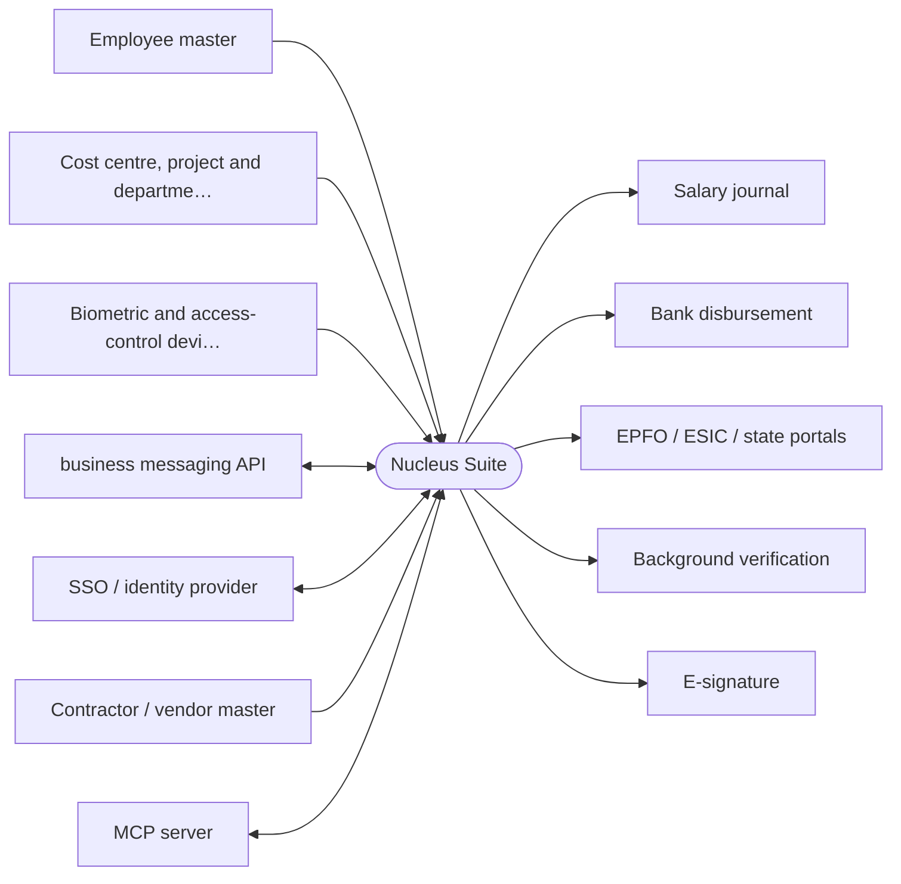

<picture>
  <source media="(prefers-color-scheme: dark)" srcset="../assets/MultipliersKraftLogoDark.png">
  
</picture>

# IA-03 — Integration Flows

| Attribute | Value |
| :--- | :--- |
| Document ID | IA-03 |
| Title | Integration Flows |
| Product | Nucleus Suite (Nucleus HRMS Suite) |
| Version | 1.0.0 |
| Status | Issued for approval |
| Owner (role) | Integration Architect |
| Author | Dhanraj Dadhich |
| Reviewed by | *pending* |
| Approved by | Architecture Review Board — *pending* |
| Date | 2026-11-05 |
| Classification | Internal |
| CMMI practice areas | TS, PI, SAM |
| Related documents | IA-01, ICD-01, SAM-01 |
| Quality & process-performance objectives | QPPO-05 (effective requirements reviews), QPPO-01 (escaped defects) — MPM-01 |
| Process performance baseline used | PPB-01 (review defect density), PPB-02 (review rate) — MPM-01 |
| Peer review record | *pending* (PR-xxxx, QA-02) |
| Tailoring record | none |
| Traceability anchor | BG-01 – BG-10 |
| Source of record | Nucleus — Process Flows & Process Maps v1.0 — sheet(s) 15_Integration_Flows |

> **Source of record.** Requirements in this document are taken from the source workbook(s) named above and keep their workbook IDs, which are never renumbered. Changes are made through a change request (CM-02) against the source workbook. Sections marked **Authored** are original additions that are not present in the source workbooks.

> INTEGRATION FLOWS
> Every boundary the product crosses, how it crosses it, and what must reconcile afterwards.

## 1. Integration landscape

## 2. Flows

| Flow | Direction | Mechanism | Cadence | Payload | Ownership / rules | Reconciliation | Phase |
| :--- | :--- | :--- | :--- | :--- | :--- | :--- | :--- |
| Employee master | ERP → Nucleus (configurable) | REST upsert through integration-svc, or scheduled file | Nightly + on-change | External code, name, DOB, DOJ, department, cost centre | Field ownership map; conflicts held; idempotent on external code; never last-write-wins | employee_sync_log: received vs applied vs held vs unmatched vs duplicate | P1 |
| Salary journal | Nucleus → ERP | API post to the connected ERP system, ERP-native XML voucher, CSV, staging table, manual download | Per run | Balanced journal dimensioned by cost centre, department, location, project and run type | Every component mapped before APPROVED; posting result and document number written back | Gross vs payslips, net vs bank file, statutory vs challans, dimension residue = 0 | P1 |
| Cost centre, project and department master | ERP → Nucleus | API or file | Weekly | Code, name, status, hierarchy | Nucleus does not maintain a second copy of the client's cost structure | Unmapped codes reported before a run | P1 |
| Bank disbursement | Nucleus → Bank | Direct API with major Indian banks, plus a file fallback | Per run | Beneficiary, account token, IFSC, amount, narration | Dual control, out-of-band total verification, alert on bank-detail change inside the window | File total = journal net = sum of payslip nets | P1 |
| Biometric and access-control devices | Device → Nucleus | Device SDK, push webhook, or site agent polling the buffer | Continuous | Punch events with device ID and timestamp | Offline buffering assumed; clock drift corrected with the raw value retained | Device health: expected vs received event counts per shift | P1 |
| business messaging API | Both | Provider API | Continuous | Apply, approve, check in and out, payslip retrieval, announcements | Same service-side rules as the app — the channel never gets its own rule path | Message delivery log; action parity tests per channel | P2 |
| EPFO / ESIC / state portals | Nucleus → Authority | Generated files (ECR, contribution, PT, LWF, 24Q) filed by a human | Monthly / quarterly | Statutory returns and challans | Generated from posted records only; acknowledgement captured as evidence | Statutory liability in the journal = challan amount | P1 |
| Background verification | Nucleus → Vendor | Vendor API | Per hire | Candidate identity and consent | Consent recorded before dispatch | Case status back onto the pre-boarding chain | P3 |
| E-signature | Nucleus → Vendor | Vendor API | Per document | Letters, policies, contracts | Signed artefact retained with the template version | Issued vs signed register | P2 |
| SSO / identity provider | Both | OIDC, SAML 2.0, SCIM | Continuous | Users, groups, deprovisioning | Do not write authentication | Joiner-mover-leaver parity with assignment status | P0 |
| Contractor / vendor master | ERP → Nucleus | API or file | Monthly | Vendor codes and contracts | Reconcilable to the client's vendor records | Invoice vs attendance variance before payment | P3 |
| MCP server | Nucleus ↔ client AI environment | MCP over the governed tool surface | On demand | Scoped tool calls | Same policy gate and action ledger as internal agents | Every call in the ledger | P3 |

Payload-level specifications for each flow are in ICD-01.

## Approval & Sign-off

| Role | Name | Date | Decision | Conditions / comments |
| :--- | :--- | :--- | :--- | :--- |
| Author | Dhanraj Dadhich | 2026-11-05 | Submitted | |
| Peer review moderator | *pending* | | | PR-xxxx |
| PQA (process compliance) | *pending* | | | |
| Approval authority (DOC-01 §7) | *pending* | | | |

## Measurement Data Captured

| Measure | Value | Unit | Notes |
| :--- | :--- | :--- | :--- |
| Size | 12 | specified items (table rows) | Counted automatically at generation |
| Authoring effort | *to be recorded* | person-hours | |
| Review effort (preparation + meeting) | *pending review* | person-hours | From PR-xxxx |
| Rework effort | *pending review* | person-hours | |
| Review rate | *pending review* | items / hour | Compare with PPB control limits |
| Requirement volatility (changes since baseline) | 0 | CRs touching this artefact | Not yet baselined (CM-03) |

**Defects found, by detection phase and severity**

| Detection phase | Major | Minor | Editorial | Injected in phase (major) |
| :--- | :--- | :--- | :--- | :--- |
| Author self-check | 0 | 0 | 0 | — |
| Peer review | *pending* | | | |
| Design / build | | | | |
| System / integration test | | | | |
| UAT | | | | |
| Production (escaped) | | | | each escaped major opens a CAR record (CAR-01) |

Within control limits of the review-rate PPB? *To be assessed at peer review.*

## Revision History

| Version | Date | Author | Change summary | CR ref | Approved by |
| :--- | :--- | :--- | :--- | :--- | :--- |
| 1.0.0 | 2026-11-05 | Dhanraj Dadhich | Consolidated release | CR-0001 | *pending* |
