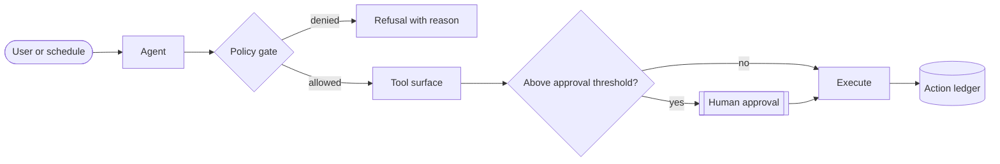

<picture>
  <source media="(prefers-color-scheme: dark)" srcset="../assets/MultipliersKraftLogoDark.png">
  
</picture>

# AI-01 — Agent Catalogue and Tool Governance

| Attribute | Value |
| :--- | :--- |
| Document ID | AI-01 |
| Title | Agent Catalogue and Tool Governance |
| Product | Nucleus Suite (Nucleus HRMS Suite) |
| Version | 1.0.0 |
| Status | Issued for approval |
| Owner (role) | Head of AI |
| Author | Dhanraj Dadhich |
| Reviewed by | *pending* |
| Approved by | Data & AI Ethics Board — *pending* |
| Date | 2026-11-05 |
| Classification | Internal |
| CMMI practice areas | TS, RDM, VV |
| Related documents | GOV-11, IA-01, SEC-01, FRS-INT-00 |
| Quality & process-performance objectives | QPPO-05 (effective requirements reviews), QPPO-01 (escaped defects) — MPM-01 |
| Process performance baseline used | PPB-01 (review defect density), PPB-02 (review rate) — MPM-01 |
| Peer review record | *pending* (PR-xxxx, QA-02) |
| Tailoring record | none |
| Traceability anchor | BG-02, BG-06 |
| Source of record | Nucleus — Process Flows & Process Maps v1.0 — sheet(s) 14_Agents, 13_API_and_Tools, 09_Business_Rules |

> **Source of record.** Requirements in this document are taken from the source workbook(s) named above and keep their workbook IDs, which are never renumbered. Changes are made through a change request (CM-02) against the source workbook. Sections marked **Authored** are original additions that are not present in the source workbooks.

> AGENT CATALOGUE AND GOVERNANCE
> What each agent does, which tools it may call, and how far it may go without a human. Autonomy is tenant configuration; the ledger is not optional.

## 1. Governed agent action path

## 2. Agent catalogue

| Agent | Cadence | What it does | Tools used | Autonomy default | Approval threshold | Ledger fields | Phase |
| :--- | :--- | :--- | :--- | :--- | :--- | :--- | :--- |
| Policy Assistant | On demand | Grounded policy answers with citations, own-data retrieval, simple actions | read_employee, check_loan_eligibility, apply_leave, create_ticket | Auto for reads, confirm for writes | Any write confirms | question, retrieved_sources, tool, inputs, confirmation, outcome | P2 |
| Attendance Steward | Daily | Triages the exception queue, proposes regularisations, flags unpaired punches and inferred shifts, drafts manager nudges | list_exceptions, propose_regularisation, read_employee | Propose only; auto under the configured threshold | Tenant-set minutes threshold | exception_id, evidence, proposed_change, simulation, approver, outcome | P2 |
| Payroll Preparer | Per cycle | Assembles inputs, runs the pre-audit, classifies each flag, drafts resolutions, produces a signed readiness report | simulate_payroll, run_pre_audit, read_employee | Propose only. Always. | No autonomous payroll change, ever | run_id, flags_classified, drafts, readiness_report_hash | P3 |
| Compliance Watcher | Continuous | Tracks the obligation calendar, assembles filing packs and statutory forms from posted data, flags rule changes and tenant impact | assemble_filing_pack, run_report | Prepare and alert; a human files | Filing always human | obligation_id, pack_ref, impact_analysis | P3 |
| Recruiting Coordinator | Continuous | Screens against the ontology, schedules, chases scorecards, drafts communication | schedule_interview, run_report | Scheduling auto; all candidate decisions human | No auto-reject, ever | requisition_id, candidate_id, action, human_decision | P3 |
| Manager Coach | Weekly | One brief per manager: who needs attention and why, drawn from real signals, with a suggested action | run_report, read_employee | Read only | — | manager_id, signals_used, brief_ref | P3 |
| Onboarding Runner | Per hire | Drives the joining chain, chases blockers, escalates on SLA | run_report, create_ticket | Auto within the workflow definition | Escalation only | workflow_instance_id, steps_chased, escalations | P3 |
| Exit Coordinator | Per exit | Chases clearance, prepares F&F, tracks knowledge transfer | run_report, create_ticket, draft_letter | Prepare; a human releases | F&F release always human | person_id, items_chased, fnf_pack_ref | P3 |
| Analyst | On demand | Natural-language question to a governed query, returns a chart and the SQL | run_report | Read only | — | question, generated_sql, row_count | P3 |

## 3. Governed tools available to agents

| Surface | Name | Method / class | Purpose | Permission | Side effect | Dry run | Consumed by | Note |
| :--- | :--- | :--- | :--- | :--- | :--- | :--- | :--- | :--- |
| TOOL | read_employee | read | Employee record within the caller's scope | people.read | read | — | Policy Assistant, Manager Coach | Compensation fields obey RL-005 |
| TOOL | list_exceptions | read | Open attendance exceptions for a scope | time.read | read | — | Attendance Steward | Drives the daily triage |
| TOOL | propose_regularisation | propose | Draft a regularisation with evidence | time.propose | propose | Yes | Attendance Steward | Human approves unless under the tenant threshold |
| TOOL | simulate_payroll | read | Dry-run a run and return the diff | payroll.simulate | read | — | Payroll Preparer | Never mutates |
| TOOL | run_pre_audit | propose | Execute checks and classify flags | payroll.audit | propose | Yes | Payroll Preparer | Propose only. Always. |
| TOOL | check_loan_eligibility | read | Call the single eligibility method | loans.read | read | — | Policy Assistant | Same answer as the screen and the payroll node |
| TOOL | draft_letter | propose | Render a letter draft from a template | experience.propose | propose | Yes | HR assistant | Human reviews before issue |
| TOOL | assemble_filing_pack | propose | Build a statutory pack from posted records | compliance.propose | propose | Yes | Compliance Watcher | A human files |
| TOOL | create_ticket | write | Raise a helpdesk ticket | helpdesk.write | write | Yes | Policy Assistant | Low blast radius |
| TOOL | schedule_interview | write | Book an interview slot | talent.write | write | Yes | Recruiting Coordinator | Scheduling auto; candidate decisions human |
| TOOL | run_report | read | Governed query over the analytics model | analytics.read | read | — | Analyst agent | Returns chart and the SQL |
| TOOL | apply_leave | write | Apply on the employee's behalf | leave.self | write | Yes | Policy Assistant | Confirmation required |

## 4. Agent rules

| Rule ID | Rule | Parameters | Client value / default | Configured in | Consumed by | Test case |
| :--- | :--- | :--- | :--- | :--- | :--- | :--- |
| RL-540 | An agent is a first-class principal with its own ID, scoped role and accountable human owner. | — | Always | Code invariant | INT-01.1 | TC-A540 |
| RL-541 | Tools are the only interface; agents never touch the database, call internal functions or hold credentials. | — | Enforced | Architecture | INT-01.2 | TC-A541 |
| RL-542 | Every agent action passes the policy gate: permission, tenant policy, value and blast-radius caps. | caps | Per tenant | Tenant policy | INT-01.3 | TC-A542 |
| RL-543 | Any tool classified write or above produces a dry-run diff before execution. | side_effect | read / propose / write / irreversible | tool_registry | INT-01.4 | TC-A543 |
| RL-544 | Nothing irreversible executes without a named human: disbursement, termination, offer release, statutory filing, loan sanction. | — | Absolute | Code invariant | INT-01.5 | TC-A544 |
| RL-545 | Every action lands in the append-only ledger with plan, simulation, approval, outcome and a reversal handle. | — | Always | Code invariant | INT-01.6 | TC-A545 |

## 5. Frontier AI features across domains (Authored)

| ID | Feature | AI risk tier | Phase |
| :--- | :--- | :--- | :--- |
| PLT-FX-001 | Zero-trust continuous authorisation | Tier 1 | P4 |
| PLT-FX-002 | Natural-language configuration | Tier 2 | P5 |
| PLT-FX-003 | Policy digital twin | Tier 1 | P5 |
| PLT-FX-007 | Autonomous configuration health check | Tier 2 | P4 |
| PPL-FX-001 | Organisation digital twin | Tier 3 | P5 |
| PPL-FX-002 | AI data-quality steward | Tier 2 | P4 |
| PPL-FX-004 | Explainable attrition risk | Tier 3 | P5 |
| PPL-FX-005 | Conversational profile updates | Tier 2 | P3 |
| PPL-FX-006 | Self-updating skills and career profile | Tier 2 | P4 |
| TIM-FX-001 | AI roster optimiser | Tier 2 | P5 |
| TIM-FX-002 | Fatigue and safety risk scoring | Tier 2 | P4 |
| TIM-FX-003 | Punch anomaly detection | Tier 2 | P4 |
| TIM-FX-004 | Voice punch with geofence | Tier 1 | P3 |
| TIM-FX-005 | OT budget burn forecasting | Tier 1 | P4 |
| TIM-FX-006 | Computer-vision-free presence assurance | Tier 1 | P4 |
| LVE-FX-001 | Coverage-aware leave planner | Tier 1 | P4 |
| LVE-FX-002 | Within-policy auto-approval agent | Tier 2 | P4 |
| LVE-FX-003 | Burnout nudges | Tier 1 | P4 |
| LVE-FX-004 | Leave liability forecasting | Tier 1 | P4 |
| LVE-FX-005 | Predictive absence planning | Tier 2 | P5 |
| PAY-FX-003 | Explainable payslip | Tier 1 | P4 |
| PAY-FX-004 | Zero-touch pre-audit | Tier 2 | P3 |
| PAY-FX-005 | Tax regime advisor | Tier 2 | P4 |
| PAY-FX-006 | Zero-day payroll close | Tier 2 | P5 |
| CMP-FX-001 | Regulatory change radar | Tier 3 | P5 |
| CMP-FX-002 | Continuous compliance score | Tier 1 | P4 |
| CMP-FX-003 | Inspection-ready pack in one click | Tier 2 | P3 |
| CMP-FX-004 | Compliance copilot for inspectors' questions | Tier 2 | P5 |
| LCY-FX-001 | Agentic onboarding concierge | Tier 2 | P4 |
| LCY-FX-002 | Early-attrition early warning | Tier 3 | P5 |
| LCY-FX-003 | Exit sentiment analysis | Tier 1 | P4 |
| LCY-FX-004 | Personalised onboarding journeys by role and language | Tier 2 | P4 |
| SSV-FX-001 | Voice-first HR in 11 languages | Tier 2 | P4 |
| SSV-FX-002 | Proactive nudges | Tier 1 | P3 |
| SSV-FX-003 | End-to-end task agents | Tier 2 | P4 |
| SSV-FX-005 | Emotion-free sentiment-aware routing | Tier 2 | P4 |
| CMB-FX-001 | AI compensation advisor with equity guardrails | Tier 3 | P5 |
| CMB-FX-002 | Real-time total rewards wallet | Tier 1 | P4 |
| CMB-FX-003 | Personalised benefits recommender | Tier 2 | P5 |
| CMB-FX-004 | Pay transparency readiness | Tier 1 | P5 |
| CMB-FX-005 | Fair-pay autopilot | Tier 3 | P5 |
| TAL-FX-001 | Skills cloud and inferred skills | Tier 2 | P4 |
| TAL-FX-002 | Internal talent marketplace | Tier 3 | P5 |
| TAL-FX-003 | Bias-audited recruiting copilot | Tier 4 | P5 |
| TAL-FX-004 | Adaptive learning paths | Tier 2 | P4 |
| TAL-FX-005 | Calibration bias detection | Tier 3 | P4 |
| TAL-FX-006 | Skills-based job architecture generator | Tier 3 | P5 |
| TAL-FX-007 | AI interview scheduling and panel balancing | Tier 2 | P4 |
| CTG-FX-001 | Contractor compliance score | Tier 2 | P4 |
| CTG-FX-002 | Invoice-to-attendance auto-reconciliation | Tier 2 | P4 |
| CTG-FX-003 | On-demand plant labour pool | Tier 1 | P5 |
| EXP-FX-001 | Continuous listening with NLP themes | Tier 1 | P4 |
| EXP-FX-002 | Personalised multilingual communications | Tier 2 | P4 |
| EXP-FX-004 | Personal wellbeing companion (opt-in) | Tier 1 | P5 |
| FIN-FX-002 | Workforce cost scenario planning | Tier 1 | P5 |
| FIN-FX-003 | AI bank and ERP reconciliation | Tier 2 | P4 |
| FIN-FX-004 | Real-time workforce P&L | Tier 1 | P5 |
| INT-FX-001 | Natural-language analytics | Tier 1 | P4 |
| INT-FX-002 | Predictive workforce planning | Tier 2 | P5 |
| INT-FX-003 | Agent and MCP ecosystem | Tier 2 | P4 |
| INT-FX-004 | Autonomous insight alerts | Tier 1 | P4 |
| INT-FX-006 | Workforce scenario studio | Tier 2 | P5 |
| INT-FX-007 | Multi-agent orchestration with human approval chains | Tier 3 | P5 |

## Approval & Sign-off

| Role | Name | Date | Decision | Conditions / comments |
| :--- | :--- | :--- | :--- | :--- |
| Author | Dhanraj Dadhich | 2026-11-05 | Submitted | |
| Peer review moderator | *pending* | | | PR-xxxx |
| PQA (process compliance) | *pending* | | | |
| Approval authority (DOC-01 §7) | *pending* | | | |

## Measurement Data Captured

| Measure | Value | Unit | Notes |
| :--- | :--- | :--- | :--- |
| Size | 90 | specified items (table rows) | Counted automatically at generation |
| Authoring effort | *to be recorded* | person-hours | |
| Review effort (preparation + meeting) | *pending review* | person-hours | From PR-xxxx |
| Rework effort | *pending review* | person-hours | |
| Review rate | *pending review* | items / hour | Compare with PPB control limits |
| Requirement volatility (changes since baseline) | 0 | CRs touching this artefact | Not yet baselined (CM-03) |

**Defects found, by detection phase and severity**

| Detection phase | Major | Minor | Editorial | Injected in phase (major) |
| :--- | :--- | :--- | :--- | :--- |
| Author self-check | 0 | 0 | 0 | — |
| Peer review | *pending* | | | |
| Design / build | | | | |
| System / integration test | | | | |
| UAT | | | | |
| Production (escaped) | | | | each escaped major opens a CAR record (CAR-01) |

Within control limits of the review-rate PPB? *To be assessed at peer review.*

## Revision History

| Version | Date | Author | Change summary | CR ref | Approved by |
| :--- | :--- | :--- | :--- | :--- | :--- |
| 1.0.0 | 2026-11-05 | Dhanraj Dadhich | Consolidated release | CR-0001 | *pending* |
