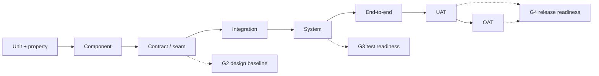
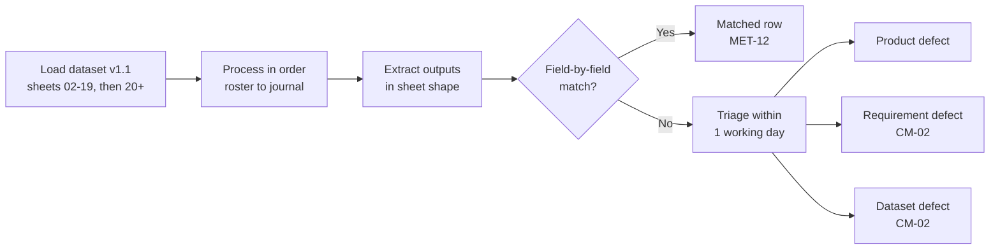
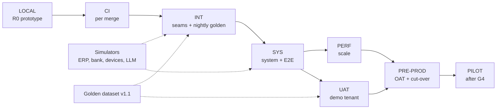
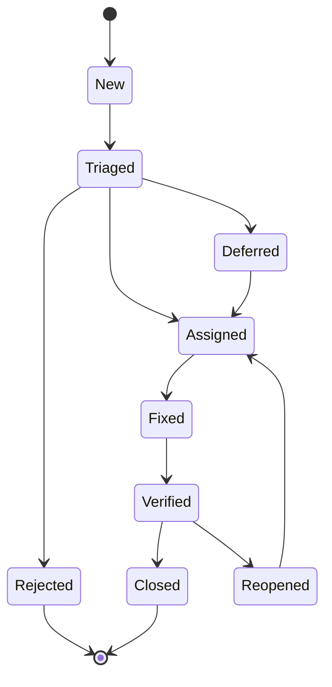
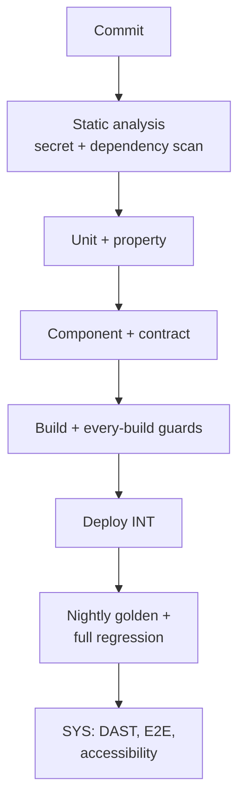
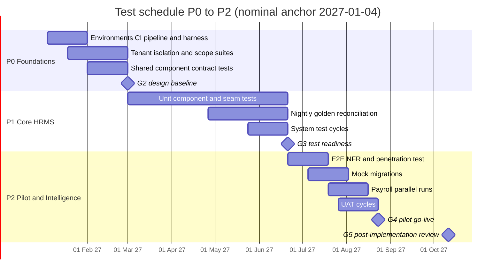
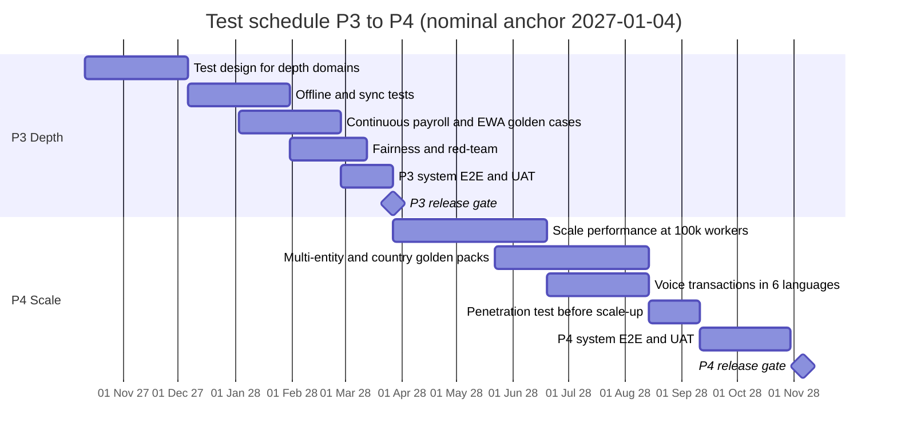

<picture>
  <source media="(prefers-color-scheme: dark)" srcset="../assets/MultipliersKraftLogoDark.png">
  
</picture>

# MTP-01 — Master Test Plan

| Attribute | Value |
| :--- | :--- |
| Document ID | MTP-01 |
| Title | Master Test Plan |
| Product | Nucleus Suite (Nucleus HRMS Suite) |
| Version | 1.0.0 |
| Status | Issued for approval |
| Owner (role) | QA/Test Lead |
| Author | Dhanraj Dadhich |
| Reviewed by | *pending* |
| Approved by | Steering Committee — *pending* |
| Date | 2026-11-05 |
| Classification | Internal |
| CMMI practice areas | VV, PI, PLAN, MPM, PQA, CAR |
| Related documents | QA-03, VV-01, VV-02, VV-03, UAT-01, NFR-01, TR-01, TR-02, REQ-02, PLN-02, MPM-01, GOV-01, GOV-08, GOV-10, GOV-11, RB-02, RB-03, FRS-&lt;DOM&gt;-08 |
| Quality & process-performance objectives | QPPO-01 (minimise defects reaching users), QPPO-02 (remove defects before system test), QPPO-03 (exact payroll at go-live), QPPO-07 (fair and grounded AI) |
| Process performance baseline used | PPB-03 (defect removal efficiency before system test), PPB-04 (payroll parallel-run variance), PPB-06 (escaped defects per 100 FRs) |
| Peer review record | *pending* (PR-xxxx, QA-02) |
| Tailoring record | none |
| Traceability anchor | BG-04, BG-06, BG-09; R-01..R-27; T-01..T-40; demo points 1–26 |

---

## 1. Introduction

### 1.1 Purpose

This Master Test Plan (MTP) turns the Verification and Validation Strategy (QA-03) into an executable plan for the whole Nucleus Suite programme. It states **what** is tested in each delivery phase, **how** each test level and test type is run, **where** it runs, **with which data**, **when** a level may start, stop, pause and finish, **who** is accountable, and **which numbers** prove that testing is under quantitative control. The structure follows the master-test-plan content model of ISO/IEC/IEEE 29119-3; QA-03 remains the policy source and this plan does not repeat its principles.

### 1.2 Stage note

The programme is in **R0 — UI-validation prototype on local JSON**. Nothing in this plan authorises live backend, database, external API or payroll-disbursement work (DEC-0002). Activities scheduled for P0 onward start only after the Executive Sponsor's go signal and a re-baseline of PLN-02. During R0 the plan is exercised only through prototype tests and walkthroughs (§3).

### 1.3 Test basis

| Basis | Document | Use in this plan |
| :--- | :--- | :--- |
| Business goals and scope | GOV-01 | Phase scope, out-of-scope items, objectives that tests evidence |
| Functional requirements | FRS-&lt;DOM&gt;-01..07 per domain | Functional, rule and state-machine test design |
| Source test cases | VV-01 (from the Process Flows workbook, sheet 19_Test_Cases) and FRS-&lt;DOM&gt;-08 | Golden, negative and property cases (for example TC-T80, TC-M432, TC-PR01) |
| Client acceptance tests | VV-02 (from the Build Sheet, sheet 10_Acceptance_Tests, bound to dataset sheet 68_Acceptance_Test_Data) | `T-01..T-40`, the acceptance spine of UAT-01 |
| Golden dataset | VV-03 (HRMS Demo Dataset v1.1, fictional client Vindhya Precision Industries Pvt Ltd) | Inputs and expected results for reconciliation |
| Client requirements and demo points | TR-01, TR-02 | `R-01..R-27`, demo point → process → rule → test chain |
| Non-functional targets | NFR-01 | Performance, availability, recovery, accuracy, coverage, accessibility, security targets |
| Measurement | MPM-01 | QPPO, PPB, PPM and MET definitions |
| Data and AI governance | GOV-10, GOV-11 | Synthetic-data rule, privacy tests, AI risk tiers and evaluation thresholds |
| Roadmap | PLN-02, RB-03 | Phase windows, gates, capability gaps and frontier items per phase |

### 1.4 Conventions

Severity codes S1–S4, environment names and gate names are those of QA-03 and DOC-01. Authored test cases use `<DOM>-TC-NNN` and carry a cross-reference to any source test case (such as TC-L200) or client acceptance test (such as T-08) they elaborate. Money is written in Indian grouping (₹ 1,00,000).

## 2. Context of Testing

### 2.1 Test items — the 14 domains

| Domain | Test items (source processes) | Client requirements | Golden dataset sheets | Source cases already defined | Seams owned | First phase under test |
| :--- | :--- | :--- | :--- | :--- | :--- | :--- |
| PLT Platform & Foundations | PLT-01..PLT-08: provisioning, identity and data scope, configuration, workflow, approval chain, audit, outbox, bi-temporal write | R-09 | 43, 44, 64, 65, 66 | TC-P05 (every build), TC-PR09; T-18 | S-11, S-12 | P0 |
| PPL People Core | PPL-01..PPL-08: person/position/assignment, effective-dated change, worker-class resolution, position control, org change, documents, rehire, duplicates | R-03, R-04, R-05, R-23 | 04, 05, 06, 10, 11, 12, 38, 62 | TC-H35, TC-R56; T-04, T-06, T-07, T-37 | S-04, S-07, S-09 | P0 (effective-dated write) / P1 |
| TIM Time & Attendance | TIM-01..TIM-10: punch ingestion, day derivation, shift inference, day type, disposition, gate pass, overtime, exceptions, recompute, team reports | R-01, R-02, R-12, R-13, R-14 | 07, 08, 20, 21, 22, 23, 41, 42, 49, 50, 51, 52 | 16 golden `TC-T*`, TC-PR05..TC-PR07; T-01..T-03, T-05, T-23..T-27 | S-01, S-02, S-04 | P1 |
| LVE Leave | LVE-01..LVE-08: accrual, proration, validation, approval chain, early return, comp-off, year end, balance projection | R-06, R-07, R-08 | 09, 14–19, 39, 40, 53, 54 | 9 golden `TC-L*`, TC-PR08; T-08..T-17 | S-02, S-03 | P1 |
| PAY Payroll | PAY-01..PAY-14: run creation, input lock, pre-audit, gross-to-net, wage base, daily wage, statutory, recoveries, approval and disbursement, off-cycle OT, arrears, F&F, payslips, rollback | R-11 (and payroll side of R-09, R-17) | 13, 26, 47, 48, 55, 57, 58 | TC-Y281, TC-Y290, TC-Y302, TC-Y330, TC-PR01..TC-PR04; T-22 | S-01, S-03, S-05, S-06, S-08, S-10 | P1 |
| CMP Compliance | CMP-01p..CMP-06p: rule packs, obligation calendar, forms and registers, wage-base simulation, AI governance logging, DPDP consent and erasure | R-18, R-27 | 28, 29, 48 | TC-C382, TC-Y302; T-31, T-32 | — | P1 |
| LCY Lifecycle | LCY-01..LCY-08: pre-boarding, joining chain, confirmation, promotion and transfer, resignation, no-dues, F&F on LWD, assets | R-17, R-24, R-27 | 27, 33, 34, 58, 60, 61 | TC-X402, TC-X340; T-30, T-38 | S-08 | P1 |
| SSV Self-service & Helpdesk | SSV-01..SSV-05: self-service action, approval inbox, business messaging channel transaction, helpdesk ticket, grounded policy answer | (channel side of R-21) | 63 | None in source; authored cases required | — | P1 (portal) / P2 (channels, grounded answers) |
| CMB Compensation, Loans & Benefits | CMB-01..CMB-06: loan eligibility, application and guarantors, sanction and override, repayment and release, advance and EWA, revision cycle | R-10 | 13, 24, 25 | TC-M430, TC-M432, TC-M433, TC-M443, TC-M452; T-19..T-21 | S-05 | P1 (eligibility, deduction) / P2 (module) |
| TAL Talent | TAL-01..TAL-05: requisition and position check, candidate pipeline, referral award, goals and reviews, skills and learning | R-20, R-25, R-26 | 10, 11, 37, 59 | TC-R461, TC-R462; T-34, T-39, T-40 | S-09 | P3 (P2 for referral award) |
| CTG Contingent Workforce | CTG-01..CTG-03: contractor engagement, contractor attendance and invoice reconciliation, principal-employer verification | R-04 (third-party classes) | 45, 46 | None in source; authored cases required | — | P3 |
| EXP Experience | EXP-01..EXP-03: recognition and payout, announcements, letters and issue register | R-19, R-21, R-22 | 30, 31, 32 | TC-E502; T-33, T-35, T-36 | S-10 | P2 |
| FIN Finance & ERP | FIN-01..FIN-05: ERP master inbound, GL mapping, salary journal and posting, reconciliation, bank file with dual control | R-15, R-16 | 35, 36, 56, 57 | TC-F510, TC-F521, TC-F530; T-28, T-29 | S-06, S-07 | P1 (inbound direction fixed in P0) / P2 |
| INT Intelligence & Agents | INT-01..INT-04: policy gate, action ledger, analytics projection, predictive scoring; Nucleus Talk | — | 67 | None in source; AI evaluation sets authored per feature | S-11 | R0 (voice navigation) / P2 |

Where the domain-phase plan in PLN-02 §3.3 and the demo-point phases in TR-02 differ, this plan tests a capability in the **earlier** of the two phases, so that no client requirement reaches a gate untested.

### 2.2 Shared components and seams

Each shared component (approval chain, ledger, eligibility service, recompute worker, template renderer, rule pack evaluator, blocking-item lock, scope resolver, outbox, effective-dated write, tool surface) has its own component suite that is run once, deeply, by the Platform squad. Consuming domains test only their configuration of the component. Each seam S-01..S-12 has a contract suite owned jointly by both domains; a seam is "green" only when both the producer and consumer sides pass.

## 3. Test Scope by Phase

| Phase | Window | Test focus | Items in scope | Levels and types active | Gate evidence |
| :--- | :--- | :--- | :--- | :--- | :--- |
| R0 Prototype (current) | Now | Validate screens, flows, role consoles and client calculators against local JSON | All 14 domains as UI; leave and attendance flows in memory; Nucleus Talk navigation; 11-language copy | Unit and component tests of client calculators and adapters; automated accessibility checks; copy-harvest and translation checks; prototype walkthroughs with personas | Walkthrough notes and findings converted to CRs; G1 requirements baseline |
| P0 Foundations | Weeks 1–8 | A tenant can be provisioned, isolated, secured and seeded | PLT-01..PLT-08; effective-dated write for PPL; outbox; tool-surface contract; shared-component contracts | Unit, component, contract; tenant-isolation suite; authorisation matrix; SAST, dependency and secret scanning; provisioning timing; seeding from dataset sheets 65 and 66 | G2: tenant provisioned under 30 minutes; isolation and scope suites green; contracts approved |
| P1 Core HRMS | Weeks 9–24 | Core HRMS is functionally complete and reconciles to the golden dataset | PPL, TIM, LVE, PAY (India statutory), CMP registers and returns, LCY basics, SSV portal; loan eligibility and recovery; ERP inbound and journal | All functional levels to system test; nightly golden reconciliation for TIM, LVE, PAY, CMP, FIN; seams S-01..S-08, S-12; property tests every build; performance for attendance ingestion, recompute and payroll throughput | G3: Must-have FRs executed; golden match rate 100% for P1 sheets; zero open S1 |
| P2 Pilot & Intelligence | Weeks 25–40 | The pilot tenant is fit for use, payroll is exact against the incumbent, AI is evaluated | Pilot tenant; CMB module; FIN posting and reconciliation; EXP; SSV channels and grounded answers; INT policy gate, tool surface, action ledger, read-only assistance | E2E journeys; UAT (UAT-01); ≥ 2 mock migrations; ≥ 2 payroll parallel runs; independent penetration test; DAST; OAT and DR drill; AI evaluation and red-team; native-speaker localisation validation; WCAG 2.2 AA audit | G4: UAT signed, parallel-run unexplained variance = 0 lines, OAT passed; G5 post-implementation review |
| P3 Depth | Weeks 41–64 | Depth domains and frontline differentiators are correct, fair and resilient | TAL, CTG, EXP depth; CMB depth; capability gaps scheduled for P3 (RB-03); offline-first frontline; continuous payroll and EWA; predictions; bias-checked calibration; agents with human approval | Full level set as a G1→G5 mini-cycle; offline and sync tests; fairness and counterfactual tests; agent-safety tests; golden extensions authored per new rule | Phase release gate: domain exit criteria met; AI features above DAEB thresholds at the lower confidence bound |
| P4 Scale | Weeks 65–96 | The platform scales, operates multi-entity and multi-country, and stays exact | Performance at 100,000 workers; multi-entity and country packs; workflow designer and extensibility; ESG/DEI packs; tenant self-provisioning; voice transactions in at least 6 languages | Scale, soak and spike tests; multi-tenant noisy-neighbour tests; country golden packs; extensibility isolation tests; penetration test before scale-up | Phase release gate: scale NFRs met; country packs reconciled |
| P5 Frontier | After week 96 | Not scheduled | Frontier items (FX) only after DAR-01, CCB and, for AI, DAEB approval | Each approved item receives its own test design when it enters a phase | — |

## 4. Features to Be Tested and Not to Be Tested

### 4.1 Features to be tested

1. Every Must-have functional requirement, business rule and invariant in the domain packs, with positive, negative and boundary cases; the invariants INV-LEV-01 (no negative leave), INV-LEV-02 (no overlapping approved leave), INV-ATT-01 (IN before OUT), INV-SEC-02 (no self-approval) and INV-PAY-01 (Basic + DA ≥ 50% of CTC) at unit and system level.
2. All 40 client acceptance tests `T-01..T-40` and all 26 demo-point scenarios, through UAT-01.
3. Every expected-result row of the golden dataset that falls inside the phase scope.
4. Every seam contract S-01..S-12 and every shared component.
5. Every NFR in NFR-01 at the gate named for it.
6. Every AI feature, at the evaluation depth required by its GOV-11 risk tier.
7. Capability gaps (CG) and frontier items (FX) listed in RB-03, **once** their requirements are approved through CM-02 and the item is scheduled into a phase.

### 4.2 Features not to be tested

| Item | Reason | Disposition |
| :--- | :--- | :--- |
| Live payroll disbursement and live statutory filing before the P2 pilot | Out of scope until compliance sign-off (GOV-01 OS-01) | Bank files and returns are generated and verified as files; nothing is transmitted |
| Production database, external messaging, payment gateways during R0 | R0 is local JSON (DEC-0002) | Tested from P0 against simulators only |
| General ledger, accounts payable and procurement inside the ERP system | Owned by the customer's ERP (OS-03) | Only the posting contract and reconciliation are tested |
| Corporate card feeds, career-site content management | Out of scope (OS-04, OS-05) | Not tested |
| Biometric device firmware and access-control hardware | Out of scope (OS-06) | Device protocol tested through simulators and certified devices |
| Medical records beyond benefits eligibility | Excluded on privacy grounds (OS-07) | Negative test: the data model rejects such fields |
| Covert monitoring and fully autonomous decisions on hiring, termination, pay or promotion | Prohibited (OS-08, OS-09) | Tested **negatively**: agents cannot execute these actions without a recorded human decision |
| Country payroll packs outside India before P4 | Phased (OS-10) | Tested in P4 |
| Internals of third-party services (ERP system, banks, LLM provider, devices) | Not our product | Contract behaviour verified through simulators and sandboxes |
| Capability gaps and frontier items not yet specified | No approved test basis | Test design starts when the requirement is approved |

## 5. Test Approach — Levels and Types

### 5.1 Levels and how they map to gates

### 5.2 Test types

| # | Test type | Objective | Basis | Technique | Environment | Automation | Owner | First phase |
| ---: | :--- | :--- | :--- | :--- | :--- | :--- | :--- | :--- |
| 1 | Unit | Verify functions, calculators, validators, invariants | FR, BR, business rules such as RL-080 | Example-based and property-based tests (TC-PR01..TC-PR09) | LOCAL, CI | 100% | Developers | R0 |
| 2 | Component | Verify a domain service or shared component in isolation | Component contract, golden cases for the component | API tests with stubs; component golden cases | CI | 100% | Developers + QA | R0 (client adapters) / P0 |
| 3 | Contract | Verify producer–consumer agreements | Seams S-01..S-12; OpenAPI 3.1 and event schemas (IA-01, IA-02) | Consumer-driven contracts; schema validation; event replay | CI, INT | 100% | Both domain owners | P0 |
| 4 | Integration | Verify assembled services and external interfaces | IA-03 integration flows | Service-to-service tests against simulators for ERP, bank, devices and LLM provider | INT | ≥ 90% | QA + Integration Lead | P0 |
| 5 | System | Verify the integrated product against FR and NFR | Domain packs, NFR-01 | Scenario tests, state-machine coverage, NFR checks | SYS | ≥ 70% | QA | P1 |
| 6 | End-to-end | Verify cross-domain journeys | Value streams VS-01..VS-08 (GOV-05) | Journey scripts through UI and API, reconciled to the dataset | SYS | Critical journeys | QA | P1 |
| 7 | Regression | Prove nothing previously working has broken | All automated suites | Fast subset per merge; full suite nightly; full PAY/CMP golden suite on any statutory rule change | CI, INT | 100% of regression set | QA | R0 |
| 8 | Performance | Prove NFR-01 latency, throughput, recompute and scale targets | NFR-01 | Load, stress, soak, spike; payroll-run duration; shift-change punch bursts | PERF | Scripted | QA + Engineering | P1 |
| 9 | Security | Prove isolation, authorisation and absence of exploitable weaknesses | OWASP ASVS level set per component by the ARB; NFR-01 security | Threat modelling, SAST, dependency and secret scanning, DAST, tenant-isolation suite, authorisation matrix, independent penetration test | CI, SYS, PRE-PROD | Scans 100%; pen test manual | Security Lead | P0 |
| 10 | Accessibility | Prove WCAG 2.2 AA on employee-facing surfaces | NFR-01, SSV-CG-003 | Automated checks per build; keyboard-only and screen-reader passes per new screen; data-table alternatives for charts | CI, SYS | Automated checks 100%; manual sampling | UX Lead | R0 |
| 11 | Localisation and RTL | Prove 11 languages, locale formats and Arabic mirroring | GOV-01 §6.2, PLT scope | Pseudo-localisation; truncation checks; RTL mirroring with logical layout properties; bidirectional text with embedded IDs and numbers; Indian digit grouping; native-speaker review | CI, SYS, UAT | Pseudo-loc 100%; native review manual | UX Lead + Domain POs | R0 |
| 12 | Privacy | Prove minimisation, masking, consent, rights and retention | GOV-10, DPDP Act 2023 (to be validated by Legal) | Purpose-and-role field matrix; salary masking for roles without compensation visibility; consent capture and withdrawal; access, correction and erasure requests with statutory retention exceptions; sensitive-access logging | SYS, UAT | ≥ 80% | DPO + QA | P0 |
| 13 | AI evaluation and red-team | Prove accuracy, groundedness, fairness, robustness and safety of AI features | GOV-11, AI-01 | Versioned evaluation sets; numeric facts compared with deterministic service output; subgroup and counterfactual tests; adversarial prompts via fields and documents; agent tool-abuse attempts; kill-switch test | INT, SYS | Runs 100%; human review of samples | Head of AI | P2 (voice navigation from R0) |
| 14 | Offline | Prove capture without connectivity and safe resync | BO-03.4, RSK-R-010 | Device offline for defined durations; duplicate and conflicting punches; clock skew; ordering on resync; tamper evidence | SYS, device lab | Scripted with device simulators | Time PO + QA | P3 |
| 15 | Migration reconciliation | Prove legacy data lands complete and correct | PLT-CG-006, PLT-CG-008; migration mapping specification | Record counts, control totals (headcount, balances, YTD pay and tax), sampled field comparisons; ≥ 2 mock runs | PRE-PROD, pilot tenant | Comparator 100% | Migration Lead | P2 |
| 16 | Payroll parallel run | Prove Nucleus Suite pay equals the incumbent's, line by line | QPPO-03, PPB-04 | ≥ 2 consecutive cycles; every differing line explained or raised as a defect | Pilot tenant (production-classified) | Comparison report automated | Payroll Domain Lead | P2 |
| 17 | Golden-dataset reconciliation | Prove the product reproduces every in-scope expected result | VV-03, QA-03 §5.2 | Load → process → extract → field-by-field compare → triage | INT (nightly), SYS, UAT | 100% | Domain leads + QA | P1 |
| 18 | Voice | Prove Nucleus Talk commands per language and noise profile | MET-20, voice rules for user-gesture initiation | Recognition sets per language and accent group; code-mixed speech; plant noise profiles; confirmation before action; touch fallback | SYS, device lab | Evaluation runs 100% | Head of AI | R0 |
| 19 | Operational acceptance | Prove operability | NFR-01 recovery and availability | Backup and restore, failover, DR drill (RPO 5 minutes, RTO 1 hour), alerting, runbooks, retention jobs | PRE-PROD | Drills scripted | Ops/SRE + QA | P2 |

### 5.3 Golden-dataset reconciliation

1. The tenant clock is set to 15 September 2026; master and configuration sheets 02–19 load before any transaction sheet; the v1.1 additions load in the order given in the dataset change log.
2. Processing order is fixed: rosters → punches → attendance computation → gate pass and overtime → leave → loans → payroll runs → statutory outputs → journals and bank files → F&F.
3. Expected-result sheets reconciled field by field include 21_Expected_Attendance, 17_Leave_Ledger, 53_Leave_Balance_AsOn, 54_Year_End_Leave_Preview, 13_Salary_Structure (wage base and 50% floor add-back), 55_Payroll_Register, 56_GL_Journal, 57_Bank_File, 58_FnF_Settlement, 23_Overtime_Register and 22_Gate_Pass.
4. Equality is exact to the paisa unless the requirement states a rounding rule; a tolerance exists only if it is written in the requirement and approved by the domain owner.
5. The run is nightly on the integration branch from the day a domain's first calculator exists and mandatory at G3 and G4.

### 5.4 Payroll parallel runs

- At least two consecutive cycles run on the pilot tenant with the client's incumbent payroll as the comparator, before G4.
- Every payslip line is compared component by component (earnings, PF, ESI, PT by state, LWF, TDS under the elected regime, loan recovery, other recovery, net pay).
- A differing line is "explained" only when the explanation is recorded and accepted by the Payroll Domain Lead and the client's payroll owner (for example, a known incumbent error); otherwise it is a defect. An unexplained variance on net pay is S1.
- Results are plotted on the PPB-04 u-chart (unexplained variance lines per 1,000 payslips per cycle) and fed to PPM-03 to predict the next cycle.
- Because the comparator holds real personal data, parallel runs execute only inside the production-classified pilot tenant under DPO approval, never in a test environment.

### 5.5 AI evaluation and red-team

| Evaluation | Method | Pass rule |
| :--- | :--- | :--- |
| Task accuracy | Curated, versioned evaluation set per feature | Lower 95% confidence bound ≥ DAEB-approved threshold |
| Groundedness | Every cited answer checked against its source; every numeric fact compared with the deterministic service output | MET-15 at or above threshold; any fabricated number fails the run |
| Fairness | Outcome-rate ratios across protected attributes on balanced synthetic populations; counterfactual attribute swaps | MET-14 within DAEB thresholds |
| Robustness | Paraphrase, typo, code-mixed language, noisy audio | Degradation within the feature's stated limit |
| Red-team | Direct and indirect prompt injection (through form fields, documents, ticket text), exfiltration, jailbreak, privilege escalation through agent tools, harmful advice | Zero critical findings open at release |
| Agent safety | Every write tool requires confirmation; actions only through permission-checked services; agent identity recorded; kill switch | 100% pass |
| Drift (after release) | Scheduled re-evaluation on fixed sets; input distribution monitoring | MET-16 below alert level |

### 5.6 Offline-first

Offline tests cover punches, leave requests and gate passes captured on shared plant terminals and personal handsets with no connectivity for up to the duration stated in the requirement, then resynchronised. Cases include duplicate punches from two devices, an IN captured offline after an OUT already synchronised (INV-ATT-01), clock skew, a leave approval reaching the server before the offline request, and a tampered local store. The pass rule is BO-03.4: at least 99.9% successful synchronisation and zero silent data loss.

### 5.7 Performance targets carried from NFR-01

| Target | Test | Gate |
| :--- | :--- | :--- |
| Interactive reads p95 under 300 ms, p99 under 800 ms | Load test at the pilot's peak concurrent users, then at P4 scale | Every release |
| 10,000 employees gross-to-net in under 120 seconds | Payroll worker load test with generated volume | Every release from P1 |
| 500 attendance events per second sustained per tenant at shift change, with offline catch-up | Device-simulator burst test | Every release from P1 |
| A full month recomputed for 5,000 employees in under 10 minutes without degrading interactive latency | Recompute with the interactive suite running concurrently | Every release from P1 |
| Mobile cold start under 2.5 s on a mid-range handset on a 3G profile | Device lab run | Every release from P2 |
| New tenant provisioned in under 30 minutes | Timed provisioning run | Every release from P0 |
| Availability 99.9% monthly; payroll window 99.95% from the 25th to the 5th | Synthetic probes in pilot | Monthly from P2 |

## 6. Test Environments

| Environment | Purpose | Data | Refresh | External services | Access |
| :--- | :--- | :--- | :--- | :--- | :--- |
| LOCAL | Developer tests; R0 prototype on local JSON with in-memory mutations | Synthetic fixtures | On demand | None | Developers |
| CI | Unit, component, contract, static analysis | Generated per run | Per run | None | Pipeline only |
| INT | Integration, seams, nightly golden reconciliation | Dataset v1.1 | Nightly reset | Simulators | Engineering, QA |
| SYS | System, E2E, DAST, functional NFR checks | Dataset v1.1 plus generated volume | Per sprint | Simulators and vendor sandboxes | QA, POs |
| PERF | Performance and scale | Generated volume modelled on dataset distributions | Per test cycle | Simulators | QA, Engineering |
| UAT | Acceptance by personas | Demo tenant seeded from dataset v1.1 and sheet 68 | Per UAT cycle | Simulators; outbound messaging captured, never delivered | Client testers, Product Owner |
| PRE-PROD | OAT, cut-over rehearsal, DR drills | Synthetic; production-like configuration | Per release | Sandboxes | Ops/SRE, QA |
| PILOT | Production-classified pilot tenant, parallel runs and rehearsals with real data | Client data under DPO approval | — | Production endpoints only after G4 | Named client and programme roles |

Every environment is a configuration item (CM-01). Environment readiness is confirmed by a smoke suite before any level's entry criteria are evaluated. Cloud hosting for INT and above sits in a cloud region in India (NFR-01 data residency).

## 7. Test Data

1. **Synthetic only outside production.** No real personal data enters LOCAL, CI, INT, SYS, PERF, UAT or PRE-PROD (GOV-10). The golden dataset carries format-valid dummy Aadhaar, PAN and UAN values flagged as dummies, and only the last four digits of bank accounts.
2. **One golden source.** HRMS Demo Dataset v1.1 is the only source of expected results. It is a configuration item; a correction to it is a change request (CM-02, RSK-D-010). Testers never re-derive an expected value.
3. **Demo tenant.** The fictional client Vindhya Precision Industries Pvt Ltd: legal entities LE-01 (Karnataka) and LE-02 (Telangana), five sites (LOC-BLR, LOC-PLA, LOC-PUN, LOC-HYD, LOC-CHN) across Karnataka, Maharashtra, Telangana and Tamil Nadu, 68 workers across nine worker classes, demo period 01–15 September 2026, payroll cycle September 2026.
4. **Seeding.** Enumerations and picklists from sheets 65 and 66; roles and data scope from 43; demo users from 44 (credentials issued out of band under the tenant convention and never written in test artefacts).
5. **Volume data.** Generated deterministically (fixed seed) from the dataset's distributions of worker class, shift group, state and pay structure, scaled to 10,000 and 100,000 workers; generated data is reproducible from its seed and generator version.
6. **AI evaluation data.** Balanced synthetic populations for fairness tests; evaluation sets versioned with the feature; no production prompts or outputs are copied into evaluation sets without DPO approval and anonymisation.
7. **Migration data.** Migration tooling is proven on synthetic legacy extracts produced from the golden dataset in legacy layouts. Rehearsals with the pilot client's real extracts happen only inside the pilot tenant.
8. **Known data gaps.** T-15 is partly ready (the contiguous-absence case is created live); T-14 for joiners after 4 December awaits Q-02. These are tracked in §13.

## 8. Entry, Exit, Suspension and Resumption Criteria

| Level / type | Entry criteria | Exit criteria | Suspension | Resumption |
| :--- | :--- | :--- | :--- | :--- |
| Unit | Story meets Definition of Ready; design peer-reviewed | All tests pass; coverage of changed logic per NFR-01 (85% payroll, attendance, compliance; 70% overall); no critical static-analysis finding | Build broken for more than 4 working hours | Build green |
| Component | Units merged; component contract approved | Component suite and component golden cases pass | Contract changed without CCB approval | Contract re-approved and suite updated |
| Contract / seam | Seam contract approved at G2; both sides deployed to INT | All contract tests pass on both sides; nightly report shows no unexplained mismatch for the seam | Either side unavailable for more than one working day | Both sides redeployed and smoke-tested |
| Integration | Contracts green; simulators configured | All IA-03 flows pass, including failure, retry and duplicate paths | Simulator or sandbox unavailable | Restored and smoke-tested |
| System | G3 evidence ready; environment smoke suite green; data loaded and reconciled | 100% of Must-have FRs executed; MET-10 ≥ 95%; zero open S1; every open S2 has an approved plan; NFR results recorded | Golden match rate below 98% on the nightly run, or more than 5 open S1 | Root causes fixed; match rate ≥ 98% on two consecutive nights |
| End-to-end | System exit met for the involved domains | All critical journeys pass; golden match rate 100% for in-scope domains | Any S1 in a journey's money or access path | Fix verified and journey re-run in full |
| Performance | Functionally stable build; volume data generated | All NFR-01 targets for the phase met at stated percentiles | Environment differs from the agreed profile | Profile restored |
| Security | Threat model reviewed; scanners configured | No open critical or high finding; pen-test findings closed or formally risk-accepted by the Security Lead | Critical finding in a shared component | Fix deployed and re-scanned |
| AI evaluation | DAEB tier assigned; evaluation set approved | Lower confidence bound ≥ threshold for every metric; zero critical red-team findings | Data or model version changes mid-run | Run restarted on pinned versions |
| Migration | Mapping specification peer-reviewed | Two mock runs reconciled; opening balances signed by the client data owner | Control totals differ without explanation | Mapping corrected; run repeated |
| Parallel run | Golden match 100% for PAY and CMP; pilot configuration frozen | Two consecutive cycles with zero unexplained variance lines | Unexplained net-pay variance (S1) | Defect fixed; cycle re-run |
| UAT | E2E exit met; UAT-01 scripts ready; testers trained (OCM-02) | Product Owner and pilot sponsor sign-off per UAT-01 | Per UAT-01 §8 | Per UAT-01 §8 |
| OAT | System exit; runbooks drafted | Backup/restore and DR drills meet RPO 5 minutes and RTO 1 hour; alerting verified; support accepts handover | Drill fails a recovery objective | Fix and full repeat of the drill |

## 9. Defect Management

### 9.1 Severity and priority

| Severity | Definition | Gate rule | Triage target | Examples |
| :--- | :--- | :--- | :--- | :--- |
| S1 Critical | Wrong pay or statutory amount, data breach, cross-tenant exposure, unauthorised action (human or agent), system unusable | Blocks every gate | Within 4 working hours | Golden mismatch in net pay; plant user sees head-office salary in an export |
| S2 Major | Core function fails with no reasonable workaround | Fixed before G4 or deferred with Product Council approval | Within 1 working day | Leave approval routed out of order |
| S3 Minor | Function works with a workaround, or cosmetic with usability impact | Planned | Within 3 working days | RTL label misaligned on a form |
| S4 Trivial | Cosmetic | Backlog | Weekly | Spacing |

Priority (fix order) is set by the triage board independently of severity, but an S1 is always fixed first.

### 9.2 Defect record

Each defect records: ID; severity; priority; domain; linked requirement, source test case, client acceptance test or UAT scenario; environment and build; steps; expected result with the dataset sheet and row; actual result; **origin phase** and **detection phase** (for PPB-03 and PPB-06); classification (product, requirement, dataset, environment, test); root-cause category (for CAR-01); status history.

### 9.3 Lifecycle

Deferral requires Product Council approval for S2 and is never allowed for S1. Triage is daily during system test, parallel runs and UAT. A requirement or dataset defect is fixed through CM-02, not in the code. Every escaped S1 or S2 and every out-of-control signal on a PPB chart opens a causal analysis record under CAR-01.

## 10. Automation Strategy

| Layer | Target share | Runs | Gate rule |
| :--- | :--- | :--- | :--- |
| Unit and property | Majority of all tests | Every commit | Merge blocked on failure |
| Component and contract | All components and seams | Every merge | Merge blocked on failure |
| Every-build guards | TC-P05 (plant user reading a head-office-payrolled employee), TC-PR01..TC-PR09 | Every build | Build fails on any failure |
| Golden reconciliation | 100% automated | Nightly; mandatory at G3 and G4 | Gate blocked below 100% |
| UI end-to-end | Critical journeys only | Nightly | Release blocked on failure |
| Accessibility | All screens automated; manual sampling | Every UI build | Release blocked on new AA violation |
| AI evaluation | All runs automated; samples human-reviewed | Per model or prompt change, and weekly | Release blocked below threshold |
| Performance | Scripted | Per release | Release blocked on target miss |

Rules: test code is peer-reviewed like product code (QA-02); suites, evaluation sets and the reconciliation harness are configuration items (CM-01); a flaky test is quarantined within one working day, fixed within five, and a quarantined test never counts as a pass; MET-11 (automated share of the regression set) targets ≥ 80%.

## 11. Metrics and Quantitative Management

| Measure | Definition | Objective / baseline | Target | Analysis | Frequency | Owner |
| :--- | :--- | :--- | :--- | :--- | :--- | :--- |
| Escaped defects | S1 + S2 found after release per 100 FRs delivered, per phase increment | QPPO-01; PPB-06; PPM-01 | Downward trend phase on phase; no S1 escape in PAY, CMP or PLT security | u-chart by domain; PPM-01 prediction at phase mid-point | Per phase | QA/Test Lead |
| Defect removal efficiency before system test | Defects removed before system test ÷ total defects for the scope | QPPO-02; PPB-03 | ≥ 60% in P1, rising each phase | XmR per phase increment and per domain release | Per phase | QA/Test Lead |
| Golden-dataset match rate (MET-12) | Matched expected-result rows ÷ in-scope rows | QPPO-03; feeds PPM-03 | 100% at gate; ≥ 98% pre-gate | Trend by domain; every mismatch triaged | Nightly | Domain leads |
| Parallel-run variance (MET-13) | Unexplained variance lines per 1,000 payslips per cycle | QPPO-03; PPB-04; PPM-03 | 0 lines at go-live | u-chart by pay group and state | Per cycle | Payroll Domain Lead |
| Requirements verification coverage (MET-05) | Must-have requirements with ≥ 1 passing test ÷ Must-have requirements | BG-09 | 100% at G4 | From REQ-02 | Weekly in test | QA/Test Lead |
| Test pass rate (MET-10) | Passed ÷ executed per cycle | — | ≥ 95% at exit | Per cycle | Per cycle | QA/Test Lead |
| Automated share (MET-11) | Automated ÷ total in regression | — | ≥ 80% | Monthly trend | Monthly | QA/Test Lead |
| Defect density (MET-07) | Confirmed defects ÷ FRs delivered | — | Within baseline | Per phase | Per phase | QA/Test Lead |
| Defect leakage (MET-08) | Defects found after a level ÷ total for that level's scope | QPPO-01 | ≤ 5% post-release | Per level | Per phase | QA/Test Lead |
| AI fairness and groundedness (MET-14, MET-15) | Lowest ÷ highest favourable-outcome rate; supported answers ÷ answers | QPPO-07 | Within DAEB thresholds at the lower confidence bound | Per release with sample size and interval | Per release | Head of AI |
| Voice command success (MET-20) | Commands executed as intended ÷ commands, by language | BG-03 | Per feature target | By language and noise profile | Weekly | Head of AI |
| Accessibility conformance (MET-23) | Screens passing WCAG 2.2 AA ÷ in-scope screens | BG-06 | 100% at G4 | Per sprint | Per sprint | UX Lead |

The QA/Test Lead reports these measures to the Process-Performance Review. A point outside control limits, or a QPPO prediction below its target, triggers a CAR-01 analysis and a recorded corrective action before the next gate.

## 12. Schedule

Week numbers count from P0 week 1. The charts use a nominal anchor of 2027-01-04 for P0 week 1 so that they render; the anchor is not a commitment and moves with the Executive Sponsor's go signal.

## 13. Roles and Responsibilities

### 13.1 Roles

| Role | Responsibility in testing |
| :--- | :--- |
| QA/Test Lead | Owns this plan, phase test plans, defect process, metrics and gate test summaries |
| Developers | Unit, property and component tests; fix defects; keep suites green |
| Domain Product Owners | Test basis quality; expected-result disputes; acceptance of domain exit |
| Platform Lead | Shared-component suites; tenant-isolation and scope suites |
| Payroll Domain Lead | PAY and CMP golden cases; parallel runs; QPPO-03 |
| Head of AI | AI evaluation, red-team, voice evaluation; QPPO-07 |
| Security Lead | Threat models, scanning, penetration tests, security exit |
| DPO | Privacy tests; approval of any real-data activity in the pilot tenant |
| UX Lead | Accessibility and localisation tests |
| Integration and Migration Leads | Integration flows, simulators, migration reconciliation |
| Ops/SRE | Environments, OAT and DR drills |
| PQA Lead | Independent audit that this plan is followed (QA-04) |
| Product Owner | UAT ownership and acceptance (UAT-01) |
| Pilot client representatives | UAT execution and parallel-run comparator data |

### 13.2 RACI

R = responsible, A = accountable, C = consulted, I = informed.

| Activity | QA Lead | Dev | Domain PO | Payroll Lead | Head of AI | Security Lead | DPO | UX Lead | Ops/SRE | PQA | Product Owner |
| :--- | :---: | :---: | :---: | :---: | :---: | :---: | :---: | :---: | :---: | :---: | :---: |
| Master and phase test plans | A/R | C | C | C | C | C | C | C | C | I | C |
| Unit, property, component tests | C | A/R | I | I | I | I | I | I | I | I | I |
| Contract and seam suites | A | R | R | C | C | I | I | I | I | I | I |
| Golden reconciliation | A | R | R | R | I | I | I | I | C | I | I |
| System and E2E tests | A/R | C | C | C | C | C | C | C | C | I | I |
| Performance tests | A/R | R | I | C | I | I | I | I | R | I | I |
| Security tests | C | R | I | I | I | A/R | C | I | C | I | I |
| Accessibility and localisation | R | R | C | I | I | I | I | A | I | I | I |
| Privacy tests | R | R | C | I | I | C | A | I | I | I | I |
| AI evaluation and red-team | C | R | C | I | A/R | C | C | I | I | I | I |
| Migration reconciliation | R | R | C | C | I | I | C | I | R | I | A |
| Payroll parallel runs | R | C | C | A/R | I | I | C | I | C | I | I |
| UAT | R | C | R | C | C | I | I | C | I | I | A |
| Defect triage | A/R | R | R | R | R | R | C | C | C | I | C |
| Test metrics and PPB charts | A/R | I | I | C | C | I | I | I | I | C | I |
| Gate test summary report | A/R | I | C | C | C | C | C | C | C | C | C |

## 14. Risks and Contingencies

| Risk ref | Risk to testing | Effect | Mitigation and contingency | Owner |
| :--- | :--- | :--- | :--- | :--- |
| RSK-D-011 | Go signal for live backend work not given | P0 onward cannot start; R0 tests only | Keep R0 prototype suites and walkthroughs current; re-baseline this schedule on the signal | Programme Manager |
| RSK-D-010 | Golden dataset carries a defect | False failures or false passes | Dataset under CM-02; three-way triage (§5.3); v1.1 change log reviewed before each load | QA/Test Lead |
| RSK-R-007 | Cross-tenant data exposure | S1; loss of trust | Tenant-isolation suite and TC-PR09 on every build; isolation cases in every pen test | Security Lead |
| RSK-R-010 | Offline resync ordering loses or duplicates data | Wrong attendance, wrong pay | §5.6 cases; tamper-evident local store; reconciliation telemetry | Time PO |
| RSK-R-021 | Translations not validated by native speakers | Unusable frontline journeys | Native-speaker review per language before G4; pseudo-localisation from R0 | UX Lead |
| RSK-D-002 | ERP sandbox access late | Integration tests blocked | Contract-faithful simulators built from the posting and inbound contracts; sandbox runs added when access arrives | Integration Lead |
| RSK-D-004 | Device specifications late | Punch ingestion tests incomplete | Device simulators driven by 20_Punch_Events; certified-device runs at P2 | Time PO |
| RSK-D-015 | Pilot legacy extracts late or incomplete | Migration and parallel runs slip | Synthetic legacy extracts for tooling; extract checklist issued at P1 exit | Migration Lead |
| RSK-D-001 | Statutory rates or slabs change | Golden expectations drift | Full PAY/CMP golden suite on every rule-pack change; PT slabs in sheet 48 are demo figures to be validated by Legal | Compliance PO |
| RSK-D-014 | DAEB approval late for agentic features | AI tests cannot close | Evaluation sets prepared in advance; features stay propose-only until approval (OD-13) | Head of AI |
| OD-08, OD-10 | Overtime basis and break-deduction default undecided | Attendance golden expectations ambiguous | Tests run against the client's recorded choice (gross span, break not deducted, per R-01); product default tested once decided | Time PO |
| OD-14 | No payroll subject-matter expert | Silent payroll wrongness | Retained payroll reviewer signs off golden PAY cases before G3 | Programme Manager |
| Q-02, Q-13, Q-15, Q-16 | Open client questions affect expected results | Tests T-14, T-31, T-32, T-28, T-30 partly unspecifiable | Questions tracked in RB-02; affected cases marked blocked, not passed | Product Owner |

## 15. Test Deliverables

| Deliverable | Content | Produced by | When |
| :--- | :--- | :--- | :--- |
| MTP-01 Master Test Plan | This document | QA/Test Lead | G1, then per CR |
| Phase test plans | Phase scope, cycles, resources and data for P0, P1, P2, P3 and P4 | QA/Test Lead | Phase G1 |
| Test design specifications | Authored `<DOM>-TC-NNN` cases per domain extending FRS-&lt;DOM&gt;-08 | Domain POs + QA | Before system test of the domain |
| Test case catalogue | VV-01 plus authored cases, traced in REQ-02 | QA | Continuous |
| Golden reconciliation reports | Matched, mismatched, missing and unexpected rows per run | Harness | Nightly; G3, G4 |
| Seam and component suite results | Per seam and per shared component | Domain owners | Per merge |
| NFR test report | Results against every NFR-01 target | QA + Engineering | Each release |
| Security reports | SAST, DAST, dependency, penetration findings and closure | Security Lead | Per merge / per sprint / P2 and P4 |
| Accessibility and localisation reports | WCAG 2.2 AA results; native-speaker validation per language | UX Lead | G4 per phase |
| AI evaluation and red-team reports | Per feature, with sample size and confidence interval | Head of AI | Per release |
| Migration reconciliation reports | Counts, control totals, sampled fields, client sign-off | Migration Lead | Each mock run |
| Parallel-run reports | Line-level variance analysis per cycle and PPB-04 chart | Payroll Domain Lead | Each cycle |
| UAT-01 and signed UAT record | Scenarios, results, sign-off | Product Owner | G4 |
| OAT report | Drill outcomes against RPO and RTO; handover acceptance | Ops/SRE | G4 |
| Gate test summary report | Exit criteria status, metrics, residual risks, recommendation | QA/Test Lead | G2, G3, G4, phase gates |

## Approval & Sign-off

| Role | Name | Date | Decision | Conditions / comments |
| :--- | :--- | :--- | :--- | :--- |
| Author | Dhanraj Dadhich | 2026-11-05 | Submitted | |
| Peer review moderator | *pending* | | | PR-xxxx |
| PQA (process compliance) | *pending* | | | |
| Steering Committee | *pending* | | | |

## Measurement Data Captured

| Measure | Value | Unit | Notes |
| :--- | :--- | :--- | :--- |
| Size | 15 | sections | 19 test types, 14 test items, 13 entry/exit rows |
| Authoring effort | *to be recorded* | person-hours | |
| Review effort (preparation + meeting) | *pending review* | person-hours | From PR-xxxx |
| Review rate | *pending review* | items / hour | Compare with PPB-02 control limits |
| Requirement volatility | 0 | CRs since baseline | |

## Revision History

| Version | Date | Author | Change summary | CR ref | Approved by |
| :--- | :--- | :--- | :--- | :--- | :--- |
| 1.0.0 | 2026-11-05 | Dhanraj Dadhich | Consolidated release | CR-0001 | *pending* |
