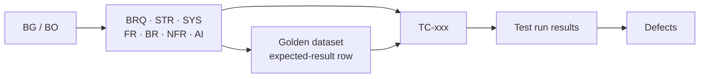

<picture>
  <source media="(prefers-color-scheme: dark)" srcset="../assets/MultipliersKraftLogoDark.png">
  
</picture>

# QA-03 — Verification and Validation Strategy

| Attribute | Value |
| :--- | :--- |
| Document ID | QA-03 |
| Title | Verification and Validation Strategy |
| Product | Nucleus Suite (Nucleus HRMS Suite) |
| Version | 1.0.0 |
| Status | Issued for approval |
| Owner (role) | QA/Test Lead |
| Author | Dhanraj Dadhich |
| Reviewed by | Chief Architect, Payroll Domain Lead, Head of AI, Security Lead, DPO, PQA Lead — *pending* |
| Approved by | Product Council — *pending* |
| Date | 2026-11-05 |
| Classification | Internal |
| CMMI practice areas | VV, PI, PR, RDM, MPM |
| Related documents | DOC-01, QA-01, QA-02, REQ-01, REQ-02, MPM-01, GOV-10, GOV-11, the AI feature specification and model card (GOV-11), the test case specification (MTP-01), CM-01 |
| Quality & process-performance objectives | QPPO-02 (defect removal before system test), QPPO-03 (exact payroll), QPPO-05 |
| Process performance baseline used | PPB-01, PPB-02, PPB-03, PPB-04 |
| Peer review record | *pending* (PR-xxxx, QA-02) |
| Tailoring record | none |
| Traceability anchor | BG-09 |

---

## 1. Purpose

Defines how the Nucleus Suite programme **verifies** that each work product meets its specified requirements ("built right") and **validates** that the product fulfils its intended use for the real personas in real operating conditions ("built the right thing"). It applies to all 14 process domains (PLT, PPL, TIM, LVE, PAY, CMP, LCY, SSV, CMB, TAL, CTG, EXP, FIN, INT) and to the shared components (CMP-nn) and domain seams (S-01..S-12). Test levels, schedules, environments and entry/exit criteria are planned in the master test plan (MTP-01); user acceptance testing is planned in UAT-01.

All requirements are treated as **new** for verification purposes, regardless of any implementation status recorded in client trackers; nothing is accepted as "already done" without evidence produced under this strategy.

## 2. Guiding Principles

1. **Golden-dataset first.** Wherever an expected result exists in the source dataset, the system's output is reconciled to it automatically. Expected results are not re-derived by testers.
2. **Shift left.** Peer review (QA-02) and automated unit/component tests catch most defects before system test (QO-02).
3. **Traceability both ways.** Every Must-have requirement traces to at least one passing test case; every test case traces to a requirement (REQ-02).
4. **Synthetic data only** outside production. No real personal data in any non-production environment (GOV-10).
5. **Seams are tested explicitly.** Each seam S-01..S-12 has its own contract test set, owned jointly by both domains.
6. **Shared components are tested once, deeply.** Each CMP-nn has its own suite; consuming domains test only their configuration and integration, not the component's internals.
7. **AI is evaluated, not just tested.** AI features have evaluation sets and statistical pass thresholds, plus adversarial red-teaming.
8. **Deterministic numbers.** Pay, balances and statutory amounts are verified to exact equality (to the paisa / defined rounding rule), never by tolerance, except where a documented rounding rule applies.

## 3. Validation Sources (Authoritative Expected Results)

| Source | Content | Use |
| :--- | :--- | :--- |
| **HRMS Demo Dataset v1.1** — fictional client *Vindhya Precision Industries Pvt Ltd* | Synthetic master data, transactions and expected outputs across domains | **Golden dataset**: input fixtures and expected results for reconciliation (§5.2) |
| 21_Expected_Attendance (within the dataset) | Expected daily attendance outcomes (status, hours, overtime, exceptions) for given punch/roster inputs | TIM golden cases; seam S-01 and S-02 tests |
| Other expected-result sheets in the dataset (leave, payroll, statutory, journals, etc.) | Expected balances, gross-to-net, deductions, registers, GL legs | LVE, PAY, CMP, FIN golden cases |
| 68_Acceptance_Test_Data | Data prepared for acceptance scenarios | UAT and system-test data |
| 10_Acceptance_Tests | Acceptance test definitions (TC-xxx seeded from dataset expected results) | Acceptance criteria and UAT scripts; seed of the TC catalogue |
| NFR-01 (imported from the workbook's 20_NFR_and_DoD), with SRS-01, SEC-01, OPS-01, NOT-01, RPT-01 and LOC-01 in 05_System_Requirements | System requirements and NFRs with target, how measured, gate and owner | Non-functional test design and exit criteria; this document does **not** restate targets |
| Domain packs (06_Functional_Requirements), UCC-01, USC-01 | FR, BR, UC, US, acceptance criteria | Functional test design |

**Rule:** if a test expectation conflicts with a golden-dataset expected result, the conflict is raised as a defect against either the requirement or the dataset; testers do not choose silently. Dataset corrections follow change control (CM-02) because the dataset is a configuration item (RSK-D-010).

## 4. V&V Levels

| Level | Objective | Scope | Owner | Primary techniques | Environment |
| :--- | :--- | :--- | :--- | :--- | :--- |
| **Peer review** | Remove defects from specifications, designs, code | All work products (QA-02) | Moderators | Inspection, technical review | — |
| **Unit** | Verify smallest units (functions, rules, calculators) | Domain logic, statutory calculators, validators, invariants | Developers | Automated unit tests; property-based tests for calculators | Local / CI |
| **Component** | Verify a domain service or shared component in isolation | Each domain service; each CMP-nn | Developers + QA | API tests with stubs; golden-case tests for the component | CI |
| **Integration / seam** | Verify interaction between components and across domain seams | S-01..S-12 contracts; external interfaces (ERP, gateways, biometric devices, AI providers) | QA + Integration Lead | Contract tests, consumer-driven contracts, event replay | INT |
| **System** | Verify the integrated product against FR and NFR | End-to-end domain functionality, NFRs | QA | Scenario tests, golden-dataset reconciliation, NFR tests | SYS |
| **End-to-end (E2E)** | Verify cross-domain business journeys | Hire-to-retire, time-to-pay, pay-to-ledger, request-to-resolve, plant shift-to-pay | QA | Journey scripts driven through the UI and APIs; reconciled to dataset | SYS |
| **User acceptance (UAT)** | **Validate** fitness for purpose with real roles | Persona journeys from GOV-08 consoles | Product Owner + customer/pilot users | Scripted (10_Acceptance_Tests) + exploratory | UAT |
| **Operational acceptance (OAT)** | Validate operability | Backup/restore, DR, monitoring, alerting, runbooks, support handover, data retention jobs | Ops/SRE + QA | Drills, failover tests | PRE-PROD |

## 5. Test Types

### 5.1 Functional Testing

Derived from FRs, business rules and use cases (incl. alternate and exception flows). Each Must-have FR has positive, negative and boundary tests. Business invariants (e.g. INV-LEV-01 non-negative leave balance, INV-LEV-02 no overlapping approved leave, INV-ATT-01 IN before OUT, INV-SEC-02 no self-approval, INV-PAY-01 Basic + DA ≥ 50% of CTC) each have dedicated tests at unit and system level.

### 5.2 Golden-Dataset Reconciliation (core validation method)

**What:** The HRMS Demo Dataset v1.1 inputs are loaded into a clean tenant; the system processes them through the real domain services; outputs are extracted and compared field-by-field with the dataset's expected results.

**How:**

1. **Load** — dataset master and transaction data loaded via the standard import/migration path (also exercising migration tooling).
2. **Process** — run the business processes in the order the dataset assumes (rosters → punches → attendance computation → leave → payroll → statutory → journals).
3. **Extract** — outputs exported in the same shape as the expected-result sheets.
4. **Reconcile** — automated comparison produces a reconciliation report: matched, mismatched (with expected vs actual), missing, unexpected.
5. **Triage** — each mismatch becomes a defect (product defect, requirement defect or dataset defect) within one working day.

**Coverage targets:** every expected-result row in the dataset is mapped to at least one TC-xxx; MET-12 measures match rate.

**Pass criterion:** 100% match for all in-scope domains and phases at G4 (QA-01 QO-04). Rounding rules must be specified in the requirement; any tolerance must be documented in the requirement and approved by the domain owner.

**Frequency:** nightly on the integration branch from the moment a domain's first calculator exists; mandatory at G3 and G4.

### 5.3 Statutory and Payroll Verification

| Technique | Description |
| :--- | :--- |
| Golden statutory cases | Per state (PT, LWF), per regime (TDS old/new), PF ceiling/VPF, ESI threshold crossings, Code on Wages basic floor reclassification, gratuity, arrears and recovery, full and final |
| Effective-dating tests | Rule changes mid-period; retroactive changes after lock (seam S-01) |
| Parallel payroll runs | ≥ 2 consecutive cycles comparing Nucleus Suite to the customer's existing payroll before go-live; variance analysed line by line (MET-13, PPB-04) |
| Register and form verification | Statutory registers and forms (e.g. muster roll, wage register) checked against dataset expected outputs |
| Journal balancing | Every payroll journal: total debits = total credits; GL mapping per ERP (seam S-06) |

### 5.4 Regression Testing

- Automated regression suite = all unit, component, contract and golden-dataset tests + critical E2E journeys.
- Runs on every merge (fast subset) and nightly (full).
- Statutory rule changes trigger the full PAY/CMP golden suite.

### 5.5 Non-Functional Testing

Targets, measurement methods, gates and owners are taken **from 05_System_Requirements** (imported from 20_NFR_and_DoD). This strategy specifies only how they are tested.

| NFR family | Test approach |
| :--- | :--- |
| Availability | Synthetic probes and incident records as defined in the NFR (e.g. the monthly availability NFR with maintenance outside Indian business hours); verified in OAT and in pilot |
| Performance and scalability | Load, stress, soak and spike tests with representative synthetic volumes; payroll run duration tests; measured percentiles as defined per NFR |
| Reliability and recovery | Failover, backup/restore, DR drills; recovery objectives per NFR |
| Security | See §5.6 |
| Accessibility | See §5.7 |
| Localisation | See §5.8 |
| Offline-first | Device offline for defined durations; conflict and duplicate scenarios; resync ordering (RSK-R-010) |
| Maintainability | Static analysis, complexity thresholds, dependency health |

### 5.6 Security Testing

- Threat modelling per domain and per seam at G2.
- SAST, dependency/supply-chain scanning and secret scanning on every merge.
- DAST against SYS environment each sprint.
- **Tenant isolation suite** — attempts cross-tenant access through APIs, search, exports, analytics and AI retrieval (RSK-R-007).
- Authorisation matrix tests — every role × every protected action, including agent-initiated actions (seam S-11).
- Independent penetration test before pilot (P2) and before each scale-up phase.
- Verification against the OWASP ASVS level set by ARB per component.

### 5.7 Accessibility Testing

Automated checks on every UI build plus manual testing with keyboard-only and screen readers for each new screen; conformance to WCAG 2.2 AA (MET-23). Dense dashboards and charts require text alternatives and data-table equivalents.

### 5.8 Localisation and Internationalisation Testing

- 11 languages: en, hi, mr, ta, te, bn, es, fr, de, ja, ar.
- Pseudo-localisation for truncation and hard-coded strings.
- **RTL (Arabic):** layout mirroring, logical CSS properties, bidirectional text in mixed content (e.g. IDs and numbers inside Arabic text).
- Locale-aware number, currency (₹ Indian grouping), date and time formats.
- Native-speaker validation per language before G4 (RSK-R-021).

### 5.9 AI Evaluation (INT domain and AI features in all domains)

| Evaluation | Method | Pass rule |
| :--- | :--- | :--- |
| Task accuracy | Curated evaluation sets per feature (AI feature specification and model card, GOV-11) with expected outputs | Threshold approved by DAEB per feature |
| Groundedness / citation correctness | Answers checked against source documents; numeric facts must equal deterministic service output | MET-15 within threshold; any fabricated number = fail |
| Fairness / bias | Outcome-rate comparisons across protected attributes on synthetic, balanced test populations; counterfactual tests (attribute swap) | MET-14 within DAEB thresholds |
| Robustness | Paraphrase, typo, code-mixed language, noisy audio input | Degradation within threshold |
| **Red-teaming** | Prompt injection (direct and via documents/fields), data exfiltration, jailbreak, privilege escalation through agent tools, harmful-advice scenarios | Zero critical findings open at release |
| Agent safety | Every write tool requires confirmation; actions only through permission-checked services; kill-switch test | 100% pass |
| Drift monitoring (post-release) | Scheduled re-evaluation on fixed sets; input distribution monitoring | MET-16 within threshold |

AI evaluation results are statistical: each run reports sample size and confidence interval; a feature passes only if the lower confidence bound meets the threshold.

### 5.10 Voice Testing (Nucleus Talk)

- Command recognition per language and accent group, including code-mixed speech (MET-20).
- Noise profiles representative of plant floors.
- Confirmation-before-action and touch fallback for every voice action.
- Browser speech-synthesis constraints (user-gesture initiation) verified on supported browsers.

### 5.11 Privacy Testing

- Data minimisation: fields displayed/exported only per purpose and role.
- Masking of salary data for roles without compensation visibility (e.g. plant supervisors).
- Consent capture and withdrawal; data-principal rights workflows (access, correction, erasure with statutory retention exceptions).
- Retention and deletion jobs.
- Access logging for sensitive records (identity documents, bank details, salary).

### 5.12 Data Migration Verification

- Mapping specification peer-reviewed (QA-02).
- ≥ 2 mock migrations; reconciliation of record counts, control totals (headcount, balances, YTD pay and tax) and sampled field-level comparisons.
- Opening-balance reconciliation signed by customer data owner.

## 6. Test Environments

| Env | Purpose | Data | Refresh |
| :--- | :--- | :--- | :--- |
| LOCAL | Developer testing; R0 prototype uses local JSON with in-memory mutations | Synthetic fixtures | On demand |
| CI | Unit, component, contract tests | Synthetic, generated per run | Per run |
| INT | Integration and seam tests; nightly golden-dataset reconciliation | HRMS Demo Dataset v1.1 | Nightly reset |
| SYS | System, E2E, NFR (functional), security DAST | Dataset v1.1 + generated volume data | Per sprint |
| PERF | Performance and scale | Generated synthetic volume data modelled on dataset distributions | Per test cycle |
| UAT | Acceptance by personas | 68_Acceptance_Test_Data + dataset | Per UAT cycle |
| PRE-PROD | OAT, cut-over rehearsal | Synthetic; production-like configuration | Per release |

External services (ERP, gateways, AI providers, biometric devices) use sandboxes or simulators; no production endpoints are called in R0 or in non-production environments.

## 7. Entry and Exit Criteria

| Level | Entry criteria | Exit criteria |
| :--- | :--- | :--- |
| Unit | Requirement/story approved; design reviewed | Tests pass; coverage of changed logic per DoD; static analysis clean of critical findings |
| Component | Units merged; component contract defined | All component tests pass; golden cases for the component pass |
| Integration / seam | Seam contract approved (G2); both sides deployed to INT | All contract tests pass; nightly reconciliation report has no unexplained mismatches for the seam |
| System | G3 met; test plan approved; environment and data ready | 100% Must-have FRs executed; zero open Critical defects; Major defects have approved plan; NFR results recorded against 05_System_Requirements |
| E2E | System exit met for involved domains | All critical journeys pass; golden-dataset reconciliation 100% for in-scope domains |
| UAT | E2E exit met; UAT scripts from 10_Acceptance_Tests ready; users trained (OCM-02) | Product Owner and pilot sign-off; zero open Critical, no Major without workaround and approval |
| OAT | System exit; runbooks drafted | DR/backup drills pass; monitoring and alerting verified; support accepts handover |

## 8. Defect Management

| Severity | Definition | Target resolution before | Example |
| :--- | :--- | :--- | :--- |
| S1 Critical | Wrong pay/statutory amount, data breach, cross-tenant exposure, unauthorised action, system unusable | Blocks gate; fix before exit | Golden mismatch in net pay |
| S2 Major | Core function fails, no reasonable workaround | Fix before G4 or approved deferral | Leave approval routing wrong |
| S3 Minor | Function works with workaround / cosmetic with usability impact | Planned | Mis-aligned RTL label |
| S4 Trivial | Cosmetic | Backlog | Spacing |

Each defect records: ID, severity, priority, domain, requirement/TC link, environment, steps, expected (incl. dataset reference) vs actual, **origin phase** (for defect leakage and DRE — PPB-03), root-cause category (for CAR-01), status history. Defect triage is daily during system test and UAT.

## 9. Traceability (REQ-02)

- TC IDs follow DOC-01 §7 (`<DOMAIN>-TC-NNN`); TCs seeded from 10_Acceptance_Tests keep a cross-reference to the source TC-xxx.
- Coverage (MET-05) is computed from REQ-02 at each gate.
- Orphan tests (no requirement) and untested requirements are reported weekly during system test.

## 10. Validation with Personas

Validation sessions are run per console persona (GOV-08): CHRO, HRBP, Plant Supervisor, TA Lead, Finance Controller, Talent Calibration Lead, Line Manager, Employee, Capability Lead, Super Admin — plus frontline/contract workers on shared or personal devices.

| Activity | When | Evidence |
| :--- | :--- | :--- |
| Prototype walkthroughs (R0) | Continuous during R0 | Session notes; findings converted into requirements via CM-02 |
| Usability tests with task success measures | Before G2 for each domain's key journeys | Task success, time on task, errors |
| Pilot validation at a plant site | P2 Pilot & Intelligence | Pilot report; adoption and task metrics (MET-19, MET-20) |
| UAT sign-off | G4 of each phase | Signed UAT record (UAT-01) |

## 11. Automation Strategy

| Layer | Target share of tests | Tools (indicative; selected via DAR-01) |
| :--- | :--- | :--- |
| Unit / component | Majority | Project automated test runner |
| Contract / seam | All seams | Contract-testing framework |
| Golden reconciliation | 100% automated | Reconciliation harness (dataset loader + comparator + report) |
| UI E2E | Critical journeys only | Browser automation framework |
| Accessibility | Automated checks on all screens + manual sampling | Automated a11y scanner |
| AI evaluation | 100% automated runs; human review of samples | Evaluation harness with versioned datasets |
| Performance | Scripted | Load-testing tool |

Automated suites, evaluation sets and the reconciliation harness are configuration items (CM-01).

## 12. Metrics

| Metric | Ref. |
| :--- | :--- |
| Requirements coverage | MET-05 |
| Defect density | MET-07 |
| Defect leakage / escaped defects | MET-08, PPB-06 |
| Test pass rate | MET-10 |
| Automated test share | MET-11 |
| Golden-dataset match rate | MET-12 |
| Parallel-run variance | MET-13, PPB-04 |
| AI fairness, groundedness, drift | MET-14, MET-15, MET-16 |
| Voice command success | MET-20 |
| Accessibility conformance | MET-23 |
| Defect removal efficiency | PPB-03 |

## Approval & Sign-off

| Role | Name | Date | Decision | Conditions / comments |
| :--- | :--- | :--- | :--- | :--- |
| Author | Dhanraj Dadhich | 2026-11-05 | Submitted | |
| Peer review moderator | *pending* | | | PR-xxxx |
| PQA (process compliance) | *pending* | | | NC-xxxx if any |
| Product Council | *pending* | | | |

## Measurement Data Captured

| Measure | Value | Unit | Notes |
| :--- | :--- | :--- | :--- |
| Size | 13 | sections | |
| Authoring effort | *to be recorded* | person-hours | |
| Review effort (preparation + meeting) | *pending review* | person-hours | From PR-xxxx |
| Rework effort | *pending review* | person-hours | |
| Review rate | *pending review* | pages / hour | Compare with PPB-02 control limits |
| Requirement volatility | 0 | CRs since baseline | Not yet baselined (CM-03) |

| Detection phase | Major | Minor | Editorial |
| :--- | :--- | :--- | :--- |
| Author self-check | 0 | 0 | 0 |
| Peer review | *pending* | | |

## 13. Revision History

| Version | Date | Author | Change summary | CR ref | Approved by |
| :--- | :--- | :--- | :--- | :--- | :--- |
| 1.0.0 | 2026-11-05 | Dhanraj Dadhich | Consolidated release | CR-0001 | *pending* |
