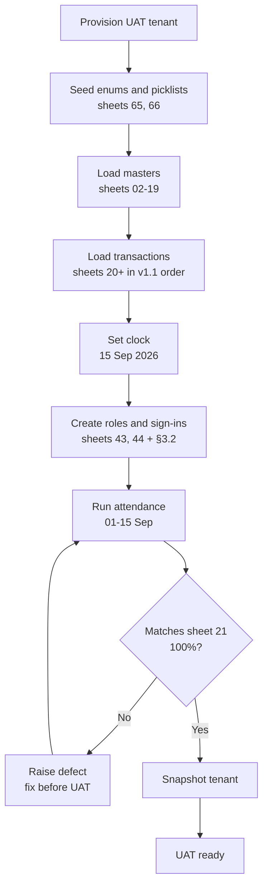
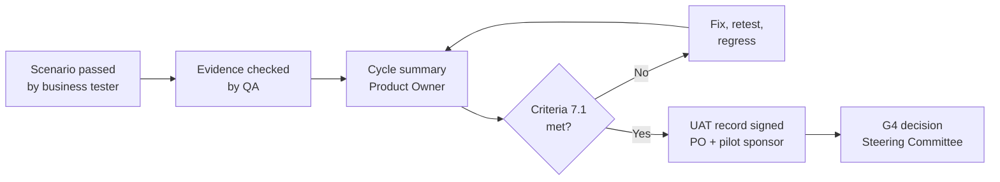
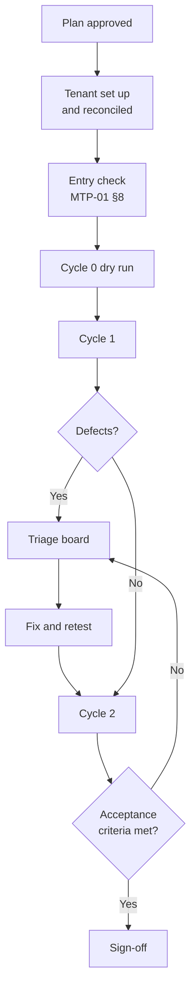

<picture>
  <source media="(prefers-color-scheme: dark)" srcset="../assets/MultipliersKraftLogoDark.png">
  
</picture>

# UAT-01 — User Acceptance Test Plan

| Attribute | Value |
| :--- | :--- |
| Document ID | UAT-01 |
| Title | User Acceptance Test Plan |
| Product | Nucleus Suite (Nucleus HRMS Suite) |
| Version | 1.0.0 |
| Status | Issued for approval |
| Owner (role) | Product Owner |
| Author | Dhanraj Dadhich |
| Reviewed by | *pending* |
| Approved by | Product Council — *pending* |
| Date | 2026-11-05 |
| Classification | Internal |
| CMMI practice areas | VV, RDM, OT |
| Related documents | MTP-01, QA-03, VV-01, VV-02, VV-03, TR-01, TR-02, GOV-05, GOV-08, GOV-10, OCM-02, RB-02 |
| Quality & process-performance objectives | QPPO-01 (minimise defects reaching users), QPPO-03 (exact payroll at go-live) |
| Process performance baseline used | PPB-04 (payroll parallel-run variance), PPB-06 (escaped defects per 100 FRs) |
| Peer review record | *pending* (PR-xxxx, QA-02) |
| Tailoring record | none |
| Traceability anchor | Demo points 1–26; R-01..R-27; T-01..T-40; value chain HIRE → EXIT and GOVERN |

---

## 1. Purpose and Scope

This plan defines how the client's business users **validate** that Nucleus Suite is fit for their intended use before release. It contains one acceptance scenario for each of the 26 client demo points and thirteen end-to-end scenarios that follow work across the value chain — hire, onboard, work, pay, comply, grow, exit and govern. Every scenario names the persona who runs it, the records it uses from the golden dataset, the steps, the expected result and the client requirement (R-01 to R-27), client acceptance test (T-01 to T-40) and source test case (for example TC-T80) it proves.

UAT is a level in the Master Test Plan (MTP-01 §5.1). Its formal execution is in **P2 Pilot & Intelligence**, ahead of Gate G4, and it repeats as a mini-cycle for the scope of P3 and P4. During the current **R0** stage the same scripts may be walked through on the local-JSON prototype as **validation only**: findings become change requests (CM-02); nothing walked through in R0 counts as accepted.

## 2. UAT Objectives

1. Confirm that each of the 26 demo points behaves as the client described it, using the exact records the golden dataset prepared for it.
2. Confirm that work flows across domains without manual re-keying: a requisition becomes a joiner, attendance becomes pay, pay becomes a balanced journal and statutory registers, and an exit becomes a released settlement.
3. Confirm that controls are real, not cosmetic: a blocked action is blocked in every surface (screen, report, export and API), and an approval cannot be replaced by editing a value.
4. Confirm that each persona can complete their tasks on their usual device and in their preferred language.
5. Give the Product Owner and the pilot sponsor objective evidence for the G4 release decision.

## 3. Participants by Persona

### 3.1 Persona roster

| Persona (GOV-08) | Console | UAT role | Dataset sign-in (sheet 44) | Scenarios led |
| :--- | :--- | :--- | :--- | :--- |
| PER-01 CHRO | S1 | Executive acceptor; signs the UAT record for the client | — | Sign-off; observes UAT-036 |
| PER-02 HR Business Partner / HR Head | S2 | Leave level 3, HR override, F&F, letters, requisition approval | U-005 Ritu Balachandran (R-HRHEAD, LE-01 and LE-02); U-006 Anita Mathew (R-HRHEAD, LE-01) | UAT-005, 007, 016, 018–024, 027, 031, 034, 035, 038 |
| PER-03 Plant Supervisor / Time Office | S3 | Attendance, rosters, regularisation, plant-scope restriction | U-001 Kalaivani Subramani (R-PLANT-HR, LOC-CHN); supplementary Peenya plant HR | UAT-002–004, 008, 011–013, 029, 036 |
| PER-04 Talent Acquisition Lead | S4 | Requisitions, candidates, offers | Supplementary recruiter sign-in | UAT-024, 025, 027, 037 |
| PER-05 Finance Controller | S5 | GL mapping, posting, reconciliation, loan level 3 | U-007 Nandita Bose (R-FINANCE) | UAT-015, 032 |
| PER-07 Line Manager | S7 | Team calendar, approvals, grade-exemption check | U-003 Nikhil Iyer, U-004 Rekha Deshpande (R-MANAGER) | UAT-001, 012, 022, 029, 030 |
| PER-08 Employee and PER-11 Frontline Worker | S8 | Own attendance, leave, payslip, voice and language | U-010 Ravi Kulkarni (R-EMPLOYEE); supplementary employee sign-ins | UAT-001, 006, 039 |
| PER-10 Super Admin | S10 | Tenant setup, clock control, supplementary sign-ins, ERP sync configuration | Programme-issued administrator | UAT-014, setup (§4) |
| PER-13 Payroll Administrator | S5 | Payroll runs, OT run, bank files, payslips | U-002 Deepak Sarangi (R-PAYROLL) | UAT-008, 010, 030–033 |
| PER-14 DPO / Compliance Officer | S10 | Statutory calendar, forms, privacy checks | U-009 Vikram Chauhan (R-COMPLIANCE) | UAT-017, 026, 033, 036 |
| PER-15 External / Statutory Auditor | Read-only | Observes evidence; no test steps | — | Observer for UAT-015, 017, 033 |
| PER-16 Integration user (non-human) | API | Delivers the ERP inbound batch | Integration credential issued by the Super Admin | UAT-014 |
| Director approver | Approval inbox | Loan special terms | U-008 Arvind Raghunathan (R-DIRECTOR) | UAT-009 |

### 3.2 Supplementary sign-ins created at setup

The dataset supplies ten sign-ins. The Super Admin creates these additional sign-ins before UAT; credentials follow the tenant convention, are issued out of band and are never written into test evidence.

| Sign-in purpose | Role and scope | Linked employee |
| :--- | :--- | :--- |
| Peenya plant HR | R-PLANT-HR, attendance location LOC-PLA | Plant HR user at Peenya Works |
| Chennai plant payroll (negative check for demo point 8) | R-PLANT-PAY, payroll processing location LOC-CHN | Plant payroll user at Oragadam Works |
| Leave supervisor and HOD for W-01 | R-MANAGER | E1039 Sanjay Pawar |
| Gate-pass approver for W-04 | R-MANAGER | E1024 Srinivas Achar |
| Recruiter | Requisition and candidate rights configured in the TAL set-up | Recruiter at head office |
| Employee self-service | R-EMPLOYEE, own record | E1019, E1023, E1028, E1032, E1034, E1036, E1041, E1043, E1044, E1066 |

### 3.3 Participant rules

- Each scenario is executed by a **client business user** acting in the named persona, with a programme tester recording evidence; programme staff never execute a step on the client's behalf.
- Testers complete the role-based training in OCM-02 before Cycle 1.
- Approvers in a chain are different people; no tester approves their own request (INV-SEC-02).

## 4. UAT Environment and Demo Tenant Setup

### 4.1 Environment

| Item | Setting |
| :--- | :--- |
| Environment | UAT (MTP-01 §6), hosted in a cloud region in India |
| Tenant | Vindhya Precision Industries Pvt Ltd — fictional client; LE-01 Vindhya Precision Industries Pvt Ltd (Karnataka) and LE-02 Vindhya Components Pvt Ltd (Telangana) |
| Sites | LOC-BLR Bengaluru Corporate Office, LOC-PLA Peenya Works, LOC-PUN Chakan Works, LOC-HYD Medchal Works, LOC-CHN Oragadam Works |
| Population | 68 workers across nine worker classes; demo period 01–15 September 2026; payroll cycle September 2026 |
| Tenant clock | 15 September 2026, 09:00 IST, so that open items sit in the state the dataset expects |
| Clock advances | Only by the Super Admin, only inside the scenarios that name them (16 Sep, 30 Sep, 05 Oct, 07 Oct 2026); the tenant is restored from the UAT snapshot afterwards |
| External services | ERP system and bank simulators; outbound e-mail and business messaging channel traffic captured in a message sink and never delivered |
| Devices | Desktop browser; shared plant terminal; mid-range mobile handset |
| Languages exercised | English, Hindi, Marathi, Tamil and Telugu for site users; Arabic spot check for right-to-left layout |
| Data | Synthetic only (GOV-10); dummy Aadhaar, PAN and UAN values flagged as dummies; bank accounts by last four digits |

### 4.2 Setup sequence

### 4.3 Setup acceptance

UAT does not start until: the attendance run reconciles 100% to 21_Expected_Attendance; the nightly golden reconciliation for every sheet used below is at 100%; the dataset defects listed in §11 are resolved through CM-02; the two browser profiles for demo point 8 (U-001 and U-002) are open side by side on one workstation; and the snapshot from which every clock-advance scenario restores is recorded.

## 5. Demo-Point Scenarios (UAT-001 to UAT-026)

Each scenario is run as written. A scenario passes only when every expected result is observed; partial observation is a fail with a defect.

### UAT-001 — Multi-punch day across midnight, break report and team history (demo point 1)

| Attribute | Detail |
| :--- | :--- |
| Persona | PER-11 frontline worker — U-010 Ravi Kulkarni (E1018); PER-07 line manager — U-003 Nikhil Iyer (E1017) |
| Preconditions | Punches PE-00013 to PE-00016 and attendance day AD-00008 loaded; E1018 rostered on SH-A, 12-hour shift (RS-2026-W36-01); OT-2026-0912 approved by E1017 on 09 Sep |
| Steps | 1. Sign in as U-010 and open own attendance for 08 Sep 2026. 2. Open the session detail and the break register entry BR-0001. 3. Open the overtime line for 08 Sep. 4. Open 09 Sep. 5. Sign in as U-003, open Team Calendar, set 01 Jan to 15 Mar 2026 and select E1018; then set 01–15 Sep 2026. 6. Try to select an employee outside the reporting line; export the team view. |
| Expected result | One attendance record dated 08 Sep with segments 08:00–20:30 and 21:15–03:20; gross 19h20m; a 45-minute Meal break listed separately (20:30–21:15); OT 7h20m against the 12-hour shift; day status Present; 09 Sep is not marked absent. Team Calendar returns history for both ranges; only E1018, E1019, E1025, E1029, E1030 and E1032 are selectable; the export matches the screen |
| Links | R-01, R-02; T-01, T-02, T-03, T-05; TC-T80, TC-T82, TC-T83, TC-T84, TC-T87; W-03; Q-01 |
| Phase | P1 build, accepted at G4 |

### UAT-002 — Contractual worker with no rest day, paid daily (demo point 2)

| Attribute | Detail |
| :--- | :--- |
| Persona | PER-03 Peenya plant HR; PER-13 U-002 Deepak Sarangi |
| Preconditions | E1032 Shivanna Muniyappa, worker class WC-CONT, wage basis Daily; attendance days AD-00111 and AD-00118; regularisation RG-2026-0220 loaded |
| Steps | 1. Open E1032's employee record and note worker class, rest-day applicability and wage basis. 2. Open his attendance for Sunday 06 Sep and Sunday 13 Sep. 3. Open RG-2026-0220 (request to treat 13 Sep as a weekly off). 4. As U-002, open E1032's line in the September regular run. |
| Expected result | Wage type Daily; no rest day; both Sundays show Working, not Weekly Off; RG-2026-0220 is rejected because a regularisation cannot create a rest-day entitlement the worker class does not carry; pay is computed on days present, with the day count on the payslip |
| Links | R-03; T-06; TC-T101, TC-Y290; W-10; Q-14 |
| Phase | P1, accepted at G4 |

### UAT-003 — Third-party employee and helper under one vendor (demo point 3)

| Attribute | Detail |
| :--- | :--- |
| Persona | PER-03 Peenya plant HR |
| Preconditions | E1034 Imran Shaikh (WC-3PE, sub-category SUB-EMP) and E1036 Lakshmi Rao (WC-3PH, sub-category SUB-HLP), both vendor VN-01, same site and shift; 38_Employment_Categories loaded |
| Steps | 1. Open both records side by side and compare category, sub-category and rest-day pattern. 2. Open both attendance days for Sunday 06 Sep. 3. Open the employment-category configuration that resolves each worker class. |
| Expected result | Sunday 06 Sep is Weekly Off for E1034 and Working for E1036; the difference comes from the sub-category row in the category configuration, not from code or a manual flag |
| Links | R-04; T-07; TC-T102 |
| Phase | P1 policy, accepted at G4 (contractor module in P3) |

### UAT-004 — Overtime only on rest days or holidays (demo point 4)

| Attribute | Detail |
| :--- | :--- |
| Persona | PER-03 Peenya plant HR; PER-07 U-004 Rekha Deshpande |
| Preconditions | E1034, OT eligibility basis RestDayHolidayOnly; OT-2026-0932 (04 Sep, Working) and OT-2026-0931 (06 Sep, Weekly Off) |
| Steps | 1. Open E1034's attendance for Friday 04 Sep (span over 12 hours) and the overtime action. 2. Open Sunday 06 Sep and the overtime action. |
| Expected result | 04 Sep: OT computes to zero and no OT line is raised. 06 Sep: the whole working span of 12h08m is overtime, approved by E1021 and payable in PR-2026-09-02 |
| Links | R-05; T-04; TC-T130, TC-T132 |
| Phase | P1, accepted at G4 |

### UAT-005 — Early return from leave and three-level approval (demo point 5)

| Attribute | Detail |
| :--- | :--- |
| Persona | Leave supervisor and HOD (E1039 Sanjay Pawar); PER-02 U-005 Ritu Balachandran (HR Head); PER-02 U-006 Anita Mathew (HR early-return action per W-02) |
| Preconditions | LV-2026-0774 for E1043 Neha Mishra; ledger rows LL-0011 and LL-0012; workflows W-01 and W-02 configured |
| Steps | 1. Open LV-2026-0774 and its approval trail. 2. On a fresh copy of the request created live, attempt approval as HR Head before the supervisor acts. 3. Approve the live copy in order: supervisor, HOD, HR Head. 4. On LV-2026-0774, perform the early-return action with return date 14 Sep. 5. Open the leave ledger, RG-2026-0214 and E1043's attendance for 14–16 Sep. |
| Expected result | Out-of-order approval is refused. Each level is recorded with actor, decision and timestamp. The early return writes, in one commit, an EL reversal credit of three days and attendance corrected to Present for 14, 15 and 16 Sep (RG-2026-0214). The ledger shows the original debit and the reversal. The HR edit is recorded against the user who performed it, not the original approver |
| Links | R-06; T-08, T-09; TC-L200, TC-L201, TC-L15; W-01, W-02 |
| Phase | P1, accepted at G4 |

### UAT-006 — Comp-off lapses 60 days from each credit (demo point 6)

| Attribute | Detail |
| :--- | :--- |
| Persona | PER-02 U-005; PER-08 employee sign-ins for E1028 and E1044 |
| Preconditions | CO-2026-0231 and CO-2026-0288 for E1028 Yashoda Rani; CO-2026-0198 and LL-0045 for E1044 Rahul Gaikwad; ticket TK-2026-0918 |
| Steps | 1. As E1028, open the comp-off ledger. 2. Compare the two credits and their expiry dates. 3. As E1044, open the lapsed credit and the ledger movement. 4. As U-005, open TK-2026-0918. |
| Expected result | Two credits on separate clocks: CO-2026-0231 (credited 12 Jul) is Lapsed on 10 Sep; CO-2026-0288 (06 Sep) runs to 05 Nov. CO-2026-0198 shows Lapsed on 30 Jul with a ledger movement naming the lapse run, and the balance falls. The ticket answer cites the same ledger movement |
| Links | R-07; T-10; TC-L210, TC-L212, TC-L213; Q-07 |
| Phase | P1, accepted at G4 |

### UAT-007 — Automatic leave credit, proration, combination rule, caps and year end (demo point 7)

| Attribute | Detail |
| :--- | :--- |
| Persona | PER-02 U-005; employee sign-in for E1019 |
| Preconditions | 14–17, 39, 40, 53 and 54 loaded; E1004 (grade rank 70, AGM band), E1019 (standard), E1067, E1069, E1060, E1030, E1065; LV-2026-0802 and LV-2026-0803 |
| Steps | 1. Walk from leave scheme to policy to E1004's ledger (LL-0001 to LL-0003). 2. Open E1019's monthly accrual (LL-0007). 3. Open E1069 (EL already caught up) and E1067; advance the clock to 16 Sep and run accrual. 4. Open CL and SL credits for E1069, E1067, E1060, E1030 and E1065. 5. Open LV-2026-0802 (CL combined with EL); then, as E1019, apply 2 CL for two days and, in a separate application, EL for the following three days. 6. Open LV-2026-0803 (eleventh EL day in a month). 7. Run year-end in Preview and then Commit for the employees in 54_Year_End_Leave_Preview. |
| Expected result | E1004: 18 EL, 6 CL and 6 SL on 1 January in one movement. E1019: 1.5 EL a month, 18 across the year. E1067: no EL for six months, then a single 9-day EL credit on 16 Sep; E1069 shows the same pattern already completed. CL and SL: 6, 5, 4, 3 and 2 days for E1069, E1067, E1060, E1030 and E1065 (E1030 under the trainee scheme receives CL only). Both CL-with-EL attempts are blocked, including the two separate applications forming one contiguous absence, with the rule named. The eleventh EL day is blocked with the cap named. Preview and Commit report identical figures |
| Links | R-08; T-11 to T-17; TC-L171, TC-L173, TC-L180, TC-L192, TC-L193; Q-02 to Q-06 |
| Phase | P1, accepted at G4 |

### UAT-008 — Head-office salary hidden from plant users (demo point 8)

| Attribute | Detail |
| :--- | :--- |
| Persona | PER-03 U-001 Kalaivani Subramani (Chennai plant HR); PER-13 U-002 Deepak Sarangi (payroll); Chennai plant payroll sign-in |
| Preconditions | E1056 Anand Krishnan: work location LOC-CHN, payroll group HO; the two browser profiles open side by side |
| Steps | 1. As U-001, open E1056's record, edit an attendance day, then open his compensation section. 2. As U-001, run the salary register, run an export of LOC-CHN employees and call the employee API for E1056. 3. As U-002, open the same record and the same register. 4. As the Chennai plant payroll sign-in, open E1056. |
| Expected result | U-001 sees and can edit attendance; every compensation and rate field is blank in all four surfaces, and E1056 is absent from the salary register and export. U-002 sees the full structure. Chennai plant payroll sees plant-paid salaries but not E1056, because the restriction follows the payroll processing location |
| Links | R-09; T-18; TC-P03, TC-P05, TC-H36 |
| Phase | P0, accepted at G4 |

### UAT-009 — Loan policy: one loan, guarantor lock, ceilings and director override (demo point 9)

| Attribute | Detail |
| :--- | :--- |
| Persona | PER-02 U-005; PER-05 U-007; Director U-008 Arvind Raghunathan; employee sign-ins for E1041 and E1044 |
| Preconditions | LN-2026-0041 (E1044, active), guarantors E1040 and E1041; LN-APP-2026-0014; LN-APP-2026-0019; LN-2025-0112 (E1050, closed); LN-2026-0012 (E1022); workflows W-05 and W-06 |
| Steps | 1. As E1044, apply for a second loan (LN-APP-2026-0019) and separately for a salary advance. 2. As E1041, open the rejected application LN-APP-2026-0014. 3. Open E1056's eligibility. 4. Open LN-2025-0112 and its guarantor release rows. 5. Open LN-2026-0012; attempt to raise the amount by editing; then approve the special-terms step as U-008. |
| Expected result | The second loan and the advance are both blocked with the same reason. E1041's application is rejected because he is an active guarantor. E1056's ceiling is 6× basic on 8 years 8 months of service. LN-2025-0112's closure released its guarantors, who are eligible again. Editing the amount is refused; the sanction of ₹ 1,50,000 against an ₹ 86,000 ceiling exists only as a recorded Director approval with reason. The same eligibility answer appears on the screen, at the guarantor lock and in the payroll recovery node |
| Links | R-10; T-19, T-20, T-21; TC-M430, TC-M432, TC-M433, TC-M443, TC-M452; W-05, W-06; Q-08, Q-09 |
| Phase | P1 eligibility and deduction / P2 full module, accepted at G4 |

### UAT-010 — Overtime paid after salary in its own run (demo point 10)

| Attribute | Detail |
| :--- | :--- |
| Persona | PER-13 U-002 Deepak Sarangi |
| Preconditions | PR-2026-09-01 (Regular, PRE_AUDIT) and PR-2026-09-02 (Off-cycle overtime, DRAFT) for LE-01 |
| Steps | 1. Attempt to execute PR-2026-09-02 while PR-2026-09-01 is open. 2. Complete and close PR-2026-09-01. 3. Advance the clock to 07 Oct and execute PR-2026-09-02. 4. Open both bank files and both journals. |
| Expected result | The OT run is refused while the salary run is open. The regular run pays on 30 Sep with OT = 0; the OT run pays on 07 Oct with its own bank file (BF-2026-10-0096, 96 records, ₹ 3,84,190) and its own journal line. Every payslip screen offers a run selector, because four runs exist against September for LE-01 |
| Links | R-11; T-22; TC-Y134, TC-Y330, TC-F333 |
| Phase | P1, accepted at G4 |

### UAT-011 — Gate pass entitlement and credit (demo point 11)

| Attribute | Detail |
| :--- | :--- |
| Persona | Employee sign-in for E1023 Kavya Venkatesh; gate-pass approver E1024 Srinivas Achar |
| Preconditions | GP-2026-0141, GP-2026-0155 approved (2 hours each); GP-2026-0163 submitted; W-04 configured |
| Steps | 1. Open E1023's two approved passes and the attendance for both dates. 2. As E1024, act on GP-2026-0163. 3. Open TK-2026-0925. |
| Expected result | Each approved pass appears as a break and the same minutes are credited back, so net hours are unchanged. GP-2026-0163 is rejected on the monthly ceiling (4 hours and 2 instances used); the entitlement is checked at submission and again at approval |
| Links | R-12; T-23; TC-T86, TC-T121; W-04; Q-10 |
| Phase | P1, accepted at G4 |

### UAT-012 — Half-day and absent thresholds, grace, lates, exemption and long-night relief (demo point 12)

| Attribute | Detail |
| :--- | :--- |
| Persona | PER-07 U-004 Rekha Deshpande; employee sign-in for E1019 |
| Preconditions | 08_Attendance_Rules, 41_Grace_Late_Policy, 42_Night_Extension_Rule loaded; E1022 (02 and 09 Sep), E1041 (07 Sep), E1019 (lates on 01, 03, 07, 10 and 14 Sep), E1018 (09 Sep, AD-00009), E1021 (grade rank 55) |
| Steps | 1. Open E1022 on 02 and 09 Sep (12-hour shift). 2. Open E1041 on 07 Sep (10-hour shift). 3. As E1019, open her September lates. 4. As U-004, open her own September attendance. 5. Open E1018 on 09 Sep after the 03:20 finish. 6. Open TK-2026-0912. |
| Expected result | E1022 below 6:30 net is Absent; E1041 below 9:30 net is Half Day. E1019's first three lates beyond grace are forgiven and the fourth converts the day to Half Day; the counter resets on the first of the next month. E1021 has five lates beyond grace and every day is Present. E1018 arriving up to 09:30 on 09 Sep is credited a full day with no late mark and no grace deduction |
| Links | R-13; T-24, T-25, T-26; TC-T112, TC-T113, TC-T115, TC-T117, TC-T118; Q-11, Q-12 |
| Phase | P1, accepted at G4 |

### UAT-013 — Shift detected from the in-punch (demo point 13)

| Attribute | Detail |
| :--- | :--- |
| Persona | PER-03 Peenya plant HR; PER-07 U-004 Rekha Deshpande |
| Preconditions | E1020 Arjun Bhat rostered SH-A (RS-2026-W36-03); in-punches on 04 and 11 Sep inside the SH-B detection window; exception EX-2026-0358 |
| Steps | 1. Open E1020's attendance for 04 and 11 Sep. 2. Open the roster RS-2026-W36-03. 3. Open the exception queue. |
| Expected result | Shift applied SH-B differs from shift assigned SH-A; the 12-hour thresholds are applied against the detected shift; the roster still reads SH-A; the override is recorded; detection windows of different shifts do not overlap |
| Links | R-14; T-27; TC-T91, TC-T92, TC-T94 |
| Phase | P1, accepted at G4 |

### UAT-014 — ERP employee master inbound with an ownership map (demo point 14)

| Attribute | Detail |
| :--- | :--- |
| Persona | PER-10 Super Admin; PER-16 integration user; observer PER-05 U-007 |
| Preconditions | ERP simulator holds batch ERP-SYNC-2026-09-14 (rows SY-0001 to SY-0008); field ownership map configured (ERP owns code, name, joining date, department, cost centre; Nucleus owns grade, worker class, shift, leave policy, manager) |
| Steps | 1. Deliver the batch through the integration user. 2. Open the sync log row by row. 3. Force a failure on one record and open the failure queue; retry it. |
| Expected result | Clean rows applied; SY-0004 rejected because grade is Nucleus-owned; SY-0005 held for review on a material manager difference; SY-0006 rejected as an unmatched code; SY-0007 rejected as a duplicate payload by hash; SY-0008 applied with payroll group HO unchanged. The forced failure appears in the queue with its reason and can be retried |
| Links | R-15; T-28; TC-F510 to TC-F516; Q-15; OD-07 |
| Phase | P1 (direction decided in P0), accepted at G4 |

### UAT-015 — Account posting to the ERP system (demo point 15)

| Attribute | Detail |
| :--- | :--- |
| Persona | PER-05 U-007 Nandita Bose; observer PER-15 |
| Preconditions | 35_GL_Mapping with GL-023 deliberately unmapped; PR-2026-08-01 and journal JV-2026-08-0441; bank file BF-2026-08-0412 |
| Steps | 1. Attempt to approve the September journal with GL-023 unmapped. 2. Add the mapping and generate the journal. 3. Post it to the ERP simulator; reconcile to the bank file. 4. Re-run the posting for August (JV-2026-08-0441 against PR-2026-08-01). 5. Force a posting failure. |
| Expected result | The run cannot reach APPROVED and the message names the component. Every component maps to an account and cost centre; debits equal credits. August debits and credits are ₹ 3,17,20,000 each and the re-run creates no second posting. The salary payable credit reconciles to the bank file total with zero variance. The forced failure is visible in the posting log |
| Links | R-16; T-29; TC-F520, TC-F521, TC-F530 |
| Phase | P1, accepted at G4 |

### UAT-016 — Full and final on the last working day, gated by no-dues (demo point 16)

| Attribute | Detail |
| :--- | :--- |
| Persona | PER-02 U-006 Anita Mathew; PER-13 U-002 |
| Preconditions | E1042 Swapnil Kadam (LWD 18 Sep, settlement FF-2026-0018) with two blocking lines open (tool kit and locker key; knowledge transfer); E1068 Dinesh Vaidya (LWD 30 Sep, FF-2026-0021) fully cleared; W-07, W-08 |
| Steps | 1. Open E1042's clearance and try to release FF-2026-0018; save the record at each step. 2. Open the F&F run PR-2026-09-03 and its bank file. 3. Advance the clock to 30 Sep; release FF-2026-0021 for E1068. 4. Clear E1042's blocking lines and release. |
| Expected result | Release is blocked while any blocking line is Pending; it is permitted once lines are Cleared, or Waived with a reason. The record saves without error at every step. E1042 is excluded from bank file BF-2026-09-0002 until cleared; his settlement carries ₹ 12,500 asset recovery and no gratuity (4 years). E1068 settles on 30 Sep with net ₹ 2,51,219 including gratuity of ₹ 1,74,138 for 7 years |
| Links | R-17; T-30; TC-X400, TC-X402, TC-X340; W-07, W-08; Q-16 |
| Phase | P1, accepted at G4 |

### UAT-017 — Statutory obligations, registers and state variants (demo point 17)

| Attribute | Detail |
| :--- | :--- |
| Persona | PER-14 U-009 Vikram Chauhan; observer PER-15 |
| Preconditions | 28_Statutory_Calendar, 29_Statutory_Forms, 48_PT_Slabs loaded; September runs for LE-01 and LE-02 |
| Steps | 1. Open the obligation calendar for September to November 2026 across four states. 2. Compare PT on the same run for Karnataka (LE-01) and Tamil Nadu (LE-02) employees. 3. Generate the Karnataka register set for LOC-PLA (including FRM-28-2026-09 and FRM-36-2026-H1) and the Tamil Nadu set for LOC-CHN (FRM-36-2026-H1T). |
| Expected result | Obligations show owner, due date, status and evidence. PT differs by state on the same run, with one state where it does not apply. The two register sets differ by state and every figure is drawn from live data; nothing is typed in. Form titles and layouts follow the dataset's state labels and are to be validated by Legal |
| Links | R-18; T-32; TC-Y302, TC-C380; Q-13 |
| Phase | P1, accepted at G4 |

### UAT-018 — Star employee to announcement and payroll (demo point 18)

| Attribute | Detail |
| :--- | :--- |
| Persona | PER-02 U-006; PER-13 U-002 |
| Preconditions | RC-2026-Q2-004 (E1022 Mohan Joseph) and RC-2026-Q2-007 (E1057), award ₹ 15,000 each, pay in PR-2026-09-01 |
| Steps | 1. Open both citations. 2. Open the announcement each raised. 3. Open the award lines in PR-2026-09-01. |
| Expected result | Selection raised AN-2026-0089 and AN-2026-0090 with no second manual step; the certificate carries period and criteria; each award appears as an earning in the named run, not as a side payment |
| Links | R-19; T-33; TC-E490, TC-E491 |
| Phase | P2, accepted at G4 |

### UAT-019 — Referral award through payroll (demo point 19)

| Attribute | Detail |
| :--- | :--- |
| Persona | PER-04 recruiter; PER-13 U-002 |
| Preconditions | RF-2026-0021 and RF-2026-0021B (referrer E1019, candidate CN-2026-0171, joined as E1065); confirmation CF-2026-0049 due 17 Feb 2027; RF-2026-0026 (referrer E1044, joiner E1066) |
| Steps | 1. Open RF-2026-0021 and the payroll run that paid it. 2. Open RF-2026-0021B and CF-2026-0049. 3. Open RF-2026-0026. |
| Expected result | The first 50% of RF-2026-0021 was paid as a payroll input in PR-2026-08-01; the balance is scheduled to mature on the confirmation date held on CF-2026-0049 and the two dates agree; RF-2026-0026 is part paid in PR-2026-09-01; each referral links to its requisition and position |
| Links | R-20; T-34; TC-R470, TC-R471, TC-R472 |
| Phase | P2, accepted at G4 |

### UAT-020 — Announcements raised from events (demo point 20)

| Attribute | Detail |
| :--- | :--- |
| Persona | PER-02 U-005 |
| Preconditions | AN-2026-0088 to AN-2026-0095 loaded; message sink active |
| Steps | 1. Open the announcement list. 2. Open the birthday (AN-2026-0088) and new-joiner (AN-2026-0091) items. 3. Set an employee's date of birth to today and create a joiner dated today. 4. Open the management draft AN-2026-0094 and publish it. |
| Expected result | Birthday and new-joiner announcements raise themselves from the record with no typing; audience rules (location, entity, org unit, all employees) scope delivery; channel selection includes the app, e-mail, notice board and the business messaging channel, and every outbound message lands in the sink, not with a real recipient |
| Links | R-21; T-35; TC-X397, TC-E492 |
| Phase | P2, accepted at G4 |

### UAT-021 — Appointment and other letters (demo point 21)

| Attribute | Detail |
| :--- | :--- |
| Persona | PER-02 U-006 |
| Preconditions | Appointment-letter template version 2.1 (sheet 32_Letter_Templates) issued to E1066 as LTR-2026-0341; confirmation-letter template issued to E1058 as LTR-2026-0338 |
| Steps | 1. Reopen LTR-2026-0341 and reprint it. 2. Edit a template to reference a merge field that does not exist and save. |
| Expected result | The reprint reproduces the letter exactly as sent, with the retained template version; the template with the bad merge field fails on save, not at issue |
| Links | R-22; T-36; TC-E500, TC-E502 |
| Phase | P2, accepted at G4 |

### UAT-022 — Organisation chart from the employee record (demo point 22)

| Attribute | Detail |
| :--- | :--- |
| Persona | PER-07 U-003; PER-02 U-005 |
| Preconditions | Org units OU-100 to OU-180, three levels; E1017 and his six reportees |
| Steps | 1. Drill the chart from OU-100. 2. Filter headcount by org unit and location. 3. Change one reportee's manager on the employee record and reopen the chart. |
| Expected result | The chart reflects the change with no separate hierarchy maintenance; department-wise view groups correctly |
| Links | R-23; T-37; TC-H35, TC-R56 |
| Phase | P1, accepted at G4 |

### UAT-023 — Induction and assets gate confirmation and return at exit (demo point 23)

| Attribute | Detail |
| :--- | :--- |
| Persona | PER-02 U-005 |
| Preconditions | E1066 joined 01 Sep; induction items IND-2026-0088 to IND-2026-0093 (IND-2026-0090 in progress); assets AST-L-0412, AST-M-0908, AST-A-1155; confirmation CF-2026-0052 |
| Steps | 1. Open E1066's induction path and assets. 2. Attempt to confirm E1066. 3. Open a simulated exit clearance for E1066. |
| Expected result | Confirmation is blocked while the mandatory induction item is open, whatever the manager recommends; the three issued assets appear as blocking clearance items with their recovery values |
| Links | R-24; T-38; TC-X395, TC-X396 |
| Phase | P1 assets / P3 learning depth, accepted at G4 |

### UAT-024 — Replacement requisition against a vacated position (demo point 24)

| Attribute | Detail |
| :--- | :--- |
| Persona | PER-04 recruiter; PER-02 U-005 (W-09 approver) |
| Preconditions | REQ-2026-0037 (Replacement) against vacated POS-2214; candidates CN-2026-0204 and CN-2026-0206 |
| Steps | 1. Open REQ-2026-0037 and approve it. 2. Open department headcount before and after. 3. Raise a New position requisition for the same department and compare. |
| Expected result | The replacement consumes no fresh sanction and departmental headcount is unchanged; a New position requisition increases it |
| Links | R-25; T-39; TC-R461; W-09 |
| Phase | P3, accepted at the P3 release gate |

### UAT-025 — Approved manpower department-wise (demo point 25)

| Attribute | Detail |
| :--- | :--- |
| Persona | PER-04 recruiter; PER-02 U-005 |
| Preconditions | OU-111 Machining at Peenya — 24 sanctioned, 24 filled; REQ-2026-0041; candidate CN-2026-0211 with offer OF-2026-0071 |
| Steps | 1. Open the sanctioned-manpower view by department, designation and location. 2. Submit REQ-2026-0041 for approval. 3. Open OF-2026-0071. |
| Expected result | Sanctioned, actual and open requisitions are shown side by side; REQ-2026-0041 is blocked or routed to the additional approval level, never passed with a warning; OF-2026-0071 is held by the headcount control |
| Links | R-26; T-40; TC-R462; W-09 |
| Phase | P3, accepted at the P3 release gate |

### UAT-026 — Form F generated in the joining chain (demo point 26)

| Attribute | Detail |
| :--- | :--- |
| Persona | PER-14 U-009 Vikram Chauhan |
| Preconditions | E1066 joined 01 Sep through pre-boarding chain PB-2026-0066; FRM-F-2026-0112 |
| Steps | 1. Open the pre-boarding chain step "Employee code and Form F generation". 2. Open FRM-F-2026-0112 and the Form F register. 3. Join a test employee live and generate the next Form F. |
| Expected result | Form F is produced as a joining step, populated from the employee record, in the state variant of the employee's establishment, with a gapless serial in the register |
| Links | R-27; T-31; TC-C382; OD-11; Q-13 |
| Phase | P1, accepted at G4 |

## 6. End-to-End Scenarios Across the Value Chain (UAT-027 to UAT-039)

| ID | Stages | Title | Persona(s) |
| :--- | :--- | :--- | :--- |
| UAT-027 | HIRE → ONBOARD | Referral to joiner through the joining chain | PER-04, PER-02, PER-14 |
| UAT-028 | ONBOARD → WORK → PAY | A joiner's first month | PER-02, PER-13 |
| UAT-029 | WORK | Roster to attendance for a plant line | PER-03, PER-07 |
| UAT-030 | WORK → PAY | Overtime from punch to bank file | PER-07, PER-13 |
| UAT-031 | WORK → PAY | Leave to pay | PER-02, PER-13 |
| UAT-032 | PAY | Pay to post for two entities | PER-13, PER-05 |
| UAT-033 | PAY → COMPLY | Run to statutory outputs | PER-13, PER-14 |
| UAT-034 | EXIT → PAY | Resignation to released settlement | PER-02, PER-13, PER-05 |
| UAT-035 | GROW → PAY | Recognition and referral to payroll | PER-02, PER-13 |
| UAT-036 | GOVERN | Data scope, audit and AI assistance within scope | PER-03, PER-13, PER-14 |
| UAT-037 | GOVERN | Request to resolve through the helpdesk | PER-08, PER-02 |
| UAT-038 | HIRE → EXIT | Hire-to-retire for a new worker created live | PER-04, PER-02, PER-11, PER-13 |
| UAT-039 | WORK | Frontline voice and language | PER-11 |

### UAT-027 — Referral to joiner through the joining chain (HIRE → ONBOARD)

| Attribute | Detail |
| :--- | :--- |
| Persona | PER-04 recruiter; PER-02 U-006; PER-14 U-009 |
| Preconditions | CN-2026-0188 Abhinav Rastogi, referred by E1044, against replacement requisition REQ-2026-0039; offer OF-2026-0066 accepted; pre-boarding chain PB-2026-0066 |
| Steps | 1. Follow the candidate from referral to accepted offer. 2. Open each pre-boarding step: offer acceptance, document collection, employee code and Form F, induction and assets, new-joiner announcement. 3. Open the appointment letter and the confirmation record CF-2026-0052. |
| Expected result | Every downstream record — FRM-F-2026-0112, three assets, induction items, AN-2026-0091, LTR-2026-0341 and RF-2026-0026 — was raised by a step in the chain, not typed afterwards; confirmation is correctly blocked by IND-2026-0090 |
| Links | R-20, R-21, R-22, R-24, R-25, R-27; T-31, T-34, T-36, T-38, T-39; TC-C382, TC-E502, TC-X395 |

### UAT-028 — A joiner's first month (ONBOARD → WORK → PAY)

| Attribute | Detail |
| :--- | :--- |
| Persona | PER-02 U-005; PER-13 U-002; employee sign-in for E1066 |
| Preconditions | E1066 joined 01 Sep at LOC-PUN on STAFF9 shift group |
| Steps | 1. As E1066, open leave balances and attendance. 2. Apply for one day of CL and have it approved through W-01. 3. As U-002, open E1066's line in the September regular run and his payslip. |
| Expected result | CL and SL of 2 days each (August–September joining rung); no EL until six months of service; the approved CL appears in attendance and in the payroll days-paid count; the payslip lists the pay components of his structure and deductions computed for Maharashtra PT; any line also present in 55_Payroll_Register reconciles exactly |
| Links | R-08, R-24; T-14; TC-L180 |

### UAT-029 — Roster to attendance for a plant line (WORK)

| Attribute | Detail |
| :--- | :--- |
| Persona | PER-03 Peenya plant HR; PER-07 U-003 and U-004 |
| Preconditions | Rosters RS-2026-W36-01 to RS-2026-W36-08; punches 01–15 Sep; exceptions EX-2026-0341 to EX-2026-0369; regularisations RG-2026-0211 to RG-2026-0222 |
| Steps | 1. Open the live shift board for OU-111 and OU-112. 2. Open the exception queue and sort by severity. 3. As U-004 (the approver named on the request), approve RG-2026-0211. 4. Export team history for 01–15 Sep as U-003. |
| Expected result | Informational exceptions (cross-date session, detected shift) are auto-resolved; payroll-blocking exceptions remain open until resolved; the vendor-claim exception blocks the vendor payment, not an employee payment; RG-2026-0211 changes 09 Sep for E1022 to Half Day and the LOP for the second half stands; the export reproduces the screen |
| Links | R-01, R-02, R-13, R-14; T-01, T-05, T-24, T-27; TC-T80, TC-T92, TC-T112 |

### UAT-030 — Overtime from punch to bank file (WORK → PAY)

| Attribute | Detail |
| :--- | :--- |
| Persona | PER-07 U-003; PER-13 U-002 |
| Preconditions | OT-2026-0912, OT-2026-0918, OT-2026-0931 and OT-2026-0955 in 23_Overtime_Register |
| Steps | 1. Open the overtime register and the approval trail for each line. 2. Close PR-2026-09-01; advance the clock to 07 Oct; execute PR-2026-09-02. 3. Open the OT bank file and journal. |
| Expected result | Every OT minute figure equals the overtime column of 21_Expected_Attendance; only approved lines are paid; the OT run pays on 07 Oct in its own file and journal line; Form 28 for LOC-PLA September is drawn from the same approved records |
| Links | R-01, R-05, R-11; T-03, T-04, T-22; TC-T87, TC-T132, TC-Y330 |

### UAT-031 — Leave to pay (WORK → PAY)

| Attribute | Detail |
| :--- | :--- |
| Persona | PER-02 U-005; PER-13 U-002 |
| Preconditions | 53_Leave_Balance_AsOn and 54_Year_End_Leave_Preview loaded; LV-2026-0774 early return completed (UAT-005) |
| Steps | 1. Open E1043's balance as on 15 Sep and its ledger movements. 2. Open E1043's line in the September run. 3. Run the year-end preview and open the encashment amounts. |
| Expected result | Balances are derived from the ledger alone; the early-return days are paid as present; encashment amounts equal days × rate per day in 54_Year_End_Leave_Preview; no balance is negative (INV-LEV-01) |
| Links | R-06, R-08; T-08, T-17; TC-L200 |

### UAT-032 — Pay to post for two entities (PAY)

| Attribute | Detail |
| :--- | :--- |
| Persona | PER-13 U-002; PER-05 U-007 |
| Preconditions | PR-2026-09-01 (LE-01) and PR-2026-09-11 (LE-02) in PRE_AUDIT; 47_Pay_Components, 48_PT_Slabs, 13_Salary_Structure loaded |
| Steps | 1. Run pre-payroll audit for both runs and clear the exceptions. 2. Lock inputs; execute gross-to-net; approve. 3. Publish payslips; generate bank files and journals; post to the ERP simulator; reconcile. |
| Expected result | Payroll register lines equal 55_Payroll_Register; E1014 and E1049 show the 50% floor add-back; E1032 is paid on days present; net pay never exceeds gross; journals balance per entity and reconcile to the bank files with zero variance; a recomputation of a closed run from its snapshot is identical |
| Links | R-09, R-16; T-29; TC-Y281, TC-Y290, TC-Y302, TC-F530, TC-PR01, TC-PR03 |

### UAT-033 — Run to statutory outputs (PAY → COMPLY)

| Attribute | Detail |
| :--- | :--- |
| Persona | PER-13 U-002; PER-14 U-009 |
| Preconditions | September runs closed (UAT-032); 28_Statutory_Calendar loaded |
| Steps | 1. Generate the PF, ESI and PT outputs for September by entity and state. 2. Generate FRM-28-2026-09 and the contract-labour register FRM-XIII-2026-09. 3. Mark the related obligations with evidence and sign off. |
| Expected result | Each statutory output reconciles to the payroll register totals for its entity and state; the registers are generated from live data; obligations move to completed with evidence attached and the compliance owner's sign-off recorded; nothing is transmitted to an authority |
| Links | R-18; T-32; TC-Y302, TC-C380 |

### UAT-034 — Resignation to released settlement (EXIT → PAY)

| Attribute | Detail |
| :--- | :--- |
| Persona | PER-02 U-006; PER-13 U-002; PER-05 U-007 |
| Preconditions | E1042 and E1068 clearance in 27_Exit_Clearance; settlements in 58_FnF_Settlement; run PR-2026-09-03 |
| Steps | 1. Record a fresh resignation for a test employee with assets and an active loan; follow notice, clearance and settlement. 2. Repeat UAT-016 steps for E1068 and E1042. 3. Generate the F&F bank file and journal. |
| Expected result | Assets and loan recovery appear on the clearance and the settlement automatically; settlement components and net amounts equal 58_FnF_Settlement for E1042 and E1068; the held settlement never reaches the bank file; the journal balances |
| Links | R-10, R-17, R-24; T-30, T-38; TC-X402, TC-X340, TC-M452 |

### UAT-035 — Recognition and referral to payroll (GROW → PAY)

| Attribute | Detail |
| :--- | :--- |
| Persona | PER-02 U-006; PER-13 U-002 |
| Preconditions | RC-2026-M09-002 (pending approval, ₹ 3,000); RF-2026-0029 (not yet due) |
| Steps | 1. Approve RC-2026-M09-002 and select the next open run. 2. Open RF-2026-0029 and attempt to mark it payable. 3. Open the payroll inputs list. |
| Expected result | The approved award becomes a payroll input in the named run and raises its announcement; RF-2026-0029 cannot be paid before its qualifying event; no award is paid outside payroll |
| Links | R-19, R-20, R-21; T-33, T-34 |

### UAT-036 — Data scope, audit and AI assistance within scope (GOVERN)

| Attribute | Detail |
| :--- | :--- |
| Persona | PER-03 U-001; PER-13 U-002; PER-14 U-009 |
| Preconditions | UAT-008 completed; sensitive-access logging active; read-only AI assistance enabled for the tenant (P2) |
| Steps | 1. As U-001, ask the assistant for E1056's salary and for his attendance on 11 Sep. 2. Open the sensitive-access log for E1056. 3. As U-009, export the access log for the period. |
| Expected result | The assistant answers the attendance question with a citation and refuses the salary question exactly as the screen does (S-11); every view of salary, bank or identity fields is logged with actor, purpose and time; the log is exportable and cannot be edited |
| Links | R-09; T-18; TC-P05 |

### UAT-037 — Request to resolve through the helpdesk (GOVERN)

| Attribute | Detail |
| :--- | :--- |
| Persona | PER-08 employee sign-ins for E1032, E1041, E1044; PER-02 U-006 |
| Preconditions | TK-2026-0912, TK-2026-0918, TK-2026-0925, TK-2026-0931, TK-2026-0940, TK-2026-0944 |
| Steps | 1. As E1044, raise a new ticket asking where a comp-off credit went. 2. As U-006, answer it from the record and close it. 3. Open the existing tickets and their resolutions. |
| Expected result | The answer cites the ledger movement and lapse-run reference; SLA due dates are tracked; tickets that reflect configured policy (no rest day for WC-CONT, salary hidden from plant HR) are closed as "working as configured" or referred as policy questions, not as defects |
| Links | R-03, R-07, R-09, R-10, R-12, R-13; T-06, T-10, T-18, T-20 |

### UAT-038 — Hire-to-retire for a new worker created live (HIRE → EXIT)

| Attribute | Detail |
| :--- | :--- |
| Persona | PER-04 recruiter; PER-02 U-005; PER-11 the new worker; PER-13 U-002 |
| Preconditions | CN-2026-0211 Basanti Naik with offer OF-2026-0071 held by REQ-2026-0041 at full sanction; pre-boarding chain PB-2026-0071 |
| Steps | 1. Approve the additional sanction level on REQ-2026-0041 with a recorded reason. 2. Issue OF-2026-0071; complete document collection, medical fitness certificate, employee code and Form F. 3. Advance the clock to 05 Oct 2026; join her at LOC-PLA. 4. Record a week of punches on a shared plant terminal; run attendance. 5. Preview October pay. 6. Record a resignation, complete clearance and preview the settlement. |
| Expected result | The offer cannot issue until the sanction override is recorded; Form F is generated in the chain with the next gapless serial; as an October joiner she receives 1 CL and 1 SL; attendance follows her shift rules; October pay is prorated by the configured basis; clearance gates the settlement. Expected amounts for this live worker are computed and peer-reviewed by the Payroll Domain Lead before execution and added to the dataset as extension rows through CM-02 |
| Links | R-08, R-24, R-26, R-27, R-17; T-14, T-31, T-40, T-30 |

### UAT-039 — Frontline voice and language (WORK)

| Attribute | Detail |
| :--- | :--- |
| Persona | PER-11 frontline worker — U-010 Ravi Kulkarni on a shared plant terminal and on a mobile handset |
| Preconditions | Interface languages enabled; Nucleus Talk enabled; plant-floor noise profile played at the terminal |
| Steps | 1. Switch the interface to Hindi; repeat in Marathi, Tamil and Telugu for the screens a worker uses. 2. Tap the microphone and say "punch in"; confirm. 3. Say "apply for leave"; complete the dialog by touch. 4. Switch to Arabic and open the attendance and leave screens. |
| Expected result | All worker-facing labels, dates and numbers render in the chosen language with Indian digit grouping where applicable; voice starts only after the tap, asks for confirmation before acting and offers touch fallback; the leave dialog opens pre-selected for the worker; Arabic mirrors the layout with IDs and numbers readable inside right-to-left text |
| Links | BO-03.3; MET-20; MET-23 |

## 7. Acceptance Criteria and Sign-off

### 7.1 Acceptance criteria

1. All 26 demo-point scenarios (UAT-001 to UAT-026) in the release scope pass; UAT-024 and UAT-025 are accepted at the P3 release gate.
2. All end-to-end scenarios in the release scope pass.
3. Every client acceptance test T-01 to T-40 in scope is observed passing inside at least one scenario.
4. Zero open S1 defects; zero open S2 defects without a workaround approved by the Product Council; every open S3 has a fix plan.
5. Golden reconciliation for every dataset sheet used by UAT is at 100% on the build under test.
6. For the pilot: payroll parallel-run unexplained variance is zero lines (MTP-01 §5.4).

### 7.2 Sign-off procedure

| Sign-off | Who | Evidence |
| :--- | :--- | :--- |
| Scenario | Executing business tester | Screenshots or exports for every expected result, timestamped, with build number |
| Cycle | Product Owner, with the QA/Test Lead | Pass/fail count, open defects by severity, retest results |
| UAT record | Product Owner and the pilot sponsor (PER-01 or delegate); PQA confirms the procedure was followed | Signed UAT record referencing this plan, the build, the dataset version and the defect list |

## 8. Defect Triage in UAT

| Topic | Rule |
| :--- | :--- |
| Board | Daily during UAT: Product Owner (chair), QA/Test Lead, the domain Product Owner, the client's lead tester |
| Severity | As MTP-01 §9.1 |
| Classification | Product defect; requirement defect (change request); dataset defect (CM-02); new need (change request, outside acceptance); training or usability observation (OCM-02); environment |
| Turnaround | S1 fixed and retested within 2 working days; S2 within 5 working days |
| Retest | A fix touching a money or access path re-runs every scenario of that domain plus the nightly golden reconciliation |
| Suspension | Any S1 in a money or access path; UAT environment unavailable for more than 4 working hours; golden match rate below 100% after a deployment |
| Resumption | Fix verified; snapshot restored; affected scenarios restarted from step 1 |

## 9. UAT Cycles and Flow

| Cycle | Relative timing (P2) | Content |
| :--- | :--- | :--- |
| Cycle 0 — dry run | Week 30 | QA executes every script on the snapshot to prove scripts and data |
| Cycle 1 — full execution | Weeks 31–32 | Business users execute all in-scope scenarios |
| Cycle 2 — retest and regression | Week 33 | Fixed defects retested; affected scenarios and all E2E scenarios re-run |
| Sign-off | End of week 33 | UAT record signed ahead of the G4 decision |

## 10. Traceability Summary

| Demo point | Scenario | Requirement | Acceptance tests | Phase accepted |
| ---: | :--- | :--- | :--- | :--- |
| 1 | UAT-001 | R-01, R-02 | T-01, T-02, T-03, T-05 | G4 (P2) |
| 2 | UAT-002 | R-03 | T-06 | G4 (P2) |
| 3 | UAT-003 | R-04 | T-07 | G4 (P2) |
| 4 | UAT-004 | R-05 | T-04 | G4 (P2) |
| 5 | UAT-005 | R-06 | T-08, T-09 | G4 (P2) |
| 6 | UAT-006 | R-07 | T-10 | G4 (P2) |
| 7 | UAT-007 | R-08 | T-11 to T-17 | G4 (P2) |
| 8 | UAT-008 | R-09 | T-18 | G4 (P2) |
| 9 | UAT-009 | R-10 | T-19, T-20, T-21 | G4 (P2) |
| 10 | UAT-010 | R-11 | T-22 | G4 (P2) |
| 11 | UAT-011 | R-12 | T-23 | G4 (P2) |
| 12 | UAT-012 | R-13 | T-24, T-25, T-26 | G4 (P2) |
| 13 | UAT-013 | R-14 | T-27 | G4 (P2) |
| 14 | UAT-014 | R-15 | T-28 | G4 (P2) |
| 15 | UAT-015 | R-16 | T-29 | G4 (P2) |
| 16 | UAT-016 | R-17 | T-30 | G4 (P2) |
| 17 | UAT-017 | R-18 | T-32 | G4 (P2) |
| 18 | UAT-018 | R-19 | T-33 | G4 (P2) |
| 19 | UAT-019 | R-20 | T-34 | G4 (P2) |
| 20 | UAT-020 | R-21 | T-35 | G4 (P2) |
| 21 | UAT-021 | R-22 | T-36 | G4 (P2) |
| 22 | UAT-022 | R-23 | T-37 | G4 (P2) |
| 23 | UAT-023 | R-24 | T-38 | G4 (P2) |
| 24 | UAT-024 | R-25 | T-39 | P3 release gate |
| 25 | UAT-025 | R-26 | T-40 | P3 release gate |
| 26 | UAT-026 | R-27 | T-31 | G4 (P2) |

All 40 client acceptance tests and all 27 client requirements are covered.

## 11. Risks, Assumptions and Known Data Issues

| Item | Description | Handling |
| :--- | :--- | :--- |
| Dataset inconsistency — Form F state | 12_Employees and 61_Preboarding_Chain place E1066 at LOC-PUN (Maharashtra), while 29_Statutory_Forms records FRM-F-2026-0112 against Karnataka and LOC-PLA | Raised as a dataset defect through CM-02 before UAT entry; UAT-026 expects the variant of the employee's own establishment |
| Dataset inconsistency — early-return actor | 44_Demo_Users names U-005 for the early-return closure of LV-2026-0774; 64_Approval_Workflows (W-02) and 50_Attendance_Regularisation name E1006 | Resolved through CM-02 before UAT entry; UAT-005 checks that the recorded actor equals the signed-in user |
| Statutory form titles | 29_Statutory_Forms labels Form 28 as the overtime register, Form 18 as the leave-with-wages register and Form 36 as the muster roll | Titles and layouts to be validated by Legal per state (Q-13) |
| T-15 partly ready | The contiguous-absence case has no stored record | Created live in UAT-007 step 5 |
| Open client questions | Q-01 to Q-16 in RB-02 affect expected results for T-14 (joiners after 4 December), T-28, T-30, T-31 and T-32 | Affected expectations are marked blocked until answered; a blocked expectation is not a pass |
| Site language coverage | Two sites are in Karnataka; Kannada is not among the 11 supported interface languages | Raised to the Product Owner as a localisation scope question for P2 |
| Real data | The demo tenant is synthetic; the pilot client's real data is used only in the pilot tenant | Pilot-specific acceptance re-runs these scripts in the production-classified pilot tenant under DPO approval |

## Approval & Sign-off

| Role | Name | Date | Decision | Conditions / comments |
| :--- | :--- | :--- | :--- | :--- |
| Author | Dhanraj Dadhich | 2026-11-05 | Submitted | |
| Peer review moderator | *pending* | | | PR-xxxx |
| PQA (process compliance) | *pending* | | | |
| Product Council | *pending* | | | |

## Measurement Data Captured

| Measure | Value | Unit | Notes |
| :--- | :--- | :--- | :--- |
| Size | 39 | UAT scenarios | 26 demo-point scenarios and 13 end-to-end scenarios |
| Authoring effort | *to be recorded* | person-hours | |
| Review effort (preparation + meeting) | *pending review* | person-hours | From PR-xxxx |
| Review rate | *pending review* | items / hour | Compare with PPB-02 control limits |
| Requirement volatility | 0 | CRs since baseline | |

## Revision History

| Version | Date | Author | Change summary | CR ref | Approved by |
| :--- | :--- | :--- | :--- | :--- | :--- |
| 1.0.0 | 2026-11-05 | Dhanraj Dadhich | Consolidated release | CR-0001 | *pending* |
