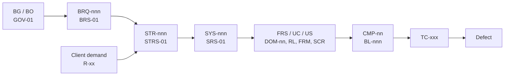
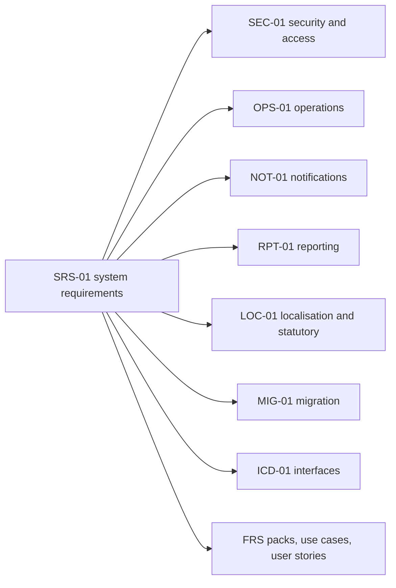

<picture>
  <source media="(prefers-color-scheme: dark)" srcset="../assets/MultipliersKraftLogoDark.png">
  
</picture>

# REQ-02 — Requirements Traceability Matrix (RTM)

| Attribute | Value |
| :--- | :--- |
| Document ID | REQ-02 |
| Title | Requirements Traceability Matrix |
| Product | Nucleus Suite (Nucleus HRMS Suite) |
| Version | 1.0.0 |
| Status | Issued for approval |
| Owner (role) | BA Lead |
| Author | Dhanraj Dadhich |
| Reviewed by | QA Lead, PQA Lead — *pending* |
| Approved by | Not baselined (living); snapshots approved at gates by Product Council |
| Date | 2026-11-05 |
| Classification | Internal |
| CMMI practice areas | RDM, VV |
| Related documents | DOC-01, DOC-02, GOV-01, PLN-02, REQ-01, QA-03, CM-02 |
| Quality & process-performance objectives | QPPO-05 (effective requirements reviews), QPPO-01 |
| Process performance baseline used | PPB-01 (review defect density), PPB-02 (review rate) |
| Peer review record | *pending* (PR-xxxx, QA-02) |
| Tailoring record | none |
| Traceability anchor | BG-01 – BG-10 |

---

## 1. Purpose

The RTM provides **bidirectional traceability** from business goals and client demands down to tests and defects, and back up. It is used for impact analysis of change requests, coverage checks at gates and PQA audits. It implements rules T1–T10 in REQ-01 §11.2.

## 2. Structure

### 2.1 Trace chain

Business requirements (BRQ, BRS-01) refine the business objectives; stakeholder requirements (STR, STRS-01) restate business and client needs (R-xx) from each stakeholder's viewpoint; system requirements (SYS, SRS-01, with NFR-01, SEC-01, OPS-01, NOT-01, RPT-01 and LOC-01) are allocated to the domain packs, where they are realised by processes (DOM-nn), rules, forms, screens, functional requirements, use cases (FRS-<DOM>-12, UCC-01) and user stories (FRS-<DOM>-13, USC-01). Every link is navigable in both directions.

### 2.2 Master trace columns

| Column | Content |
| :--- | :--- |
| Item ID | Source ID (imported) or `<DOM>-<TYPE>-nnn` (new) |
| Origin | Imported / New / CG (capability gap, `<DOM>-CG-nnn`) / FX (frontier, `<DOM>-FX-nnn`) |
| Domain | 14-domain code |
| Title | Short title, at most 10 words (REQ-01 §6) |
| Priority | MoSCoW |
| Phase | R0, P0–P4 (P5 = proposal) |
| Status | REQ-01 §9 |
| BG / BO | BG-nn, BO-nn.n (GOV-01) |
| Business requirement | BRQ-nnn (BRS-01) |
| Stakeholder requirement | STR-nnn (STRS-01) |
| System requirement | SYS-nnn (SRS-01) or `<DOM>-NFR/SEC/OPS/NOT/RPT/LOC-nnn` |
| Client demand | R-xx |
| Process / step | DOM-nn / DOM-nn.s |
| Rules / forms / screens | RL-nnn, FRM-<MOD>-nn, SCR-nnn |
| Shared components | CMP-nn |
| Backlog | BL-nnn |
| Test cases | TC-xxx |
| Test result | Not run / Pass / Fail / Blocked |
| Open defects | IDs |
| CR history | CR IDs |
| Change count / injected defects | Per-requirement volatility and defect-injection data (REQ-01 §13.1) |
| Defined in | BRS-01, STRS-01, SRS-01, a 05_System_Requirements document, or `FRS-<DOM>-00..13` (use cases in 12, user stories in 13) |

### 2.3 Storage rules

- Domain RTM sections live in `requirements/11_Traceability/` (one file per domain once populated). This document holds the structure, the BG/R-xx seed and the coverage rules.
- The RTM is updated in the same change that alters a requirement or an import (CM-01 §5).
- Snapshots are taken at G1, at each test-readiness gate and at G4, and placed under configuration control.

## 3. Coverage Metrics

| Metric | Formula | G1 | Test readiness (G3 / phase) | G4 |
| :--- | :--- | :--- | :--- | :--- |
| Upstream coverage | BRQ traced to a BO, STR traced to a BRQ or R-xx, SYS traced to an STR (rule T11) ÷ total BRQ + STR + SYS | 100% | 100% | 100% |
| Demand coverage | R-xx traced to ≥ 1 DOM-nn ÷ total R-xx (27) | 100% | 100% | 100% |
| Process justification | DOM-nn traced to R-xx or BO ÷ DOM-nn | 100% | 100% | 100% |
| Artefact coverage | RL / FRM / SCR traced to DOM step ÷ total | 95% | 100% | 100% |
| Backlog coverage | BL-nnn traced to source + CMP-nn named ÷ BL-nnn in phase | 100% | 100% | 100% |
| Test coverage | Must items with ≥ 1 TC ÷ Must items | — | 100% | 100% |
| Test pass | Must items with all TCs passed ÷ Must items | — | — | 100% |
| Statutory citation | Statutory RL with legal source ÷ statutory RL | 100% | 100% | 100% |
| Component re-implementation | BL stories flagged as re-implementing a CMP | 0 | 0 | 0 |

### 3.1 Requirement-level coverage

The chain below is the path every requirement follows from a business goal to the evidence that closes it. Counts are of distinct identifiers defined in each document at version 1.0.0; a requirement referenced in another document is counted only where it is defined.

| Level | Identifier | Defined in | Count | Upward trace at this version |
| :--- | :--- | :--- | ---: | :--- |
| Business goal | BG-nn | GOV-01 | 10 | Root of the chain |
| Business requirement | BRQ-nnn | BRS-01 | 90 (79 Must, 10 Should, 1 Could) | 90 of 90 trace to a BG (BRS-01 §14.3); 90 of 90 refined by at least one STR; 90 of 90 realised by at least one SYS |
| Stakeholder requirement | STR-nnn | STRS-01 | 108 (85 Must, 20 Should, 3 Could) | 108 of 108 trace to a BRQ (STRS-01 §10) |
| System requirement | SYS-nnn | SRS-01 | 89 (86 Must, 3 Should) | 89 of 89 realise at least one BRQ (SRS-01 §15.3, §15.4) |
| Security, privacy and access | PLT-SEC-nnn | SEC-01 | 87 | Cites 27 SYS requirements in its trace column; other rows trace to GOV-10, GOV-11 and NFR-01 |
| Operational and support | PLT-OPS-nnn | OPS-01 | 76 | Cites 15 SYS requirements in its trace column; other rows trace to NFR-01 targets |
| Notification and communication | PLT-NOT-nnn | NOT-01 | 72 | Traces to rules, processes and goals; no item-level SYS link yet (realises SYS-070, SYS-071) |
| Reporting and analytics | INT-RPT-nnn | RPT-01 | 98 (73 requirement statements, 25 report specifications) | Traces to source reports, processes and personas; no item-level SYS link yet (realises SYS-017, SYS-077) |
| Localisation and statutory | CMP-LOC-nnn | LOC-01 | 90 | Traces to statutes, rules and processes; no item-level SYS link yet (realises SYS-045, SYS-066..SYS-068) |
| Data migration and cutover | PLT-MIG-nnn | MIG-01 | 59 | Traces to data objects and processes; no item-level SYS link yet (realises SYS-061) |
| Interface | `<DOM>-INT-nnn.nn`, PLT-INT-1nn | ICD-01 | 99 (87 per interface, 12 cross-interface) | Traces to rules, flows and tests; no item-level SYS link yet (realises SYS-080..SYS-089) |
| **System level in total** | | SRS-01 and companions | **670** | |
| Use case | `<DOM>-UC-nnn` | FRS-&lt;DOM&gt;-12 (14 packs) | 223 | Each use case names the process (DOM-nn) it realises, its client requirements, rules and acceptance tests; no item-level SYS or BRQ link yet |
| User story | `<DOM>-US-nnn` | FRS-&lt;DOM&gt;-13 (14 packs) | 586 | Each story names the use case it refines |
| Test case | TC-xxx | VV-01 | 53 | Verification of SYS and domain rules |
| Client acceptance test | T-nn | VV-02 | 40 | Verification of client requirements R-01..R-27 |
| UAT scenario | UAT-nnn | UAT-01 | 39 (26 demo-point, 13 end-to-end) | Validation with business users |

Use cases and user stories per domain:

| Domain | Use cases | User stories |
| :--- | ---: | ---: |
| PLT | 25 | 73 |
| PPL | 18 | 50 |
| TIM | 19 | 66 |
| LVE | 15 | 40 |
| PAY | 25 | 58 |
| CMP | 15 | 41 |
| LCY | 16 | 40 |
| SSV | 12 | 29 |
| CMB | 17 | 46 |
| TAL | 22 | 49 |
| CTG | 8 | 24 |
| EXP | 9 | 20 |
| FIN | 10 | 24 |
| INT | 12 | 26 |
| **Total** | **223** | **586** |

Upward coverage (§3, first metric) is complete at this version for the BRQ, STR and SYS levels. SEC-01 and OPS-01 cite SYS requirements for part of their rows; NOT-01, RPT-01, LOC-01, MIG-01 and ICD-01 do not yet cite SYS identifiers, so their SYS links are added by the BA Lead before the G1 snapshot of the phase that builds them (rule T11). Use cases trace upward through their process (DOM-nn) and client requirements, which BRS-01 §14.1 maps to BRQ; direct UC → SYS and UC → BRQ links are added at the same snapshot.

## 4. Weekly Trace Health Report (format)

| Domain | Items | Orphans | R-xx without DOM | DOM without R-xx/BO | BL without CMP | Without TC | Failed TC | Open CRs |
| :--- | :--- | :--- | :--- | :--- | :--- | :--- | :--- | :--- |
| PLT | | | | | | | | |
| … | | | | | | | | |

## 5. Seed Matrix — Business Goals to Domains

All rows below are **Proposed**. The R-xx → DOM-nn mapping is completed from the imported client demo points and process catalogue. It is not invented here.

| BG | Goal (short) | Primary domains | Supporting domains | Candidate areas | Phases |
| :--- | :--- | :--- | :--- | :--- | :--- |
| BG-01 | enterprise-grade hire-to-retire on effective-dated worker model | PPL, LCY | PLT, PAY, SSV | Worker/position/org; effective-dated write; lifecycle transactions; self-service | P0–P1, P3 |
| BG-02 | AI-native agentic experience | INT | all domains via tool surface | Nucleus Talk; governed agents; human-in-the-loop; explainability | R0 (voice navigation), P2, P3, P5 |
| BG-03 | Frontline and plant workforce excellence | TIM, LVE, CMP | PPL, SSV, PAY | Biometric/geofence punches; offline-first; rosters; OT; gate pass; factory registers; 11 languages; plant salary masking | R0–P2 |
| BG-04 | Continuous, compliant payroll | PAY, CMP | CMB, TIM, LVE, FIN | Gross-to-net; PF/ESI/PT/TDS; Code on Wages 50% floor; control room; F&F; gratuity; EWA (P5) | P1–P3, P5 |
| BG-05 | Skills-based talent ecosystem | TAL | EXP, INT | Recruitment; OKR; 9-box calibration; learning; succession; talent marketplace (P5) | P3–P4, P5 |
| BG-06 | Trust by design | PLT | all domains | Scope resolver; masking; consent; immutable audit; DPDP/GDPR rights; AI explainability | P0 onward |
| BG-07 | Composable open platform | PLT, FIN | PAY, INT | Outbox; API contracts (ICD-01); three ERP posting formats; extensibility | P0, P2–P3 |
| BG-08 | Decision intelligence | INT | PPL, PAY, TAL | Consoles S1–S10; NL query; predictive attrition; org digital twin (P5) | P2, P4, P5 |
| BG-09 | CMMI Maturity Level 5 delivery capability | (governance) | all | This governance framework; V&V evidence; process assets; per-requirement volatility and defect-injection data feeding PPBs and CAR-01 | R0 onward |
| BG-10 | Scalable multi-tenant SaaS | PLT | all | Tenant provisioning (P0 exit); tenant isolation; idempotency; scale NFRs | P0, P4 |

### 5.1 Client demand seed

Client tracker statuses (*Implemented / WIP / Done*) are **not** carried over. Every R-xx starts as Proposed (REQ-01 §5.4).

The 27 client requirements are registered verbatim, with their full statements, in TR-01. The BA Lead adds the DOM-nn and BO links from the process catalogue at P0 G1 (rule T1, REQ-01 §11.2) and records them in the domain RTM sections (§7); stakeholder requirements derived from them are specified in STRS-01.

| R-xx | Client demo point (short title, TR-01) | Source module | Client priority | Status |
| :--- | :--- | :--- | :--- | :--- |
| R-01 | Multi-punch work hours across midnight, with break captured separately | ATT | P1 | Proposed |
| R-02 | Team Calendar — date-range history and report for a manager's own team | ATT | P1 | Proposed |
| R-03 | Contractual employees have no rest days and are paid daily wages | EMP | P1 | Proposed |
| R-04 | Third-party group — Employees get rest days, Helpers do not | EMP | P1 | Proposed |
| R-05 | Some employees receive OT only on rest days or holidays | EMP | P1 | Proposed |
| R-06 | Early return from leave — mark present and credit the balance back | LVE | P1 | Proposed |
| R-07 | COFF lapses 60 days from the COFF date | LVE | P1 | Proposed |
| R-08 | Automatic leave credit — grade-based, monthly accrual, new-joiner proration | LVE | P1 | Proposed |
| R-09 | Salary processed at head office, attendance at plant, salary hidden from plant users | SEC | P1 | Proposed |
| R-10 | Loan policy — one active loan, guarantor interlock, multiple-of-basic ceiling | LON | P2 | Proposed |
| R-11 | OT is generated and paid after salary generation, in a separate run | OTM | P1 | Proposed |
| R-12 | Personal gate pass — 4 hours a month, maximum two passes, added to work hours | GPS | P2 | Proposed |
| R-13 | Attendance thresholds by shift length, grace period and late-mark rules | SHF | P1 | Proposed |
| R-14 | Auto shift detection from the in-punch time | SHF | P1 | Proposed |
| R-15 | Link the ERP employee master to Nucleus | INT | P1 | Proposed |
| R-16 | Show and generate account posting in the ERP from Nucleus | INT | P1 | Proposed |
| R-17 | Full and final settlement on the same day, gated by no-dues | FNF | P1 | Proposed |
| R-18 | Statutory compliance — Factory Act forms and returns | STA | P1 | Proposed |
| R-19 | Star employees | ENG | P3 | Proposed |
| R-20 | Referral process and awards | ENG | P3 | Proposed |
| R-21 | Announcements — birthday, star employee, new joiner, referral, management messages | ENG | P3 | Proposed |
| R-22 | Appointment letter and other HR letters | DOC | P3 | Proposed |
| R-23 | Organisation chart and department-wise hierarchy | ORG | P3 | Proposed |
| R-24 | Induction training at joining, and asset issue | ONB | P2 | Proposed |
| R-25 | Recruitment — position code for a replacement | REC | P2 | Proposed |
| R-26 | Approved manpower, department-wise | REC | P2 | Proposed |
| R-27 | Joining form under the Factory Act — Form F | STA | P1 | Proposed |

## 6. Re-homed Intents from Retired Placeholder Requirements

The retired placeholder IDs `FR-GOV-01..04-001..003` and `BR-GOV-01..04-101..102` (DOC-02 §4) were four duplicated copies of generic intents. Each intent is re-homed **once**. Before a new ID is confirmed, the domain author must check whether an imported RL / DOM step / CMP already covers the intent. If one does, the candidate is **withdrawn** and the RTM points to the imported ID instead (no duplicates).

| Retired IDs (×4) | Intent | Candidate ID | Domain | Likely existing coverage to check first | Status |
| :--- | :--- | :--- | :--- | :--- | :--- |
| FR-GOV-0x-001 | Audit log for every state transition (timestamp, actor, role, target, before/after, comments) | PLT-FR-001 | PLT | Platform audit processes; approval-chain CMP audit fields | Proposed |
| FR-GOV-0x-002 | Forward-dated and retroactive changes with bi-temporal tracking (transaction time vs effective time) | PLT-FR-002 (mechanism) + PPL-FR-001 (worker/org application) | PLT, PPL | **Effective-dated write** CMP-nn | Proposed |
| FR-GOV-0x-003 | Validation rules vary by country / state / legal entity of the worker | CMP-FR-001 (rule content) + PLT-FR-003 (resolution mechanism) | CMP, PLT | **Rule pack evaluator** CMP-nn; jurisdiction rule packs | Proposed |
| BR-GOV-0x-101 | Transaction fails if contextual objects (cost centre, job profile, supervisory org) are invalid on the effective date | PPL-BR-001 | PPL | People Core RL-nnn for org/position validity | Proposed |
| BR-GOV-0x-102 | Org rollups recalculate within a stated time after a committed change | PPL-NFR-001 | PPL | **Recompute worker** CMP-nn | Proposed — restate with measurement conditions (DOC-01 §10 rule 4) |
| Exception `ERR-PR-LOCK` | Retroactive change colliding with a locked payroll period is blocked | PAY-BR-001 | PAY | **Blocking-item lock** CMP-nn; payroll lock RL-nnn | Proposed |

> Naming caution: `CMP-FR-001` is a **Compliance-domain** functional requirement. `CMP-nn` (two digits, no type) is a **shared component** from the source workbook. Always write the type segment for domain requirements.

## 7. Domain RTM Sections

| Domain | RTM file (target) | Status |
| :--- | :--- | :--- |
| PLT, PPL, TIM, LVE, PAY, CMP, LCY, SSV | `requirements/11_Traceability/RTM_<DOM>.md` | Not started — populate at G1 (P0–P1 scope) |
| CMB, TAL, CTG, FIN | `requirements/11_Traceability/RTM_<DOM>.md` | Not started — populate at P3 G1 |
| EXP, INT | `requirements/11_Traceability/RTM_<DOM>.md` | Not started — INT seed at P2 (analytics/assist), EXP at P4 |

### Allocation of system requirements to detailed specifications

Each group of system requirements in SRS-01 §11 is refined by the documents listed; the refining documents trace back to the same group, so the allocation is bidirectional. Interface requirements in SRS-01 §12 are refined by ICD-01 and IA-01, quality attributes by NFR-01 and OPS-01, and reporting and analytics needs by RPT-01.

| SRS-01 group | System requirements | Refined by |
| :--- | :--- | :--- |
| 11.1 Tenancy, entities and residency | SYS-001 – SYS-008 (8) | SRS-01, SEC-01, OPS-01, FRS-PLT-12 |
| 11.2 Identity and principals | SYS-009 – SYS-014 (6) | SEC-01, ICD-01 (identity provider), FRS-PLT-12 |
| 11.3 Authorisation and data scope | SYS-015 – SYS-020 (6) | SEC-01, BA-04, FRS-<DOM>-04 |
| 11.4 Effective dating and bi-temporal data | SYS-021 – SYS-027 (7) | FRS-PPL-12, DA-01, MIG-01 |
| 11.5 Money and calculation integrity | SYS-028 – SYS-031 (4) | FRS-PAY-02, FRS-PAY-12, LOC-01 |
| 11.6 Audit and action ledger | SYS-032 – SYS-036 (5) | SEC-01, AI-01, OPS-01 |
| 11.7 Workflow and approvals | SYS-037 – SYS-044 (8) | BA-05, NOT-01, FRS-PLT-12 |
| 11.8 Rules, ledgers and locks | SYS-045 – SYS-052 (8) | FRS-LVE-02, FRS-PAY-02, FRS-TIM-02, LOC-01 |
| 11.9 Events, outbox and recompute | SYS-053 – SYS-058 (6) | IA-02, ICD-01, FRS-TIM-12, FRS-PAY-12 |
| 11.10 Configuration, extensibility and data load | SYS-059 – SYS-061 (3) | DA-04, MIG-01, FRS-PLT-12 |
| 11.11 Frontline capture and offline operation | SYS-062 – SYS-065 (4) | FRS-TIM-12, OPS-01, CONOPS-01 |
| 11.12 Localisation and accessibility | SYS-066 – SYS-069 (4) | LOC-01, NFR-01 |
| 11.13 Notifications and channels | SYS-070 – SYS-071 (2) | NOT-01, FRS-SSV-12 |
| 11.14 AI governance and tool surface | SYS-072 – SYS-076 (5) | AI-01, GOV-11, SEC-01, RPT-01, FRS-INT-12 |

The allocation is also held at requirement level for five refining documents. Every requirement in NOT-01, RPT-01, LOC-01, MIG-01 and ICD-01 now cites the SYS IDs it realises in a **Realises SYS** column, and each of those documents closes with a "Traceability to system requirements" table that lists, per SYS ID, the requirements realising it. Each requirement cites one to three SYS IDs, chosen as the most specific by meaning, and every cited ID has been checked against SRS-01 §11 and §12. Together the five documents carry 418 requirements traced upward to SRS-01.

| Document | Requirement IDs | Requirements | Distinct SYS IDs cited |
| :--- | :--- | :--- | :--- |
| NOT-01 Notification and Communication Requirements | PLT-NOT-* | 72 | 34 |
| RPT-01 Reporting and Analytics Requirements | INT-RPT-* | 98 | 50 |
| LOC-01 Localisation and Statutory Requirements | CMP-LOC-* | 90 | 37 |
| MIG-01 Data Migration and Cutover Requirements | PLT-MIG-* | 59 | 38 |
| ICD-01 Interface Control Document | PLT-INT-*, FIN-INT-*, TIM-INT-*, SSV-INT-*, CMP-INT-*, LCY-INT-*, EXP-INT-*, CTG-INT-*, INT-INT-* | 99 | 53 |

## Approval & Sign-off

| Role | Name | Date | Decision | Conditions / comments |
| :--- | :--- | :--- | :--- | :--- |
| Author | Dhanraj Dadhich | 2026-11-05 | Submitted | |
| Peer review moderator | *pending* | | | PR-xxxx |
| PQA (process compliance) | *pending* | | | NC-xxxx if any |
| Not baselined (living); snapshots approved at gates by Product Council | *pending* | | | |

## Measurement Data Captured

| Measure | Value | Unit | Notes |
| :--- | :--- | :--- | :--- |
| Size | 8 | sections | |
| Authoring effort | *to be recorded* | person-hours | |
| Review effort (preparation + meeting) | *pending review* | person-hours | From PR-xxxx |
| Rework effort | *pending review* | person-hours | |
| Review rate | *pending review* | pages / hour | Compare with PPB-02 control limits |
| Requirement volatility | 0 | CRs since baseline | Not yet baselined (CM-03) |

| Detection phase | Major | Minor | Editorial |
| :--- | :--- | :--- | :--- |
| Author self-check | 0 | 0 | 0 |
| Peer review | *pending* | | |

## 8. Revision History

| Version | Date | Author | Change summary | CR ref | Approved by |
| :--- | :--- | :--- | :--- | :--- | :--- |
| 1.0.0 | 2026-11-05 | Dhanraj Dadhich | Consolidated release | CR-0001 | *pending* |
