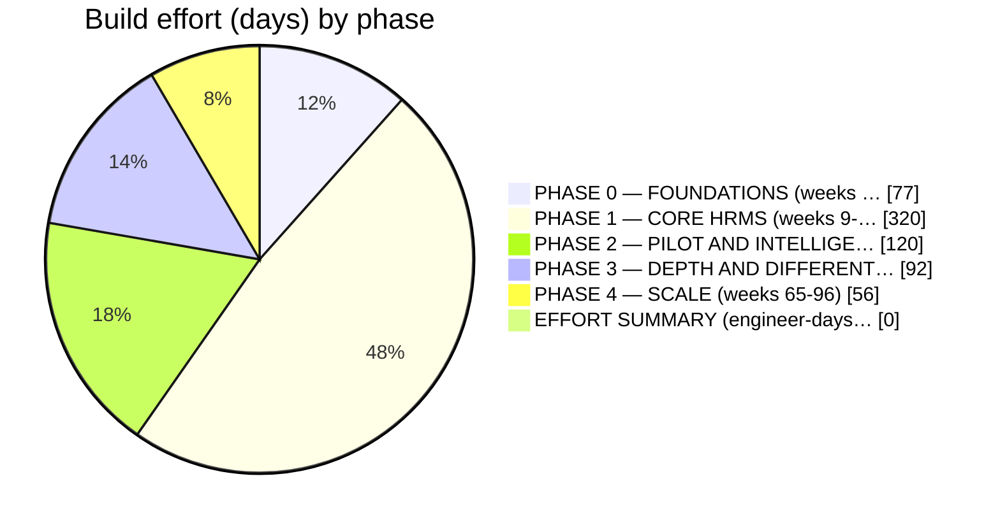

<picture>
  <source media="(prefers-color-scheme: dark)" srcset="../assets/MultipliersKraftLogoDark.png">
  
</picture>

# RB-01 — Phased Build Backlog

| Attribute | Value |
| :--- | :--- |
| Document ID | RB-01 |
| Title | Phased Build Backlog |
| Product | Nucleus Suite (Nucleus HRMS Suite) |
| Version | 1.0.0 |
| Status | Issued for approval |
| Owner (role) | Delivery Lead |
| Author | Dhanraj Dadhich |
| Reviewed by | *pending* |
| Approved by | Steering Committee — *pending* |
| Date | 2026-11-05 |
| Classification | Internal |
| CMMI practice areas | PLAN, EST |
| Related documents | PLN-02, PLN-03, FRS-<DOM>-09 |
| Quality & process-performance objectives | QPPO-05 (effective requirements reviews), QPPO-01 (escaped defects) — MPM-01 |
| Process performance baseline used | PPB-01 (review defect density), PPB-02 (review rate) — MPM-01 |
| Peer review record | *pending* (PR-xxxx, QA-02) |
| Tailoring record | none |
| Traceability anchor | BG-01 – BG-10 |
| Source of record | Nucleus — Process Flows & Process Maps v1.0 — sheet(s) 18_Build_Backlog |

> **Source of record.** Requirements in this document are taken from the source workbook(s) named above and keep their workbook IDs, which are never renumbered. Changes are made through a change request (CM-02) against the source workbook. Sections marked **Authored** are original additions that are not present in the source workbooks.

> BUILD BACKLOG AND SEQUENCE
> Epic and story backlog by phase. Effort assumes the shared component already exists — where it does not, the component is listed as a dependency, not hidden scope.

## PHASE 0 — FOUNDATIONS (weeks 1-8). Exit: a tenant can be provisioned, a user signs in, an employee record is created and changed with full temporal history and audit, and a plant-scoped user cannot see a head-office pay field.

Effort: 77 days across 11 stories.

| ID | Epic | Story | Domain | Phase | Component | Depends on | Effort (days) | Definition of done |
| :--- | :--- | :--- | :--- | :--- | :--- | :--- | :--- | :--- |
| BL-001 | Platform | Repository, module boundaries, dependency-graph test in CI, preview environments | PLT | P0 | — | — | 8 | A cross-module database import fails the build |
| BL-002 | Platform | Tenancy with RLS forced, plus the CI guard that fails any table without tenant_id and a policy | PLT | P0 | CMP-08 | BL-001 | 6 | New table without a policy fails CI |
| BL-003 | Platform | Identity: OIDC, SAML, SCIM, roles | PLT | P0 | CMP-08 | BL-002 | 6 | SSO login and deprovisioning work end to end |
| BL-004 | Platform | Scope resolver with entity, reporting line AND location dimensions | PLT | P0 | CMP-08 | BL-003 | 8 | TC-P05 passes: plant user sees time, pay fields null |
| BL-005 | Platform | Bi-temporal base tables and the as-at reader | PLT | P0 | CMP-10 | BL-002 | 8 | 'What did we believe on 3 June about her grade effective 1 April' answers in SQL |
| BL-006 | Platform | Workflow engine v1 with sequential multi-level chains, SLA and versioning | PLT | P0 | CMP-01 | BL-005 | 12 | Leave chain and loan chain both run on it unchanged |
| BL-007 | Platform | Configuration framework with effective dating and the override-with-reason pattern | PLT | P0 | CMP-10 | BL-005 | 8 | A new leave type needs no developer |
| BL-008 | Platform | Audit projection and action ledger schema | PLT | P0 | CMP-06 | BL-005 | 6 | Every write and sensitive read lands with actor and reason |
| BL-009 | Platform | Transactional outbox and relay worker | PLT | P0 | CMP-07 | BL-002 | 5 | Consumers are idempotent under replay |
| BL-010 | Platform | Design system and component library | PLT | P0 | — | BL-001 | 8 | Employee home renders on a mid-range mobile in under 2.5s on 3G |
| BL-011 | Platform | ADRs started, including the master-data direction decision | PLT | P0 | — | — | 2 | OD-07 recorded before People Core schema work |

## PHASE 1 — CORE HRMS (weeks 9-24). Exit: one design-partner client's real payroll runs in shadow for two cycles and reconciles to zero variance, on attendance the product computed itself.

Effort: 320 days across 45 stories.

| ID | Epic | Story | Domain | Phase | Component | Depends on | Effort (days) | Definition of done |
| :--- | :--- | :--- | :--- | :--- | :--- | :--- | :--- | :--- |
| BL-020 | People Core | person, employment, position, assignment, org_unit with effective dating | PPL | P1 | CMP-10 | BL-005 | 12 | Rehire, transfer and matrix reporting need no special cases |
| BL-021 | People Core | worker_class with rest-day, wage-type and OT-eligibility policy, overridable per assignment | PPL | P1 | CMP-10 | BL-020 | 6 | All nine demo classes configured without code |
| BL-022 | People Core | Designation bands with grace exemption and leave band | PPL | P1 | CMP-10 | BL-020 | 3 | Assistant Manager and above resolve grace_exempt = Y |
| BL-023 | People Core | Document vault with classification and expiry | PPL | P1 | CMP-08 | BL-020 | 5 | Expiry reminders fire; files encrypted |
| BL-030 | Time | Punch ingestion: biometric plus one more source, offline buffer and catch-up | TIM | P1 | CMP-07 | BL-020 | 10 | 500 events/s sustained per tenant at shift change |
| BL-031 | Time | Attendance day derivation: pairing, segments, breaks, gross, net, OT, provenance | TIM | P1 | CMP-04 | BL-030 | 12 | TC-T80 to TC-T89 pass, including the 19h20m cross-midnight day |
| BL-032 | Time | Shift inference with assigned vs applied and override | TIM | P1 | CMP-04 | BL-031 | 4 | TC-T92 passes; inference is visible to the roster owner |
| BL-033 | Time | Day type resolution from calendar plus class rest-day policy | TIM | P1 | CMP-10 | BL-021 | 4 | TC-T101, TC-T102 pass |
| BL-034 | Time | Disposition rule set: thresholds, grace, late counting, exemption, long-night relief | TIM | P1 | CMP-04 | BL-031 | 10 | TC-T112 to TC-T118 pass; thresholds editable as data |
| BL-035 | Time | Gate pass with service-enforced ceiling and credit-back | TIM | P1 | CMP-01 | BL-031 | 5 | TC-T121, TC-T86 pass on app AND business messaging paths |
| BL-036 | Time | Overtime computation, eligibility, approval, run tagging | TIM | P1 | CMP-01 | BL-034 | 6 | TC-T130 to TC-T134 pass |
| BL-037 | Time | Exception queue and regularisation | TIM | P1 | CMP-01 | BL-031 | 6 | Unpaired punches surface, never disappear |
| BL-038 | Time | Attendance recompute worker with as-at reads and delta output | TIM | P1 | CMP-04 | BL-031 | 10 | 5,000 people, one month, under 10 minutes, interactive latency unaffected |
| BL-039 | Time | Team history view with export | TIM | P1 | CMP-08 | BL-034 | 5 | Works on a phone; scoped by reporting line at query time |
| BL-040 | Leave | Leave ledger, accrual policies, proration, eligibility waits | LVE | P1 | CMP-02 | BL-021 | 10 | TC-L171 to TC-L182 pass; accrual is idempotent under re-run |
| BL-041 | Leave | Request validation: combination, caps, conflicts, with rule-naming messages | LVE | P1 | CMP-02 | BL-040 | 5 | TC-L192, TC-L193 pass before the chain starts |
| BL-042 | Leave | Sequential approval chain with HR edit right | LVE | P1 | CMP-01 | BL-006 | 4 | TC-L14, TC-L15 pass |
| BL-043 | Leave | Early return: reversal plus recompute in one transaction | LVE | P1 | CMP-02 | BL-038 | 5 | TC-L201 passes; ledger and attendance never disagree |
| BL-044 | Leave | Comp-off per-credit expiry and lapse job | LVE | P1 | CMP-02 | BL-040 | 4 | TC-L210 to TC-L213 pass |
| BL-045 | Leave | Balance projection service and screen | LVE | P1 | CMP-02 | BL-040 | 4 | No stored balance column exists anywhere |
| BL-050 | Payroll | Run types, lifecycle states, input lock and hashed snapshot | PAY | P1 | CMP-05 | BL-005 | 8 | A run recomputes to the paisa from its snapshot |
| BL-051 | Payroll | Gross-to-net DAG with integer money and trace capture | PAY | P1 | CMP-03 | BL-050 | 14 | Every payslip line drills to its rule and inputs |
| BL-052 | Payroll | Wage-base node with the 50% floor add-back | PAY | P1 | CMP-03 | BL-051 | 6 | TC-Y280 to TC-Y282 pass; node testable in isolation |
| BL-053 | Payroll | Daily-wage earnings node | PAY | P1 | CMP-03 | BL-051 | 4 | TC-Y290 passes; day count visible on the payslip |
| BL-054 | Payroll | Central rule pack plus Karnataka: PF, ESI, PT, LWF, 24Q | PAY | P1 | CMP-09 | BL-051 | 14 | 300 payroll golden cases green |
| BL-055 | Payroll | Pre-payroll audit with the eleven rule checks and severity gating | PAY | P1 | CMP-05 | BL-051 | 8 | A CRITICAL flag blocks approval |
| BL-056 | Payroll | Loan deduction node with the net-pay floor | PAY | P1 | CMP-03 | BL-051, BL-070 | 4 | TC-Y311, TC-Y312 pass |
| BL-057 | Payroll | Off-cycle overtime run with its own bank file and journal | PAY | P1 | CMP-03 | BL-051, BL-036 | 6 | TC-Y330, TC-F333 pass; run selector everywhere |
| BL-058 | Payroll | Payslip, bank file, dual control, rollback | PAY | P1 | CMP-05 | BL-051 | 8 | Rollback blocked past DISBURSEMENT_PREPARED |
| BL-060 | Lifecycle | Joining chain including statutory registrations and Form F generation | LCY | P1 | CMP-01 | BL-006, BL-090 | 8 | TC-C382 passes; Form F is produced inside the chain |
| BL-061 | Lifecycle | Clearance checklist templates with blocking semantics | LCY | P1 | CMP-05 | BL-006 | 6 | TC-X402 passes; F&F held while a blocking item is open |
| BL-062 | Lifecycle | F&F run on the last working day | LCY | P1 | CMP-03 | BL-061, BL-051 | 6 | TC-X340, TC-X341 pass, negative net handled |
| BL-063 | Lifecycle | Asset register and allocation-to-clearance link | LCY | P1 | CMP-01 | BL-020 | 4 | TC-X396 passes |
| BL-070 | Loans | Eligibility service method with ceiling, one-at-a-time and guarantor lock | CMB | P1 | CMP-02 | BL-020 | 5 | One method; four consumers call it; TC-M430 to TC-M434 pass |
| BL-080 | Self-service | Employee mobile: punch, payslip, leave, gate pass, balances, offline | SSV | P1 | CMP-08 | BL-031, BL-051 | 12 | Every listed task completes in three taps or fewer |
| BL-081 | Self-service | Unified manager approval inbox with rule context | SSV | P1 | CMP-01 | BL-006 | 8 | One queue across every module |
| BL-090 | Compliance | Rule pack interface, test harness, deployment pipeline | CMP | P1 | CMP-09 | BL-007 | 10 | No pack deploys without a green suite and a named reviewer |
| BL-091 | Compliance | Statutory form library and generation, seeded with the client's forms | CMP | P1 | CMP-03r | BL-090 | 8 | KA and TN sets differ correctly for the same company |
| BL-092 | Compliance | Obligation calendar | CMP | P1 | CMP-01 | BL-090 | 5 | The HR head's morning screen |
| BL-100 | Finance | GL mapping, validation and the blocking check | FIN | P1 | CMP-10 | BL-051 | 5 | TC-F521 passes: unmapped component blocks APPROVED |
| BL-101 | Finance | Salary journal with employee-level dimensioning and run type | FIN | P1 | CMP-03 | BL-100 | 8 | No unallocated residue in any dimension |
| BL-102 | Finance | ERP employee-master inbound sync with the ownership map | FIN | P1 | CMP-07 | BL-020 | 10 | TC-F510 to TC-F516 pass, conflicts held not overwritten |
| BL-103 | Finance | Reconciliation report screen | FIN | P1 | CMP-08 | BL-101 | 5 | All seven assertions shown passing |
| BL-110 | QA | Golden-case library to 300 payroll and 120 attendance cases | ALL | P1 | — | BL-031, BL-051 | 12 | A single mismatch fails the build |
| BL-111 | QA | Shadow payroll and shadow attendance harness for design partners | ALL | P1 | — | BL-110 | 6 | Two full cycles reconciled to the rupee before go-live |

## PHASE 2 — PILOT AND INTELLIGENCE (weeks 25-40). Exit: three clients live and paying; the assistant deflects a measurable share of HR tickets.

Effort: 120 days across 13 stories.

| ID | Epic | Story | Domain | Phase | Component | Depends on | Effort (days) | Definition of done |
| :--- | :--- | :--- | :--- | :--- | :--- | :--- | :--- | :--- |
| BL-120 | Compliance | Two more state packs (Maharashtra, Tamil Nadu) | CMP | P2 | CMP-09 | BL-090 | 10 | PT differs correctly by state on one run |
| BL-121 | Compliance | Labour Codes wage-base simulator | CMP | P2 | CMP-03 | BL-052 | 8 | Per-employee and aggregate impact of a proposed structure |
| BL-122 | Intelligence | Model gateway, prompt versioning, cost attribution | INT | P2 | CMP-11 | BL-001 | 8 | No vendor SDK call from domain code |
| BL-123 | Intelligence | Policy gate, tool registry, action ledger, reversal | INT | P2 | CMP-11 | BL-122, BL-008 | 10 | No non-tool path from an agent to data |
| BL-124 | Intelligence | Helpdesk and Policy Assistant with grounding | SSV | P2 | CMP-11 | BL-123 | 10 | No answer without a retrieved source |
| BL-125 | Intelligence | Attendance Steward agent | TIM | P2 | CMP-11 | BL-123, BL-037 | 8 | Proposals carry a dry-run diff; reversal rate tracked |
| BL-126 | Experience | Recognition, announcements, letters and the issue register | EXP | P2 | CMP-03r | BL-006 | 10 | Awards raise payroll inputs; letters retain template versions |
| BL-127 | Loans | Loan module in full: application, guarantors, sanction, override, release | CMB | P2 | CMP-01 | BL-070 | 10 | TC-M440 to TC-M452 pass |
| BL-128 | Talent | Referral tracking with staged award payout through payroll | TAL | P2 | CMP-02 | BL-126 | 6 | Balance on confirmation actually pays |
| BL-129 | Analytics | Operational reports shipped configured | INT | P2 | CMP-08 | BL-031 | 8 | Break, OT register, late summary, gate-pass utilisation, team history |
| BL-130 | Finance | Journal posting proven against two accounting systems | FIN | P2 | — | BL-101 | 8 | ERP-native XML voucher and one cloud ERP both accepted |
| BL-131 | Self-service | business messaging channel for apply, approve, check in, payslip | SSV | P2 | CMP-08 | BL-080 | 10 | Same service-side rules as the app; channel parity tested |
| BL-132 | Performance | Performance and goals (moved here or to P3 per OD-09) | TAL | P2 | CMP-01 | BL-006 | 14 | Weighted KRA/KPI with a calibration workbench |

## PHASE 3 — DEPTH AND DIFFERENTIATION (weeks 41-64). Exit: ten clients live, a repeatable four-week implementation, a documented bake-off win.

Effort: 92 days across 7 stories.

| ID | Epic | Story | Domain | Phase | Component | Depends on | Effort (days) | Definition of done |
| :--- | :--- | :--- | :--- | :--- | :--- | :--- | :--- | :--- |
| BL-140 | Talent | Recruiting with position control and replacement-vs-addition | TAL | P3 | CMP-10 | BL-020 | 16 | TC-R461, TC-R462 pass |
| BL-141 | Talent | Skills graph and learning module | TAL | P3 | CMP-07 | BL-020 | 20 | Induction paths and compliance training assigned by event |
| BL-142 | Intelligence | Payroll Preparer and Compliance Watcher agents | INT | P3 | CMP-11 | BL-123 | 12 | Both propose only; filing and payroll changes stay human |
| BL-143 | Compensation | Compensation and benefits in full, revision cycle | CMB | P3 | CMP-01 | BL-121 | 14 | Simulation wired into the revision cycle |
| BL-144 | Contingent | Contract workforce, sub-populations, invoice reconciliation | CTG | P3 | CMP-04 | BL-021 | 14 | Variance visible before payment |
| BL-145 | Platform | MCP surface over the governed tool registry | INT | P3 | CMP-11 | BL-123 | 6 | Build the tool layer once, expose it twice |
| BL-146 | Security | SOC 2 Type I | ALL | P3 | — | BL-008 | 10 | Evidence collection started in month 1, not month 11 |

## PHASE 4 — SCALE (weeks 65-96)

Effort: 56 days across 3 stories.

| ID | Epic | Story | Domain | Phase | Component | Depends on | Effort (days) | Definition of done |
| :--- | :--- | :--- | :--- | :--- | :--- | :--- | :--- | :--- |
| BL-150 | Capability | Capability Index and wellbeing, with the separate store and access control | ALL | P4 | CMP-08 | BL-141 | 16 | No individual wellbeing signal reaches a manager, ever |
| BL-151 | Multi-country | UAE and Singapore packs | CMP | P4 | CMP-09 | BL-090 | 20 | Country abstraction proven by a second country |
| BL-152 | Channel | White-label and partner console | PLT | P4 | CMP-10 | BL-007 | 20 | A partner configures a tenant without engineering |

## EFFORT SUMMARY (engineer-days, excluding QA and implementation overhead)

Effort: 0 days across 7 stories.

| ID | Epic | Story | Domain | Phase | Component | Depends on | Effort (days) | Definition of done |
| :--- | :--- | :--- | :--- | :--- | :--- | :--- | :--- | :--- |
| Phase | Stories | Effort (days) |  |  |  |  |  |  |
| P0 | 11 | 77 |  |  |  |  |  |  |
| P1 | 45 | 320 |  |  |  |  |  |  |
| P2 | 13 | 120 |  |  |  |  |  |  |
| P3 | 7 | 92 |  |  |  |  |  |  |
| P4 | 3 | 56 |  |  |  |  |  |  |
| TOTAL | 79 | 665 |  |  |  |  |  |  |

## Approval & Sign-off

| Role | Name | Date | Decision | Conditions / comments |
| :--- | :--- | :--- | :--- | :--- |
| Author | Dhanraj Dadhich | 2026-11-05 | Submitted | |
| Peer review moderator | *pending* | | | PR-xxxx |
| PQA (process compliance) | *pending* | | | |
| Approval authority (DOC-01 §7) | *pending* | | | |

## Measurement Data Captured

| Measure | Value | Unit | Notes |
| :--- | :--- | :--- | :--- |
| Size | 86 | specified items (table rows) | Counted automatically at generation |
| Authoring effort | *to be recorded* | person-hours | |
| Review effort (preparation + meeting) | *pending review* | person-hours | From PR-xxxx |
| Rework effort | *pending review* | person-hours | |
| Review rate | *pending review* | items / hour | Compare with PPB control limits |
| Requirement volatility (changes since baseline) | 0 | CRs touching this artefact | Not yet baselined (CM-03) |

**Defects found, by detection phase and severity**

| Detection phase | Major | Minor | Editorial | Injected in phase (major) |
| :--- | :--- | :--- | :--- | :--- |
| Author self-check | 0 | 0 | 0 | — |
| Peer review | *pending* | | | |
| Design / build | | | | |
| System / integration test | | | | |
| UAT | | | | |
| Production (escaped) | | | | each escaped major opens a CAR record (CAR-01) |

Within control limits of the review-rate PPB? *To be assessed at peer review.*

## Revision History

| Version | Date | Author | Change summary | CR ref | Approved by |
| :--- | :--- | :--- | :--- | :--- | :--- |
| 1.0.0 | 2026-11-05 | Dhanraj Dadhich | Consolidated release | CR-0001 | *pending* |
