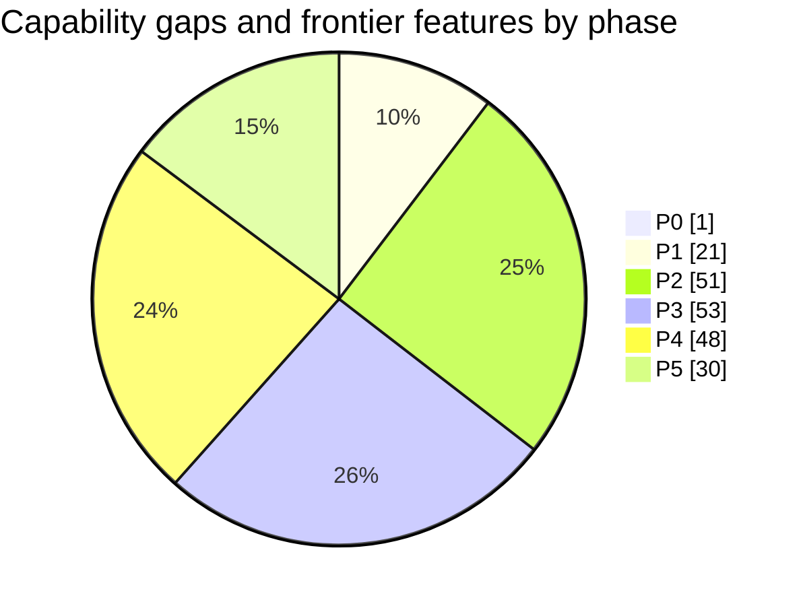

<picture>
  <source media="(prefers-color-scheme: dark)" srcset="../assets/MultipliersKraftLogoDark.png">
  
</picture>

# RB-03 — Capability Gap and Frontier Feature Roadmap

| Attribute | Value |
| :--- | :--- |
| Document ID | RB-03 |
| Title | Capability Gap and Frontier Feature Roadmap |
| Product | Nucleus Suite (Nucleus HRMS Suite) |
| Version | 1.0.0 |
| Status | Issued for approval |
| Owner (role) | Head of Product |
| Author | Dhanraj Dadhich |
| Reviewed by | *pending* |
| Approved by | Steering Committee — *pending* |
| Date | 2026-11-05 |
| Classification | Internal |
| CMMI practice areas | PLAN, RDM, DAR |
| Related documents | GOV-01, GOV-02, FRS-<DOM>-10 |
| Quality & process-performance objectives | QPPO-05 (effective requirements reviews), QPPO-01 (escaped defects) — MPM-01 |
| Process performance baseline used | PPB-01 (review defect density), PPB-02 (review rate) — MPM-01 |
| Peer review record | *pending* (PR-xxxx, QA-02) |
| Tailoring record | none |
| Traceability anchor | BG-01 – BG-10 |
| Source of record | Authored |

> **Source of record.** Requirements in this document are taken from the source workbook(s) named above and keep their workbook IDs, which are never renumbered. Changes are made through a change request (CM-02) against the source workbook. Sections marked **Authored** are original additions that are not present in the source workbooks.

Roadmap of the authored capability gaps (CG) and frontier features (FX) across all domains. Nothing here is committed until approved through CM-02 and, for AI features, GOV-11.

## Phase P0

| ID | Type | Domain | Title | Priority / AI tier |
| :--- | :--- | :--- | :--- | :--- |
| PLT-CG-001 | Capability gap | Platform & Foundations | Adaptive MFA and step-up authentication | Must |

## Phase P1

| ID | Type | Domain | Title | Priority / AI tier |
| :--- | :--- | :--- | :--- | :--- |
| PLT-CG-002 | Capability gap | Platform & Foundations | Notification matrix and preference centre | Must |
| PLT-CG-005 | Capability gap | Platform & Foundations | Proxy, delegation and act-as | Must |
| PLT-CG-006 | Capability gap | Platform & Foundations | Bulk data load with validation and rollback | Must |
| PLT-CG-008 | Capability gap | Platform & Foundations | Legacy HRMS data migration toolkit | Must |
| PLT-CG-009 | Capability gap | Platform & Foundations | Data subject rights workflow | Must |
| PPL-CG-001 | Capability gap | People Core | Job architecture | Must |
| PPL-CG-002 | Capability gap | People Core | Matrix and multiple organisation hierarchies | Must |
| PPL-CG-004 | Capability gap | People Core | Dependants, nominees and emergency contacts | Must |
| PPL-CG-006 | Capability gap | People Core | Interactive org chart | Must |
| TIM-CG-002 | Capability gap | Time & Attendance | Mobile geofenced and selfie attendance | Must |
| TIM-CG-006 | Capability gap | Time & Attendance | Overtime pre-approval and budget control | Must |
| LVE-CG-001 | Capability gap | Leave | Statutory maternity and paternity tracking | Must |
| LVE-CG-005 | Capability gap | Leave | Optional and restricted holidays | Must |
| PAY-CG-002 | Capability gap | Payroll | Retroactive pay processing | Must |
| PAY-CG-003 | Capability gap | Payroll | Tax declaration and proof management | Must |
| PAY-CG-011 | Capability gap | Payroll | Salary hold and release | Must |
| LCY-CG-005 | Capability gap | Lifecycle | Probation review automation | Must |
| LCY-CG-007 | Capability gap | Lifecycle | Notice period management and buy-out | Must |
| SSV-CG-001 | Capability gap | Self-service & Helpdesk | HR service catalogue and knowledge base | Must |
| SSV-CG-003 | Capability gap | Self-service & Helpdesk | Accessibility conformance | Must |
| CMB-CG-001 | Capability gap | Compensation, Loans & Benefits | Salary structures and grade ranges | Must |

## Phase P2

| ID | Type | Domain | Title | Priority / AI tier |
| :--- | :--- | :--- | :--- | :--- |
| PLT-CG-003 | Capability gap | Platform & Foundations | No-code business-process designer | Must |
| PLT-CG-004 | Capability gap | Platform & Foundations | Configuration sandbox and promotion | Should |
| PLT-CG-010 | Capability gap | Platform & Foundations | Identity provisioning (SCIM/LDAP) | Must |
| PLT-CG-011 | Capability gap | Platform & Foundations | As-at time travel for every record | Must |
| PLT-CG-012 | Capability gap | Platform & Foundations | Policy-as-code with automated regression | Must |
| PLT-CG-015 | Capability gap | Platform & Foundations | Document management with AI extraction | Must |
| PLT-CG-017 | Capability gap | Platform & Foundations | Expanded Indian language coverage | Must |
| PPL-CG-005 | Capability gap | People Core | Mass reorganisation | Must |
| PPL-CG-007 | Capability gap | People Core | Concurrent employment and multiple assignments | Must |
| PPL-CG-009 | Capability gap | People Core | Digital employee ID and verifiable employment letter | Should |
| LVE-CG-002 | Capability gap | Leave | Leave of absence (long, unpaid, sabbatical) | Must |
| LVE-CG-004 | Capability gap | Leave | Calendar integration | Should |
| LVE-CG-006 | Capability gap | Leave | Leave policy simulator | Must |
| LVE-CG-007 | Capability gap | Leave | Team coverage rules | Must |
| PAY-CG-004 | Capability gap | Payroll | Reimbursements and flexible benefit plan claims | Must |
| PAY-CG-007 | Capability gap | Payroll | Year-end processing | Must |
| PAY-CG-008 | Capability gap | Payroll | Multi-frequency payroll | Must |
| PAY-CG-010 | Capability gap | Payroll | Payroll audit trail explorer | Must |
| CMP-CG-001 | Capability gap | Compliance | Labour code readiness pack | Must |
| CMP-CG-002 | Capability gap | Compliance | POSH case management | Must |
| CMP-CG-003 | Capability gap | Compliance | Contract labour (CLRA) registers | Must |
| CMP-CG-005 | Capability gap | Compliance | Compliance training tracking | Must |
| CMP-CG-006 | Capability gap | Compliance | Environment, health and safety incident management | Must |
| CMP-CG-007 | Capability gap | Compliance | Grievance and whistle-blower channel | Must |
| CMP-CG-008 | Capability gap | Compliance | Licence and registration renewals | Must |
| CMP-CG-009 | Capability gap | Compliance | Inspection visit register | Must |
| LCY-CG-001 | Capability gap | Lifecycle | Background verification orchestration | Must |
| LCY-CG-002 | Capability gap | Lifecycle | Internal mobility and transfer journeys | Must |
| LCY-CG-004 | Capability gap | Lifecycle | Exit interview and attrition reasons | Must |
| LCY-CG-006 | Capability gap | Lifecycle | Contract-to-permanent conversion | Must |
| SSV-CG-004 | Capability gap | Self-service & Helpdesk | Native mobile application | Must |
| SSV-CG-005 | Capability gap | Self-service & Helpdesk | Omnichannel virtual HR agent | Must |
| SSV-CG-006 | Capability gap | Self-service & Helpdesk | Confidential HR case management | Must |
| SSV-CG-007 | Capability gap | Self-service & Helpdesk | Document self-service on demand | Must |
| CMB-CG-011 | Capability gap | Compensation, Loans & Benefits | Statutory bonus and gratuity administration | Must |
| TAL-CG-001 | Capability gap | Talent | Sourcing and job-board multiposting | Must |
| TAL-CG-002 | Capability gap | Talent | Applicant tracking pipeline | Must |
| TAL-CG-003 | Capability gap | Talent | Interview scheduling and scorecards | Must |
| TAL-CG-004 | Capability gap | Talent | Offer management | Must |
| TAL-CG-015 | Capability gap | Talent | Apprenticeship and trainee programmes | Must |
| CTG-CG-001 | Capability gap | Contingent Workforce | Vendor management for contract labour | Must |
| CTG-CG-002 | Capability gap | Contingent Workforce | Statutory challan verification | Must |
| CTG-CG-003 | Capability gap | Contingent Workforce | Safety induction and PPE issue | Must |
| CTG-CG-004 | Capability gap | Contingent Workforce | Contract worker gate attendance and wage validation | Must |
| EXP-CG-005 | Capability gap | Experience | Celebrations and milestones | Should |
| EXP-CG-006 | Capability gap | Experience | Internal communications and campaigns | Should |
| FIN-CG-001 | Capability gap | Finance & ERP | Labour cost allocation to projects | Must |
| FIN-CG-005 | Capability gap | Finance & ERP | Benefits and statutory liability accounting | Must |
| INT-CG-001 | Capability gap | Intelligence & Agents | Self-service report writer | Must |
| INT-CG-002 | Capability gap | Intelligence & Agents | Executive dashboards and people analytics | Must |
| INT-CG-004 | Capability gap | Intelligence & Agents | Regulatory and statutory reports library | Must |

## Phase P3

| ID | Type | Domain | Title | Priority / AI tier |
| :--- | :--- | :--- | :--- | :--- |
| PLT-CG-007 | Capability gap | Platform & Foundations | Custom objects and fields | Should |
| PLT-CG-014 | Capability gap | Platform & Foundations | Multi-currency and multi-entity consolidation | Must |
| PLT-CG-016 | Capability gap | Platform & Foundations | Visitor and gate management | Should |
| PPL-CG-008 | Capability gap | People Core | Headcount and position planning | Must |
| PPL-CG-010 | Capability gap | People Core | Organisation health metrics | Should |
| TIM-CG-001 | Capability gap | Time & Attendance | Project and task timesheets | Should |
| TIM-CG-003 | Capability gap | Time & Attendance | Shift swap and open-shift marketplace | Should |
| TIM-CG-004 | Capability gap | Time & Attendance | Flexi-time and time banking | Could |
| TIM-CG-007 | Capability gap | Time & Attendance | Canteen and transport integration | Should |
| TIM-CG-008 | Capability gap | Time & Attendance | Hybrid work and desk booking | Should |
| LVE-CG-003 | Capability gap | Leave | Leave donation / shared leave bank | Could |
| PAY-CG-005 | Capability gap | Payroll | Garnishments and court orders | Should |
| PAY-CG-009 | Capability gap | Payroll | Employee net-pay what-if | Should |
| CMP-CG-004 | Capability gap | Compliance | ESG / BRSR workforce disclosures | Should |
| LCY-CG-003 | Capability gap | Lifecycle | Rehire eligibility and alumni | Should |
| LCY-CG-008 | Capability gap | Lifecycle | Knowledge transfer at exit | Should |
| SSV-CG-002 | Capability gap | Self-service & Helpdesk | Employee journeys | Should |
| CMB-CG-002 | Capability gap | Compensation, Loans & Benefits | Merit, bonus and variable pay cycles | Must |
| CMB-CG-004 | Capability gap | Compensation, Loans & Benefits | Health insurance enrolment | Must |
| CMB-CG-005 | Capability gap | Compensation, Loans & Benefits | Retirement plans (NPS, superannuation) | Must |
| CMB-CG-006 | Capability gap | Compensation, Loans & Benefits | Flexible benefits and perks | Should |
| CMB-CG-007 | Capability gap | Compensation, Loans & Benefits | Total rewards statement | Should |
| CMB-CG-008 | Capability gap | Compensation, Loans & Benefits | Pay equity analysis | Must |
| CMB-CG-010 | Capability gap | Compensation, Loans & Benefits | Internal pay benchmarking | Must |
| TAL-CG-005 | Capability gap | Talent | Goals and OKR cascade | Must |
| TAL-CG-006 | Capability gap | Talent | Continuous feedback and check-ins | Must |
| TAL-CG-007 | Capability gap | Talent | Performance reviews and 360 | Must |
| TAL-CG-008 | Capability gap | Talent | Succession planning and talent pools | Must |
| TAL-CG-009 | Capability gap | Talent | Career frameworks and development plans | Should |
| TAL-CG-010 | Capability gap | Talent | Learning catalogue and content ingestion | Must |
| TAL-CG-011 | Capability gap | Talent | Certifications and licence tracking | Must |
| TAL-CG-012 | Capability gap | Talent | Candidate relationship management | Must |
| TAL-CG-013 | Capability gap | Talent | Campus and bulk hiring | Must |
| TAL-CG-014 | Capability gap | Talent | Assessments and skill tests | Should |
| TAL-CG-016 | Capability gap | Talent | Mentoring and coaching | Should |
| TAL-CG-017 | Capability gap | Talent | Learning experience and content authoring | Should |
| CTG-CG-005 | Capability gap | Contingent Workforce | Contractor workforce planning | Should |
| EXP-CG-001 | Capability gap | Experience | Employee listening surveys | Must |
| EXP-CG-002 | Capability gap | Experience | Wellbeing programmes | Should |
| EXP-CG-004 | Capability gap | Experience | Diversity, equity and inclusion analytics | Must |
| FIN-CG-002 | Capability gap | Finance & ERP | Leave and gratuity liability accruals | Should |
| FIN-CG-003 | Capability gap | Finance & ERP | Headcount and workforce budget vs actual | Should |
| FIN-CG-004 | Capability gap | Finance & ERP | Travel and expense management | Must |
| INT-CG-003 | Capability gap | Intelligence & Agents | Data warehouse export | Should |
| INT-CG-005 | Capability gap | Intelligence & Agents | Skills gap analysis | Must |
| INT-CG-007 | Capability gap | Intelligence & Agents | Embedded analytics in every screen | Should |
| PLT-FX-005 | Frontier | Platform & Foundations | Privacy vault and consent ledger | No AI |
| PPL-FX-005 | Frontier | People Core | Conversational profile updates | Tier 2 |
| TIM-FX-004 | Frontier | Time & Attendance | Voice punch with geofence | Tier 1 |
| PAY-FX-004 | Frontier | Payroll | Zero-touch pre-audit | Tier 2 |
| CMP-FX-003 | Frontier | Compliance | Inspection-ready pack in one click | Tier 2 |
| SSV-FX-002 | Frontier | Self-service & Helpdesk | Proactive nudges | Tier 1 |
| SSV-FX-004 | Frontier | Self-service & Helpdesk | Shop-floor kiosk mode | No AI |

## Phase P4

| ID | Type | Domain | Title | Priority / AI tier |
| :--- | :--- | :--- | :--- | :--- |
| PLT-CG-013 | Capability gap | Platform & Foundations | Extension marketplace and low-code apps | Should |
| PPL-CG-003 | Capability gap | People Core | Global assignment and expatriate management | Should |
| TIM-CG-005 | Capability gap | Time & Attendance | Labour-demand scheduling | Should |
| TIM-CG-009 | Capability gap | Time & Attendance | Wearable and IoT presence (opt-in) | Could |
| PAY-CG-001 | Capability gap | Payroll | Multi-country payroll | Should |
| PAY-CG-006 | Capability gap | Payroll | Third-party payroll extracts | Should |
| CMB-CG-003 | Capability gap | Compensation, Loans & Benefits | Equity and ESOP administration | Should |
| CMB-CG-009 | Capability gap | Compensation, Loans & Benefits | Long-term incentives and retention bonuses | Should |
| EXP-CG-003 | Capability gap | Experience | Communities and social feed | Could |
| PLT-FX-001 | Frontier | Platform & Foundations | Zero-trust continuous authorisation | Tier 1 |
| PLT-FX-004 | Frontier | Platform & Foundations | Tamper-evident audit ledger | No AI |
| PLT-FX-006 | Frontier | Platform & Foundations | Offline-first edge for plants | No AI |
| PLT-FX-007 | Frontier | Platform & Foundations | Autonomous configuration health check | Tier 2 |
| PPL-FX-002 | Frontier | People Core | AI data-quality steward | Tier 2 |
| PPL-FX-006 | Frontier | People Core | Self-updating skills and career profile | Tier 2 |
| TIM-FX-002 | Frontier | Time & Attendance | Fatigue and safety risk scoring | Tier 2 |
| TIM-FX-003 | Frontier | Time & Attendance | Punch anomaly detection | Tier 2 |
| TIM-FX-005 | Frontier | Time & Attendance | OT budget burn forecasting | Tier 1 |
| TIM-FX-006 | Frontier | Time & Attendance | Computer-vision-free presence assurance | Tier 1 |
| LVE-FX-001 | Frontier | Leave | Coverage-aware leave planner | Tier 1 |
| LVE-FX-002 | Frontier | Leave | Within-policy auto-approval agent | Tier 2 |
| LVE-FX-003 | Frontier | Leave | Burnout nudges | Tier 1 |
| LVE-FX-004 | Frontier | Leave | Leave liability forecasting | Tier 1 |
| PAY-FX-002 | Frontier | Payroll | Earned wage access | No AI |
| PAY-FX-003 | Frontier | Payroll | Explainable payslip | Tier 1 |
| PAY-FX-005 | Frontier | Payroll | Tax regime advisor | Tier 2 |
| CMP-FX-002 | Frontier | Compliance | Continuous compliance score | Tier 1 |
| LCY-FX-001 | Frontier | Lifecycle | Agentic onboarding concierge | Tier 2 |
| LCY-FX-003 | Frontier | Lifecycle | Exit sentiment analysis | Tier 1 |
| LCY-FX-004 | Frontier | Lifecycle | Personalised onboarding journeys by role and language | Tier 2 |
| SSV-FX-001 | Frontier | Self-service & Helpdesk | Voice-first HR in 11 languages | Tier 2 |
| SSV-FX-003 | Frontier | Self-service & Helpdesk | End-to-end task agents | Tier 2 |
| SSV-FX-005 | Frontier | Self-service & Helpdesk | Emotion-free sentiment-aware routing | Tier 2 |
| CMB-FX-002 | Frontier | Compensation, Loans & Benefits | Real-time total rewards wallet | Tier 1 |
| TAL-FX-001 | Frontier | Talent | Skills cloud and inferred skills | Tier 2 |
| TAL-FX-004 | Frontier | Talent | Adaptive learning paths | Tier 2 |
| TAL-FX-005 | Frontier | Talent | Calibration bias detection | Tier 3 |
| TAL-FX-007 | Frontier | Talent | AI interview scheduling and panel balancing | Tier 2 |
| CTG-FX-001 | Frontier | Contingent Workforce | Contractor compliance score | Tier 2 |
| CTG-FX-002 | Frontier | Contingent Workforce | Invoice-to-attendance auto-reconciliation | Tier 2 |
| EXP-FX-001 | Frontier | Experience | Continuous listening with NLP themes | Tier 1 |
| EXP-FX-002 | Frontier | Experience | Personalised multilingual communications | Tier 2 |
| EXP-FX-003 | Frontier | Experience | Recognition currency | No AI |
| FIN-FX-003 | Frontier | Finance & ERP | AI bank and ERP reconciliation | Tier 2 |
| INT-FX-001 | Frontier | Intelligence & Agents | Natural-language analytics | Tier 1 |
| INT-FX-003 | Frontier | Intelligence & Agents | Agent and MCP ecosystem | Tier 2 |
| INT-FX-004 | Frontier | Intelligence & Agents | Autonomous insight alerts | Tier 1 |
| INT-FX-005 | Frontier | Intelligence & Agents | Model transparency centre | No AI |

## Phase P5

| ID | Type | Domain | Title | Priority / AI tier |
| :--- | :--- | :--- | :--- | :--- |
| INT-CG-006 | Capability gap | Intelligence & Agents | Organisation network analysis (consented) | Could |
| PLT-FX-002 | Frontier | Platform & Foundations | Natural-language configuration | Tier 2 |
| PLT-FX-003 | Frontier | Platform & Foundations | Policy digital twin | Tier 1 |
| PPL-FX-001 | Frontier | People Core | Organisation digital twin | Tier 3 |
| PPL-FX-003 | Frontier | People Core | Verifiable credentials wallet | No AI |
| PPL-FX-004 | Frontier | People Core | Explainable attrition risk | Tier 3 |
| TIM-FX-001 | Frontier | Time & Attendance | AI roster optimiser | Tier 2 |
| LVE-FX-005 | Frontier | Leave | Predictive absence planning | Tier 2 |
| PAY-FX-001 | Frontier | Payroll | Continuous payroll | No AI |
| PAY-FX-006 | Frontier | Payroll | Zero-day payroll close | Tier 2 |
| PAY-FX-007 | Frontier | Payroll | Instant cross-border pay for global assignees | No AI |
| CMP-FX-001 | Frontier | Compliance | Regulatory change radar | Tier 3 |
| CMP-FX-004 | Frontier | Compliance | Compliance copilot for inspectors' questions | Tier 2 |
| LCY-FX-002 | Frontier | Lifecycle | Early-attrition early warning | Tier 3 |
| CMB-FX-001 | Frontier | Compensation, Loans & Benefits | AI compensation advisor with equity guardrails | Tier 3 |
| CMB-FX-003 | Frontier | Compensation, Loans & Benefits | Personalised benefits recommender | Tier 2 |
| CMB-FX-004 | Frontier | Compensation, Loans & Benefits | Pay transparency readiness | Tier 1 |
| CMB-FX-005 | Frontier | Compensation, Loans & Benefits | Fair-pay autopilot | Tier 3 |
| TAL-FX-002 | Frontier | Talent | Internal talent marketplace | Tier 3 |
| TAL-FX-003 | Frontier | Talent | Bias-audited recruiting copilot | Tier 4 |
| TAL-FX-006 | Frontier | Talent | Skills-based job architecture generator | Tier 3 |
| CTG-FX-003 | Frontier | Contingent Workforce | On-demand plant labour pool | Tier 1 |
| CTG-FX-004 | Frontier | Contingent Workforce | Contract labour digital passport | No AI |
| EXP-FX-004 | Frontier | Experience | Personal wellbeing companion (opt-in) | Tier 1 |
| FIN-FX-001 | Frontier | Finance & ERP | Continuous labour-cost ledger | No AI |
| FIN-FX-002 | Frontier | Finance & ERP | Workforce cost scenario planning | Tier 1 |
| FIN-FX-004 | Frontier | Finance & ERP | Real-time workforce P&L | Tier 1 |
| INT-FX-002 | Frontier | Intelligence & Agents | Predictive workforce planning | Tier 2 |
| INT-FX-006 | Frontier | Intelligence & Agents | Workforce scenario studio | Tier 2 |
| INT-FX-007 | Frontier | Intelligence & Agents | Multi-agent orchestration with human approval chains | Tier 3 |

## Approval & Sign-off

| Role | Name | Date | Decision | Conditions / comments |
| :--- | :--- | :--- | :--- | :--- |
| Author | Dhanraj Dadhich | 2026-11-05 | Submitted | |
| Peer review moderator | *pending* | | | PR-xxxx |
| PQA (process compliance) | *pending* | | | |
| Approval authority (DOC-01 §7) | *pending* | | | |

## Measurement Data Captured

| Measure | Value | Unit | Notes |
| :--- | :--- | :--- | :--- |
| Size | 204 | specified items (table rows) | Counted automatically at generation |
| Authoring effort | *to be recorded* | person-hours | |
| Review effort (preparation + meeting) | *pending review* | person-hours | From PR-xxxx |
| Rework effort | *pending review* | person-hours | |
| Review rate | *pending review* | items / hour | Compare with PPB control limits |
| Requirement volatility (changes since baseline) | 0 | CRs touching this artefact | Not yet baselined (CM-03) |

**Defects found, by detection phase and severity**

| Detection phase | Major | Minor | Editorial | Injected in phase (major) |
| :--- | :--- | :--- | :--- | :--- |
| Author self-check | 0 | 0 | 0 | — |
| Peer review | *pending* | | | |
| Design / build | | | | |
| System / integration test | | | | |
| UAT | | | | |
| Production (escaped) | | | | each escaped major opens a CAR record (CAR-01) |

Within control limits of the review-rate PPB? *To be assessed at peer review.*

## Revision History

| Version | Date | Author | Change summary | CR ref | Approved by |
| :--- | :--- | :--- | :--- | :--- | :--- |
| 1.0.0 | 2026-11-05 | Dhanraj Dadhich | Consolidated release | CR-0001 | *pending* |
