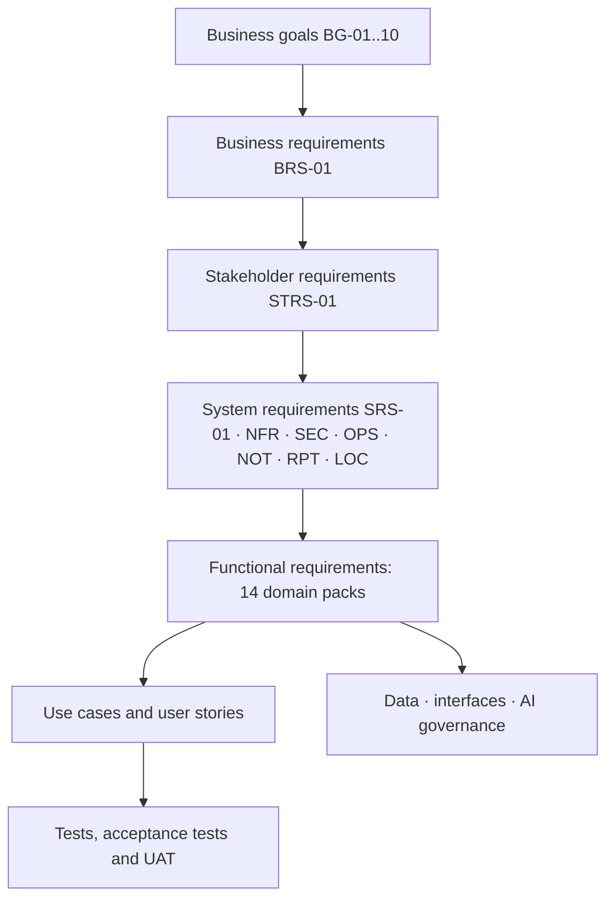

<picture>
  <source media="(prefers-color-scheme: dark)" srcset="assets/MultipliersKraftLogoDark.png">
  
</picture>

<h1 align="center">Nucleus Suite (Nucleus HRMS Suite) Requirements Repository</h1>

An AI-native, enterprise-grade Human Capital Management suite built on our own platform — India-first, global-ready. Requirements, governance and process assets managed to <b>CMMI Maturity Level 5</b>.

| Attribute | Value |
| :--- | :--- |
| Release | **1.0.0** — consolidated release, issued for approval |
| Author | Dhanraj Dadhich |
| Date | 2026-11-05 |
| Current delivery stage | R0 — UI-validation prototype on local JSON. Nothing in this repository authorises live backend, database, external API or payroll disbursement work (DEC-0002). |
| Conventions | [DOC-01 Document Control Standard](00_Programme_Governance/01_Document_Control/DOC-01_Document_Control_Standard.md) |
| Register of all 277 controlled documents | [DOC-02 Master Document Register](00_Programme_Governance/01_Document_Control/DOC-02_Master_Document_Register.md) |
| Source coverage proof | [TR-04 Source Coverage Report](11_Traceability/TR-04_Source_Coverage_Report.md) |

---

## 1. How the requirements fit together

## 2. Structure

| # | Folder | What it answers | Key documents |
| :--- | :--- | :--- | :--- |
| 00 | [Programme Governance](00_Programme_Governance/README.md) | Why, what, who decides, which rules govern data and AI | DOC-01..02, GOV-01..04, GOV-07..11, SRC-01 |
| 01 | [Project Management](01_Project_Management/README.md) | How work is planned, estimated, risk-managed, measured, controlled and adopted | PLN-01..03, RSK-01..03, MPM-01, MC-01, DAR-01..02, SAM-01, OCM-01..02 |
| 02 | [Engineering Process](02_Engineering_Process/README.md) | How requirements are managed, configured, assured and continuously improved | REQ-01, REQ-03, CM-01..03, QA-01/02/04, PCM-01, CAR-01, OT-01 |
| 03 | [Business Requirements](03_Business_Requirements/README.md) | What the business needs and how it operates | BRS-01, CONOPS-01, GOV-05, GOV-06, BA-01..06 |
| 04 | [Stakeholder Requirements](04_Stakeholder_Requirements/README.md) | What each stakeholder and user needs | STRS-01 |
| 05 | [System Requirements](05_System_Requirements/README.md) | What the system as a whole must do and how well | SRS-01, NFR-01, SEC-01, OPS-01, NOT-01, RPT-01, LOC-01 |
| 06 | [Functional Requirements](06_Functional_Requirements/README.md) | What each domain must do, in detail | FRS-00, UCC-01, USC-01, FRS-&lt;DOM&gt;-00..13 |
| 07 | [Data Architecture](07_Data_Architecture/README.md) | Objects, fields, picklists, configuration, migration | DA-01..05, MIG-01 |
| 08 | [Integration and API](08_Integration_and_API/README.md) | APIs, governed tools, events, interfaces | IA-01..03, ICD-01 |
| 09 | [AI and Agents](09_AI_and_Agents/README.md) | Agents, tool governance, frontier AI | AI-01 |
| 10 | [Verification and Validation](10_Verification_and_Validation/README.md) | How we prove it works | QA-03, MTP-01, UAT-01, VV-01..03 |
| 11 | [Traceability](11_Traceability/README.md) | Goal → requirement → test, and source coverage | REQ-02, TR-01..04 |
| 12 | [Release and Backlog](12_Release_and_Backlog/README.md) | What is built when; open decisions; capability-gap and frontier roadmap | RB-01..03 |

## 3. Functional domains

| # | Domain | Code | # | Domain | Code |
| ---: | :--- | :--- | ---: | :--- | :--- |
| 01 | [Platform & Foundations](06_Functional_Requirements/01_PLT_Platform_and_Foundations/README.md) | PLT | 08 | [Self-service & Helpdesk](06_Functional_Requirements/08_SSV_Self_Service_and_Helpdesk/README.md) | SSV |
| 02 | [People Core](06_Functional_Requirements/02_PPL_People_Core/README.md) | PPL | 09 | [Compensation, Loans & Benefits](06_Functional_Requirements/09_CMB_Compensation_Loans_and_Benefits/README.md) | CMB |
| 03 | [Time & Attendance](06_Functional_Requirements/03_TIM_Time_and_Attendance/README.md) | TIM | 10 | [Talent](06_Functional_Requirements/10_TAL_Talent/README.md) | TAL |
| 04 | [Leave](06_Functional_Requirements/04_LVE_Leave/README.md) | LVE | 11 | [Contingent Workforce](06_Functional_Requirements/11_CTG_Contingent_Workforce/README.md) | CTG |
| 05 | [Payroll](06_Functional_Requirements/05_PAY_Payroll/README.md) | PAY | 12 | [Experience](06_Functional_Requirements/12_EXP_Experience/README.md) | EXP |
| 06 | [Compliance](06_Functional_Requirements/06_CMP_Compliance/README.md) | CMP | 13 | [Finance & ERP](06_Functional_Requirements/13_FIN_Finance_and_ERP/README.md) | FIN |
| 07 | [Lifecycle](06_Functional_Requirements/07_LCY_Lifecycle/README.md) | LCY | 14 | [Intelligence & Agents](06_Functional_Requirements/14_INT_Intelligence_and_Agents/README.md) | INT |

Each pack: 00 Overview · 01 Process Specifications · 02 Business Rules · 03 Forms and Fields · 04 Screens, Reports and UX · 05 Data Model · 06 State Machines and Events · 07 APIs, Integrations and Agents · 08 Test Cases and Acceptance · 09 Backlog and Open Decisions · 10 Capability Coverage and Frontier Features · 11 Reference Configuration and Golden Data · 12 Use Case Specifications · 13 User Stories.

## 4. Release 1.0.0 at a glance

| Layer | Content |
| :--- | :--- |
| Business | 90 business requirements (BRQ), concept of operations with 12 operational scenarios |
| Stakeholder | 108 stakeholder requirements (STR) |
| System | 89 system requirements (SYS); 87 security, privacy and access; 76 operational and support; 72 notification with a 102-row notification matrix; 98 reporting and analytics; 90 localisation and statutory; non-functional targets |
| Functional | 93 processes with step flows; 223 use cases; 586 user stories; 652 authored test cases for capability gaps with Given/When/Then criteria; 49 forms with 860 fields; 119 picklists; business rules, screens, state machines and events per domain |
| Capability growth | 129 capability gaps (`<DOM>-CG-nnn`) and 75 frontier features (`<DOM>-FX-nnn`), roadmapped by phase in RB-03 |
| Data and interfaces | Enterprise data dictionary, 18 interface control specifications, 59 migration and cut-over requirements |
| Verification | Master test plan, 39 UAT scenarios, golden-dataset test cases and client acceptance tests |
| Diagrams | Every diagram is Mermaid (456 diagrams, all syntax-validated and render-checked) |

## 5. Sources and rules applied

The functional requirements are built from the source workbooks registered in SRC-01 (process flows and maps, forms and fields, client build sheet, golden demo dataset and client demo points). Every sheet and identifier is carried into this repository (TR-04); source identifiers are never renumbered; delivery statuses recorded in client trackers are not carried, because every requirement here is new. Content that goes beyond the sources — capability gaps, frontier features, authored use cases and user stories, and the business, stakeholder and system specifications — is marked as authored where it appears.

## 6. CMMI coverage

| Level | Practice areas | Primary evidence |
| :--- | :--- | :--- |
| ML2 | PLAN, EST, MC, RDM, RSK, CM, PQA, PR, SAM, GOV, II | PLN-01..03, MC-01, REQ-01..03, RSK-01..03, CM-01..03, QA-01/02/04, SAM-01, GOV-03/04 |
| ML3 | VV, PI, TS, DAR, PCM, PAD, OT | MTP-01, UAT-01, QA-03, VV-01..03, FRS packs, IA-01..03, ICD-01, DAR-01..02, PCM-01, OT-01 |
| ML4 | MPM — statistical management | MPM-01 (QPPO-01..07, PPB-01..07, PPM-01..03), MC-01 |
| ML5 | CAR, continuous performance improvement | CAR-01, PCM-01 improvement pipeline, DAR-01 |

Every controlled document carries the full header (including quality and process-performance objectives, baseline, peer review, tailoring and traceability anchor), an Approval & Sign-off block and a Measurement Data Captured block. Appraisal additionally requires records that the process was followed (approvals, peer review records, CCB minutes, measurement data, causal analyses); producing them is tracked in RSK-03.

## 7. Reading order

1. **Everyone:** GOV-01 → BRS-01 → CONOPS-01 → DOC-01.
2. **Product and business analysts:** STRS-01 → SRS-01 → FRS-00 → a domain pack → UCC-01 → USC-01 → TR-02.
3. **Leadership:** GOV-02 → GOV-03 → GOV-04 → RB-03 → RSK-02 → MPM-01.
4. **Architects and AI:** SRS-01 → BA-01 → BA-06 → DA-01 → IA-01 → ICD-01 → SEC-01 → AI-01 → GOV-11 → NFR-01 → OPS-01.
5. **QA and PMO:** MTP-01 → UAT-01 → QA-03 → VV-03 → MC-01 → CM-02 → CAR-01.

## Revision History

| Version | Date | Author | Change summary | CR ref | Approved by |
| :--- | :--- | :--- | :--- | :--- | :--- |
| 1.0.0 | 2026-11-05 | Dhanraj Dadhich | Consolidated release | CR-0001 | *pending* |
