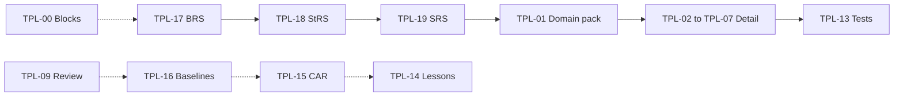

<picture>
  <source media="(prefers-color-scheme: dark)" srcset="../requirements/assets/MultipliersKraftLogoDark.png">
  
</picture>

# TPL-README — Template Library Index and Usage Guide

| Attribute | Value |
| :--- | :--- |
| Document ID | TPL-README |
| Title | Template Library Index and Usage Guide |
| Product | Nucleus Suite (Nucleus HRMS Suite) |
| Version | 1.0.0 |
| Status | Issued for approval |
| Owner (role) | Engineering Process Group (EPG) Lead |
| Author | Dhanraj Dadhich |
| Reviewed by | *pending* |
| Approved by | EPG Lead — *pending* |
| Date | 2026-11-05 |
| Classification | Internal |
| CMMI practice areas | PAD, CM, RDM, MPM, CAR, PCM |
| Related documents | DOC-01, DOC-02, PCM-01, REQ-01, MPM-01, CM-02 |
| Quality & process-performance objectives | QPPO-05 (effective requirements reviews), QPPO-01 (minimise defects reaching users) |
| Process performance baseline used | PPB-01 (review defect density), PPB-02 (review rate) |
| Peer review record | *pending* (PR-xxxx, QA-02) |
| Tailoring record | none |
| Traceability anchor | BG-09 |

---

## 1. Purpose

This folder holds the organisational process assets (CMMI PAD) from which every controlled document of Nucleus Suite is produced. The templates apply DOC-01 — product identity, the 14 domain codes, phases R0 and P0–P5, identifier schemes and the mandatory document blocks — and capture the measurement data needed for the process performance baselines and models of MPM-01 and for causal analysis under CAR-01.

## 2. How to Use a Template

| # | Step |
| ---: | :--- |
| 1 | Copy the template into the target folder of `requirements/` (folders 00–12, DOC-01 §3) and name the copy `<DOC-ID>_<Title_With_Underscores>.md`; domain pack documents follow TPL-01 §3 |
| 2 | Fill the logo block and header table (TPL-00), adjusting the logo path to the folder depth; status Draft until the author submits, then Issued for approval; version 1.0.0 for the first consolidated release (DOC-01 §9) |
| 3 | Replace every bracketed field with real content. A controlled document contains no brackets or placeholders; a value that is not yet known is stated as the accountable role and the gate at which it is fixed, and logged in RSK-03 (DOC-01 §10) |
| 4 | Delete guidance lines (italic lines beginning "Guidance:") |
| 5 | Keep every section; a section that does not apply states "Not applicable" with the reason and carries a PCM-01 tailoring entry |
| 6 | Give every requirement its ID, statement, rationale, trace, MoSCoW priority, phase, verification method and acceptance criterion; every requirement enters as *Proposed* (REQ-01) |
| 7 | Draw every diagram in Mermaid; name no third-party product and make no product comparison |
| 8 | Run the REQ-03 checklist, request a peer review (QA-02) and record it with TPL-09 |
| 9 | Complete the Approval & Sign-off and Measurement Data Captured blocks; the PMO Analyst loads the measurements into the MPM-01 repository |
| 10 | Register the document in DOC-02, or in the domain pack overview for pack documents |

## 3. Template Catalogue

| ID | Template | Use it to | Primary owner | CMMI practice areas |
| :--- | :--- | :--- | :--- | :--- |
| TPL-00 | Document Header, Sign-off and Measurement Blocks | Start any controlled document | Any author | PAD, CM, MPM, PR |
| TPL-01 | Domain Requirements Pack Structure | Set up or audit one of the 14 domain packs (FRS-<DOM>-00 to -13) | Domain Product Owner | PAD, RDM, TS, VV, MPM |
| TPL-02 | Functional Requirements Specification | Write authored functional requirements and capability gaps | BA Lead | PAD, RDM, VV, MPM |
| TPL-03 | Use Case and User Story | Write use cases (FRS-<DOM>-12) and user stories (FRS-<DOM>-13) | BA Lead, Product Owner | PAD, RDM, VV |
| TPL-04 | Data Model and Interface Schema | Define objects, JSON Schema, API and event contracts | Chief Architect | PAD, TS, RDM |
| TPL-05 | UI/UX Screen Specification | Specify a screen, form, console widget or report | UX Lead | PAD, TS, RDM |
| TPL-06 | Non-Functional Requirements | Set measurable quality targets | Chief Architect | PAD, RDM, TS, VV |
| TPL-07 | AI Feature Specification and Model Card | Specify any AI or agent capability | Head of AI | PAD, RDM, VV, GOV |
| TPL-08 | Change Request Form | Change a baselined item | Configuration Manager | PAD, CM, RDM |
| TPL-09 | Peer Review Record | Record a review, its effort and its defects | PQA Lead | PAD, PR, PQA, MPM |
| TPL-10 | Decision Record | Record a decision with criteria and alternatives | EPG Lead | PAD, DAR |
| TPL-11 | Meeting Minutes | Minute a governance body meeting | Programme Manager | PAD, GOV, MC |
| TPL-12 | Status Report | Report status with predictions against objectives | Programme Manager | PAD, MC, MPM |
| TPL-13 | Test Case Specification | Specify a verification or validation test | QA / Test Lead | PAD, VV, PI, MPM |
| TPL-14 | Lessons Learned and Post-Implementation Review | Close a phase or gate G5 | Programme Manager | PAD, PCM, CAR, MPM |
| TPL-15 | Causal Analysis and Resolution Record | Analyse escaped defects or out-of-limit measures | EPG Lead | PAD, CAR, MPM, PCM |
| TPL-16 | Process Performance Baseline and Model | Declare a baseline or document a prediction model | PMO Analyst | PAD, MPM, PCM, CAR, EST, PLAN |
| TPL-17 | Business Requirements Specification | Write the BRS (`BRQ-nnn`) in the ISO/IEC/IEEE 29148 style | BA Lead | PAD, RDM |
| TPL-18 | Stakeholder Requirements Specification | Write the StRS (`STR-nnn`) in the ISO/IEC/IEEE 29148 style | BA Lead | PAD, RDM |
| TPL-19 | System Requirements Specification | Write the SRS (`SYS-nnn`) in the ISO/IEC/IEEE 29148 style | Chief Architect | PAD, RDM, TS |

## 4. How the Templates Evidence Each Maturity Level

| Level | What the evidence shows | Where the templates produce it |
| :--- | :--- | :--- |
| 2 — Managed | Plans, requirements, configuration control, status tracking | TPL-00 header and revision history, TPL-08, TPL-11, TPL-12 |
| 3 — Defined | Standard process, peer reviews, verification and validation, decisions, tailoring | TPL-01 standard pack, TPL-02 to TPL-07, TPL-09, TPL-10, TPL-13, TPL-17 to TPL-19, tailoring record in TPL-00 |
| 4 — Quantitatively managed | Quality and process-performance objectives, baselines, prediction models | QPPO and PPB header fields, Measurement Data Captured block, quantitative acceptance criteria, TPL-12 predictions, TPL-16 |
| 5 — Optimizing | Causal analysis, evaluated improvements, lessons into process assets | Defect injection and detection fields, CAR links, TPL-15, TPL-14 improvement proposals |

## 5. Which Template for Which Domain Pack Document

Domain packs live in `requirements/06_Functional_Requirements/<NN>_<DOM>_<Domain_Name>/` for the 14 domains PLT, PPL, TIM, LVE, PAY, CMP, LCY, SSV, CMB, TAL, CTG, EXP, FIN and INT. The pack shape is fixed by TPL-01.

| Pack document | Template for detail |
| :--- | :--- |
| `README.md` — FRS-<DOM>-00 Domain overview | TPL-00, TPL-01 §7 |
| FRS-<DOM>-01 Process Specifications | TPL-01 §7; TPL-07 for AGENT steps |
| FRS-<DOM>-02 Business Rules | TPL-01 §7; TPL-02 for authored requirements |
| FRS-<DOM>-03 Forms and Fields | TPL-01 §7; TPL-05 §4 |
| FRS-<DOM>-04 Screens, Reports and UX | TPL-05, including the report variant |
| FRS-<DOM>-05 Data Model | TPL-04 |
| FRS-<DOM>-06 State Machines and Events | TPL-04 §5 and §8 |
| FRS-<DOM>-07 APIs, Integrations and Agents | TPL-04 §7–8; TPL-06; TPL-07 for every agent |
| FRS-<DOM>-08 Test Cases and Acceptance | TPL-13 |
| FRS-<DOM>-09 Backlog and Open Decisions | TPL-03 Part B; TPL-10 to close an open decision |
| FRS-<DOM>-10 Capability Coverage and Frontier Features | TPL-01 §7; TPL-02 for capability gaps; TPL-07 for AI frontier features |
| FRS-<DOM>-11 Reference Configuration and Golden Data | TPL-01 §7; TPL-04 §9 |
| FRS-<DOM>-12 Use Case Specifications | TPL-03 Part A |
| FRS-<DOM>-13 User Stories | TPL-03 Part B |

## 6. Changing a Template

Templates are baselined process assets. A change is raised with TPL-08 and decided under CM-02 on the EPG Lead's recommendation. Template changes normally come from improvement proposals (TPL-14) and causal analysis actions (TPL-15); their effect is evaluated against the relevant baseline (TPL-16) before the change is made permanent.

## Approval & Sign-off

| Role | Name | Date | Decision | Conditions / comments |
| :--- | :--- | :--- | :--- | :--- |
| Author | Dhanraj Dadhich | 2026-11-05 | Submitted | |
| Peer review moderator | *pending* | | | PR-xxxx |
| PQA (process compliance) | *pending* | | | |
| EPG Lead | *pending* | | | |

## Measurement Data Captured

| Measure | Value | Unit | Notes |
| :--- | :--- | :--- | :--- |
| Size | 20 | templates indexed | TPL-00 to TPL-19 |
| Authoring effort | *to be recorded* | person-hours | |
| Review effort (preparation + meeting) | *pending review* | person-hours | From PR-xxxx |
| Review rate | *pending review* | templates / hour | Compare with PPB-02 control limits |
| Requirement volatility | 0 | CRs since baseline | |

## Revision History

| Version | Date | Author | Change summary | CR ref | Approved by |
| :--- | :--- | :--- | :--- | :--- | :--- |
| 1.0.0 | 2026-11-05 | Dhanraj Dadhich | Consolidated release | CR-0001 | *pending* |
