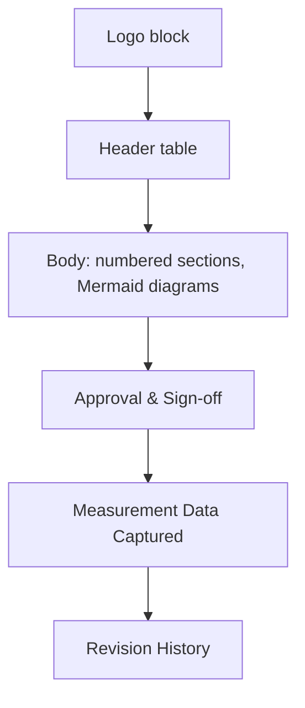

<p align="right">
<picture>
  <source media="(prefers-color-scheme: dark)" srcset="../requirements/assets/MultipliersKraftLogoDark.png">
  
</picture>
</p>

# TPL-00 — Document Header, Sign-off and Measurement Blocks

| Attribute | Value |
| :--- | :--- |
| Document ID | TPL-00 |
| Title | Document Header, Sign-off and Measurement Blocks |
| Product | Nucleus Suite (Nucleus HRMS Suite) |
| Version | 1.0.0 |
| Status | Issued for approval |
| Owner (role) | Engineering Process Group (EPG) Lead |
| Author | Dhanraj Dadhich |
| Reviewed by | *pending* |
| Approved by | EPG Lead — *pending* |
| Date | 2026-11-05 |
| Classification | Internal |
| CMMI practice areas | PAD, CM, MPM, PR |
| Related documents | DOC-01, DOC-02, MPM-01, QA-02, PCM-01, TPL-16 |
| Quality & process-performance objectives | QPPO-05 (effective requirements reviews), QPPO-01 (minimise defects reaching users) |
| Process performance baseline used | PPB-01 (review defect density), PPB-02 (review rate) |
| Peer review record | *pending* (PR-xxxx, QA-02) |
| Tailoring record | none |
| Traceability anchor | BG-09 |

---

## 1. Purpose and Use

Every controlled document of Nucleus Suite opens with the logo and the header table, and closes with the Approval & Sign-off, Measurement Data Captured and Revision History blocks, in that order (DOC-01 §4). This template gives the exact text of each block and the rules for filling it.

*Guidance: copy the blocks below into the new document. Bracketed fields are replaced with real values before the document is submitted; a controlled document contains no brackets and no placeholders (DOC-01 §10.8). The only pending markers allowed are `*pending*`, `*pending review*`, `*to be recorded*` and `PR-xxxx` in the sign-off and measurement blocks until the review takes place. Delete every guidance line before submission.*



## 2. Block 1 — Logo

The logo path depends on the folder depth below `requirements/`: one `../` per level. A file in `requirements/05_System_Requirements/` uses `../assets/`; a file in a domain pack uses `../../assets/`.

```markdown
<p align="right">
<picture>
  <source media="(prefers-color-scheme: dark)" srcset="[../ per level]assets/MultipliersKraftLogoDark.png">
  
</picture>
</p>
```

## 3. Block 2 — Header Table

```markdown
# [DOC-ID] — [Title]

| Attribute | Value |
| :--- | :--- |
| Document ID | [Prefix per DOC-01 §5, or FRS-<DOM>-nn for a domain pack document] |
| Title | [Title in title case] |
| Product | Nucleus Suite (Nucleus HRMS Suite) |
| Version | [1.0.0 for the first consolidated release; later versions per DOC-01 §9] |
| Status | [Draft / Issued for approval / Approved / Change in progress / Superseded] |
| Owner (role) | [Accountable role, e.g. Domain Product Owner — Leave] |
| Author | [Name of the author of record] |
| Reviewed by | *pending* until the peer review closes, then reviewer names and roles |
| Approved by | [Approval authority per DOC-01 §8] — *pending* |
| Date | [YYYY-MM-DD] |
| Classification | [Public / Internal / Confidential / Restricted] |
| CMMI practice areas | [Abbreviations from DOC-01 §11, e.g. RDM, VV] |
| Related documents | [Document IDs, e.g. BRS-01, SRS-01, FRS-LVE-02] |
| Quality & process-performance objectives | [QPPO IDs from MPM-01 with short names] |
| Process performance baseline used | [PPB IDs from MPM-01 with short names] |
| Peer review record | *pending* (PR-xxxx, QA-02) until the review is held, then PR-nnnn |
| Tailoring record | [PCM-01 tailoring entry, or none] |
| Traceability anchor | [BG-nn · R-nn · process IDs] |
| Source of record | [Only for documents built from the source workbooks: workbook name and sheet names] |
```

## 4. Block 3 — Approval & Sign-off

```markdown
## Approval & Sign-off

| Role | Name | Date | Decision | Conditions / comments |
| :--- | :--- | :--- | :--- | :--- |
| Author | [Author name] | [YYYY-MM-DD] | Submitted | |
| Peer review moderator | *pending* | | | PR-xxxx |
| PQA (process compliance) | *pending* | | | |
| [Approval authority per DOC-01 §8] | *pending* | | | |
```

Decisions recorded by reviewers and the approval authority: *Approved*, *Approved with conditions* (conditions listed), *Rejected* (reason and the PR or NC record).

## 5. Block 4 — Measurement Data Captured

```markdown
## Measurement Data Captured

| Measure | Value | Unit | Notes |
| :--- | :--- | :--- | :--- |
| Size | [count] | [sections / requirements / rules / fields / test cases] | Size unit per MPM-01 for this work-product type |
| Authoring effort | *to be recorded* | person-hours | |
| Review effort (preparation + meeting) | *pending review* | person-hours | From PR-xxxx |
| Review rate | *pending review* | [size units] / hour | Compare with PPB-02 control limits |
| Requirement volatility | 0 | CRs since baseline | From CM-03 |
```

After the review and at each later phase, the owner adds the defect table below. Every escaped Critical or Major defect opens a causal analysis record (CAR-01, TPL-15).

```markdown
| Detection phase | Critical | Major | Minor | Injected in phase (Critical + Major) |
| :--- | :--- | :--- | :--- | :--- |
| Author self-check | [n] | [n] | [n] | [phase] |
| Peer review | [n] | [n] | [n] | [phase] |
| Design and build | [n] | [n] | [n] | [phase] |
| System and integration test | [n] | [n] | [n] | [phase] |
| UAT | [n] | [n] | [n] | [phase] |
| Production (escaped) | [n] | [n] | [n] | [phase] — CAR-nnnn |
```

## 6. Block 5 — Revision History

```markdown
## Revision History

| Version | Date | Author | Change summary | CR ref | Approved by |
| :--- | :--- | :--- | :--- | :--- | :--- |
| 1.0.0 | [YYYY-MM-DD] | [Author name] | [Change summary] | [CR-nnnn] | *pending* |
```

## 7. Field Rules

| Field | Rule |
| :--- | :--- |
| Version | Semantic `MAJOR.MINOR.PATCH`; 1.0.0 is the first consolidated release; after baseline PATCH = editorial, MINOR = clarification without scope change, MAJOR = scope, architecture or compliance change, each citing its CR (DOC-01 §9) |
| Status | Follows the lifecycle in DOC-01 §8; a document returns to Draft only when its review finds Critical or Major defects |
| Approved by | The authority for the document class in DOC-01 §8; never left blank |
| Quality & process-performance objectives | At least one QPPO; "none" is not accepted for a requirements document |
| Process performance baseline used | The PPB whose control limits the review is judged against (normally PPB-01 and PPB-02) |
| Tailoring record | Any departure from DOC-01 or from a template carries a PCM-01 tailoring entry |
| Traceability anchor | At least one upward identifier: business goal, client requirement or process |
| Measurement data | Updated at review and at baseline; the PMO Analyst loads it into the MPM-01 measurement repository |
| Classification | Documents with personal-data examples use synthetic data from the golden dataset and are at least Internal |

## 8. Worked Example — Header of a Domain Pack Document

| Attribute | Value |
| :--- | :--- |
| Document ID | FRS-LVE-02 |
| Title | Leave — Business Rules |
| Product | Nucleus Suite (Nucleus HRMS Suite) |
| Version | 1.0.0 |
| Status | Issued for approval |
| Owner (role) | Domain Product Owner — Leave |
| Author | Dhanraj Dadhich |
| Reviewed by | *pending* |
| Approved by | Product Council — *pending* |
| Date | 2026-11-05 |
| Classification | Internal |
| CMMI practice areas | RDM, VV |
| Related documents | FRS-LVE-00, FRS-LVE-01, FRS-LVE-08, BRS-01, SRS-01 |
| Quality & process-performance objectives | QPPO-05 (effective requirements reviews), QPPO-01 (minimise defects reaching users) |
| Process performance baseline used | PPB-01 (review defect density), PPB-02 (review rate) |
| Peer review record | *pending* (PR-xxxx, QA-02) |
| Tailoring record | none |
| Traceability anchor | BG-01, BG-03 · R-06, R-07, R-08 · LVE-01 to LVE-08 |
| Source of record | Nucleus — Process Flows & Process Maps v1.0 — sheet 09_Business_Rules |

## Approval & Sign-off

| Role | Name | Date | Decision | Conditions / comments |
| :--- | :--- | :--- | :--- | :--- |
| Author | Dhanraj Dadhich | 2026-11-05 | Submitted | |
| Peer review moderator | *pending* | | | PR-xxxx |
| PQA (process compliance) | *pending* | | | |
| EPG Lead | *pending* | | | |

## Measurement Data Captured

| Measure | Value | Unit | Notes |
| :--- | :--- | :--- | :--- |
| Size | 8 | sections | |
| Authoring effort | *to be recorded* | person-hours | |
| Review effort (preparation + meeting) | *pending review* | person-hours | From PR-xxxx |
| Review rate | *pending review* | sections / hour | Compare with PPB-02 control limits |
| Requirement volatility | 0 | CRs since baseline | |

## Revision History

| Version | Date | Author | Change summary | CR ref | Approved by |
| :--- | :--- | :--- | :--- | :--- | :--- |
| 1.0.0 | 2026-11-05 | Dhanraj Dadhich | Consolidated release | CR-0001 | *pending* |
