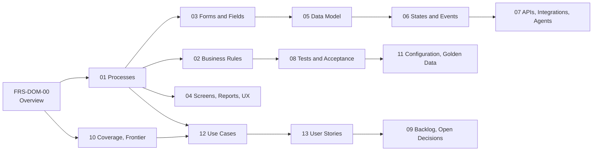
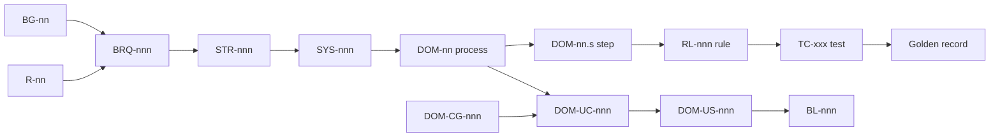

<picture>
  <source media="(prefers-color-scheme: dark)" srcset="../requirements/assets/MultipliersKraftLogoDark.png">
  
</picture>

# TPL-01 — Domain Requirements Pack Structure

| Attribute | Value |
| :--- | :--- |
| Document ID | TPL-01 |
| Title | Domain Requirements Pack Structure |
| Product | Nucleus Suite (Nucleus HRMS Suite) |
| Version | 1.0.0 |
| Status | Issued for approval |
| Owner (role) | Engineering Process Group (EPG) Lead |
| Author | Dhanraj Dadhich |
| Reviewed by | *pending* |
| Approved by | EPG Lead — *pending* |
| Date | 2026-11-05 |
| Classification | Internal |
| CMMI practice areas | PAD, RDM, TS, VV, MPM |
| Related documents | DOC-01, REQ-01, REQ-02, REQ-03, QA-03, MPM-01, FRS-00, UCC-01, USC-01, TPL-00, TPL-02 to TPL-07, TPL-13 |
| Quality & process-performance objectives | QPPO-05 (effective requirements reviews), QPPO-01 (minimise defects reaching users) |
| Process performance baseline used | PPB-01 (review defect density), PPB-02 (review rate) |
| Peer review record | *pending* (PR-xxxx, QA-02) |
| Tailoring record | none |
| Traceability anchor | BG-01 to BG-10 · R-01 to R-27 |

---

## 1. Purpose

This template fixes the file set and the minimum content of every domain requirements pack. All 14 domains are specified in the same shape, so that reviewers, testers and auditors find the same artefact in the same place for every domain, the traceability matrix (REQ-02) is complete for every domain, and size and defect data can be compared across domains for the baselines of MPM-01.

## 2. Domains

| # | Code | Domain | # | Code | Domain |
| ---: | :--- | :--- | ---: | :--- | :--- |
| 01 | PLT | Platform & Foundations | 08 | SSV | Self-service & Helpdesk |
| 02 | PPL | People Core | 09 | CMB | Compensation, Loans & Benefits |
| 03 | TIM | Time & Attendance | 10 | TAL | Talent |
| 04 | LVE | Leave | 11 | CTG | Contingent Workforce |
| 05 | PAY | Payroll | 12 | EXP | Experience |
| 06 | CMP | Compliance | 13 | FIN | Finance & ERP |
| 07 | LCY | Lifecycle | 14 | INT | Intelligence & Agents |

Value chain (level 0): HIRE · ONBOARD · WORK · PAY · COMPLY · GROW · EXIT · GOVERN.

## 3. Pack Location and File Set

Location: `requirements/06_Functional_Requirements/<NN>_<DOM>_<Domain_Name>/`, for example `04_LVE_Leave/`. The folder sits beside the functional index FRS-00 (`README.md`), the use case catalogue UCC-01 and the user story catalogue USC-01.

File names follow `FRS-<DOM>-nn_<Title_With_Underscores>.md`. The `FRS-` prefix is mandatory because `<DOM>-nn` is the process identifier scheme of the source workbooks: `TIM-01` is a process, `FRS-TIM-01` is the document that specifies the processes of the TIM domain.

Every pack holds exactly 14 documents:

| Doc ID | File | Content |
| :--- | :--- | :--- |
| FRS-<DOM>-00 | `README.md` | Domain overview |
| FRS-<DOM>-01 | `FRS-<DOM>-01_Process_Specifications.md` | Process Specifications |
| FRS-<DOM>-02 | `FRS-<DOM>-02_Business_Rules.md` | Business Rules |
| FRS-<DOM>-03 | `FRS-<DOM>-03_Forms_and_Fields.md` | Forms and Fields |
| FRS-<DOM>-04 | `FRS-<DOM>-04_Screens_Reports_and_UX.md` | Screens, Reports and UX |
| FRS-<DOM>-05 | `FRS-<DOM>-05_Data_Model.md` | Data Model |
| FRS-<DOM>-06 | `FRS-<DOM>-06_State_Machines_and_Events.md` | State Machines and Events |
| FRS-<DOM>-07 | `FRS-<DOM>-07_APIs_Integrations_and_Agents.md` | APIs, Integrations and Agents |
| FRS-<DOM>-08 | `FRS-<DOM>-08_Test_Cases_and_Acceptance.md` | Test Cases and Acceptance |
| FRS-<DOM>-09 | `FRS-<DOM>-09_Backlog_and_Open_Decisions.md` | Backlog and Open Decisions |
| FRS-<DOM>-10 | `FRS-<DOM>-10_Capability_Coverage_and_Frontier_Features.md` | Capability Coverage and Frontier Features |
| FRS-<DOM>-11 | `FRS-<DOM>-11_Reference_Configuration_and_Golden_Data.md` | Reference Configuration and Golden Data |
| FRS-<DOM>-12 | `FRS-<DOM>-12_Use_Case_Specifications.md` | Use Case Specifications |
| FRS-<DOM>-13 | `FRS-<DOM>-13_User_Stories.md` | User Stories |

Every document carries the logo, the full header, the Approval & Sign-off block, the Measurement Data Captured block and the Revision History (TPL-00). Documents built from the source workbooks also state their source of record and mark authored sections as **Authored**. A document with no content for a domain keeps its headings, states "Not applicable" with the reason, and records a tailoring entry (PCM-01).

## 4. Identifier Rules

**Source identifiers — kept exactly as issued in the source workbooks and never renumbered (DOC-01 §7):**

| Scheme | Meaning | Lives in |
| :--- | :--- | :--- |
| `<DOM>-nn` (`CMP-nnp` for compliance) · `<DOM>-nn.s` | Process · process step | FRS-<DOM>-01 |
| `RL-nnn` · `BS:RL-nn` | Business rule · client calculation rule | FRS-<DOM>-02 |
| `FRM-<MOD>-nn` · `F-<MOD>-nn` · `PL_*` · `EN_*` | Form · client form delta · picklist · enumeration | FRS-<DOM>-03, -05 |
| `SCR-nnn` · `RP-nn` · `CMP-nn` | Screen · report · shared reusable component | FRS-<DOM>-04 |
| `W-nn` · `SM-n` · `S-nn` | Workflow · swimlane map · seam | FRS-<DOM>-01, -00 |
| `TC-xxx` · `T-nn` | Test case · client acceptance test | FRS-<DOM>-08 |
| `BL-nnn` · `OD-nn` · `Q-nn` | Backlog story · open decision · open question | FRS-<DOM>-09 |
| `R-nn` | Client requirement (client demo points) | FRS-<DOM>-00, -10 |
| `INV-xxx-nn` | System invariant | FRS-<DOM>-02, -06 |

**Authored identifiers:**

| Scheme | Meaning | Lives in |
| :--- | :--- | :--- |
| `BRQ-nnn` · `STR-nnn` · `SYS-nnn` | Business, stakeholder and system requirements realised by the domain (BRS-01, STRS-01, SRS-01) | Traced from FRS-<DOM>-00 and -12 |
| `<DOM>-UC-nnn` | Use case | FRS-<DOM>-12 |
| `<DOM>-US-nnn` | User story | FRS-<DOM>-13 |
| `<DOM>-CG-nnn` | Capability gap — new capability not specified in the sources | FRS-<DOM>-10 |
| `<DOM>-FX-nnn` | Frontier feature | FRS-<DOM>-10 |
| `<DOM>-<TYPE>-nnn`, TYPE ∈ FR, NFR, BR, SEC, OPS, NOT, RPT, LOC, MIG, INT, AI | Other authored requirements | The document matching the type, e.g. `<DOM>-AI-nnn` in FRS-<DOM>-07 |

Every authored item traces to at least one source identifier or business requirement.

**Status rule.** Delivery statuses from client trackers ("Implemented", "WIP", "Done") are not requirement statuses. Every requirement enters the pack as *Proposed* (REQ-01); prototype evidence may be cited as a validation note only.

## 5. Field Conventions (FRS-<DOM>-03 and -05)

| # | Convention |
| :--- | :--- |
| FC-1 | Temporal attributes are effective-dated (`effective_from`, `effective_to`); history is never overwritten |
| FC-2 | A reason is mandatory whenever a user overrides a policy default or a rule |
| FC-3 | Every create, update and delete is audited: actor, role, before, after, timestamp, channel |
| FC-4 | Aadhaar, PAN, passport and bank account numbers are tokenised at rest and masked in the UI (for example `XXXX7238`) |
| FC-5 | Master and transactional records are end-dated, never deleted |
| FC-6 | Money is stored as an integer in the smallest currency unit (paise for INR) with an ISO 4217 currency code |
| FC-7 | A blocked save names the rule and the offending value (for example "RL-193: 11th EL day in November 2026 exceeds the monthly cap of 10") |

## 6. Requirement Attributes (every requirement-bearing row)

Every requirement-bearing table — processes, rules, fields, screens, objects, events, APIs, use cases, stories, test cases, capability gaps and frontier features — carries the attributes below, as columns or in a quality register at the end of the document.

| Attribute | Allowed values or rule |
| :--- | :--- |
| Priority | MoSCoW: Must, Should, Could, Won't (this phase) |
| Phase | R0, P0, P1, P2, P3, P4, P5 |
| Verification method | Inspection, Analysis, Demonstration, Test |
| Acceptance criterion | Observable, measurable pass condition (for example "0 negative balances in 10,000 generated requests", "p95 ≤ 1.5 s") |
| Status | REQ-01 lifecycle: Proposed, Analysed, Approved, Baselined, Implemented, Verified, Deferred, Rejected |
| Volatility counter | Approved CRs that changed the item since baseline (CM-03) |
| Defect injection and detection phase | Recorded when a defect is traced to the item |
| CAR link | `CAR-nnnn` when a defect against the item escaped to UAT or production |

## 7. Minimum Content per Document

### FRS-<DOM>-00 — Domain overview (`README.md`)

| Section | Minimum content |
| :--- | :--- |
| Domain scope | In scope and out of scope, naming the owning domain of every exclusion |
| Position in the value chain | Level 0 stages served, with a Mermaid context diagram |
| Seams with other domains | Other domain, what crosses the seam (object, event, API), direction, owner, seam ID `S-nn` |
| Client requirements realised | `R-nn` covered and the document in which each is specified |
| Requirement inventory | Counts of processes, rules, forms, screens, objects, events, tests, use cases, stories, gaps and frontier features |
| Document map | The 14 documents with one-line purpose |
| Completeness findings | Gaps found against the source and how each is handled |

### FRS-<DOM>-01 — Process Specifications

Process inventory (`<DOM>-nn`: name, trigger, owner, frequency, criticality, phase, reused components), then per process a step table:

| Step | Lane (actor or system) | Step type | Description | Rules | Objects (CRUD) | Screen | Event emitted |
| :--- | :--- | :--- | :--- | :--- | :--- | :--- | :--- |
| `<DOM>-nn.s` | [actor] | [TASK / SYS / DEC / APPR / INT / WAIT / AGENT] | [step] | [RL-nnn] | [object: C/R/U/D] | [SCR-nnn] | [domain.object.verb] |

Step types: TASK human task · SYS system action · DEC decision · APPR approval · INT integration · WAIT timer · AGENT AI agent action, which references a `<DOM>-AI-nnn` specification (TPL-07). Swimlane maps (`SM-n`) and approval workflows (`W-nn`) are drawn in Mermaid.

### FRS-<DOM>-02 — Business Rules

| RL ID | Rule | Parameters | Default | Configured in | Consumed by (step, form, API) | Test case |
| :--- | :--- | :--- | :--- | :--- | :--- | :--- |

Client calculation rules (`BS:RL-nn`) follow with a worked numerical example each.

### FRS-<DOM>-03 — Forms and Fields

Form index (`FRM-<MOD>-nn`: purpose, host screen, persona, field count, navigation path), then per form:

| Section | Field label | Field name (snake_case) | Control | Data type | Mandatory | Default | Validation | Picklist | Visibility and masking | Note |
| :--- | :--- | :--- | :--- | :--- | :--- | :--- | :--- | :--- | :--- | :--- |

Then picklists used (`PL_*`) and client form deltas (`F-<MOD>-nn`).

### FRS-<DOM>-04 — Screens, Reports and UX

| SCR ID | Screen | Personas | Platform (web, mobile, kiosk, voice) | Purpose | Key actions | Data scope | Offline behaviour |
| :--- | :--- | :--- | :--- | :--- | :--- | :--- | :--- |

Reports (`RP-nn`): persona, question answered, measures with formulas, filters, latency, row-level security. Detailed screens use TPL-05.

### FRS-<DOM>-05 — Data Model

Mermaid ER diagram, then per object:

| Object | Attribute | Type | Required | Source | Temporal (effective-dated, bi-temporal, none) | Sensitivity (GOV-10 class) |
| :--- | :--- | :--- | :--- | :--- | :--- | :--- |

Enumerations (`EN_*`) with seed values. Detailed schemas use TPL-04.

### FRS-<DOM>-06 — State Machines and Events

Per stateful object a Mermaid `stateDiagram-v2` and a transition table:

| From | To | Trigger | Guard | Actor | Event |
| :--- | :--- | :--- | :--- | :--- | :--- |

Event catalogue (`domain.object.verb`, past tense, e.g. `leave.request.created`):

| Event | Producer process | Payload (key fields) | Consumers | Idempotency key | Retention |
| :--- | :--- | :--- | :--- | :--- | :--- |

### FRS-<DOM>-07 — APIs, Integrations and Agents

Form CRUD endpoints, public REST and governed tool surface (method, path, purpose, scopes, idempotency), integration flows (counterpart system class, format, frequency, error handling), agents operating in the domain (tools, permission scope, human confirmation, `<DOM>-AI-nnn`), and authored API requirements (`<DOM>-INT-nnn`).

### FRS-<DOM>-08 — Test Cases and Acceptance

| Case ID | Scenario | Source record (demo dataset) | Expected result | Rule | Type (Golden, Property, Negative, Boundary, E2E) |
| :--- | :--- | :--- | :--- | :--- | :--- |

Followed by the client acceptance tests (`T-nn`) that touch the domain. Detailed cases use TPL-13. Demo client: Vindhya Precision Industries Pvt Ltd (fictional).

### FRS-<DOM>-09 — Backlog and Open Decisions

Backlog stories `BL-nnn` grouped by phase (story, source, priority, dependency); open decisions `OD-nn` blocking the domain (question, options, owner, gate, `DEC-nnnn` once closed); open questions `Q-nn` on client requirements.

### FRS-<DOM>-10 — Capability Coverage and Frontier Features

| Section | Content |
| :--- | :--- |
| Capabilities specified in the source | Process ID, process, criticality, phase, reused components |
| Capability gaps (Authored) | `<DOM>-CG-nnn`: capability, requirement statement, priority, phase; each has a use case in FRS-<DOM>-12 |
| Frontier features (Authored) | `<DOM>-FX-nnn`: feature, description, value to the client, builds on, AI risk tier (GOV-11), phase; each subject to DAR-01 |

### FRS-<DOM>-11 — Reference Configuration and Golden Data

| Section | Content |
| :--- | :--- |
| Configuration register | Tenant parameters with default, allowed range and the rule each drives (configuration, not code) |
| Reference and golden data | The demo-dataset sheets used by the domain, with the expected computed outputs that FRS-<DOM>-08 checks |
| Golden data integrity | Row counts per sheet, owner and refresh rule under CM-02 |

### FRS-<DOM>-12 — Use Case Specifications

Use case index (`<DOM>-UC-nnn`: name, primary actor, realises — process or `<DOM>-CG-nnn` —, source, phase, criticality), Mermaid use case diagrams, then one specification per use case in the TPL-03 Part A shape.

### FRS-<DOM>-13 — User Stories

Story index (`<DOM>-US-nnn`: title, persona, parent use case, priority), then each story in the TPL-03 Part B shape with Given–When–Then acceptance criteria drawn from the golden data.

## 8. Traceability Spine

Coverage rules: every `RL-nnn` has at least one `TC-xxx`; every `R-nn` maps to at least one process and one test; every `AGENT` step maps to an AI specification; every `<DOM>-CG-nnn` has a use case and at least one story; an escaped defect opens `CAR-nnnn`, whose actions change a process asset.

## 9. Phases

| Phase | Name | Window |
| :--- | :--- | :--- |
| R0 | UI-validation prototype on local JSON (current; no live backend, database or external API — DEC-0002) | Current |
| P0 | Foundations | Weeks 1–8 |
| P1 | Core HRMS | Weeks 9–24 |
| P2 | Pilot & Intelligence | Weeks 25–40 |
| P3 | Depth & Differentiation | Weeks 41–64 |
| P4 | Scale | Weeks 65–96 |
| P5 | Frontier | After week 96 |

## 10. Completeness Checklist (Gate G1)

| # | Check | Evidence | Pass |
| ---: | :--- | :--- | :--- |
| 1 | All 14 documents (FRS-<DOM>-00 to -13) exist with logo, full header and closing blocks; not-applicable sections carry a tailoring entry | Folder listing | ☐ |
| 2 | Source identifiers unchanged from the workbooks; tracker statuses not carried over | Comparison with SRC-01 | ☐ |
| 3 | Every process has a step table with step types, rules, objects, screens and events | FRS-<DOM>-01 | ☐ |
| 4 | Every rule has default, configuration point, consumer and test case | FRS-<DOM>-02, -08 | ☐ |
| 5 | Every field has snake_case name, control, type, validation and masking; FC-1 to FC-7 applied | FRS-<DOM>-03 | ☐ |
| 6 | Every object attribute has sensitivity class and temporal flag | FRS-<DOM>-05 | ☐ |
| 7 | Every state machine has guards and events; events are past tense with an idempotency key | FRS-<DOM>-06 | ☐ |
| 8 | Every AGENT step has an AI specification with risk tier and human-in-the-loop design | FRS-<DOM>-01, -07 | ☐ |
| 9 | Every in-scope `R-nn` traces to a process, a test and a golden record | FRS-<DOM>-00, -08, -11 | ☐ |
| 10 | Open decisions have an owner and a gate; backlog stories have a phase | FRS-<DOM>-09 | ☐ |
| 11 | Capability gaps carry `-CG-` IDs; frontier features carry `-FX-` IDs and a risk tier | FRS-<DOM>-10 | ☐ |
| 12 | Every process and capability gap has a use case; every use case has at least one story | FRS-<DOM>-12, -13 | ☐ |
| 13 | Measurement data complete; review rate and defect density within PPB-01 and PPB-02 limits or special cause recorded | All documents | ☐ |
| 14 | Peer review held and Critical and Major defects closed (TPL-09); Product Council approval minuted (TPL-11) | Records | ☐ |

## Approval & Sign-off

| Role | Name | Date | Decision | Conditions / comments |
| :--- | :--- | :--- | :--- | :--- |
| Author | Dhanraj Dadhich | 2026-11-05 | Submitted | |
| Peer review moderator | *pending* | | | PR-xxxx |
| PQA (process compliance) | *pending* | | | |
| EPG Lead | *pending* | | | |

## Measurement Data Captured

| Measure | Value | Unit | Notes |
| :--- | :--- | :--- | :--- |
| Size | 14 | pack documents specified | |
| Authoring effort | *to be recorded* | person-hours | |
| Review effort (preparation + meeting) | *pending review* | person-hours | From PR-xxxx |
| Review rate | *pending review* | sections / hour | Compare with PPB-02 control limits |
| Requirement volatility | 0 | CRs since baseline | |

## Revision History

| Version | Date | Author | Change summary | CR ref | Approved by |
| :--- | :--- | :--- | :--- | :--- | :--- |
| 1.0.0 | 2026-11-05 | Dhanraj Dadhich | Consolidated release | CR-0001 | *pending* |
