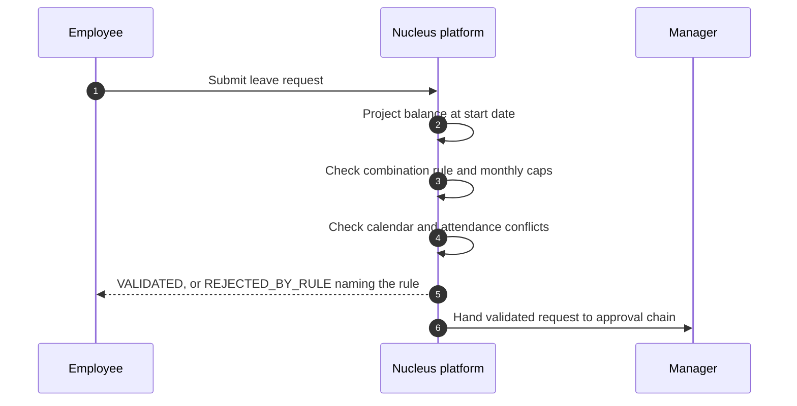

<p align="right">
<picture>
  <source media="(prefers-color-scheme: dark)" srcset="../requirements/assets/MultipliersKraftLogoDark.png">
  
</picture>
</p>

# TPL-03 — Use Case and User Story

| Attribute | Value |
| :--- | :--- |
| Document ID | TPL-03 |
| Title | Use Case and User Story |
| Product | Nucleus Suite (Nucleus HRMS Suite) |
| Version | 1.0.0 |
| Status | Issued for approval |
| Owner (role) | Business Analysis (BA) Lead |
| Author | Dhanraj Dadhich |
| Reviewed by | *pending* |
| Approved by | EPG Lead — *pending* |
| Date | 2026-11-05 |
| Classification | Internal |
| CMMI practice areas | PAD, RDM, VV |
| Related documents | DOC-01, REQ-01, UCC-01, USC-01, GOV-08, TPL-01, TPL-02 |
| Quality & process-performance objectives | QPPO-05 (effective requirements reviews), QPPO-04 (predictable phase delivery) |
| Process performance baseline used | PPB-01 (review defect density), PPB-02 (review rate), PPB-05 (story cycle time) |
| Peer review record | *pending* (PR-xxxx, QA-02) |
| Tailoring record | none |
| Traceability anchor | R-nn · `<DOM>-nn` · `<DOM>-CG-nnn` |

---

## 1. Purpose and Use

Part A gives the shape of every use case in FRS-<DOM>-12 and Part B the shape of every user story in FRS-<DOM>-13. Each source process (`<DOM>-nn`) and each capability gap (`<DOM>-CG-nnn`) is realised by at least one use case; each use case is refined into at least one story. The catalogues UCC-01 and USC-01 index them across domains.

*Guidance: one use case per actor goal, named verb + object. Steps cite the process step they realise. Delete guidance lines before submission.*

## 2. Part A — Use Case

```markdown
### [<DOM>-UC-nnn]

**[Verb + object]** — [One sentence: the goal in context.]

| Attribute | Value |
| :--- | :--- |
| Realises | [<DOM>-nn or <DOM>-CG-nnn] |
| Source | [Source workbook / Authored] |
| Level | [Summary / User goal / Sub-function] |
| Primary actor | [Persona, GOV-08] |
| Secondary actors | [Approvers, Nucleus platform, agents, external system classes] |
| Trigger | [Event and channel: web, mobile, kiosk, Nucleus Talk, API, schedule] |
| Frequency | [Rate and peaks] |
| Criticality | [Critical / High / Medium / Low] |
| Phase | [R0 / P0–P5] |
| Client requirements | [R-nn] |
| Business rules | [RL-nnn, BS:RL-nn, INV-xxx-nn] |
| Screens | [SCR-nnn] |
| Data objects (CRUD) | [object (C/R/U/D)] |
| Events | [domain.object.verb] |
| Acceptance tests | [TC-xxx, T-nn] |
| System requirements | [SYS-nnn] |
```

Then, in order:

| Section | Content |
| :--- | :--- |
| Stakeholders and interests | Table: stakeholder, interest |
| Preconditions | What must be true before the trigger |
| Main success scenario | Table: #, actor, action, process step reference |
| Sequence diagram | Mermaid `sequenceDiagram` of the main success scenario |
| Alternate flows | Table: ID (A1…), at step, condition, steps, rejoins |
| Exception flows | Table: ID (E1…), at step, condition, handling, rule |
| Postconditions — success | State, records written, events emitted |
| Postconditions — failure (minimal guarantee) | What holds even when the goal fails |
| Quality requirements | Measurable response-time, language and accessibility expectations |

## 3. Part B — User Story

*Guidance: stories satisfy INVEST — independent, negotiable, valuable, estimable, small enough for one sprint, testable. Acceptance criteria use golden data so that each one can become an automated test.*

```markdown
### [<DOM>-US-nnn] · [Parent use case name]

As a **[persona]**, I want [capability] so that [benefit].

Priority: **[MoSCoW]** · Use case: [<DOM>-UC-nnn] · Realises: [<DOM>-nn or <DOM>-CG-nnn]

| # | Given | When | Then |
| ---: | :--- | :--- | :--- |
| 1 | [Context from golden data] | [Action] | [Observable outcome] |
| 2 | [Context] | [Invalid action] | [Rejection naming the rule and the value] |
```

**Definition of Ready**

| # | Criterion |
| ---: | :--- |
| 1 | The story satisfies INVEST and traces to a use case |
| 2 | Acceptance criteria include at least one negative case and cite golden records |
| 3 | Screen (TPL-05) and data impacts (TPL-04) identified |
| 4 | Translation keys identified; no literal interface text planned |
| 5 | Dependencies resolved or logged in RSK-03; blocking `OD-nn` closed |
| 6 | Estimated by the team (PLN-03) |

**Definition of Done**

| # | Criterion |
| ---: | :--- |
| 1 | Code peer-reviewed and merged; type checks, lint and the full test suite pass |
| 2 | Every acceptance criterion automated as a test whose name carries its TC ID; REQ-02 updated |
| 3 | WCAG 2.2 AA checks and design-token checks pass |
| 4 | Audit and event behaviour verified |
| 5 | Product Owner accepts the story in the sprint review |

## 4. Worked Example — LVE-UC-003 and LVE-US-007

### LVE-UC-003

**Apply for leave with rule validation** — Let an employee apply for leave and receive an immediate, rule-named decision on whether the request can enter the approval chain.

| Attribute | Value |
| :--- | :--- |
| Realises | LVE-03 |
| Source | Source workbook |
| Level | User goal |
| Primary actor | Employee / worker |
| Secondary actors | Nucleus platform, Manager / supervisor |
| Trigger | The employee opens Apply for leave (SCR-030) on mobile, web or the business messaging channel and submits a request |
| Frequency | Continuous |
| Criticality | High |
| Phase | P1 |
| Client requirements | R-08 |
| Business rules | RL-190, RL-191, RL-192, RL-193, RL-194, BS:RL-11, BS:RL-12 |
| Screens | SCR-030 |
| Data objects (CRUD) | leave_request (C), leave_ledger (R), leave_combination_rule (R), leave_type (R), attendance_day (R), work_calendar (R) |
| Events | leave.request.created, leave.request.rejected_by_rule |
| Acceptance tests | TC-L190, TC-L191, TC-L192, TC-L193, TC-L194, T-15, T-16 |

**Main success scenario**

| # | Actor | Action | Ref |
| ---: | :--- | :--- | :--- |
| 1 | Employee / worker | Enter leave type, dates, half-day flags, reason and contact during leave, then submit | LVE-03.1 |
| 2 | Nucleus platform | Project the balance from the ledger as at the leave start date, honouring per-credit expiry | LVE-03.2 |
| 3 | Nucleus platform | Check the combination rule: CL may not be taken with, or merged into, EL or SL | LVE-03.3 |
| 4 | Nucleus platform | Check monthly caps of 2 CL and 10 EL per calendar month, counting days already approved | LVE-03.4 |
| 5 | Nucleus platform | Check conflicts with team calendar, holidays, rest days and attendance, then set the request to VALIDATED | LVE-03.5 |



**Exception flows**

| ID | At step | Condition | Handling | Rule |
| :--- | ---: | :--- | :--- | :--- |
| E1 | 2 | Projected balance at the start date is lower than the days requested | Submission blocked; projected balance and credits expiring before the start date shown | RL-191 |
| E2 | 3 | CL is contiguous with EL or SL | Request moves to REJECTED_BY_RULE before the chain starts; message names the combination rule | RL-192 |
| E3 | 4 | Request would exceed 2 CL or 10 EL in the month | Request moves to REJECTED_BY_RULE; message names the cap and the days already counted | RL-193 |

**Postconditions.** Success: the request is VALIDATED, handed to LVE-04 and `leave.request.created` is emitted. Failure: the request is REJECTED_BY_RULE, `leave.request.rejected_by_rule` is emitted, and no approval instance or ledger row is written.

**Quality requirements.** Validation result returned within 1.5 s at p95 on mobile and web; rejection messages name the rule in the employee's selected language.

### LVE-US-007 · Apply for leave with rule validation

As an **employee**, I want to see my balance as it will stand on my leave start date, including credits that will expire first, so that I do not apply for days I will not have.

Priority: **Must** · Use case: LVE-UC-003 · Realises: LVE-03

| # | Given | When | Then |
| ---: | :--- | :--- | :--- |
| 1 | I hold 4 comp-off days of which 2 expire on 2026-10-20 | I start an application for comp-off from 2026-10-25 | the screen shows a projected balance of 2 days and flags the 2 expiring days |
| 2 | my projected EL on 2026-11-01 is 3 days | I apply for 4 EL days from 2026-11-01 | submission is blocked and the projected balance of 3 days is shown (RL-191) |

## Approval & Sign-off

| Role | Name | Date | Decision | Conditions / comments |
| :--- | :--- | :--- | :--- | :--- |
| Author | Dhanraj Dadhich | 2026-11-05 | Submitted | |
| Peer review moderator | *pending* | | | PR-xxxx |
| PQA (process compliance) | *pending* | | | |
| EPG Lead | *pending* | | | |

## Measurement Data Captured

| Measure | Value | Unit | Notes |
| :--- | :--- | :--- | :--- |
| Size | 4 | sections | |
| Authoring effort | *to be recorded* | person-hours | |
| Review effort (preparation + meeting) | *pending review* | person-hours | From PR-xxxx |
| Review rate | *pending review* | sections / hour | Compare with PPB-02 control limits |
| Requirement volatility | 0 | CRs since baseline | |

## Revision History

| Version | Date | Author | Change summary | CR ref | Approved by |
| :--- | :--- | :--- | :--- | :--- | :--- |
| 1.0.0 | 2026-11-05 | Dhanraj Dadhich | Consolidated release | CR-0001 | *pending* |
