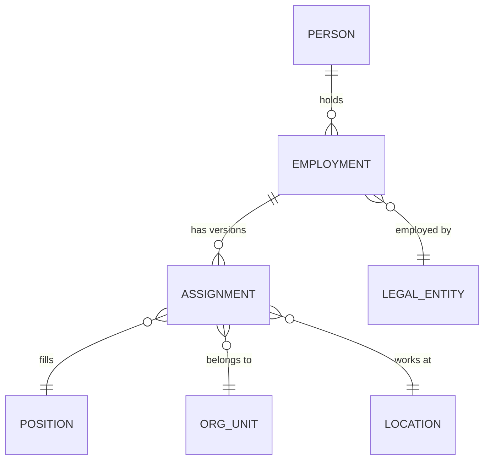
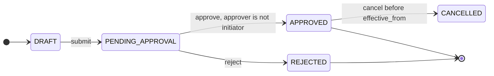

<p align="right">
<picture>
  <source media="(prefers-color-scheme: dark)" srcset="../requirements/assets/MultipliersKraftLogoDark.png">
  
</picture>
</p>

# TPL-04 — Data Model and Interface Schema

| Attribute | Value |
| :--- | :--- |
| Document ID | TPL-04 |
| Title | Data Model and Interface Schema |
| Product | Nucleus Suite (Nucleus HRMS Suite) |
| Version | 1.0.0 |
| Status | Issued for approval |
| Owner (role) | Chief Architect |
| Author | Dhanraj Dadhich |
| Reviewed by | *pending* |
| Approved by | EPG Lead — *pending* |
| Date | 2026-11-05 |
| Classification | Internal |
| CMMI practice areas | PAD, TS, RDM |
| Related documents | DOC-01, DA-01 to DA-05, IA-01 to IA-03, ICD-01, GOV-10, TPL-01 |
| Quality & process-performance objectives | QPPO-05 (effective requirements reviews), QPPO-02 (remove defects before system test) |
| Process performance baseline used | PPB-01 (review defect density), PPB-02 (review rate) |
| Peer review record | *pending* (PR-xxxx, QA-02) |
| Tailoring record | none |
| Traceability anchor | BG-01, BG-06, BG-07 · SYS-001 |

---

## 1. Purpose and Use

This template specifies a data object or object group, its state machine, its JSON Schema, its API contract and its domain events. Summary rows go into FRS-<DOM>-05 (data model), FRS-<DOM>-06 (state machines and events) and FRS-<DOM>-07 (APIs); this template carries the detail that the Architecture Review Board approves at gate G2.

*Guidance: every object is tenant-scoped, audited, classified and has a retention rule. Examples use synthetic data from the golden dataset only. Delete guidance lines before submission.*

## 2. Object Summary

| Field | Value |
| :--- | :--- |
| Object (table name, snake_case) | [e.g. assignment] |
| Description | [What one row represents] |
| Owning domain | [`<DOM>`] |
| System of record | [Nucleus Suite / named external system class] |
| Temporal model | [Non-temporal / Effective-dated / Bi-temporal (effective and recorded time)] |
| Expected volume | [Rows per tenant per year, with the basis] |
| Processes and requirements | [`<DOM>-nn`, `<DOM>-FR-nnn`, SYS-nnn] |
| Forms | [FRM-<MOD>-nn] |

## 3. Standard Columns (every object)

| Column | Type | Null | Constraint | Purpose |
| :--- | :--- | :--- | :--- | :--- |
| `id` | UUID | No | Primary key | Immutable surrogate key |
| `tenant_id` | UUID | No | Row-level isolation policy (SYS-001) | Tenant boundary |
| `effective_from` | DATE | No* | ≤ `effective_to` | *Effective-dated objects only |
| `effective_to` | DATE | No* | Default `9999-12-31` | *Effective-dated objects only |
| `recorded_at` | TIMESTAMPTZ | No | Default now | Recorded time (bi-temporal) |
| `superseded_at` | TIMESTAMPTZ | Yes | Null = current version | End of recorded time (bi-temporal) |
| `status` | Enumeration | No | Per the state machine in §5 | Lifecycle state |
| `created_by`, `updated_by` | UUID | No | Principal reference | Audit |
| `created_at`, `updated_at` | TIMESTAMPTZ | No | | Audit |
| `version` | INTEGER | No | Optimistic lock | Concurrency control |

Field conventions FC-1 to FC-7 (TPL-01 §5) apply: effective-dated history, mandatory override reason, audit on every write, tokenised and masked identity numbers, end-dating instead of deletion (physical erasure only under a data-subject erasure request per GOV-10), integer minor-unit money with an ISO 4217 code, and rule-named blocked saves.

## 4. Business Attributes

| Attribute (snake_case) | Type | Null | Constraint or validation | Temporal | Sensitivity (GOV-10) | Masked for | Source | Description |
| :--- | :--- | :--- | :--- | :--- | :--- | :--- | :--- | :--- |
| [attribute] | [type; money = BIGINT minor units] | [Y/N] | [regex, range, reference, enumeration] | [Y/N] | [Public / Internal / Personal / Sensitive personal / Restricted] | [roles] | [form, integration, derived] | [meaning] |

**Worked rows** (golden data: Vindhya Precision Industries Pvt Ltd, fictional)

| Attribute (snake_case) | Type | Null | Constraint or validation | Temporal | Sensitivity (GOV-10) | Masked for | Source | Description |
| :--- | :--- | :--- | :--- | :--- | :--- | :--- | :--- | :--- |
| `pan_token` | VARCHAR(64) | Y | Token issued by the vault; the source PAN matches `^[A-Z]{5}[0-9]{4}[A-Z]$` with fourth character P for an individual | N | Sensitive personal | Everyone except HR and the employee, who see `XXXXXX234F` | FRM-PPL-01 | Tokenised PAN; absence forces the higher TDS rate (to be validated by Legal) |
| `basic_monthly_minor` | BIGINT | N | ≥ 0; currency `INR` | Y | Restricted | Plant supervisors see `***` | Salary structure, FRS-CMB-05 | Monthly basic in paise; for E1014 Harish Nambiar 6250000 (₹ 62,500) |

## 5. Relationships and State Machine





| From | To | Actor | Guard | Side effects (audit, events) |
| :--- | :--- | :--- | :--- | :--- |
| [state] | [state] | [role or principal type] | [condition] | [audit entry; event] |

## 6. JSON Schema

```json
{
  "$schema": "https://json-schema.org/draft/2020-12/schema",
  "$id": "https://schemas.nucleus.local/people/assignment.v1.json",
  "title": "Assignment",
  "type": "object",
  "additionalProperties": false,
  "properties": {
    "id":            { "type": "string", "format": "uuid" },
    "tenantId":      { "type": "string", "format": "uuid" },
    "employmentId":  { "type": "string", "format": "uuid" },
    "locationCode":  { "type": "string", "pattern": "^LOC-[A-Z]{3}$" },
    "effectiveFrom": { "type": "string", "format": "date" },
    "effectiveTo":   { "type": "string", "format": "date" },
    "reason":        { "type": "string", "minLength": 3, "maxLength": 300 },
    "status":        { "enum": ["DRAFT", "PENDING_APPROVAL", "APPROVED", "REJECTED", "CANCELLED"] }
  },
  "required": ["id", "tenantId", "employmentId", "effectiveFrom", "reason", "status"]
}
```

The schema matches the attribute tables of §3 and §4 field by field; reviewers check each property.

## 7. API Contract (OpenAPI 3.1)

```yaml
openapi: 3.1.0
info: { title: "People Core API", version: "1.0.0" }
paths:
  /api/v1/assignments/{assignmentId}/changes:
    post:
      operationId: createAssignmentChange
      parameters:
        - { in: path, name: assignmentId, required: true, schema: { type: string, format: uuid } }
        - { in: header, name: Idempotency-Key, required: true, schema: { type: string, format: uuid } }
      requestBody:
        required: true
        content:
          application/json:
            schema: { $ref: "#/components/schemas/AssignmentChange" }
      responses:
        "201": { description: Change recorded and routed for approval }
        "409": { description: Version conflict or rule violation (problem details naming the rule) }
        "422": { description: Validation errors }
```

| Item | Rule |
| :--- | :--- |
| Authentication and authorisation | OIDC bearer token; scope plus role and data-scope conditions evaluated on the server |
| Idempotency | Every POST carries `Idempotency-Key`; a replay returns the original response |
| Errors | Problem-details body with the rule ID (`RL-nnn`) and a translation key |
| Versioning | Major version in the path; only additive changes within a version |
| Rate limits | [Requests per minute per principal, with the basis] |

## 8. Domain Event (CloudEvents 1.0)

```json
{
  "specversion": "1.0",
  "type": "people.assignment.changed",
  "source": "/tenants/7d3c0e1a-9f2b-4c55-8a10-2f6b1d9e4c21/people",
  "id": "0b8f2a55-61d4-4e1a-9a3c-5f0e2d7b9c11",
  "time": "2026-11-10T09:42:17+05:30",
  "subject": "employee/E1052/assignment",
  "datacontenttype": "application/json",
  "data": {
    "effectiveFrom": "2026-12-01",
    "changedFields": [ { "field": "locationCode", "before": "LOC-HYD", "after": "LOC-PLA" } ]
  }
}
```

| Event | Producer | Consumers | Delivery | Idempotency key | Personal data in payload |
| :--- | :--- | :--- | :--- | :--- | :--- |
| people.assignment.changed | PPL-02 | Time recompute, payroll, access, analytics | At least once through the outbox | assignment ID + version | Minimised: identifiers and changed fields only |

## 9. Data Quality Rules

| Rule | Statement | Severity | Check point |
| :--- | :--- | :--- | :--- |
| [RL-nnn, or authored `<DOM>-BR-nnn`] | [e.g. PAN matches `^[A-Z]{5}[0-9]{4}[A-Z]$`] | [Block / Warn] | [Entry / import / nightly] |

## 10. Retention and Privacy

| Data category | Retention | Basis | Deletion or anonymisation method |
| :--- | :--- | :--- | :--- |
| [Category] | [Period and start event] | [Statute (to be validated by Legal) / consent / contract] | [Method] |

## Approval & Sign-off

| Role | Name | Date | Decision | Conditions / comments |
| :--- | :--- | :--- | :--- | :--- |
| Author | Dhanraj Dadhich | 2026-11-05 | Submitted | |
| Peer review moderator | *pending* | | | PR-xxxx |
| PQA (process compliance) | *pending* | | | |
| EPG Lead | *pending* | | | |

## Measurement Data Captured

| Measure | Value | Unit | Notes |
| :--- | :--- | :--- | :--- |
| Size | 10 | sections | |
| Authoring effort | *to be recorded* | person-hours | |
| Review effort (preparation + meeting) | *pending review* | person-hours | From PR-xxxx |
| Review rate | *pending review* | sections / hour | Compare with PPB-02 control limits |
| Requirement volatility | 0 | CRs since baseline | |

## Revision History

| Version | Date | Author | Change summary | CR ref | Approved by |
| :--- | :--- | :--- | :--- | :--- | :--- |
| 1.0.0 | 2026-11-05 | Dhanraj Dadhich | Consolidated release | CR-0001 | *pending* |
