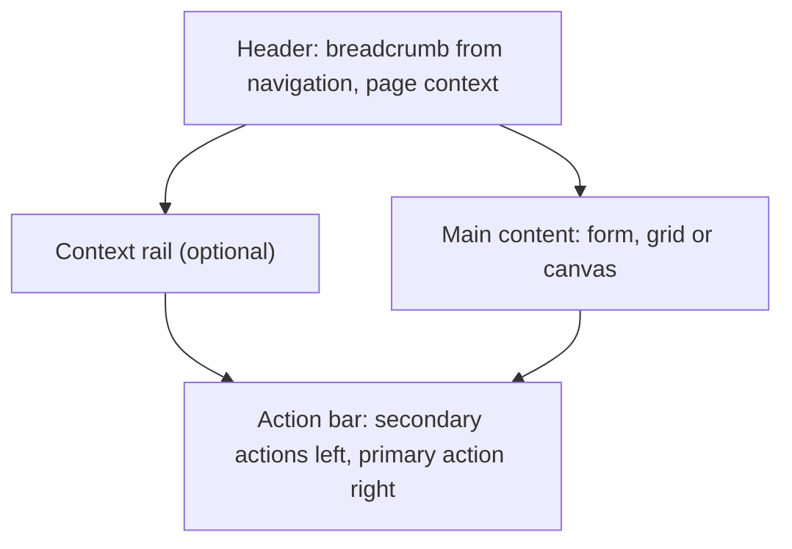

<picture>
  <source media="(prefers-color-scheme: dark)" srcset="../requirements/assets/MultipliersKraftLogoDark.png">
  
</picture>

# TPL-05 — UI/UX Screen Specification

| Attribute | Value |
| :--- | :--- |
| Document ID | TPL-05 |
| Title | UI/UX Screen Specification |
| Product | Nucleus Suite (Nucleus HRMS Suite) |
| Version | 1.0.0 |
| Status | Issued for approval |
| Owner (role) | UX Lead |
| Author | Dhanraj Dadhich |
| Reviewed by | *pending* |
| Approved by | EPG Lead — *pending* |
| Date | 2026-11-05 |
| Classification | Internal |
| CMMI practice areas | PAD, TS, RDM |
| Related documents | DOC-01, GOV-08, LOC-01, RPT-01, NFR-01, TPL-01, TPL-04, TPL-07 |
| Quality & process-performance objectives | QPPO-05 (effective requirements reviews), QPPO-01 (minimise defects reaching users) |
| Process performance baseline used | PPB-01 (review defect density), PPB-02 (review rate) |
| Peer review record | *pending* (PR-xxxx, QA-02) |
| Tailoring record | none |
| Traceability anchor | BG-02, BG-03 · SCR-nnn |

---

## 1. Purpose and Use

This template specifies one screen, dialog, console widget or report in detail. The summary row stays in FRS-<DOM>-04; the detail produced here is used by design, build and accessibility testing.

*Guidance: colours, radii and shadows are referenced only by design-token name, never by literal value. Every visible string has a translation key. Delete guidance lines before submission.*

## 2. Screen Identity

| Field | Value |
| :--- | :--- |
| Screen ID | [SCR-nnn — source identifier, never renumbered] |
| Screen name | [Name] |
| Type | [Page / Dialog / Drawer / Console widget / Report] |
| Platform | [Web / Mobile / Kiosk / Voice] |
| Forms hosted | [FRM-<MOD>-nn] |
| Shared components | [CMP-nn] |
| Personas and consoles | [PER-nn, S1–S10] |
| Use cases and requirements | [<DOM>-UC-nnn, <DOM>-FR-nnn, SYS-nnn] |
| Entry points | [Navigation catalogue item, deep link, Nucleus Talk command, notification, AI suggestion] |
| Exit points | [Where the user goes next] |
| Phase | [R0 / P0–P5] |

## 3. Layout Regions

| Region | Content | Behaviour |
| :--- | :--- | :--- |
| [Region] | [Content] | [Progressive disclosure, sticky, collapsible] |

## 4. Field Specification

| # | Label key | Control | Binding (object.attribute) | Required | Validation (on blur or change) | Error message key | Masking or visibility by role | Default |
| ---: | :--- | :--- | :--- | :--- | :--- | :--- | :--- | :--- |
| [n] | [`domain.screen.field`] | [Date picker / Select / Autocomplete / Currency / Switch / …] | [object.attribute] | [Y — label shows `*`] | [Rule] | [Key] | [e.g. `***` for plant supervisors] | [Value] |

Field conventions (TPL-01 §5): mandatory labels show `*`; a reason becomes mandatory whenever a user overrides a policy default (FC-2); identity and bank numbers are masked except for permitted roles (FC-4); currency inputs display `₹ 1,00,000` and bind to integer paise (FC-6); a blocked save names the rule and the value (FC-7). Dependent fields clear and reload when their parent changes.

## 5. Screen States

| State | Trigger | Presentation |
| :--- | :--- | :--- |
| Empty | No records | Illustration, guidance text key, primary action |
| Loading | Fetch in progress | Skeleton; submit button shows a spinner and is disabled |
| Error | Fetch or submit failure | Inline error and toast; focus moves to the first error |
| Success | Submit succeeded | Toast; form resets or closes; data refreshes |
| Offline | No connectivity | Banner; drafts queued locally; unsafe actions read-only |
| Partial permission | Some fields not permitted | Fields hidden or masked, with an explanation |
| Unsaved changes | Navigation away from a changed form | Confirmation dialog |

## 6. Actions and Permissions

| Action | Control | Roles shown (interface convenience; the server enforces) | Confirmation | Result |
| :--- | :--- | :--- | :--- | :--- |
| [Action] | [Primary button] | [Roles] | [Y/N] | [State transition] |

## 7. Accessibility (WCAG 2.2 AA)

| # | Check |
| ---: | :--- |
| 1 | Every control keyboard-operable with a visible focus indicator |
| 2 | Labels programmatically associated; errors announced to screen readers |
| 3 | Contrast at least 4.5:1 in all four themes, verified through tokens |
| 4 | Target size at least 24 × 24 CSS px |
| 5 | Motion respects `prefers-reduced-motion` |
| 6 | No information conveyed by colour alone |

## 8. Localisation

| Item | Specification |
| :--- | :--- |
| Languages | The 11 supported languages of LOC-01; source strings in English |
| Right-to-left | Logical CSS properties; mirrored layout for Arabic |
| Formats | Locale-aware date, number and currency (INR shown as `₹ 1,00,000`) |
| Text expansion | Layout tolerates 40% longer strings |

## 9. Voice (Nucleus Talk)

| Utterance examples | Intent | Result type | Spoken response key |
| :--- | :--- | :--- | :--- |
| [Example utterance] | [Intent] | [TAB / MODAL / ACTION] | [Key] |

## 10. AI Assistance

| Touchpoint | AI feature (`<DOM>-AI-nnn`, TPL-07) | User control | Explanation shown |
| :--- | :--- | :--- | :--- |
| [Touchpoint] | [ID] | [Accept / edit / dismiss] | ["Why this suggestion?" panel] |

## 11. Design Tokens and Responsive Behaviour

Tokens used: [list, e.g. `--card`, `--text`, `--signal`, `--flag`, `--r-control`, `--shadow-raise`].

| Breakpoint | Layout change |
| :--- | :--- |
| ≥ 1280 px | Full layout |
| 768–1279 px | Context rail collapses |
| < 768 px | Single column; action bar sticky at the bottom |

## 12. Report Variant (RP-nn in FRS-<DOM>-04 and RPT-01)

| Field | Value |
| :--- | :--- |
| Business question answered | [Question] |
| Measures and formulas | [Formula per measure] |
| Filters and drill paths | [Filters] |
| Data latency | [Real time / hourly / daily] |
| Row-level security | [Data scope rule] |
| Export formats | [CSV / XLSX / PDF] |

## 13. Worked Example — SCR-030 Apply for Leave (FRM-LVE-02)

| # | Label key | Control | Binding | Required | Validation | Error message key | Masking or visibility | Default |
| ---: | :--- | :--- | :--- | :--- | :--- | :--- | :--- | :--- |
| 1 | `leave.apply.leave_type` | Select (PL_LEAVE_TYPE) | leave_request.leave_type | Y | Only types the band and worker class are eligible for | `leave.apply.type_ineligible` | Self | — |
| 2 | `leave.apply.date_from` | Date picker | leave_request.date_from | Y | Not before joining; within the backdating window | `leave.apply.date_from_invalid` | Self | — |
| 3 | `leave.apply.date_to` | Date picker | leave_request.date_to | Y | From ≤ To | `leave.apply.date_range_invalid` | Self | Same as From |
| 4 | `leave.apply.days_applied` | Number (derived, read-only) | leave_request.days_applied | Y | Rest days and holidays handled per the sandwich rule | — | Self | Computed |
| 5 | `leave.apply.contact` | Phone | leave_request.contact | N | E.164 | `leave.apply.contact_invalid` | Self | Registered mobile |

A request for 4 EL days from 2026-11-01 when the projected balance is 3 days shows "RL-191: projected EL balance on 2026-11-01 is 3 days; 4 requested" and keeps the submit button disabled.

## Approval & Sign-off

| Role | Name | Date | Decision | Conditions / comments |
| :--- | :--- | :--- | :--- | :--- |
| Author | Dhanraj Dadhich | 2026-11-05 | Submitted | |
| Peer review moderator | *pending* | | | PR-xxxx |
| PQA (process compliance) | *pending* | | | |
| EPG Lead | *pending* | | | |

## Measurement Data Captured

| Measure | Value | Unit | Notes |
| :--- | :--- | :--- | :--- |
| Size | 13 | sections | |
| Authoring effort | *to be recorded* | person-hours | |
| Review effort (preparation + meeting) | *pending review* | person-hours | From PR-xxxx |
| Review rate | *pending review* | sections / hour | Compare with PPB-02 control limits |
| Requirement volatility | 0 | CRs since baseline | |

## Revision History

| Version | Date | Author | Change summary | CR ref | Approved by |
| :--- | :--- | :--- | :--- | :--- | :--- |
| 1.0.0 | 2026-11-05 | Dhanraj Dadhich | Consolidated release | CR-0001 | *pending* |
