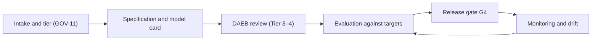

<picture>
  <source media="(prefers-color-scheme: dark)" srcset="../requirements/assets/MultipliersKraftLogoDark.png">
  
</picture>

# TPL-07 — AI Feature Specification and Model Card

| Attribute | Value |
| :--- | :--- |
| Document ID | TPL-07 |
| Title | AI Feature Specification and Model Card |
| Product | Nucleus Suite (Nucleus HRMS Suite) |
| Version | 1.0.0 |
| Status | Issued for approval |
| Owner (role) | Head of AI |
| Author | Dhanraj Dadhich |
| Reviewed by | *pending* |
| Approved by | Data & AI Ethics Board — *pending* |
| Date | 2026-11-05 |
| Classification | Internal |
| CMMI practice areas | PAD, RDM, VV, GOV |
| Related documents | DOC-01, GOV-10, GOV-11, AI-01, QA-03, MPM-01, TPL-06, TPL-13 |
| Quality & process-performance objectives | QPPO-07 (fair and grounded AI), QPPO-01 (minimise defects reaching users) |
| Process performance baseline used | PPB-01 (review defect density), PPB-02 (review rate) |
| Peer review record | *pending* (PR-xxxx, QA-02) |
| Tailoring record | none |
| Traceability anchor | BG-02, BG-06, BG-08 |

---

## 1. Purpose and Use

Every feature in which a model or an AI agent produces content, ranks, predicts, recommends or acts is specified with this template — Nucleus Talk intents, agent transactions, matching, calibration support, attrition prediction and document extraction. The specification is identified `<DOM>-AI-nnn`, summarised in FRS-<DOM>-07 and registered in AI-01. Tier 3 and Tier 4 features need Data & AI Ethics Board approval before build (G2) and before release (G4).

*Guidance: answer every question; "not applicable" needs a reason. Delete guidance lines before submission.*

## 2. Feature Identity

| Field | Value |
| :--- | :--- |
| AI feature ID | [<DOM>-AI-nnn] |
| Name | [Name] |
| Problem statement | [User problem and today's manual workaround] |
| Business goals | [BG-02 / BG-05 / BG-08 …] |
| People affected | [Users of the output and the people the output is about] |
| Processes, use cases and requirements | [<DOM>-nn AGENT steps, <DOM>-UC-nnn, SYS-nnn] |
| Phase | [P2–P5] |

## 3. Risk Classification (GOV-11)

| Question | Answer |
| :--- | :--- |
| Does the output influence employment, pay, discipline, access to opportunity or legal compliance? | [Y/N] |
| Does it process sensitive personal data (health, biometrics, caste, religion, financial)? | [Y/N] |
| Does it advise, act after confirmation, or act within limits without confirmation? | [Advise / Act after confirmation / Act within limits] |
| Is it visible to the person the output is about? | [Y/N] |
| Jurisdictions | [IN, other] |
| Risk tier | [1 Informational / 2 Assistive / 3 Advisory on people / 4 Consequential / Prohibited] |
| Rationale | [Why this tier] |

## 4. Human Oversight

| Item | Specification |
| :--- | :--- |
| Decision owner | [Role that remains accountable] |
| Human checkpoint | [Before action / before commit / sampled after the fact, with sample size] |
| Override | [How a human overrides; reason captured] |
| Contestability | [How an affected person questions the outcome] |
| Autonomy limits | [e.g. drafts but never submits; monetary cap; record-count cap] |

## 5. Data

| Data source | Categories (GOV-10 class) | Lawful basis or consent | Minimisation | Retention for AI use |
| :--- | :--- | :--- | :--- | :--- |
| [Source] | [Class] | [Basis] | [Measure] | [Period] |

Excluded attributes, never used as features: gender, religion, caste, age, disability, pregnancy, marital status and known proxies for them.

## 6. Model and Provider

| Field | Value |
| :--- | :--- |
| Approach | [LLM with retrieval / classical ML / rules plus ML / agent with tools] |
| Model and version | [LLM provider, model identifier, pinned version] |
| Hosting and residency | [Cloud region in India; whether the provider retains prompts or data] |
| Training or fine-tuning data | [None / description and provenance] |
| Cost envelope | [Per tenant per month] |

## 7. Agent Tools and Permission Scopes

| Tool | What it does | Permission scope | Human confirmation | Rate or value limits |
| :--- | :--- | :--- | :--- | :--- |
| [tool name] | [Action] | [Acts only as the invoking principal] | [Y/N] | [Limit] |

Prompt and instruction assets are versioned under configuration control (CM-01). Prompt-injection defences: content from documents and users is treated as data, tools come from an allow-list, and outputs are validated before any write.

## 8. Evaluation Plan

| Measure | Definition | Target | Dataset | Frequency |
| :--- | :--- | :--- | :--- | :--- |
| Task accuracy | [Definition] | [Target] | [Dataset] | Before release and monthly |
| Fairness (MET-14) | Lowest ÷ highest favourable-outcome rate across groups; counterfactual flip rate | [DAEB threshold] | [Dataset] | Per release and monthly |
| Groundedness (MET-15) | Answers fully supported by cited sources (lower 95% confidence bound) | [DAEB threshold] | [Dataset] | Per release and weekly sample |
| Robustness | Accuracy under noisy, code-mixed or accented input | [Target] | [Dataset] | Per release |
| Safety | Harmful or policy-violating output rate | 0 critical | Red-team set | Before release |
| Latency | p95 response time | [Target] | Production-like load | Continuous |

Release is blocked if any Must target is missed; the DAEB may grant a time-boxed waiver recorded as a decision (TPL-10).

## 9. Explanation, Monitoring and Fallback

| Item | Specification |
| :--- | :--- |
| What the user sees | [Confidence, top factors, source citations, "Why this?" panel] |
| What the affected person sees | [Plain-language notice in their language] |
| Logging | [Inputs, output, model version, explanation, human decision, retention] |
| Drift (MET-16) | [Alert and action levels; DAEB notified on action level] |
| Fairness breach | [Disable recommendations; investigate; CAR-nnnn] |
| Fallback | [The non-AI path that always completes the user's task, including when the kill switch is on] |

## 10. Model Card

| Field | Value |
| :--- | :--- |
| Intended use | [Use] |
| Out-of-scope uses | [Uses] |
| Users | [Personas] |
| Performance summary | [Measures from §8 with dates] |
| Known limitations | [Limitations] |
| Ethical considerations | [Considerations] |
| Evaluation data | [Datasets] |
| Version history | [Model and prompt versions] |
| DAEB approval | [DEC-nnnn, date] |

## 11. Worked Example — LVE-AI-001 Leave Application by the Policy Assistant

| Field | Value |
| :--- | :--- |
| Problem statement | Plant workers without a desk find the leave form slow; they ask a supervisor to apply for them, which hides the request from the worker and breaks INV-SEC-02 when the supervisor also approves |
| Processes and use cases | LVE-03 (step LVE-03.1 captured through Nucleus Talk) · LVE-UC-003 |
| Risk tier | 2 — Assistive: the agent drafts a request on the worker's own record and submits only after the worker confirms |
| Human checkpoint | The worker confirms leave type, dates and days on screen or by voice before submission; rule validation (RL-190 to RL-194) runs as for any other channel |
| Tools | `read_employee` (own record), `apply_leave` (own record, confirmation required) |
| Autonomy limits | One request per confirmation; no approval actions; no change to another person's record |
| Evaluation | Intent and date extraction correct for ≥ 95% of 1,000 curated utterances in English, Hindi, Kannada, Tamil and Telugu; voice command success (MET-20) tracked weekly by language |
| Fallback | The pre-filled Apply for leave screen (SCR-030) opens for manual completion |
| Action ledger | question, retrieved sources, tool, inputs, confirmation, outcome |

## Approval & Sign-off

| Role | Name | Date | Decision | Conditions / comments |
| :--- | :--- | :--- | :--- | :--- |
| Author | Dhanraj Dadhich | 2026-11-05 | Submitted | |
| Peer review moderator | *pending* | | | PR-xxxx |
| PQA (process compliance) | *pending* | | | |
| Data & AI Ethics Board | *pending* | | | |

## Measurement Data Captured

| Measure | Value | Unit | Notes |
| :--- | :--- | :--- | :--- |
| Size | 11 | sections | |
| Authoring effort | *to be recorded* | person-hours | |
| Review effort (preparation + meeting) | *pending review* | person-hours | From PR-xxxx |
| Review rate | *pending review* | sections / hour | Compare with PPB-02 control limits |
| Requirement volatility | 0 | CRs since baseline | |

## Revision History

| Version | Date | Author | Change summary | CR ref | Approved by |
| :--- | :--- | :--- | :--- | :--- | :--- |
| 1.0.0 | 2026-11-05 | Dhanraj Dadhich | Consolidated release | CR-0001 | *pending* |
