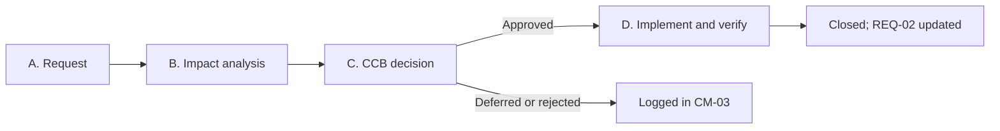

<picture>
  <source media="(prefers-color-scheme: dark)" srcset="../requirements/assets/MultipliersKraftLogoDark.png">
  
</picture>

# TPL-08 — Change Request Form

| Attribute | Value |
| :--- | :--- |
| Document ID | TPL-08 |
| Title | Change Request Form |
| Product | Nucleus Suite (Nucleus HRMS Suite) |
| Version | 1.0.0 |
| Status | Issued for approval |
| Owner (role) | Configuration Manager |
| Author | Dhanraj Dadhich |
| Reviewed by | *pending* |
| Approved by | EPG Lead — *pending* |
| Date | 2026-11-05 |
| Classification | Internal |
| CMMI practice areas | PAD, CM, RDM |
| Related documents | DOC-01, CM-01, CM-02, CM-03, REQ-02, MPM-01 |
| Quality & process-performance objectives | QPPO-06 (fast, controlled change) |
| Process performance baseline used | PPB-07 (CR cycle time) |
| Peer review record | *pending* (PR-xxxx, QA-02) |
| Tailoring record | none |
| Traceability anchor | BG-09 · MET-04, MET-26 |

---

## 1. Purpose and Use

A change request is required for any change to a baselined item: a document at or after its approved 1.0.0 version, a requirement in status Baselined, a source workbook, or a process asset. The requester submits the form to the Configuration Manager, who assigns the `CR-nnnn` identifier and logs it in CM-03. The Change Control Board decides under CM-02.

*Guidance: one change per request. Delete guidance lines before submission.*

## 2. Section A — Request (requester)

| Field | Value |
| :--- | :--- |
| CR ID | [CR-nnnn — assigned by the Configuration Manager] |
| Title | [Title] |
| Requested by, role | [Name, role, STK-nn] |
| Date raised | [YYYY-MM-DD] |
| Class | [Minor / Major / Emergency — CM-02] |
| Type | [Scope / Requirement / Design / Process / Document / Defect correction / Regulatory] |
| Affected baseline items | [Document IDs and versions; requirement IDs; workbook sheets] |
| Description of change | [Exactly what changes] |
| Reason and benefit | [Why; consequence of not changing] |
| Regulatory driver | [Statute and effective date (to be validated by Legal), or none] |

## 3. Section B — Impact Analysis (analyst and architect)

| Dimension | Impact (None / Low / Medium / High) | Detail |
| :--- | :--- | :--- |
| Scope | [Level] | [Detail] |
| Schedule | [Level] | [Days; milestones and gates affected] |
| Effort and cost | [Level] | [Person-days per PLN-03] |
| Requirements | [Level] | [IDs added, changed, deleted] |
| Architecture and data | [Level] | [Objects, interfaces, migrations] |
| Privacy and AI risk | [Level] | [GOV-10 or GOV-11 review needed?] |
| Verification | [Level] | [Test cases to add or re-run] |
| Training and change management | [Level] | [OCM-01 impact] |
| Other domains | [Level] | [Seams affected] |
| Risks introduced | [Level] | [RSK-R-nnn] |

Alternatives considered: [Alternatives and why they were not chosen].

## 4. Section C — Decision (CCB)

| Field | Value |
| :--- | :--- |
| Decision | [Approved / Approved with conditions / Deferred to Pn / Rejected] |
| Conditions | [Conditions] |
| Decision date | [YYYY-MM-DD] |
| CCB minutes | [Minutes ID, TPL-11] |
| Target version and baseline | [Document version per DOC-01 §9; phase] |
| Escalated to Steering Committee | [Y/N — required when the CM-02 threshold is exceeded] |

## 5. Section D — Implementation and Closure

| Field | Value |
| :--- | :--- |
| Implemented in | [Document versions; build references] |
| Verified by | [Name, role, evidence] |
| REQ-02 updated | [Y/N] |
| Volatility counters updated | [Y/N — on every affected requirement] |
| Closed date | [YYYY-MM-DD] |
| Cycle time | [Working days from submission to CCB decision — MET-26, PPB-07] |

## Approval & Sign-off

| Role | Name | Date | Decision | Conditions / comments |
| :--- | :--- | :--- | :--- | :--- |
| Author | Dhanraj Dadhich | 2026-11-05 | Submitted | |
| Peer review moderator | *pending* | | | PR-xxxx |
| PQA (process compliance) | *pending* | | | |
| EPG Lead | *pending* | | | |

## Measurement Data Captured

| Measure | Value | Unit | Notes |
| :--- | :--- | :--- | :--- |
| Size | 5 | sections | |
| Authoring effort | *to be recorded* | person-hours | |
| Review effort (preparation + meeting) | *pending review* | person-hours | From PR-xxxx |
| Review rate | *pending review* | sections / hour | Compare with PPB-02 control limits |
| Requirement volatility | 0 | CRs since baseline | |

## Revision History

| Version | Date | Author | Change summary | CR ref | Approved by |
| :--- | :--- | :--- | :--- | :--- | :--- |
| 1.0.0 | 2026-11-05 | Dhanraj Dadhich | Consolidated release | CR-0001 | *pending* |
