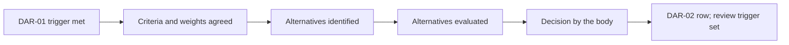

<picture>
  <source media="(prefers-color-scheme: dark)" srcset="../requirements/assets/MultipliersKraftLogoDark.png">
  
</picture>

# TPL-10 — Decision Record

| Attribute | Value |
| :--- | :--- |
| Document ID | TPL-10 |
| Title | Decision Record |
| Product | Nucleus Suite (Nucleus HRMS Suite) |
| Version | 1.0.0 |
| Status | Issued for approval |
| Owner (role) | Engineering Process Group (EPG) Lead |
| Author | Dhanraj Dadhich |
| Reviewed by | *pending* |
| Approved by | EPG Lead — *pending* |
| Date | 2026-11-05 |
| Classification | Internal |
| CMMI practice areas | PAD, DAR |
| Related documents | DOC-01, DAR-01, DAR-02, GOV-04 |
| Quality & process-performance objectives | QPPO-04 (predictable phase delivery) |
| Process performance baseline used | PPB-02 (review rate) |
| Peer review record | *pending* (PR-xxxx, QA-02) |
| Tailoring record | none |
| Traceability anchor | BG-09 |

---

## 1. Purpose and Use

Every decision that meets a DAR-01 trigger — architecture choice, supplier selection, AI model selection, scope trade-off, statutory interpretation, closure of an open decision `OD-nn` — is recorded with this form and summarised as one row in DAR-02.

*Guidance: criteria and weights are agreed before alternatives are scored. Delete guidance lines before use.*

## 2. Identification

| Field | Value |
| :--- | :--- |
| Decision ID | [DEC-nnnn] |
| Title | [Title] |
| Status | [Proposed / Recorded / Accepted / Superseded by DEC-nnnn / Rejected] |
| Decision owner | [Role] |
| Decision body | [Steering Committee / Product Council / ARB / CCB / DAEB] |
| Date raised / date decided | [YYYY-MM-DD / YYYY-MM-DD] |
| DAR-01 trigger | [Criterion met] |
| Open decision closed | [OD-nn, or none] |

## 3. Context

[The problem, forces and constraints, with links to requirements, risks (RSK-R-nnn) and change requests.]

## 4. Evaluation Criteria

| # | Criterion | Weight (%) | How measured |
| ---: | :--- | ---: | :--- |
| [n] | [Criterion] | [w] | [Measure] |

## 5. Alternatives and Scoring (1–5)

| Criterion (weight) | Alternative A | Alternative B | Alternative C |
| :--- | :--- | :--- | :--- |
| [Criterion (w)] | [Score] | [Score] | [Score] |
| Weighted total | [Total] | [Total] | [Total] |

Evaluation method: [weighted scoring / prototype / benchmark / cost model / expert judgement].

## 6. Decision, Consequences and Review Trigger

| Item | Content |
| :--- | :--- |
| Decision | [Selected alternative and the reason in two or three sentences] |
| Positive consequences | [Consequences] |
| Accepted trade-offs | [Trade-offs] |
| Risks created | [RSK-R-nnn] |
| Follow-up actions | [RSK-AC-nnn] |
| Review trigger | [Condition under which the decision is revisited] |

## 7. Worked Example — DEC-0002

| Item | Content |
| :--- | :--- |
| Title | Current phase is local JSON UI validation; live backend and database work only on an explicit signal |
| Status | Recorded |
| Decision owner | Executive Sponsor |
| Context | Stage R0 validates screens, flows and role consoles with in-memory JSON data through a single data boundary |
| Decision | No production database, external API, production authentication, live payroll disbursement or statutory filing is active in R0 |
| Accepted trade-offs | Server-side domain logic stays dormant; performance targets of NFR-01 cannot be measured until P0 |
| Review trigger | The Executive Sponsor's signal to start P0 week 1 |

## Approval & Sign-off

| Role | Name | Date | Decision | Conditions / comments |
| :--- | :--- | :--- | :--- | :--- |
| Author | Dhanraj Dadhich | 2026-11-05 | Submitted | |
| Peer review moderator | *pending* | | | PR-xxxx |
| PQA (process compliance) | *pending* | | | |
| EPG Lead | *pending* | | | |

## Measurement Data Captured

| Measure | Value | Unit | Notes |
| :--- | :--- | :--- | :--- |
| Size | 7 | sections | |
| Authoring effort | *to be recorded* | person-hours | |
| Review effort (preparation + meeting) | *pending review* | person-hours | From PR-xxxx |
| Review rate | *pending review* | sections / hour | Compare with PPB-02 control limits |
| Requirement volatility | 0 | CRs since baseline | |

## Revision History

| Version | Date | Author | Change summary | CR ref | Approved by |
| :--- | :--- | :--- | :--- | :--- | :--- |
| 1.0.0 | 2026-11-05 | Dhanraj Dadhich | Consolidated release | CR-0001 | *pending* |
