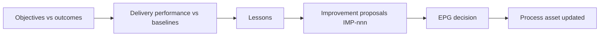

<picture>
  <source media="(prefers-color-scheme: dark)" srcset="../requirements/assets/MultipliersKraftLogoDark.png">
  
</picture>

# TPL-14 — Lessons Learned and Post-Implementation Review

| Attribute | Value |
| :--- | :--- |
| Document ID | TPL-14 |
| Title | Lessons Learned and Post-Implementation Review |
| Product | Nucleus Suite (Nucleus HRMS Suite) |
| Version | 1.0.0 |
| Status | Issued for approval |
| Owner (role) | Programme Manager |
| Author | Dhanraj Dadhich |
| Reviewed by | *pending* |
| Approved by | EPG Lead — *pending* |
| Date | 2026-11-05 |
| Classification | Internal |
| CMMI practice areas | PAD, PCM, CAR, MPM |
| Related documents | DOC-01, PCM-01, CAR-01, MPM-01, GOV-01, GOV-04, TPL-15, TPL-16 |
| Quality & process-performance objectives | QPPO-01 to QPPO-07 |
| Process performance baseline used | PPB-01 to PPB-07 |
| Peer review record | *pending* (PR-xxxx, QA-02) |
| Tailoring record | none |
| Traceability anchor | BG-01 to BG-10 · gate G5 |

---

## 1. Purpose and Use

A post-implementation review is held at the end of every phase and at gate G5. It compares business objectives and delivery performance with their targets, records lessons, and turns lessons that change a process asset into improvement proposals (`IMP-nnn`) for the EPG.

*Guidance: invite the people who did the work; record facts with data. Delete guidance lines before use.*

## 2. Review Scope

| Field | Value |
| :--- | :--- |
| Review ID | [PIR-Pn] |
| Phase | [P0–P5] |
| Period covered | [YYYY-MM-DD to YYYY-MM-DD] |
| Facilitator | [Name, role] |
| Participants | [Names, roles] |

## 3. Objectives versus Outcomes

| Business objective | Target | Actual | Met? | Comment |
| :--- | :--- | :--- | :--- | :--- |
| [BO-nn.n] | [Target] | [Actual] | [Y / N / Partly] | [Comment] |

## 4. Delivery Performance

| Dimension | Baseline or objective | Actual | Variance | Main cause |
| :--- | :--- | :--- | :--- | :--- |
| Schedule (MET-01, MET-03) | [Value] | [Value] | [Value] | [Cause] |
| Effort and cost (MET-02) | [Value] | [Value] | [Value] | [Cause] |
| Scope delivered (requirements Verified ÷ committed) | [Value] | [Value] | [Value] | [Cause] |
| Escaped defects (PPB-06, QPPO-01) | [Value] | [Value] | [Value] | [Cause] |
| Defect removal efficiency (PPB-03, QPPO-02) | [Value] | [Value] | [Value] | [Cause] |

## 5. Lessons

| # | Category | What happened | Impact | Root cause | Keep / stop / start | Recommendation |
| ---: | :--- | :--- | :--- | :--- | :--- | :--- |
| [n] | [Requirements / Planning / Technical / Process / People / Supplier / AI] | [Fact] | [Impact] | [Cause] | [Choice] | [Recommendation] |

## 6. Improvement Proposals

| ID | Proposal | Process asset affected | Expected effect (quantified) | Owner | EPG decision |
| :--- | :--- | :--- | :--- | :--- | :--- |
| [IMP-nnn] | [Proposal] | [Template, procedure or checklist ID] | [Effect] | [Role] | [Accepted / Rejected / Deferred] |

## 7. Benefits Tracking

| Benefit | Measure | Owner | When measured |
| :--- | :--- | :--- | :--- |
| [Benefit] | [MET-nn or BO measure] | [Role] | [Date or cadence] |

## Approval & Sign-off

| Role | Name | Date | Decision | Conditions / comments |
| :--- | :--- | :--- | :--- | :--- |
| Author | Dhanraj Dadhich | 2026-11-05 | Submitted | |
| Peer review moderator | *pending* | | | PR-xxxx |
| PQA (process compliance) | *pending* | | | |
| EPG Lead | *pending* | | | |

## Measurement Data Captured

| Measure | Value | Unit | Notes |
| :--- | :--- | :--- | :--- |
| Size | 7 | sections | |
| Authoring effort | *to be recorded* | person-hours | |
| Review effort (preparation + meeting) | *pending review* | person-hours | From PR-xxxx |
| Review rate | *pending review* | sections / hour | Compare with PPB-02 control limits |
| Requirement volatility | 0 | CRs since baseline | |

## Revision History

| Version | Date | Author | Change summary | CR ref | Approved by |
| :--- | :--- | :--- | :--- | :--- | :--- |
| 1.0.0 | 2026-11-05 | Dhanraj Dadhich | Consolidated release | CR-0001 | *pending* |
