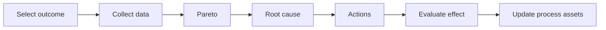

<picture>
  <source media="(prefers-color-scheme: dark)" srcset="../requirements/assets/MultipliersKraftLogoDark.png">
  
</picture>

# TPL-15 — Causal Analysis and Resolution Record

| Attribute | Value |
| :--- | :--- |
| Document ID | TPL-15 |
| Title | Causal Analysis and Resolution Record |
| Product | Nucleus Suite (Nucleus HRMS Suite) |
| Version | 1.0.0 |
| Status | Issued for approval |
| Owner (role) | Engineering Process Group (EPG) Lead |
| Author | Dhanraj Dadhich |
| Reviewed by | *pending* |
| Approved by | EPG Lead — *pending* |
| Date | 2026-11-05 |
| Classification | Internal |
| CMMI practice areas | PAD, CAR, MPM, PCM |
| Related documents | DOC-01, CAR-01, MPM-01, PCM-01, TPL-09, TPL-14, TPL-16 |
| Quality & process-performance objectives | QPPO-01 (minimise defects reaching users), QPPO-02 (remove defects before system test) |
| Process performance baseline used | PPB-03 (defect removal efficiency), PPB-06 (escaped defects per 100 FRs) |
| Peer review record | *pending* (PR-xxxx, QA-02) |
| Tailoring record | none |
| Traceability anchor | BG-09 · MET-08, MET-09 |

---

## 1. Purpose and Use

A causal analysis record (`CAR-nnnn`) is opened under CAR-01 whenever a selection criterion in §3 is met. One record covers one causal theme, which may span several defects. The record closes only after the effect of its actions has been evaluated statistically (§8) and the lessons are filed in the process asset library.

*Guidance: include the people who did the work in the analysis team. Delete guidance lines before use.*

## 2. Identification

| Field | Value |
| :--- | :--- |
| CAR ID | [CAR-nnnn] |
| Title | [Outcome analysed] |
| Opened by, date | [Name, YYYY-MM-DD] |
| Domain and process | [e.g. PAY — requirements development] |
| Facilitator | [Name] |
| Analysis team | [Names, roles] |
| Status | [Open / Analysing / Actions in progress / Evaluating / Closed] |

## 3. Selection Criteria

| ☐ | Criterion | Reference |
| :--- | :--- | :--- |
| ☐ | A Critical or Major defect escaped to UAT or production | [Defect ID] |
| ☐ | A process measure fell outside its PPB control limits (special cause) | [PPB-nn] |
| ☐ | A QPPO is predicted by a PPM, or observed, not to be met | [QPPO-nn, PPM-nn] |
| ☐ | Three or more defects of the same type in one phase increment | [Defect IDs] |
| ☐ | An exceptionally good outcome worth replicating | [Reference] |

## 4. Outcome and Defect Data

| # | Defect or outcome ID | Description | Artefact | Injection phase | Detection phase | Severity | Cost to fix (person-hours) |
| ---: | :--- | :--- | :--- | :--- | :--- | :--- | ---: |
| [n] | [ID] | [Description] | [e.g. RL-281, FRS-PAY-02] | [Phase] | [Phase] | [Critical / Major / Minor] | [n] |

Data period and source: [Defect tracker query or measurement repository extract, date range].

## 5. Pareto Analysis

| Defect category | Count | % | Cumulative % |
| :--- | ---: | ---: | ---: |
| [Category] | [n] | [%] | [%] |

Focus category (the vital few): [Category].

## 6. Root Cause Analysis

**Cause-and-effect (fishbone) categories**

| Branch | Candidate causes |
| :--- | :--- |
| People (skills, training) | [Causes] |
| Process (procedure, template, checklist) | [Causes] |
| Methods and environment (authoring, test and build practices) | [Causes] |
| Inputs (source workbooks, client data, regulation) | [Causes] |
| Conditions (schedule pressure, team distribution) | [Causes] |
| Measurement (wrong or missing measure) | [Causes] |

**Five whys** (focus category)

| Why | Answer |
| ---: | :--- |
| 1 | [Answer] |
| 2 | [Answer] |
| 3 | [Answer] |
| 4 | [Answer] |
| 5 — root cause | [Answer] |

Root cause validated by: [Data evidence, e.g. "8 of 9 escaped defects came from rules without a boundary-value test"].

## 7. Actions

| Action ID | Action | Root cause addressed | Process asset affected | Owner | Due | Expected effect (quantified) |
| :--- | :--- | :--- | :--- | :--- | :--- | :--- |
| [CAR-nnnn-A1] | [Action] | [Cause] | [e.g. REQ-03 item, TPL-13 field] | [Role] | [YYYY-MM-DD] | [e.g. escaped rule defects halved] |

EPG decision on the actions: [Accepted / Modified / Rejected — DEC-nnnn].

## 8. Action Evaluation (before and after)

| Item | Before | After |
| :--- | :--- | :--- |
| Measure | [Measure] | [Measure] |
| Data set and period | [Period] | [Period] |
| Sample size (n) | [n] | [n] |
| Mean or median | [Value] | [Value] |
| Standard deviation | [Value] | [Value] |
| Control limits (UCL / LCL) | [Values] | [Values] |

| Test | Value |
| :--- | :--- |
| Hypothesis | H0: no change in the measure; H1: the measure improved |
| Test used | [Two-sample t-test / Mann–Whitney U / chi-square / test of proportions] |
| Significance level (α) | 0.05 |
| p-value | [Value] |
| Conclusion | [Significant improvement / no significant change / worse] |
| Baseline revised | [Yes — new PPB version / No] |

## 9. Lessons into Process Assets and Closure

| Lesson | Asset updated | New version | Communicated to |
| :--- | :--- | :--- | :--- |
| [Lesson] | [Asset ID] | [Version] | [Teams; OT-01 training] |

| Field | Value |
| :--- | :--- |
| Closure criteria met | [Actions implemented and effect evaluated: Y/N] |
| Closed by, date | [Name, YYYY-MM-DD] |

## Approval & Sign-off

| Role | Name | Date | Decision | Conditions / comments |
| :--- | :--- | :--- | :--- | :--- |
| Author | Dhanraj Dadhich | 2026-11-05 | Submitted | |
| Peer review moderator | *pending* | | | PR-xxxx |
| PQA (process compliance) | *pending* | | | |
| EPG Lead | *pending* | | | |

## Measurement Data Captured

| Measure | Value | Unit | Notes |
| :--- | :--- | :--- | :--- |
| Size | 9 | sections | |
| Authoring effort | *to be recorded* | person-hours | |
| Review effort (preparation + meeting) | *pending review* | person-hours | From PR-xxxx |
| Review rate | *pending review* | sections / hour | Compare with PPB-02 control limits |
| Requirement volatility | 0 | CRs since baseline | |

## Revision History

| Version | Date | Author | Change summary | CR ref | Approved by |
| :--- | :--- | :--- | :--- | :--- | :--- |
| 1.0.0 | 2026-11-05 | Dhanraj Dadhich | Consolidated release | CR-0001 | *pending* |
