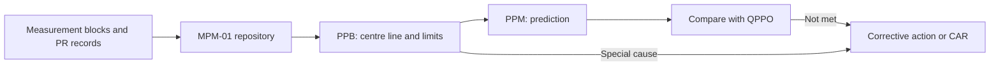

<picture>
  <source media="(prefers-color-scheme: dark)" srcset="../requirements/assets/MultipliersKraftLogoDark.png">
  
</picture>

# TPL-16 — Process Performance Baseline and Model

| Attribute | Value |
| :--- | :--- |
| Document ID | TPL-16 |
| Title | Process Performance Baseline and Model |
| Product | Nucleus Suite (Nucleus HRMS Suite) |
| Version | 1.0.0 |
| Status | Issued for approval |
| Owner (role) | PMO Analyst (Measurement Lead) |
| Author | Dhanraj Dadhich |
| Reviewed by | *pending* |
| Approved by | EPG Lead — *pending* |
| Date | 2026-11-05 |
| Classification | Internal |
| CMMI practice areas | PAD, MPM, PCM, CAR, EST, PLAN |
| Related documents | DOC-01, MPM-01, PLN-03, QA-02, CAR-01, TPL-00, TPL-15 |
| Quality & process-performance objectives | QPPO-01 to QPPO-07 |
| Process performance baseline used | Not applicable — this template declares baselines |
| Peer review record | *pending* (PR-xxxx, QA-02) |
| Tailoring record | none |
| Traceability anchor | BG-09 |

---

## 1. Purpose and Use

Part A declares a process performance baseline (`PPB-nn`) once per baselined measure; Part B documents a process performance model (`PPM-nn`) once per prediction model. A baseline is declared only after the process is shown to be stable (§A5). Data comes from the Measurement Data Captured blocks (TPL-00) and the peer review records (TPL-09) loaded into the MPM-01 measurement repository.

*Guidance: state every formula exactly; a baseline without an operational definition cannot be reused. Delete guidance lines before use.*

## 2. Part A — Process Performance Baseline

### A1. Identification

| Field | Value |
| :--- | :--- |
| PPB ID and version | [PPB-nn, version] |
| Measure | [Measure] |
| Operational definition | [Formula, units, what counts, what is excluded] |
| Process or sub-process | [e.g. requirements peer review, QA-02] |
| Related QPPO | [QPPO-nn] |
| Owner | [Role] |

### A2. Data Set

| Field | Value |
| :--- | :--- |
| Source | [Repository extract and query reference] |
| Period | [YYYY-MM-DD to YYYY-MM-DD] |
| Data points (n) | [n — at least 20 before control limits are trusted] |
| Data quality checks | [Completeness, outliers investigated, measurement errors removed] |

### A3. Stratification

| Subgroup | Rationale | n |
| :--- | :--- | ---: |
| [e.g. statutory domains PAY, CMP, TIM, LVE vs others] | [Different complexity] | [n] |

Subgroups whose distributions differ significantly keep separate baselines (test: [ANOVA / Kruskal–Wallis]).

### A4. Distribution

| Statistic | Value |
| :--- | :--- |
| Distribution shape and test | [Normal / lognormal / Poisson / non-parametric — Anderson–Darling p-value] |
| Mean, median | [Values] |
| Standard deviation | [Value] |
| Minimum, maximum | [Values] |
| 25th and 75th percentiles | [Values] |

### A5. Control Limits and Stability

| Item | Value |
| :--- | :--- |
| Chart type | [XmR / X-bar R / u-chart / p-chart] |
| Centre line | [Value] |
| Upper and lower control limits | [Values] |
| Run rules applied | One point beyond 3σ; two of three beyond 2σ; four of five beyond 1σ; eight in a row on one side |
| Special-cause signals | [None / list with CAR-nnnn] |
| Stable? | [Yes — baseline declared / No — investigate before declaring] |

### A6. Capability against the Objective

| Item | Value |
| :--- | :--- |
| QPPO target or specification limits | [Target] |
| Capability (% of points within specification, or Cpk when normal) | [Value] |
| Capable? | [Yes / No — action through CAR-01 or PCM-01] |

### A7. Use and Revision

How projects use the baseline: [e.g. a review whose density is below the lower limit triggers a re-review for possible under-review; above the upper limit triggers a CAR on the authoring process]. Revision trigger: [process change, two or more special-cause signals in a quarter, or every six months].

## 3. Part B — Process Performance Model

### B1. Identification

| Field | Value |
| :--- | :--- |
| PPM ID | [PPM-nn] |
| Predicted outcome | [Outcome] |
| Related QPPO | [QPPO-nn] |
| Owner | [Role] |

### B2. Factors

| Factor | Type | Controllable? | Source | Range observed |
| :--- | :--- | :--- | :--- | :--- |
| [Factor] | [Continuous / count / ratio] | [Yes / Partly / No] | [PPB-nn, MET-nn] | [Range] |

### B3. Model

| Field | Value |
| :--- | :--- |
| Model type | [Regression (Poisson / negative binomial / linear / logistic) / Monte Carlo simulation / Bayesian network / reliability growth] |
| Equation or structure | [Fitted equation or simulation structure] |
| Fit statistics | [Deviance, pseudo-R², coefficient p-values, residual checks] |
| Uncertainty | [Prediction interval at 90%, or P10 / P50 / P90] |

### B4. Validation

| Item | Value |
| :--- | :--- |
| Hold-out or later data set | [Data] |
| Predicted versus actual | [Comparison] |
| Mean absolute error | [Value] |
| Valid range | [Factor ranges and project types] |

### B5. Use in Planning and Control

| Use | How |
| :--- | :--- |
| Planning | [e.g. at G1, run with planned review coverage; add review effort until P90 meets the QPPO] |
| Mid-course correction | [Re-run monthly with actual factor values; the status report (TPL-12) shows prediction against objective] |
| What-if analysis | [Which controllable factor gives the largest improvement] |

## 4. Worked Example — PPB-01 and PPM-01 Definitions (MPM-01)

| Field | PPB-01 |
| :--- | :--- |
| Process | Requirements and design inspection |
| Measure and definition | Review defect density — (Critical + Major) defects per page, or per 10 requirements |
| Chart | u-chart, because review size varies |
| Stratification | Work-product type; domain group — statutory (PAY, CMP, TIM, LVE) versus other |
| Source | Peer review records (TPL-09) |
| State | Collecting (provisional limits) |
| Related QPPO | QPPO-05 — at least 90% of reviews within limits |

| Field | PPM-01 |
| :--- | :--- |
| Predicted outcome | Escaped defects per 100 FRs for a phase increment (QPPO-01) |
| Controllable factors | Review coverage (% of work products inspected); share of reviews with rate inside PPB-02 limits; automated test coverage of changed code; golden-dataset match rate at G3 (MET-12) |
| Uncontrollable factors | Domain complexity class; team experience; requirements volatility (MET-04) |
| Model type | Poisson or negative-binomial regression on PPB-01, PPB-02, PPB-03 and PPB-06 history; prediction interval reported |
| Use | At G3, predict escapes; if the interval exceeds the QPPO-01 objective, add reviews and tests before G4 |
| State | Designed; fitted once two phase increments of data exist |

## Approval & Sign-off

| Role | Name | Date | Decision | Conditions / comments |
| :--- | :--- | :--- | :--- | :--- |
| Author | Dhanraj Dadhich | 2026-11-05 | Submitted | |
| Peer review moderator | *pending* | | | PR-xxxx |
| PQA (process compliance) | *pending* | | | |
| EPG Lead | *pending* | | | |

## Measurement Data Captured

| Measure | Value | Unit | Notes |
| :--- | :--- | :--- | :--- |
| Size | 4 | sections | Part A 7 subsections; Part B 5 subsections |
| Authoring effort | *to be recorded* | person-hours | |
| Review effort (preparation + meeting) | *pending review* | person-hours | From PR-xxxx |
| Review rate | *pending review* | sections / hour | Compare with PPB-02 control limits |
| Requirement volatility | 0 | CRs since baseline | |

## Revision History

| Version | Date | Author | Change summary | CR ref | Approved by |
| :--- | :--- | :--- | :--- | :--- | :--- |
| 1.0.0 | 2026-11-05 | Dhanraj Dadhich | Consolidated release | CR-0001 | *pending* |
