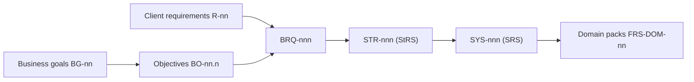

<picture>
  <source media="(prefers-color-scheme: dark)" srcset="../requirements/assets/MultipliersKraftLogoDark.png">
  
</picture>

# TPL-17 — Business Requirements Specification

| Attribute | Value |
| :--- | :--- |
| Document ID | TPL-17 |
| Title | Business Requirements Specification |
| Product | Nucleus Suite (Nucleus HRMS Suite) |
| Version | 1.0.0 |
| Status | Issued for approval |
| Owner (role) | Business Analysis (BA) Lead |
| Author | Dhanraj Dadhich |
| Reviewed by | *pending* |
| Approved by | EPG Lead — *pending* |
| Date | 2026-11-05 |
| Classification | Internal |
| CMMI practice areas | PAD, RDM |
| Related documents | DOC-01, BRS-01, CONOPS-01, GOV-01, GOV-05, BA-01 to BA-06, REQ-01, REQ-02, TPL-18, TPL-19 |
| Quality & process-performance objectives | QPPO-05 (effective requirements reviews), QPPO-01 (minimise defects reaching users) |
| Process performance baseline used | PPB-01 (review defect density), PPB-02 (review rate) |
| Peer review record | *pending* (PR-xxxx, QA-02) |
| Tailoring record | none |
| Traceability anchor | BG-01 to BG-10 · R-01 to R-27 |

---

## 1. Purpose and Use

This template gives the outline of a Business Requirements Specification in the ISO/IEC/IEEE 29148 style. It is the shape of BRS-01 in `03_Business_Requirements/`. The BRS states what the business needs, in the language of the business, and is the first level of the requirements hierarchy of DOC-01 §3. Business requirements are identified `BRQ-nnn` and are refined into stakeholder requirements (TPL-18) and system requirements (TPL-19).

Approval authority for a BRS: Steering Committee (DOC-01 §8), after review by the Product Council and PQA.

*Guidance: write in business terms; no screen, table or technology names. Bracketed text is replaced with real content; a submitted BRS contains no brackets. Delete guidance lines before submission.*

## 2. Outline

| § | Section | Content |
| :--- | :--- | :--- |
| 1 | Introduction | 1.1 Purpose · 1.2 Audience · 1.3 How to read a requirement · 1.4 Treatment of client requirements (`R-nn`) · 1.5 Delivery stage (R0 and DEC-0002) |
| 2 | Business purpose and context | 2.1 Business purpose · 2.2 Business problems addressed, each with its evidence · 2.3 Business context summary |
| 3 | Business scope | 3.1 In scope, by value-chain stage · 3.2 Out of scope, with the reason and owner of each exclusion |
| 4 | Business goals and objectives | Goals BG-01 to BG-10 with objectives BO-nn.n, each measurable with a baseline, target and date (GOV-01) |
| 5 | Business model and operational context | 5.1 Business model · 5.2 Business context diagram (Mermaid) · 5.3 Level 0 value chain HIRE · ONBOARD · WORK · PAY · COMPLY · GROW · EXIT · GOVERN · 5.4 Operating locations, legal entities and states |
| 6 | Business processes | 6.1 Level 1 process domains (the 14 domain codes) and seams · 6.2 Level 1 processes per domain (`<DOM>-nn`) |
| 7 | Business requirements | `BRQ-nnn`, grouped by value-chain stage and domain, in the table of §3 |
| 8 | Business rules summary | Rule families with representative `RL-nnn` and `BS:RL-nn` and the domain pack that holds them |
| 9 | Business policies | Policies the solution must respect, with the policy owner |
| 10 | Business constraints | Statutory, budget, schedule, organisational and data-residency constraints (statutory statements to be validated by Legal) |
| 11 | Assumptions and dependencies | Each with owner and the gate by which it is confirmed (RSK-03) |
| 12 | Business risks | `RSK-R-nnn` with exposure and response |
| 13 | Success measures | Measures with baseline, target and measurement method, linked to BO-nn.n and MET-nn |
| 14 | Traceability | BRQ → BG / BO → R-nn → process; coverage summary |

## 3. Requirement Attributes

| Attribute | Rule |
| :--- | :--- |
| ID | `BRQ-nnn`; never renumbered once baselined |
| Requirement | One statement in business terms, using MUST, SHOULD or MAY |
| Rationale | The business reason or problem addressed |
| Trace | Business goal (BG) · client requirement (R-nn) · process (`<DOM>-nn`) · workflow (`W-nn`) · phase |
| Priority | MoSCoW |
| Verification | I Inspection · A Analysis · D Demonstration · T Test |
| Acceptance criterion | Observable result, citing golden data or a client acceptance test (`T-nn`) |
| Owner | Business owner role (STK-nn) |
| Status | Proposed on entry (REQ-01) |

Requirement table used in §7:

| ID | Requirement | Rationale | Trace (BG · R · process · phase) | Priority | Verif. | Acceptance criterion |
| :--- | :--- | :--- | :--- | :--- | :--- | :--- |
| [BRQ-nnn] | [The business MUST …] | [Reason] | [BG-nn · R-nn · `<DOM>-nn` · Pn] | [MoSCoW] | [I / A / D / T] | [Criterion] |

## 4. Quality Checks for Business Requirements

| # | Check |
| ---: | :--- |
| 1 | Each requirement states a business outcome, not a design |
| 2 | Each requirement traces to at least one business goal and, where one exists, a client requirement |
| 3 | Each client requirement `R-nn` is covered by at least one BRQ |
| 4 | Each acceptance criterion is observable and uses golden data or a `T-nn` test |
| 5 | Statutory obligations are stated generally and marked "to be validated by Legal" |
| 6 | No third-party product is named; open standards and Indian statutes may be named |

## 5. Worked Example — BRQ-032

| ID | Requirement | Rationale | Trace (BG · R · process · phase) | Priority | Verif. | Acceptance criterion |
| :--- | :--- | :--- | :--- | :--- | :--- | :--- |
| BRQ-032 | Leave MUST accrue automatically by grade: AGM and above receive 18 EL, 6 CL and 6 SL on 1 January; other employees receive 6 CL and 6 SL in January and 1.5 EL each month; accrual MUST be idempotent. | Manual credits are slow and error-prone; double credit must be impossible. | BG-01 · R-08 · LVE-01 · P1 | Must | T | T-11 and T-12: annual and monthly credits match; re-running accrual creates no extra credit. |

## Approval & Sign-off

| Role | Name | Date | Decision | Conditions / comments |
| :--- | :--- | :--- | :--- | :--- |
| Author | Dhanraj Dadhich | 2026-11-05 | Submitted | |
| Peer review moderator | *pending* | | | PR-xxxx |
| PQA (process compliance) | *pending* | | | |
| EPG Lead | *pending* | | | |

## Measurement Data Captured

| Measure | Value | Unit | Notes |
| :--- | :--- | :--- | :--- |
| Size | 5 | sections | |
| Authoring effort | *to be recorded* | person-hours | |
| Review effort (preparation + meeting) | *pending review* | person-hours | From PR-xxxx |
| Review rate | *pending review* | sections / hour | Compare with PPB-02 control limits |
| Requirement volatility | 0 | CRs since baseline | |

## Revision History

| Version | Date | Author | Change summary | CR ref | Approved by |
| :--- | :--- | :--- | :--- | :--- | :--- |
| 1.0.0 | 2026-11-05 | Dhanraj Dadhich | Consolidated release | CR-0001 | *pending* |
