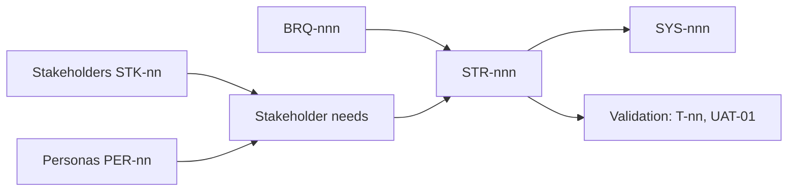

<picture>
  <source media="(prefers-color-scheme: dark)" srcset="../requirements/assets/MultipliersKraftLogoDark.png">
  
</picture>

# TPL-18 — Stakeholder Requirements Specification

| Attribute | Value |
| :--- | :--- |
| Document ID | TPL-18 |
| Title | Stakeholder Requirements Specification |
| Product | Nucleus Suite (Nucleus HRMS Suite) |
| Version | 1.0.0 |
| Status | Issued for approval |
| Owner (role) | Business Analysis (BA) Lead |
| Author | Dhanraj Dadhich |
| Reviewed by | *pending* |
| Approved by | EPG Lead — *pending* |
| Date | 2026-11-05 |
| Classification | Internal |
| CMMI practice areas | PAD, RDM |
| Related documents | DOC-01, STRS-01, BRS-01, GOV-07, GOV-08, BA-04, VV-02, REQ-02, TPL-17, TPL-19 |
| Quality & process-performance objectives | QPPO-05 (effective requirements reviews), QPPO-01 (minimise defects reaching users) |
| Process performance baseline used | PPB-01 (review defect density), PPB-02 (review rate) |
| Peer review record | *pending* (PR-xxxx, QA-02) |
| Tailoring record | none |
| Traceability anchor | BRQ-nnn · STK-01 to STK-37 · PER-01 to PER-16 |

---

## 1. Purpose and Use

This template gives the outline of a Stakeholder Requirements Specification in the ISO/IEC/IEEE 29148 style. It is the shape of STRS-01 in `04_Stakeholder_Requirements/`. The StRS states what each stakeholder class and persona needs from Nucleus Suite in order to meet the business requirements; stakeholder requirements are identified `STR-nnn`, each realising one or more `BRQ-nnn` and refined into `SYS-nnn`.

Approval authority for an StRS: Product Council (DOC-01 §8), after review by a domain expert, an architect, the QA lead and a peer reviewer.

*Guidance: write each requirement from the stakeholder's point of view, naming the persona. Bracketed text is replaced with real content; a submitted StRS contains no brackets. Delete guidance lines before submission.*

## 2. Outline

| § | Section | Content |
| :--- | :--- | :--- |
| 1 | Introduction | 1.1 Purpose · 1.2 Derivation chain from BRS to SRS · 1.3 Conventions · 1.4 Stage note (R0, DEC-0002) |
| 2 | Stakeholder classes | Classes from GOV-07 (`STK-nn`) with interest, influence and representative |
| 3 | User classes and characteristics | Personas from GOV-08 (`PER-nn`) with console (S1–S10), data scope (BA-04), frequency of use, device, language and skills |
| 4 | Stakeholder needs | Needs elicited per class, with source (interview, workshop, client demo point, workbook) |
| 5 | Stakeholder requirements | `STR-nnn` grouped by persona, in the table of §3 |
| 6 | Operational and quality expectations | Availability, response, accuracy and support expectations stated as stakeholders perceive them |
| 7 | Accessibility and language needs | WCAG 2.2 AA, the 11 supported languages, low-literacy and shared-device use |
| 8 | Stakeholder constraints | Constraints imposed by stakeholders: statutory, contractual, organisational, residency |
| 9 | Acceptance and validation approach | How each persona validates: UAT scenarios (UAT-01), client acceptance tests (`T-nn`), pilot measures |
| 10 | Traceability | 10.1 STR → BRQ → goal → client requirement · 10.2 Coverage summary: every BRQ has at least one STR; every persona has requirements |

## 3. Requirement Attributes

| Attribute | Rule |
| :--- | :--- |
| ID | `STR-nnn`; never renumbered once baselined |
| Requirement | One statement naming the persona, using MUST, SHOULD or MAY |
| Need | The stakeholder need or problem behind it |
| Trace | `BRQ-nnn` · business goal · client requirement `R-nn` |
| Priority | MoSCoW |
| Verification | I Inspection · A Analysis · D Demonstration · T Test |
| Acceptance criterion | Observable result the stakeholder accepts, citing golden data or `T-nn` |
| Stakeholder | `STK-nn` and `PER-nn` |
| Status | Proposed on entry (REQ-01) |

Requirement table used in §5:

| ID | Requirement | Need | Trace (BRQ · BG · R) | Priority | Verif. | Acceptance criterion |
| :--- | :--- | :--- | :--- | :--- | :--- | :--- |
| [STR-nnn] | [The persona MUST be able to …] | [Need] | [BRQ-nnn · BG-nn · R-nn] | [MoSCoW] | [I / A / D / T] | [Criterion] |

## 4. Quality Checks for Stakeholder Requirements

| # | Check |
| ---: | :--- |
| 1 | Each requirement names the persona whose need it meets |
| 2 | Each requirement realises at least one BRQ; each BRQ is realised by at least one STR |
| 3 | Each persona in GOV-08 has requirements, including frontline, contract and candidate users |
| 4 | Persona data scopes agree with BA-04; where they differ, BA-04 prevails |
| 5 | Each acceptance criterion can be demonstrated in UAT with golden data |
| 6 | No third-party product is named |

## 5. Worked Example — STR-008

| ID | Requirement | Need | Trace (BRQ · BG · R) | Priority | Verif. | Acceptance criterion |
| :--- | :--- | :--- | :--- | :--- | :--- | :--- |
| STR-008 | The HR Head MUST be able to approve leave at level 3 only after levels 1 and 2, and MAY edit an application with a reason that is logged against the HR Head. | The client's three-level chain and HR override. | BRQ-036 · BG-01 · R-06 | Must | T | T-09 passes; the edit history names the HR Head, not the original approver. |

## Approval & Sign-off

| Role | Name | Date | Decision | Conditions / comments |
| :--- | :--- | :--- | :--- | :--- |
| Author | Dhanraj Dadhich | 2026-11-05 | Submitted | |
| Peer review moderator | *pending* | | | PR-xxxx |
| PQA (process compliance) | *pending* | | | |
| EPG Lead | *pending* | | | |

## Measurement Data Captured

| Measure | Value | Unit | Notes |
| :--- | :--- | :--- | :--- |
| Size | 5 | sections | |
| Authoring effort | *to be recorded* | person-hours | |
| Review effort (preparation + meeting) | *pending review* | person-hours | From PR-xxxx |
| Review rate | *pending review* | sections / hour | Compare with PPB-02 control limits |
| Requirement volatility | 0 | CRs since baseline | |

## Revision History

| Version | Date | Author | Change summary | CR ref | Approved by |
| :--- | :--- | :--- | :--- | :--- | :--- |
| 1.0.0 | 2026-11-05 | Dhanraj Dadhich | Consolidated release | CR-0001 | *pending* |
