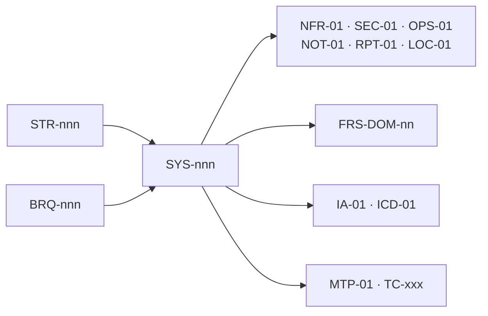

<picture>
  <source media="(prefers-color-scheme: dark)" srcset="../requirements/assets/MultipliersKraftLogoDark.png">
  
</picture>

# TPL-19 — System Requirements Specification

| Attribute | Value |
| :--- | :--- |
| Document ID | TPL-19 |
| Title | System Requirements Specification |
| Product | Nucleus Suite (Nucleus HRMS Suite) |
| Version | 1.0.0 |
| Status | Issued for approval |
| Owner (role) | Chief Architect |
| Author | Dhanraj Dadhich |
| Reviewed by | *pending* |
| Approved by | EPG Lead — *pending* |
| Date | 2026-11-05 |
| Classification | Internal |
| CMMI practice areas | PAD, RDM, TS |
| Related documents | DOC-01, SRS-01, NFR-01, SEC-01, OPS-01, NOT-01, RPT-01, LOC-01, STRS-01, BRS-01, REQ-02, TPL-06, TPL-17, TPL-18 |
| Quality & process-performance objectives | QPPO-05 (effective requirements reviews), QPPO-01 (minimise defects reaching users) |
| Process performance baseline used | PPB-01 (review defect density), PPB-02 (review rate) |
| Peer review record | *pending* (PR-xxxx, QA-02) |
| Tailoring record | none |
| Traceability anchor | BRQ-nnn · STR-nnn · BG-01 to BG-10 |

---

## 1. Purpose and Use

This template gives the outline of a System Requirements Specification in the ISO/IEC/IEEE 29148 style. It is the shape of SRS-01 in `05_System_Requirements/`, which combines the system-level and software-level content of the standard for Nucleus Suite; its companion documents NFR-01, SEC-01, OPS-01, NOT-01, RPT-01 and LOC-01 hold the detailed quality, security, operational, notification, reporting and localisation requirements. System requirements are identified `SYS-nnn`; each realises one or more `STR-nnn` and `BRQ-nnn` and constrains the functional requirements of the domain packs.

Approval authority for a system requirements document: Product Council (DOC-01 §8); architecture, interface and non-functional content is also approved by the Architecture Review Board.

*Guidance: state what the system must do and how well, not how it is built; design choices belong in architecture documents. Bracketed text is replaced with real content; a submitted SRS contains no brackets. Delete guidance lines before submission.*

## 2. Outline

| § | Section | Content |
| :--- | :--- | :--- |
| 1 | Purpose | What the document specifies and for whom |
| 2 | Scope | 2.1 Product · 2.2 What the SRS covers and what companion documents cover · 2.3 Delivery stage (R0, DEC-0002) |
| 3 | Conventions | 3.1 Requirement statement format (§3 below) · 3.2 Terms used |
| 4 | References | Governing standards (ISO/IEC/IEEE 29148, ISO/IEC 25010, WCAG 2.2, OWASP ASVS, OIDC, SCIM 2.0, OpenAPI 3.1, CloudEvents) and programme documents |
| 5 | Product perspective | 5.1 System context (Mermaid) · 5.2 Logical architecture, request and control path · 5.3 Asynchronous path · 5.4 Building blocks · 5.5 Tenancy and scope model · 5.6 Write path |
| 6 | Product functions | Function groups by value-chain stage and domain |
| 7 | User classes and characteristics | Personas and principal types (user, agent, service) |
| 8 | Operating environment | Clients, devices, kiosks, offline capture, hosting in a cloud region in India |
| 9 | Design and implementation constraints | Constraints from regulation, programme decisions (DEC-nnnn) and standards |
| 10 | Assumptions and dependencies | Each with owner and the gate by which it is confirmed |
| 11 | System requirements | `SYS-nnn` grouped by capability: tenancy and residency · identity · authorisation and data scope · effective dating · money and calculation integrity · audit · workflow and approvals · rules, ledgers and locks · events and recompute · configuration and data load · frontline and offline capture · localisation and accessibility · notifications · AI governance and tool surface |
| 12 | External interface requirements | 12.1 User interfaces · 12.2 Hardware interfaces (biometric devices, kiosks) · 12.3 Software interfaces (ERP system, banks, statutory portals, enterprise directory) · 12.4 Communication interfaces |
| 13 | Quality attributes summary | ISO/IEC 25010 characteristics with the NFR-01 targets they cite |
| 14 | Verification approach | Method per requirement group; test levels per MTP-01 |
| 15 | Traceability | SYS → STR → BRQ → BG; SYS → domain requirements → tests; coverage summary |

## 3. Requirement Attributes

| Attribute | Rule |
| :--- | :--- |
| ID | `SYS-nnn`; never renumbered once baselined |
| Requirement | One testable statement using MUST, SHOULD or MAY |
| Rationale | Why the requirement exists |
| Source / trace | Business goal or objective · client requirement `R-nn` · process step · rule `RL-nnn` · shared component `CMP-nn` · test `TC-xxx` · and last the realised `BRQ-nnn` (and `STR-nnn`) |
| Pri | M Must · S Should · C Could |
| Phase | Phase in which the requirement becomes binding (P0–P5) |
| Ver | T Test · D Demonstration · A Analysis · I Inspection |
| Acceptance criterion | The observable result that closes verification, with measurement conditions where quantitative |
| Owner | Accountable role |
| Status | Proposed on entry (REQ-01) |

Requirement table used in §11 and §12:

| ID | Requirement | Rationale | Source / trace | Pri | Phase | Ver | Acceptance criterion |
| :--- | :--- | :--- | :--- | :--- | :--- | :--- | :--- |
| [SYS-nnn] | [The system MUST …] | [Reason] | [BG · R · step · RL · CMP · TC · BRQ] | [M / S / C] | [Pn] | [T / D / A / I] | [Criterion] |

## 4. Quality Checks for System Requirements

| # | Check |
| ---: | :--- |
| 1 | Each requirement is a single, testable statement free of design detail |
| 2 | Each requirement realises at least one BRQ or STR; each STR is realised by at least one SYS |
| 3 | Quantitative requirements state their measurement conditions (load, volume, environment, percentile) |
| 4 | Security, privacy and AI requirements are consistent with SEC-01, GOV-10 and GOV-11 |
| 5 | External systems are named by class (ERP system, enterprise directory, business messaging channel), never by product |
| 6 | Every Must requirement has a verification method and at least one planned test |

## 5. Worked Example — SYS-034

| ID | Requirement | Rationale | Source / trace | Pri | Phase | Ver | Acceptance criterion |
| :--- | :--- | :--- | :--- | :--- | :--- | :--- | :--- |
| SYS-034 | Audit entries and action-ledger rows MUST be append-only and tamper-evident through hash chaining, with chain verification at least daily. | Evidence that cannot be altered unnoticed. | GOV-10 R-AUD-03 · PLT-FX-004 · BRQ-086 | M | P0 | T | Altering a stored row in a test environment is detected by the next verification run. |

## Approval & Sign-off

| Role | Name | Date | Decision | Conditions / comments |
| :--- | :--- | :--- | :--- | :--- |
| Author | Dhanraj Dadhich | 2026-11-05 | Submitted | |
| Peer review moderator | *pending* | | | PR-xxxx |
| PQA (process compliance) | *pending* | | | |
| EPG Lead | *pending* | | | |

## Measurement Data Captured

| Measure | Value | Unit | Notes |
| :--- | :--- | :--- | :--- |
| Size | 5 | sections | |
| Authoring effort | *to be recorded* | person-hours | |
| Review effort (preparation + meeting) | *pending review* | person-hours | From PR-xxxx |
| Review rate | *pending review* | sections / hour | Compare with PPB-02 control limits |
| Requirement volatility | 0 | CRs since baseline | |

## Revision History

| Version | Date | Author | Change summary | CR ref | Approved by |
| :--- | :--- | :--- | :--- | :--- | :--- |
| 1.0.0 | 2026-11-05 | Dhanraj Dadhich | Consolidated release | CR-0001 | *pending* |
